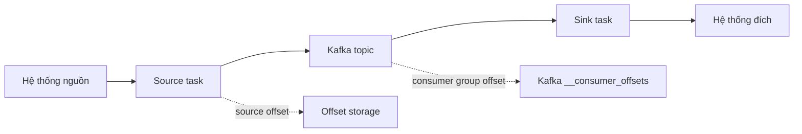
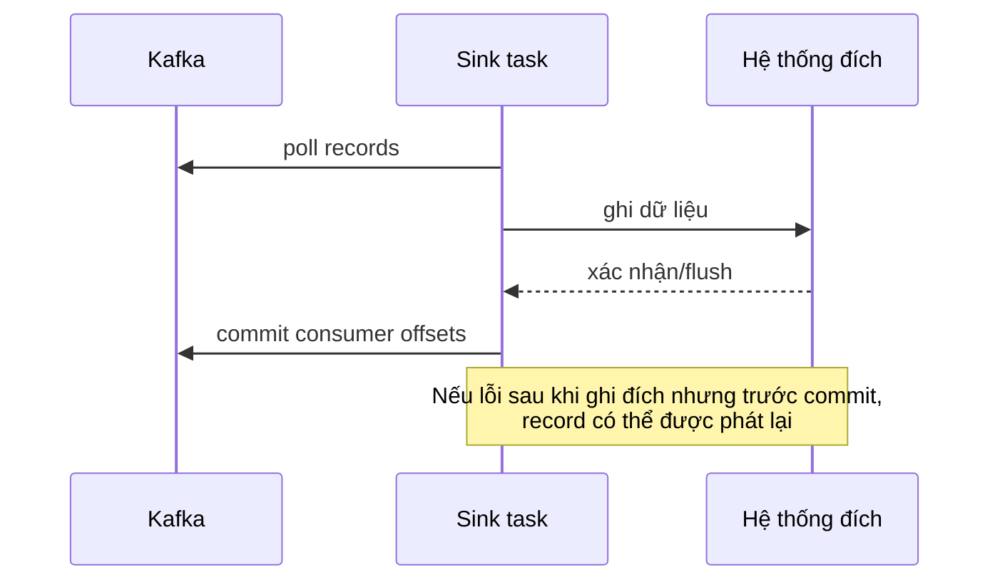

# Offset, khả năng phục hồi và bảo đảm xử lý phụ thuộc connector

Kafka Connect đưa dữ liệu giữa Kafka và các hệ thống bên ngoài thông qua connector và task. Khi worker hoặc task dừng, Connect cần biết phải tiếp tục đọc từ đâu ở nguồn hoặc tiếp tục tiêu thụ từ đâu trong Kafka. Thông tin vị trí đó được gọi là **offset**. Cách lưu, commit và khôi phục offset quyết định liệu dữ liệu có thể bị đọc lại, bị bỏ sót hay được xử lý đúng một lần trong một phạm vi nhất định.

Không có một cơ chế offset duy nhất áp dụng giống nhau cho mọi connector. Source connector lấy dữ liệu từ hệ thống bên ngoài và ghi vào Kafka; sink connector đọc dữ liệu từ Kafka và ghi sang hệ thống đích. Hai hướng này sử dụng hai loại offset khác nhau, và bảo đảm xử lý còn phụ thuộc cách connector tương tác với nguồn/đích, khả năng giao dịch và tính idempotent của hệ thống liên quan.

## 1. Connector, task và vị trí cần ghi nhớ

Kafka Connect có các thành phần chính:

- **Worker** là tiến trình chạy runtime Kafka Connect, quản lý connector, task, chuyển đổi dữ liệu và giao tiếp với Kafka.
- **Connector** là plugin định nghĩa cách kết nối đến một hệ thống, chia công việc thành task và cung cấp cấu hình.
- **Task** thực hiện công việc đọc từ nguồn (source task) hoặc ghi vào đích (sink task).
- **Offset** là thông tin vị trí mà connector/runtime dùng để tiếp tục sau khi task dừng hoặc được chuyển sang worker khác.

Một connector có thể tạo nhiều task để xử lý song song. `tasks.max` đặt giới hạn số task tối đa mà connector có thể sử dụng; số task thực tế còn tùy connector và khả năng chia nguồn/đích. Tăng số task không tự động tăng song song nếu hệ thống nguồn không thể chia thành nhiều partition hoặc hệ thống đích không chịu được tải.



Hình trên nhấn mạnh hai đường đi độc lập: source task ghi vị trí đọc ở hệ thống nguồn vào offset storage của Connect; sink task dùng consumer group offset để nhớ vị trí đã tiêu thụ trong Kafka.

## 2. Phân biệt source offset và sink offset

Đây là điểm quan trọng nhất khi vận hành Kafka Connect.

| Thuộc tính | Source connector | Sink connector |
| --- | --- | --- |
| Hướng dữ liệu | Hệ thống ngoài → Kafka | Kafka → hệ thống ngoài |
| Offset biểu thị | Vị trí đã đọc ở nguồn ngoài | Vị trí consumer đã xử lý trong Kafka topic-partition |
| Ai định nghĩa ý nghĩa? | Connector định nghĩa source partition và source offset | Kafka consumer quản lý offset theo topic-partition và consumer group |
| Nơi lưu trong distributed mode | Kafka Connect `offset.storage.topic` | Kafka internal topic `__consumer_offsets` qua consumer group |
| Khi khôi phục | Source task tiếp tục từ source offset đã lưu | Sink task tiếp tục từ committed consumer offset |
| Rủi ro phổ biến | Đọc lại dữ liệu nếu record đã ghi vào Kafka nhưng source offset chưa được lưu | Ghi lại dữ liệu vào hệ thống đích nếu đã ghi thành công nhưng Kafka offset chưa commit |

**Source partition** không phải Kafka partition. Đây là định danh do connector tạo để chia không gian dữ liệu nguồn. Ví dụ connector CDC có thể dùng database/server và partition log; connector đọc file có thể dùng đường dẫn file; connector đọc bảng có thể dùng tên bảng hoặc khóa phân vùng.

**Source offset** cũng không phải Kafka offset. Nó là vị trí trong nguồn như LSN/binlog position, sequence ID, timestamp kết hợp khóa tăng dần hoặc vị trí byte trong file. Connector phải hiểu cách diễn giải và sử dụng lại giá trị này để tiếp tục đọc đúng vị trí.

Sink offset lại là offset Kafka của một topic-partition. Ví dụ `orders-2 @ 105` có nghĩa sink consumer group đã commit vị trí tiếp theo tương ứng với offset 105 của partition 2 theo quy ước commit của Kafka.

## 3. Source connector lưu offset như thế nào?

Source connector đọc dữ liệu từ một hệ thống khác. Khi tạo `SourceRecord`, connector cung cấp hai map:

- `sourcePartition`: định danh phần nguồn mà record thuộc về.
- `sourceOffset`: vị trí của record trong phần nguồn đó.

Kafka Connect dùng cặp thông tin này để lưu tiến độ. Connector không nên tự ý dùng Kafka offset làm source offset, vì hai hệ thống có thể có cách đánh số và thứ tự hoàn toàn khác nhau.

Ví dụ minh họa một connector đọc thay đổi từ database:

```java
Map<String, Object> sourcePartition = Map.of(
    "server", "orders-db",
    "table", "orders"
);

Map<String, Object> sourceOffset = Map.of(
    "lsn", "0/16B6C50"
);

SourceRecord record = new SourceRecord(
    sourcePartition,
    sourceOffset,
    "orders.events",
    Schema.STRING_SCHEMA,
    "ORD-1001",
    Schema.STRING_SCHEMA,
    "{\"eventType\":\"OrderPaid\",\"orderId\":\"ORD-1001\"}"
);
```

Đây là ví dụ rút gọn để minh họa hợp đồng API; connector CDC thực tế cần dùng schema và kiểu dữ liệu đúng với plugin, đồng thời xác định chính xác vị trí log mà record đại diện.

Connect runtime ghi record vào Kafka và quản lý source offset theo cơ chế của worker. Connector phải đảm bảo source offset mô tả một vị trí có thể khôi phục: khi task được khởi tạo lại với offset đã lưu, nó phải tiếp tục sau dữ liệu đã được xử lý theo đúng semantics mà connector công bố.

### Offset của nguồn cần ổn định

Một source offset tốt cần:

1. Xác định được vị trí duy nhất hoặc đủ rõ trong một source partition.
2. Có thể được lưu và đọc lại qua thời gian.
3. Cho phép connector tiếp tục từ vị trí đó sau restart.
4. Có quy tắc rõ ràng khi nguồn xóa/rotate log hoặc thay đổi schema.
5. Không tiến lên trước dữ liệu mà connector chưa bảo đảm đã được ghi thành công vào Kafka.

Ví dụ, CDC connector có thể lưu LSN/binlog position. Nếu database đã purge đoạn log mà connector cần để khôi phục, task có thể không tiếp tục được từ offset cũ; connector có thể yêu cầu snapshot/rebootstrap hoặc thao tác khôi phục theo tài liệu plugin. Với connector đọc file, nếu file bị thay thế hoặc truncate, offset byte cũ có thể không còn chỉ đúng dữ liệu ban đầu.

## 4. Offset storage của Kafka Connect

### Distributed mode

Trong distributed mode, nhiều worker cùng tham gia một Connect cluster. Các worker dùng một số internal topic để lưu trạng thái:

| Topic | Vai trò |
| --- | --- |
| `config.storage.topic` | Lưu cấu hình connector và task. |
| `offset.storage.topic` | Lưu source offsets của connector. |
| `status.storage.topic` | Lưu trạng thái connector và task. |

`offset.storage.topic` thường được cấu hình với log compaction để giữ giá trị offset mới nhất cho từng khóa source partition/connector. Topic này phải tồn tại ổn định và được bảo vệ như dữ liệu vận hành quan trọng: nếu mất source offsets, source connector có thể đọc lại từ vị trí mặc định hoặc yêu cầu khôi phục thủ công.

Ví dụ cấu hình worker distributed:

```properties
bootstrap.servers=kafka-1:9092,kafka-2:9092,kafka-3:9092
group.id=connect-prod

config.storage.topic=connect-configs
offset.storage.topic=connect-offsets
status.storage.topic=connect-status

config.storage.replication.factor=3
offset.storage.replication.factor=3
status.storage.replication.factor=3

offset.flush.interval.ms=10000
offset.flush.timeout.ms=5000
```

Các worker trong cùng Connect cluster phải dùng cùng `group.id` và cùng bộ internal topic. Plugin connector và phiên bản phụ thuộc cũng cần đồng nhất giữa các worker có thể nhận task. Với cluster production, nên tạo trước internal topic với replication factor, số partition và cleanup policy phù hợp theo yêu cầu của phiên bản Kafka Connect. Cả ba internal topic đều cần log compaction; topic cấu hình phải có đúng một partition, còn offset và status topic có nhiều partition. Giữ nguyên số partition của offset topic sau khi Connect bắt đầu sử dụng, vì thay đổi số partition có thể làm việc tra cứu khóa offset cũ không còn đúng.

Không xóa hoặc đổi tên internal topic khi Connect cluster đang chạy. Việc mất config topic, offset topic hoặc status topic có thể khiến cluster không khôi phục được trạng thái connector như dự kiến.

### Standalone mode

Standalone mode chạy connector trong một worker đơn. Source offsets có thể được lưu vào file cục bộ bằng `offset.storage.file.filename`:

```properties
bootstrap.servers=localhost:9092
plugin.path=/opt/kafka/plugins
offset.storage.file.filename=/var/lib/kafka-connect/offsets.dat
offset.flush.interval.ms=10000
```

Nếu file offset nằm trên ổ đĩa cục bộ của máy bị mất, source connector có thể không còn vị trí để tiếp tục. Cần đưa file vào chiến lược backup/restore phù hợp và hiểu rằng standalone không có cơ chế tự chuyển task sang worker khác như distributed mode.

## 5. Khi nào source offset được flush?

Source task tạo record và runtime gửi record đến Kafka. Connect định kỳ flush source offsets theo `offset.flush.interval.ms`; thời gian chờ cho lần flush được điều khiển bởi `offset.flush.timeout.ms`. Các giá trị này ảnh hưởng đến cửa sổ có thể đọc lại sau sự cố. Đây là cơ chế flush source offsets; sink connector dùng consumer group offset và quy trình commit của sink task.

Ví dụ cấu hình `offset.flush.interval.ms=10000` có nghĩa worker cố gắng flush source offsets theo chu kỳ 10 giây. Nếu worker hoặc task dừng sau khi record đã được ghi vào Kafka nhưng trước khi offset tương ứng được lưu bền vững, khi khởi động lại connector có thể đọc lại một phần dữ liệu đã gửi.

Đây là nguyên nhân phổ biến khiến source connector có semantics **at-least-once**: dữ liệu không bị bỏ qua do offset tiến quá sớm, nhưng một số record có thể xuất hiện nhiều lần.

Không nên giảm flush interval một cách máy móc. Flush thường xuyên hơn có thể thu nhỏ cửa sổ replay, nhưng tăng số lần ghi metadata và tải lên Kafka. Hãy chọn dựa trên khả năng chịu duplicate, throughput nguồn, tải internal topic và thời gian khôi phục.

## 6. Sink connector lưu tiến độ ở đâu?

Sink connector dùng Kafka consumer để đọc topic. Mỗi task nhận các record của một tập topic-partition, chuyển đổi rồi ghi đến hệ thống đích. Tiến độ tiêu thụ được quản lý bằng consumer group offset trong Kafka, không phải source offset trong `offset.storage.topic`.

Trong quá trình commit, Connect phối hợp flush dữ liệu sink và commit offset consumer. Sink task có thể cung cấp offset đã xử lý an toàn thông qua `preCommit`; framework dùng thông tin này cùng cơ chế consumer để quản lý commit.

Một chuỗi xử lý điển hình:

1. Sink task poll record từ Kafka.
2. Connector chuyển đổi record và ghi sang database, object store hoặc hệ thống đích.
3. Task flush dữ liệu đích để đảm bảo các ghi đã được chấp nhận theo semantics của connector.
4. Connect commit consumer offsets tương ứng.
5. Khi task restart, consumer group tiếp tục từ offset đã commit.

Nếu hệ thống đích đã ghi thành công nhưng worker dừng trước khi Kafka offset được commit, record có thể được gửi lại. Nếu sink ghi dữ liệu theo thao tác append không idempotent, lần gửi lại có thể tạo dòng trùng. Nếu connector dùng upsert theo khóa ổn định hoặc hệ thống đích có idempotency key, lần xử lý lại có thể không làm thay đổi kết quả cuối.



### Vì sao sink offset không đảm bảo hệ thống đích chỉ ghi một lần?

Kafka consumer offset chỉ mô tả tiến độ đọc trong Kafka. Nó không tự động tham gia transaction của database, REST API hoặc object storage. Nếu hai hệ thống không có một giao thức giao dịch chung, không thể mặc định một lần ghi đích và một lần commit Kafka luôn xảy ra như một thao tác nguyên tử.

Do đó, sink connector cần có chiến lược cụ thể:

- Upsert theo primary key hoặc khóa nghiệp vụ.
- Dùng idempotency key để nhận diện thao tác đã xử lý.
- Dùng transaction của hệ thống đích nếu connector hỗ trợ.
- Lưu dấu vết xử lý cùng dữ liệu đích trong một transaction cục bộ.
- Thiết kế consumer downstream chấp nhận xử lý lại.

## 7. Khả năng phục hồi khi worker hoặc task gặp sự cố

### Worker trong distributed mode bị dừng

Các worker trong một Connect cluster tham gia cùng group. Khi một worker rời group, các connector/task được phân phối lại cho những worker còn hoạt động theo thuật toán của Connect.

Quá trình thường gồm:

1. Worker lỗi hoặc mất heartbeat.
2. Connect group phát hiện thành viên rời khỏi cluster.
3. Cluster thực hiện rebalance và tính toán lại assignment.
4. Task được dừng ở worker cũ và khởi chạy ở worker mới.
5. Source task đọc source offset đã lưu; sink task đọc committed offset của consumer group.
6. Task tiếp tục xử lý, có thể replay một phần dữ liệu tùy thời điểm flush/commit.

Worker mới cần có plugin tương thích, quyền truy cập hệ thống nguồn/đích, network, credentials và cấu hình giống worker cũ. Nếu chỉ một worker có connector plugin, task có thể không khởi động được sau khi assignment chuyển sang worker khác.

### Một task bị lỗi

Một connector có thể có nhiều task. Khi một task lỗi, Connect có thể restart task theo chính sách và giới hạn retry của worker/connector. Các task khác có thể tiếp tục chạy nếu không phụ thuộc task lỗi.

Với source connector, task restart từ source offsets đã được lưu. Với sink connector, task restart và consumer group tiếp tục từ offset đã commit. Dữ liệu đang nằm trong bộ nhớ task hoặc chưa commit có thể bị xử lý lại.

### Rebalance và thay đổi số worker

Thêm hoặc bớt worker có thể kích hoạt rebalance. Trong khoảng chuyển giao, task có thể bị pause, stop và start trên worker khác. Một số connector cần thời gian đóng kết nối, flush buffer hoặc giải phóng lease trên hệ thống ngoài. Connector implementation phải xử lý lifecycle `start()`, `stop()` và khôi phục state an toàn.

Không nên liên tục thêm/bớt worker trong lúc hệ thống đang bất ổn. Rebalance lặp lại có thể làm task khởi động lại nhiều lần và tăng replay hoặc áp lực lên nguồn/đích.

## 8. Delivery semantics: at-least-once, at-most-once và exactly-once

Delivery semantics cần được xét riêng cho source và sink.

| Semantics | Ý nghĩa | Rủi ro |
| --- | --- | --- |
| At-most-once | Mỗi record được chuyển tối đa một lần; có thể mất dữ liệu khi lỗi. | Có thể bỏ qua dữ liệu chưa được ghi bền vững. |
| At-least-once | Không bỏ qua dữ liệu theo quy trình commit, nhưng có thể gửi lại. | Có duplicate khi phục hồi sau lỗi. |
| Exactly-once | Một record chỉ có hiệu lực một lần trong phạm vi bảo đảm đã định nghĩa. | Cần hỗ trợ từ framework, connector, Kafka và/hoặc hệ thống đích. |

### Source: at-least-once là hành vi phổ biến

Trong cấu hình thông thường, Connect ghi source records vào Kafka và flush source offsets riêng theo cơ chế worker. Nếu crash ở khoảng giữa hai thao tác, record có thể được ghi lại khi source task đọc lại từ offset cũ. Đây là at-least-once.

Để source exactly-once, Kafka Connect có hỗ trợ transaction cho source connector trong các phiên bản triển khai KIP-618. Cần bật cấu hình worker `exactly.once.source.support=enabled` ở distributed mode trên các worker trong cluster và connector phải khai báo/hỗ trợ cơ chế exactly-once theo yêu cầu của phiên bản đó. Khi được hỗ trợ, source records và source offsets có thể được ghi trong Kafka transaction; consumer dùng `isolation.level=read_committed` chỉ đọc dữ liệu đã commit.

Exactly-once source chỉ bảo đảm trong phạm vi Kafka Connect ghi dữ liệu và offset vào Kafka. Nó không tự biến thao tác đọc nguồn thành một transaction phân tán với database hoặc hệ thống ngoài. Connector vẫn phải có semantics đọc nguồn phù hợp và phục hồi được từ source offset.

### Sink: exactly-once phụ thuộc connector và hệ thống đích

Kafka Connect không thể tự đảm bảo một lần ghi duy nhất cho mọi hệ thống đích. Một sink connector có thể đạt kết quả idempotent bằng upsert, khóa duy nhất, transaction của database hoặc cơ chế deduplication. Một số connector có hỗ trợ transaction/Exactly-once riêng, nhưng phải xác minh theo tài liệu và phiên bản cụ thể.

Ví dụ, sink ghi đơn hàng bằng `INSERT` thuần có thể tạo duplicate khi record được replay. Nếu dùng `UPSERT` theo `order_id`, lần replay có thể cập nhật cùng một hàng và tạo kết quả cuối idempotent. Tuy nhiên, nếu thao tác còn gửi email hoặc gọi API thanh toán, side effect đó cần idempotency riêng.

## 9. Retry, lỗi record và Dead Letter Queue

Không phải mọi lỗi đều nên làm task dừng ngay. Cần phân biệt:

- Lỗi tạm thời: timeout mạng, rate limit, database failover, broker unavailable.
- Lỗi dữ liệu: schema sai, field bắt buộc thiếu, kiểu dữ liệu không hợp lệ.
- Lỗi cấu hình/triển khai: credentials sai, connector plugin thiếu, topic không tồn tại hoặc quyền ACL không đủ.

Retry hữu ích cho lỗi tạm thời. Retry vô hạn với lỗi dữ liệu cố định có thể khiến task liên tục thất bại và chặn các record phía sau. Kafka Connect hỗ trợ cấu hình error handling cho một số lỗi trong quá trình xử lý record. Với sink pipeline, các lỗi record đủ điều kiện có thể được bỏ qua hoặc chuyển vào Dead Letter Queue (DLQ). Ví dụ:

```properties
errors.retry.timeout=60000
errors.retry.delay.max.ms=10000
errors.tolerance=all
errors.deadletterqueue.topic.name=connect-errors
errors.deadletterqueue.context.headers.enable=true
```

Các cấu hình trên là ví dụ cần điều chỉnh theo worker/connector và phiên bản. DLQ không phải nơi tự động chuyển mọi lỗi của hệ thống ngoài, và thường được dùng cho lỗi record trong sink pipeline. Một lỗi ghi database có thể được connector xử lý theo retry policy riêng; lỗi source connector, lỗi task/fatal hoặc lỗi không thể gắn với một record sink sẽ vẫn làm task thất bại hoặc được xử lý theo cơ chế riêng của plugin.

Khi dùng `errors.tolerance=all`, một số lỗi record đủ điều kiện có thể bị bỏ qua hoặc chuyển DLQ. Điều này giúp pipeline tiếp tục nhưng có nguy cơ dữ liệu không đến hệ thống đích. Cần giám sát DLQ, đặt cảnh báo, xác định người xử lý và có quy trình replay record sau khi sửa dữ liệu.

## 10. Thay đổi hoặc reset offset có kiểm soát

Reset offset có thể hữu ích khi cần replay dữ liệu, sửa source position hoặc chuyển connector sang một điểm bắt đầu mới. Nhưng reset sai có thể tạo duplicate lớn hoặc bỏ qua dữ liệu.

Trước khi reset:

1. Dừng connector theo cách được hỗ trợ để tránh task tiếp tục ghi offset trong lúc thay đổi.
2. Sao lưu source offsets hoặc consumer group offsets liên quan.
3. Xác định chính xác muốn replay từ đâu và phạm vi dữ liệu sẽ bị đọc lại.
4. Kiểm tra connector có hỗ trợ thay đổi offset và ý nghĩa của offset mới.
5. Xác nhận hệ thống đích chịu được replay hoặc có deduplication.
6. Sau khi thay đổi, theo dõi task state, record rate, lag và kết quả đầu ra.

Với sink connector, offset Kafka thuộc consumer group. Có thể dùng công cụ consumer group để xem trạng thái:

```bash
kafka-consumer-groups.sh \
  --bootstrap-server localhost:9092 \
  --describe \
  --group connect-orders-sink
```

Lệnh trên chỉ áp dụng khi biết đúng group ID mà sink connector sử dụng. Không dùng lệnh consumer group để reset source offsets của source connector, vì source offsets được lưu trong Connect offset storage và có định dạng do connector định nghĩa.

Các phiên bản Kafka Connect hỗ trợ connector offsets REST API có thể cung cấp thao tác đọc, sửa hoặc xóa offset của connector. Endpoint và điều kiện sử dụng phụ thuộc phiên bản; thường cần dừng connector trước khi thay đổi offset. Hãy kiểm tra API docs đúng phiên bản và tài liệu connector trước khi thực hiện. Không chỉnh sửa trực tiếp record trong internal offset topic bằng cách thao tác byte hoặc producer tùy ý.

## 11. Cấu hình và ví dụ vận hành

Một distributed worker cluster có thể sử dụng cấu hình minh họa:

```properties
bootstrap.servers=kafka-1:9092,kafka-2:9092,kafka-3:9092
group.id=connect-prod

config.storage.topic=connect-configs
offset.storage.topic=connect-offsets
status.storage.topic=connect-status

config.storage.replication.factor=3
offset.storage.replication.factor=3
status.storage.replication.factor=3

offset.flush.interval.ms=10000
offset.flush.timeout.ms=5000

plugin.path=/opt/kafka/plugins
```

Worker cần dùng cùng cấu hình cluster và cùng plugin tương thích. Các internal topic phải có replication và compaction phù hợp. Với production, không nên đặt replication factor của internal topic thấp hơn yêu cầu chịu lỗi của cluster.

Source connector config là cấu hình riêng của plugin, ví dụ:

```json
{
  "name": "orders-source",
  "config": {
    "connector.class": "com.example.connect.OrdersSourceConnector",
    "tasks.max": "4",
    "topic.prefix": "orders",
    "database.hostname": "orders-db",
    "database.port": "5432",
    "database.user": "connect_reader",
    "database.password": "${file:/opt/kafka/secrets.properties:orders.password}"
  }
}
```

Đây là JSON minh họa cho một connector giả định, không phải cấu hình có thể chạy trực tiếp. Tên thuộc tính kết nối, cách lưu credentials, cách tạo task và source offset phụ thuộc plugin thực tế. Không đưa mật khẩu thật vào file cấu hình hoặc Git; dùng secret provider hoặc cơ chế quản lý bí mật phù hợp môi trường.

Sink connector cũng có cấu hình riêng. Ví dụ giả định sink ghi vào database:

```json
{
  "name": "orders-sink",
  "config": {
    "connector.class": "com.example.connect.OrdersSinkConnector",
    "tasks.max": "4",
    "topics": "orders.events",
    "connection.url": "jdbc:postgresql://orders-db:5432/warehouse",
    "insert.mode": "upsert",
    "pk.mode": "record_key",
    "pk.fields": "order_id"
  }
}
```

Các thuộc tính `insert.mode`, `pk.mode` và `pk.fields` là ví dụ thường gặp ở một số JDBC sink plugin; connector khác có thể dùng tên và semantics khác. Hãy xác minh plugin có hỗ trợ upsert và khóa primary key đúng với schema thực tế.

## 12. Giám sát offset và khả năng phục hồi

Để biết Connect đang tiến triển hay bị kẹt, nên theo dõi cả trạng thái task, throughput, lag và lỗi.

| Nhóm theo dõi | Ví dụ chỉ số/thông tin | Ý nghĩa |
| --- | --- | --- |
| Connector/task state | RUNNING, PAUSED, FAILED, task assignment | Phát hiện task dừng hoặc liên tục restart. |
| Source throughput | Số record poll và write theo thời gian | Source đọc được nhưng không ghi được hay đang chậm ở nguồn. |
| Source offset | Source partition/offset và thời điểm flush | Xác định connector có tiến triển và khả năng replay. |
| Sink throughput | Record đọc, gửi và lỗi ghi | Phân biệt Kafka đọc nhanh với hệ thống đích ghi chậm. |
| Sink consumer lag | Lag theo topic-partition của sink group | Xác định backlog đang tăng hay giảm. |
| Worker health | JVM, CPU, heap, GC, network, thread | Phát hiện worker quá tải. |
| Internal topics | ISR, under-replicated partitions, produce/fetch errors | Đảm bảo Connect có thể lưu cấu hình và offset bền vững. |
| DLQ | Số record vào DLQ và tuổi record | Phát hiện lỗi dữ liệu đang bị tách khỏi luồng chính. |

Có thể xem trạng thái connector qua REST API:

```bash
curl http://connect-worker:8083/connectors/orders-source/status
curl http://connect-worker:8083/connectors/orders-sink/status
```

Trong distributed mode, REST request đến worker có thể được chuyển tiếp đến worker đang giữ connector/task tương ứng. Kết quả status giúp xác định connector và từng task đang RUNNING hay FAILED; nó không thay thế việc kiểm tra offset và đầu ra thực tế.

Khi điều tra một connector không tiến triển:

1. Xác định connector hay task nào bị lỗi.
2. Đọc worker log theo connector name và task ID.
3. Kiểm tra source offset hoặc sink consumer group offset phù hợp.
4. Kiểm tra throughput ở nguồn, Kafka và đích.
5. Xác minh network, credentials, ACL và quota.
6. Kiểm tra internal topics và tình trạng ISR.
7. Khôi phục task, rồi xác minh dữ liệu không bị bỏ qua và duplicate nằm trong mức có thể xử lý.

## 13. Bài thực hành: kiểm tra replay sau khi worker restart

Thực hiện trên môi trường lab có một Connect distributed cluster, một source connector thử nghiệm và một sink connector ghi vào hệ thống đích có thể truy vấn.

### Phần A: quan sát source offset

1. Tạo source connector đọc một tập dữ liệu có ID tăng dần hoặc vị trí nguồn có thể quan sát.
2. Gửi dữ liệu mới và xác nhận record xuất hiện trong Kafka topic.
3. Quan sát source offsets của connector bằng REST API nếu phiên bản hỗ trợ; nếu không, dùng công cụ/connector API phù hợp.
4. Ghi nhận vị trí offset đã lưu và thời điểm flush.
5. Dừng worker đang chạy source task trong môi trường lab, để Connect phân phối lại task.
6. Quan sát task khởi động lại và kiểm tra xem có record nào bị replay.

### Phần B: quan sát sink consumer offset

1. Tạo sink connector đọc topic thử nghiệm và ghi record vào bảng đích.
2. Ghi nhận consumer group offset và số hàng trong bảng.
3. Dừng worker sau khi một số record đã được ghi nhưng trước lần commit tiếp theo nếu có thể tái hiện an toàn.
4. Khởi động lại worker và quan sát sink task tiếp tục từ committed offset.
5. Kiểm tra xem có hàng trùng hay không; thử cấu hình upsert/deduplication nếu connector hỗ trợ.
6. So sánh kết quả với cách ghi append không idempotent.

### Phần C: ghi nhận kết quả

| Tình huống | Source connector | Sink connector |
| --- | --- | --- |
| Restart sau khi dữ liệu đã được ghi nhưng offset chưa lưu/commit | Có thể replay source record | Có thể ghi lại record vào đích |
| Restart sau khi offset đã lưu/commit | Tiếp tục từ source offset đã lưu | Tiếp tục từ Kafka committed offset |
| Hệ thống nguồn/đích không truy cập được | Source task có thể retry hoặc fail theo connector | Sink task có thể retry hoặc fail theo connector |
| Offset nguồn không còn hợp lệ | Có thể cần snapshot/rebootstrap theo plugin | Không áp dụng trực tiếp; kiểm tra Kafka retention và group offset |
| Đích hỗ trợ upsert/deduplication | Không áp dụng trực tiếp cho source | Có thể làm lần replay không tạo kết quả trùng |

Điền số liệu và log thực tế từ lab. Không kết luận exactly-once chỉ vì số hàng cuối cùng không trùng; cần xác định cơ chế transaction/idempotence và phạm vi bảo đảm của connector.

## 14. Những điểm cần nhớ

- Source offset mô tả vị trí trong hệ thống ngoài và do connector định nghĩa; sink offset là Kafka consumer group offset theo topic-partition.
- Distributed Connect lưu source offsets trong `offset.storage.topic`; sink consumer offsets nằm trong Kafka `__consumer_offsets`.
- Source offset flush có thể tạo cửa sổ replay nếu worker dừng sau khi record đã được ghi nhưng trước khi offset được lưu.
- Sink có thể ghi lại record nếu hệ thống đích đã nhận dữ liệu nhưng consumer offset chưa commit.
- Distributed mode có thể chuyển task sang worker khác; worker mới cần plugin, cấu hình, quyền và kết nối tương thích.
- At-least-once là semantics phổ biến; source exactly-once cần hỗ trợ transaction của Connect và connector, còn sink exactly-once phụ thuộc connector/hệ thống đích.
- Idempotent upsert, transaction và deduplication giúp xử lý replay an toàn hơn.
- Retry và DLQ phải được cấu hình theo loại lỗi; DLQ không tự xử lý mọi lỗi connector hoặc lỗi hệ thống đích.
- Reset offset có thể gây replay hoặc bỏ qua dữ liệu; cần backup, dừng connector và xác minh semantics trước khi thay đổi.

Kafka Connect chỉ có thể phục hồi đúng khi offset phản ánh chính xác tiến độ mà connector đã xử lý và hệ thống nguồn/đích có cách tiếp tục phù hợp. Người vận hành cần hiểu offset nào đang được dùng, offset được lưu ở đâu và điều gì xảy ra nếu task lỗi giữa hai bước ghi dữ liệu và commit. Từ đó mới có thể chọn retry, idempotency, transaction hoặc replay để đạt mức bảo đảm phù hợp với từng connector.

