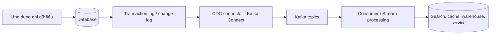
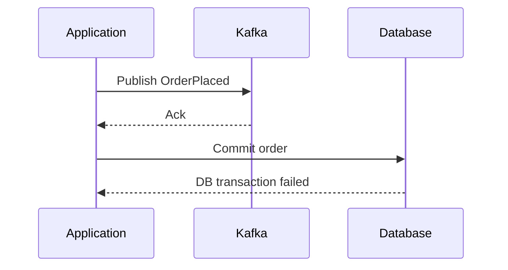
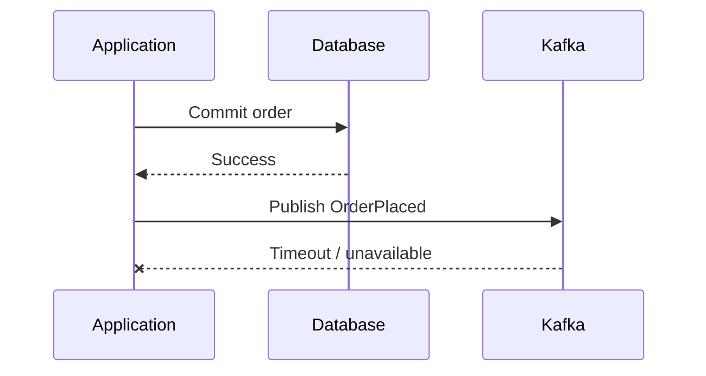
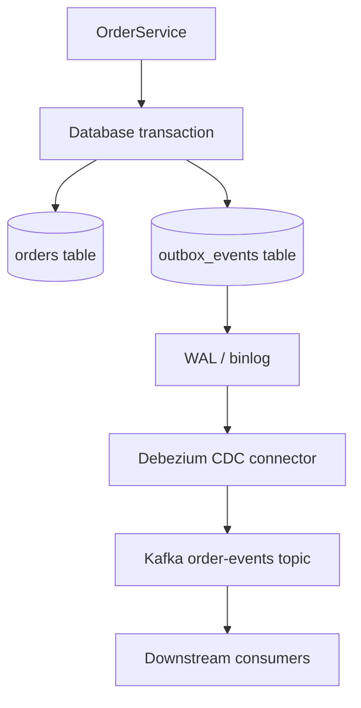
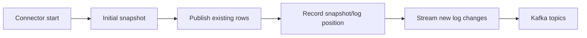

# Change Data Capture và khác biệt với phát sự kiện từ ứng dụng

## Hai cách đưa thay đổi dữ liệu vào Kafka

Một hệ thống có thể đưa thông tin thay đổi từ database vào Kafka theo hai hướng chính:

- **Change Data Capture (CDC):** đọc dấu vết thay đổi ở database, thường từ transaction log, rồi chuyển các thay đổi đó thành record Kafka.
- **Application event publishing:** ứng dụng phát một event khi nghiệp vụ xảy ra, tại thời điểm code xử lý lệnh nghiệp vụ.

Hai cách đều có thể tạo event stream, nhưng chúng mô tả hai điều khác nhau. CDC trả lời câu hỏi *dữ liệu trong database đã thay đổi như thế nào?* Application event trả lời câu hỏi *nghiệp vụ nào vừa xảy ra và có ý nghĩa gì?*

Ví dụ khách hàng đặt hàng. CDC có thể ghi nhận một hàng mới được insert vào bảng `orders`, cùng các giá trị cột sau khi commit. Application event có thể phát `OrderPlaced`, chứa `orderId`, khách hàng, tổng tiền, mặt hàng, kênh bán và ngữ cảnh nghiệp vụ. CDC phản ánh thay đổi lưu trữ; application event phản ánh ý định/ngữ nghĩa của domain.

Trong hệ thống KAFKA, CDC thường được triển khai bằng Kafka Connect cùng connector như Debezium. Application event thường được phát từ Java/Spring service bằng Kafka producer. Hai cách có thể kết hợp, đặc biệt qua transactional outbox để bảo đảm database commit và việc phát event không bị lệch nhau.

## 1. Change Data Capture (CDC) là gì?

CDC là kỹ thuật nhận biết và chuyển tiếp các thay đổi xảy ra trong nguồn dữ liệu. Nguồn thường là relational database, nhưng CDC cũng có thể áp dụng cho hệ thống lưu trữ khác nếu có cơ chế log/change feed phù hợp.

Các thay đổi CDC thường gồm:

- `INSERT`: một bản ghi mới được tạo.
- `UPDATE`: giá trị của một hoặc nhiều cột thay đổi.
- `DELETE`: một bản ghi bị xóa.

CDC có thể ghi nhận thay đổi ở mức hàng/bảng, tùy cơ chế capture và connector. Record thường chứa thông tin nguồn, thao tác, dữ liệu trước/sau và timestamp hoặc vị trí transaction log.

### 1.1 Luồng CDC điển hình



Ứng dụng tiếp tục ghi database như bình thường. Database ghi thay đổi vào log theo transaction. CDC connector đọc log, chuyển đổi thành record và publish vào Kafka. Consumer có thể dùng luồng này để đồng bộ search index, cache, data warehouse, read model hoặc dịch vụ khác.

### 1.2 CDC log-based

Log-based CDC đọc transaction log hoặc change log mà database tạo ra. Ví dụ:

| Database | Nguồn log thường dùng |
|---|---|
| PostgreSQL | WAL qua logical decoding/output plugin như `pgoutput` |
| MySQL | Binary log (binlog), thường dùng row-based events |
| SQL Server | Transaction log thông qua cơ chế CDC/connector hỗ trợ |
| Oracle | Redo log thông qua LogMiner hoặc giải pháp capture tương ứng |

Ưu điểm của log-based CDC:

- Nhận được insert/update/delete mà không cần truy vấn bảng liên tục.
- Có thể giữ thứ tự thay đổi theo nguồn log trong phạm vi connector/database hỗ trợ.
- Giảm truy vấn đọc lặp lên bảng nghiệp vụ so với polling thường xuyên.
- Có thể capture cả thao tác xóa mà không cần dựa vào cột `updated_at`.
- Có khả năng phục hồi từ vị trí log đã lưu nếu log nguồn còn tồn tại.

Đánh đổi là phải cấu hình quyền đọc log, replication slot/binlog retention, plugin hoặc cơ chế capture riêng của database. Nếu connector dừng lâu hơn thời gian database giữ log, vị trí cần đọc có thể bị mất và cần quy trình snapshot/recovery.

### 1.3 CDC dựa trên polling/query

Một số connector hoặc giải pháp CDC định kỳ truy vấn bảng để tìm bản ghi mới/thay đổi. Cách phổ biến là dùng cột tăng dần hoặc timestamp như `updated_at`:

```sql
SELECT *
FROM orders
WHERE updated_at > :last_seen_timestamp
ORDER BY updated_at;
```

Polling dễ triển khai khi nguồn không cung cấp transaction log API phù hợp, nhưng có giới hạn:

- Phải có cột theo dõi thay đổi đủ tin cậy.
- Hai bản ghi có cùng timestamp có thể bị bỏ sót nếu checkpoint chỉ lưu timestamp mà không có tie-breaker.
- Xóa cứng thường không được phát hiện vì hàng đã biến mất khỏi bảng.
- Polling liên tục tạo tải truy vấn lên database.
- Cập nhật nhiều lần giữa hai lần poll có thể chỉ quan sát được trạng thái cuối, không thấy mọi lần thay đổi.

Để giảm rủi ro, cần checkpoint kết hợp khóa duy nhất, cửa sổ overlap, xử lý idempotent và cơ chế tombstone/soft delete nếu cần capture delete. Polling thường phù hợp với đồng bộ định kỳ hoặc nguồn dữ liệu đơn giản; nó không tương đương hoàn toàn với log-based CDC.

### 1.4 Trigger-based CDC

Một cách khác là dùng database trigger để ghi thay đổi vào bảng audit/change table. Một tiến trình khác đọc bảng này rồi publish sang Kafka.

Ưu điểm là có thể kiểm soát rõ cột nào cần capture và bổ sung logic theo nghiệp vụ. Nhược điểm là trigger làm tăng công việc trong transaction ghi, có thể ảnh hưởng latency, tạo thêm bảng/cleanup và cần quản lý trigger theo schema migration.

Trigger-based CDC thường không có đầy đủ đặc tính của transaction log capture. Cần xác định rõ trigger chạy trong cùng transaction nào, cách xử lý rollback và cách đánh dấu checkpoint.

## 2. Application event publishing là gì?

Application event publishing phát event từ code ứng dụng tại điểm nghiệp vụ được xác nhận. Event thể hiện một sự kiện domain có ý nghĩa, ví dụ:

- `OrderPlaced`: khách hàng đã đặt hàng.
- `PaymentAuthorized`: khoản thanh toán được cấp phép.
- `ShipmentDispatched`: kiện hàng đã được bàn giao cho đơn vị vận chuyển.
- `CustomerEmailChanged`: khách hàng đã đổi email.

Event thường có schema do domain/application thiết kế. Payload có thể chứa ID, dữ liệu cần thiết cho consumer, actor, correlation ID, business timestamp, phiên bản schema và các metadata phục vụ audit.

### 2.1 Phát event trực tiếp từ Java/Spring

Ví dụ đơn giản:

```java
@Service
public class OrderService {
    private final OrderRepository orderRepository;
    private final KafkaTemplate<String, OrderPlaced> kafkaTemplate;

    public OrderService(
            OrderRepository orderRepository,
            KafkaTemplate<String, OrderPlaced> kafkaTemplate) {
        this.orderRepository = orderRepository;
        this.kafkaTemplate = kafkaTemplate;
    }

    public void placeOrder(CreateOrderCommand command) {
        Order order = Order.create(command);
        orderRepository.save(order);

        OrderPlaced event = new OrderPlaced(
                order.getId(),
                order.getCustomerId(),
                order.getTotalAmount()
        );
        kafkaTemplate.send("order-events", order.getId(), event);
    }
}
```

Ví dụ trên minh họa ý tưởng, nhưng nếu database transaction và Kafka send không được phối hợp, nó có thể gặp dual-write problem. Không nên xem đoạn code này là cách bảo đảm nhất quán production.

### 2.2 Application event mang ngữ nghĩa domain

Một row `orders.status='PAID'` chỉ nói trạng thái cột đã đổi. Nó không nhất thiết giải thích:

- Thanh toán được xác nhận bởi ai hoặc hệ thống nào.
- Đó là thanh toán mới, capture, điều chỉnh hay bù trừ.
- Đơn hàng chuyển trạng thái do quy trình nào.
- Consumer nên gửi email, cấp quyền, hay chỉ cập nhật read model.

Application event có thể thể hiện rõ `PaymentCaptured` hoặc `OrderPaid` cùng ngữ cảnh cần thiết. Domain team kiểm soát contract này và có thể giữ event ổn định ngay cả khi schema database thay đổi.

### 2.3 Event không nên chỉ là bản sao tùy tiện của database row

Nếu application event chỉ copy mọi cột của bảng vào Kafka, consumer sẽ bị phụ thuộc chặt vào schema lưu trữ. Thay đổi cột nội bộ có thể trở thành breaking change cho nhiều consumer.

Thiết kế event theo nhu cầu và ngữ nghĩa của consumer/domain. Chỉ đưa dữ liệu cần thiết, có versioning, phân loại dữ liệu nhạy cảm và tránh phát secret hoặc thông tin cá nhân không cần thiết.

## 3. CDC và application event khác nhau ở đâu?

| Tiêu chí | CDC | Application event |
|---|---|---|
| Nguồn phát | Database log, change table hoặc polling | Code nghiệp vụ của ứng dụng |
| Ý nghĩa | Thay đổi dữ liệu đã lưu | Sự kiện/ngữ nghĩa nghiệp vụ |
| Payload | Thường phản ánh row, before/after, source metadata | Do domain thiết kế theo consumer/use case |
| Phụ thuộc schema DB | Thường cao hơn, nhất là row-level CDC | Có thể độc lập schema lưu trữ |
| Capture delete | Log-based có thể nhận delete; polling cần cơ chế bổ sung | Ứng dụng phát event xóa/đóng theo domain |
| Thay đổi ngoài ứng dụng | Có thể capture nếu đi qua database log | Không tự biết nếu không có code phát event |
| Triển khai | Kafka Connect connector/CDC platform | Kafka producer hoặc framework messaging |
| Tải lên database | Log-based đọc log; polling tạo query; trigger thêm việc ghi | Ứng dụng gửi event, có thể thêm outbox write |
| Ngữ cảnh nghiệp vụ | Có thể thiếu ý định/actor/reason | Có thể chứa actor, reason và business context |
| Độ trễ | Theo tốc độ log capture/polling và connector | Theo thời điểm ứng dụng publish |
| Rủi ro chính | Log retention, schema change, connector lag, duplicate | Dual-write, retry, event contract và publish failure |
| Use case tiêu biểu | Replication, search index, warehouse, cache/read model | Tích hợp domain, notification, workflow, service events |

Không có lựa chọn duy nhất cho mọi hệ thống. CDC rất hữu ích khi cần phản ánh thay đổi dữ liệu từ nhiều nguồn hoặc đồng bộ trạng thái lưu trữ. Application event phù hợp khi consumer cần hiểu sự kiện nghiệp vụ và không nên phụ thuộc cấu trúc bảng.

## 4. Vấn đề dual-write khi ứng dụng ghi DB và gửi Kafka

Một service thường cần thực hiện hai thao tác:

1. Commit thay đổi vào database.
2. Publish event vào Kafka.

Database và Kafka là hai hệ thống độc lập. Nếu không có cơ chế phối hợp, hai thao tác có thể chỉ thành công một phần.

### 4.1 Gửi Kafka trước khi database commit



Consumer có thể nhận `OrderPlaced` dù order không được lưu thành công. Đây là event giả so với trạng thái database.

### 4.2 Commit database trước rồi gửi Kafka



Order đã được lưu nhưng event không đến Kafka. Consumer downstream không biết order mới tồn tại. Nếu ứng dụng retry gửi Kafka, nó còn phải xử lý trường hợp broker đã nhận record nhưng response bị mất.

### 4.3 Vì sao không dùng một transaction thông thường?

Transaction của database chỉ quản lý database; Kafka transaction chỉ quản lý các record và offset trong Kafka. `@Transactional` của Spring với JDBC/JPA không tự tạo một transaction nguyên tử bao trùm database và Kafka.

Có thể có giải pháp distributed transaction/XA trong một số hệ thống, nhưng việc vận hành, hiệu năng và hỗ trợ giữa các thành phần phức tạp. Một mẫu phổ biến hơn là transactional outbox: ghi thay đổi nghiệp vụ và event cần phát vào cùng database transaction, sau đó CDC hoặc relay chuyển outbox sang Kafka.

## 5. Transactional Outbox kết hợp CDC

### 5.1 Ý tưởng của outbox

Trong cùng một database transaction, ứng dụng:

1. Ghi hoặc cập nhật dữ liệu nghiệp vụ.
2. Insert một event vào bảng `outbox_events`.
3. Commit cả hai thay đổi cùng nhau.

CDC connector đọc thay đổi của bảng outbox và publish record sang Kafka. Nếu transaction database rollback, cả row nghiệp vụ và outbox event đều rollback. Nếu commit thành công, outbox event tồn tại để connector có thể phát lại kể cả khi Kafka tạm thời không khả dụng.



Outbox giải quyết tính nhất quán giữa thay đổi database và ý định phát event. Việc publish từ outbox vẫn có thể là at-least-once; consumer cần idempotency vì một event có thể được phát lại sau restart hoặc lỗi xác nhận.

### 5.2 Ví dụ schema outbox

Một bảng outbox đơn giản có thể gồm:

```sql
CREATE TABLE outbox_events (
    event_id       UUID PRIMARY KEY,
    aggregate_type VARCHAR(100) NOT NULL,
    aggregate_id   VARCHAR(100) NOT NULL,
    event_type     VARCHAR(200) NOT NULL,
    event_version  INTEGER NOT NULL,
    payload        JSONB NOT NULL,
    occurred_at    TIMESTAMPTZ NOT NULL,
    created_at     TIMESTAMPTZ NOT NULL DEFAULT now()
);

CREATE INDEX idx_outbox_aggregate
    ON outbox_events (aggregate_type, aggregate_id, occurred_at);
```

Schema thực tế phụ thuộc database và connector. Có thể bổ sung `correlation_id`, `causation_id`, `traceparent`, tenant, partition key hoặc metadata phục vụ audit. `event_id` phải ổn định để consumer deduplicate.

### 5.3 Ghi business row và outbox row trong cùng transaction

```java
@Service
public class OrderService {
    private final OrderRepository orders;
    private final OutboxRepository outbox;
    private final ObjectMapper objectMapper;

    @Transactional
    public void placeOrder(CreateOrderCommand command) {
        Order order = Order.create(command);
        orders.save(order);

        OrderPlaced event = new OrderPlaced(
                UUID.randomUUID(),
                order.getId(),
                order.getCustomerId(),
                order.getTotalAmount()
        );

        outbox.save(OutboxEvent.from(
                event.eventId(),
                "Order",
                order.getId(),
                "OrderPlaced",
                1,
                toJson(event)
        ));
    }
}
```

`orders.save()` và `outbox.save()` phải tham gia cùng một transaction manager/database transaction. Không gọi `KafkaTemplate.send()` trực tiếp trong method này rồi giả định database transaction sẽ rollback Kafka publish.

### 5.4 Debezium Outbox Event Router

Debezium cung cấp Outbox Event Router SMT để biến row trong outbox table thành Kafka event có key, payload và header theo cấu hình. Điều này tránh phải tự viết một relay polling phức tạp.

Ví dụ cấu hình minh họa cho PostgreSQL connector:

```json
{
  "name": "orders-cdc",
  "config": {
    "connector.class": "io.debezium.connector.postgresql.PostgresConnector",
    "tasks.max": "1",
    "database.hostname": "db.internal",
    "database.port": "5432",
    "database.user": "${file:/secrets/db.properties:username}",
    "database.password": "${file:/secrets/db.properties:password}",
    "database.dbname": "orders",
    "topic.prefix": "commerce",
    "plugin.name": "pgoutput",
    "slot.name": "orders_cdc_slot",
    "publication.name": "orders_cdc_publication",
    "table.include.list": "public.outbox_events",
    "snapshot.mode": "initial",
    "transforms": "outbox",
    "transforms.outbox.type": "io.debezium.transforms.outbox.EventRouter"
  }
}
```

Đây là khung cấu hình cần điều chỉnh theo phiên bản Debezium, database và cách quản lý secret. Cần cấu hình thêm routing topic, event key, payload column, header và schema mapping theo schema outbox thực tế. Không đưa credential dạng rõ vào connector config hoặc Git.

### 5.5 Dọn dẹp outbox

CDC connector thường cần đọc các thay đổi trong log và có thể capture insert/update/delete của outbox. Việc xóa row khỏi outbox cần chính sách riêng:

- Giữ row một khoảng thời gian phục vụ audit/replay.
- Dọn theo batch sau khi event đã được capture và có checkpoint an toàn.
- Hoặc dùng partitioning/retention của database để quản lý bảng lớn.

Không xóa row ngay sau khi insert hoặc dựa trên một cờ `published=true` chưa được đồng bộ đúng với CDC. Cần hiểu connector capture delete, tombstone và trạng thái log trước khi dọn dữ liệu.

## 6. Snapshot và streaming trong CDC

### 6.1 Initial snapshot

Khi CDC connector khởi chạy lần đầu, nó có thể cần snapshot dữ liệu hiện tại để consumer có baseline, sau đó chuyển sang đọc thay đổi mới từ transaction log.



Snapshot không phải lúc nào cũng là một transaction duy nhất cho toàn bộ database. Cách connector phối hợp snapshot với log position phụ thuộc database và connector. Cần đọc tài liệu đúng phiên bản để hiểu isolation, lock và cách xử lý thay đổi phát sinh trong lúc snapshot.

### 6.2 Streaming sau snapshot

Sau khi baseline hoàn tất, connector tiếp tục đọc WAL/binlog/transaction log từ vị trí đã lưu. Source offset của connector được lưu trong Kafka Connect offset storage topic (hoặc cơ chế offset store được cấu hình). Khi worker restart, connector khôi phục vị trí đọc từ offset đã commit.

Nếu connector dừng lâu hơn thời gian database giữ log, vị trí cần đọc có thể không còn tồn tại. Khi đó cần snapshot lại hoặc thực hiện quy trình phục hồi theo hướng dẫn connector; không reset offset tùy tiện vì có thể bỏ sót hoặc phát lại dữ liệu lớn.

### 6.3 Duplicate và at-least-once

CDC connector có thể phát lại một số record sau restart, lỗi xác nhận hoặc khôi phục từ checkpoint trước đó. Thiết kế consumer theo hướng idempotent:

- Dùng event key/primary key ổn định.
- Ghi nhận source position hoặc event ID đã xử lý nếu cần deduplication.
- Dùng upsert thay vì insert mù khi đồng bộ read model.
- Không giả định một record chỉ được giao đúng một lần.

Exactly-once trong một số pipeline Kafka không đồng nghĩa CDC cùng database và mọi downstream side effect được bảo đảm exactly-once xuyên suốt. Xác định rõ ranh giới bảo đảm của connector, Kafka producer/transaction và consumer.

## 7. Thứ tự và transaction boundary

### 7.1 Thứ tự trong nguồn và thứ tự trong Kafka

Log-based CDC thường đọc thay đổi theo thứ tự của transaction log nguồn. Tuy nhiên, khi record được định tuyến sang nhiều Kafka topic hoặc partition, consumer không tự có một thứ tự toàn cục giữa tất cả bảng/partition.

Kafka chỉ bảo đảm thứ tự trong một partition. Nếu cần thứ tự theo aggregate, hãy chọn key phù hợp như `order_id` để các event liên quan vào cùng partition. Với nhiều bảng có quan hệ, cần xác định cách route và key để consumer có thể tái dựng trình tự cần thiết.

### 7.2 Một database transaction có thể tạo nhiều event

Một transaction database có thể cập nhật nhiều bảng. CDC có thể phát nhiều record tương ứng, nhưng consumer đọc các topic/partition riêng không mặc nhiên nhìn thấy tất cả thay đổi như một transaction nguyên tử duy nhất.

Một số connector phát transaction metadata như transaction ID, begin/end và event count. Metadata này có thể giúp consumer nhóm các thay đổi thuộc cùng transaction, nhưng ứng dụng vẫn phải thiết kế cách buffer/commit và xử lý khi event đến từ nhiều partition.

### 7.3 Application event có thể tạo ranh giới domain rõ hơn

Nếu consumer cần biết `OrderPlaced` là một hành động domain duy nhất, application event/outbox có thể biểu diễn một event tổng hợp thay vì yêu cầu consumer suy luận từ nhiều row-level change. CDC bảng nghiệp vụ phù hợp hơn khi cần đồng bộ dữ liệu hoặc xây dựng projection từ trạng thái row.

## 8. Schema evolution và delete event

### 8.1 Schema database có thể thay đổi

Thêm/đổi/xóa cột có thể ảnh hưởng CDC payload và connector. Cần phối hợp migration database với schema contract ở Kafka:

- Thêm cột nullable hoặc có default trước khi consumer phụ thuộc cột mới.
- Tránh đổi kiểu dữ liệu phá vỡ consumer cũ.
- Kiểm tra connector hỗ trợ DDL/schema history như thế nào.
- Quản lý schema version và tương thích consumer.
- Thử nghiệm migration trên staging trước production.

CDC event thường bộc lộ chi tiết schema lưu trữ nhiều hơn application event, vì vậy thay đổi database có thể tác động trực tiếp đến downstream.

### 8.2 Delete và tombstone

Log-based CDC có thể phát một event biểu thị thao tác delete, thường gồm key và metadata về operation; tùy connector, sau đó có thể phát tombstone với value `null` để hỗ trợ compacted topic.

Consumer phải phân biệt:

- Event delete có envelope và metadata: mô tả bản ghi nguồn đã bị xóa.
- Tombstone: key có value null, thường dùng để xóa key khỏi compacted Kafka topic.

Không giả định mọi connector đều phát cùng cấu trúc delete/tombstone. Kiểm tra cấu hình connector, converter và SMT để biết chính xác record nào được phát.

### 8.3 Dữ liệu nhạy cảm

CDC có thể capture toàn bộ cột của bảng, kể cả PII hoặc dữ liệu không định chia sẻ. Trước khi publish:

- Chỉ include các bảng/cột cần thiết nếu connector hỗ trợ.
- Dùng SMT hoặc pipeline transform để loại bỏ/che dữ liệu nhạy cảm.
- Phân quyền topic theo consumer và môi trường.
- Mã hóa đường truyền và bảo vệ log/backup.
- Xác định retention và quy trình xóa theo yêu cầu pháp lý.

Đừng xem Kafka nội bộ là vùng dữ liệu an toàn mặc định; mọi record CDC cần được phân loại và bảo vệ như dữ liệu nguồn.

## 9. Khi nào chọn CDC, application event hay kết hợp?

### 9.1 Chọn CDC khi

- Cần đồng bộ trạng thái database sang search index, cache, lake/warehouse hoặc read model.
- Muốn capture thay đổi từ nhiều ứng dụng cùng ghi vào một database.
- Không thể sửa tất cả ứng dụng nguồn để phát event.
- Cần capture update/delete ở mức dữ liệu và giữ source metadata.
- Muốn xây dựng data pipeline từ transaction log thay vì polling bảng.

### 9.2 Chọn application event khi

- Consumer cần ngữ nghĩa domain rõ ràng.
- Event phải phản ánh ý định hoặc quyết định nghiệp vụ, không chỉ trạng thái row.
- Cần payload tổng hợp từ nhiều bảng hoặc chứa actor/reason/context.
- Muốn event contract độc lập với schema database.
- Ứng dụng là nơi duy nhất có đầy đủ ngữ cảnh nghiệp vụ.

### 9.3 Kết hợp CDC với outbox khi

- Ứng dụng cần phát domain event và đồng thời cập nhật database.
- Không chấp nhận dual-write giữa DB commit và Kafka publish.
- Muốn dùng CDC connector để chuyển outbox sang Kafka.
- Cần retry/recovery độc lập với request của người dùng.

Một mô hình phổ biến là: application tạo domain event, ghi event vào outbox trong cùng transaction với business data, Debezium đọc outbox và phát event sang Kafka. Đây là kết hợp application semantics với cơ chế vận chuyển CDC.

## 10. Những lỗi thường gặp

| Lỗi | Hậu quả | Cách xử lý |
|---|---|---|
| Xem CDC row change là domain event | Consumer phải suy luận ý nghĩa nghiệp vụ và phụ thuộc schema DB | Dùng application event cho ngữ nghĩa domain |
| Publish Kafka trực tiếp sau DB commit mà không có outbox | DB thành công nhưng event có thể mất | Dùng transactional outbox hoặc cơ chế phối hợp phù hợp |
| Publish Kafka trước DB commit | Consumer thấy event cho dữ liệu chưa commit | Ghi outbox trong cùng DB transaction |
| Polling chỉ dựa trên timestamp | Có thể bỏ sót bản ghi cùng timestamp hoặc thay đổi nhanh | Dùng composite checkpoint, overlap và dedupe; cân nhắc log-based CDC |
| Không giữ đủ WAL/binlog | Connector không thể tiếp tục từ offset cũ | Giám sát log retention/replication slot và connector lag |
| Thay đổi schema không tương thích | Consumer/connector lỗi deserialize hoặc parse | Quản lý schema evolution và rollout tương thích |
| Giả định CDC không duplicate | Side effect có thể chạy nhiều lần | Dùng event ID, upsert và idempotent consumer |
| Nhầm source offset Connect với sink group offset | Reset sai checkpoint | Source dùng offset storage; sink dùng `__consumer_offsets` |
| Xóa outbox quá sớm | Mất khả năng replay/audit hoặc gây race với capture | Dọn theo retention và checkpoint an toàn |
| Để lộ PII qua CDC | Dữ liệu nhạy cảm lan sang nhiều topic | Allowlist, masking, ACL và retention |

## 11. Quy trình triển khai CDC cho Kafka

1. Xác định mục tiêu: replication dữ liệu, read model hay domain integration.
2. Chọn capture method: log-based, polling hoặc trigger; ưu tiên hiểu rõ giới hạn của database nguồn.
3. Kiểm tra quyền database, transaction log settings, retention và năng lực storage.
4. Thiết kế topic, key/partition strategy, schema và delete semantics.
5. Cấu hình Kafka Connect worker/internal topics và connector phù hợp.
6. Chạy initial snapshot nếu cần baseline; kiểm tra tác động lên database.
7. Xác minh connector chuyển sang streaming và source offset được lưu.
8. Kiểm tra record insert/update/delete, ordering và transaction metadata.
9. Xử lý duplicate bằng event ID, upsert hoặc deduplication ở consumer.
10. Diễn tập worker restart, broker outage và tình huống database log sắp hết retention.
11. Thiết lập monitoring cho connector/task state, source lag, log retention, throughput và error rate.
12. Xây dựng quy trình schema migration, snapshot lại và replay có kiểm soát.

## 12. Checklist production

- Đã xác định rõ cần row-level CDC hay semantic application event.
- Nếu dùng log-based CDC, WAL/binlog/redo retention đủ dài cho outage và recovery.
- Database account chỉ có quyền capture cần thiết.
- Connector có source offset storage bền vững và worker internal topics khỏe mạnh.
- Topic key/partition strategy giữ ordering theo aggregate khi cần.
- Consumer idempotent và chịu được duplicate.
- Snapshot mode và snapshot impact đã được kiểm thử.
- Delete/tombstone semantics đã được xác minh với connector/converter/SMT.
- Schema evolution có quy trình tương thích.
- PII/secrets được allowlist, mask hoặc loại bỏ trước khi phân phối.
- Outbox ghi cùng transaction với business data nếu cần domain event tin cậy.
- Outbox cleanup không xóa dữ liệu trước khi capture an toàn.
- Theo dõi connector lag, source log retention, task failure, topic lag và DLT.
- Có quy trình phục hồi khi source log bị mất hoặc connector cần snapshot lại.

## Kết luận

CDC capture thay đổi đã xảy ra trong database, thường từ transaction log, rồi chuyển chúng thành record Kafka. Application event được phát từ code nghiệp vụ và mô tả ý nghĩa domain. CDC phù hợp cho replication, đồng bộ dữ liệu và read model; application event phù hợp cho tích hợp nghiệp vụ và contract độc lập schema database.

Khi ứng dụng vừa ghi database vừa cần phát event, dual-write có thể khiến dữ liệu và event lệch nhau. Transactional outbox giải quyết điểm này bằng cách ghi business data và domain event vào cùng database transaction, sau đó CDC connector chuyển outbox sang Kafka. Dù dùng cách nào, vẫn cần quản lý snapshot, source offset, schema evolution, delete semantics, ordering, duplicate và dữ liệu nhạy cảm. Chọn đúng ranh giới giữa CDC và application event giúp hệ thống KAFKA vừa đồng bộ dữ liệu tin cậy vừa giữ được ngữ nghĩa nghiệp vụ rõ ràng.
