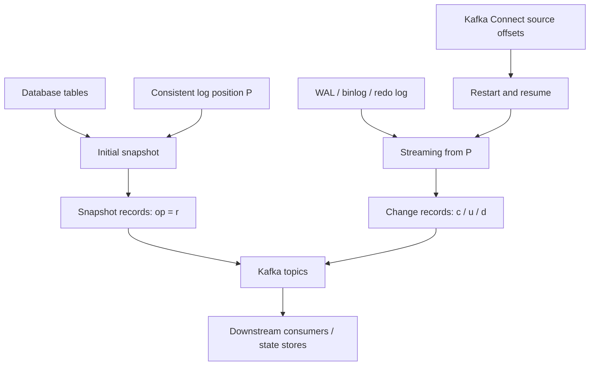

# Snapshot ban đầu, đọc transaction log và chuyển sang streaming

Change Data Capture (CDC) đưa thay đổi từ database vào Kafka mà không cần ứng dụng nguồn tự phát một event cho mọi câu lệnh ghi. Với Debezium và Kafka Connect, connector thường cần hai giai đoạn: **snapshot ban đầu** để lấy trạng thái hiện có của các bảng, sau đó **streaming** để đọc các thay đổi mới từ transaction log như PostgreSQL WAL, MySQL binlog, SQL Server transaction log/CDC hoặc Oracle redo log.

Ranh giới giữa hai giai đoạn rất quan trọng. Nếu snapshot và streaming không dùng một mốc nhất quán, hệ thống có thể bỏ sót thay đổi xảy ra trong lúc quét bảng hoặc phát lại dữ liệu không đúng thứ tự. Connector CDC được thiết kế để phối hợp snapshot với vị trí log, lưu source offset và tiếp tục streaming từ điểm phù hợp. Tuy nhiên, cách lấy snapshot, loại log position và cơ chế phục hồi phụ thuộc database connector/version. Người vận hành cần hiểu mốc nhất quán, retention của transaction log, source offset, semantics của snapshot record và cách kiểm tra sau khi chuyển sang streaming.

## 1. Vì sao CDC thường cần snapshot trước?

Transaction log chỉ ghi các thay đổi phát sinh sau khi database bắt đầu lưu log theo cơ chế tương ứng. Khi triển khai CDC lần đầu, log có thể không chứa toàn bộ trạng thái hiện tại của bảng. Nếu chỉ đọc log từ thời điểm hiện tại, consumer sẽ biết các thay đổi mới nhưng không có dữ liệu nền để dựng trạng thái ban đầu.

Ví dụ bảng `orders` đã có một triệu đơn hàng trước khi CDC được cài đặt. Sau thời điểm bắt đầu, chỉ có các thay đổi như tạo đơn mới, cập nhật trạng thái hoặc xóa đơn được ghi vào log. Một hệ thống analytics cần cả một triệu hàng hiện tại lẫn các thay đổi tiếp theo. Snapshot cung cấp trạng thái ban đầu; streaming tiếp tục cập nhật state từ transaction log.

Hai giai đoạn có mục đích khác nhau:

| Giai đoạn | Nguồn dữ liệu | Mục đích | Loại sự kiện thường gặp với Debezium |
|---|---|---|---|
| Initial snapshot | Trạng thái bảng tại một snapshot nhất quán | Nạp dữ liệu đã tồn tại trước khi CDC bắt đầu | `op = r` (read) |
| Log streaming | Transaction log phát sinh từ một log position | Phát thay đổi sau mốc snapshot | `op = c`, `u`, `d` (create, update, delete) |

Snapshot không phải là một chuỗi transaction log được phát lại từ đầu. Nó là quá trình đọc trạng thái hiện tại theo một cơ chế nhất quán của database. Streaming đọc các thay đổi đã được ghi trong log. Hai nguồn này cần được nối bằng một mốc log position an toàn.

## 2. Kiến trúc snapshot-to-streaming

Một luồng Debezium source connector điển hình:



Ở mức khái niệm, connector xác định một snapshot nhất quán tại log position P, đọc các hàng thuộc snapshot đó, rồi phát các thay đổi trong transaction log bắt đầu từ vị trí P theo semantics của database connector. Thứ tự các bước nội bộ và cách lưu schema/offset khác nhau giữa connector, nhưng mục tiêu luôn là không tạo khoảng trống giữa trạng thái nền và thay đổi phát sinh trong lúc snapshot chạy.

Trong quá trình snapshot, database vẫn có thể tiếp tục nhận ghi. Những thay đổi phát sinh sau mốc P phải được giữ trong transaction log cho tới khi connector đọc được chúng. Vì vậy, snapshot càng lâu thì yêu cầu retention của log càng quan trọng.

## 3. Snapshot nhất quán là gì?

Snapshot nhất quán là tập dữ liệu được nhìn tại một trạng thái logic của database, thay vì đọc từng bảng ở các thời điểm tùy ý rồi ghép thành một trạng thái không từng tồn tại.

Giả sử transaction T cập nhật hai bảng trong cùng một giao dịch:

1. Cập nhật `orders.status` từ `NEW` thành `PAID`.
2. Cập nhật `payments.status` từ `PENDING` thành `AUTHORIZED`.
3. Commit transaction.

Nếu snapshot đọc `orders` trước khi T commit nhưng đọc `payments` sau khi T commit, kết quả có thể chứa `orders=NEW` và `payments=AUTHORIZED`. Đây là trạng thái không nhất quán nếu hai cập nhật phải cùng commit. Cơ chế snapshot của connector cần đảm bảo các bảng được đọc theo cùng một snapshot database hoặc một quy trình khóa/mốc tương đương.

### Cách database cung cấp snapshot khác nhau

| Database | Log position thường gặp | Cơ chế nhất quán/snapshot cần quan tâm |
|---|---|---|
| PostgreSQL | LSN (Log Sequence Number) | MVCC snapshot, replication slot và vị trí WAL; chi tiết exported snapshot/transaction phụ thuộc phiên bản Debezium và cấu hình |
| MySQL | Binlog file/position hoặc GTID | Phối hợp binlog position với transaction snapshot và cơ chế khóa ngắn để xác định ranh giới nhất quán; chi tiết phụ thuộc quyền và phiên bản connector |
| SQL Server | LSN trong transaction log/CDC | Snapshot và CDC capture state theo cơ chế SQL Server connector, database isolation và CDC configuration |
| Oracle | SCN (System Change Number) cùng redo log metadata | Consistent read tại SCN và đọc redo log qua cơ chế connector như LogMiner hoặc XStream tùy cấu hình |

Không áp dụng một thuật toán snapshot chung cho mọi database. Khi triển khai, đọc tài liệu đúng connector/database version để biết loại lock, isolation level, quyền database, cách xác định mốc log và hành vi khi snapshot bị gián đoạn.

## 4. Mốc log position P nối snapshot với streaming

Điểm cốt lõi của snapshot-to-streaming là xác định được một log position P đại diện cho ranh giới nhất quán của snapshot.

Mô hình khái niệm:

```text
Transaction log:
  ... -- T100 -- T101 -- [ P ] -- T102 -- T103 -- T104 -->
                         |
                         +-- snapshot nhìn trạng thái nhất quán tại P

Snapshot scan:
  đọc các hàng tồn tại tại P, có thể kéo dài trong nhiều phút/giờ

Streaming:
  sau snapshot, đọc các thay đổi log từ P theo semantics connector
```

Trong lúc snapshot đang quét, database vẫn có thể commit T102, T103 và T104. Connector phải bảo đảm log từ P vẫn còn sẵn sàng để đọc sau khi snapshot hoàn tất. Nếu log bị xóa trước khi connector bắt kịp, connector có thể không tiếp tục được và cần xử lý phục hồi hoặc snapshot lại.

Không nên hiểu P là một offset Kafka. P là vị trí trong transaction log của database. Connector lưu nó trong source offset để biết lần tiếp theo cần đọc log từ đâu. Khi record CDC được ghi vào Kafka, record có thêm Kafka topic/partition/offset riêng, hoàn toàn khác hệ tọa độ của database log.

| Vị trí | Ví dụ | Dùng để làm gì |
|---|---|---|
| Database log position | PostgreSQL LSN, MySQL GTID/binlog position, Oracle SCN | Tiếp tục đọc thay đổi trong database |
| Kafka offset | `orders.events` partition 2, offset 9812 | Consumer đọc record từ Kafka |
| Kafka Connect source offset | Metadata connector-specific được lưu trong offset storage topic | Khôi phục tiến độ source connector sau restart |

Ba loại vị trí này không thể thay thế cho nhau.

## 5. Snapshot record và streaming change event khác nhau thế nào?

Debezium thường biểu diễn snapshot row bằng event có `op = r`. Change event từ log có operation như `c` (create/insert), `u` (update) và `d` (delete). Event envelope thường chứa `before`, `after`, `source`, `op` và `ts_ms`; cấu trúc cụ thể tùy connector, phiên bản và converter.

Ví dụ snapshot record rút gọn:

```json
{
  "before": null,
  "after": {
    "order_id": 2048,
    "status": "NEW",
    "amount": 1250000
  },
  "source": {
    "db": "orders_db",
    "schema": "public",
    "table": "orders",
    "snapshot": "true"
  },
  "op": "r",
  "ts_ms": 1795166100000
}
```

Ví dụ update event rút gọn:

```json
{
  "before": {
    "order_id": 2048,
    "status": "NEW",
    "amount": 1250000
  },
  "after": {
    "order_id": 2048,
    "status": "PAID",
    "amount": 1250000
  },
  "source": {
    "db": "orders_db",
    "schema": "public",
    "table": "orders"
  },
  "op": "u",
  "ts_ms": 1795166160000
}
```

Đây là payload minh họa; trường snapshot indicator có thể là boolean/string hoặc mang trạng thái khác tùy Debezium version. Không hardcode logic downstream dựa trên một giá trị snapshot metadata chưa được xác minh với connector đang dùng.

Consumer dựng trạng thái hiện tại thường áp dụng snapshot row như một bản ghi nền (upsert), sau đó áp dụng change event. Với update, thường dùng `after`; với delete, xử lý theo `op=d` và tombstone nếu connector phát tombstone. Không nên coi snapshot row là một insert nghiệp vụ mới cần gửi email, tính doanh thu hoặc kích hoạt side effect giống event `OrderCreated` từ ứng dụng.

## 6. Thứ tự snapshot và streaming

Snapshot thường quét theo bảng và chunk/batch, không đại diện cho thứ tự transaction nghiệp vụ ban đầu. Một snapshot có thể đọc hàng A trước hàng B chỉ vì thứ tự scan/index, không có nghĩa A được tạo trước B.

Streaming change event phản ánh thứ tự mà connector đọc transaction log trong phạm vi nguồn và partitioning mà connector sử dụng. Tuy nhiên:

- Kafka chỉ bảo đảm thứ tự trong một partition.
- Event của các bảng khác nhau thường nằm ở topic khác nhau; không có thứ tự toàn cục giữa các topic.
- Event cùng entity cần key ổn định để thường được đưa về cùng partition.
- Snapshot và streaming record có thể có timestamp khác nhau; không dùng `ts_ms` đơn thuần để suy ra thứ tự commit chính xác.
- Connector có thể phát metadata transaction nếu cấu hình hỗ trợ, nhưng consumer phải chủ động dùng nó để tái dựng ranh giới transaction.

Nếu consumer cần xây dựng state, hãy thiết kế xử lý idempotent và theo key/version. Nếu cần xử lý nghiệp vụ theo thứ tự transaction xuyên nhiều bảng, cần xem xét transaction metadata, source log position hoặc một mô hình materialization phù hợp; không dựa vào thứ tự nhận giữa các Kafka topic.

## 7. Có bị duplicate khi chuyển từ snapshot sang streaming không?

Một snapshot row và một change event tiếp theo cho cùng primary key không nhất thiết là duplicate sai. Ví dụ:

1. Snapshot tại P đọc order 2048 có trạng thái `NEW`.
2. Sau P, database commit update trạng thái thành `PAID`.
3. Connector phát snapshot row `NEW`.
4. Connector phát update event `PAID` từ transaction log.

Consumer áp dụng lần lượt sẽ dựng state cuối là `PAID`. Đây là hành vi mong muốn: snapshot mô tả trạng thái tại P, streaming mô tả thay đổi sau P.

Duplicate thực sự vẫn có thể xảy ra do retry, restart, rebalance hoặc replay. Source connector lưu offset trong Kafka Connect, nhưng record có thể đã được ghi vào Kafka mà offset chưa được commit bền vững; sau phục hồi, connector có thể phát lại record. Vì vậy, downstream nên idempotent, thường dùng primary key làm Kafka record key và upsert theo version/source position khi cần.

Không dùng `eventId` mới được sinh ở mỗi lần consumer nhận để deduplicate. Nếu cần ID ổn định, dùng khóa nghiệp vụ/định danh record hoặc metadata source position phù hợp; lưu ý một hàng có thể phát nhiều change event khác nhau trong suốt vòng đời.

## 8. Source offset của Kafka Connect

Kafka Connect lưu source offset để connector tiếp tục từ vị trí nguồn sau khi worker restart hoặc task được phân phối lại. Với Debezium, offset thường chứa thông tin database log position và metadata connector-specific như transaction/GTID/LSN, snapshot state hoặc thông tin phục hồi.

Trong distributed mode, các internal topic thường gồm:

| Topic | Vai trò |
|---|---|
| `config.storage.topic` | Lưu cấu hình connector trong cluster Connect |
| `offset.storage.topic` | Lưu source offsets và tiến độ connector |
| `status.storage.topic` | Lưu trạng thái connector/task |

Đây là metadata của Kafka Connect, không phải topic dữ liệu CDC theo bảng. Không xóa hoặc reset `offset.storage.topic` để xử lý một connector lỗi nếu chưa hiểu hậu quả: connector có thể mất source progress và thực hiện snapshot lại hoặc đọc log từ vị trí khác.

Source offset cũng khác consumer group offset. Consumer group downstream commit Kafka offset vào `__consumer_offsets`; source connector ghi tiến độ nguồn vào Connect offset storage topic. Xóa/đặt lại một loại offset không tự thay đổi loại offset còn lại.

## 9. Điều gì xảy ra khi worker restart giữa snapshot?

Hành vi restart phụ thuộc snapshot mode, database connector, thời điểm crash và source offset đã được lưu. Một số connector có thể tiếp tục snapshot từ trạng thái/offset đã lưu; một số trường hợp có thể chạy lại snapshot hoặc chuyển sang streaming nếu snapshot đã hoàn tất. Không giả định mọi connector đều resume chính xác từ row cuối cùng mà không đọc lại.

Khi kiểm tra restart, cần xem:

- Connector đã ghi snapshot completion state vào source offset chưa?
- Source log position P đã được lưu và còn tồn tại trong database log chưa?
- Connect offset topic có đủ replication/retention và đang hoạt động không?
- Connector có thay đổi `snapshot.mode`, database identity hoặc connector name không?
- Có ai reset source offset hoặc xóa internal topic không?
- Task có restart liên tục do lỗi schema, permission hoặc database connection không?

Nếu snapshot chạy lại, downstream có thể nhận lại nhiều snapshot row. Consumer phải upsert idempotent và phân biệt snapshot record với business event. Nếu source offset bị mất và transaction log đã trôi qua vị trí cần đọc, connector có thể cần snapshot mới để khôi phục baseline.

## 10. Snapshot mode và lựa chọn vận hành

Debezium có nhiều snapshot mode để chọn cách lấy dữ liệu ban đầu hoặc phục hồi. Tên và semantics của mode thay đổi theo connector/version; một số mode cũ được đổi tên hoặc thay thế. Các lựa chọn thường gặp trong các phiên bản Debezium gồm:

| Mode/nhóm mode | Mục đích khái quát | Lưu ý |
|---|---|---|
| `initial` | Chạy snapshot ban đầu khi chưa có offset phù hợp, sau đó streaming | Lựa chọn phổ biến cho lần triển khai mới |
| `initial_only` | Chụp snapshot rồi dừng, không tiếp tục streaming | Dùng khi chỉ cần baseline một lần |
| `no_data` | Bỏ qua snapshot row và bắt đầu streaming từ mốc log theo semantics connector | Chỉ phù hợp nếu downstream đã có baseline hoặc không cần trạng thái cũ |
| `when_needed` | Snapshot khi connector không thể tiếp tục từ offset hiện có theo điều kiện được hỗ trợ | Cần hiểu điều kiện trigger của connector/version |
| `recovery` / schema recovery | Phục hồi metadata/schema history trong các connector hỗ trợ | Không phải chế độ thay thế snapshot dữ liệu thông thường trong mọi connector |
| Incremental snapshot | Đọc snapshot theo chunk trong khi streaming có thể tiếp tục | Có cơ chế signaling/watermark và semantics riêng |

Không copy một `snapshot.mode` từ MySQL sang PostgreSQL hoặc từ Debezium version cũ sang version mới mà không kiểm tra tài liệu đúng connector. Trước khi đổi mode trên production, xác định source offset hiện tại và kết quả mong đợi: snapshot lại, chỉ stream, hay phục hồi schema history.

### Khi nào không nên bỏ snapshot?

Chỉ dùng mode không snapshot nếu downstream đã có baseline chính xác hoặc nghiệp vụ chỉ quan tâm thay đổi từ thời điểm bắt đầu. Nếu bỏ snapshot trên một bảng đã có dữ liệu, consumer mới sẽ không tự biết trạng thái của các hàng cũ chưa thay đổi sau khi CDC bắt đầu.

## 11. Snapshot blocking và incremental snapshot

Initial snapshot truyền thống thường hoàn thành việc đọc baseline trước khi connector chuyển hẳn sang streaming change event. Trong thời gian đó, transaction log phải được giữ lại để không mất thay đổi mới.

Incremental snapshot cho phép đọc dữ liệu theo chunk và phối hợp với streaming theo cơ chế connector hỗ trợ. Debezium incremental snapshot thường dùng watermark để xác định ranh giới chunk và xử lý cạnh tranh với change event trong lúc snapshot đang chạy.

Đặc điểm:

- Bảng lớn được chia thành chunk thay vì một lần scan dài.
- Có thể giảm thời gian giữ một snapshot transaction dài, tùy connector/database.
- Change event vẫn tiếp tục được xử lý trong lúc incremental snapshot diễn ra.
- Connector cần theo dõi watermark/chunk state để tránh áp dụng snapshot row cũ đè lên change event mới hơn.
- Incremental snapshot thường được kích hoạt bằng signaling mechanism; cấu hình và signal channel phụ thuộc connector.

Incremental snapshot không có nghĩa dữ liệu được phát theo đúng thứ tự commit của database. Consumer vẫn cần dùng primary key, source metadata hoặc version để hợp nhất state an toàn.

### Watermark giải quyết điều gì?

Giả sử chunk snapshot đang đọc order 2048. Trong lúc scan, database cập nhật order đó từ `NEW` thành `PAID` và streaming phát change event. Nếu snapshot row `NEW` được xử lý sau change event `PAID`, state có thể bị ghi lùi về `NEW`. Cơ chế watermark và collision handling của incremental snapshot giúp connector nhận biết record snapshot nào có thể bị change event mới hơn che phủ hoặc loại bỏ.

Chi tiết watermark và cách phát snapshot window phụ thuộc connector/version. Không tự triển khai logic loại bỏ event dựa trên một trường watermark giả định; dùng metadata và thuật toán được tài liệu Debezium của connector công bố.

## 12. Transaction log retention là điều kiện sống còn

Trong khi snapshot quét bảng, database tiếp tục ghi transaction log. Nếu log bị truncate/purge trước khi connector bắt kịp, mốc P có thể không còn đọc được.

Ví dụ:

- Snapshot dự kiến chạy 4 giờ.
- Database tạo binlog/WAL với tốc độ cao.
- Retention chỉ giữ log trong 2 giờ.
- Snapshot kết thúc sau khi log cần thiết đã bị xóa.

Connector có thể báo lỗi không tìm thấy log position/GTID/LSN cần thiết và không thể tiếp tục streaming an toàn. Khi đó cần xử lý theo hướng dẫn connector: tăng retention/slot capacity, phục hồi từ backup hoặc chạy snapshot mới. Không bỏ qua lỗi và tự nhảy tới log hiện tại nếu downstream cần đầy đủ dữ liệu.

### PostgreSQL

Debezium PostgreSQL thường dùng logical replication slot để giữ WAL cần cho connector. Slot inactive hoặc connector chậm có thể làm WAL tích tụ và tăng dung lượng đĩa. Cần theo dõi slot lag, retained WAL và giới hạn dung lượng lưu trữ. Không xóa replication slot đang được connector sử dụng chỉ để giải phóng disk nếu chưa có kế hoạch snapshot/resync.

### MySQL

Binlog phải được giữ đủ lâu để connector bắt kịp sau snapshot/restart. GTID hoặc file/position phải còn trong phạm vi binlog hiện có. Purge binlog quá sớm có thể khiến connector không thể tiếp tục từ offset đã lưu.

### Các database khác

SQL Server CDC cleanup, Oracle archive log/redo retention và cơ chế capture riêng cũng cần được sizing theo thời gian snapshot, outage và recovery. Dùng đúng metric/monitoring của database thay vì giả định mọi connector có cùng cách giữ log.

## 13. Tối ưu initial snapshot

Snapshot lớn có thể tạo tải đáng kể lên database và Kafka Connect. Cần đo thử với dữ liệu gần production và điều chỉnh theo giới hạn database.

Các yếu tố ảnh hưởng:

- Số lượng bảng và số hàng cần snapshot.
- Kích thước row, LOB/BLOB và độ rộng record.
- Index và query plan của các bảng.
- Batch/fetch size và số snapshot thread nếu connector hỗ trợ.
- Network bandwidth giữa database, Connect worker và broker.
- Kafka producer throughput, compression và topic partition count.
- Tốc độ transaction log phát sinh trong lúc snapshot.
- Retention/replication của WAL, binlog hoặc redo log.

### Chọn phạm vi snapshot

Chỉ snapshot schema/table cần thiết. Dùng include/exclude list để tránh đọc bảng log/audit hoặc bảng lớn không cần downstream. Tuy nhiên, thay đổi table filter sau khi connector đã chạy có thể tác động snapshot và topic mapping; cần kiểm tra connector behavior và source offset trước khi cập nhật.

### Điều chỉnh batch/fetch size

Batch lớn giảm overhead round-trip nhưng tăng memory và áp lực lên database/worker. Batch nhỏ giảm bộ nhớ nhưng tăng số lần truy vấn và thời gian snapshot. Tên property và default phụ thuộc connector; không dùng một property generic cho mọi Debezium connector.

### Snapshot song song

Một số connector hỗ trợ parallel snapshot hoặc nhiều snapshot thread. Tăng concurrency có thể rút ngắn thời gian nhưng cũng tăng query load, transaction/resource usage và áp lực log retention. Kiểm thử với database administrator trước khi tăng.

## 14. DDL và schema evolution trong lúc snapshot

Snapshot cần biết schema của bảng tại thời điểm đọc. Nếu DDL thay đổi trong lúc snapshot hoặc khi streaming, connector cần cơ chế theo dõi schema tương ứng với database. Một số connector dùng schema history topic hoặc metadata nội bộ; cơ chế cụ thể khác nhau.

Nguyên tắc:

- Tránh thay đổi DDL không được kiểm soát trong lúc initial snapshot lớn.
- Đồng bộ lịch deploy schema database với connector và consumer.
- Không xóa hoặc đổi tên cột mà downstream vẫn đang phụ thuộc.
- Kiểm tra cách connector xử lý `ALTER TABLE`, column type change và table rename.
- Bảo vệ schema history topic/configuration nếu connector yêu cầu; mất schema history có thể khiến giải mã log cũ thất bại.
- Khi schema recovery được hỗ trợ, dùng đúng quy trình của connector; không xóa schema history topic để thử sửa lỗi.

Schema Registry của Kafka và schema history nội bộ của Debezium là hai khái niệm khác nhau. Schema Registry quản lý schema của message Kafka theo subject/version; schema history connector-specific giúp một số connector hiểu cấu trúc database khi đọc transaction log. Một hệ thống có thể dùng cả hai.

## 15. Kiểm tra connector đã chuyển sang streaming chưa

Không chỉ nhìn connector state là `RUNNING`. Cần xác nhận snapshot đã hoàn tất và streaming đang tiến triển.

Kiểm tra:

1. Connector/task state trong Kafka Connect REST API.
2. Log worker có thông báo snapshot bắt đầu/kết thúc và chuyển sang streaming không.
3. Source offset đã lưu snapshot completion và log position phù hợp chưa.
4. Database log position/LSN/GTID/SCN có tiếp tục tiến lên không.
5. Kafka topic có snapshot record (`op=r`) và change event (`c/u/d`) theo kỳ vọng không.
6. Kafka Connect source offset topic và internal topic có hoạt động bình thường không.
7. Consumer downstream có nhận record, lag có ổn định và state có khớp database không.

Các trường log và metric cụ thể phụ thuộc connector/version. Nên dùng connector logs, JMX/metrics và database monitoring cùng nhau.

### Ví dụ kiểm tra bằng REST API

```bash
curl -s http://connect-1:8083/connectors/orders-db-source/status
curl -s http://connect-1:8083/connectors/orders-db-source/offsets
```

Endpoint offsets có trong các phiên bản Kafka Connect hỗ trợ API tương ứng; cần xác minh version. Nội dung offset có thể chứa thông tin database nhạy cảm như hostname, database/schema/table hoặc log position, nên bảo vệ endpoint và không chia sẻ output công khai.

Để xem record trong topic:

```bash
kafka-console-consumer.sh \
  --bootstrap-server kafka-1:9092 \
  --topic dbserver1.public.orders \
  --from-beginning \
  --property print.key=true
```

Tên topic phụ thuộc `topic.prefix`, naming strategy và connector config. Không dùng `--from-beginning` trên topic production lớn nếu chỉ cần kiểm tra một vài record; có thể dùng consumer thử nghiệm có giới hạn hoặc công cụ đọc theo partition/offset.

## 16. Quy trình triển khai initial snapshot và streaming

Một kế hoạch triển khai có kiểm soát:

1. **Inventory:** xác định database, bảng, primary key, kích thước dữ liệu, tốc độ ghi và yêu cầu downstream.
2. **CDC prerequisites:** bật log mode phù hợp, tạo replication user/slot hoặc CDC access, cấu hình retention và quyền cần thiết.
3. **Capacity planning:** ước lượng snapshot duration, log generation rate, WAL/binlog retention, worker memory, Kafka throughput và topic storage.
4. **Contract:** xác định topic naming, key, schema, delete/tombstone semantics và event envelope.
5. **Staging:** chạy snapshot trên bản dữ liệu gần thực tế, đo tải và kiểm tra consistency.
6. **Deploy connector:** pin plugin/version, cấu hình include/exclude table và snapshot mode phù hợp.
7. **Observe snapshot:** theo dõi tiến độ, lỗi, database load, retained log và Kafka throughput.
8. **Verify handoff:** xác nhận snapshot hoàn tất, streaming bắt đầu từ log position đã lưu và change event xuất hiện.
9. **Reconcile:** so sánh số lượng/key/checksum giữa database và downstream state tại một mốc nhất quán.
10. **Operate:** theo dõi log lag, source offset, task state, WAL/binlog retention và consumer lag.

Không bắt đầu snapshot production trước khi xác minh retention của transaction log đủ cho thời gian snapshot cộng outage/recovery margin.

## 17. Ví dụ tình huống end-to-end

Giả sử bảng `orders` có ba hàng:

| order_id | status | amount |
|---:|---|---:|
| 1001 | NEW | 500000 |
| 1002 | PAID | 750000 |
| 1003 | NEW | 250000 |

Connector xác định snapshot tại log position P và đọc ba hàng. Trong lúc snapshot:

- Transaction T1 đổi order 1001 từ `NEW` sang `PAID`.
- Transaction T2 insert order 1004.
- Transaction T3 xóa order 1002.

Downstream sau khi áp dụng đầy đủ snapshot và log stream cần có trạng thái:

| order_id | Trạng thái cuối mong đợi |
|---:|---|
| 1001 | PAID |
| 1003 | NEW |
| 1004 | trạng thái mới do T2 ghi |
| 1002 | đã xóa |

Snapshot có thể đã đọc order 1001 là `NEW`, order 1002 là `PAID` và chưa có order 1004. Streaming sau P phải phát update cho 1001, insert 1004 và delete 1002. Consumer phải xử lý snapshot row như baseline và change event như thay đổi tiếp theo. Nếu consumer xử lý bất đồng bộ hoặc retry làm đảo thứ tự trong cùng key, cần cơ chế version/source position để không ghi state cũ đè state mới.

## 18. Reconciliation sau snapshot

Snapshot hoàn tất không tự chứng minh downstream đã giống database. Cần đối soát theo một mốc nhất quán:

- Đếm số hàng theo bảng hoặc theo partition/range.
- So sánh tập primary key.
- So sánh checksum/hash theo nhóm dữ liệu đã chuẩn hóa.
- Kiểm tra các hàng vừa insert/update/delete trong thời gian snapshot.
- Xác minh consumer đã xử lý đến source position hoặc thời điểm đối soát được chọn.
- Xử lý dữ liệu thay đổi liên tục bằng watermark/cutoff phù hợp, không so sánh hai hệ thống tại hai thời điểm khác nhau.

Nếu bảng lớn, đối soát theo chunk/range và lưu kết quả từng phần. Hash phải chuẩn hóa kiểu dữ liệu, timezone, decimal precision, null và collation; nếu không, cùng dữ liệu logic có thể tạo checksum khác nhau.

## 19. Lỗi thường gặp

| Hiện tượng | Nguyên nhân có thể | Hướng xử lý |
|---|---|---|
| Snapshot chạy xong nhưng không có change event | Connector chưa chuyển sang streaming, log capture chưa bật hoặc quyền log thiếu | Kiểm tra connector log, source offset và CDC/log configuration |
| Connector báo log position không còn tồn tại | WAL/binlog/redo log đã bị purge trước khi connector bắt kịp | Tăng retention, phục hồi theo hướng dẫn hoặc snapshot lại; không nhảy log tùy tiện |
| Snapshot kéo dài và database tăng tải | Quét quá nhiều bảng, batch/concurrency không phù hợp | Thu hẹp table scope, điều chỉnh batch/thread theo connector và đo tải |
| Snapshot record và update cùng key xuất hiện | Đây là baseline tại P rồi change sau P | Upsert snapshot, áp dụng change theo thứ tự/version; không coi mọi cặp này là lỗi duplicate |
| State downstream bị ghi lùi | Snapshot row đến sau change event hoặc consumer xử lý bất đồng bộ | Dùng incremental snapshot collision handling hoặc version/source position phù hợp |
| Restart làm snapshot chạy lại | Source offset/snapshot state chưa được lưu hoặc bị reset; mode yêu cầu snapshot lại | Kiểm tra Connect offset topic, connector config và snapshot mode |
| Consumer không thấy delete | Chưa xử lý `op=d`, tombstone hoặc converter unwrap envelope | Kiểm tra delete/tombstone config và consumer semantics |
| Thiếu dữ liệu sau initial load | Snapshot/stream handoff sai, log retention thiếu hoặc table filter sai | Đối soát theo key, xem mốc P và connector log; chạy snapshot/resync theo kế hoạch |
| DDL làm connector lỗi | Schema history hoặc database schema thay đổi không tương thích | Kiểm tra schema history, DDL handling và migration sequence |
| WAL tăng liên tục | Replication slot không được consume hoặc connector lag | Kiểm tra slot, connector task, database disk và log throughput |
| Một số bảng không có snapshot record | Table include/exclude, quyền đọc hoặc snapshot selection không đúng | Kiểm tra filter, schema/table privileges và snapshot log |

## 20. Checklist production

**Trước snapshot:**

- Xác định đúng database connector và phiên bản Debezium.
- Xác minh database log mode, replication slot/binlog/CDC/redo prerequisites.
- Chọn snapshot mode đúng mục tiêu; không bỏ snapshot nếu downstream chưa có baseline.
- Xác định primary key và cách tạo Kafka record key.
- Giới hạn table/schema cần snapshot.
- Đảm bảo transaction log retention đủ cho snapshot và thời gian outage dự phòng.
- Ước lượng tải database, memory worker, Kafka throughput và storage.

**Trong snapshot và handoff:**

- Theo dõi snapshot progress, log position và source offset.
- Xác minh snapshot nhất quán theo database connector.
- Giữ transaction log từ mốc P cho tới khi connector bắt kịp.
- Phân biệt `op=r` với change event `c/u/d`.
- Xử lý snapshot row idempotent và không kích hoạt side effect nghiệp vụ ngoài ý muốn.
- Kiểm tra streaming thực sự tiến triển sau khi snapshot hoàn tất.

**Sau khi streaming:**

- Đối soát database với downstream state.
- Theo dõi source log lag, Connect task state, consumer lag và WAL/binlog retention.
- Giữ Connect offset/config/status topics được bảo vệ và replication phù hợp.
- Kiểm thử restart, task rebalance, log retention exhaustion và snapshot recovery trong staging.
- Có runbook resnapshot/resync và đánh giá tác động duplicate.
- Quản lý DDL/schema evolution đồng bộ với producer/consumer.

## 21. Ghi nhớ

Initial snapshot cung cấp trạng thái nền của các bảng tại một mốc nhất quán; transaction log streaming tiếp tục phát các thay đổi từ log position tương ứng. Debezium thường biểu diễn snapshot row bằng `op=r`, còn insert/update/delete từ log bằng `c/u/d`. Log position như LSN, GTID/binlog position hoặc SCN là tọa độ của database; Kafka offset và Kafka Connect source offset là các loại tiến độ khác nhau.

Để handoff không mất dữ liệu, connector phải nối snapshot với một mốc P và database phải giữ transaction log đủ lâu cho tới khi streaming bắt kịp. Snapshot có thể phát lại sau restart, và downstream vẫn cần upsert/idempotency. Incremental snapshot chia dữ liệu thành chunk và dùng watermark/collision handling để phối hợp với change event. Trước production, hãy kiểm tra consistency, log retention, schema/DDL, source offsets, task state và đối soát kết quả; chỉ nhìn trạng thái connector `RUNNING` là chưa đủ để xác nhận CDC đã hoạt động đúng.
