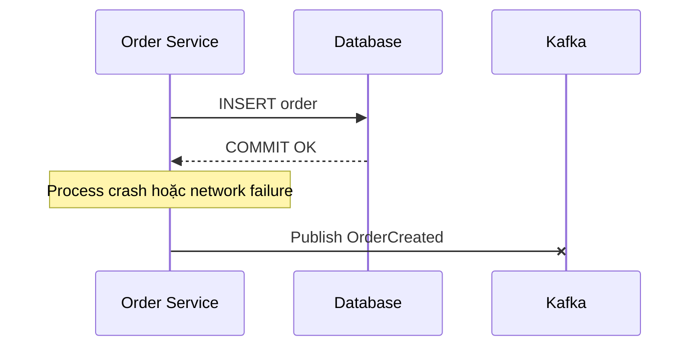
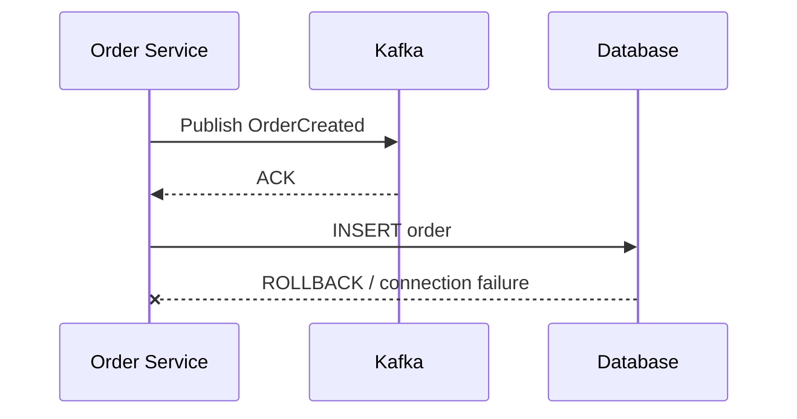
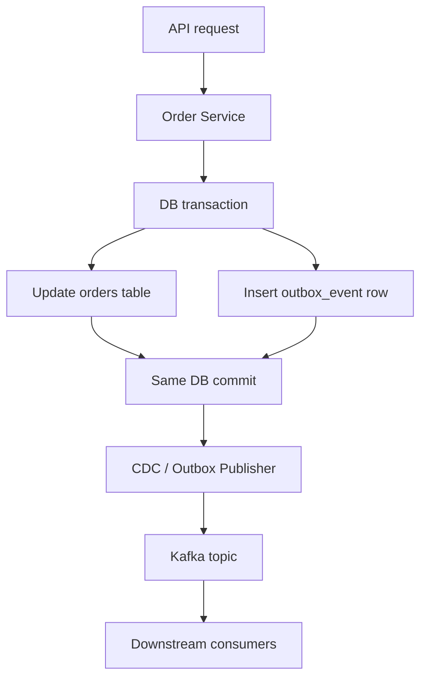
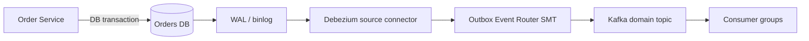

# Bài toán dual write giữa cơ sở dữ liệu và Kafka

## Mục tiêu

Một service nghiệp vụ thường phải cập nhật cơ sở dữ liệu và phát event lên Kafka trong cùng một thao tác. Ví dụ, khi tạo đơn hàng, service vừa ghi đơn hàng vào database vừa phát event `OrderCreated` để inventory, payment hoặc notification xử lý tiếp.

Nếu hai thao tác này không cùng một transaction nguyên tử, hệ thống có thể rơi vào trạng thái database đã thay đổi nhưng Kafka không có event, hoặc Kafka đã có event trong khi database rollback. Đây là bài toán dual write.

Bài học này giải thích các failure window của dual write, giới hạn của transaction thông thường, cách transactional outbox giải quyết tính nhất quán giữa database và event stream, cùng các yêu cầu về CDC, idempotency, ordering và vận hành.

Sau bài học, bạn có thể:

- Nhận diện các trạng thái không nhất quán khi ghi database và Kafka riêng rẽ.
- Giải thích vì sao transaction của database không tự động bao trùm Kafka.
- Thiết kế transactional outbox để lưu business change và event trong cùng DB transaction.
- Phân biệt CDC-based outbox publisher với polling publisher.
- Xử lý duplicate, ordering, retry và replay ở consumer.
- Theo dõi outbox backlog, CDC lag và rủi ro WAL/binlog retention.
- Xây dựng quy trình kiểm chứng và phục hồi khi một thành phần gặp sự cố.

## 1. Dual write là gì?

Dual write xuất hiện khi một thao tác nghiệp vụ cần ghi vào hai hệ thống độc lập. Trường hợp phổ biến là:

1. Ghi dữ liệu nghiệp vụ vào database.
2. Gửi event mô tả thay đổi đó tới Kafka.

Ví dụ service tạo đơn hàng:

```java
public Order createOrder(CreateOrderCommand command) {
    Order order = orderRepository.save(
            new Order(command.customerId(), command.amount()));

    kafkaTemplate.send(
            "commerce.orders.events.v1",
            order.getId().toString(),
            new OrderCreated(order.getId(), order.getAmount()));

    return order;
}
```

Đoạn code nhìn đơn giản nhưng database và Kafka có hai cơ chế commit độc lập. `@Transactional` trên method chỉ quản lý transaction của transaction manager được cấu hình; nó không tự biến database transaction và Kafka produce thành một transaction phân tán nguyên tử.

Nếu database commit thành công nhưng process dừng trước khi Kafka nhận event, đơn hàng tồn tại nhưng các service downstream không biết đơn hàng đã được tạo. Nếu Kafka nhận event trước rồi database rollback, consumer có thể xử lý một đơn hàng không tồn tại.

Đây không phải lỗi riêng của Kafka. Bất kỳ lần ghi đồng bộ vào hai hệ thống độc lập nào cũng có thể gặp failure window tương tự.

## 2. Hai failure window của dual write

### 2.1. Ghi database trước, sau đó publish Kafka

Trình tự:



Kết quả:

- Database có đơn hàng.
- Kafka không có event.
- Consumer không nhận được thông tin để thực hiện bước tiếp theo.

Nếu service retry toàn bộ request, có thể tạo đơn hàng thứ hai nếu không có idempotency key. Nếu không retry, event bị thiếu vĩnh viễn trừ khi có cơ chế reconciliation hoặc phát lại.

### 2.2. Publish Kafka trước, sau đó ghi database

Trình tự:



Kết quả:

- Kafka có event.
- Database không có đơn hàng đã commit.
- Consumer có thể gửi email, giữ hàng hoặc tạo tác vụ cho một đơn hàng không tồn tại.

Một số hệ thống cố gắng bù trừ bằng event `OrderCancelled` hoặc `OrderCreationFailed`. Đây là compensation theo nghiệp vụ, không phải rollback nguyên tử của Kafka record. Consumer có thể đã nhìn thấy event đầu tiên trước khi compensation tới.

### 2.3. Ma trận failure

| Thứ tự thao tác | Sự cố | Trạng thái có thể xảy ra | Hệ quả |
|---|---|---|---|
| DB rồi Kafka | DB commit, process crash trước publish | DB có, Kafka thiếu | Mất event |
| DB rồi Kafka | Kafka timeout sau khi broker có thể đã append | DB có, kết quả publish không rõ | Retry có thể tạo duplicate |
| Kafka rồi DB | Kafka ACK, DB rollback | Kafka có, DB thiếu | Event mồ côi/phantom event |
| Kafka rồi DB | Kafka timeout, DB chưa chạy | Kết quả Kafka không rõ | Retry có thể duplicate |
| Cả hai trong một method | Process chết giữa hai commit | Một hệ thống commit, hệ thống kia không | Không có atomicity chung |
| Cả hai đều thành công | Client mất response và retry request | Có thể tạo hai lần nghiệp vụ | Duplicate nếu thiếu idempotency |

### 2.4. Timeout không đồng nghĩa thao tác thất bại

Nếu producer gửi record nhưng timeout trước khi nhận acknowledgement, ứng dụng không thể luôn biết broker đã append record hay chưa. Tương tự, database connection có thể mất sau khi server commit nhưng trước khi client nhận kết quả.

Do đó, retry một thao tác có kết quả không xác định phải được thiết kế idempotent. Không được giả định timeout đồng nghĩa không có side effect.

## 3. Vì sao transaction thông thường không giải quyết được?

Database transaction bảo vệ các thay đổi nằm trong cùng database transaction. Ví dụ:

```sql
BEGIN;

INSERT INTO orders(id, customer_id, amount, status)
VALUES ('ord-1001', 'cus-2001', 125000, 'CREATED');

UPDATE customer_summary
SET order_count = order_count + 1
WHERE customer_id = 'cus-2001';

COMMIT;
```

Hai thay đổi trên cùng database có thể commit hoặc rollback cùng nhau. Kafka produce không tự tham gia transaction đó.

### 3.1. `@Transactional` không tự tạo distributed transaction

Ví dụ:

```java
@Transactional
public void createOrder(CreateOrderCommand command) {
    Order order = orderRepository.save(Order.from(command));
    kafkaTemplate.send("commerce.orders.events.v1",
            order.getId().toString(),
            toEvent(order));
}
```

`@Transactional` thường mở transaction với database transaction manager. `KafkaTemplate.send()` là thao tác bất đồng bộ tới Kafka. Nếu không chờ kết quả gửi, method có thể commit database trong khi send vẫn đang thất bại. Kể cả khi chờ future, vẫn tồn tại khoảng thời gian giữa hai hệ thống commit.

Spring có thể phối hợp thứ tự commit giữa database transaction manager và Kafka transaction manager thông qua transaction synchronization trong một số cấu hình. Cơ chế này không tương đương một distributed XA transaction với atomic commit cho cả hai resource; crash trong commit sequence vẫn có thể tạo trạng thái lệch.

Một biến thể thường gặp là dùng `@TransactionalEventListener(phase = AFTER_COMMIT)` để chỉ publish sau khi DB transaction commit. Cách này tránh gửi event khi DB rollback, nhưng vẫn có failure window: process có thể chết sau DB commit và trước khi listener publish xong. Nếu listener chạy bất đồng bộ, lỗi publish còn cần retry và durable storage riêng. After-commit callback hữu ích cho side effect không critical hoặc có cơ chế reconciliation; nó không thay thế outbox khi event phải được phát bền vững.

### 3.2. Kafka transaction bảo vệ phạm vi Kafka

Kafka transaction có thể kết hợp ghi nhiều Kafka records và commit consumer offsets trong một Kafka transaction. Nó hữu ích cho consume-transform-produce trong Kafka.

Kafka transaction không tự bao gồm transaction của PostgreSQL, MySQL hoặc một database bất kỳ. Nếu service cập nhật DB rồi gửi Kafka, Kafka transaction không thể rollback DB đã commit. Nếu cập nhật DB sau Kafka commit, database vẫn có thể thất bại độc lập.

### 3.3. Two-phase commit/XA

Về lý thuyết, distributed transaction coordinator với XA/2PC có thể điều phối nhiều resource manager. Trong hệ thống event streaming, cách này thường làm tăng coupling, thời gian giữ lock, operational complexity và yêu cầu tương thích driver/resource. Kafka producer transaction cũng không phải một XA resource manager tổng quát để tham gia mọi database transaction.

Vì vậy, nhiều hệ thống chọn transactional outbox: ghi business data và ý định phát event vào cùng một database transaction, sau đó chuyển event ra Kafka bằng một tiến trình riêng.

## 4. Transactional outbox pattern

Outbox là một bảng trong cùng database với dữ liệu nghiệp vụ. Trong một DB transaction, service:

1. Ghi hoặc cập nhật business row.
2. Ghi một outbox row mô tả event cần phát.
3. Commit cả hai thay đổi cùng nhau.

Một publisher riêng đọc outbox và gửi event tới Kafka. Publisher có thể dùng CDC để đọc transaction log hoặc polling để truy vấn bảng.



Điểm quan trọng: business change và outbox event intent được commit trong cùng database transaction. Nếu transaction rollback, cả order row và outbox row đều không tồn tại. Nếu transaction commit, cả hai đều tồn tại để publisher có thể chuyển event đi sau đó.

Outbox không làm database và Kafka thành một transaction duy nhất. Nó chuyển bài toán từ “hai lần ghi độc lập trong request” thành “một DB commit bền vững, sau đó chuyển event có thể retry”. Đây là nền tảng để đạt eventual consistency với semantics thường là at-least-once.

## 5. Thiết kế bảng outbox

Một schema tổng quát theo PostgreSQL:

```sql
CREATE TABLE outbox_event (
    id                UUID PRIMARY KEY,
    aggregatetype     VARCHAR(100) NOT NULL,
    aggregateid       VARCHAR(200) NOT NULL,
    type              VARCHAR(200) NOT NULL,
    payload           JSONB NOT NULL,
    occurred_at       TIMESTAMPTZ NOT NULL DEFAULT now(),
    aggregate_version BIGINT,
    headers           JSONB
);

CREATE INDEX idx_outbox_aggregate
    ON outbox_event (aggregatetype, aggregateid, aggregate_version);

CREATE INDEX idx_outbox_occurred_at
    ON outbox_event (occurred_at);
```

Ý nghĩa:

| Cột | Vai trò |
|---|---|
| `id` | Event ID duy nhất, dùng để deduplicate và truy vết |
| `aggregatetype` | Loại aggregate/domain entity, ví dụ `Order` |
| `aggregateid` | ID entity, thường được dùng làm Kafka key |
| `type` | Event type, ví dụ `OrderCreated` hoặc `OrderCancelled` |
| `payload` | Nội dung event đã serialize hoặc JSON |
| `occurred_at` | Thời điểm event được tạo trong transaction |
| `aggregate_version` | Version/sequence của entity để kiểm tra thứ tự |
| `headers` | Metadata bổ sung như correlation ID, trace context hoặc schema version |

Tên cột trong ví dụ tương thích với cách đặt tên thường dùng của Debezium Outbox Event Router, nhưng schema thực tế có thể tùy chỉnh bằng connector configuration. Kiểm tra cấu hình SMT theo đúng phiên bản Debezium.

### 5.1. Event ID phải ổn định

Tạo event ID một lần khi tạo outbox row và giữ nguyên ID đó trong mọi lần publish/retry. Không tạo UUID mới mỗi lần publisher đọc lại row; nếu làm vậy, consumer không thể nhận ra hai lần publish là cùng một event.

Event ID có thể là UUID hoặc ID duy nhất khác. Nó không thay thế aggregate ID:

- Event ID nhận diện một lần phát sinh event.
- Aggregate ID nhận diện entity mà event mô tả.
- Aggregate version xác định thứ tự event của entity nếu domain cần.

### 5.2. Payload là snapshot hay reference?

Outbox có thể lưu:

- Event payload bất biến chứa dữ liệu consumer cần.
- Một tập field tối thiểu và reference để consumer tra cứu thêm.

Snapshot event giúp consumer không phải đọc lại database nguồn và giữ được dữ liệu tại thời điểm event được tạo. Reference giảm payload nhưng consumer có thể đọc trạng thái mới hơn, không còn giống snapshot lúc event được tạo.

Không nên phát toàn bộ database entity một cách máy móc. Chỉ đưa vào event các field thuộc public contract, cần thiết cho consumer và được phép chia sẻ. Tránh đưa password, token, dữ liệu cá nhân không cần thiết hoặc field nội bộ.

## 6. Ghi business data và outbox trong cùng transaction

Ví dụ service Java dùng Spring và JPA:

```java
@Service
public class OrderApplicationService {

    private final OrderRepository orderRepository;
    private final OutboxEventRepository outboxRepository;
    private final ObjectMapper objectMapper;

    @Transactional
    public Order createOrder(CreateOrderCommand command) {
        Order order = orderRepository.save(
                Order.create(command.customerId(), command.amount()));

        OrderCreated payload = new OrderCreated(
                order.getId(),
                order.getCustomerId(),
                order.getAmount(),
                Instant.now());

        OutboxEvent event = OutboxEvent.create(
                UUID.randomUUID(),
                "Order",
                order.getId().toString(),
                "OrderCreated",
                toJson(payload));

        outboxRepository.save(event);
        return order;
    }

    private String toJson(Object value) {
        try {
            return objectMapper.writeValueAsString(value);
        } catch (JsonProcessingException ex) {
            throw new IllegalStateException("Cannot serialize outbox event", ex);
        }
    }
}
```

Trong ví dụ, `OrderRepository` và `OutboxEventRepository` phải tham gia cùng transaction manager và cùng database transaction. Nếu một lệnh insert thất bại, transaction rollback cả hai. Không gọi Kafka trong method này; publisher độc lập sẽ đọc outbox sau commit.

Nếu ID của order được database sinh khi insert, JPA có thể cần flush để lấy ID trước khi tạo outbox event. Điều này vẫn nằm trong cùng transaction; flush không đồng nghĩa commit.

Không bắt exception ghi outbox rồi tiếp tục commit business row. Nếu không ghi được outbox, transaction nghiệp vụ phải rollback để tránh tạo trạng thái “đã cập nhật DB nhưng không có event intent”.

### 6.1. Ví dụ transaction SQL

```sql
BEGIN;

INSERT INTO orders (
    id, customer_id, amount, status, version
)
VALUES (
    'ord-1001', 'cus-2001', 125000, 'CREATED', 1
);

INSERT INTO outbox_event (
    id, aggregatetype, aggregateid, type,
    payload, occurred_at, aggregate_version
)
VALUES (
    'f2c6f4e0-4d5b-4e15-9b31-2c4a0b1c7e10',
    'Order',
    'ord-1001',
    'OrderCreated',
    '{"orderId":"ord-1001","customerId":"cus-2001","amount":125000}',
    now(),
    1
);

COMMIT;
```

Nếu insert outbox thất bại, rollback transaction sẽ loại bỏ cả insert order. Nếu commit thành công, CDC/publisher có thể quan sát outbox row.

## 7. Phát outbox bằng CDC

Change Data Capture (CDC) đọc các thay đổi đã commit từ transaction log của database, ví dụ PostgreSQL WAL hoặc MySQL binlog. CDC connector chuyển change record thành Kafka record. Với outbox, Debezium thường được dùng cùng Outbox Event Router SMT để biến row outbox thành domain event.



Luồng hoạt động:

1. Service commit business row và outbox row.
2. Database ghi transaction vào WAL/binlog.
3. Debezium đọc transaction log và nhận biết thay đổi đã commit.
4. Outbox Event Router lấy event ID, aggregate key, event type và payload từ outbox row.
5. Connector phát event vào Kafka topic tương ứng.
6. Connector lưu source offset để tiếp tục sau restart.

CDC tránh việc publisher phải polling bảng liên tục. Nó tận dụng log database và có thể giữ thứ tự thay đổi theo luồng transaction log. Tuy nhiên, CDC connector vẫn cần monitoring, storage cho source offsets và chính sách retention của transaction log.

### 7.1. Ví dụ cấu hình Outbox Event Router

Phần SMT trong Debezium connector configuration có thể có dạng:

```properties
transforms=outbox
transforms.outbox.type=io.debezium.transforms.outbox.EventRouter

transforms.outbox.table.field.event.id=id
transforms.outbox.table.field.event.key=aggregateid
transforms.outbox.table.field.event.type=type
transforms.outbox.table.field.event.payload=payload
transforms.outbox.table.field.event.timestamp=occurred_at

transforms.outbox.route.by.field=aggregatetype
```

Ví dụ này minh họa các field mapping chính. Tên property, default topic replacement, cách đặt headers và cách xử lý payload phụ thuộc phiên bản Debezium. Cần đối chiếu schema bảng và tài liệu Outbox Event Router của phiên bản đang triển khai trước khi áp dụng.

Source connector vẫn cần cấu hình database-specific như hostname, database name, replication slot/publication hoặc binlog, table include list, topic prefix, credentials và offset storage. Không sao chép một cấu hình PostgreSQL sang MySQL hoặc ngược lại.

### 7.2. PostgreSQL và WAL

Với PostgreSQL, Debezium thường đọc logical replication stream từ WAL thông qua logical replication slot và output plugin phù hợp. Cần:

- Bật các tham số logical replication theo yêu cầu của Debezium.
- Tạo replication user có quyền cần thiết.
- Cấu hình publication/table include list.
- Đặt replication slot name ổn định.
- Theo dõi WAL retained bytes và replication slot lag.

Nếu connector ngừng đọc lâu, replication slot có thể giữ WAL lại và làm dung lượng disk tăng. Đặt retention/monitoring và quy trình xử lý slot theo hướng dẫn của database; không xóa slot đang được connector dùng chỉ để giải phóng disk nếu chưa đánh giá hậu quả.

### 7.3. MySQL và binlog

Với MySQL, Debezium đọc binary log. Cần:

- Bật binary logging và cấu hình row-based logging theo yêu cầu connector.
- Đặt server ID duy nhất cho connector.
- Cấp quyền replication và đọc metadata cần thiết.
- Giữ binlog đủ lâu để connector có thể phục hồi sau downtime.
- Theo dõi binlog expiration và connector lag.

Nếu binlog bị xóa trước khi connector bắt kịp, connector có thể không tiếp tục từ offset cũ và cần snapshot/resnapshot hoặc quy trình phục hồi theo database/connector version.

### 7.4. Snapshot và replay

Khi connector khởi tạo lần đầu, Debezium có thể snapshot dữ liệu theo cấu hình. Với outbox table, snapshot có thể đọc các row đang tồn tại và phát chúng như record ban đầu, tùy snapshot mode và connector behavior.

Nếu outbox rows cũ vẫn còn khi snapshot chạy, consumer có thể nhận lại event đã phát trước đó. Vì vậy:

- Dùng event ID ổn định.
- Thiết kế consumer idempotent.
- Xác định snapshot mode và offset state trước khi khởi động lại connector.
- Không truncate outbox table tùy tiện trong lúc connector đang snapshot hoặc đọc log.
- Lưu retention/cleanup policy phù hợp với connector lag và khả năng replay.

## 8. Phát outbox bằng polling publisher

Không phải hệ thống nào cũng triển khai CDC. Một worker có thể truy vấn bảng outbox định kỳ, publish record chưa xử lý và cập nhật trạng thái.

Ví dụ schema polling có thể bổ sung:

```sql
ALTER TABLE outbox_event
    ADD COLUMN published_at TIMESTAMPTZ,
    ADD COLUMN attempts INTEGER NOT NULL DEFAULT 0,
    ADD COLUMN last_error TEXT;

CREATE INDEX idx_outbox_pending
    ON outbox_event (occurred_at)
    WHERE published_at IS NULL;
```

Một poller có thể chọn batch bằng row locking:

```sql
BEGIN;

SELECT id, aggregatetype, aggregateid, type, payload
FROM outbox_event
WHERE published_at IS NULL
ORDER BY occurred_at, id
LIMIT 100
FOR UPDATE SKIP LOCKED;

-- Publisher gửi các row được chọn tới Kafka.
-- Sau khi nhận acknowledgement, cập nhật published_at.

COMMIT;
```

Đây là skeleton minh họa, không phải transaction implementation hoàn chỉnh. Không nên giữ database row locks trong thời gian network publish dài nếu tải lớn; thiết kế lease/claim state, batch size, lock timeout và retry phù hợp để tránh khóa bảng và giảm throughput.

### 8.1. Publish rồi đánh dấu

Trình tự:

1. Đọc/claim row pending.
2. Publish Kafka và chờ acknowledgement.
3. Đánh dấu row `published_at`.

Nếu Kafka publish thành công nhưng process crash trước khi update `published_at`, lần poll sau sẽ gửi lại row. Kết quả là duplicate.

### 8.2. Đánh dấu rồi publish

Nếu đánh dấu `published_at` trước khi gửi Kafka:

1. DB đánh dấu row đã publish.
2. Process crash trước khi Kafka nhận record.
3. Lần poll sau bỏ qua row.

Kết quả là mất event. Vì vậy, polling publisher thường chọn publish trước rồi mark sau, chấp nhận duplicate và dùng consumer idempotency.

### 8.3. Claim và lease

Với nhiều poller, cần cơ chế claim row để hai worker không cùng xử lý một batch. Có thể dùng `FOR UPDATE SKIP LOCKED`, trạng thái `PROCESSING` cùng `locked_until`, hoặc lease có timeout. Nếu worker chết, lease hết hạn để worker khác tiếp tục.

Claim không loại bỏ duplicate ở ranh giới Kafka ACK và DB mark. Nó chỉ tránh nhiều worker chủ động lấy cùng row trong cùng thời điểm. Event ID vẫn cần ổn định để consumer deduplicate.

## 9. CDC hay polling?

| Tiêu chí | CDC (ví dụ Debezium) | Polling publisher |
|---|---|---|
| Cách đọc | Đọc WAL/binlog transaction log | Query outbox table theo chu kỳ |
| Độ trễ | Thường thấp, gần realtime | Phụ thuộc poll interval và batch |
| Tải database | Đọc log tuần tự; cần quản lý replication slot/binlog | Query/index/row lock tạo tải lên bảng |
| Vận hành | Cần Connect, plugin, DB log retention và slot/binlog monitoring | Cần worker, claim/lease, retry và cleanup |
| Ordering | Có thể giữ thứ tự log/partition theo connector và key | Phải chủ động sắp xếp và tuần tự hóa theo aggregate |
| Duplicate | Có thể phát lại sau restart hoặc offset uncertainty | Có thể duplicate giữa Kafka ACK và DB mark |
| Cleanup | Cần phối hợp retention với CDC progress/snapshot | Có thể xóa/archive sau khi mark và hết replay window |
| Phù hợp | Hệ thống có CDC platform, cần throughput/latency tốt | Workload nhỏ/vừa, muốn ít thành phần hoặc không thể dùng CDC |

Không có lựa chọn đúng cho mọi hệ thống. Chọn theo năng lực vận hành, tải outbox, độ trễ yêu cầu, loại database và khả năng hỗ trợ CDC.

## 10. Idempotency ở consumer

Outbox đảm bảo business change và event intent được lưu nguyên tử trong database. Nó không đảm bảo event chỉ được publish đúng một lần. CDC hoặc polling publisher có thể phát lại sau restart, timeout hoặc khi commit offset chưa rõ.

Consumer cần có khả năng nhận cùng event nhiều lần mà không tạo side effect trùng.

### 10.1. Inbox/deduplication table

Một consumer có thể lưu event ID đã xử lý trong cùng transaction với business update:

```sql
CREATE TABLE processed_event (
    consumer_name VARCHAR(150) NOT NULL,
    event_id UUID NOT NULL,
    processed_at TIMESTAMPTZ NOT NULL DEFAULT now(),
    PRIMARY KEY (consumer_name, event_id)
);
```

Pseudo flow:

```java
@Transactional
public void handle(OrderCreated event) {
    boolean firstDelivery = processedEventRepository.insertIfAbsent(
            "inventory-service", event.eventId());

    if (!firstDelivery) {
        return;
    }

    inventoryService.reserve(event.orderId());
}
```

`insertIfAbsent` cần được triển khai bằng unique constraint/upsert hoặc xử lý duplicate-key theo database. Việc insert inbox row và business side effect phải nằm trong cùng transaction. Nếu side effect rollback, inbox insert cũng rollback để lần giao lại có thể thử lại.

Nếu consumer gọi API bên ngoài không tham gia database transaction, truyền event ID/idempotency key sang API đích hoặc dùng một outbox/inbox tiếp theo. Chỉ lưu event ID rồi gọi API ngoài vẫn có thể tạo trạng thái lệch giữa inbox và API.

### 10.2. Idempotency không phải bỏ qua mọi duplicate

Deduplicate theo event ID giúp loại bỏ cùng một event được gửi lại. Nó không giải quyết hai event khác nhau nhưng cùng yêu cầu nghiệp vụ, ví dụ hai lệnh thanh toán giống nhau có event ID khác nhau. Domain vẫn cần business key, unique constraint và validation phù hợp.

## 11. Ordering theo aggregate

Kafka chỉ đảm bảo thứ tự trong một partition. Để giữ thứ tự event của cùng một aggregate:

- Dùng `aggregateid` làm Kafka key.
- Đảm bảo mọi event của cùng aggregate được route vào cùng topic/partition.
- Không thay key strategy giữa các phiên bản nếu chưa có migration plan.
- Có thể đưa `aggregate_version`/sequence vào payload.
- Consumer kiểm tra version tăng đơn điệu và phát hiện gap hoặc event đến trễ.

Ví dụ:

```json
{
  "eventId": "f2c6f4e0-4d5b-4e15-9b31-2c4a0b1c7e10",
  "aggregateType": "Order",
  "aggregateId": "ord-1001",
  "aggregateVersion": 3,
  "eventType": "OrderConfirmed",
  "occurredAt": "2026-11-20T10:15:00Z",
  "schemaVersion": 1,
  "payload": {
    "orderId": "ord-1001",
    "status": "CONFIRMED"
  }
}
```

Nếu event version 4 tới trước version 3 do nhiều publisher hoặc retry, consumer có thể phát hiện gap và trì hoãn/đưa vào buffer thay vì áp dụng sai thứ tự. Cách xử lý phụ thuộc domain: có hệ thống chỉ cần trạng thái mới nhất, có hệ thống phải xử lý mọi transition.

Thay đổi số partition của topic có thể làm key hash map sang partition khác; các event cũ và mới của cùng aggregate có thể nằm ở hai partition trong giai đoạn chuyển đổi. Nếu ordering là yêu cầu cứng, cần lập kế hoạch partition expansion và consumer migration cẩn thận.

## 12. Transactional outbox không tự tạo exactly-once end-to-end

Outbox giải quyết atomicity giữa business state và event intent trong một database. Các chặng tiếp theo vẫn có thể retry:

1. DB commit business row + outbox row.
2. CDC/poller publish event vào Kafka.
3. Consumer nhận event.
4. Consumer ghi database hoặc gọi dịch vụ khác.

Crash ở bất kỳ ranh giới nào cũng có thể tạo delivery lại. Vì vậy, mô hình thường là at-least-once + idempotent processing.

Kafka transactions có thể giúp producer ghi nhiều topic và commit consumer offsets nguyên tử trong Kafka. Nó không làm side effect database bên ngoài trở thành một phần của cùng transaction nếu không có distributed transaction coordinator tương thích.

Không quảng cáo “exactly-once” chỉ vì đã dùng outbox. Hãy mô tả rõ guarantee ở từng boundary:

| Boundary | Guarantee cần thiết kế |
|---|---|
| Business DB → outbox row | Atomic trong cùng DB transaction |
| Outbox/CDC → Kafka | Có thể at-least-once; event ID ổn định |
| Kafka → consumer | Consumer group có thể nhận lại sau crash/rebalance |
| Consumer → DB | Inbox/dedup và business update cùng transaction |
| Consumer → external API | Idempotency key hoặc cơ chế dedup ở hệ thống đích |

## 13. Retention, cleanup và bảo vệ dữ liệu outbox

Outbox table tăng liên tục nếu không cleanup. Cần chính sách:

- Xác định thời gian giữ record đã publish theo replay/audit requirement.
- Archive hoặc partition table nếu volume lớn.
- Không xóa record pending chỉ vì quá cũ; đưa vào alert/quarantine và điều tra.
- Phối hợp cleanup với CDC snapshot và transaction log progress.
- Giữ event ID/source metadata đủ lâu để điều tra duplicate.
- Redact hoặc tránh lưu secret/PII không cần thiết trong payload.

Với CDC, không dựa vào `published_at` của bảng nếu publisher không cập nhật cột đó. CDC đọc database log và quản lý offset riêng; cleanup row là quyết định retention, không phải bằng chứng chắc chắn event đã tới consumer. Phải hiểu connector snapshot/offset và database log semantics trước khi xóa dữ liệu.

Với polling, chỉ cleanup row sau khi đã mark thành công, hết thời gian replay cần thiết và có cơ chế archive/backup nếu audit yêu cầu. Không xóa row khi publisher vẫn có thể đang xử lý hoặc lease chưa hết hạn.

## 14. Monitoring và troubleshooting

Theo dõi cả database, publisher/CDC, Kafka và consumer:

| Nhóm | Chỉ số cần quan sát | Ý nghĩa |
|---|---|---|
| Outbox table | Pending row count, oldest pending age, table size | Mức backlog và tốc độ phình bảng |
| Polling publisher | Poll duration, batch size, publish success/failure, retry count | Sức khỏe publisher |
| CDC connector | Connector/task status, source lag, offset commit, restart count | Khả năng đọc transaction log |
| Database log | PostgreSQL retained WAL/slot lag hoặc MySQL binlog availability | Rủi ro đầy disk hoặc mất log cần thiết |
| Kafka | Produce errors, topic availability, ISR, broker latency | Khả năng nhận event |
| Consumer | Consumer lag, processing errors, duplicate count, inbox conflicts | Khả năng tiêu thụ event |
| Business reconciliation | DB entity vs event count/consumer state | Phát hiện sai lệch nghiệp vụ |

Alert nên có ngưỡng theo SLO:

- Tuổi của outbox event pending vượt thời gian cho phép.
- Pending row count tăng liên tục thay vì giảm.
- CDC connector/task FAILED hoặc source lag tăng nhanh.
- WAL retained bytes/replication slot lag hoặc binlog sắp hết retention.
- Kafka produce error hoặc internal topic/target topic không khả dụng.
- Consumer lag hoặc DLT tăng đột biến.
- Tỷ lệ duplicate/inbox conflict vượt baseline.

Không dùng event ID, customer ID hoặc exception message làm metric label có cardinality không giới hạn. Dùng connector, topic, event type và environment làm dimension có kiểm soát.

### 14.1. DB có outbox row nhưng Kafka không có event

Kiểm tra:

1. Outbox row đã commit hay còn nằm trong transaction chưa commit?
2. CDC connector/poller có đang RUNNING không?
3. Connector có include đúng schema/table không?
4. Source offset có tiến không?
5. Database WAL/binlog còn giữ đoạn log connector cần không?
6. Connector có lỗi permission, serialization, SMT hoặc topic authorization không?
7. Kafka target topic có tồn tại và đủ partition/ISR không?

### 14.2. Kafka có duplicate event

Kiểm tra:

- Connector restart hoặc offset commit có làm replay không?
- Snapshot có đọc lại outbox row cũ không?
- Poller publish thành công nhưng crash trước khi mark row không?
- Producer retry có kết quả ACK không xác định không?
- Event ID có ổn định qua mọi lần publish không?
- Consumer có inbox/unique constraint đúng không?

### 14.3. Outbox backlog tăng

- Kiểm tra DB transaction insert outbox có tăng bất thường không.
- Kiểm tra publisher/connector throughput và source lag.
- Kiểm tra Kafka throttling, broker availability và authorization.
- Kiểm tra payload size, serialization errors và record bị poison.
- Tăng task/parallelism chỉ khi connector và database source hỗ trợ; tránh gây thêm tải lên DB.
- Nếu WAL/binlog sắp đầy, xử lý connector recovery và storage capacity theo runbook database.

## 15. Bài thực hành và tự kiểm tra

### Thực hành A — Tái hiện dual write

1. Viết service tạo order và publish Kafka trực tiếp.
2. Thử DB commit rồi cố tình dừng process trước khi publish.
3. Kiểm tra order tồn tại nhưng topic không có event.
4. Đảo thứ tự: publish Kafka trước rồi cố tình rollback DB.
5. Kiểm tra consumer có thể nhận event cho order không tồn tại.
6. Ghi lại hai failure window và giải thích vì sao retry request có thể tạo duplicate.

### Thực hành B — Triển khai transactional outbox

1. Tạo `orders` và `outbox_event` trong cùng database.
2. Viết service `@Transactional` insert order và outbox row.
3. Cố tình làm insert outbox thất bại; xác nhận order cũng rollback.
4. Commit transaction thành công; xác nhận cả hai row tồn tại.
5. Dùng CDC connector hoặc polling publisher chuyển outbox event vào Kafka.
6. Kiểm tra Kafka key là aggregate ID và payload có event ID ổn định.

### Thực hành C — Kiểm tra duplicate và idempotency

1. Cho publisher gửi một event thành công rồi dừng trước khi commit offset/mark published.
2. Khởi động lại publisher và quan sát event có thể xuất hiện lần hai.
3. Viết consumer inbox table có unique key `(consumer_name, event_id)`.
4. Gửi lại cùng event và xác nhận business side effect chỉ xảy ra một lần.
5. Thử hai event ID khác nhau nhưng cùng business command để xác định domain constraint cần có.

### Câu hỏi tự kiểm tra

1. Dual write là gì và vì sao ghi database rồi publish Kafka có thể mất event?
2. Vì sao publish Kafka trước rồi ghi database có thể tạo phantom event?
3. `@Transactional` với database có tự quản lý Kafka produce trong cùng transaction không?
4. Kafka transaction bảo vệ những thao tác nào?
5. Transactional outbox ghi những dữ liệu nào trong cùng DB transaction?
6. Vì sao outbox vẫn có thể phát duplicate?
7. CDC đọc dữ liệu từ WAL/binlog khác polling publisher như thế nào?
8. Vì sao event ID phải ổn định qua các lần retry?
9. Consumer inbox cần commit cùng business side effect vì sao?
10. Vì sao aggregate ID thường được dùng làm Kafka key?
11. WAL/binlog retention có thể gây rủi ro gì khi CDC connector ngừng lâu?
12. Tại sao dùng outbox không đồng nghĩa exactly-once end-to-end?

## Kết luận

Dual write trực tiếp giữa database và Kafka tạo ra failure window vì hai hệ thống commit độc lập. Transactional outbox giải quyết phần atomicity quan trọng nhất bằng cách ghi business state và event intent trong cùng database transaction, sau đó dùng CDC hoặc polling publisher chuyển event sang Kafka. Publisher vẫn có thể phát lại, nên event ID phải ổn định và consumer cần idempotency/inbox. Thiết kế production còn phải quản lý ordering theo aggregate, WAL/binlog retention, outbox cleanup, connector lag và quy trình reconciliation.

## Tài liệu tham khảo

- [Debezium — Outbox Event Router](https://debezium.io/documentation/reference/stable/transformations/outbox-event-router.html)
- [Debezium — PostgreSQL connector](https://debezium.io/documentation/reference/stable/connectors/postgresql.html)
- [Debezium — MySQL connector](https://debezium.io/documentation/reference/stable/connectors/mysql.html)
- [Apache Kafka 4.1 — Design: Message delivery semantics and transactions](https://kafka.apache.org/41/design/design/)
- [Spring Framework — Declarative transaction management](https://docs.spring.io/spring-framework/reference/data-access/transaction/declarative.html)
- [Microservices.io — Transactional Outbox pattern](https://microservices.io/patterns/data/transactional-outbox.html)
