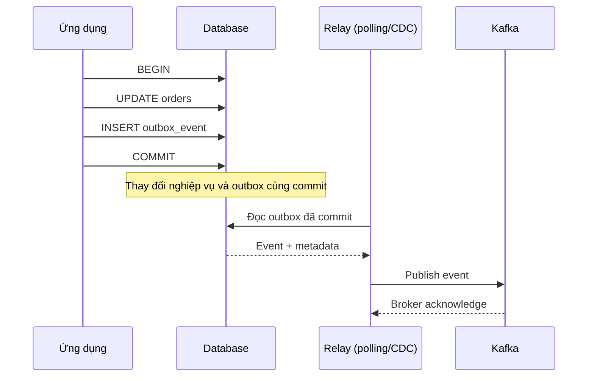
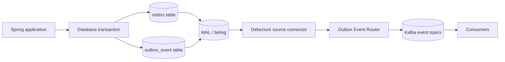

# Đọc outbox bằng polling hoặc CDC

Transactional outbox giải quyết một lỗi phổ biến khi ứng dụng vừa cập nhật database vừa phát sự kiện Kafka: database commit thành công nhưng việc gửi Kafka thất bại, hoặc Kafka đã nhận sự kiện nhưng database rollback. Thay vì ghi database rồi gửi Kafka bằng hai thao tác độc lập, ứng dụng ghi thay đổi nghiệp vụ và một bản ghi outbox trong cùng transaction database. Một tiến trình relay đọc outbox và chuyển sự kiện sang Kafka.

Có hai cách triển khai relay thường gặp: **polling publisher** truy vấn các hàng chưa gửi theo chu kỳ, còn **CDC (Change Data Capture)** đọc log thay đổi đã commit của database như PostgreSQL WAL hoặc MySQL binlog. Cả hai đều dùng outbox làm ranh giới bền vững giữa transaction nghiệp vụ và việc phát sự kiện, nhưng khác nhau về độ trễ, tải database, cơ chế checkpoint và vận hành.

## 1. Outbox bảo đảm điều gì?

Giả sử một request xác nhận đơn hàng cần cập nhật bảng `orders` và phát `OrderConfirmed` sang Kafka. Nếu code làm hai thao tác riêng:

```text
UPDATE orders ...;       -- database commit
KafkaTemplate.send(...); -- gửi Kafka
```

thì có một cửa sổ lỗi giữa hai hệ thống. Database có thể đã commit nhưng ứng dụng chết trước khi gửi Kafka. Nếu gửi Kafka trước rồi database rollback, consumer lại nhận một sự kiện cho thay đổi chưa tồn tại.

Outbox chuyển hai thay đổi database thành một transaction:



Nếu transaction database rollback, cả thay đổi nghiệp vụ lẫn outbox đều không xuất hiện. Nếu commit, outbox tồn tại bền vững để relay có thể gửi sau, kể cả ứng dụng đã kết thúc request. Outbox không tạo một transaction phân tán giữa database và Kafka; nó lưu ý định phát sự kiện cùng transaction nghiệp vụ rồi chuyển tiếp theo cơ chế retry.

## 2. Thiết kế bảng outbox

Một bảng outbox thường có các trường sau:

| Trường | Vai trò |
|---|---|
| `id` | Event ID duy nhất, dùng truy vết và deduplicate |
| `aggregatetype` | Loại aggregate, ví dụ `Order` |
| `aggregateid` | ID aggregate, ví dụ `order-42`; thường dùng làm Kafka key |
| `type` | Loại sự kiện, ví dụ `OrderConfirmed` |
| `payload` | Nội dung event, thường là JSON hoặc dữ liệu theo schema |
| `created_at` | Thời điểm tạo outbox record |
| `published_at` | Thời điểm polling relay xác nhận đã publish, nếu dùng polling |
| `attempts` | Số lần relay thử gửi, nếu cần quản lý retry trong bảng |

Ví dụ PostgreSQL:

```sql
CREATE TABLE outbox_event (
    id            UUID PRIMARY KEY,
    aggregatetype  VARCHAR(100) NOT NULL,
    aggregateid    VARCHAR(200) NOT NULL,
    type           VARCHAR(200) NOT NULL,
    payload        JSONB NOT NULL,
    created_at     TIMESTAMPTZ NOT NULL DEFAULT now(),
    published_at   TIMESTAMPTZ,
    attempts       INTEGER NOT NULL DEFAULT 0,
    locked_by      VARCHAR(200),
    locked_until   TIMESTAMPTZ
);

CREATE INDEX idx_outbox_unpublished
    ON outbox_event (created_at, id)
    WHERE published_at IS NULL;
```

Đây là schema minh họa cho polling. Nếu dùng CDC, cột `published_at` không bắt buộc vì connector theo dõi vị trí trong transaction log; việc đánh dấu mỗi hàng là đã gửi thường không thuộc đường đi CDC. Có thể vẫn cần cột thời gian tạo và cơ chế retention/cleanup riêng.

Chọn kiểu `payload` và schema theo hợp đồng dữ liệu của hệ thống. Event nên chứa dữ liệu đủ để consumer hiểu sự kiện mà không cần truy vấn ngược trạng thái hiện tại nếu nghiệp vụ yêu cầu event bất biến. Không nên lưu password, token hoặc dữ liệu cá nhân không cần thiết trong outbox vì nội dung này sẽ được sao chép sang Kafka và các hệ thống downstream.

## 3. Ghi thay đổi nghiệp vụ và outbox trong cùng transaction

Điều kiện cốt lõi là thao tác cập nhật aggregate và insert outbox phải dùng cùng database transaction, cùng transaction manager và cùng database resource.

Ví dụ với Spring:

```java
@Service
public class OrderApplicationService {
    private final OrderRepository orderRepository;
    private final OutboxRepository outboxRepository;
    private final ObjectMapper objectMapper;

    @Transactional
    public void confirmOrder(String orderId) {
        Order order = orderRepository.findById(orderId)
                .orElseThrow(() -> new OrderNotFoundException(orderId));

        order.confirm();
        orderRepository.save(order);

        OrderConfirmed event = new OrderConfirmed(
                order.getId(), order.getVersion(), order.getConfirmedAt());

        outboxRepository.save(new OutboxEvent(
                UUID.randomUUID(),
                "Order",
                order.getId(),
                "OrderConfirmed",
                toJson(event)
        ));
    }

    private String toJson(Object event) {
        try {
            return objectMapper.writeValueAsString(event);
        } catch (JsonProcessingException e) {
            throw new IllegalStateException("Cannot serialize outbox event", e);
        }
    }
}
```

Ví dụ giả định các repository cùng tham gia một transaction do Spring quản lý. Nếu outbox nằm ở database khác, hoặc một phần thao tác dùng transaction manager khác, atomicity không còn được bảo đảm. `KafkaTemplate.send()` không nên được xem là phần thay thế cho insert outbox trong transaction này.

Nếu serialize event thất bại trước khi commit, transaction nên rollback để không có thay đổi nghiệp vụ thiếu outbox. Một lựa chọn khác là lưu payload dạng cấu trúc trong database rồi serialize ở relay, nhưng khi đó cần quản lý schema/version và lỗi serialize ở đường relay.

## 4. Cách 1: Polling publisher

Polling publisher là một tiến trình hoặc scheduled job định kỳ truy vấn outbox để tìm các hàng chưa publish. Nó claim một batch, gửi event sang Kafka, đợi broker xác nhận rồi đánh dấu hàng tương ứng đã publish.

Luồng xử lý:

1. Poller truy vấn các hàng `published_at IS NULL` theo thứ tự cần thiết.
2. Claim hàng để nhiều poller không đồng thời xử lý cùng một batch.
3. Publish từng event sang Kafka, dùng `aggregateid` làm key khi cần ordering theo aggregate.
4. Chờ kết quả gửi thành công theo chính sách producer.
5. Chỉ sau khi broker xác nhận, cập nhật `published_at`.
6. Nếu gửi lỗi, giữ hàng ở trạng thái có thể retry và áp dụng backoff.

### Claim hàng an toàn với nhiều instance

Nếu nhiều poller cùng chạy, một mẫu thường dùng trong PostgreSQL là `FOR UPDATE SKIP LOCKED`. Mỗi transaction claim một nhóm hàng mà poller khác chưa khóa:

```sql
BEGIN;

WITH picked AS (
    SELECT id
    FROM outbox_event
    WHERE published_at IS NULL
      AND (locked_until IS NULL OR locked_until < now())
    ORDER BY created_at, id
    FOR UPDATE SKIP LOCKED
    LIMIT 100
)
UPDATE outbox_event AS e
SET attempts = e.attempts + 1,
    locked_by = :worker_id,
    locked_until = now() + interval '60 seconds'
FROM picked
WHERE e.id = picked.id
RETURNING e.*;

COMMIT;
```

Đoạn SQL trên claim batch bằng lease rồi commit transaction trước khi gửi Kafka. Poller chỉ được xử lý các hàng mang `locked_by` của chính nó; nếu xử lý lâu hơn lease, cần gia hạn `locked_until`. Khi worker chết, lease hết hạn và worker khác có thể claim lại. Chọn lease dài hơn thời gian xử lý batch thông thường và có metric/cảnh báo cho lease hết hạn. Nếu giữ row lock trong suốt lúc gọi Kafka, transaction database sẽ dài và giữ lock khi chờ mạng; cách này thường làm tăng contention và không nên dùng cho thời gian gửi không giới hạn.

Ví dụ cập nhật trạng thái sau khi publish thành công:

```sql
UPDATE outbox_event
SET published_at = now(), locked_by = NULL, locked_until = NULL
WHERE id = :event_id
  AND locked_by = :worker_id
  AND published_at IS NULL;
```

Điều kiện claim token ngăn một worker cũ cập nhật trạng thái của lease đã được worker khác tiếp quản. Khi worker lỗi, lease hết hạn để event có thể được claim lại. Trong triển khai thực tế, nên kiểm tra số hàng được cập nhật; nếu bằng 0 thì lease đã bị thu hồi hoặc event đã được xử lý bởi tiến trình khác.

### Cửa sổ duplicate của polling

Giả sử Kafka đã nhận event và trả acknowledge, nhưng poller crash trước khi cập nhật `published_at`. Lần poll tiếp theo thấy hàng vẫn chưa publish và gửi lại event. Đây là cửa sổ duplicate bình thường của mô hình polling at-least-once.

Không thể khắc phục cửa sổ này bằng cách đánh dấu `published_at` trước khi gửi: nếu poller crash sau khi đánh dấu nhưng trước khi Kafka nhận event, sự kiện sẽ bị mất khỏi luồng retry. Vì vậy, thứ tự an toàn là publish trước, đánh dấu sau và thiết kế consumer idempotent theo `id`.

### Ordering và polling

`ORDER BY created_at, id` chỉ xác định thứ tự lấy batch, chưa đủ để bảo đảm thứ tự phát ra Kafka khi có nhiều poller, nhiều batch hoặc retry. Ví dụ, event version 2 của một đơn hàng có thể được gửi trước version 1 nếu hai poller xử lý song song và một lần gửi bị chậm.

Nếu cần ordering theo aggregate:

- Dùng `aggregateid` làm Kafka record key để cùng aggregate đi vào cùng partition.
- Không để hai poller phát đồng thời các event của cùng aggregate nếu thứ tự là bắt buộc.
- Có thể claim theo aggregate hoặc partition công việc, hoặc chỉ cho phép một publisher xử lý tuần tự mỗi nhóm key.
- Đưa `aggregate_version`/sequence vào event để consumer phát hiện event thiếu hoặc đến sai thứ tự.

Kafka chỉ bảo đảm thứ tự trong một partition theo thứ tự record được ghi vào partition. Kafka không thể sửa thứ tự đã bị relay đảo trước khi publish.

## 5. Cách 2: Đọc outbox bằng CDC

CDC relay đọc các thay đổi đã commit từ transaction log của database thay vì liên tục truy vấn bảng outbox. Với PostgreSQL, nguồn log thường là WAL thông qua logical decoding; với MySQL là binlog. Debezium là lựa chọn phổ biến để đọc CDC và phát record vào Kafka.

Luồng CDC:

1. Ứng dụng commit thay đổi nghiệp vụ và insert outbox trong cùng transaction.
2. Database ghi transaction vào log bền vững.
3. Debezium connector đọc log và nhận các thay đổi đã commit.
4. Outbox Event Router SMT chuyển row outbox thành Kafka event với topic, key, payload và metadata phù hợp.
5. Kafka Connect lưu source offset của connector để tiếp tục đọc sau restart.



CDC quan sát thay đổi đã commit trong log nên không cần query liên tục `WHERE published_at IS NULL`. Nó cũng không cần cập nhật từng outbox row thành published; checkpoint là source offset trong Kafka Connect. Tuy nhiên, database log retention, replication slot/binlog position và connector health trở thành thành phần quan trọng của độ bền dữ liệu.

## 6. Outbox Event Router với Debezium

Debezium cung cấp Outbox Event Router SMT để biến change event của bảng outbox thành message nghiệp vụ. Một convention phổ biến dùng các cột:

| Cột | Ý nghĩa trong Outbox Event Router mặc định |
|---|---|
| `id` | Event ID, thường được đưa vào header để truy vết |
| `aggregatetype` | Loại aggregate, thường dùng để định tuyến topic |
| `aggregateid` | Khóa aggregate, thường trở thành Kafka message key |
| `type` | Loại event, ví dụ `OrderConfirmed` |
| `payload` | Nội dung event |

Ví dụ worker connector config rút gọn cho PostgreSQL:

```json
{
  "name": "orders-outbox-cdc",
  "config": {
    "connector.class": "io.debezium.connector.postgresql.PostgresConnector",
    "database.hostname": "postgres",
    "database.port": "5432",
    "database.user": "debezium",
    "database.password": "${file:/opt/connect/secrets.properties:db.password}",
    "database.dbname": "orders",
    "topic.prefix": "orders-db",
    "plugin.name": "pgoutput",
    "table.include.list": "public.outbox_event",
    "transforms": "outbox",
    "transforms.outbox.type": "io.debezium.transforms.outbox.EventRouter"
  }
}
```

Đây là cấu hình minh họa dựa trên convention mặc định của Outbox Event Router. Cần đối chiếu tên thuộc tính, quyền database, publication/replication slot và phiên bản Debezium đang triển khai. Không gửi password dạng rõ trong REST request hoặc lưu trong Git; dùng ConfigProvider/secret store và phân quyền phù hợp.

Với convention mặc định, Event Router thường định tuyến theo `aggregatetype` và dùng `aggregateid` làm key. Có thể tùy chỉnh tên cột, route topic, header và cách expand JSON payload bằng các thuộc tính SMT. Nếu bảng thực tế dùng tên khác, phải cấu hình mapping khớp với schema bảng. Không đổi tên cột trong database rồi giả định SMT tự nhận diện.

Payload JSON nên được giữ dưới dạng cấu trúc mong muốn. Nếu database trả payload dưới dạng JSON string, cấu hình SMT/Converter cần bảo đảm consumer nhận được JSON object hay bytes đúng theo hợp đồng; tránh vô tình serialize JSON thành chuỗi có dấu ngoặc kép bao ngoài. Hãy kiểm thử record thực tế từ topic bằng consumer và kiểm tra key, header, topic cùng schema.

## 7. Polling và CDC khác nhau như thế nào?

| Tiêu chí | Polling publisher | CDC với Debezium |
|---|---|---|
| Cách đọc | Query các hàng chưa publish theo chu kỳ | Đọc transaction log của database |
| Độ trễ | Phụ thuộc polling interval, batch và tải query | Thường gần thời gian thực sau khi transaction commit và log được đọc |
| Tải database | Query/index, lock hoặc lease trên bảng outbox | Đọc WAL/binlog; cần duy trì log và replication slot |
| Trạng thái checkpoint | Trạng thái publish/claim trong bảng outbox | Source offset trong Kafka Connect |
| Duplicate | Có thể xảy ra sau Kafka ack trước khi đánh dấu published | Có thể xảy ra khi record đã được phát nhưng source offset chưa commit/flush, tùy semantics và cấu hình |
| Ordering | Cần thiết kế claim và publisher concurrency | Theo thứ tự log/partition mà connector phát; ordering toàn cục vẫn không tự có giữa các Kafka partition |
| Cleanup | Có thể xóa/partition dữ liệu đã publish theo retention | Cần cleanup outbox và quản lý WAL/binlog retention độc lập |
| Vận hành | Đơn giản hơn nếu ứng dụng đã có scheduler và Kafka producer | Cần Connect cluster, Debezium plugin, replication slot và quyền CDC |
| Phù hợp | Lưu lượng vừa phải, muốn ít thành phần và kiểm soát query | Cần độ trễ thấp, lưu lượng lớn hoặc muốn tách relay khỏi ứng dụng |

Không có lựa chọn tốt nhất cho mọi trường hợp. Polling thường dễ triển khai và dễ hiểu, nhưng query/claim có thể tạo tải lên database khi lưu lượng lớn. CDC giảm query polling và tận dụng transaction log, nhưng thêm hạ tầng Connect và yêu cầu vận hành log retention/replication slot.

## 8. Chọn polling khi nào?

Polling phù hợp khi:

- Hệ thống có lượng event vừa phải và polling interval đáp ứng SLA.
- Muốn dùng database hiện có mà chưa cần triển khai Kafka Connect/Debezium.
- Outbox table có thể đánh index tốt theo trạng thái và thời gian tạo.
- Team cần kiểm soát trực tiếp batch size, retry, lease và logic phát event.
- Có thể chấp nhận độ trễ theo chu kỳ poll và thiết kế idempotency cho duplicate.

Một số điểm cần thiết kế:

- Index phù hợp với điều kiện lọc, ví dụ partial index cho `published_at IS NULL`.
- Batch size vừa phải để không giữ quá nhiều row lock hoặc lease.
- Lease timeout lớn hơn thời gian xử lý batch dự kiến và có cơ chế gia hạn nếu cần.
- Retry có backoff, giới hạn và cảnh báo cho event lỗi lâu ngày.
- Cleanup theo retention sau khi đã publish và có thời gian phục hồi cần thiết.
- Metric về số hàng chờ, tuổi event cũ nhất, thời gian publish và số lần retry.

Nếu poller chạy trong cùng ứng dụng Spring, có thể dùng `@Scheduled` để kích hoạt job. Nhưng cần tránh một instance chạy job chồng lấn với chính nó và cần cơ chế claim an toàn khi có nhiều replica. `@Scheduled` không tự bảo đảm distributed lock.

## 9. Chọn CDC khi nào?

CDC phù hợp khi:

- Cần độ trễ thấp và lưu lượng event lớn.
- Database hỗ trợ transaction log/CDC ổn định.
- Tổ chức đã vận hành Kafka Connect hoặc sẵn sàng triển khai worker cluster.
- Muốn tách việc đọc outbox khỏi vòng đời ứng dụng nghiệp vụ.
- Có thể quản lý replication slot, WAL/binlog retention, connector offset và plugin version.

Với PostgreSQL, cần cấu hình logical replication và quyền cho user CDC, chọn plugin output phù hợp như `pgoutput`, và theo dõi replication slot. Nếu connector ngừng đọc quá lâu, slot có thể giữ WAL khiến dung lượng đĩa tăng. Cần cảnh báo về retained WAL, slot lag và trạng thái connector.

Với MySQL, cần bật binlog theo định dạng và row image mà connector yêu cầu, cấp quyền replication phù hợp và bảo đảm binlog retention đủ dài để connector phục hồi sau gián đoạn. Nếu binlog cần thiết đã bị xóa trước khi connector resume, có thể phải chạy snapshot/backfill.

CDC không loại bỏ nhu cầu quản lý outbox table. Các hàng outbox vẫn tăng theo thời gian nếu không có retention/cleanup. Cleanup cần được thiết kế để không làm mất dữ liệu trước khi connector đã đọc log tương ứng và cần kiểm thử cách connector xử lý delete/tombstone event của bảng outbox.

## 10. Ordering và nhiều event của cùng aggregate

Nếu một đơn hàng có các event `OrderCreated`, `OrderPaid`, `OrderShipped`, consumer thường cần nhận theo thứ tự. Dùng `aggregateid` làm Kafka key giúp các event của cùng đơn hàng đi vào cùng partition. Tuy nhiên, key chỉ bảo đảm chúng cùng partition; relay vẫn phải phát theo đúng thứ tự tạo.

Với polling, nhiều worker có thể claim các event cùng aggregate và gửi không theo thứ tự nếu không có khóa/partitioning công việc. Có thể:

- Dùng một poller tuần tự khi throughput thấp và ordering đơn giản.
- Chia aggregate vào các lane cố định để mỗi lane xử lý tuần tự.
- Claim theo aggregate và chỉ cho phép một event chưa hoàn tất trên mỗi aggregate.
- Thêm `aggregate_version` để consumer kiểm tra version tiếp theo.

Với CDC, thứ tự commit trong database log được Debezium đọc theo transaction log, nhưng record có thể được phân phối sang nhiều Kafka partition nếu topic/key không được cấu hình đúng. Dùng aggregate ID làm key và kiểm tra partitioner/converter thực tế. Không giả định consumer đọc nhiều partition sẽ có thứ tự toàn cục.

## 11. Duplicate và idempotency ở consumer

Cả polling lẫn CDC có thể phát lại event trong một số cửa sổ lỗi. Consumer nên coi event delivery là at-least-once trừ khi có một bảo đảm exactly-once cụ thể đã được chứng minh cho toàn bộ đường đi.

Một mẫu deduplication trong database:

```sql
CREATE TABLE processed_event (
    event_id UUID PRIMARY KEY,
    processed_at TIMESTAMPTZ NOT NULL DEFAULT now()
);
```

Consumer xử lý trong cùng transaction database:

1. Insert `event_id` vào `processed_event`.
2. Nếu vi phạm unique key, event đã được xử lý; không áp dụng side effect lần nữa.
3. Nếu insert thành công, thực hiện cập nhật nghiệp vụ.
4. Commit cả dấu deduplicate và thay đổi nghiệp vụ cùng nhau.

Nếu xử lý side effect ở hệ thống khác, unique table trong database consumer không tự làm side effect đó atomic. Cần idempotency key ở API đích, outbox tiếp theo hoặc một quy trình bù trừ phù hợp.

## 12. Cleanup và retention của outbox

Outbox là bảng tăng liên tục. Nếu không cleanup, index và dung lượng database sẽ tăng, làm chậm cả transaction nghiệp vụ lẫn relay.

Với polling:

- Chỉ cleanup những event đã được xác nhận publish và đã qua thời gian giữ lại phục vụ điều tra/replay.
- Có thể partition bảng theo thời gian và drop partition cũ nếu chính sách retention cho phép.
- Không xóa hàng chỉ vì đã gửi request Kafka; cần xác nhận broker đã acknowledge và trạng thái publish đã được lưu.

Với CDC:

- Theo dõi connector đã đọc qua các transaction chứa outbox event trước khi xóa hàng.
- Có thể cleanup theo thời gian/partition sau một khoảng retention an toàn.
- Kiểm thử việc phát sinh delete/tombstone khi xóa hàng và cấu hình SMT để không phát nhầm event nghiệp vụ.
- Quản lý WAL/binlog retention riêng; cleanup outbox table không thay thế việc kiểm soát replication slot.

Không nên xóa thủ công Connect offset hoặc Kafka internal topic để giải phóng dung lượng. Hãy dùng cơ chế retention của database, Kafka và connector đúng mục đích.

## 13. Quan sát và xử lý sự cố

| Chỉ số/tình trạng | Polling | CDC |
|---|---|---|
| Backlog | Số hàng chưa publish | Độ trễ connector so với transaction log và tốc độ topic output |
| Tuổi event cũ nhất | `now() - min(created_at)` trong hàng chưa publish | So sánh timestamp commit/source với thời điểm hiện tại nếu có |
| Lỗi gửi | Kafka producer error, số attempts, lease hết hạn | Connector/task FAILED, producer/transaction error trong worker log |
| Tiến độ checkpoint | `published_at` và trạng thái claim | Source offset/connector offset và replication position |
| Tài nguyên nguồn | Query latency, lock wait, index/table growth | WAL/binlog retained, replication slot lag, disk usage |
| Duplicate | Kafka ack trước khi đánh dấu published | Replay sau restart hoặc source offset chưa được commit |

Khi event không xuất hiện trong Kafka:

1. Xác nhận transaction nghiệp vụ đã commit và hàng outbox tồn tại.
2. Nếu polling, kiểm tra điều kiện query, claim/lease, lỗi producer và cập nhật `published_at`.
3. Nếu CDC, kiểm tra connector status, task log, table include list, replication slot/binlog, source offset và SMT routing.
4. Kiểm tra topic, key, converter và schema; event có thể đã được phát sang topic khác do routing.
5. Sau khi khắc phục, xác định event nào cần replay và kiểm tra consumer idempotency trước khi chạy lại.

Nếu event bị phát trùng, tìm event ID trong outbox và Kafka, so sánh thời điểm broker acknowledge với thời điểm poller đánh dấu publish hoặc source offset được commit. Không xóa event trùng trực tiếp khỏi topic để che vấn đề; xử lý duplicate ở consumer hoặc bằng quy trình sửa dữ liệu có kiểm soát.

## 14. Checklist chọn và triển khai relay

- Ghi thay đổi nghiệp vụ và outbox trong cùng một database transaction.
- Đặt event ID ổn định, aggregate ID, event type và payload theo hợp đồng dữ liệu.
- Chọn polling nếu cần đơn giản và lưu lượng/SLA phù hợp; chọn CDC nếu cần log-based capture và sẵn sàng vận hành Connect.
- Với polling, claim batch an toàn giữa nhiều instance, dùng lease, retry/backoff và chỉ đánh dấu published sau Kafka acknowledge.
- Với CDC, cấu hình Debezium đúng database log, table filter, source offset, SMT và secret provider.
- Dùng aggregate ID làm Kafka key khi cần ordering theo aggregate; kiểm tra thứ tự phát của relay.
- Thiết kế consumer idempotent vì duplicate vẫn có thể xảy ra.
- Theo dõi backlog, tuổi event, task status, source offset, producer error và database log retention.
- Có retention/cleanup cho outbox, nhưng chỉ xóa sau khi đã qua cửa sổ phục hồi và điều tra.
- Kiểm thử các tình huống crash ở từng ranh giới: trước publish, sau broker ack, trước checkpoint/đánh dấu published và trong lúc cleanup.

Polling đọc các hàng outbox chưa publish bằng query và trạng thái claim; CDC đọc thay đổi đã commit từ WAL/binlog rồi chuyển thành Kafka event. Cả hai tận dụng transaction database để không mất mối liên hệ giữa thay đổi nghiệp vụ và ý định phát sự kiện. Lựa chọn phụ thuộc độ trễ, tải database, khả năng vận hành CDC và yêu cầu ordering; trong cả hai trường hợp, cần xử lý duplicate, idempotency và retention như những phần cốt lõi của thiết kế.
