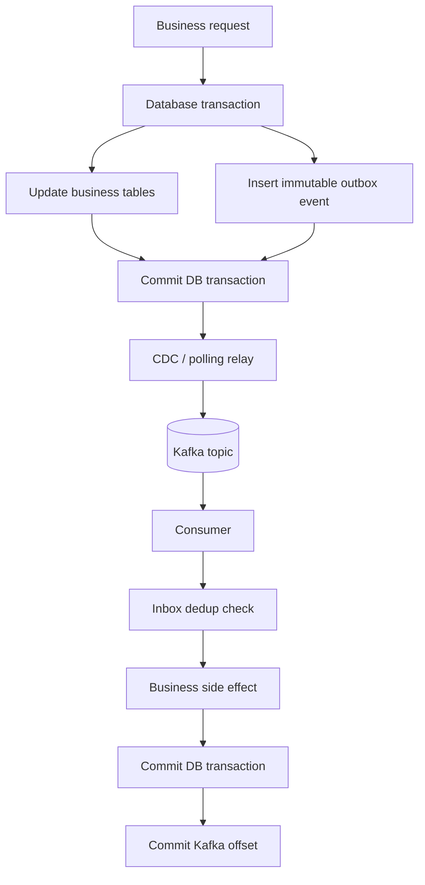

# Khử trùng, replay và dọn dữ liệu outbox

## Mục tiêu

Transactional outbox giúp ghi thay đổi nghiệp vụ và event vào cùng một transaction database. CDC connector như Debezium đọc transaction log rồi chuyển outbox event sang Kafka; một polling publisher cũng có thể đọc các hàng pending và gửi event bằng Kafka producer. Cả hai cách đều có thể phát lại event sau lỗi, vì vậy consumer phải xử lý duplicate an toàn. Bảng outbox cũng tăng liên tục, nên cần chiến lược archive và cleanup không làm mất event chưa được chuyển đi hoặc phá vỡ khả năng replay.

Bài học này tập trung vào ba phần liên kết với nhau:

- **Khử trùng (deduplication):** nhận diện cùng một event được giao nhiều lần và ngăn side effect lặp.
- **Replay:** phát lại event từ Kafka, DLT hoặc kho outbox/archive để phục hồi projection và xử lý lỗi.
- **Cleanup:** dọn outbox/inbox và dữ liệu replay theo watermark, retention và yêu cầu audit.

Sau bài học này, bạn có thể:

- Thiết kế event identity ổn định qua retry, CDC, DLT và replay.
- Phân biệt producer idempotence với consumer deduplication.
- Dùng inbox table để commit dedup marker và side effect database trong cùng transaction.
- Lập kế hoạch replay bằng consumer group riêng hoặc replay topic.
- Xác định điều kiện an toàn để xóa/archive outbox rows.
- Phân biệt cleanup của polling outbox với CDC outbox.
- Tính retention cho inbox/dedup store dựa trên replay horizon.
- Theo dõi backlog, CDC lag, duplicate rate và cleanup watermark.

## 1. Vòng đời event trong transactional outbox

Trong outbox pattern, service cập nhật dữ liệu nghiệp vụ và thêm một outbox row trong cùng database transaction. Khi transaction commit, cả hai thay đổi cùng tồn tại. Một relay đọc outbox rồi publish event lên Kafka.



Outbox giải quyết dual-write giữa database và Kafka ở phía producer. Nó không bảo đảm mỗi consumer chỉ nhận event đúng một lần. Ví dụ relay có thể publish thành công rồi process crash trước khi ghi nhận tiến độ; sau restart, cùng event được gửi lại. Consumer cũng có thể hoàn tất database transaction rồi crash trước khi Kafka offset được commit.

Vì vậy thiết kế thực tế thường theo at-least-once delivery và dùng event ID cùng idempotent consumer để side effect chỉ có hiệu lực một lần trong phạm vi nghiệp vụ đã xác định.

## 2. Event identity phải ổn định

Mỗi outbox event cần một ID riêng, được tạo khi event nghiệp vụ phát sinh và lưu bền vững trong outbox row. ID không được sinh lại khi relay retry hoặc khi event được replay.

Một schema outbox minh họa:

```sql
CREATE TABLE outbox_event (
    event_id       UUID PRIMARY KEY,
    aggregate_type TEXT NOT NULL,
    aggregate_id   TEXT NOT NULL,
    event_type     TEXT NOT NULL,
    event_version  INTEGER NOT NULL,
    aggregate_seq  BIGINT,
    payload        JSONB NOT NULL,
    occurred_at    TIMESTAMPTZ NOT NULL,
    created_at     TIMESTAMPTZ NOT NULL DEFAULT now()
);

CREATE INDEX ix_outbox_created_at
    ON outbox_event (created_at);

CREATE INDEX ix_outbox_aggregate
    ON outbox_event (aggregate_type, aggregate_id, aggregate_seq);
```

Đây là schema minh họa cho PostgreSQL. Tên cột cần khớp với cấu hình Debezium Outbox Event Router hoặc polling relay đang dùng. Nếu hệ thống cần giữ source metadata, tenant, correlation ID hoặc causation ID, bổ sung theo contract đã thống nhất.

### 2.1. Không nhầm các loại ID

| Giá trị | Nhận diện điều gì? | Có giữ nguyên khi replay? |
|---|---|---|
| `event_id` | Một event nghiệp vụ cụ thể | Có |
| `aggregate_id` | Aggregate/domain entity phát event | Có |
| `aggregate_seq` | Thứ tự event trong aggregate nếu domain cung cấp | Có |
| Kafka topic/partition/offset | Vị trí của một lần ghi trong Kafka | Không nhất thiết; replay sang topic khác tạo vị trí mới |
| `replay_run_id` | Một lần chạy replay | Không; mỗi replay run có ID mới |
| `consumer_name` | Phạm vi dedup của một consumer/projection | Ổn định theo logical consumer, có thể version hóa khi rebuild |

Không dùng `aggregate_id` làm `event_id`: một aggregate phát nhiều event hợp lệ. Không dùng Kafka offset làm event ID: offset chỉ có ý nghĩa trong một partition của một topic. Không dùng payload hash làm ID duy nhất nếu hai event giống payload nhưng là hai sự kiện nghiệp vụ khác nhau.

### 2.2. Tạo ID cùng transaction nghiệp vụ

Event ID nên được tạo một lần trước khi ghi outbox row và lưu trong cùng transaction với thay đổi nghiệp vụ:

```sql
BEGIN;

UPDATE orders
SET status = 'PAID', updated_at = now()
WHERE order_id = 'ORD-1001';

INSERT INTO outbox_event (
    event_id, aggregate_type, aggregate_id, event_type,
    event_version, aggregate_seq, payload, occurred_at
)
VALUES (
    '01934d4e-9b6a-7c2f-8b1a-6d3c2a7e1001',
    'Order', 'ORD-1001', 'OrderPaid', 1, 3,
    '{"orderId":"ORD-1001","status":"PAID"}'::jsonb,
    now()
);

COMMIT;
```

Nếu transaction rollback, cả update và outbox insert đều rollback. Nếu transaction commit, relay có thể gửi event nhiều lần nhưng luôn dùng cùng `event_id`.

## 3. Producer idempotence không thay consumer deduplication

Kafka producer idempotence giúp xử lý retry ở protocol producer để giảm duplicate do retry request trong một producer session. Nó không loại bỏ mọi duplicate phát sinh khi ứng dụng restart, relay đọc lại outbox row hoặc operator replay event vào topic.

| Cơ chế | Bảo vệ phạm vi nào? | Không giải quyết điều gì? |
|---|---|---|
| Producer idempotence | Retry send trong protocol producer theo producer ID/sequence | Cùng event được publish lại bởi producer session khác hoặc replay tool |
| Kafka transaction | Atomic giữa các ghi Kafka và consumer offsets được đưa vào transaction | Database/API bên ngoài Kafka; replay nghiệp vụ |
| Consumer deduplication | Side effect của một consumer đối với cùng event identity | Ordering sai, event bị thiếu hoặc event ID được tạo không ổn định |
| Inbox pattern | Dedup marker và database side effect trong cùng DB transaction | Side effect ngoài DB nếu không có cơ chế riêng |

Vì thế, bật `enable.idempotence=true` là cấu hình producer tốt nhưng không đủ để consumer bỏ qua event trùng. Hãy giữ event ID trong payload hoặc metadata được bảo toàn end-to-end và dùng nó tại consumer.

## 4. Inbox table để deduplicate consumer

Inbox table lưu event ID đã được consumer xử lý. Unique constraint là hàng rào cuối cùng chống race khi hai lần giao cùng event đến gần nhau.

Ví dụ PostgreSQL:

```sql
CREATE TABLE consumer_inbox (
    consumer_name TEXT NOT NULL,
    event_id      UUID NOT NULL,
    processed_at  TIMESTAMPTZ NOT NULL DEFAULT now(),
    source_topic  TEXT,
    source_partition INTEGER,
    source_offset BIGINT,
    PRIMARY KEY (consumer_name, event_id)
);
```

`consumer_name` tạo phạm vi dedup riêng cho mỗi logical consumer. Hai projection khác nhau có thể xử lý cùng event ID một cách độc lập. Nếu rebuild projection, có thể dùng namespace consumer mới thay vì xóa inbox của projection đang chạy.

### 4.1. Ghi inbox và side effect trong cùng transaction

Trình tự an toàn:

1. Bắt đầu database transaction.
2. Insert `(consumer_name, event_id)` vào inbox bằng thao tác insert-if-absent.
3. Nếu insert không tạo row vì unique conflict, event đã được xử lý; kết thúc transaction và bỏ qua side effect.
4. Nếu insert thành công, cập nhật projection/business tables.
5. Commit database transaction.
6. Chỉ sau khi listener xử lý thành công, để container commit Kafka offset.

Ví dụ SQL:

```sql
BEGIN;

WITH accepted AS (
    INSERT INTO consumer_inbox (
        consumer_name, event_id, source_topic,
        source_partition, source_offset
    )
    VALUES (
        'order-projection-v1',
        '01934d4e-9b6a-7c2f-8b1a-6d3c2a7e1001',
        'orders.events', 2, 1042
    )
    ON CONFLICT (consumer_name, event_id) DO NOTHING
    RETURNING event_id
)
UPDATE order_projection
SET status = 'PAID'
WHERE order_id = 'ORD-1001'
  AND EXISTS (SELECT 1 FROM accepted);

COMMIT;
```

CTE `accepted` chỉ trả row khi insert inbox thành công. Nếu event đã có trong inbox, CTE rỗng và projection không đổi. Inbox insert và update projection nằm cùng transaction nên nếu update lỗi, inbox insert cũng rollback.

Không dùng mô hình `SELECT exists` rồi mới `INSERT` như hàng rào duy nhất: hai consumer/worker có thể cùng đọc kết quả chưa tồn tại trước khi một bên insert. Unique constraint và `INSERT ... ON CONFLICT DO NOTHING` xử lý race ở database.

### 4.2. Ví dụ Spring service

```java
@Service
public class OrderProjectionService {
    private final InboxRepository inboxRepository;
    private final OrderProjectionRepository projectionRepository;

    public OrderProjectionService(
            InboxRepository inboxRepository,
            OrderProjectionRepository projectionRepository) {
        this.inboxRepository = inboxRepository;
        this.projectionRepository = projectionRepository;
    }

    @Transactional
    public boolean applyOnce(OrderPaid event, SourcePosition source) {
        boolean firstDelivery = inboxRepository.insertIfAbsent(
                "order-projection-v1",
                event.eventId(),
                source.topic(), source.partition(), source.offset());

        if (!firstDelivery) {
            return false; // Duplicate: transaction không tạo side effect mới.
        }

        projectionRepository.markPaid(event.orderId());
        return true;
    }
}
```

Listener chỉ acknowledge sau khi service transaction hoàn tất:

Với tham số `Acknowledgment`, cấu hình listener container ở `MANUAL` hoặc `MANUAL_IMMEDIATE` và tắt auto commit. Nếu dùng AckMode do container quản lý như `RECORD`, có thể để listener trả về sau khi service transaction hoàn tất để container commit theo mode đó.

```java
@KafkaListener(topics = "orders.events", groupId = "order-projection")
public void onOrderPaid(ConsumerRecord<String, OrderPaid> record,
                        Acknowledgment acknowledgment) {
    SourcePosition source = new SourcePosition(
            record.topic(), record.partition(), record.offset());

    projectionService.applyOnce(record.value(), source);
    acknowledgment.acknowledge();
}
```

Ví dụ giả định service được gọi qua Spring proxy để `@Transactional` có hiệu lực. Method trả về sau khi database transaction commit; listener mới acknowledge Kafka. Nếu process crash giữa DB commit và Kafka offset commit, event được giao lại, inbox phát hiện duplicate và side effect không lặp.

### 4.3. Inbox không làm side effect ngoài DB trở nên atomic

Nếu consumer gửi email hoặc gọi REST API rồi mới ghi inbox, crash có thể gửi lặp. Nếu ghi inbox trước rồi gọi API, crash có thể đánh dấu đã xử lý dù API chưa thực hiện. Inbox chỉ atomic với các thao tác nằm trong cùng database transaction.

Với side effect ngoài DB, dùng idempotency key do dịch vụ đích hỗ trợ, transactional outbox ở phía consumer, hoặc workflow/saga có retry và reconciliation. Đừng tuyên bố exactly-once end-to-end chỉ vì có inbox table.

## 5. Dedupe scope và retention

Deduplication chỉ hiệu lực khi marker còn tồn tại. Nếu xóa inbox row sau 7 ngày nhưng vận hành có thể replay event 30 ngày tuổi, replay có thể chạy side effect lần nữa.

Thời gian giữ inbox nên ít nhất bằng horizon dài nhất mà event có thể quay lại:

\[
T_{inbox} \geq \max(T_{Kafka\ replay}, T_{DLT\ retention}, T_{outbox\ replay}, T_{backup\ restore}) + T_{safety}
\]

Trong đó:

- `T_Kafka replay`: khoảng thời gian operator có thể reset/replay từ topic.
- `T_DLT retention`: thời gian DLT còn giữ event để redrive.
- `T_outbox replay`: thời gian event còn trong outbox/archive có thể phát lại.
- `T_backup restore`: độ tuổi tối đa của dữ liệu có thể được khôi phục và phát lại.
- `T_safety`: biên an toàn cho sự cố, điều tra và lịch cleanup.

Nếu hệ thống cho phép replay vô thời hạn từ archive, retention inbox hữu hạn không đủ để bảo đảm dedup tuyệt đối. Khi đó cần giữ dedup ledger lâu dài, hoặc side effect phải idempotent theo business state/sequence để event cũ không thể áp dụng lại sai.

Không xóa inbox theo một lịch cố định chỉ vì bảng lớn. Hãy gắn cleanup với replay policy, retention Kafka/DLT, backup window và khả năng phục hồi đã được thống nhất.

## 6. Replay là gì và khi nào cần?

Replay là đọc và xử lý lại event đã tồn tại. Nó thường dùng để:

- Rebuild read model/search index sau khi thay đổi schema hoặc logic projection.
- Khôi phục dữ liệu sau lỗi consumer hoặc bug nghiệp vụ đã được sửa.
- Re-drive record từ DLT sau khi sửa payload/consumer.
- Chuyển dữ liệu sang pipeline mới.
- Đối soát dữ liệu sau một sự cố mất đồng bộ.

Replay không giống retry. Retry thử lại một lần xử lý thất bại trong cùng workflow; replay là chủ động đọc lại một phạm vi lịch sử, có thể gồm nhiều event đã từng xử lý thành công.

Trước khi replay, cần xác định:

1. Nguồn replay: Kafka topic, DLT, outbox table hay archive.
2. Phạm vi: toàn topic, partition, offset range, timestamp range hoặc danh sách event ID.
3. Đích replay: consumer group hiện tại, group mới, replay topic hay projection mới.
4. Side effect nào được phép chạy lại.
5. Cách giữ event identity, ordering, rate limit và audit.
6. Tiêu chí dừng, rollback và đối soát sau replay.

## 7. Replay từ Kafka bằng consumer group riêng

Cách an toàn để rebuild một projection là chạy consumer group mới từ offset sớm nhất còn được Kafka giữ lại. Group mới có committed offset riêng nên không thay đổi tiến độ của consumer group đang phục vụ production.

Ví dụ cấu hình:

```properties
group.id=order-projection-rebuild-20261120
enable.auto.commit=false
auto.offset.reset=earliest
isolation.level=read_committed
```

`auto.offset.reset=earliest` chỉ áp dụng khi group chưa có committed offset hoặc offset cũ không còn hợp lệ; nó không tự reset group đã có offset. Consumer mới chỉ đọc dữ liệu còn tồn tại theo retention/compaction của topic. Với compacted topic, replay không nhất thiết khôi phục mọi thay đổi lịch sử; nó có thể chỉ còn trạng thái cuối cùng của key.

### 7.1. Khi nào reset offset group hiện tại?

Reset group hiện tại ảnh hưởng consumer đang chạy và có thể làm toàn bộ event trong phạm vi được đọc lại. Chỉ thực hiện khi đã dừng mọi member của group, lưu offset hiện tại, xác định rõ topic/partition/range và có kế hoạch idempotency.

Dry run trước:

```bash
bin/kafka-consumer-groups.sh --bootstrap-server localhost:9092 \
  --group order-projection \
  --topic orders.events \
  --reset-offsets --to-earliest --dry-run
```

Nếu kết quả đúng, mới chạy `--execute` trong maintenance window đã chuẩn bị. Không reset offset của group production chỉ để kiểm tra replay. Với group mới, không cần reset offset trước khi chạy; dùng `auto.offset.reset=earliest`.

### 7.2. Rebuild projection không làm gián đoạn production

Một quy trình phổ biến:

1. Tạo projection table mới, ví dụ `order_projection_v2`.
2. Tạo consumer group mới `order-projection-v2-rebuild`.
3. Đọc từ earliest offset còn được giữ và áp dụng event vào projection v2.
4. Theo dõi lag cho tới khi bắt kịp luồng mới.
5. Đối soát số lượng, tổng tiền, trạng thái và invariant nghiệp vụ.
6. Chuyển read traffic sang projection v2 theo cách có thể rollback.
7. Giữ projection cũ trong thời gian quan sát rồi mới dọn.

Inbox cho projection mới nên có namespace riêng, ví dụ `order-projection-v2`. Không xóa inbox của projection v1 đang chạy chỉ để v2 có thể đọc lại event.

## 8. Replay từ DLT hoặc replay topic

DLT thường giữ event đã hết retry hoặc không thể xử lý tự động. Sau khi sửa lỗi, operator có thể re-drive record về topic chính hoặc topic replay chuyên dụng.

Khi republish:

- Giữ nguyên `event_id`, `event_type`, `event_version`, `aggregate_id`, `occurred_at` và payload gốc nếu không có bước migration được phê duyệt.
- Ghi `replay_run_id`, `replayed_at`, nguồn DLT và source coordinates vào header/audit metadata.
- Giữ Kafka key theo aggregate để duy trì partitioning mong muốn.
- Consumer vẫn chạy inbox deduplication; event đã xử lý thành công có thể được bỏ qua.
- Nếu payload cần sửa, lưu bản gốc và ghi nhận migration/version/actor để audit.

Ví dụ header khi replay:

```text
event-id: 01934d4e-9b6a-7c2f-8b1a-6d3c2a7e1001
replay-run-id: replay-20261120-ops-01
replayed-at: 2026-11-20T11:30:00Z
replay-source: orders.DLT
original-topic: orders.events
original-partition: 2
original-offset: 1042
```

Không thay `event_id` bằng `replay_run_id`. Nếu mỗi lần replay tạo event ID mới, inbox sẽ không nhận ra duplicate và side effect có thể lặp. `replay_run_id` nhận diện lần chạy; `event_id` nhận diện event gốc.

### 8.1. Replay topic có kiểm soát

Một topic như `orders.replay` có thể dùng làm kênh re-drive riêng. Cần định nghĩa rõ consumer nào subscribe, có transform/ACL riêng không, có giữ key gốc không và khi nào xóa dữ liệu replay. Không để consumer production subscribe đồng thời cả topic gốc và replay topic nếu chưa có dedup và ordering strategy.

Nếu cùng event được đọc từ topic gốc và replay topic đồng thời, hai bản có thể tới consumer theo thứ tự khác nhau. Inbox chống side effect duplicate nhưng không tự sửa thứ tự nghiệp vụ. Với event có sequence, consumer cần kiểm tra sequence/version và xử lý event đến muộn theo policy.

## 9. Replay từ outbox/archive

Outbox là nguồn event gốc nếu còn lưu payload và metadata đầy đủ. Có thể tạo một replay job đọc phạm vi event đã chọn, rồi publish sang replay topic. Cần tránh để replay job cạnh tranh với relay bình thường trên cùng các hàng pending.

Với replay từ archive:

- Lưu payload gốc, event ID, event type/version, aggregate ID/sequence và timestamp.
- Lưu metadata nguồn như database/table, thời điểm export và checksum nếu cần kiểm chứng.
- Chọn range rõ ràng, có manifest về số event và thời gian.
- Publish với key gốc và event ID gốc.
- Thêm replay run metadata riêng.
- Rate limit để không làm nghẽn consumer production hoặc broker.
- Đối soát số event đọc, gửi, nhận, duplicate và lỗi.

Không replay bằng cách copy raw database rows sang Kafka nếu schema/outbox format đã thay đổi mà không có migration. Replay job phải deserialize theo schema/version gốc và áp dụng migration có kiểm soát khi cần.

## 10. Ordering khi replay

Kafka bảo đảm thứ tự trong một partition, không bảo đảm thứ tự toàn topic. Nếu event của một aggregate cần được áp dụng theo trình tự, hãy giữ Kafka key là aggregate ID và cân nhắc `aggregate_seq` do domain phát ra.

Ví dụ:

| Aggregate | Sequence | Event |
|---|---:|---|
| `ORD-1001` | 1 | `OrderCreated` |
| `ORD-1001` | 2 | `OrderPaid` |
| `ORD-1001` | 3 | `OrderShipped` |

Consumer có thể kiểm tra sequence:

- `seq == last_seq + 1`: áp dụng event.
- `seq <= last_seq`: event cũ/duplicate; bỏ qua hoặc audit theo policy.
- `seq > last_seq + 1`: phát hiện gap; tạm dừng aggregate, retry hoặc yêu cầu backfill.

Đừng dùng timestamp đơn lẻ làm thứ tự tuyệt đối vì clock có thể lệch. Nếu event cũ được replay sau event mới, sequence giúp phát hiện stale event. Nếu business operation có thể được áp dụng lại theo trạng thái hiện tại, cần xác định quy tắc merge/compensation rõ ràng.

Tăng partition count hoặc thay partitioner có thể làm thay đổi mapping key. Khi replay cần ordering theo aggregate, giữ partitioning strategy phù hợp hoặc chạy migration có kế hoạch.

## 11. Cleanup outbox: phân biệt polling relay và CDC relay

Không có một câu lệnh cleanup phù hợp cho mọi outbox. Cách xác định row đã được publish phụ thuộc relay.

| Mô hình | Dấu hiệu tiến độ | Điều kiện cleanup |
|---|---|---|
| Polling publisher | Trạng thái row như `PENDING`, `IN_FLIGHT`, `PUBLISHED`, hoặc lease/attempt metadata | Chỉ cleanup row đã publish thành công, qua thời gian giữ audit/replay và không còn lease đang hoạt động |
| CDC/Debezium | Source offset/log position như LSN, binlog/GTID hoặc SCN; connector/task progress | Chỉ cleanup sau khi connector đã đọc và lưu tiến độ vượt qua transaction chứa insert, đồng thời retention/recovery window vẫn được đáp ứng |
| Archive + replay | Manifest/archive watermark và checksum | Chỉ xóa bản online sau khi archive được xác minh và replay policy cho phép |

Không coi Kafka consumer offset là watermark cleanup của outbox. Consumer offset thuộc topic-partition; CDC source offset thuộc database transaction log; polling publisher có trạng thái riêng trong database.

## 12. Cleanup với polling publisher

Polling publisher thường đọc các row chưa publish, gửi Kafka record, rồi cập nhật trạng thái. Thứ tự phải là **Kafka send được xác nhận trước, sau đó mới đánh dấu published**. Nếu đánh dấu published trước khi gửi, crash có thể làm mất event. Nếu send thành công rồi crash trước khi update trạng thái, event có thể được gửi lại; event ID và consumer inbox xử lý duplicate.

### 12.1. Schema trạng thái và lease

Ví dụ mở rộng bảng outbox cho polling relay:

```sql
ALTER TABLE outbox_event
    ADD COLUMN delivery_status TEXT NOT NULL DEFAULT 'PENDING',
    ADD COLUMN attempt_count INTEGER NOT NULL DEFAULT 0,
    ADD COLUMN lease_owner TEXT,
    ADD COLUMN lease_until TIMESTAMPTZ,
    ADD COLUMN published_at TIMESTAMPTZ;

CREATE INDEX ix_outbox_pending
    ON outbox_event (delivery_status, created_at);
```

CDC outbox thường không cần cập nhật trạng thái delivery trên từng row; phần trạng thái này chủ yếu dành cho polling relay. Nếu dùng Debezium, update `PUBLISHED` có thể tạo thêm change record và tăng write amplification, nên chỉ thêm khi có lý do vận hành cụ thể.

### 12.2. Claim một batch bằng lease

Worker có thể claim row theo batch, commit claim nhanh rồi publish ngoài transaction DB:

```sql
BEGIN;

WITH picked AS (
    SELECT event_id
    FROM outbox_event
    WHERE delivery_status = 'PENDING'
       OR (delivery_status = 'IN_FLIGHT' AND lease_until < now())
    ORDER BY created_at
    LIMIT 100
    FOR UPDATE SKIP LOCKED
)
UPDATE outbox_event o
SET delivery_status = 'IN_FLIGHT',
    lease_owner = 'relay-03',
    lease_until = now() + interval '2 minutes',
    attempt_count = attempt_count + 1
FROM picked
WHERE o.event_id = picked.event_id
RETURNING o.*;

COMMIT;
```

Sau khi claim commit, worker gửi các record tới Kafka và chờ broker acknowledgment theo producer policy. Với mỗi record gửi thành công, cập nhật:

```sql
UPDATE outbox_event
SET delivery_status = 'PUBLISHED',
    published_at = now(),
    lease_owner = NULL,
    lease_until = NULL
WHERE event_id = :event_id
  AND delivery_status = 'IN_FLIGHT'
  AND lease_owner = 'relay-03';
```

Nếu send thất bại, giải phóng lease hoặc để lease hết hạn để worker khác retry. Nếu worker crash sau Kafka acknowledgment nhưng trước update `PUBLISHED`, row sẽ được claim lại và gửi duplicate. Đây là cửa sổ at-least-once có chủ đích; không đảo thứ tự thành mark-published trước send.

Lease phải dài hơn thời gian xử lý batch dự kiến hoặc được gia hạn khi worker vẫn hoạt động. Nếu lease quá ngắn, worker thứ hai có thể claim lại row trong khi worker đầu còn publish. Cần lease owner/token và điều kiện update để worker cũ không ghi đè trạng thái của worker mới.

### 12.3. Cleanup row đã publish

Sau khi qua retention/replay window, có thể xóa theo batch. Ví dụ PostgreSQL:

```sql
WITH expired AS (
    SELECT event_id
    FROM outbox_event
    WHERE delivery_status = 'PUBLISHED'
      AND published_at < now() - interval '14 days'
    ORDER BY published_at
    LIMIT 5000
)
DELETE FROM outbox_event o
USING expired e
WHERE o.event_id = e.event_id;
```

`14 days` và batch size chỉ là ví dụ, phải xuất phát từ replay/audit requirement và tải database. Chỉ xóa row `PUBLISHED`; không xóa `PENDING`, `IN_FLIGHT` còn lease hoặc row có trạng thái không xác định. Nếu event cần replay lâu hơn, archive trước khi xóa.

Batch delete giúp giới hạn transaction duration và lock. Theo dõi table bloat, vacuum/compaction và write amplification; với volume lớn, partition theo thời gian rồi detach/drop partition đã hết hạn có thể rẻ hơn xóa từng row.

## 13. Cleanup với CDC/Debezium outbox

Với CDC relay, database transaction log là nguồn tiến độ. Debezium đọc insert event trong WAL/binlog/redo log và ghi source offset để tiếp tục sau restart. Outbox row thường được thiết kế append-only; không cần update `published=true` cho mỗi event.

Cleanup cần xét ít nhất:

1. Connector/task đang hoạt động ổn định và không ở trạng thái snapshot/recovery bất thường.
2. Source offset đã được lưu bền vững vượt qua transaction commit chứa outbox insert cần cleanup.
3. Thời gian giữ row đáp ứng yêu cầu audit, replay và điều tra.
4. Database log retention/replication slot/binlog retention đủ để connector phục hồi nếu bị gián đoạn.
5. Archive hoặc backup có thể phục hồi payload nếu cần replay ngoài thời gian giữ online.

CDC source offset là vị trí trong transaction log, không phải ID hoặc offset của từng outbox row. Không thể suy ra watermark an toàn chỉ bằng `MAX(created_at)` hoặc consumer lag Kafka. Cần kết hợp connector progress, database log position, thời gian outage được hỗ trợ và snapshot strategy.

### 13.1. Không xóa theo giờ khi connector đang bị lag

Nếu connector dừng lâu, outbox row có thể vẫn cần giữ cho audit/snapshot/recovery. Với CDC streaming từ transaction log, delete row trong bảng không xóa ngược change event đã nằm trong WAL/binlog; tuy nhiên, cleanup quá sớm có thể làm mất dữ liệu cần cho snapshot/re-snapshot, archive hoặc replay. Nếu database log bị truncate trước khi connector đọc kịp, connector có thể không phục hồi được từ source offset cũ.

Đặt cảnh báo khi source lag hoặc replication slot/binlog retention tiến gần ngưỡng. Không chạy cleanup destructive nếu connector đang failed, source offset không rõ, snapshot đang chạy hoặc database log đã có nguy cơ bị mất.

### 13.2. Delete change và Outbox Event Router

Xóa row outbox tạo thêm một database change. Tùy connector, phiên bản Debezium và cấu hình Event Router, delete/tombstone không được coi như một event nghiệp vụ mới. Hãy kiểm tra chính xác hành vi delete của connector/SMT đang dùng và xác minh topic đầu ra không nhận nhầm cleanup record thành business event.

Không bật một transform/filter chỉ dựa vào giả định chung về mọi phiên bản. Test insert, update (nếu có), delete và tombstone trong môi trường staging trước khi cleanup production. Nếu outbox table chỉ cần append, cân nhắc partition drop sau watermark thay vì phát hàng loạt delete row.

### 13.3. Partitioned outbox

Với lượng event lớn, partition bảng theo `created_at` có thể giúp cleanup bằng cách detach/drop partition cũ. Điều kiện là:

- Partition đã qua CDC safety watermark và replay/audit retention.
- Không còn transaction đang ghi vào partition đó.
- Archive/checksum hoàn tất nếu cần lưu lịch sử.
- Schema/connector vẫn hoạt động đúng khi partition bị detach/drop.
- Lịch drop không làm mất event thuộc transaction commit muộn hoặc event được backdate.

Không partition chỉ theo ngày nếu event có thể đến trễ hoặc timestamp nghiệp vụ không phản ánh thời điểm commit. Nên dùng timestamp tạo row ở database và quy tắc xử lý late event rõ ràng.

## 14. Archive trước khi cleanup

Nếu cần replay dài hạn hoặc audit, archive outbox event trước khi xóa khỏi database online. Archive có thể là object storage, data lake hoặc một topic retention dài hơn; chọn định dạng có thể đọc lại và kiểm chứng.

Một archive manifest nên lưu:

- Source database/table và khoảng thời gian/ID được export.
- Số lượng event và số lượng theo event type/partition nếu có.
- Checksum/hash của file hoặc batch.
- Schema/event version và serializer/encoding.
- Thời điểm export, job ID và operator/system identity.
- Trạng thái xác minh sau upload và vị trí object.

Chỉ cleanup bản online sau khi archive upload thành công, checksum xác minh và restore/replay test định kỳ chứng minh dữ liệu đọc lại được. Một object tồn tại nhưng không thể deserialize không phải archive hữu ích.

Không archive secret hoặc PII vượt quá mục đích lưu trữ. Áp dụng encryption, access control, retention/legal hold và chính sách xóa dữ liệu cá nhân cho archive như đối với database.

## 15. Cleanup inbox và dedup ledger

Inbox có thể lớn tương đương số event consumer đã xử lý. Có một số cách quản lý:

| Chiến lược | Khi phù hợp | Rủi ro |
|---|---|---|
| TTL theo `processed_at` | Replay horizon hữu hạn và được kiểm soát | Replay event cũ sau TTL có thể tạo side effect lại |
| Partition theo thời gian | Inbox rất lớn, cần drop dữ liệu theo kỳ | Phải bảo đảm partition retention không ngắn hơn replay horizon |
| Giữ marker lâu dài | Side effect không thể lặp và event có thể replay vô hạn | Tăng dung lượng; cần archive/partitioning |
| Rebuild namespace mới | Tạo projection mới mà projection cũ vẫn hoạt động | Tốn storage trong giai đoạn chạy song song |

Ví dụ xóa inbox đã hết hạn trong một batch PostgreSQL:

```sql
WITH expired AS (
    SELECT consumer_name, event_id
    FROM consumer_inbox
    WHERE processed_at < now() - interval '90 days'
    ORDER BY processed_at
    LIMIT 10000
)
DELETE FROM consumer_inbox i
USING expired e
WHERE i.consumer_name = e.consumer_name
  AND i.event_id = e.event_id;
```

`90 days` chỉ là ví dụ. Chỉ chạy khi policy replay, DLT, outbox/archive và backup restore đều có horizon ngắn hơn thời gian giữ inbox cộng safety margin. Nếu không thể chứng minh điều đó, chưa nên xóa dedup marker.

## 16. Xử lý crash window và duplicate

Các cửa sổ lỗi cần được thiết kế trước:

| Thời điểm crash | Điều có thể xảy ra | Cách bảo vệ |
|---|---|---|
| DB transaction commit trước khi relay đọc | Outbox row còn pending/chưa được CDC đọc | Relay tiếp tục từ trạng thái/offset bền vững |
| Kafka send thành công, polling relay chưa mark published | Event được gửi lại | Giữ event ID, consumer inbox dedupe |
| Debezium publish xong nhưng source offset chưa flush | Connector có thể đọc và publish lại sau restart | Consumer dedupe theo event ID |
| Consumer DB commit xong, Kafka offset chưa commit | Consumer nhận lại event | Inbox và side effect cùng DB transaction |
| Replay publish xong, replay job chưa ghi checkpoint | Batch replay có thể gửi lại | Event ID ổn định, checkpoint idempotent và audit replay run |
| Cleanup archive upload xong nhưng chưa xác minh | Bản online vẫn cần giữ | Chỉ cleanup sau checksum/restore verification |
| Inbox row bị cleanup quá sớm | Replay cũ có thể tạo side effect lại | Retention theo replay horizon, không chỉ theo dung lượng |

At-least-once chấp nhận duplicate để tránh mất event. Mục tiêu là duplicate không tạo side effect sai và operator có thể truy vết mỗi lần phát lại.

## 17. Replay có giới hạn tốc độ và điểm dừng

Replay có thể cạnh tranh tài nguyên với traffic hiện tại. Cần giới hạn throughput và theo dõi ảnh hưởng đến consumer production.

Các giới hạn có thể áp dụng:

- Records/second và bytes/second.
- Số partition chạy đồng thời.
- Số worker/producer in-flight.
- Bounded queue và pause/resume khi sink chậm.
- Giới hạn thời gian replay hoặc cửa sổ thời gian mỗi batch.
- Stop threshold khi error rate, consumer lag hoặc DB load vượt ngưỡng.

Không tăng tốc replay vượt năng lực database đích. Nếu replay cùng consumer group production, replay backlog có thể làm tăng lag và trì hoãn event mới. Với projection rebuild, group mới và bảng đích mới thường dễ kiểm soát hơn.

Replay job cần checkpoint theo partition hoặc theo source event ID. Checkpoint không thay event ID; nếu job crash sau publish nhưng trước checkpoint, batch được gửi lại và consumer dedupe.

## 18. Ví dụ quy trình replay DLT

Giả sử `OrderPaid` bị đưa vào `orders.DLT` do consumer lỗi schema. Sau khi deploy consumer hỗ trợ schema mới:

1. Chọn danh sách DLT record theo thời gian hoặc event ID.
2. Xác minh nguyên nhân lỗi đã được khắc phục và consumer mới tương thích payload.
3. Tạo `replay_run_id` và ghi manifest số record dự kiến.
4. Re-publish payload với key gốc, giữ `event_id` và metadata nghiệp vụ.
5. Thêm header replay run và source coordinates.
6. Rate limit và theo dõi consumer lag/error/DLT count.
7. Đối soát số record đọc, publish, duplicate và success.
8. Chỉ đánh dấu replay run hoàn tất khi mọi record có kết quả cuối cùng hoặc được đưa vào danh sách exception.

Không xóa DLT gốc ngay sau khi replay publish. Giữ DLT theo retention điều tra và xác minh consumer đã xử lý. Nếu replay lỗi, operator cần có thể tiếp tục từ checkpoint hoặc tạo run mới mà không làm mất nguồn gốc.

## 19. Monitoring và cảnh báo

| Metric | Ý nghĩa | Cảnh báo khi |
|---|---|---|
| Outbox row count | Số event còn trong bảng online | Tăng liên tục hoặc vượt capacity dự kiến |
| Oldest pending age | Tuổi row chưa được publish ở polling relay | Vượt SLO publish delay |
| In-flight lease age | Worker giữ row nhưng chưa hoàn tất | Lease hết hạn liên tục hoặc stuck |
| Publish attempts/failure | Retry và lỗi gửi Kafka | Tăng đột biến hoặc cùng event retry quá lâu |
| Debezium source lag | Khoảng cách giữa source log position và connector progress | Gần ngưỡng WAL/binlog retention |
| Kafka consumer lag | Consumer chưa xử lý kịp output | Replay làm lag vượt ngưỡng |
| Duplicate detection count | Số event bị inbox bỏ qua | Tăng bất thường có thể chỉ ra relay restart/replay loop |
| Inbox table size/oldest marker | Dung lượng và horizon dedup | Dung lượng gần capacity hoặc cleanup vượt retention policy |
| Replay throughput/error | Tốc độ và lỗi của replay run | Error/lag/DB load vượt stop threshold |
| Cleanup rows/latency | Số row xóa và thời gian cleanup | Transaction/lock/bloat tăng bất thường |

Với CDC, theo dõi thêm replication slot retained WAL hoặc binlog age/space, connector task status và source offset persistence. Một connector `RUNNING` không có nghĩa lag đang an toàn; cần xem tiến độ thực tế và xu hướng.

## 20. Thực hành: inbox dedup, replay và cleanup

Lab có thể dùng PostgreSQL, Kafka, Debezium Outbox Event Router hoặc polling relay. Mục tiêu là chứng minh duplicate không tạo side effect thứ hai và cleanup không xóa event còn cần thiết.

### 20.1. Tạo business row và outbox row

1. Tạo bảng `orders`, `outbox_event` và `consumer_inbox` theo ví dụ.
2. Trong một transaction, tạo/cập nhật order và insert event với UUID ổn định.
3. Commit transaction rồi kiểm tra outbox row tồn tại.
4. Dùng CDC connector hoặc polling relay để đưa event lên topic `orders.events`.
5. Xác nhận key là `aggregate_id` và payload có `event_id`.

### 20.2. Gửi cùng event hai lần

1. Publish lại cùng payload và cùng `event_id`.
2. Consumer xử lý lần đầu: inbox insert thành công, projection update commit.
3. Consumer nhận lần thứ hai: inbox unique constraint báo duplicate, projection không update lần nữa.
4. Xác nhận duplicate counter tăng và business state không đổi.

### 20.3. Crash giữa DB commit và Kafka offset commit

1. Dừng listener ngay sau khi service transaction commit nhưng trước acknowledgment/offset commit.
2. Restart cùng consumer group.
3. Xác nhận event được giao lại.
4. Inbox phát hiện event đã xử lý và listener có thể acknowledge mà không lặp side effect.

### 20.4. Replay bằng group mới

1. Tạo projection table và inbox namespace mới.
2. Chạy consumer group mới từ earliest offset còn được giữ.
3. Replay event theo key/partition, giới hạn throughput.
4. Đối soát projection mới với projection hiện tại hoặc nguồn database.
5. Chuyển read traffic sau khi xác nhận kết quả.

### 20.5. Cleanup có watermark

1. Với polling relay, đánh dấu một số event đã publish sau khi Kafka ack thành công.
2. Archive event cũ và xác minh checksum.
3. Chỉ cleanup event `PUBLISHED` đã vượt retention.
4. Với CDC, kiểm tra source connector progress và database log retention trước khi xóa/drop partition.
5. Giữ inbox marker ít nhất bằng replay horizon đã phê duyệt.
6. Thử replay một event vẫn còn trong archive để xác minh quy trình hoạt động.

Ghi lại số row trước/sau cleanup, watermark, connector source position, replay manifest, duplicate count và kết quả đối soát.

## 21. Các lỗi thiết kế thường gặp

| Lỗi | Hậu quả | Cách khắc phục |
|---|---|---|
| Sinh event ID mới mỗi lần relay retry | Consumer coi cùng event là event mới | Lưu ID trong outbox và giữ nguyên khi retry |
| Dùng producer idempotence thay inbox | Duplicate từ process restart/replay vẫn tạo side effect | Dedup theo event ID ở consumer |
| Ghi inbox sau side effect trong transaction khác | Crash có thể lặp side effect | Inbox và DB side effect cùng transaction |
| Dùng `SELECT exists` làm dedup guard | Race giữa các worker | Unique constraint + insert-if-absent |
| Xóa inbox theo TTL ngắn hơn replay horizon | Event cũ replay có thể chạy lại side effect | Tính retention theo mọi nguồn replay và backup |
| Mark published trước Kafka send | Crash làm mất event | Kafka ack trước rồi mới mark published |
| Giữ transaction DB mở trong lúc chờ Kafka lâu | Lock và transaction bloat | Claim bằng lease, publish ngoài transaction, cập nhật trạng thái sau ack |
| Cleanup CDC outbox chỉ theo `created_at` | Xóa dữ liệu cần cho snapshot/recovery/audit | Dùng source progress, log retention và replay/archive policy |
| Nhầm consumer offset với CDC source offset | Chọn sai watermark cleanup | Theo dõi từng loại offset đúng hệ thống |
| Replay vào group production không kế hoạch | Duplicate side effect và lag tăng | Group mới hoặc maintenance/reset có dry run |
| Replay tạo event ID mới | Inbox không nhận diện duplicate | Giữ ID gốc, thêm replay run ID riêng |
| Replay song song phá ordering | Aggregate nhận event sai thứ tự | Giữ key/sequence và giới hạn concurrency theo partition/aggregate |
| Drop outbox partition trước archive verification | Mất khả năng replay lịch sử | Archive, checksum và restore test trước cleanup |

## 22. Checklist production

- [ ] Mỗi event có `event_id` ổn định được tạo cùng transaction nghiệp vụ.
- [ ] Outbox lưu payload và metadata đủ để replay.
- [ ] Consumer có unique inbox key theo `(consumer_name, event_id)` hoặc định danh tương đương.
- [ ] Inbox insert và side effect database nằm trong cùng DB transaction.
- [ ] Kafka offset chỉ được xác nhận sau khi DB transaction hoàn tất.
- [ ] Side effect ngoài DB có idempotency key/outbox/saga phù hợp.
- [ ] Producer idempotence được hiểu đúng phạm vi, không thay consumer dedup.
- [ ] Replay có source, range, destination, replay run ID, rate limit và stop criteria.
- [ ] Replay giữ event ID, aggregate key/sequence và timestamp nghiệp vụ.
- [ ] Rebuild projection dùng group/namespace riêng và có bước đối soát.
- [ ] Polling relay chỉ mark published sau Kafka acknowledgment.
- [ ] CDC cleanup dựa trên connector/source progress, log retention và snapshot/recovery policy.
- [ ] Outbox/archive có manifest, checksum và restore/replay test.
- [ ] Inbox retention không ngắn hơn replay/DLT/outbox/backup horizon.
- [ ] Cleanup chạy theo batch/partition, có theo dõi lock, bloat và dung lượng.
- [ ] Có dashboard cho outbox age, CDC lag, duplicate, inbox size, replay và cleanup.
- [ ] Đã thử crash ở các điểm giữa DB commit, Kafka publish, offset commit và cleanup.

## 23. Câu hỏi tự kiểm tra

1. Vì sao transactional outbox vẫn có thể phát cùng event nhiều lần?
2. Producer idempotence khác consumer inbox deduplication như thế nào?
3. Vì sao `event_id` phải được tạo và lưu cùng outbox row?
4. Tại sao inbox insert và side effect database phải nằm trong cùng transaction?
5. Vì sao unique constraint an toàn hơn `SELECT exists` trong dedup flow?
6. Nếu consumer commit DB nhưng chưa commit Kafka offset, điều gì xảy ra khi restart?
7. Vì sao retention inbox phải dựa trên replay horizon dài nhất?
8. Rebuild projection bằng consumer group mới có lợi ích gì?
9. Replay từ DLT cần giữ metadata nào và tạo metadata nào mới?
10. Vì sao replay cần giữ Kafka key và aggregate sequence?
11. Cleanup polling outbox khác cleanup CDC outbox ở điểm nào?
12. Vì sao không dùng Kafka consumer offset làm watermark xóa outbox?
13. Điều kiện nào cần thỏa trước khi drop partition outbox?
14. Archive cần manifest/checksum và restore test để làm gì?
15. Khi nào có thể cleanup inbox marker an toàn?

## Tài liệu tham khảo

- [Debezium — Outbox Event Router](https://debezium.io/documentation/reference/stable/transformations/outbox-event-router.html): cấu hình Outbox Event Router, event ID, aggregate key và payload.
- [Debezium — PostgreSQL Connector](https://debezium.io/documentation/reference/stable/connectors/postgresql.html): logical decoding, replication slot, source offsets và WAL retention.
- [Debezium — MySQL Connector](https://debezium.io/documentation/reference/stable/connectors/mysql.html): binlog, GTID và recovery của CDC connector.
- [Apache Kafka — Producer Configurations](https://kafka.apache.org/documentation/#producerconfigs): idempotent producer và delivery settings.
- [Apache Kafka — Transactions](https://kafka.apache.org/documentation/#transactions): atomic write và consume-transform-produce trong Kafka.
- [Apache Kafka — Consumer Configurations](https://kafka.apache.org/documentation/#consumerconfigs): `auto.offset.reset`, committed offsets và isolation level.

> Outbox bảo đảm business change và event được ghi cùng database transaction; inbox bảo vệ side effect consumer trước duplicate. Replay phải giữ event identity và ordering, còn cleanup chỉ được chạy khi source progress, replay horizon và archive đã đủ an toàn.
