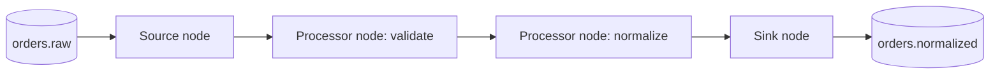
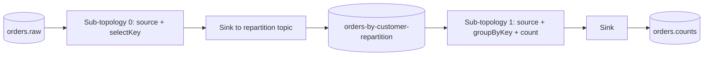

# Topology, source node, processor node và sink node

Kafka Streams biến một ứng dụng xử lý dữ liệu thành một **topology** gồm các node nối với nhau bằng những luồng record. Ba loại node cơ bản là **source node** để đọc dữ liệu từ Kafka topic, **processor node** để lọc/biến đổi/tổng hợp dữ liệu và **sink node** để ghi kết quả ra topic khác. Topology mô tả luồng xử lý logic; Kafka Streams runtime dựa trên topology và partition của topic để tạo task, phân phối công việc cho stream thread và khôi phục state khi cần.

Hiểu ba loại node giúp đọc được sơ đồ topology, xác định dữ liệu đi qua đâu, nơi nào đổi key hoặc repartition, node nào cần state store và topic nào là đầu ra. Bài viết dùng cả Kafka Streams DSL và Processor API để minh họa cách xây dựng topology, kiểm tra cấu trúc và liên hệ topology với partition/task trong runtime.

## 1. Topology là gì?

Topology là đồ thị xử lý được khai báo trong ứng dụng Kafka Streams. Đồ thị có các node thực hiện thao tác và các cạnh biểu diễn luồng record từ node này sang node khác.

Một pipeline đơn giản:



Ví dụ, ứng dụng đọc topic `orders.raw`, bỏ record không hợp lệ, chuẩn hóa trạng thái đơn hàng rồi ghi kết quả vào `orders.normalized`. Source node xác định đầu vào, các processor node chứa logic, sink node xác định đầu ra.

Topology thường được khai báo bằng `StreamsBuilder` (DSL) hoặc `Topology` (Processor API). Khi gọi `build()`, Kafka Streams tạo một mô tả topology mà runtime dùng để khởi tạo stream tasks.

Topology là cấu trúc logic của ứng dụng, không phải một Kafka topic, consumer group hoặc thread. Một node không tương ứng một thread; cùng một topology có thể được thực thi song song trên nhiều task và stream thread.

## 2. Ba loại node cơ bản

| Node | Vai trò | Đầu vào | Đầu ra |
|---|---|---|---|
| Source node | Đọc record từ một hoặc nhiều Kafka topic | Topic partition và record bytes | Key/value đã deserialize thành kiểu ứng dụng |
| Processor node | Thực hiện logic xử lý record | Record từ source hoặc processor cha | Không phát, phát một hoặc nhiều record tới node con; có thể cập nhật state store |
| Sink node | Ghi record ra Kafka topic | Record từ processor cha | Record được serialize và gửi tới topic đích |

Một topology có thể có nhiều source, processor và sink. Processor node có thể phân nhánh sang nhiều node con hoặc nhiều nhánh có thể hợp nhất. Một sink có thể ghi ra nhiều topic nếu ứng dụng khai báo nhiều sink node; một processor không bắt buộc phải nằm trên đúng một đường thẳng.

### Source node

Source node là điểm đi vào topology. Nó gắn với topic cụ thể hoặc tập topic được chọn bằng pattern, đồng thời xác định cách deserialize key/value và các thiết lập đọc liên quan.

Source node thường chịu trách nhiệm:

- Chọn topic đầu vào.
- Deserialize key và value bằng Serde tương ứng.
- Chuyển record vào topology với timestamp và metadata của Kafka record.
- Tiếp nhận dữ liệu từ các partition được gán cho task.

Source node không tự xử lý nghiệp vụ. Nếu deserialize thất bại, lỗi xảy ra ở ranh giới đọc/deserialize trước khi record được xử lý bình thường trong processor logic.

### Processor node

Processor node thực hiện logic trên record. Ví dụ:

- `filter`: loại record không đạt điều kiện.
- `map`/`mapValues`: biến đổi key hoặc value.
- `flatMap`: tạo nhiều record từ một record.
- `groupByKey`/`aggregate`: nhóm và cập nhật state.
- `join`: kết hợp luồng hoặc bảng theo key/window.
- Processor API tùy chỉnh: đọc/ghi state store, forward record, schedule punctuation.

Processor có thể stateless hoặc stateful. Processor stateful sử dụng state store để lưu kết quả tích lũy; store có thể được changelog vào Kafka để phục hồi sau khi task chuyển sang instance khác.

### Sink node

Sink node là điểm ghi dữ liệu ra Kafka topic. Nó xác định topic đích, cách serialize key/value và có thể dùng partitioner để quyết định partition đích.

Sink node không ghi trực tiếp vào database hoặc HTTP service. Nếu cần ghi sang hệ thống ngoài, thường dùng Kafka Connect sink connector hoặc một thành phần tích hợp riêng; Kafka Streams sink node ghi ra Kafka topic.

## 3. Đọc topology theo hướng dữ liệu

Khi xem một topology, hãy lần theo luồng từ source tới sink:

1. Source đọc topic nào và có bao nhiêu partition?
2. Key/value được deserialize thành kiểu nào?
3. Processor nào lọc hoặc thay đổi record?
4. Có processor nào đổi key hoặc tạo repartition topic không?
5. Có processor stateful nào cần state store/changelog không?
6. Sink ghi tới topic nào, dùng Serde và partitioner nào?

Ví dụ topology:

```text
orders.raw
   |
   v
source-orders
   |
   v
validate-order
   | valid
   v
normalize-status
   |
   v
sink-orders-normalized
   |
   v
orders.normalized
```

Một record có thể bị loại ở `validate-order`, được chuyển sang nhánh lỗi hoặc đi tiếp. Không phải processor nào cũng phát record; một filter có thể không forward record nếu điều kiện sai.

## 4. Xây dựng topology bằng Kafka Streams DSL

DSL cung cấp các phép toán cấp cao trên `KStream`, `KTable` và `GlobalKTable`. Ứng dụng mô tả phép biến đổi, Kafka Streams tạo các processor node tương ứng trong topology.

Ví dụ đọc chuỗi JSON/text từ `orders.raw`, lọc giá trị null, chuẩn hóa chuỗi rồi ghi sang `orders.normalized`:

```java
import org.apache.kafka.common.serialization.Serdes;
import org.apache.kafka.streams.StreamsBuilder;
import org.apache.kafka.streams.Topology;
import org.apache.kafka.streams.kstream.Consumed;
import org.apache.kafka.streams.kstream.KStream;
import org.apache.kafka.streams.kstream.Produced;

StreamsBuilder builder = new StreamsBuilder();

KStream<String, String> orders = builder.stream(
        "orders.raw",
        Consumed.with(Serdes.String(), Serdes.String()));

KStream<String, String> normalized = orders
        .filter((key, value) -> value != null)
        .mapValues(String::trim);

normalized.to(
        "orders.normalized",
        Produced.with(Serdes.String(), Serdes.String()));

Topology topology = builder.build();
System.out.println(topology.describe());
```

Trong ví dụ:

- `builder.stream(...)` tạo source node đọc `orders.raw`.
- `filter(...)` tạo logic processor chỉ forward record có value khác null.
- `mapValues(...)` tạo processor chuẩn hóa value và giữ nguyên key.
- `to(...)` tạo sink node ghi sang `orders.normalized`.
- `builder.build()` hoàn thiện topology để runtime sử dụng.

`Consumed.with(...)` xác định Serde cho đầu vào; `Produced.with(...)` xác định Serde cho đầu ra. Có thể cấu hình default Serde ở `StreamsConfig`, nhưng khai báo rõ tại source/sink giúp topology dễ đọc và tránh nhầm kiểu dữ liệu khi một ứng dụng xử lý nhiều loại topic.

Đây là ví dụ tối giản. Trong ứng dụng thật, cần cấu hình `application.id`, `bootstrap.servers`, default Serde phù hợp, exception handling, state directory và lifecycle của `KafkaStreams`.

## 5. Khởi chạy ứng dụng Kafka Streams

Sau khi tạo topology, ứng dụng truyền nó cùng cấu hình cho `KafkaStreams`:

```java
import java.util.Properties;

import org.apache.kafka.streams.KafkaStreams;
import org.apache.kafka.streams.StreamsConfig;

Properties props = new Properties();
props.put(StreamsConfig.APPLICATION_ID_CONFIG, "orders-normalizer");
props.put(StreamsConfig.BOOTSTRAP_SERVERS_CONFIG, "localhost:9092");
props.put(StreamsConfig.DEFAULT_KEY_SERDE_CLASS_CONFIG,
        Serdes.String().getClass().getName());
props.put(StreamsConfig.DEFAULT_VALUE_SERDE_CLASS_CONFIG,
        Serdes.String().getClass().getName());

KafkaStreams streams = new KafkaStreams(topology, props);
streams.start();

Runtime.getRuntime().addShutdownHook(new Thread(streams::close));
```

`application.id` định danh một Kafka Streams application và được dùng làm consumer group ID cùng prefix cho một số internal resource. Các instance cùng `application.id` tham gia cùng một ứng dụng logic và chia sẻ việc xử lý partition; dùng ID khác sẽ tạo một ứng dụng độc lập với tiến độ và state riêng.

Trong production, nên cấu hình `state.dir`, uncaught exception handler, state listener, metrics reporter và thời gian đóng ứng dụng. Không tạo nhiều `KafkaStreams` instance trong cùng JVM với cùng state directory nếu không có cấu hình riêng phù hợp.

## 6. Source node và topic partition

Source node đọc record từ topic đầu vào. Topic có thể có nhiều partition, và Kafka Streams dùng partition để chia workload thành task có thể chạy song song.

Ví dụ topic `orders.raw` có bốn partition:

```text
orders.raw
  partition 0 ----+
  partition 1 ----+----> source node ----> processor chain
  partition 2 ----+
  partition 3 ----+
```

Source node là một phần của topology logic; partition là đơn vị lưu trữ/ordering trong Kafka. Task là đơn vị xử lý runtime được tạo từ topology và tập partition nguồn. Một task có thể xử lý các partition tương ứng từ nhiều source topic; số task và cách ghép partition phụ thuộc cấu trúc nguồn và yêu cầu partitioning.

Một số hệ quả:

- Thêm partition cho input topic có thể làm tăng khả năng song song của ứng dụng sau khi task được phân phối lại.
- Số stream thread không tự tạo thêm partition; thread chỉ chạy task được giao.
- Nhiều task có thể chạy trên một stream thread.
- Một partition tại một thời điểm chỉ được một task của cùng application xử lý.
- Ordering được bảo đảm trong phạm vi partition, không có thứ tự toàn cục giữa các partition.

Vì vậy, khi thiết kế source topic, cần chọn partition count và key phù hợp với throughput, ordering và số lượng task mong muốn.

## 7. Serde tại source và sink node

Serde là kết hợp `Serializer` và `Deserializer`. Source node cần deserializer để chuyển bytes thành key/value Java; sink node cần serializer để chuyển Java key/value thành bytes.

Ví dụ với `String`:

```java
Consumed.with(Serdes.String(), Serdes.String())
Produced.with(Serdes.String(), Serdes.String())
```

Với JSON, Avro hoặc Protobuf, cần dùng Serde tương ứng và quản lý schema/type resolution phù hợp. Kiểu Serde ở source phải khớp định dạng bytes của topic đầu vào; Serde ở sink phải khớp contract mà consumer downstream mong đợi.

Nếu deserializer không khớp, topology có thể không xử lý được record ngay từ source. Nếu serializer ở sink lỗi, processor có thể đã chạy nhưng output không được ghi thành công. Cần theo dõi serialization/deserialization error riêng với lỗi business logic.

Không dùng `StringSerde` để đọc Avro/Protobuf bytes rồi giả định nội dung sẽ thành JSON. Bytes của format nhị phân cần deserializer tương ứng.

## 8. Processor node stateless và stateful

Processor stateless xử lý record mà không cần lưu trạng thái giữa các record. Ví dụ `filter`, `mapValues`, `selectKey` hoặc chuẩn hóa text.

Processor stateful duy trì state qua nhiều record. Ví dụ:

- Đếm số đơn hàng theo customer.
- Tính tổng tiền theo cửa sổ 5 phút.
- Duy trì bảng trạng thái mới nhất theo key.
- Join stream với table hoặc hai stream theo key/window.

DSL ví dụ đếm số event theo key:

```java
KTable<String, Long> orderCounts = orders
        .groupByKey()
        .count();

orderCounts.toStream().to(
        "orders.counts",
        Produced.with(Serdes.String(), Serdes.Long()));
```

`groupByKey()` yêu cầu key hiện tại có ý nghĩa phân nhóm. `count()` tạo state store để giữ count theo key. Kafka Streams thường ghi changelog cho state store để có thể khôi phục state từ Kafka sau khi task chuyển sang instance khác hoặc local state bị mất.

Stateful operation có thể tạo internal changelog topic; thao tác thay đổi key hoặc repartition trước khi group/join có thể tạo repartition topic. Những topic nội bộ này là một phần topology/runtime, không phải topic output nghiệp vụ do người dùng trực tiếp tạo bằng `to()`.

## 9. Đổi key và repartition node

Key quyết định partition mặc định khi ghi record và là cơ sở cho nhiều thao tác group/join. Nếu processor đổi key, các record cùng entity có thể không còn nằm ở partition tương ứng với key mới.

Ví dụ:

```java
KStream<String, OrderEvent> byCustomer = orders
        .selectKey((orderId, event) -> event.customerId());

KTable<String, Long> counts = byCustomer
        .groupByKey()
        .count();
```

`selectKey()` thay key logic trong stream. Trước một số thao tác cần co-location theo key như `groupByKey()` hoặc join, Kafka Streams có thể chèn repartition step để ghi record sang internal repartition topic rồi đọc lại theo partitioning mới.

Repartition là một lần ghi/đọc Kafka nội bộ, có chi phí serialization, network, disk và thêm độ trễ. Khi xem `Topology.describe()`, có thể thấy các node/topic nội bộ tương ứng, tùy topology và version.

Không phải mọi lần đổi key đều lập tức ghi ra repartition topic. Repartition thường được thực hiện khi một thao tác downstream yêu cầu partitioning theo key mới. Nếu đổi key rồi chỉ map/filter và sink trực tiếp, không nhất thiết phải repartition.

## 10. Sink node và partitioner

Sink node ghi record tới topic đích. Nếu không chỉ định custom partitioner, Kafka producer dùng partitioning mặc định dựa trên key (khi key có giá trị) hoặc chiến lược khác cho record không key, tùy producer/configuration.

Điều này có ý nghĩa với ordering:

- Nếu tất cả event của cùng `orderId` giữ key đó, chúng thường được gửi tới cùng partition của topic đích.
- Nếu processor đổi key, event có thể đi sang partition khác.
- Nếu sink dùng custom partitioner, cách phân phối record có thể khác mặc định.
- Nếu key null, không có bảo đảm co-location theo entity key.

Ví dụ sink DSL:

```java
normalized.to(
        "orders.normalized",
        Produced.with(Serdes.String(), Serdes.String()));
```

Nếu output topic cần key khác input, hãy thay key có chủ đích trước khi sink. Nếu downstream dựa vào ordering theo entity, giữ key ổn định và kiểm tra partitioner/topic partition count.

Sink node chỉ tạo record và gửi tới Kafka topic. Nó không bảo đảm consumer downstream đã xử lý record hoặc database đích đã commit. Nếu cần end-to-end processing guarantee, phải cấu hình processing guarantee, transaction, offset và side effect downstream phù hợp.

## 11. Xây dựng topology trực tiếp bằng Processor API

DSL phù hợp với pipeline phổ biến; Processor API cho phép khai báo rõ source, processor và sink node. Ví dụ dưới đây đọc `orders.raw`, trim value và ghi sang `orders.normalized`:

```java
import org.apache.kafka.common.serialization.StringDeserializer;
import org.apache.kafka.common.serialization.StringSerializer;
import org.apache.kafka.streams.Topology;
import org.apache.kafka.streams.processor.api.Processor;
import org.apache.kafka.streams.processor.api.ProcessorContext;
import org.apache.kafka.streams.processor.api.ProcessorSupplier;
import org.apache.kafka.streams.processor.api.Record;

Topology topology = new Topology();

topology.addSource(
        "orders-source",
        new StringDeserializer(),
        new StringDeserializer(),
        "orders.raw");

topology.addProcessor(
        "normalize-order",
        (ProcessorSupplier<String, String, String, String>) () ->
                new Processor<String, String, String, String>() {
                    private ProcessorContext<String, String> context;

                    @Override
                    public void init(ProcessorContext<String, String> context) {
                        this.context = context;
                    }

                    @Override
                    public void process(Record<String, String> record) {
                        if (record.value() != null) {
                            context.forward(record.withValue(record.value().trim()));
                        }
                    }
                },
        "orders-source");

topology.addSink(
        "orders-sink",
        "orders.normalized",
        new StringSerializer(),
        new StringSerializer(),
        "normalize-order");

System.out.println(topology.describe());
```

Trong Processor API hiện đại:

- `addSource()` khai báo source node, topic và deserializer.
- `addProcessor()` khai báo processor node cùng các parent node.
- `ProcessorContext` cho phép forward record và truy cập metadata/state store được kết nối.
- `addSink()` khai báo sink node, topic đích và serializer.

Đoạn code minh họa dùng Processor API mới (`org.apache.kafka.streams.processor.api`). Kafka Streams còn có Processor API cũ trong package `org.apache.kafka.streams.processor`; không trộn hai thế hệ API trong cùng một processor. Chữ ký overload có thể khác theo Kafka Streams version, nên kiểm tra Javadoc của dependency dự án nếu compiler báo không khớp.

## 12. Processor node có thể phân nhánh và hợp nhất

Topology không bắt buộc là một chuỗi tuyến tính. Một processor có thể forward tới nhiều child node; nhiều nhánh có thể được merge lại.

Ví dụ DSL:

```java
KStream<String, OrderEvent>[] branches = orders.branch(
        (key, event) -> event.amount() >= 1_000_000,
        (key, event) -> true);

branches[0].to("orders.high-value", Produced.with(Serdes.String(), orderEventSerde));
branches[1].to("orders.standard", Produced.with(Serdes.String(), orderEventSerde));
```

Nhánh đầu nhận đơn có amount từ một triệu trở lên; nhánh sau nhận các record còn lại. `branch()` đánh giá điều kiện theo thứ tự và record được đưa vào nhánh đầu tiên khớp. Với Kafka Streams version mới, có thể dùng các API phân nhánh hiện hành như `split()`; hãy theo API version của dự án.

Có thể hợp nhất các stream cùng kiểu:

```java
KStream<String, OrderEvent> allOrders = highValue.merge(standard);
```

Merge tạo một luồng logic chung; nó không tạo thứ tự toàn cục giữa hai nhánh/partition. Thứ tự record vẫn phụ thuộc partition và thời điểm xử lý.

## 13. Topology nội bộ và tên node

Khi dùng DSL, Kafka Streams tự sinh processor node cho các phép toán. Tên node có thể được sinh tự động hoặc được đặt qua `Named`/các API đặt tên tương ứng. Tên rõ ràng giúp đọc topology và đối chiếu metric/log.

Ví dụ:

```java
KStream<String, String> normalized = orders
        .filter((key, value) -> value != null, Named.as("filter-non-null"))
        .mapValues(String::trim, Named.as("trim-value"));
```

Topology tối ưu hóa có thể gộp hoặc thay đổi một số node trung gian. Vì vậy, không dựa vào tên node tự sinh như một API ổn định để code bên ngoài tham chiếu. Đặt tên cho các bước quan trọng và kiểm tra topology sau khi nâng cấp Kafka Streams.

## 14. Xem topology bằng `Topology.describe()`

`Topology.describe()` trả về `TopologyDescription` gồm sub-topology, source node, processor node, sink node và quan hệ giữa chúng. Ví dụ đầu ra khái niệm:

```text
Sub-topology: 0
  Source: KSTREAM-SOURCE-0000000000 (topics: [orders.raw])
    --> KSTREAM-FILTER-0000000001
  Processor: KSTREAM-FILTER-0000000001 (stores: [])
    --> KSTREAM-MAPVALUES-0000000002
    <-- KSTREAM-SOURCE-0000000000
  Processor: KSTREAM-MAPVALUES-0000000002 (stores: [])
    --> KSTREAM-SINK-0000000003
    <-- KSTREAM-FILTER-0000000001
  Sink: KSTREAM-SINK-0000000003 (topic: orders.normalized)
    <-- KSTREAM-MAPVALUES-0000000002
```

Đầu ra trên chỉ minh họa; tên node, định dạng và số sub-topology phụ thuộc DSL, optimization và phiên bản. Dùng topology description để:

- Xác minh đúng topic nguồn và topic đích.
- Phát hiện nhánh bị thiếu hoặc sink ghi nhầm topic.
- Xem repartition/changelog topic được tạo nội bộ.
- Xem processor nào gắn với state store.
- So sánh topology trước và sau khi thay đổi code.

`Topology.describe()` mô tả cấu trúc logic, không phải dashboard đầy đủ về task assignment, thread, lag hoặc throughput. Muốn xem runtime cần kết hợp Kafka Streams metrics, state listener, consumer group và broker metrics.

## 15. Sub-topology và ranh giới repartition

Kafka Streams có thể chia topology thành nhiều sub-topology khi có repartition topic hoặc ranh giới tương tự. Mỗi sub-topology có các source, processor và sink node riêng. Repartition topic đóng vai trò cầu nối dữ liệu giữa các phần topology.

Ví dụ khái niệm:



Repartition topic thường là internal topic do Kafka Streams quản lý. Nó giúp phân phối lại record theo key mới để phép group/join thực hiện đúng trên partition tương ứng. Không xóa internal repartition topic khi application đang chạy.

Changelog topic có mục đích khác: lưu thay đổi của state store để phục hồi state. Một topology có thể có cả repartition topic và changelog topic; chúng không phải một loại resource.

## 16. State store gắn với processor node

Processor stateful có thể sử dụng state store cục bộ. Store có thể là key-value store, window store hoặc session store tùy phép toán. Kafka Streams quản lý store theo task và có thể dùng changelog topic để phục hồi.

Ví dụ aggregate:

```java
KTable<String, Long> totalByCustomer = orders
        .groupBy((orderId, event) -> KeyValue.pair(
                event.customerId(), event.amount()))
        .aggregate(
                () -> 0L,
                (customerId, amount, total) -> total + amount,
                Materialized.as("customer-total-store"));
```

Trong ví dụ, `groupBy()` thay key sang `customerId`; Kafka Streams cần phân phối lại record theo key đó trước khi aggregate. `aggregate()` duy trì tổng theo customer trong state store tên `customer-total-store`.

State store có thể được query qua Interactive Queries nếu ứng dụng cấu hình và định tuyến đúng. Tuy nhiên, state store cục bộ chỉ chứa phần state của các task đang chạy trên instance; muốn query toàn bộ application cần xác định host sở hữu key/partition và xử lý trường hợp task chuyển host.

## 17. Timestamp và source node

Source node đưa record vào topology cùng timestamp mà processor dùng cho event-time/window operations. Timestamp có thể lấy từ Kafka record timestamp hoặc được tính bởi `TimestampExtractor` tùy cấu hình.

Điều này ảnh hưởng tới:

- Windowed aggregation.
- Join theo thời gian.
- Grace period và late-arriving records.
- Stream-time và xử lý punctuation.

Không mặc định timestamp của Kafka record là thời điểm nghiệp vụ xảy ra. Nếu producer gửi `CreateTime`, timestamp thường do producer/client gắn; nếu topic dùng `LogAppendTime`, broker gắn thời điểm append. Nếu event time nằm trong payload, cần TimestampExtractor phù hợp và kiểm tra format/timezone.

Ví dụ cấu hình extractor ở mức khái niệm:

```java
props.put(
        StreamsConfig.DEFAULT_TIMESTAMP_EXTRACTOR_CLASS_CONFIG,
        OrderEventTimestampExtractor.class.getName());
```

Extractor phải xử lý record null, payload lỗi và timestamp không hợp lệ theo policy rõ ràng. Không trả timestamp tùy ý hoặc thời điểm hiện tại cho mọi record lỗi vì điều đó có thể làm thay đổi window semantics và che giấu dữ liệu sai.

## 18. Kiểm thử topology bằng `TopologyTestDriver`

`TopologyTestDriver` cho phép kiểm thử topology mà không cần broker thật. Test tạo input topic, ghi record, đọc output topic và kiểm tra kết quả.

Ví dụ cho topology đọc/trim/ghi chuỗi:

```java
Properties testProps = new Properties();
testProps.put(StreamsConfig.APPLICATION_ID_CONFIG, "orders-normalizer-test");
testProps.put(StreamsConfig.BOOTSTRAP_SERVERS_CONFIG, "dummy:9092");

try (TopologyTestDriver driver = new TopologyTestDriver(topology, testProps)) {
    TestInputTopic<String, String> input = driver.createInputTopic(
            "orders.raw",
            new StringSerializer(),
            new StringSerializer());

    TestOutputTopic<String, String> output = driver.createOutputTopic(
            "orders.normalized",
            new StringDeserializer(),
            new StringDeserializer());

    input.pipeInput("ORD-2048", "  PAID  ");

    assert output.readValue().equals("PAID");
}
```

Đoạn test cần import `TopologyTestDriver`, `TestInputTopic`, `TestOutputTopic` từ `org.apache.kafka.streams`. Có thể dùng JUnit/AssertJ thay Java `assert` để assertion luôn được thực thi theo cấu hình test. `TopologyTestDriver` phù hợp để kiểm tra logic node và serialization; nó không thay thế integration test với broker cho rebalance, ACL, transaction, partition assignment hoặc network failure.

## 19. Lỗi thường gặp khi thiết kế topology

| Hiện tượng | Nguyên nhân có thể | Hướng xử lý |
|---|---|---|
| Không có record ở output topic | Thiếu sink node, filter loại hết record hoặc source topic không có dữ liệu | Xem `Topology.describe()`, kiểm tra input và điều kiện filter |
| Deserialize lỗi ngay ở source | Serde không khớp bytes của topic | Dùng đúng String/JSON/Avro/Protobuf Serde và kiểm tra producer format |
| Output key bị thay đổi ngoài ý muốn | `selectKey`, `map` hoặc partitioner làm đổi key | Kiểm tra key ở từng processor và giữ key nghiệp vụ ổn định |
| Group/join cho kết quả sai hoặc thiếu | Key chưa được repartition đúng, partitioning không tương thích | Kiểm tra `selectKey`, `groupBy`, repartition topic và partition count |
| Tạo nhiều internal topic | Nhiều bước đổi key/group/join hoặc state store | Đọc topology, xác định ranh giới repartition/changelog và tối ưu pipeline |
| Task không chạy song song như mong muốn | Input partition count thấp hoặc số thread/task không phù hợp | Tăng partition có kế hoạch, điều chỉnh `num.stream.threads` và capacity |
| State store bị mất sau restart | Changelog/internal topic hoặc state dir gặp vấn đề | Kiểm tra changelog, replication, state restoration và disk |
| Topology thay đổi gây lỗi state restore | Store name, serde, partitioning hoặc topology evolution không tương thích | Lập kế hoạch migration application ID/state store và kiểm thử restore |
| `Topology.describe()` khác sau nâng cấp | Node naming/optimization thay đổi theo version | So sánh cấu trúc logic và output behavior, không phụ thuộc tên node tự sinh |
| Record cùng entity đi nhiều partition | Key null/không ổn định hoặc partitioner khác nhau | Chuẩn hóa key và cấu hình partitioner nhất quán |

## 20. Checklist thiết kế topology

- Xác định rõ source topic và schema/Serde đầu vào.
- Xác định processor nào filter, map, branch, merge, aggregate hoặc join.
- Giữ key ổn định nếu cần ordering/co-location theo entity.
- Đánh giá repartition khi đổi key trước group/join.
- Phân biệt repartition topic với state-store changelog topic.
- Xác định state store và retention/replication của internal topic liên quan.
- Chọn sink topic, Serde và partitioner phù hợp contract downstream.
- Đặt tên node quan trọng để topology dễ quan sát.
- Dùng `Topology.describe()` để review cấu trúc sau khi build.
- Thiết kế partition count theo parallelism và ordering.
- Kiểm tra timestamp extractor nếu dùng event-time/window.
- Test topology bằng `TopologyTestDriver` và bổ sung integration test cho runtime behavior.
- Không coi node là thread/task hoặc topology là thứ tự toàn cục.

## 21. Ghi nhớ

Kafka Streams topology là đồ thị xử lý gồm source node, processor node và sink node. Source node đọc topic và deserialize record; processor node thực hiện logic stateless/stateful, có thể forward, filter, branch hoặc cập nhật state store; sink node serialize và ghi record ra topic đích.

DSL giúp khai báo pipeline bằng `KStream`/`KTable`, còn Processor API cho phép xây dựng node trực tiếp. Kafka Streams dùng partition nguồn để tạo task và phân phối cho stream thread; node không phải thread/task. Đổi key trước group/join có thể tạo repartition topic, còn state store có thể có changelog topic để phục hồi. Dùng `Topology.describe()` để kiểm tra source/processor/sink và internal node, kết hợp metrics/runtime test để hiểu cách topology thực sự chạy. Thiết kế đúng key, Serde, partition, state store và sink giúp luồng Kafka Streams dễ mở rộng và vận hành.
