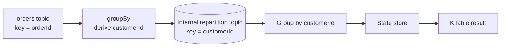
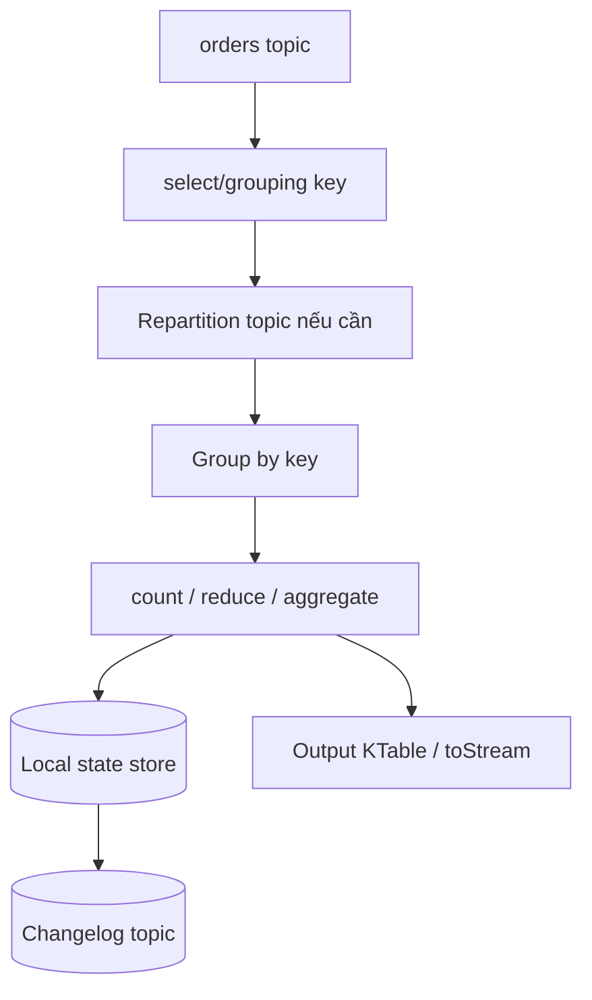

# groupByKey, groupBy, aggregate, count và reduce

Kafka Streams thường phải gom nhiều record theo một khóa để tính số lượng, tổng tiền, trạng thái hoặc số liệu theo từng khách hàng, tài khoản hay sản phẩm. Java DSL cung cấp `groupByKey()` và `groupBy()` để xác định cách nhóm record; sau đó `count()`, `reduce()` và `aggregate()` thực hiện phép tính trên từng nhóm.

Các thao tác này là stateful operations: Kafka Streams cần giữ trạng thái tổng hợp theo key và khôi phục trạng thái đó sau khi ứng dụng restart. Hiểu đúng key, partition, repartition topic, Serdes và kiểu kết quả `KTable` là điều kiện để phép tổng hợp vừa đúng dữ liệu vừa có hiệu năng tốt.

## 1. Nhóm record theo key để làm gì?

Giả sử topic `orders` chứa các sự kiện đơn hàng. Mỗi record có key là `orderId`, còn value chứa `customerId`, số tiền và trạng thái:

| Kafka key | customerId | amountCents | Ý nghĩa |
|---|---|---:|---|
| `order-101` | `customer-7` | 25000 | Đơn hàng thứ nhất của khách hàng 7 |
| `order-102` | `customer-3` | 40000 | Đơn hàng của khách hàng 3 |
| `order-103` | `customer-7` | 15000 | Đơn hàng thứ hai của khách hàng 7 |
| `order-104` | `customer-7` | 32000 | Đơn hàng thứ ba của khách hàng 7 |

Nếu cần đếm đơn hàng theo `orderId`, key hiện tại đã phù hợp. Nếu cần đếm hoặc tính tổng tiền theo `customerId`, phải đổi grouping key từ `orderId` sang `customerId`.

Sau khi nhóm, Kafka Streams có thể duy trì một giá trị tổng hợp cho mỗi key:

| Group key | orderCount | totalAmountCents |
|---|---:|---:|
| `customer-7` | 3 | 72000 |
| `customer-3` | 1 | 40000 |

Grouping xác định record nào cùng cập nhật một state. Nếu chọn sai key, phép tính có thể vẫn chạy thành công nhưng kết quả không đại diện cho đúng thực thể nghiệp vụ.

## 2. `groupByKey()` giữ nguyên key hiện tại

`groupByKey()` gom record theo key đang có trong `KStream`. Nó không đổi key và trả về `KGroupedStream<K, V>` để gọi các phép tổng hợp.

```java
KStream<String, OrderEvent> orders = builder.stream(
        "orders",
        Consumed.with(Serdes.String(), orderEventSerde)
);

KGroupedStream<String, OrderEvent> ordersByOrderId =
        orders.groupByKey(
                Grouped.with(Serdes.String(), orderEventSerde)
        );

KTable<String, Long> countByOrderId = ordersByOrderId.count(
        Materialized.<String, Long, KeyValueStore<Bytes, byte[]>>as(
                "order-count-by-id"
        )
        .withKeySerde(Serdes.String())
        .withValueSerde(Serdes.Long())
);
```

Ở đây mỗi `orderId` là một group. Nếu mỗi order chỉ có một event, kết quả đếm theo `orderId` có thể luôn là 1; điều này cho thấy phép tổng hợp đúng về mặt kỹ thuật nhưng key chưa chắc phù hợp với câu hỏi nghiệp vụ.

### Khi nào dùng `groupByKey()`?

Dùng khi key của record đã là thuộc tính muốn nhóm, ví dụ:

- Key là `customerId` và cần đếm event theo khách hàng.
- Key là `accountId` và cần tính tổng giao dịch theo tài khoản.
- Key là `productId` và cần đếm lượng cập nhật theo sản phẩm.

Ví dụ topic `account-transactions` đã được producer ghi với key là `accountId`:

```java
KStream<String, Long> transactions = builder.stream(
        "account-transactions",
        Consumed.with(Serdes.String(), Serdes.Long())
);

KTable<String, Long> totalByAccount = transactions
        .groupByKey(Grouped.with(Serdes.String(), Serdes.Long()))
        .reduce(
                Long::sum,
                Materialized.<String, Long, KeyValueStore<Bytes, byte[]>>as(
                        "account-total-store"
                )
                .withKeySerde(Serdes.String())
                .withValueSerde(Serdes.Long())
        );
```

Mỗi record có value là số tiền giao dịch. `reduce(Long::sum)` cộng value mới vào tổng hiện tại của account tương ứng.

## 3. `groupBy()` tạo grouping key mới

`groupBy()` cho phép tính grouping key từ key và value hiện tại bằng một `KeyValueMapper`. Nó trả về `KGroupedStream<KR, V>`, trong đó `KR` là kiểu key mới.

Ví dụ topic `orders` đang dùng `orderId` làm Kafka key nhưng cần đếm đơn hàng theo `customerId`:

```java
KGroupedStream<String, OrderEvent> ordersByCustomer = orders.groupBy(
        (orderId, order) -> order.customerId(),
        Grouped.with(Serdes.String(), orderEventSerde)
);

KTable<String, Long> countByCustomer = ordersByCustomer.count(
        Materialized.<String, Long, KeyValueStore<Bytes, byte[]>>as(
                "orders-count-by-customer"
        )
        .withKeySerde(Serdes.String())
        .withValueSerde(Serdes.Long())
);
```

Mapper nhận cả key cũ (`orderId`) và value (`OrderEvent`) rồi trả về key mới (`customerId`). Key cũ không còn là grouping key của phép tổng hợp tiếp theo.

### Vì sao `groupBy()` thường tạo repartition?

Kafka Streams phân phối record theo partition. Các record có cùng key cần được xử lý trên cùng partition để một state store có thể cập nhật đúng một trạng thái cho key đó. Nếu grouping key mới khác key dùng để phân phối record ở topic nguồn, các record cùng group có thể đang nằm ở nhiều partition khác nhau.

Kafka Streams cần repartition: ghi record vào một internal repartition topic theo key mới, rồi đọc lại topic đó để bảo đảm các record cùng key mới được chuyển đến cùng partition.



Repartition tạo thêm network I/O, serialization, disk I/O và độ trễ. Nó cũng có thể tạo internal topic mà Kafka Streams quản lý. Vì vậy, nếu nghiệp vụ thường xuyên cần nhóm theo `customerId`, có thể cân nhắc để producer dùng `customerId` làm key ngay từ đầu hoặc tạo một luồng đã được re-key phù hợp.

`groupByKey()` thường tránh repartition nếu key hiện tại vẫn là key phân phối hợp lệ. Tuy nhiên, nếu trước đó có thao tác thay đổi key như `selectKey()` hoặc `map()` theo cách đánh dấu cần repartition, Kafka Streams có thể phải repartition trước khi group. Đừng suy luận chỉ từ tên method; hãy xem topology được xây dựng và internal topics khi chạy.

## 4. Cấu hình Serdes cho grouping và repartition

Serde là cặp serializer/deserializer mà Kafka Streams dùng để chuyển key/value thành bytes và đọc bytes trở lại. Khi grouping làm phát sinh repartition topic, Kafka Streams cần biết cách serialize key mới và value được chuyển tiếp.

Với `groupByKey()`:

```java
orders.groupByKey(
        Grouped.with(Serdes.String(), orderEventSerde)
);
```

Với `groupBy()`:

```java
orders.groupBy(
        (orderId, order) -> order.customerId(),
        Grouped.with(Serdes.String(), orderEventSerde)
);
```

`Grouped.with(keySerde, valueSerde)` khai báo Serdes cho key/value ở bước grouping. Nếu không chỉ rõ, Kafka Streams có thể dùng default Serdes từ cấu hình Streams; cấu hình mặc định phải phù hợp với kiểu dữ liệu thực tế. Với custom class như `OrderEvent`, cần cấu hình Serde tương ứng, chẳng hạn JSON, Avro hoặc Protobuf.

Serde dùng để ghi repartition topic khác vai trò với Serde của state store. Khi materialize kết quả, cần cấu hình thêm Serde cho key và kiểu aggregate được lưu trong store.

## 5. `count()` đếm số record trong từng group

`count()` đếm số record đi qua mỗi group và trả về `KTable<K, Long>`. Giá trị của mỗi key là số lượng tích lũy hiện tại.

```java
KTable<String, Long> orderCountByCustomer = orders
        .groupBy(
                (orderId, order) -> order.customerId(),
                Grouped.with(Serdes.String(), orderEventSerde)
        )
        .count(
                Materialized.<String, Long, KeyValueStore<Bytes, byte[]>>as(
                        "order-count-by-customer"
                )
                .withKeySerde(Serdes.String())
                .withValueSerde(Serdes.Long())
        );
```

Nếu ba event thuộc `customer-7` đã đi qua stream, giá trị của key đó là 3. Khi event tiếp theo của cùng khách hàng đến, giá trị được cập nhật thành 4.

`count()` đếm record, không tự hiểu khái niệm “đơn hàng duy nhất”. Nếu producer phát lại cùng event hai lần, count có thể tăng hai lần. Muốn đếm entity duy nhất, cần thiết kế event ID, deduplication hoặc mô hình KTable theo entity key trước khi đếm.

### `count()` trả về KTable, không phải một kết quả cuối cùng

KTable biểu diễn trạng thái mới nhất theo key. Khi count thay đổi, KTable phát ra cập nhật cho key đó. Nó không phát lại toàn bộ bảng sau mỗi event.

Có thể chuyển KTable thành KStream để ghi các thay đổi ra topic:

```java
orderCountByCustomer
        .toStream()
        .to("customer-order-counts",
                Produced.with(Serdes.String(), Serdes.Long()));
```

Topic đầu ra lúc này nhận các cập nhật count, ví dụ `customer-7 -> 3`, sau đó `customer-7 -> 4`. Consumer cần hiểu đây là các giá trị cập nhật theo key, không phải các bản ghi tăng dần độc lập để cộng lại lần nữa.

## 6. `reduce()` kết hợp value cũ và value mới

`reduce()` dùng một `Reducer<V>` để kết hợp aggregate hiện tại với value mới. Kiểu aggregate phải cùng kiểu với kiểu value đầu vào `V`, vì reducer nhận hai đối số cùng kiểu và trả về một giá trị cùng kiểu.

Ví dụ cộng tổng số tiền giao dịch theo account:

```java
KStream<String, Long> transactions = builder.stream(
        "account-transactions",
        Consumed.with(Serdes.String(), Serdes.Long())
);

KTable<String, Long> balanceDeltaByAccount = transactions
        .groupByKey(Grouped.with(Serdes.String(), Serdes.Long()))
        .reduce(
                (currentTotal, newAmount) -> currentTotal + newAmount,
                Materialized.<String, Long, KeyValueStore<Bytes, byte[]>>as(
                        "account-amount-total"
                )
                .withKeySerde(Serdes.String())
                .withValueSerde(Serdes.Long())
        );
```

Với các value `100`, `50`, `-20` của cùng account, state lần lượt là `100`, `150`, `130`.

Một ví dụ khác là giữ value được xử lý gần nhất:

```java
KStream<String, String> values = builder.stream(
        "values",
        Consumed.with(Serdes.String(), Serdes.String())
);

KTable<String, String> latestProcessedValue = values
        .groupByKey(Grouped.with(Serdes.String(), Serdes.String()))
        .reduce(
                (currentValue, newValue) -> newValue,
                Materialized.<String, String, KeyValueStore<Bytes, byte[]>>as(
                        "latest-value-by-key"
                )
                .withKeySerde(Serdes.String())
                .withValueSerde(Serdes.String())
        );
```

Ở đây “gần nhất” nghĩa là record được xử lý sau trong thứ tự stream của partition/group, không nhất thiết là event có timestamp nghiệp vụ lớn nhất. Nếu cần chọn theo event time, phải so sánh timestamp trong reducer và xác định chính sách cho event đến muộn.

`reduce()` phù hợp khi trạng thái tổng hợp có cùng kiểu với value đầu vào, ví dụ cộng số, lấy min/max hoặc kết hợp chuỗi. Nếu cần đổi từ `OrderEvent` sang một kiểu trạng thái khác như `CustomerSummary`, hãy dùng `aggregate()`.

## 7. `aggregate()` tạo kiểu trạng thái tùy ý

`aggregate()` linh hoạt hơn `reduce()` vì kiểu aggregate `VR` có thể khác kiểu value đầu vào `V`. Nó cần ba thành phần:

- `Initializer<VR>` tạo trạng thái ban đầu cho mỗi key khi key xuất hiện lần đầu.
- `Aggregator<K, V, VR>` nhận key, value mới và trạng thái hiện tại để tạo trạng thái tiếp theo.
- `Materialized` xác định tên state store và Serdes cho key/value của trạng thái.

Ví dụ tổng hợp số đơn hàng và tổng doanh thu theo khách hàng:

```java
public record CustomerSummary(long orderCount, long totalAmountCents) {
    public CustomerSummary add(long amountCents) {
        return new CustomerSummary(
                orderCount + 1,
                totalAmountCents + amountCents
        );
    }
}
```

```java
Serde<String> customerIdSerde = Serdes.String();
Serde<CustomerSummary> summarySerde = customerSummarySerde;

Materialized<String, CustomerSummary, KeyValueStore<Bytes, byte[]>> summaryStore =
        Materialized.<String, CustomerSummary, KeyValueStore<Bytes, byte[]>>as(
                "customer-order-summary"
        )
        .withKeySerde(customerIdSerde)
        .withValueSerde(summarySerde);

KTable<String, CustomerSummary> summaryByCustomer = orders
        .groupBy(
                (orderId, order) -> order.customerId(),
                Grouped.with(customerIdSerde, orderEventSerde)
        )
        .aggregate(
                () -> new CustomerSummary(0, 0),
                (customerId, order, current) ->
                        current.add(order.amountCents()),
                summaryStore
        );
```

`customerSummarySerde` là Serde ứng dụng cung cấp để serialize/deserialize `CustomerSummary`; có thể triển khai bằng JSON, Avro hoặc định dạng phù hợp. `Bytes` và `KeyValueStore` là kiểu state store thường dùng khi materialize aggregation vào key-value store.

Với mỗi event, aggregator nhận trạng thái hiện tại của customer rồi trả về một đối tượng trạng thái mới. Cách dùng immutable record giúp tránh sửa trực tiếp object đang được chia sẻ hoặc cache.

## 8. So sánh count, reduce và aggregate

| Phép toán | Kiểu đầu vào | Trạng thái | Kết quả | Trường hợp dùng |
|---|---|---|---|---|
| `count()` | `V` bất kỳ phù hợp với Serde | `Long` | `KTable<K, Long>` | Đếm record theo key |
| `reduce()` | `V` | Cũng là `V` | `KTable<K, V>` | Kết hợp value cùng kiểu, như sum/min/max |
| `aggregate()` | `V` | Kiểu tùy ý `VR` | `KTable<K, VR>` | Tạo summary nhiều trường hoặc accumulator khác kiểu input |

Ví dụ chọn nhanh:

- Đếm số lần khách hàng phát sinh event: `count()`.
- Cộng các giá trị `Long` theo tài khoản: `reduce(Long::sum)`.
- Tính đồng thời số đơn hàng, tổng tiền và thời điểm gần nhất: `aggregate()` với một kiểu summary riêng.

Không nên dùng `aggregate()` chỉ để thay thế mọi trường hợp `count()` hoặc `reduce()`. Phép toán đơn giản giúp topology dễ đọc hơn và giảm lượng logic phải duy trì.

## 9. State store và changelog topic

Các phép `count`, `reduce` và `aggregate` cần lưu trạng thái theo key. Kafka Streams thường materialize trạng thái vào local state store, thường dùng RocksDB cho persistent key-value store. Local store giúp truy cập nhanh khi xử lý record.

Để khôi phục state sau khi process hoặc máy bị mất, Kafka Streams ghi changelog topic cho state store. Khi task được khởi chạy lại hoặc chuyển sang instance khác, state có thể được phục hồi bằng cách đọc changelog từ Kafka. Vì vậy, aggregation có trạng thái không chỉ nằm trong RAM của ứng dụng.

Tên store có thể đặt bằng `Materialized.as("store-name")`. Tên ổn định giúp nhận diện store và changelog topic tương ứng qua các lần triển khai. Thay đổi tên store có thể khiến ứng dụng tạo state store mới và cần khôi phục/tái tính toán trạng thái theo topology mới.

Có thể truy vấn state store bằng Interactive Queries nếu ứng dụng cấu hình và định tuyến request giữa các instance phù hợp. Tuy nhiên, `KTable` trong topology và API truy vấn local store không tự biến mọi instance thành một database toàn cục; mỗi instance chỉ sở hữu một phần task/partition state tại thời điểm đó.

## 10. Repartition, state store và hiệu năng

Một topology có thể gồm nhiều bước:



Một số yếu tố ảnh hưởng hiệu năng:

- **Số partition:** giới hạn mức song song của task và state partition. Tăng partition cần cân nhắc ordering, key distribution và chi phí state.
- **Repartition topic:** thêm network, serialization và disk I/O. Tránh đổi key nhiều lần không cần thiết.
- **Skew key:** một key có lưu lượng quá lớn có thể tạo hot partition và task xử lý chậm hơn phần còn lại.
- **State size:** aggregate lớn cần disk, cache và thời gian restore lâu hơn.
- **Changelog traffic:** mỗi cập nhật state có thể tạo record changelog; aggregation có tần suất cập nhật cao làm tăng lưu lượng nội bộ.
- **Serde:** serializer/deserializer nặng hoặc payload lớn làm tăng CPU và latency.

Khi kiểm tra topology, dùng `Topology.describe()` để xem source, processor, repartition topic và sink node. Quan sát metric task/record processing, commit latency, restore duration, RocksDB và consumer lag để tìm bottleneck.

## 11. Null key, null value và dữ liệu không hợp lệ

Grouping và aggregation cần key xác định để chọn state. Record có null key không thể gắn vào group cụ thể; record có null value cũng không thể được cộng hoặc aggregate như một event thông thường. Kafka Streams bỏ qua record null key hoặc null value trong các phép grouping/aggregation tương ứng.

Nếu null biểu thị một ý nghĩa nghiệp vụ như xóa entity, hãy chọn mô hình phù hợp thay vì kỳ vọng `count()` hoặc reducer xử lý như record bình thường. Với KTable, tombstone (key có value null) mang ngữ nghĩa xóa key khỏi bảng. Với KStream, null value có thể xuất hiện như tombstone khi đọc compacted topic, nhưng grouping/aggregation trên stream không tự diễn giải nó như một phép trừ count hay xóa aggregate.

Nên kiểm tra và chuẩn hóa key trước bước grouping:

```java
KStream<String, OrderEvent> validOrders = orders
        .filter((orderId, order) ->
                orderId != null && order != null && order.customerId() != null
        );
```

Record không hợp lệ có thể được định tuyến sang topic lỗi hoặc dead-letter topic trước khi aggregation, thay vì âm thầm để kết quả tổng hợp thiếu dữ liệu.

## 12. Event time, cửa sổ thời gian và aggregate liên tục

`count()`, `reduce()` và `aggregate()` trên `KGroupedStream` không tự giới hạn kết quả theo khoảng thời gian; chúng duy trì tổng hợp liên tục cho mỗi key. Nếu cần đếm số đơn trong 5 phút gần nhất, phải kết hợp grouping với windowing:

```java
KTable<Windowed<String>, Long> ordersPerFiveMinutes = orders
        .groupBy(
                (orderId, order) -> order.customerId(),
                Grouped.with(Serdes.String(), orderEventSerde)
        )
        .windowedBy(TimeWindows.ofSizeWithNoGrace(Duration.ofMinutes(5)))
        .count(
                Materialized.<String, Long, WindowStore<Bytes, byte[]>>as(
                        "orders-per-five-minutes"
                )
                .withKeySerde(Serdes.String())
                .withValueSerde(Serdes.Long())
        );
```

Đây là ví dụ tumbling window 5 phút không có grace period; `WindowStore` là kiểu state store dành cho windowed aggregation. Nếu hệ thống có event đến muộn, cần chọn grace period phù hợp và hiểu `TimestampExtractor`, stream time cùng retention của window store. Kết quả khi đó có key dạng `Windowed<K>` thay vì chỉ `K`.

Nếu cần cập nhật theo thời gian thực và có event đến muộn, windowing có thể phát nhiều lần cập nhật cho cùng một cửa sổ. Consumer output phải xử lý update theo key/window, không cộng dồn mọi update như thể mỗi record là một event mới.

## 13. Lỗi thường gặp khi grouping và aggregation

| Triệu chứng | Nguyên nhân thường gặp | Cách kiểm tra |
|---|---|---|
| Mỗi group chỉ có một record | Dùng `groupByKey()` trong khi key hiện tại là ID duy nhất của record/entity | Kiểm tra key thực tế trong topic và mục tiêu grouping |
| Tổng hợp sai theo khách hàng | Dùng key `orderId` thay vì `customerId` | Kiểm tra mapper trong `groupBy()` và record key sau repartition |
| Lỗi serialization khi repartition | Thiếu hoặc sai Serde cho key/value mới | Khai báo `Grouped.with(...)` và kiểm tra default Serdes |
| Nhiều internal repartition topic ngoài dự kiến | Đổi key nhiều lần hoặc group sau key-changing operation | Xem `Topology.describe()` và tối giản bước re-key |
| Một task chậm hơn hẳn | Hot key hoặc partition skew | Đo record rate theo key/partition; xem lại partitioning |
| State mất hoặc restore lâu | Store/changelog lớn, đổi tên store hoặc cấu hình retention sai | Kiểm tra changelog, restore metric và store name |
| Count lớn hơn số entity duy nhất | Event duplicate hoặc count đang đếm record thay vì entity | Dùng event ID/deduplication hoặc KTable theo entity key |
| Kết quả bị trừ/mất khi gặp tombstone | Nhầm ngữ nghĩa KStream với KTable | Xác định record là event hay changelog của bảng |

## 14. Checklist thiết kế grouping và aggregation

- Xác định câu hỏi nghiệp vụ và chọn đúng grouping key.
- Dùng `groupByKey()` khi key hiện tại đã đúng; dùng `groupBy()` khi cần tính key mới từ key/value.
- Hiểu khi nào topology cần repartition và kiểm tra internal topic bằng `Topology.describe()`.
- Khai báo Serdes cho key/value tại bước grouping, đặc biệt khi key mới có kiểu khác.
- Dùng `count()` để đếm record, `reduce()` khi aggregate cùng kiểu value, `aggregate()` khi cần kiểu trạng thái tùy chỉnh.
- Materialize state store với tên và Serdes ổn định khi cần stateful aggregation có khả năng phục hồi.
- Nhớ kết quả là `KTable` cập nhật theo key; `toStream()` phát các thay đổi của bảng.
- Thiết kế deduplication nếu record có thể được phát lại và count không được phép đếm trùng.
- Xử lý null key/value trước grouping; phân biệt tombstone của KTable với event của KStream.
- Dùng windowing riêng nếu phép tính có giới hạn thời gian.
- Theo dõi key skew, repartition traffic, state size, changelog và restore duration.

`groupByKey()` nhóm theo key hiện tại; `groupBy()` tính một grouping key mới và thường cần repartition để đưa record cùng key về cùng partition. Sau khi nhóm, `count()` đếm record, `reduce()` kết hợp các value cùng kiểu, còn `aggregate()` tạo trạng thái tùy ý. Các phép toán trả về `KTable` và dựa trên state store/changelog để duy trì, khôi phục kết quả qua thời gian.
