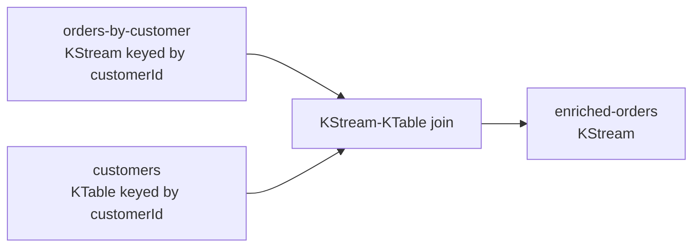
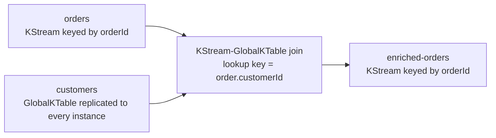

# Join giữa KStream, KTable và GlobalKTable

## Chọn đúng kiểu join trong Kafka Streams

Kafka Streams cung cấp ba abstraction thường dùng khi kết hợp dữ liệu:

- **KStream** biểu diễn một chuỗi event. Mỗi record là một sự kiện độc lập; nhiều record có thể cùng key.
- **KTable** biểu diễn trạng thái mới nhất theo key. Một record mới cập nhật giá trị của key; tombstone xóa key khỏi trạng thái.
- **GlobalKTable** cũng biểu diễn trạng thái mới nhất theo key, nhưng toàn bộ dữ liệu của bảng được sao chép đến từng instance Kafka Streams.

Join giữa các abstraction này giúp enrich event bằng dữ liệu tham chiếu, kết hợp hai luồng sự kiện hoặc duy trì một read model. Điểm quyết định không chỉ là cú pháp `join()`, mà còn là key dùng để tra cứu, partitioning, thời điểm trạng thái được nhìn thấy, chi phí repartition và kích thước state store.

Trong module KAFKA, cần phân biệt rõ KStream-KTable join với KStream-GlobalKTable join: KTable join thường cần co-partitioning theo key, còn GlobalKTable cho phép tra cứu bằng một key khác thông qua mapper vì toàn bộ bảng được nhân bản trên mỗi instance.

## 1. Hiểu ba abstraction trước khi join

### 1.1 KStream: event không bị thay thế theo key

KStream là luồng record append-only theo góc nhìn xử lý. Nếu topic nhận ba event cho `order-42`, stream có thể chứa cả ba:

```text
key=order-42 value=OrderPlaced
key=order-42 value=AddressChanged
key=order-42 value=OrderPaid
```

Mỗi record là một sự kiện cần xử lý. KStream không tự giữ một giá trị duy nhất mới nhất cho key.

### 1.2 KTable: trạng thái mới nhất theo key

KTable diễn giải topic changelog theo key. Record mới cho một key thay thế giá trị hiện tại trong bảng:

```text
key=customer-7 value={name: "An", tier: "silver"}
key=customer-7 value={name: "An", tier: "gold"}
```

Sau record thứ hai, trạng thái KTable của `customer-7` là `tier=gold`. KTable thường được materialize vào state store để tra cứu nhanh.

Nếu record có key và value `null`, đó là tombstone: key bị xóa khỏi trạng thái KTable. Tombstone khác với một object có các trường rỗng.

### 1.3 GlobalKTable: bản sao đầy đủ trên mỗi instance

GlobalKTable cũng giữ trạng thái mới nhất theo key, nhưng mọi instance của Kafka Streams application nhận toàn bộ partition của topic bảng và duy trì bản sao cục bộ đầy đủ.

Điều này cho phép một stream record tra cứu GlobalKTable bằng một key được tính từ value, không cần hai input co-partition theo cùng key. Đổi lại, mỗi instance phải lưu và cập nhật toàn bộ bảng; chi phí storage, network và restore tăng theo số instance.

### 1.4 So sánh nhanh

| Đặc điểm | KStream | KTable | GlobalKTable |
|---|---|---|---|
| Ý nghĩa | Event stream | Trạng thái mới nhất theo key | Trạng thái đầy đủ được nhân bản |
| Nhiều record cùng key | Tất cả đều là event | Record mới cập nhật giá trị | Record mới cập nhật giá trị |
| Tombstone | Không phải mô hình xóa trạng thái mặc định | Xóa key khỏi table | Xóa key khỏi global table |
| State store | Không bắt buộc | Thường được materialize khi cần join/state | Global state store |
| Join key | Record key hoặc mapper tùy join | Join theo key chung | Có thể dùng mapper để tra cứu key khác |
| Co-partitioning | Tùy loại join | Cần với KStream-KTable join | Không cần với KStream-GlobalKTable join |
| Phạm vi dữ liệu trên mỗi instance | Theo partition được giao | Theo partition được giao | Toàn bộ bảng trên mỗi instance |

## 2. KStream-KTable join

### 2.1 Cách hoạt động

KStream-KTable join tra cứu giá trị hiện tại của KTable bằng **record key của KStream**. Với mỗi stream record, Kafka Streams tìm giá trị table có cùng key rồi gọi `ValueJoiner` để tạo kết quả.

Ví dụ topic `orders-by-customer` có key là `customerId`; KTable `customers` cũng có key là `customerId`:



Nếu stream record có key `customer-7`, join lấy trạng thái customer hiện tại của `customer-7`. Join này không cần cửa sổ thời gian như KStream-KStream join.

### 2.2 Ví dụ Java DSL với key đã tương thích

Giả sử event stream và customer table đều được partition theo `customerId`:

```java
KStream<String, OrderEvent> orders = builder.stream(
        "orders-by-customer",
        Consumed.with(Serdes.String(), orderEventSerde)
);

KTable<String, Customer> customers = builder.table(
        "customers",
        Consumed.with(Serdes.String(), customerSerde)
);

KStream<String, EnrichedOrder> enriched = orders.join(
        customers,
        (order, customer) -> new EnrichedOrder(
                order.orderId(),
                customer.customerId(),
                customer.name(),
                order.totalAmount()
        ),
        Joined.with(Serdes.String(), orderEventSerde, customerSerde)
);

enriched.to(
        "enriched-orders",
        Produced.with(Serdes.String(), enrichedOrderSerde)
);
```

`orderEventSerde`, `customerSerde` và `enrichedOrderSerde` là Serde đã được ứng dụng cấu hình, ví dụ JSON hoặc Avro. Kết quả giữ key của KStream đầu vào, tức `customerId`.

### 2.3 Inner join và left join

`join()` là inner join: chỉ tạo kết quả khi có giá trị KTable tương ứng với key của stream record.

`leftJoin()` giữ stream record ngay cả khi không tìm thấy giá trị table:

```java
KStream<String, EnrichedOrder> enriched = orders.leftJoin(
        customers,
        (order, customer) -> new EnrichedOrder(
                order.orderId(),
                order.customerId(),
                customer == null ? "UNKNOWN" : customer.name(),
                order.totalAmount()
        ),
        Joined.with(Serdes.String(), orderEventSerde, customerSerde)
);
```

Với left join, `customer` có thể là `null`. ValueJoiner phải xử lý trường hợp này; không gọi `customer.name()` mà không kiểm tra.

### 2.4 Join dùng trạng thái table tại thời điểm xử lý

KStream-KTable join là non-windowed join. Với KTable không versioned, mỗi stream record tra cứu giá trị hiện có trong state store khi record được xử lý. Nếu customer vừa được cập nhật nhưng update chưa đến state store của instance xử lý stream, event có thể được enrich bằng giá trị cũ.

Khi KTable thay đổi, Kafka Streams không tự phát lại mọi stream record cũ để tạo kết quả join mới. Table update chỉ thay đổi trạng thái được dùng cho các stream record tiếp theo.

Nếu yêu cầu tra cứu trạng thái theo event time trong quá khứ, hãy nghiên cứu versioned state store/KTable và semantics temporal join của phiên bản Kafka Streams đang dùng. Không giả định KStream-KTable join mặc định là join theo timestamp hoặc đồng bộ tuyệt đối giữa hai topic.

## 3. Co-partitioning: điều kiện quan trọng của KStream-KTable

### 3.1 Vì sao phải co-partition?

KStream-KTable join chạy phân tán. Mỗi task xử lý một tập partition của stream và cần truy cập phần KTable tương ứng với cùng key. Vì vậy, hai input phải có partitioning tương thích:

- Cùng số partition.
- Dùng cùng cách phân vùng key/partitioner tương thích.
- Cùng key phải ánh xạ vào partition tương ứng ở cả hai topic.

Ví dụ, nếu `customer-7` nằm ở partition 2 của stream nhưng partition 0 của table, task xử lý stream partition 2 không thể mặc nhiên tìm được table row trong state store cục bộ của task đó.

### 3.2 Kiểm tra partition count và key strategy

Trước khi join, kiểm tra metadata của hai topic:

```bash
kafka-topics.sh --bootstrap-server kafka-1:9092 \
  --describe --topic orders-by-customer

kafka-topics.sh --bootstrap-server kafka-1:9092 \
  --describe --topic customers
```

Đếm partition và xác nhận producer dùng cùng key semantics. Cùng partition count là điều kiện cần nhưng chưa đủ nếu hai producer dùng partitioner hoặc custom partition mapping khác nhau.

Không thay đổi partition count của một topic tham gia join mà chưa đánh giá tác động. Khi số partition thay đổi, hash key có thể ánh xạ sang partition khác và phá co-partitioning/order assumptions.

### 3.3 Khi key của stream khác key tra cứu

Thực tế, `orders` thường có key là `orderId`, trong khi `customers` có key là `customerId`. KStream-KTable join không tự đọc `customerId` bên trong value để tra cứu KTable; join mặc định dùng record key.

Có thể đổi key của stream trước khi join:

```java
KStream<String, OrderEvent> ordersByCustomer = orders
        .selectKey((orderId, order) -> order.customerId())
        .repartition(Repartitioned.with(
                Serdes.String(),
                orderEventSerde
        ));

KStream<String, EnrichedOrder> enriched = ordersByCustomer.join(
        customers,
        (order, customer) -> EnrichedOrder.from(order, customer),
        Joined.with(Serdes.String(), orderEventSerde, customerSerde)
);
```

`selectKey()` thay đổi record key sang `customerId`. `repartition()` ghi stream qua internal repartition topic để phân phối lại theo key mới trước join. KTable vẫn phải có partition count và partitioning tương thích với key `customerId`.

Các phiên bản Kafka Streams hiện đại có thể tự chèn repartition node sau một số thao tác đổi key khi phát hiện join cần repartition. Dùng `repartition()` tường minh khi muốn kiểm soát rõ ràng topology và Serde; kiểm tra `Topology.describe()` để biết internal topic nào thực sự được tạo.

### 3.4 Chi phí repartition

Repartition tạo thêm topic nội bộ, serialize/deserialize record và network traffic. Nó có thể tăng latency, disk I/O và consumer lag. Nếu join là đường xử lý nóng, cân nhắc producer phát stream ngay từ đầu với key phù hợp hoặc thiết kế topic theo access pattern.

Không đổi key chỉ để join cho thuận tiện nếu key mới làm mất partitioning/order cần thiết cho bước xử lý sau. Sau join, có thể chọn lại key theo aggregate ID, nhưng các thao tác key-changing tiếp theo có thể yêu cầu repartition khác.

## 4. KStream-GlobalKTable join

### 4.1 GlobalKTable giải quyết bài toán lookup key khác

GlobalKTable cho phép stream record dùng một mapper để tính key tra cứu từ key/value của record. Ví dụ `orders` có key `orderId`, nhưng cần tìm customer bằng `order.customerId()`:



Do mỗi instance có toàn bộ GlobalKTable, stream record có thể tra cứu bất kỳ customer key nào mà không cần repartition stream theo customer ID và không cần co-partitioning giữa hai topic.

### 4.2 Ví dụ Java DSL

```java
KStream<String, OrderEvent> orders = builder.stream(
        "orders",
        Consumed.with(Serdes.String(), orderEventSerde)
);

GlobalKTable<String, Customer> customers = builder.globalTable(
        "customers",
        Consumed.with(Serdes.String(), customerSerde)
);

KStream<String, EnrichedOrder> enriched = orders.join(
        customers,
        (orderId, order) -> order.customerId(),
        (order, customer) -> new EnrichedOrder(
                order.orderId(),
                order.customerId(),
                customer.name(),
                order.totalAmount()
        )
);

enriched.to(
        "enriched-orders",
        Produced.with(Serdes.String(), enrichedOrderSerde)
);
```

Tham số thứ hai là `KeyValueMapper`: nó nhận key và value của stream record rồi trả về key dùng để tra GlobalKTable. Tham số thứ ba là `ValueJoiner`. Kết quả giữ key gốc của KStream (`orderId`).

### 4.3 Global left join

Nếu vẫn muốn phát order khi customer chưa có trong global store, dùng `leftJoin()`:

```java
KStream<String, EnrichedOrder> enriched = orders.leftJoin(
        customers,
        (orderId, order) -> order.customerId(),
        (order, customer) -> EnrichedOrder.fromNullable(order, customer)
);
```

`EnrichedOrder.fromNullable()` cần xử lý `customer == null`. Inner `join()` không tạo kết quả nếu key tra cứu không có giá trị; `leftJoin()` giữ record stream và truyền giá trị table là `null` cho ValueJoiner.

### 4.4 GlobalKTable không cần co-partitioning

Không cần cùng partition count giữa `orders` và `customers`, vì mỗi instance nhận toàn bộ dữ liệu GlobalKTable thay vì chỉ một phần tương ứng với stream partition.

Đây là lợi thế lớn khi:

- Stream key và lookup key khác nhau.
- Bảng tham chiếu tương đối nhỏ và có thể nhân bản trên mọi instance.
- Cần tra cứu nhiều key khác nhau mà không muốn tạo nhiều repartition topic.

Tuy nhiên, GlobalKTable không phải giải pháp miễn phí: mỗi instance phải đọc, lưu và phục hồi toàn bộ bảng. Khi số lượng customer tăng rất lớn, chi phí nhân bản có thể cao hơn chi phí repartition KStream-KTable.

### 4.5 Global table update và thời điểm lookup

GlobalKTable được cập nhật bất đồng bộ trên từng instance. Một stream record được xử lý trước khi instance nhận update customer mới có thể lookup thấy giá trị cũ. Không có một barrier toàn cục bảo đảm mọi instance đã áp dụng cùng một phiên bản bảng tại cùng thời điểm.

GlobalKTable cũng không phát lại stream record khi một row customer thay đổi. Update chỉ làm thay đổi trạng thái lookup cho các stream record tiếp theo được xử lý trên instance đó.

Nếu cần consistency mạnh giữa event và reference data, đưa version/sequence vào payload, kiểm tra phiên bản khi join hoặc thiết kế luồng đồng bộ phù hợp. Không dùng GlobalKTable nếu nghiệp vụ đòi hỏi join chính xác theo một transaction boundary xuyên hai topic mà chưa có cơ chế phối hợp.

## 5. KStream-KTable và KStream-GlobalKTable: chọn loại nào?

| Tiêu chí | KStream-KTable | KStream-GlobalKTable |
|---|---|---|
| Lookup key | KStream record key | Key do `KeyValueMapper` tính ra |
| Co-partitioning | Cần | Không cần |
| Repartition | Có thể cần khi stream đổi key | Thường không cần để lookup global table |
| State trên mỗi instance | Phần table thuộc task/partition được giao | Toàn bộ table |
| Scaling | Chia table theo partition | Nhân bản table lên mọi instance |
| Tài nguyên | Phân tán state và restore theo task | Tăng storage/network theo số instance |
| Use case | Join theo cùng khóa partition | Lookup bảng tham chiếu nhỏ bằng field khác |
| Ví dụ | Event key=`customerId`, table key=`customerId` | Event key=`orderId`, lookup bằng `customerId` |

Quy tắc thực tế:

- Chọn KStream-KTable khi hai luồng dữ liệu có cùng partition key và cần scale theo partition.
- Chọn KStream-GlobalKTable khi bảng lookup đủ nhỏ để nhân bản, hoặc stream cần tra cứu bằng một key khác mà không muốn repartition.
- Nếu bảng rất lớn, GlobalKTable có thể gây tốn RAM/disk/network và thời gian restore; ưu tiên KTable co-partitioned hoặc một kiến trúc lookup khác.

## 6. So sánh với KStream-KStream join

KStream-KStream join kết hợp hai event stream, thường yêu cầu `JoinWindows` vì hai event có thể đến ở các thời điểm khác nhau. Nó tìm record tương ứng trong cửa sổ thời gian và tạo kết quả khi record của hai stream thỏa điều kiện join.

KStream-KTable và KStream-GlobalKTable không phải window join: một stream event tra cứu trạng thái hiện tại của table. Sự khác nhau này quan trọng:

| Join | Dữ liệu bên phải | Điều kiện chính | Kết quả khi bên phải thay đổi |
|---|---|---|---|
| KStream-KStream | Event stream | Key và time window | Event mới có thể ghép với event trong window |
| KStream-KTable | Latest state theo key | Co-partitioning và key trùng | Không phát lại stream event cũ |
| KStream-GlobalKTable | Bảng trạng thái được nhân bản | Key mapper lookup | Không phát lại stream event cũ |

Nếu bài toán là “order event kết hợp với customer profile hiện tại”, dùng KStream-KTable hoặc GlobalKTable. Nếu bài toán là “payment event ghép với shipment event xảy ra trong vòng 10 phút”, xem KStream-KStream windowed join.

## 7. KTable-KTable join trong cùng mô hình dữ liệu

KTable-KTable join kết hợp hai bảng trạng thái theo cùng primary key. Nó tạo ra một KTable kết quả; khi một bên thay đổi, kết quả tương ứng có thể được cập nhật.

Ví dụ bảng customer và bảng loyalty cùng key `customerId`:

```java
KTable<String, Customer> customers = builder.table(
        "customers",
        Consumed.with(Serdes.String(), customerSerde)
);

KTable<String, Loyalty> loyalty = builder.table(
        "loyalty",
        Consumed.with(Serdes.String(), loyaltySerde)
);

KTable<String, CustomerProfile> profiles = customers.join(
        loyalty,
        (customer, level) -> new CustomerProfile(
                customer.customerId(),
                customer.name(),
                level.tier()
        )
);
```

KTable-KTable join cũng cần partitioning tương thích theo key. Nếu dùng left/outer join, cần xác định semantics khi một phía bị xóa bằng tombstone. Đây là join giữa hai trạng thái, khác với KStream-KTable join chỉ phát kết quả khi có stream record.

## 8. State store, Serde và topology

### 8.1 Serde phải đúng cho input, repartition và output

Kafka Streams cần serialize/deserialize key và value ở các điểm đọc topic, repartition, state store/changelog và ghi output. Khi đổi key trước join, cần cung cấp Serde phù hợp cho repartition topic.

Ví dụ:

```java
KStream<String, OrderEvent> ordersByCustomer = orders
        .selectKey((orderId, order) -> order.customerId())
        .repartition(Repartitioned.with(
                Serdes.String(),
                orderEventSerde
        ));
```

Nếu thiếu Serde hoặc dùng sai schema, lỗi có thể chỉ xuất hiện khi task bắt đầu xử lý record hoặc khi state store restore. Nên cấu hình Serde tường minh trong topology quan trọng và kiểm thử dữ liệu thực tế.

### 8.2 Materialized state store

KTable thường được materialize để join/lookup. Có thể đặt tên store và cấu hình Serde:

```java
KTable<String, Customer> customers = builder.table(
        "customers",
        Consumed.with(Serdes.String(), customerSerde),
        Materialized.<String, Customer, KeyValueStore<Bytes, byte[]>>as("customers-store")
                .withKeySerde(Serdes.String())
                .withValueSerde(customerSerde)
);
```

Tên store ổn định giúp quan sát topology và truy cập Interactive Queries khi cần. Với GlobalKTable, store được nhân bản toàn cục trên mỗi instance; cân nhắc kích thước, retention, restore time và storage engine.

### 8.3 Xem topology và internal repartition topic

In ra topology để kiểm tra các processor và internal topic:

```java
Topology topology = builder.build();
System.out.println(topology.describe());
```

Tìm các node `REPARTITION`/source/sink và tên internal topic. Việc đổi key trước join có thể tạo repartition topic; join KStream-GlobalKTable thường không tạo repartition chỉ để lookup global key.

Không xóa internal repartition/changelog topic khi application đang chạy. Chúng là một phần của topology và state recovery.

## 9. Xử lý null, tombstone và dữ liệu không khớp

### 9.1 KTable tombstone

Record có key và value `null` trên changelog của KTable xóa key khỏi state store. Sau khi tombstone được áp dụng, stream record lookup key đó sẽ không tìm thấy giá trị table.

### 9.2 Inner join và left join

- Inner `join()` bỏ qua stream record không có table match.
- `leftJoin()` vẫn tạo output và truyền `null` cho phía table khi không có match.
- Joiner cần định nghĩa rõ cách xử lý dữ liệu tham chiếu bị thiếu: gắn trạng thái `UNKNOWN`, route sang topic lỗi hay bỏ qua theo nghiệp vụ.

### 9.3 Null stream value

KStream record có value `null` không phải cách thông thường để biểu diễn trạng thái xóa trong stream event. Nếu producer có thể gửi null payload, hãy filter/validate trước join để tránh lỗi hoặc tạo kết quả không mong muốn. Dùng tombstone trong KTable source topic khi cần xóa key khỏi table.

### 9.4 Schema evolution

Serde của KStream và table phải tương thích với schema đang được phát. Khi thay đổi field trong customer/order, triển khai consumer có khả năng đọc cả schema cũ và mới theo chiến lược compatibility. Với GlobalKTable, lỗi deserialize ở một partition có thể làm quá trình cập nhật global store bị ảnh hưởng trên mỗi instance.

## 10. Performance và sizing

### 10.1 Chi phí KStream-KTable

KStream-KTable join tra cứu state store theo key. Nếu co-partitioning đúng, dữ liệu được chia theo task và có thể scale theo số partition. Chi phí tăng nếu phải repartition stream, state store lớn hoặc RocksDB/cache không đủ.

Theo dõi:

- Repartition topic throughput và lag.
- State store size, restore time và changelog throughput.
- Processing latency, records consumed/produced và commit rate.
- Disk, page cache, heap và RocksDB metrics.

### 10.2 Chi phí GlobalKTable

Giả sử bảng có $N$ row và mỗi row sau deserialize/index chiếm trung bình $S$ byte. Một instance cần xấp xỉ $N × S$ byte cho dữ liệu state, chưa tính overhead, changelog và cache. Với $M$ instance, tổng tài nguyên cluster dành cho global state tăng gần theo $M × N × S$.

GlobalKTable có thể giúp lookup nhanh và tránh repartition, nhưng bảng lớn sẽ làm tăng network bootstrap, disk usage, restore time và thời gian startup. Hãy benchmark số row thực tế thay vì chỉ nhìn kích thước compacted topic trên broker.

### 10.3 Skew và hot key

Nếu một customer hoặc tenant có lượng event vượt trội, mọi event của key đó đi vào cùng partition để giữ ordering. Một task có thể trở thành bottleneck dù các task khác còn rảnh.

Không thể chia một aggregate key sang nhiều partition mà vẫn giữ ordering Kafka tự nhiên. Nếu cần tăng throughput cho hot key, phải xem xét tách workload, giảm công việc trong joiner, xử lý state theo shard có sequence hoặc thiết kế lại yêu cầu ordering.

## 11. Những lỗi thường gặp

| Lỗi | Hậu quả | Cách khắc phục |
|---|---|---|
| Dùng KStream-KTable nhưng stream key khác table key | Không tìm được row tương ứng | `selectKey()` rồi repartition, hoặc dùng GlobalKTable |
| Chỉ kiểm tra partition count | Key vẫn có thể nằm ở partition khác do partitioner khác nhau | Đồng bộ key encoding và partitioning strategy |
| Tăng partition count một input topic | Phá co-partitioning hoặc đổi key mapping | Lập kế hoạch migration/repartition |
| Dùng GlobalKTable cho bảng rất lớn | Mỗi instance phải giữ toàn bộ bảng | Dùng KTable co-partitioned hoặc kiến trúc lookup khác |
| Nghĩ GlobalKTable có update đồng bộ toàn cluster | Instance có thể lookup thấy phiên bản khác nhau tạm thời | Dùng version/sequence và kiểm soát consistency |
| Nghĩ table update sẽ phát lại stream event cũ | Không có output join mới khi chỉ table thay đổi | Thiết kế stream/table trigger hoặc KTable-KTable nếu cần |
| Không xử lý null trong left join | NullPointerException | Kiểm tra giá trị table trong ValueJoiner |
| Nhầm tombstone với object rỗng | State store không xóa key như dự kiến | Dùng value null đúng semantics |
| Thiếu Serde cho repartition | Lỗi serialize/deserialize khi runtime | Cấu hình key/value Serde tường minh |
| Nghĩ cùng key trên nhiều topic có ordering chung | Consumer quan sát event sai thứ tự | Route vào cùng topic/partition hoặc kiểm tra sequence |

## 12. Quy trình thiết kế join

1. Xác định dữ liệu bên trái là event stream hay trạng thái table.
2. Xác định lookup key: record key hiện tại hay một field trong value.
3. Nếu dùng KTable, bảo đảm hai input co-partition theo cùng key.
4. Nếu stream key chưa đúng, dùng `selectKey()` và repartition có Serde phù hợp.
5. Nếu lookup bằng key khác và bảng đủ nhỏ, cân nhắc GlobalKTable.
6. Chọn inner `join()` hay `leftJoin()` theo cách xử lý record không có match.
7. Xác định semantics thời gian: trạng thái hiện tại, event-time hay windowed stream-to-stream.
8. Thiết kế tombstone, schema evolution và null handling.
9. Đo state store size, repartition throughput, restore time và processing latency.
10. Kiểm thử table update, stream update, missing key, tombstone, out-of-order input và restart.

## 13. Checklist production

- KStream, KTable và GlobalKTable được chọn đúng theo semantics dữ liệu.
- Join key được xác định rõ; không nhầm record key với field trong value.
- KStream-KTable inputs co-partition về số partition và partitioner.
- Repartition topic có Serde, retention và capacity phù hợp.
- GlobalKTable đủ nhỏ để nhân bản trên mọi instance.
- Global table update lag và restore time được theo dõi.
- Inner/left join xử lý missing key và null rõ ràng.
- Tombstone được hiểu đúng là thao tác xóa table key.
- Không giả định table update phát lại stream record cũ.
- Event-time requirement được phân biệt với current-state lookup.
- Key strategy giữ ordering theo aggregate và tránh hot key ngoài dự kiến.
- Schema/Serde tương thích giữa producer và Streams application.
- Topology được kiểm tra để xác nhận repartition/store như mong đợi.
- Đã thử nghiệm restart, state restore, table update, tombstone và partition expansion trong staging.

## Kết luận

KStream biểu diễn event; KTable biểu diễn trạng thái mới nhất theo key; GlobalKTable là bản sao đầy đủ của trạng thái đó trên từng instance Kafka Streams. KStream-KTable join tra cứu bằng record key và cần hai input co-partition. KStream-GlobalKTable join dùng `KeyValueMapper` để chọn lookup key, không cần co-partition nhưng phải trả chi phí nhân bản toàn bộ bảng.

Khi thiết kế join, hãy bắt đầu từ semantics và key: xác định stream key, table key, có cần đổi key/repartition hay không, bảng có đủ nhỏ để làm GlobalKTable không, và consumer cần trạng thái hiện tại hay join theo event time. Xử lý rõ inner/left join, tombstone, Serde, update lag và state restore. Những quyết định này giúp Kafka Streams enrich event đúng dữ liệu, giữ khả năng scale và tránh chi phí repartition hoặc global replication ngoài dự kiến.
