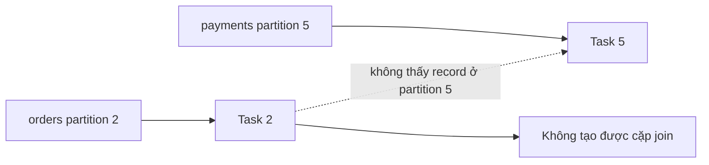
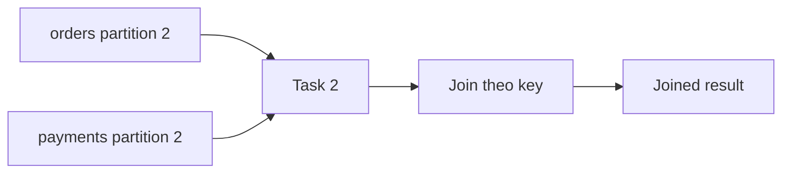

# Co-partitioning và điều kiện để phép join đúng

Kafka Streams thực hiện join theo key. Để hai record có cùng key được gặp nhau trong cùng task, dữ liệu đầu vào của các topic tham gia join phải được **co-partition**: cùng số partition và cùng quy tắc ánh xạ một key logic sang cùng partition. Chỉ có cùng tên field hoặc cùng giá trị nhìn thấy trong JSON là chưa đủ; key bytes, serializer và partitioner cũng phải nhất quán.

Co-partitioning là điều kiện quan trọng cho `KStream-KStream`, `KStream-KTable` và `KTable-KTable` join. Nếu dữ liệu cùng key nằm ở partition khác nhau, task không thể tự tìm record ở partition khác để ghép. Bài viết giải thích yêu cầu partitioning, cách rekey/repartition, cách chọn `GlobalKTable` khi phù hợp, cùng các điều kiện thời gian và kiểm thử cần có để join trả kết quả đúng.

## 1. Co-partitioning là gì?

Hai topic được co-partition khi các partition tương ứng được tổ chức sao cho mọi record có cùng key logic được đặt ở cùng số partition trên cả hai topic.

Ví dụ hai topic `orders` và `payments` đều có sáu partition:

```text
orders                         payments
partition 0  ----------------  partition 0
partition 1  ----------------  partition 1
partition 2  ----------------  partition 2
partition 3  ----------------  partition 3
partition 4  ----------------  partition 4
partition 5  ----------------  partition 5
```

Nếu key `order-2048` được ánh xạ vào partition 3 của `orders`, thì record `payment` có cùng key phải nằm ở partition 3 của `payments`. Kafka Streams task xử lý partition 3 có thể đọc dữ liệu từ cả hai input và thực hiện join.

Co-partitioning thường cần các điều kiện sau:

1. Các input topic có cùng số partition.
2. Cùng một key logic được serialize thành key bytes tương thích.
3. Các topic dùng cùng quy tắc partitioning (partitioner/hash logic) hoặc một quy tắc được thiết kế để cho cùng kết quả.
4. Không có producer ghi đè partition thủ công theo cách làm cùng key rơi vào partition khác.
5. Key phải có giá trị và cùng ý nghĩa nghiệp vụ ở các phía join.

Điều kiện số partition bằng nhau là cần thiết trong các join partitioned thông thường, nhưng chưa đủ để bảo đảm dữ liệu được đặt đúng chỗ. Ví dụ, hai topic cùng có sáu partition nhưng một producer dùng key `orderId`, producer kia dùng key `customerId`; chúng không co-partition theo `orderId` nếu giá trị key khác nhau.

## 2. Vì sao join cần co-partitioning?

Kafka Streams chia input thành task dựa trên partition. Một task đọc các partition tương ứng của những topic đầu vào và xử lý record tại chỗ. Nó không thực hiện truy vấn tùy ý tới mọi partition trên toàn cluster cho mỗi record.

Giả sử:

- `orders` partition 2 có `{key=order-2048, value=Order(...)}`.
- `payments` partition 5 có `{key=order-2048, value=Payment(...)}`.

Hai record có cùng key nhưng nằm ở partition khác nhau. Task đọc `orders-2` không tự động tìm record trong `payments-5`, nên join không tạo ra kết quả mong đợi. Record có thể tồn tại đầy đủ trong Kafka nhưng join vẫn không khớp.



Khi co-partition đúng:



Co-partitioning đưa record cùng key về cùng task. Điều đó cho phép Kafka Streams thực hiện join hiệu quả mà không cần shuffle toàn bộ dữ liệu giữa các task trong mỗi lần lookup.

## 3. Số partition phải bằng nhau

Với các join partitioned thông thường, các input topic phải có cùng số partition. Ví dụ:

| Topic | Số partition | Kết quả |
|---|---:|---|
| `orders` | 6 | |
| `payments` | 6 | Có thể co-partition nếu key/partitioner cũng nhất quán |
| `customers` | 3 | Không co-partition trực tiếp với `orders` có 6 partition |
| `shipments` | 12 | Không co-partition trực tiếp với `orders` có 6 partition |

Có thể tạo các topic với số partition thống nhất ngay từ đầu:

```bash
kafka-topics.sh --bootstrap-server localhost:9092 \
  --create --topic orders \
  --partitions 6 --replication-factor 3

kafka-topics.sh --bootstrap-server localhost:9092 \
  --create --topic payments \
  --partitions 6 --replication-factor 3
```

Replication factor không quyết định co-partitioning; nó quyết định số replica của mỗi partition. Hai topic có thể có replication factor khác nhau mà vẫn co-partition nếu partition count và key mapping phù hợp, dù cấu hình replication nên được thiết kế theo yêu cầu độ bền dữ liệu.

Kafka Streams có thể kiểm tra một số điều kiện metadata như partition count khi khởi tạo topology. Nếu phát hiện các input không đáp ứng yêu cầu, ứng dụng có thể không khởi động hoặc báo lỗi topology/partition. Tuy nhiên, kiểm tra metadata không thể chứng minh mọi producer đều serialize key và partition đúng; việc đó cần được bảo đảm trong thiết kế và kiểm thử.

## 4. Cùng key logic phải tạo cùng partition

Kafka producer quyết định partition dựa trên key đã serialize, partition count và partitioner. Với partitioner mặc định, key bytes được dùng để tính partition khi key khác null. Thuật toán chi tiết phụ thuộc Kafka client version; điều quan trọng là producer của các topic tham gia join phải có quy tắc tương thích.

Ví dụ cùng một giá trị key:

```java
producer.send(new ProducerRecord<>(
        "orders", "order-2048", orderEvent));

producer.send(new ProducerRecord<>(
        "payments", "order-2048", paymentEvent));
```

Nếu cả hai topic có cùng partition count và producer dùng cùng key serialization/partitioning, cùng key sẽ được ánh xạ về cùng partition.

### Cùng giá trị hiển thị chưa chắc cùng key bytes

Giả sử một producer serialize key `2048` bằng UTF-8 string (`"2048"`), producer khác serialize nó thành binary integer. Hai key có thể biểu diễn cùng ý nghĩa nghiệp vụ nhưng bytes khác nhau; partitioner có thể cho kết quả khác.

Các yếu tố cần đồng nhất:

- Kiểu key và Serde.
- Encoding/serialization của key.
- Chuẩn hóa giá trị (hoa/thường, khoảng trắng, Unicode normalization, định dạng ID).
- Partitioner và cấu hình liên quan.
- Cách xác định partition khi producer chỉ định partition thủ công.

Ví dụ, `CUS-73`, `cus-73` và `CUS-73 ` là ba chuỗi khác nhau nếu không chuẩn hóa. Nếu hai phía join dùng quy tắc chuẩn hóa khác nhau, chúng không chỉ có thể vào partition khác nhau mà còn không khớp key khi so sánh.

## 5. Key phải có cùng ý nghĩa nghiệp vụ

Co-partitioning không chỉ là kỹ thuật hash. Hai stream phải join trên cùng một định danh.

Ví dụ:

| Topic | Key hiện tại | Value chứa |
|---|---|---|
| `orders` | `orderId` | `orderId`, `customerId`, `amount` |
| `payments` | `paymentId` | `paymentId`, `orderId`, `amount` |

Nếu muốn join đơn hàng với thanh toán theo `orderId`, hai topic đang dùng key khác ý nghĩa. Dù cùng có sáu partition, `orders` được phân vùng theo `orderId`, còn `payments` theo `paymentId`; join theo `orderId` sẽ không tự đúng.

Có hai hướng thiết kế:

- Đưa `orderId` làm key của cả hai topic nếu đó là access pattern chính và ordering theo đơn hàng là quan trọng.
- Giữ key hiện tại nhưng tạo một luồng đã đổi key và repartition theo `orderId` trước khi join.

Không nên chọn key chỉ vì thuận tiện serialize. Hãy xác định entity cần co-location, ordering cần bảo vệ và các phép join/group cần thực hiện trước khi thiết kế topic.

## 6. Ví dụ KStream-KTable join đúng key

Giả sử topic `orders` đang dùng `orderId` làm key, còn topic `customers` dùng `customerId` làm key. Mục tiêu là làm giàu đơn hàng bằng thông tin khách hàng. Cần đổi key của stream đơn hàng sang `customerId`, sau đó repartition stream để key mới được phân phối lại đúng cách.

Giả sử cả hai topic có sáu partition. Ví dụ DSL:

```java
KStream<String, Order> orders = builder.stream(
        "orders",
        Consumed.with(Serdes.String(), orderSerde));

KTable<String, Customer> customers = builder.table(
        "customers",
        Consumed.with(Serdes.String(), customerSerde));

KStream<String, Order> ordersByCustomer = orders
        .selectKey((orderId, order) -> order.customerId())
        .repartition(Repartitioned.<String, Order>as("orders-by-customer")
                .withKeySerde(Serdes.String())
                .withValueSerde(orderSerde)
                .withNumberOfPartitions(6));

KStream<String, EnrichedOrder> enriched = ordersByCustomer.join(
        customers,
        (order, customer) -> new EnrichedOrder(
                order.orderId(),
                customer.customerId(),
                customer.name(),
                order.amount()),
        Joined.with(Serdes.String(), orderSerde, customerSerde));

enriched.to(
        "orders.enriched",
        Produced.with(Serdes.String(), enrichedOrderSerde));
```

Giải thích:

1. `orders` đọc record có key là `orderId`.
2. `selectKey()` đổi key thành `customerId` lấy từ value.
3. `repartition()` ghi record sang internal repartition topic với key mới.
4. Repartition topic có sáu partition, khớp với topic `customers`.
5. `KStream-KTable join` tra customer theo key `customerId`.
6. Sink ghi kết quả sang `orders.enriched`.

`Order`, `Customer`, `EnrichedOrder` và các Serde là kiểu do ứng dụng định nghĩa. Trong production, số partition phải lấy từ cấu hình/provisioning đã được xác minh với topic thực tế; không hardcode `6` nếu môi trường có thể thay đổi. Việc gọi `repartition()` tạo thêm network/disk I/O và internal topic, nhưng làm rõ ranh giới phân phối lại theo key.

### DSL có thể tự repartition khi cần

Các thao tác như `selectKey()` hoặc `map()` có thể đánh dấu stream là đã đổi key. Kafka Streams DSL có thể tự chèn repartition trước một số thao tác key-based như group/join khi cần. Tuy nhiên, số partition mặc định của repartition có thể không khớp với topic còn lại hoặc yêu cầu cụ thể của ứng dụng. Dùng `repartition(Repartitioned...)` tường minh khi cần kiểm soát tên topic, Serde, partitioner hoặc số partition.

`mapValues()` chỉ đổi value và giữ key nên thường không tạo nhu cầu repartition chỉ vì phép biến đổi đó.

## 7. KStream-KStream join và co-partitioning

KStream-KStream join ghép hai luồng theo key trong một time window. Ngoài co-partitioning, record còn phải thỏa điều kiện timestamp/window.

Ví dụ topic `orders` và `payments` đều có sáu partition và cùng dùng `orderId` làm key:

```java
KStream<String, OrderPlaced> orders = builder.stream(
        "orders",
        Consumed.with(Serdes.String(), orderPlacedSerde));

KStream<String, PaymentAuthorized> payments = builder.stream(
        "payments",
        Consumed.with(Serdes.String(), paymentSerde));

KStream<String, OrderPayment> orderPayments = orders.join(
        payments,
        (order, payment) -> new OrderPayment(
                order.orderId(), order.amount(), payment.paymentId()),
        JoinWindows.ofTimeDifferenceAndGrace(
                Duration.ofMinutes(5),
                Duration.ofMinutes(1)),
        StreamJoined.with(
                Serdes.String(), orderPlacedSerde, paymentSerde));
```

Trong ví dụ, hai record phải có cùng `orderId`, nằm trong cùng partition và timestamp nằm trong cửa sổ join 5 phút. Grace period 1 phút cho phép xử lý một số record đến muộn theo semantics của Kafka Streams version đang dùng.

Co-partitioning chỉ bảo đảm record cùng key có thể được xử lý trong cùng task. Nó không bảo đảm record sẽ join nếu timestamp ngoài window, key khác nhau, record bị filter hoặc đã quá grace period.

### Window là điều kiện thứ hai

KStream-KStream join là join theo thời gian. Ví dụ order có timestamp 10:00 và payment có timestamp 10:12; nếu window chỉ 5 phút thì hai record không tạo cặp join dù cùng key và cùng partition.

Thiết kế cần xác định:

- Timestamp lấy từ Kafka record hay event time trong payload.
- Khoảng cách thời gian tối đa giữa hai event có thể được xem là cùng nghiệp vụ.
- Grace period cho late-arriving record.
- Retention của window state store.
- Chính sách xử lý record đến sau khi window đóng.

Không chọn window quá rộng chỉ để tránh bỏ sót. Window lớn làm tăng state, disk, memory và thời gian giữ dữ liệu.

## 8. KStream-KTable join: key lookup theo trạng thái hiện tại

KStream-KTable join dùng key của record stream để tra giá trị hiện tại trong KTable. Đây là join không có window như KStream-KStream join.

Ví dụ:

```java
KStream<String, Order> orders = builder.stream(
        "orders",
        Consumed.with(Serdes.String(), orderSerde));

KTable<String, Customer> customers = builder.table(
        "customers",
        Consumed.with(Serdes.String(), customerSerde));

KStream<String, EnrichedOrder> enriched = orders.join(
        customers,
        (order, customer) -> EnrichedOrder.from(order, customer),
        Joined.with(Serdes.String(), orderSerde, customerSerde));
```

Ở đây key của `orders` phải là `customerId` để khớp key của `customers`. Stream và table phải co-partition. Khi một order được xử lý, Kafka Streams tra state hiện tại của customer tương ứng trong task.

Điểm cần hiểu: KStream-KTable join không tự động truy vấn lịch sử table tại đúng event time của order. Nó dùng trạng thái KTable mà task đang có tại thời điểm xử lý record. Nếu customer được cập nhật gần cùng lúc với order, kết quả có thể phụ thuộc thứ tự xử lý các input record trong task; không có một thứ tự toàn cục giữa hai topic.

Nếu nghiệp vụ cần “thông tin customer tại thời điểm đơn hàng được tạo”, cần mô hình dữ liệu có version/time history hoặc một temporal lookup có chủ đích. KTable thông thường biểu diễn trạng thái mới nhất theo key.

## 9. KTable-KTable join

KTable-KTable join kết hợp hai bảng changelog theo cùng key. Mỗi phía phải co-partition với phía còn lại để state của cùng key được xử lý trong cùng task.

Ví dụ:

```java
KTable<String, Customer> customers = builder.table(
        "customers",
        Consumed.with(Serdes.String(), customerSerde));

KTable<String, CustomerTier> tiers = builder.table(
        "customer-tiers",
        Consumed.with(Serdes.String(), tierSerde));

KTable<String, CustomerProfile> profiles = customers.join(
        tiers,
        (customer, tier) -> new CustomerProfile(
                customer.customerId(), customer.name(), tier.level()));

profiles.toStream().to(
        "customer-profiles",
        Produced.with(Serdes.String(), profileSerde));
```

`customers` và `customer-tiers` cần cùng partition count và cùng key mapping theo `customerId`. Khi một phía cập nhật, KTable join có thể phát update cho kết quả tương ứng. Nếu một phía xóa key bằng tombstone, kết quả join được cập nhật theo semantics của table join.

KTable là changelog table: record có key và value null biểu thị tombstone/xóa key. Consumer downstream cần hiểu semantics delete/tombstone; không coi null value là một object nghiệp vụ bình thường.

## 10. GlobalKTable: trường hợp không cần co-partitioning

`GlobalKTable` là bảng được Kafka Streams sao chép toàn bộ tới mỗi stream application instance. Vì mỗi instance có toàn bộ dữ liệu table cục bộ, KStream-GlobalKTable join không yêu cầu stream topic và global table topic phải co-partition theo cùng key.

Ví dụ stream có key `orderId`, nhưng cần tra customer theo `customerId` trong value:

```java
KStream<String, Order> orders = builder.stream(
        "orders",
        Consumed.with(Serdes.String(), orderSerde));

GlobalKTable<String, Customer> customers = builder.globalTable(
        "customers",
        Consumed.with(Serdes.String(), customerSerde));

KStream<String, EnrichedOrder> enriched = orders.join(
        customers,
        (orderId, order) -> order.customerId(),
        (order, customer) -> EnrichedOrder.from(order, customer));
```

Key mapper `(orderId, order) -> order.customerId()` chọn key để tra global table. Stream không cần đổi key hoặc repartition chỉ để tra customer.

Đánh đổi của GlobalKTable:

- Mỗi application instance phải đọc và lưu toàn bộ global table.
- Tốn network, disk và memory tăng theo kích thước bảng và số instance.
- Thời gian restore/rebalance global state có thể dài.
- Không có co-partition requirement, nhưng dữ liệu global table vẫn cần cập nhật và có thể trễ so với nguồn.
- Phù hợp hơn với bảng tham chiếu tương đối nhỏ, ít thay đổi và cần lookup theo một key khác với stream key.

Không dùng GlobalKTable cho một bảng hàng trăm triệu dòng nếu mỗi instance không đủ tài nguyên. Khi bảng lớn, cân nhắc KTable co-partitioned, materialized lookup service hoặc mô hình data product phù hợp.

## 11. Repartition khi đổi key

Đổi key là thao tác phổ biến trước join. Ví dụ `orders` có key `orderId` nhưng muốn join `payments` theo `customerId`.

```java
KStream<String, Order> ordersByCustomer = orders
        .selectKey((orderId, order) -> order.customerId())
        .repartition(Repartitioned.<String, Order>as("orders-by-customer")
                .withKeySerde(Serdes.String())
                .withValueSerde(orderSerde)
                .withNumberOfPartitions(6));
```

`repartition()` tạo một ranh giới ghi/đọc nội bộ:

1. Processor tạo record với key mới.
2. Sink nội bộ serialize và ghi record vào repartition topic.
3. Kafka phân phối record theo key mới và partitioner.
4. Source nội bộ đọc repartition topic.
5. Các processor tiếp theo xử lý record đã được phân vùng theo key mới.

Repartition có chi phí:

- Thêm Kafka produce/fetch và network traffic.
- Thêm disk I/O và internal topic storage.
- Tăng latency.
- Cần Serde tương thích cho key/value.
- Cần đủ partition và replication cho internal topic.

Không repartition lặp lại cùng một key nếu topology đã co-partition và không có thay đổi key. Đọc `Topology.describe()` để tìm node `repartition` và internal topic được tạo.

## 12. Co-partitioning và thay đổi số partition sau khi có dữ liệu

Thêm partition vào topic không chỉ là thay đổi capacity. Với partitioner dựa trên key, tăng partition count có thể thay đổi phép ánh xạ key sang partition cho những record mới. Các record cũ vẫn nằm ở partition cũ; Kafka không tự di chuyển chúng sang partition mới.

Ví dụ `orders` và `payments` ban đầu đều có sáu partition. Sau đó chỉ tăng `orders` lên chín partition:

- Metadata hai topic không còn cùng số partition.
- Kafka Streams join có thể không khởi động hoặc báo lỗi co-partition.
- Nếu tăng `payments` lên chín sau đó, các record lịch sử đã được ghi khi topic có sáu partition vẫn nằm ở partition cũ theo mapping cũ.
- Cùng một key có thể có record cũ và mới nằm ở partition khác nhau giữa hai topic.

Vì vậy, không nên coi việc tăng số partition của cả hai topic sau này là tự động khôi phục hoàn toàn co-partitioning cho dữ liệu lịch sử.

### Kế hoạch migration partition count

Nếu cần thay đổi partition count:

1. Tạo bộ topic mới với cùng partition count mục tiêu.
2. Re-read/replay hoặc copy dữ liệu lịch sử sang topic mới bằng partitioner/key contract thống nhất.
3. Chạy dual-write hoặc cutover có kiểm soát để không bỏ sót thay đổi mới.
4. Đối soát key và partition mapping trên dữ liệu mới.
5. Chuyển topology sang các topic mới.
6. Theo dõi join result, lag và duplicate trong giai đoạn chuyển đổi.
7. Ngừng topic cũ sau khi hết thời gian rollback và replay cần thiết.

Đây là migration dữ liệu, không chỉ là thay đổi cấu hình topic. Cần xác định retention, source of truth, idempotency và cách xử lý record phát sinh trong lúc backfill.

## 13. Kafka Streams có thể tự kiểm tra điều gì?

Kafka Streams có metadata để xác định partition count của các source topic và có thể kiểm tra điều kiện co-partition khi build/start topology hoặc khi metadata thay đổi. Một số cấu hình không hợp lệ sẽ tạo lỗi rõ ràng trước khi join hoạt động.

Tuy nhiên, runtime không thể biết chắc mọi producer có:

- Dùng cùng key logic hay không.
- Serialize key thành cùng bytes hay không.
- Dùng cùng custom partitioner hay không.
- Không ghi partition thủ công lệch mapping hay không.
- Chuẩn hóa ID theo cùng quy tắc hay không.

Vì vậy, kiểm tra partition count trong Kafka Streams chỉ là một phần xác minh. Data contract cần quy định key, Serde, partitioner và topic partition count; producer integration test cần kiểm tra cùng key được gửi tới cùng partition trên các topic.

## 14. Kiểm tra partition mapping bằng Producer metadata

Có thể viết integration test gửi cùng key vào hai topic bằng đúng cấu hình producer production rồi so sánh partition trong `RecordMetadata`:

```java
RecordMetadata orderMetadata = producer.send(
        new ProducerRecord<>("orders", "order-2048", orderEvent))
        .get();

RecordMetadata paymentMetadata = producer.send(
        new ProducerRecord<>("payments", "order-2048", paymentEvent))
        .get();

assertEquals(orderMetadata.partition(), paymentMetadata.partition());
```

Lặp lại với nhiều key đại diện và xác minh hai topic có cùng partition count. Test phải dùng đúng key serializer, partitioner và cấu hình producer sẽ chạy production; test với `StringSerializer` không chứng minh producer thật dùng Protobuf key hoặc custom partitioner sẽ có cùng mapping.

Có thể kiểm tra metadata topic bằng `AdminClient.describeTopics()` và xác nhận số partition trước khi chạy Kafka Streams application. Nếu provisioning được quản lý bằng IaC, nên kiểm tra partition count ngay trong pipeline triển khai.

## 15. Kiểm thử join bằng TopologyTestDriver và broker thật

`TopologyTestDriver` hữu ích để kiểm tra logic join với input record có key/timestamp xác định. Ví dụ test:

- Gửi order và payment cùng key, timestamp nằm trong window; kỳ vọng có output.
- Gửi hai record khác key; kỳ vọng không join.
- Gửi cùng key nhưng timestamp ngoài window; kỳ vọng không join.
- Kiểm tra record đến muộn trong grace period.
- Kiểm tra null key và tombstone theo semantics mong đợi.
- Kiểm tra rekey/repartition logic nếu topology có bước này.

Tuy nhiên, `TopologyTestDriver` không mô phỏng đầy đủ broker metadata, partition assignment, custom producer partitioner hoặc lỗi co-partition giữa các topic thật. Cần integration test với Kafka broker/container để xác minh:

1. Topic có partition count đúng.
2. Producer gửi cùng key vào cùng partition ở mọi input topic.
3. Kafka Streams khởi động topology với metadata thực.
4. Repartition topic được tạo và có số partition mong muốn.
5. Join output đúng khi dữ liệu đến từ nhiều partition.
6. Behavior sau khi topic partition count hoặc producer config thay đổi.

## 16. Các nguyên nhân làm join không có kết quả

| Hiện tượng | Nguyên nhân có thể | Cách kiểm tra/xử lý |
|---|---|---|
| Hai topic có cùng số partition nhưng join thiếu | Key mapping hoặc key bytes khác nhau | So sánh key thực, Serde, partitioner và partition metadata |
| Topology báo không co-partition | Input topic có partition count khác nhau | Kiểm tra `describeTopics`, tạo/repartition topic theo cùng count |
| Join không khớp dù key giống trong log | Một phía ghi key vào partition khác hoặc dùng key serializer khác | Gửi test record cùng key và so sánh `RecordMetadata.partition()` |
| Join theo sai entity | Một topic dùng `orderId`, topic khác dùng `paymentId` | Đổi key theo join key và repartition hoặc đổi contract producer |
| Sau `selectKey()` join không ra kết quả | Chưa repartition hoặc repartition không đúng số partition | Kiểm tra topology, dùng `.repartition(Repartitioned...)` tường minh |
| KStream-KStream cùng key nhưng không join | Timestamp ngoài window hoặc record đến sau grace | Kiểm tra TimestampExtractor, window, grace và late-record metrics |
| KStream-KTable lấy giá trị cũ | KTable state chưa nhận update tại thời điểm stream record xử lý | Xem processing order; nếu cần as-of event time, dùng mô hình/versioned lookup phù hợp |
| Null key không join | Record không có key có thể bị bỏ qua trong join | Bảo đảm key hợp lệ trước source/join |
| Tăng partition làm join sai sau migration | Record cũ và mới dùng mapping khác nhau | Rebuild/migrate dữ liệu sang topic mới có partitioning thống nhất |
| GlobalKTable làm worker tốn memory | Mỗi instance giữ toàn bộ table | Giảm kích thước lookup table hoặc dùng KTable co-partitioned |

## 17. Checklist thiết kế co-partitioned topics

**Data contract và key:**

- Xác định join key là entity nào: `orderId`, `customerId`, `accountId` hay key khác.
- Cùng một entity phải tạo cùng key logic trên mọi topic tham gia join.
- Chuẩn hóa key nhất quán về case, whitespace, Unicode và format.
- Dùng cùng kiểu key và serialization/Serde tương thích.
- Không dùng null key cho record cần join.
- Tránh producer tự chỉ định partition không theo partitioner chung.

**Topic và partition:**

- Tạo input topic với cùng partition count ngay từ đầu.
- Kiểm tra metadata partition count trước khi khởi chạy Streams app.
- Chọn partition count theo throughput, parallelism và khả năng tăng trưởng.
- Không tăng partition một phía độc lập.
- Nếu cần đổi partition count sau khi có dữ liệu, lập kế hoạch tạo topic mới và backfill/repartition.

**Topology:**

- Dùng `selectKey()`/`map()` khi cần đổi join key.
- Repartition sau khi đổi key và trước join/group khi cần.
- Cấu hình rõ `Repartitioned` key/value Serde và số partition.
- Phân biệt KStream-KStream windowed join, KStream-KTable current-state join và KTable-KTable table join.
- Chọn `GlobalKTable` chỉ khi bảng đủ nhỏ và chấp nhận replicate toàn bộ tới mỗi instance.
- Kiểm tra `Topology.describe()` để tìm repartition node/topic.

**Semantics và kiểm thử:**

- Xác định event timestamp, join window và grace cho KStream-KStream.
- Hiểu KStream-KTable dùng trạng thái table hiện tại khi xử lý stream record.
- Kiểm tra tombstone/delete và null key/value.
- Test partition mapping bằng producer metadata.
- Test topology bằng `TopologyTestDriver` và integration test với broker thật.
- Đối soát join output với dữ liệu nguồn bằng key đại diện.

## 18. Ghi nhớ

Co-partitioning bảo đảm record cùng key logic được đặt ở cùng partition trên các topic tham gia join. Với join partitioned thông thường, input topic phải có cùng partition count, cùng key serialization và quy tắc partitioning tương thích. Cùng partition count chưa đủ nếu một topic dùng key khác ý nghĩa hoặc producer dùng partitioner/Serde khác.

KStream-KStream join cần co-partitioning và còn phụ thuộc time window/grace. KStream-KTable join tra trạng thái table hiện tại theo key; KTable-KTable join cập nhật kết quả khi một trong hai table đổi. GlobalKTable là ngoại lệ vì mỗi instance giữ bản sao đầy đủ và có thể lookup bằng key mapper, đổi lại chi phí memory/network/restore tăng.

Khi đổi key, dùng repartition để phân phối lại dữ liệu trước join và kiểm tra số partition của repartition topic. Không tăng partition của topic đang có dữ liệu rồi giả định lịch sử tự được sắp xếp lại. Hãy quy định key/Serde/partitioner trong data contract, xác minh partition mapping bằng broker metadata và kiểm thử join với cả dữ liệu đúng window lẫn dữ liệu sai điều kiện.
