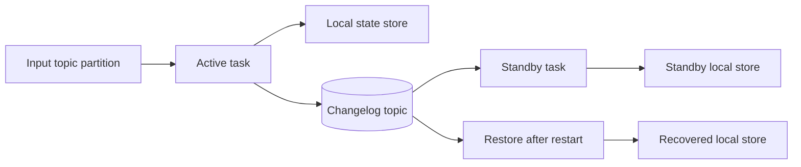
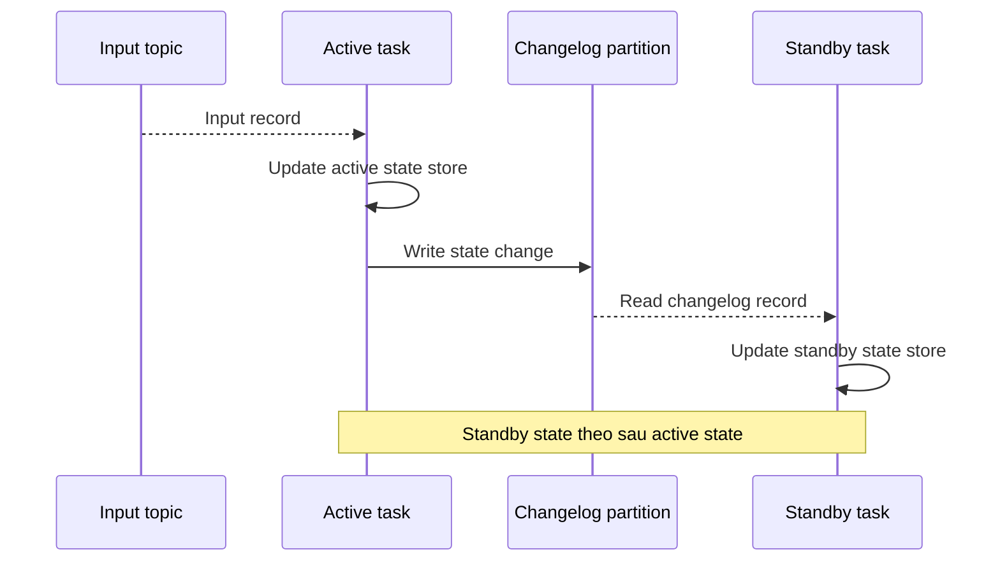
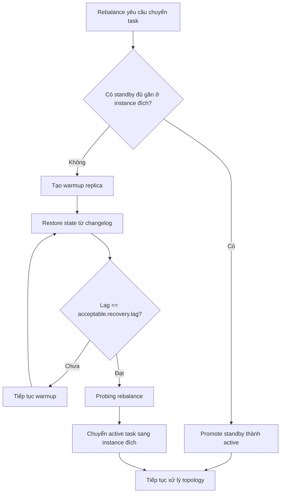
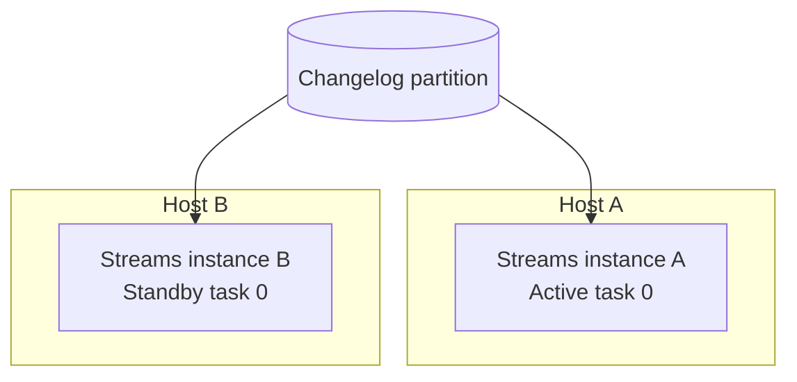

# Standby replica, warmup và thời gian phục hồi ứng dụng

## Mục tiêu

Kafka Streams có thể duy trì state store cục bộ để phục vụ aggregation, join và truy vấn. Khi instance đang giữ active task bị dừng hoặc phải chuyển task sang instance khác, ứng dụng cần khôi phục state trước khi tiếp tục xử lý đầy đủ. Nếu state store lớn, thời gian restore từ changelog có thể làm tăng thời gian gián đoạn.

Kafka Streams cung cấp **standby replica** để duy trì bản sao state store trên instance khác và **warmup replica** để chuẩn bị state trước khi chuyển active task. Hai cơ chế giúp giảm thời gian phục hồi, nhưng có chi phí CPU, disk, network và dung lượng broker. Cần hiểu cách chúng hoạt động, giới hạn và metric để chọn số replica phù hợp với RTO của ứng dụng.

Sau bài học này, bạn có thể:

- Phân biệt active task, standby task và warmup task.
- Giải thích state store được phục hồi từ changelog topic như thế nào.
- Cấu hình `num.standby.replicas`, `acceptable.recovery.lag`, `max.warmup.replicas` và `probing.rebalance.interval.ms`.
- Hiểu task promotion, probing rebalance và điều kiện một replica đủ gần để trở thành active.
- Ước lượng thời gian phục hồi và chi phí của standby/warmup.
- Thiết kế state store có changelog, replication factor và state directory phù hợp.
- Kiểm thử failover, rebalance và restore lag.
- Giám sát thời gian restore, lag của standby và sức khỏe task.

## 1. Active task và state store

Kafka Streams chia topology thành các task dựa trên input partitions. Task là đơn vị xử lý nhỏ nhất được gán cho một stream thread/instance. Với topology stateful, task có thể sở hữu state store để lưu kết quả aggregation, join hoặc dữ liệu tra cứu.

Ví dụ topology đếm số đơn hàng theo customer:

```java
KStream<String, OrderCreated> orders = builder.stream("orders.created");

orders
    .groupBy((key, event) -> event.customerId())
    .count(Materialized.as("orders-by-customer"));
```

State store `orders-by-customer` được chia theo task/partition. Mỗi active task cập nhật phần state tương ứng với input partition mà nó xử lý. Khi ứng dụng khởi động lại hoặc task được gán sang instance khác, Kafka Streams cần khôi phục phần state đó.

### 1.1. Changelog topic

Với state store được bật logging (mặc định đối với các store được materialize thông thường), Kafka Streams ghi thay đổi state vào internal changelog topic. Changelog là nguồn để tái tạo local state store khi process mất dữ liệu cục bộ.



Changelog thường được Kafka Streams tạo và quản lý cùng application ID. Với key-value store, changelog thường dùng compaction để giữ giá trị mới nhất theo key; một số store như window/session store có thêm retention và cấu hình cleanup phù hợp. Không nên tự sửa hoặc xóa internal changelog topic khi ứng dụng đang chạy.

### 1.2. Khi nào state store có thể phục hồi?

State store cần một nguồn khôi phục đáng tin cậy. Với store có changelog, task có thể restore từ local state còn hợp lệ và/hoặc đọc phần changelog còn thiếu. Nếu tắt logging cho store, Kafka Streams không có changelog tương ứng để tái tạo state sau khi local state mất; standby replica cũng không thể được duy trì từ changelog đó.

```java
StoreBuilder<KeyValueStore<String, Long>> store =
    Stores.keyValueStoreBuilder(
        Stores.persistentKeyValueStore("orders-by-customer"),
        Serdes.String(),
        Serdes.Long());

builder.addStateStore(store); // Logging bật theo mặc định
```

Nếu chủ động tắt logging:

```java
StoreBuilder<KeyValueStore<String, Long>> localOnlyStore =
    Stores.keyValueStoreBuilder(
        Stores.persistentKeyValueStore("temporary-cache"),
        Serdes.String(),
        Serdes.Long())
    .withLoggingDisabled();
```

Store `temporary-cache` không có changelog để khôi phục từ Kafka. Chỉ tắt logging khi dữ liệu có thể tái tạo từ nguồn khác hoặc việc mất state được chấp nhận. Nếu yêu cầu failover nhanh, hãy bảo đảm state store quan trọng có changelog và internal topic có replication factor phù hợp.

## 2. Active replica, standby replica và warmup replica

Ba khái niệm này có vai trò khác nhau trong vòng đời task:

| Loại | Có xử lý input records? | Có duy trì state? | Mục đích |
|---|---|---|---|
| Active task | Có | Có, phục vụ xử lý hiện tại | Thực hiện topology và tạo output |
| Standby task | Không xử lý input như active task | Có, cập nhật state từ changelog | Sẵn sàng tiếp quản nếu active task chuyển đi hoặc instance lỗi |
| Warmup task | Chưa xử lý input như active task | Có, restore/catch up state từ changelog | Chuẩn bị một bản state gần bắt kịp trước khi chuyển active task |

Standby replica là bản sao được duy trì liên tục trên instance khác. Warmup replica là bản sao bổ sung được tạo trong quá trình tái phân bổ task khi cần chuẩn bị state ở nơi nhận mới. Warmup task không phải một active consumer thứ hai cùng xử lý input business.

### 2.1. Standby replica

`num.standby.replicas` chỉ định số standby replica Kafka Streams cố gắng duy trì cho mỗi task. Standby task đọc changelog partition tương ứng để giữ local state gần với active task. Khi cần chuyển task, một standby đã theo kịp có thể được nâng thành active với lượng state cần phục hồi nhỏ hơn nhiều so với restore toàn bộ.

Ví dụ:

```properties
application.id=orders-streams
num.standby.replicas=1
```

Với `num.standby.replicas=1`, Kafka Streams cố gắng giữ một standby cho mỗi task trên một instance khác. Cần đủ instance và tài nguyên để phân bổ; nếu chỉ có một instance, không thể đặt standby ở một nơi độc lập. Standby không phải bản sao đồng bộ từng byte: nó có thể có một lượng changelog lag và cần thời gian catch up khi được promote.

### 2.2. Warmup replica

Khi rebalance yêu cầu chuyển một task sang instance khác nhưng instance đích chưa có standby đủ gần, Kafka Streams có thể tạo warmup replica. Warmup task khôi phục state từ changelog trong khi active task cũ tiếp tục xử lý. Khi warmup đã đạt recovery lag cho phép, Kafka Streams thực hiện probing rebalance để chuyển active task sang instance đã warm up.

Warmup replica giảm nguy cơ chuyển task tới một instance phải restore toàn bộ state trong lúc đang nhận trách nhiệm xử lý. Nó hữu ích khi task cần di chuyển do rebalance, scale-out hoặc thay đổi assignment. Warmup có thể tạm thời tiêu thụ thêm tài nguyên và số lượng được giới hạn bởi `max.warmup.replicas`.

### 2.3. Không phải mọi lần restart đều cần warmup

Nếu instance khởi động lại với local state store còn nguyên vẹn và hợp lệ, Kafka Streams có thể tái sử dụng state cục bộ rồi đọc phần changelog còn thiếu. Nếu instance khác đang giữ standby đủ gần, task có thể được promote từ standby. Nếu không có state local/standby phù hợp, task cần restore từ changelog; warmup replica chủ yếu hỗ trợ quá trình chuyển task có chuẩn bị, không thay thế changelog hoặc cơ chế recovery.

## 3. Cách standby replica được duy trì

Khi active task cập nhật state store, Kafka Streams ghi các thay đổi vào changelog topic. Standby task trên instance khác đọc changelog partition và áp dụng thay đổi vào local standby store. Standby không đọc input topic để chạy processor topology như active task.



Changelog replication factor bảo vệ dữ liệu state trên Kafka broker; standby replica bảo vệ bằng một bản local state store trên Kafka Streams instance khác. Hai cơ chế bổ sung cho nhau:

- Changelog là nguồn durable để restore khi local store bị mất.
- Standby là bản local đã được cập nhật gần đây để rút ngắn thời gian promotion.
- Kafka topic replication factor không tự tạo standby task.
- Standby task không thay thế broker replication hoặc backup.

Nếu changelog topic có replication factor 1 và broker chứa partition bị mất, khả năng restore có thể bị ảnh hưởng dù ứng dụng có standby local. Production thường đặt replication factor của internal topics phù hợp với cluster (ví dụ 3 khi cluster có đủ broker) và theo dõi ISR/under-replicated partitions.

## 4. Cấu hình số standby replica

Các cấu hình chính liên quan tới standby và warmup:

| Thuộc tính | Ý nghĩa | Giá trị mặc định thường gặp |
|---|---|---:|
| `num.standby.replicas` | Số standby replica cho mỗi task | `0` |
| `acceptable.recovery.lag` | Lag tối đa để một replica được xem là đủ gần cho promotion | `10000` records |
| `max.warmup.replicas` | Giới hạn số warmup replica được tạo đồng thời trong quá trình chuyển task | `2` |
| `probing.rebalance.interval.ms` | Khoảng thời gian tối đa giữa các lần probing rebalance để kiểm tra warmup replica đã catch up | `600000` ms |
| `replication.factor` | Replication factor cho internal topics do Kafka Streams tạo | `1` |
| `state.dir` | Thư mục lưu state store local | `/tmp/kafka-streams` trên nhiều môi trường mặc định |

Giá trị mặc định và hành vi có thể thay đổi theo phiên bản Kafka Streams. Hãy kiểm tra `StreamsConfig`/reference của đúng dependency đang triển khai trước khi chốt production config.

### 4.1. Cấu hình Java

```java
Properties props = new Properties();
props.put(StreamsConfig.APPLICATION_ID_CONFIG, "orders-streams");
props.put(StreamsConfig.BOOTSTRAP_SERVERS_CONFIG, "kafka-1:9092,kafka-2:9092");

props.put(StreamsConfig.NUM_STANDBY_REPLICAS_CONFIG, 1);
props.put(StreamsConfig.ACCEPTABLE_RECOVERY_LAG_CONFIG, 10_000L);
props.put(StreamsConfig.MAX_WARMUP_REPLICAS_CONFIG, 2);
props.put(StreamsConfig.PROBING_REBALANCE_INTERVAL_MS_CONFIG, 60_000L);
props.put(StreamsConfig.REPLICATION_FACTOR_CONFIG, 3);
props.put(StreamsConfig.STATE_DIR_CONFIG, "/var/lib/orders-streams");

KafkaStreams streams = new KafkaStreams(topology, props);
streams.start();
```

Đây là cấu hình minh họa; cluster phải có đủ broker để tạo internal topics replication factor 3. `acceptable.recovery.lag` là ngưỡng theo số record lag trong changelog, không phải byte hoặc mili giây. Chọn ngưỡng thấp giúp yêu cầu replica gần bắt kịp hơn nhưng có thể kéo dài thời gian warmup; ngưỡng cao giúp promotion sớm hơn nhưng task có thể cần catch up thêm sau khi nhận active assignment.

### 4.2. Cấu hình bằng properties

```properties
application.id=orders-streams
bootstrap.servers=kafka-1:9092,kafka-2:9092,kafka-3:9092

num.standby.replicas=1
acceptable.recovery.lag=10000
max.warmup.replicas=2
probing.rebalance.interval.ms=60000
replication.factor=3
state.dir=/var/lib/orders-streams
```

Tất cả instance của cùng một logical Kafka Streams application phải dùng cùng `application.id` và các cấu hình topology/serdes tương thích. `state.dir` là đường dẫn local; mỗi process trên cùng host cần thư mục riêng hoặc cách tổ chức state directory không xung đột. Không chia sẻ cùng một state directory cho nhiều process đang chạy.

## 5. `acceptable.recovery.lag` và điều kiện promotion

Standby/warmup replica không cần nhất thiết có offset bằng active task ở mọi thời điểm. Kafka Streams dùng `acceptable.recovery.lag` để xác định một replica đã đủ gần với end offset của changelog partition hay chưa.

Ví dụ:

| Replica | Lag changelog | Ngưỡng `acceptable.recovery.lag` | Có thể được xem là caught up? |
|---|---:|---:|---|
| Standby A | 0 | 1.000 | Có |
| Standby B | 800 | 1.000 | Có |
| Warmup C | 4.500 | 1.000 | Chưa |

Đây là ví dụ số học, không phải số đo từ cluster. Khi replica đạt ngưỡng, nó đủ điều kiện tham gia assignment/promotion theo cơ chế rebalance của Kafka Streams. Điều này không đồng nghĩa task đã sẵn sàng tức thì trong mọi tình huống: rebalance, task initialization, local store open và phần catch-up còn lại vẫn có thể mất thời gian.

### 5.1. Chọn ngưỡng theo tốc độ cập nhật state

Ngưỡng cần cân bằng giữa thời gian chờ warmup và lượng catch-up còn lại sau promotion:

- Ngưỡng nhỏ: replica phải gần sát active changelog hơn; giảm phần việc còn lại sau promotion nhưng warmup có thể lâu.
- Ngưỡng lớn: replica được xem là đủ gần sớm hơn; promotion nhanh hơn nhưng task có thể phải xử lý nhiều changelog còn thiếu.
- Ngưỡng bằng 0: yêu cầu replica bắt kịp tới end offset quan sát được; với luồng liên tục có thể khó đạt nếu state luôn thay đổi.

Đo tốc độ phát sinh changelog, tốc độ restore và thời gian rebalance trong môi trường gần production. Không chọn ngưỡng chỉ dựa trên một con số mặc định.

### 5.2. Lag không phải dung lượng state

Recovery lag là số record changelog còn phía sau, không trực tiếp cho biết số byte hoặc thời gian restore. Một record có thể rất nhỏ hoặc chứa value lớn. Hai task có cùng lag 1.000 record có thể có thời gian restore rất khác nhau.

Khi đánh giá readiness, kết hợp record lag với:

- Restore records/second và bytes/second nếu có metric phù hợp.
- Kích thước state store trên disk.
- Compaction và số record thực sự cần replay.
- CPU, disk I/O, network và broker throughput.
- Thời gian từ khi task được gán tới khi state store sẵn sàng.

## 6. Probing rebalance và warmup lifecycle

Warmup replica thường xuất hiện khi assignment cần chuyển task nhưng chưa có bản standby đủ gần ở instance đích. Thay vì lập tức bỏ active task cũ và bắt đầu restore toàn bộ ở instance mới, Kafka Streams có thể duy trì active task cũ, đồng thời giao warmup task cho instance đích.



`probing.rebalance.interval.ms` đặt khoảng thời gian tối đa giữa các lần rebalance dùng để probe xem warmup replica đã đủ gần để nhận task chưa. Nếu khoảng này quá lớn, warmup có thể đã sẵn sàng nhưng việc chuyển task phải chờ lần probe tiếp theo. Nếu đặt quá nhỏ, rebalance có thể xảy ra thường xuyên hơn, tạo thêm overhead.

### 6.1. `max.warmup.replicas`

`max.warmup.replicas` giới hạn số warmup replica được tạo đồng thời trong quá trình tái phân bổ. Giới hạn này tránh việc một lần rebalance tạo quá nhiều bản state restore cùng lúc, gây áp lực lên broker, disk và network.

Giá trị cao có thể rút ngắn tổng thời gian di chuyển nhiều task nếu cluster còn tài nguyên. Giá trị thấp giới hạn mức tiêu thụ tài nguyên nhưng các task có thể phải warmup theo nhiều đợt. Hãy chọn dựa trên số task, kích thước state và năng lực restore.

### 6.2. Rebalance không phải failover tức thời

Kafka Streams cần phát hiện instance lỗi, phối hợp group membership, tính lại assignment và khởi động task. Standby giúp giảm thời gian restore state; nó không loại bỏ thời gian phát hiện lỗi, rebalance hoặc initialization. Trong một số sự cố đồng thời (nhiều instance/broker lỗi), standby có thể không còn đủ bản sao hoặc cũng bị lag.

## 7. Ước lượng thời gian phục hồi

Thời gian phục hồi ứng dụng (RTO) phụ thuộc vào nhiều thành phần:

\[
T_{recovery} = T_{detect} + T_{rebalance} + T_{promote} + T_{catchup} + T_{resume}
\]

Đây là mô hình phân rã để lập kế hoạch; một số giai đoạn có thể chồng lấp. Khi warmup chạy trước probing rebalance, phần lớn `T_catchup` diễn ra trước thời điểm chuyển active task. Khi promote standby còn lag, phần catch-up có thể diễn ra sau promotion. Khi đo RTO, thống nhất mốc bắt đầu (ví dụ lần xử lý thành công cuối cùng) và mốc kết thúc (ví dụ output ổn định trở lại).

Trong đó:

- `T_detect`: thời gian phát hiện process/instance mất kết nối.
- `T_rebalance`: thời gian group coordination và phân bổ task mới.
- `T_promote`: thời gian mở/khởi tạo state store và đưa replica thành active.
- `T_catchup`: thời gian áp dụng changelog còn thiếu.
- `T_resume`: thời gian để throughput trở về mức ổn định.

Với standby đã bắt kịp, `T_catchup` thường nhỏ hơn restore toàn bộ state. Nếu không có standby phù hợp, task phải khôi phục từ local state còn hợp lệ hoặc đọc changelog nhiều hơn; thời gian có thể tăng theo kích thước state và throughput restore.

### 7.1. Ví dụ tính thời gian restore

Giả sử một task có 12 triệu changelog records cần restore, tốc độ restore đo được là 80.000 records/giây và phần khởi tạo/rebalance mất 8 giây:

\[
T_{restore} \approx \frac{12.000.000}{80.000} + 8 = 158\text{ giây}
\]

Nếu standby chỉ còn lag 24.000 records:

\[
T_{catchup} \approx \frac{24.000}{80.000} = 0,3\text{ giây}
\]

Phép tính chỉ minh họa. Restore thực tế bị ảnh hưởng bởi compaction, record size, RocksDB flush/compaction, disk throughput, network, CPU, rebalance và tốc độ tạo changelog mới. Đo từ metrics và failover drill thay vì dùng công thức như cam kết SLO.

### 7.2. RTO và RPO

Standby replica chủ yếu giảm RTO bằng cách giữ state gần bắt kịp. Standby local không phải nguồn durability độc lập: khả năng khôi phục state và RPO phụ thuộc vào changelog đã được ghi bền vững, producer/transaction semantics và replication của Kafka internal topics. Nếu changelog replication factor thấp hoặc broker mất dữ liệu, standby không thay thế được bản sao durable trên broker.

Với `processing.guarantee=exactly_once_v2`, Kafka Streams phối hợp input offsets, changelog và output records trong Kafka transaction theo topology; điều này giúp bảo đảm nhất quán Kafka-to-Kafka. Nó không làm database hoặc API ngoài Kafka tham gia transaction.

## 8. Số instance và failure domain

Đặt `num.standby.replicas=1` không có nghĩa tự động có HA nếu chỉ chạy một instance hoặc tất cả instance nằm trên cùng một host. Standby cần được đặt trên instance khác với active task để chịu được lỗi instance.

Ví dụ với một task:



Nếu Host A lỗi, task có thể được chuyển sang B sau khi group phát hiện lỗi và rebalance. Nếu A và B cùng nằm trên một VM/host, lỗi host có thể làm mất cả active lẫn standby.

### 8.1. Quy tắc sizing cơ bản

Với `N` active task và `S` standby replica/task, tổng số bản task logic cần được đặt xấp xỉ `N × (1 + S)`. Đây là nhu cầu placement, không phải công thức số instance chính xác: một instance có thể chứa nhiều task, còn số instance cần thiết phụ thuộc assignment, concurrency, CPU/RAM/disk và failure domain.

Một số nguyên tắc:

- Muốn có một standby độc lập, cần ít nhất hai instance có thể nhận task.
- Muốn chịu lỗi nhiều instance hơn, cần nhiều standby và đủ instance còn sống để nhận chúng.
- Tách instance theo host/rack/zone nếu mục tiêu là chịu lỗi failure domain đó.
- Dự phòng CPU, RAM, disk và network để instance còn lại có thể chạy active task sau failover.
- Không đặt số standby cao hơn khả năng lưu trữ và duy trì changelog của cluster.

### 8.2. Standby có chi phí

Standby replica không chạy processor topology trên input nhưng vẫn tiêu thụ tài nguyên:

- Broker phải lưu changelog và phục vụ thêm consumer reads.
- Instance phải giữ local state store và cập nhật liên tục.
- Network tăng do standby đọc changelog.
- Disk tăng theo số state replica.
- CPU tăng do deserialize và áp dụng changelog.
- Rebalance/restore có thể tạo thêm tải tạm thời.

Tăng standby từ 0 lên 1 thường là thay đổi lớn về resilience; tăng từ 1 lên 2 có thể tăng đáng kể chi phí. Hãy đo state size và failure scenario trước khi tăng số lượng.

## 9. State store, changelog và replication factor

Standby chỉ hữu ích khi có thể phục hồi state. Cần kiểm tra cấu hình state store và internal topics:

| Thành phần | Vai trò | Kiểm tra |
|---|---|---|
| Persistent state store | Lưu state cục bộ | Disk capacity, state directory, permissions |
| Changelog topic | Nguồn phục hồi state | Replication factor, ISR, retention/compaction |
| Standby task | Bản state trên instance khác | Lag, assignment, disk và restore health |
| Input topic | Nguồn record nghiệp vụ | Retention, partition count và replication |
| Repartition topic | Phục vụ repartition trong topology | Replication và throughput nếu topology tạo topic này |

`replication.factor` trong Kafka Streams cấu hình replication factor cho internal topics do Streams tạo, như repartition/changelog topics. Nếu cluster chưa có đủ broker theo replication factor yêu cầu, tạo internal topic có thể thất bại. Với production, đặt giá trị phù hợp số broker và policy cluster; ví dụ `3` khi có ít nhất ba broker đủ điều kiện.

Không nhầm replication factor của changelog với `num.standby.replicas`: một bên là bản sao log trên broker, bên kia là bản sao state store trên Streams instance.

### 9.1. Compaction và restore

Changelog key-value store thường được compact để giữ bản cập nhật mới nhất cho mỗi key. Vì vậy restore không nhất thiết đọc toàn bộ lịch sử thay đổi từ khi ứng dụng bắt đầu; nó đọc dữ liệu còn lại theo semantics của topic và có thể tận dụng local state/checkpoint.

Không tự đặt retention ngắn cho changelog nếu không hiểu store semantics. Window/session stores có thể cần retention theo thời gian; tombstone và compaction cũng có vai trò trong việc xóa key khỏi state. Thay đổi cleanup policy hoặc xóa changelog có thể làm state restore sai hoặc không thể phục hồi.

### 9.2. Global store

`GlobalKTable`/global state store được sao chép tới mọi Kafka Streams instance theo thiết kế riêng. Nó không được quản lý như standby replica của một task partitioned thông thường. Global store có chi phí nhân bản toàn bộ state trên mọi instance; đừng dùng `num.standby.replicas` như cách điều khiển số bản sao global store.

## 10. Local state directory và triển khai container

`state.dir` xác định nơi Kafka Streams lưu local state. Với container/Kubernetes, cần quyết định state directory nằm trên ephemeral disk hay persistent volume.

| Lựa chọn | Ưu điểm | Hạn chế |
|---|---|---|
| Ephemeral local disk | Đơn giản, instance mới có thể restore từ changelog | Restart trên node khác thường phải restore nhiều state hơn |
| Persistent volume | Có thể tái sử dụng local state sau restart/reschedule phù hợp | Cần xử lý attach/mount, locking và locality; không thay standby ở failure domain khác |
| Local SSD/NVMe | Restore và state access nhanh | Dữ liệu có thể mất khi node lỗi; cần changelog/standby |

Không mount cùng một state directory cho nhiều process Kafka Streams cùng `application.id` nếu không có cơ chế isolation phù hợp. Mỗi instance cần local state path có quyền truy cập và lock đúng. Persistent volume có thể giúp restart nhanh nhưng nếu volume không attach kịp, local state không sẵn sàng thì task vẫn cần restore.

Trong Kubernetes, anti-affinity/topology spread có thể giúp đặt pod trên node/zone khác nhau. Hãy xác minh assignment thực tế của standby và failure domain; cấu hình scheduler không tự bảo đảm Kafka Streams đặt standby theo rack/zone nếu assignment strategy không hỗ trợ hoặc không nhận được metadata cần thiết.

## 11. Rebalance và cooperative task movement

Kafka Streams cần thay đổi assignment khi instance tham gia/rời group, số stream thread thay đổi hoặc metadata topology/partition thay đổi. Rebalance có thể đóng/mở task và làm state restore phát sinh.

Các yếu tố ảnh hưởng:

- Thời gian phát hiện process mất kết nối (`session.timeout.ms`, heartbeat và group protocol).
- Số task/partition và độ phức tạp topology.
- Standby assignment có sẵn và recovery lag.
- Warmup replica count và probing interval.
- Thời gian restore/catch-up.
- Tải broker và instance khi nhiều task restore đồng thời.

Cooperative rebalancing giúp giảm việc dừng toàn bộ assignment không cần thiết bằng cách chuyển partition/task theo từng bước trong các cơ chế hỗ trợ. Tuy vậy, task đang di chuyển vẫn có thể cần suspend/close và state catch-up; không nên kỳ vọng không có pause hoặc latency spike.

Khi rolling deployment, tránh restart toàn bộ instance cùng lúc. Rolling one-at-a-time, đủ capacity dự phòng và standby replicas giúp duy trì khả năng xử lý trong khi từng instance được nâng cấp.

## 12. Quy trình failover khi active instance lỗi

Giả sử instance A đang chạy active task cho partition 0 và instance B duy trì standby task tương ứng:

1. Instance A dừng hoặc mất kết nối.
2. Kafka Streams group phát hiện membership thay đổi.
3. Group rebalance và xác định instance B có standby phù hợp.
4. Standby task được promote thành active task theo assignment mới.
5. Task hoàn tất phần initialization/catch-up cần thiết.
6. Input processing tiếp tục trên B.
7. Instance mới hoặc instance đã hồi phục có thể nhận standby/warmup task theo assignment.

Thời gian gián đoạn còn phụ thuộc phát hiện lỗi và rebalance. Nếu standby bị lag, B phải catch up phần changelog còn thiếu. Nếu standby cũng lỗi hoặc không có bản sao phù hợp, task phải restore từ changelog.

### 12.1. Hai instance cùng lỗi

Nếu active và standby cùng nằm trong failure domain bị mất (ví dụ cùng node/zone), lợi ích standby không còn. Task phải restore từ changelog trên broker và chờ một instance khác nhận assignment. Vì vậy cần thiết kế placement theo failure domain mà ứng dụng muốn chịu được.

### 12.2. Broker/changelog lỗi

Nếu Streams instance còn sống nhưng changelog partition không khả dụng do broker failure, standby có thể ngừng catch up. Nếu replication factor và ISR không đủ, nguồn phục hồi cũng có thể bị ảnh hưởng. Standby local không phải bản backup độc lập khỏi lỗi đồng thời của các instance và broker.

## 13. Rolling deployment và warmup

Khi triển khai version mới, task có thể được chuyển giữa instance cũ và mới. Nếu state store lớn, warmup replica cho phép instance mới khôi phục state trước khi nhận active task, giảm thời gian gián đoạn trong lúc migration.

Quy trình triển khai khuyến nghị:

1. Xác minh version mới tương thích với state store/schema và internal topic hiện tại.
2. Bảo đảm còn đủ instance cũ hoạt động trong khi instance mới warmup.
3. Cấu hình `max.warmup.replicas` để giới hạn tải restore đồng thời.
4. Theo dõi warmup lag và probing rebalance.
5. Chờ task mới đạt `acceptable.recovery.lag` trước khi kỳ vọng promotion.
6. Kiểm tra active task đã chuyển và output/lag ổn định.
7. Tiếp tục rolling instance tiếp theo.

Không thay đổi store name, serde hoặc topology state incompatibly trong rolling deployment nếu chưa có migration strategy. Kafka Streams có thể cần reset/rebuild state hoặc nâng cấp theo quy trình tương thích version cụ thể.

## 14. Giám sát standby, warmup và state restore

Không chỉ nhìn trạng thái process `RUNNING`. Cần biết task nào active/standby/warmup, lag của standby và tốc độ restore.

| Metric/quan sát | Ý nghĩa | Dấu hiệu cần điều tra |
|---|---|---|
| `standby-records-lag` | Số record standby còn sau changelog end offset | Tăng liên tục hoặc không giảm khi tải bình thường |
| `standby-records-lag-max` | Lag lớn nhất trong các standby task | Một task bị tụt xa so với các task khác |
| `restore-records-rate` / `restore-records-total` | Tốc độ và tổng record restore | Restore rate thấp bất thường |
| `restore-latency-avg` / `restore-latency-max` | Độ trễ restore | Tăng mạnh khi restart/rolling deploy |
| `rebalance-total` / `rebalance-latency-avg` | Số lần và thời gian rebalance | Rebalance lặp lại hoặc kéo dài |
| Active/standby task count | Số task theo trạng thái | Thiếu standby so với cấu hình mong muốn |
| Changelog under-replicated partitions | Độ an toàn của nguồn state | ISR thấp hoặc partition offline |
| Local state size/disk usage | Dung lượng state replica | Disk gần đầy, I/O wait tăng |

Tên metric, group, tag và mức sẵn có thay đổi theo phiên bản Kafka Streams. Xác nhận JMX/metrics thực tế của version đang chạy và tránh viết dashboard phụ thuộc vào tên metric chưa được kiểm tra.

### 14.1. Cảnh báo nên có

- Standby lag vượt ngưỡng trong thời gian dài.
- Không đủ standby task sau rebalance.
- Warmup task tồn tại quá lâu hoặc restore rate gần bằng 0.
- Probing rebalance liên tục nhưng task không được promote.
- Restore latency vượt recovery SLO.
- Changelog topic có under-replicated/offline partition.
- State directory hoặc disk gần đầy.
- Rebalance count tăng đột biến hoặc instance liên tục rời group.

## 15. Troubleshooting

| Hiện tượng | Nguyên nhân có thể | Cách xử lý |
|---|---|---|
| Không có standby task dù `num.standby.replicas=1` | Không đủ instance, task không có changelog, assignment/capacity không phù hợp | Kiểm tra instance count, state store logging, task assignment và log |
| Standby lag tăng liên tục | Broker/network chậm, standby CPU/disk thiếu, changelog write rate cao | Đo restore/read throughput, tăng capacity hoặc giảm tải state update |
| Warmup không được promote | Lag chưa đạt ngưỡng, probing interval dài, rebalance lỗi | Kiểm tra `acceptable.recovery.lag`, probing metric và group logs |
| Rebalance kéo dài | Nhiều task restore, group instability hoặc state lớn | Kiểm tra membership, restore throughput và warmup limit |
| Restart luôn restore toàn bộ state | Local state mất/không hợp lệ, state.dir ephemeral, changelog/local state không tương thích | Kiểm tra volume, permissions, application ID và restore logs |
| Changelog topic không được tạo | Replication factor lớn hơn số broker phù hợp hoặc ACL/quota lỗi | Kiểm tra `replication.factor`, broker count, ACL và broker logs |
| Standby không catch up khi broker lỗi | Changelog partition unavailable hoặc ISR không đủ | Khôi phục broker/ISR và kiểm tra replication factor |
| Disk tăng gấp đôi sau bật standby | Mỗi standby giữ một bản local state | Dự trù disk theo số replica và task placement |
| Rolling deploy gây downtime dài | Instance cũ dừng trước khi warmup đủ | Rolling chậm hơn, giữ capacity và theo dõi lag trước promotion |
| Task promotion xong nhưng throughput thấp | Catch-up còn lại, cache/store warmup hoặc downstream chậm | Đo task processing, restore và output latency sau promotion |

Khi điều tra, ghi lại application ID, instance ID, task ID, input partition, changelog partition, active/standby state, lag và thời điểm rebalance. So sánh các instance để xác định bottleneck là broker, network, disk hay processor.

## 16. Thực hành: đo thời gian phục hồi với standby replica

Lab cần một Kafka cluster có ít nhất ba broker và hai Kafka Streams instance chạy cùng `application.id`. Dùng persistent key-value store hoặc aggregation để tạo state đủ lớn để quan sát restore.

### 16.1. Tạo topology stateful

```java
StreamsBuilder builder = new StreamsBuilder();

KStream<String, OrderCreated> orders = builder.stream(
        "orders.created",
        Consumed.with(Serdes.String(), orderSerde));

orders
    .groupBy((key, event) -> event.customerId(),
        Grouped.with(Serdes.String(), orderSerde))
    .count(Materialized.as("orders-by-customer"))
    .toStream()
    .to("orders.counts", Produced.with(Serdes.String(), Serdes.Long()));
```

Gửi nhiều event với nhiều customer key để tạo state. Xác nhận changelog topic được tạo cho store và có replication factor mong muốn.

### 16.2. Chạy hai instance

Cấu hình chung:

```properties
application.id=orders-state-lab
bootstrap.servers=localhost:9092
num.standby.replicas=1
acceptable.recovery.lag=1000
max.warmup.replicas=2
probing.rebalance.interval.ms=30000
replication.factor=3
```

Chạy hai process trên hai host/container khác nhau. Dùng cùng application ID, nhưng `state.dir` riêng cho mỗi process. Xác nhận một task active và một standby được duy trì trên instance còn lại.

### 16.3. Đo failover

1. Gửi event liên tục để changelog tiếp tục tăng.
2. Ghi lại standby lag và processing throughput.
3. Dừng đột ngột instance đang giữ active task.
4. Đo thời gian từ lúc dừng đến lúc instance còn lại tiếp tục xử lý ổn định.
5. Xác nhận task được promote và không có side effect duplicate ngoài chính sách.
6. Khởi động lại instance đã dừng và quan sát assignment standby/warmup mới.

Lặp lại khi `num.standby.replicas=0` để so sánh thời gian restore từ changelog với promotion từ standby. Không thay đổi hai biến cùng lúc nếu muốn đo ảnh hưởng riêng của standby.

### 16.4. Thử warmup replica

1. Tạo state đủ lớn và chạy nhiều task trên các instance.
2. Scale thêm một instance hoặc tạo tình huống assignment cần chuyển task.
3. Theo dõi warmup task và restore lag.
4. Đặt `probing.rebalance.interval.ms` ngắn hơn trong môi trường lab để quan sát lần probe.
5. Xác nhận task chỉ chuyển active sau khi đạt recovery lag theo policy.
6. Tăng/giảm `max.warmup.replicas` và so sánh thời gian hoàn tất với CPU/network/disk.

Không dùng giá trị probing quá thấp trong production nếu chưa đo overhead rebalance.

### 16.5. Bảng kết quả

| Kịch bản | Standby lag trước lỗi | Thời gian phát hiện | Thời gian rebalance/promotion | Tổng RTO |
|---|---:|---:|---:|---:|
| Không có standby | Ghi số đo | Ghi số đo | Ghi số đo | Ghi số đo |
| Một standby gần bắt kịp | Ghi số đo | Ghi số đo | Ghi số đo | Ghi số đo |
| Standby lag cao | Ghi số đo | Ghi số đo | Ghi số đo | Ghi số đo |
| Warmup khi scale-out | Ghi số đo | Không áp dụng lỗi process | Ghi số đo | Ghi thời gian chuyển task |

Đừng điền số giả định vào kết quả lab. Ghi số đo thực tế, cấu hình, kích thước state và version Kafka Streams để kết quả có thể lặp lại.

## 17. Checklist production

- [ ] Stateful store quan trọng có changelog logging bật.
- [ ] `num.standby.replicas` phù hợp RTO và capacity.
- [ ] Standby được phân bố trên instance/failure domain độc lập với active task.
- [ ] Số instance sống còn đủ để nhận active và standby tasks khi một instance lỗi.
- [ ] Internal topic `replication.factor` phù hợp số broker và policy durability.
- [ ] `acceptable.recovery.lag` được chọn theo đo đạc restore và tốc độ changelog.
- [ ] `max.warmup.replicas` không tạo quá nhiều tải restore đồng thời.
- [ ] `probing.rebalance.interval.ms` cân bằng giữa thời gian chuyển task và overhead rebalance.
- [ ] `state.dir` có dung lượng, quyền truy cập và isolation cho từng process.
- [ ] Local disk/persistent volume có chiến lược khi node bị mất.
- [ ] Changelog topic compaction/retention không bị thay đổi tùy tiện.
- [ ] Theo dõi standby lag, warmup progress, restore latency, rebalance và disk.
- [ ] Đã kiểm thử active instance failure, standby lag, broker failure và rolling deployment.
- [ ] Đã đo RTO từ failover drill và có capacity headroom.
- [ ] Có kế hoạch rebuild state khi changelog/local state không còn khả dụng.

## 18. Câu hỏi tự kiểm tra

1. Active task khác standby task ở quyền xử lý input records như thế nào?
2. Changelog topic phục vụ mục đích gì đối với state store?
3. Vì sao standby replica không thay thế replication factor của changelog topic?
4. `num.standby.replicas=1` cần điều kiện placement nào để có HA thực sự?
5. Warmup replica khác standby replica ở thời điểm và mục đích tạo ra như thế nào?
6. `acceptable.recovery.lag` đo bằng đơn vị nào và ảnh hưởng promotion ra sao?
7. `probing.rebalance.interval.ms` và `max.warmup.replicas` giải quyết hai vấn đề gì?
8. Vì sao standby lag bằng 0 vẫn không đồng nghĩa failover tức thì?
9. Tại sao store tắt changelog logging không thể phục hồi từ changelog?
10. Những thành phần nào tạo nên RTO khi active instance bị lỗi?
11. Vì sao cần đặt standby trên failure domain khác?
12. Metric nào giúp phát hiện warmup task không catch up?
13. Khi nào persistent volume giúp restart nhanh và khi nào vẫn cần restore?
14. Làm sao kiểm thử lợi ích thực tế của standby replica?

## Tài liệu tham khảo

- [Apache Kafka Streams — Configuring a Streams Application](https://kafka.apache.org/documentation/streams/developer-guide/config-streams.html): cấu hình `num.standby.replicas`, warmup, recovery lag, state directory và internal topics.
- [Apache Kafka Streams — Fault Tolerance](https://kafka.apache.org/documentation/streams/architecture.html#streams_architecture_fault_tolerance): state store changelog, standby replicas và phục hồi task.
- [Apache Kafka Streams — State Stores](https://kafka.apache.org/documentation/streams/developer-guide/processor-api.html#state-stores): persistent state store, logging và local state.
- [Apache Kafka Streams — Monitoring](https://kafka.apache.org/documentation/streams/monitoring.html): task, restore, rebalance và client metrics.
- [Apache Kafka — Topic Configurations](https://kafka.apache.org/documentation/#topicconfigs): `cleanup.policy`, compaction và retention.

> Standby replica giữ state gần bắt kịp trên instance khác; warmup replica chuẩn bị state trước khi chuyển task. Changelog vẫn là nguồn phục hồi bền vững, còn thời gian phục hồi thực tế phải được đo qua failover drill với đúng kích thước state và failure domain của production.
