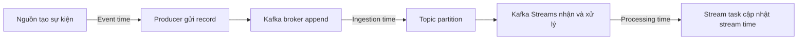

# Event time, processing time và stream time

Trong một hệ thống event streaming, một sự kiện có thể được tạo ở thiết bị, đến Kafka sau vài giây, rồi được ứng dụng xử lý muộn hơn nữa. Ba thời điểm đó trả lời ba câu hỏi khác nhau: sự việc thực sự xảy ra khi nào, broker nhận dữ liệu khi nào và ứng dụng xử lý khi nào. Kafka Streams còn có khái niệm **stream time** để điều khiển window, join và các phép xử lý phụ thuộc thời gian.

Nếu dùng nhầm loại thời gian, một báo cáo doanh thu theo giờ có thể xếp giao dịch vào sai giờ; một cảnh báo realtime có thể bị trễ; hoặc một cửa sổ tổng hợp có thể đóng trước khi sự kiện đến muộn được xử lý. Bài này giải thích cách chọn timestamp, cách Kafka lưu timestamp trong record và cách Kafka Streams tiến triển stream time.

## 1. Bốn khái niệm thời gian

| Khái niệm | Trả lời câu hỏi | Ví dụ |
| --- | --- | --- |
| **Event time** | Sự kiện thực sự xảy ra lúc nào tại nguồn? | Cảm biến ghi nhận nhiệt độ lúc 10:00:02. |
| **Ingestion time** | Kafka broker append record vào partition lúc nào? | Broker nhận record và append lúc 10:00:08. |
| **Processing time** | Ứng dụng xử lý record lúc nào? | Kafka Streams xử lý record lúc 10:00:09. |
| **Stream time** | Kafka Streams đã quan sát timestamp dữ liệu đến mốc nào? | Task đã xử lý record có timestamp lớn nhất là 10:00:12. |

Event time, ingestion time và processing time là các mốc thời gian gắn với vòng đời của dữ liệu. Stream time là khái niệm nội bộ của Kafka Streams: thời gian dữ liệu tiến triển trong một task, được tính từ timestamp mà `TimestampExtractor` cung cấp. Không nên xem stream time như đồng hồ thực của máy chủ.



Ví dụ một cảm biến ghi nhận nhiệt độ lúc 10:00:02 nhưng mất kết nối mạng. Record chỉ đến broker lúc 10:00:08 và ứng dụng đọc được lúc 10:00:09. Event time vẫn là 10:00:02; ingestion time là 10:00:08; processing time là 10:00:09. Nếu báo cáo cần thống kê nhiệt độ tại thời điểm cảm biến đo, phải dùng event time. Nếu muốn đo độ trễ từ broker đến ứng dụng, ingestion time và processing time mới là hai mốc cần so sánh.

## 2. Timestamp trong Kafka record

Từ Kafka 0.10, record có timestamp được lưu cùng dữ liệu. Timestamp này thường được producer gán và broker lưu lại, hoặc broker có thể thay bằng thời điểm append tùy cấu hình. Kafka cung cấp hai kiểu timestamp:

- `CreateTime`: timestamp do producer gửi trong record. Đây là mặc định. Nếu ứng dụng không truyền timestamp tường minh, producer thường dùng thời điểm gửi record làm timestamp. Chỉ khi producer đặt timestamp từ thời điểm xảy ra sự kiện thì `CreateTime` mới thực sự mang event time.
- `LogAppendTime`: broker gán timestamp tại thời điểm append record vào log. Đây là ingestion time ở broker. Broker ghi đè timestamp do producer gửi.

Cấu hình broker `log.message.timestamp.type` nhận `CreateTime` hoặc `LogAppendTime`; topic có cấu hình `message.timestamp.type` để ghi đè mặc định broker. [Kafka 4.4 Broker Configs](https://kafka.apache.org/44/configuration/broker-configs/) và [Kafka 4.4 Topic Configs](https://kafka.apache.org/44/configuration/topic-configs/).

Ví dụ cấu hình mặc định để giữ timestamp từ producer:

```properties
# server.properties
log.message.timestamp.type=CreateTime
```

Hoặc đặt riêng cho một topic:

```properties
message.timestamp.type=CreateTime
```

Nếu muốn timestamp do broker ghi lúc append:

```properties
message.timestamp.type=LogAppendTime
```

### 2.1. Producer phải gửi event time tường minh

Giả sử payload chứa `occurredAt`, là thời điểm sự kiện xảy ra tại hệ thống nguồn. Producer nên đặt timestamp của Kafka record bằng giá trị đó, chuyển sang epoch milliseconds UTC:

```java
Instant occurredAt = event.occurredAt();

ProducerRecord<String, OrderEvent> record = new ProducerRecord<>(
    "orders",
    null,
    occurredAt.toEpochMilli(),
    event.orderId(),
    event
);

producer.send(record);
```

Constructor này nhận timestamp theo milliseconds kể từ Unix epoch. Dùng `Instant` giúp biểu diễn một thời điểm tuyệt đối; tránh tự chuyển một giờ địa phương không có timezone thành epoch milliseconds. Nếu broker/topic dùng `LogAppendTime`, broker sẽ thay timestamp record bằng thời gian append, dù payload vẫn có thể giữ `occurredAt` gốc.

Không nên giả định timestamp trong Kafka record luôn là event time. Hãy xác định rõ ai tạo timestamp, đồng hồ nguồn có được đồng bộ không, producer có truyền timestamp hay không và topic đang dùng `CreateTime` hay `LogAppendTime`.

## 3. Event time và dữ liệu đến không đúng thứ tự

Trong hệ thống phân tán, record có thể đến Kafka theo thứ tự khác với thứ tự sự kiện xảy ra. Nguyên nhân thường gặp gồm:

- Thiết bị hoặc ứng dụng nguồn mất mạng rồi gửi bù dữ liệu.
- Nhiều producer gửi sự kiện từ các vùng địa lý có độ trễ khác nhau.
- Retry làm một sự kiện được gửi lại sau các sự kiện mới hơn.
- Đồng hồ trên thiết bị lệch hoặc chưa đồng bộ.
- Consumer replay dữ liệu lịch sử sau khi ứng dụng đã xử lý các sự kiện mới.

Kafka bảo đảm thứ tự append trong một partition theo offset. Điều đó không bảo đảm timestamp event time tăng dần theo offset. Một partition có thể chứa record timestamp 10:00:03, tiếp theo 10:00:01 rồi 10:00:05. Đây là dữ liệu đến không đúng thứ tự (out-of-order), dù thứ tự lưu trữ theo offset vẫn rõ ràng.

Ví dụ:

| Record | Event time | Ingestion time | Processing time |
| --- | --- | --- | --- |
| A | 10:00:02 | 10:00:08 | 10:00:09 |
| B | 10:00:01 | 10:00:09 | 10:00:10 |
| C | 10:00:08 | 10:00:10 | 10:00:11 |

Record B đến sau A nhưng mô tả sự kiện xảy ra trước A. Nếu tính số sự kiện theo phút bằng processing time, B sẽ bị xếp vào thời điểm 10:00:10. Nếu dùng event time, cả A và B được xếp vào phút 10:00, đúng với thời điểm nguồn phát sinh dữ liệu.

## 4. Processing time

Processing time là thời điểm ứng dụng thực sự xử lý record. Trong Kafka Streams, có thể chọn `WallclockTimestampExtractor` để gán timestamp theo đồng hồ hệ thống tại lúc record được xử lý:

```java
Properties props = new Properties();
props.put(
    StreamsConfig.DEFAULT_TIMESTAMP_EXTRACTOR_CLASS_CONFIG,
    WallclockTimestampExtractor.class
);
```

Khi dùng extractor này, stream processing dựa trên thời điểm xử lý thay vì thời điểm sự kiện xảy ra. Cách này hữu ích khi nghiệp vụ quan tâm đến thời gian hệ thống nhận và xử lý công việc, ví dụ đo tải xử lý hiện tại hoặc tạo thống kê theo thời điểm worker thực thi.

Processing time có một đặc điểm quan trọng: nếu record nằm trong Kafka nhiều giờ rồi consumer mới đọc, record được gán thời gian xử lý hiện tại. Khi replay cùng dữ liệu vào một thời điểm khác, record sẽ rơi vào cửa sổ khác. Vì vậy, processing-time aggregation thường không tái lập kết quả lịch sử giống event-time aggregation.

Processing time cũng không phải ingestion time. `WallclockTimestampExtractor` lấy thời gian khi Streams xử lý record; `LogAppendTime` được broker ghi khi record được append. Hai thời điểm có thể cách nhau lâu nếu consumer bị lag.

## 5. Stream time trong Kafka Streams

Kafka Streams gán timestamp cho từng record qua interface `TimestampExtractor`. Timestamp đó được dùng để điều khiển các thao tác phụ thuộc thời gian như window và join.

**Stream time là timestamp lớn nhất mà một task đã quan sát trong các record được xử lý**, tính cả record hiện tại. Nó được theo dõi theo từng stream task, không phải một đồng hồ toàn cục chung cho cả ứng dụng. Stream time có thể xem như high-watermark nội bộ của task.

Ví dụ task lần lượt xử lý các timestamp:

```text
Record A: 10:00:02  -> stream time = 10:00:02
Record B: 10:00:01  -> stream time = 10:00:02
Record C: 10:00:08  -> stream time = 10:00:08
Record D: 10:00:05  -> stream time = 10:00:08
```

Stream time không lùi khi nhận record có timestamp cũ hơn. Record cũ vẫn có thể được xử lý, nhưng nó không làm stream time giảm xuống. Các window sẽ quyết định có chấp nhận record đến muộn đó hay không dựa trên grace period.

### 5.1. Stream time không phải wall-clock time

Stream time tiến triển theo record được xử lý. Nếu không có record mới, stream time không tự tăng theo thời gian thực. Nếu task đang chờ dữ liệu hoặc đang idle, các phép toán dựa trên stream time cũng có thể chưa tiến triển.

Điều này tạo ra một khác biệt dễ nhầm:

| Cơ chế | Đồng hồ điều khiển | Khi không có record mới |
| --- | --- | --- |
| Window theo stream time | Timestamp record sau `TimestampExtractor` | Stream time đứng yên; window chưa tự đóng chỉ vì đồng hồ máy chạy tiếp. |
| Punctuation `STREAM_TIME` | Stream time của task | Callback không được gọi cho đến khi stream time tiến triển. |
| Punctuation `WALL_CLOCK_TIME` | Đồng hồ hệ thống | Callback vẫn có thể được gọi theo lịch dù không có record mới. |

Kafka Streams Processor API hỗ trợ cả `PunctuationType.STREAM_TIME` và `PunctuationType.WALL_CLOCK_TIME`. Dùng stream-time punctuation cho công việc cần tiến triển theo timestamp dữ liệu; dùng wall-clock punctuation cho tác vụ định kỳ theo đồng hồ máy như phát heartbeat hoặc kiểm tra trạng thái. [Kafka Streams Processor API](https://kafka.apache.org/44/streams/developer-guide/processor-api/) và [ProcessingContext Javadoc](https://kafka.apache.org/44/javadoc/org/apache/kafka/streams/processor/api/ProcessingContext.html).

Ví dụ minh họa cách đăng ký hai loại punctuation trong `Processor#init()`:

```java
context.schedule(
    Duration.ofSeconds(10),
    PunctuationType.STREAM_TIME,
    timestamp -> emitEventTimeSummary(timestamp)
);

context.schedule(
    Duration.ofSeconds(10),
    PunctuationType.WALL_CLOCK_TIME,
    timestamp -> emitOperationalHeartbeat(timestamp)
);
```

Callback stream-time chỉ chạy khi record làm stream time tiến triển đến mốc tiếp theo. Callback wall-clock được kích hoạt độc lập với record mới. Tuy vậy, callback vẫn chạy trong runtime của Kafka Streams; nó không phải một scheduler hệ điều hành bên ngoài.

### 5.2. TimestampExtractor quyết định ý nghĩa stream time

Với extractor mặc định `FailOnInvalidTimestamp`, Kafka Streams đọc timestamp đã được lưu trong Kafka record. Do đó, nếu topic dùng `CreateTime` và producer gửi event time, stream time mang semantics event time. Nếu topic dùng `LogAppendTime`, stream time mặc định sẽ tiến triển theo ingestion time.

Nếu muốn dùng event time nằm trong payload, hãy viết extractor để lấy trường đó. Ví dụ dưới đây giả sử deserializer đã chuyển value thành `OrderEvent`:

```java
public record OrderEvent(
    String orderId,
    String customerId,
    Instant occurredAt
) {}

public final class OrderEventTimestampExtractor
        implements TimestampExtractor {

    @Override
    public long extract(
            ConsumerRecord<Object, Object> record,
            long partitionTime) {
        if (!(record.value() instanceof OrderEvent event)
                || event.occurredAt() == null) {
            throw new IllegalArgumentException(
                "OrderEvent must contain occurredAt"
            );
        }

        long timestamp = event.occurredAt().toEpochMilli();
        if (timestamp <= 0) {
            throw new IllegalArgumentException(
                "occurredAt must be a valid positive epoch timestamp"
            );
        }
        return timestamp;
    }
}
```

Đăng ký extractor:

```java
props.put(
    StreamsConfig.DEFAULT_TIMESTAMP_EXTRACTOR_CLASS_CONFIG,
    OrderEventTimestampExtractor.class
);
```

`TimestampExtractor` phải stateless. Giá trị timestamp phải là milliseconds kể từ 00:00:00 UTC ngày 1-1-1970. Theo Javadoc Kafka 4.4, trả về timestamp âm làm record bị bỏ qua mà không xử lý; nếu timestamp không hợp lệ là lỗi nghiêm trọng, extractor có thể ném `RuntimeException` để dừng ứng dụng và điều tra. [TimestampExtractor Javadoc](https://kafka.apache.org/44/javadoc/org/apache/kafka/streams/processor/TimestampExtractor.html).

Không nên tự động thay timestamp thiếu bằng `System.currentTimeMillis()` nếu ứng dụng đang cần event-time semantics. Việc đó âm thầm trộn event time và processing time, làm kết quả window khó giải thích. Hãy chọn chính sách rõ ràng: từ chối record, chuyển sang dead-letter topic, hoặc dùng một fallback có giám sát và được nghiệp vụ chấp nhận.

## 6. Window và grace period xử lý late event

Window là khoảng thời gian dùng để nhóm record, ví dụ đếm số đơn hàng mỗi 5 phút. Với event-time window, Kafka Streams dựa trên timestamp record đã trích xuất để xác định record thuộc cửa sổ nào.

Ví dụ tạo tumbling window 5 phút và cho phép record đến muộn trong 2 phút:

```java
KTable<Windowed<String>, Long> ordersPerCustomer = events
    .selectKey((key, event) -> event.customerId())
    .groupByKey(Grouped.with(Serdes.String(), orderEventSerde))
    .windowedBy(
        TimeWindows.ofSizeAndGrace(
            Duration.ofMinutes(5),
            Duration.ofMinutes(2)
        )
    )
    .count();
```

Giả sử một cửa sổ có khoảng thời gian `[10:00, 10:05)`, grace period là 2 phút. Cửa sổ tiếp tục nhận out-of-order record cho đến khi stream time đạt `10:07`. Khi `stream_time >= window_end + grace_period`, cửa sổ được đóng; record đến sau mốc đó mà timestamp thuộc cửa sổ cũ sẽ bị loại khỏi phép tính window.

Grace period là mức trễ cho phép được tính theo stream time, không phải bộ đếm hai phút theo wall clock kể từ lúc record đầu tiên đến. Nếu stream time đứng yên vì không có record mới, cửa sổ không tự đóng chỉ vì hai phút thực đã trôi qua. Nếu một record có timestamp tương lai làm stream time nhảy vọt, nhiều cửa sổ cũ có thể đóng ngay.

### 6.1. Ví dụ late event

Với cửa sổ `[10:00, 10:05)` và grace 2 phút:

| Tình huống | Stream time trước khi record đến | Timestamp record | Kết quả |
| --- | --- | --- | --- |
| Record đến khi stream time là 10:06:30 | 10:06:30 | 10:04:50 | Được chấp nhận vì cửa sổ chưa đóng. |
| Record đến khi stream time là 10:07:00 | 10:07:00 | 10:04:50 | Đã đến ngưỡng đóng; record bị loại khỏi window. |
| Record đến khi stream time là 10:08:20 | 10:08:20 | 10:04:50 | Quá grace period; record bị loại khỏi window. |

Grace càng dài thì hệ thống chấp nhận dữ liệu đến muộn nhiều hơn, nhưng state window phải được giữ lâu hơn và kết quả cuối cùng có thể được phát muộn hơn. Nếu dùng `Suppressed.untilWindowCloses(...)`, kết quả cuối chỉ được phát khi window đóng; cần cân bằng grace period với yêu cầu latency và bộ nhớ buffer. [Kafka Streams DSL API — Windowing](https://kafka.apache.org/44/streams/developer-guide/dsl-api/) và [Windows Javadoc](https://kafka.apache.org/44/javadoc/org/apache/kafka/streams/kstream/Windows.html).

## 7. Chọn semantics theo nghiệp vụ

| Bài toán | Thời gian nên cân nhắc | Vì sao |
| --- | --- | --- |
| Doanh thu theo giờ phát sinh giao dịch | Event time | Giao dịch cần được ghi nhận vào thời điểm nghiệp vụ xảy ra, kể cả khi gửi trễ. |
| Theo dõi thời điểm broker nhận sự kiện | Ingestion time | Cần đo thời gian từ nguồn đến Kafka hoặc kiểm toán thời điểm broker append. |
| Đo thời gian xử lý của consumer | Processing time kết hợp ingestion time | So sánh lúc broker nhận với lúc ứng dụng xử lý để đo queue/consumer delay. |
| Báo cáo telemetry từ thiết bị mất mạng | Event time + grace period | Dữ liệu gửi bù cần được xếp về thời điểm thiết bị đo. |
| Heartbeat định kỳ dù không có message | Wall-clock punctuation hoặc scheduler bên ngoài | Tác vụ phải chạy theo thời gian thực, không phụ thuộc stream activity. |
| Tổng hợp theo thời điểm worker thực thi | Processing time | Nghiệp vụ quan tâm tải hoặc hành vi của hệ thống xử lý. |

Không có một loại thời gian đúng cho mọi pipeline. Một ứng dụng có thể dùng event time cho window phân tích nhưng vẫn ghi ingestion timestamp để đo độ trễ. Có thể lưu cả ba mốc trong payload/header hoặc metrics để điều tra: `occurredAt`, `brokerTimestamp` và `processedAt`.

## 8. Ví dụ cấu hình Kafka Streams dùng event time

Giả sử topic `orders` chứa `OrderEvent` với trường `occurredAt`. Producer đặt Kafka record timestamp từ trường này, topic dùng `CreateTime`, và Streams sử dụng timestamp mặc định hoặc custom extractor tương ứng.

```java
Properties props = new Properties();
props.put(StreamsConfig.APPLICATION_ID_CONFIG, "orders-event-time");
props.put(StreamsConfig.BOOTSTRAP_SERVERS_CONFIG, "localhost:9092");
props.put(
    StreamsConfig.DEFAULT_TIMESTAMP_EXTRACTOR_CLASS_CONFIG,
    OrderEventTimestampExtractor.class
);

StreamsBuilder builder = new StreamsBuilder();
KStream<String, OrderEvent> events = builder.stream(
    "orders",
    Consumed.with(Serdes.String(), orderEventSerde)
);

KTable<Windowed<String>, Long> counts = events
    .selectKey((key, event) -> event.customerId())
    .groupByKey(Grouped.with(Serdes.String(), orderEventSerde))
    .windowedBy(TimeWindows.ofSizeAndGrace(
        Duration.ofMinutes(5),
        Duration.ofMinutes(2)
    ))
    .count();
```

Đoạn code giả định `orderEventSerde` đã được cấu hình và các import Kafka Streams cần thiết đã có. Với topic nhiều partition, window aggregation được thực hiện theo key và task; stream time là theo task, vì thế các partition được gán vào những task khác nhau có thể tiến triển thời gian khác nhau.

## 9. Những lỗi thời gian thường gặp

| Triệu chứng | Nguyên nhân có thể | Hướng kiểm tra |
| --- | --- | --- |
| Giao dịch bị xếp vào giờ consumer xử lý | Producer không đặt event timestamp; record dùng timestamp gửi hoặc `LogAppendTime`. | Kiểm tra `ProducerRecord` timestamp và `message.timestamp.type`. |
| Window đóng quá sớm | Grace period quá ngắn hoặc stream time bị đẩy nhanh bởi timestamp tương lai. | Kiểm tra timestamp extractor, clock nguồn và stream time của task. |
| Window không đóng dù đã chờ lâu | Không có record mới để stream time tiến triển. | Xem có đang chờ stream-time window đóng trong một luồng idle không; cân nhắc wall-clock punctuation nếu nghiệp vụ cần thời gian thực. |
| Record cũ bị drop | Timestamp thuộc window đã qua grace period. | Kiểm tra event time, stream time và grace period; xác định tỷ lệ late records. |
| Replay tạo kết quả khác | Pipeline dùng processing time hoặc dữ liệu đầu vào timestamp thay đổi. | So sánh extractor và record timestamps giữa lần chạy. |
| Stream time nhảy bất thường | Một record có timestamp tương lai hoặc clock nguồn lệch. | Kiểm tra timestamp đầu vào, đồng bộ NTP và quy tắc validate timestamp. |
| Timestamp invalid hoặc không có | Producer/serializer không gán timestamp đúng hoặc custom extractor đọc sai field. | Kiểm tra đơn vị milliseconds, timezone và policy xử lý record lỗi. |

Đặc biệt chú ý đơn vị thời gian. `Instant.toEpochMilli()` trả về milliseconds; nếu producer vô tình gửi epoch seconds, timestamp sẽ nằm gần năm 1970. Nếu gửi microseconds hoặc nanoseconds như milliseconds, timestamp có thể nhảy đến tương lai rất xa và làm stream time tiến triển sai.

## 10. Checklist thiết kế

Trước khi triển khai pipeline phụ thuộc thời gian, hãy xác nhận:

1. Event time đến từ nguồn nào và nguồn có đồng bộ đồng hồ không?
2. Producer có đặt timestamp trong Kafka record không, hay chỉ lưu timestamp trong payload?
3. Topic/broker dùng `CreateTime` hay `LogAppendTime`?
4. `TimestampExtractor` mặc định có đủ không, hay cần đọc trường event time trong payload?
5. Timestamp có ở epoch milliseconds UTC, hợp lệ và nằm trong phạm vi cho phép không?
6. Độ trễ đến muộn tối đa thường gặp là bao lâu và grace period được chọn dựa trên số liệu nào?
7. Có cần kết quả cuối cùng sau khi window đóng hay chấp nhận các bản cập nhật liên tục?
8. Tác vụ định kỳ cần tiến triển theo stream time hay phải chạy theo wall-clock time ngay cả khi stream idle?
9. Metrics có đo được late records, processing lag và độ lệch timestamp không?

## 11. Ghi nhớ

- Event time là lúc sự kiện xảy ra tại nguồn; ingestion time là lúc broker append record; processing time là lúc ứng dụng xử lý record.
- Kafka record có timestamp `CreateTime` hoặc `LogAppendTime`. `CreateTime` chỉ đại diện event time nếu producer gửi timestamp nguồn một cách tường minh.
- Kafka Streams lấy timestamp qua `TimestampExtractor`; extractor quyết định semantics thời gian mà các phép window/join sử dụng.
- Stream time là timestamp lớn nhất đã quan sát trong từng task. Nó tăng theo record, không tự tăng khi stream idle và không phải wall-clock time.
- Grace period cho phép nhận out-of-order record đến một mốc stream time xác định; record đến sau khi window đóng sẽ bị loại khỏi window đó.
- `STREAM_TIME` punctuation phụ thuộc dữ liệu; `WALL_CLOCK_TIME` punctuation phụ thuộc đồng hồ hệ thống và vẫn có thể chạy khi không có record mới.
- Hãy lưu và quan sát cả event time, ingestion time, processing time nếu cần đo latency và điều tra dữ liệu đến trễ.

## Tài liệu tham khảo

- [Apache Kafka 4.4 Streams Core Concepts](https://kafka.apache.org/44/streams/core-concepts/) — event time, processing time, ingestion time và stream time.
- [Apache Kafka 4.4 Streams Config](https://kafka.apache.org/44/streams/developer-guide/config-streams/) — timestamp extractor mặc định và `WallclockTimestampExtractor`.
- [Apache Kafka 4.4 Processor API](https://kafka.apache.org/44/streams/developer-guide/processor-api/) — stream-time và wall-clock punctuation.
- [Apache Kafka 4.4 Streams DSL API](https://kafka.apache.org/44/streams/developer-guide/dsl-api/) — window, grace period và late records.
- [TimestampExtractor Javadoc](https://kafka.apache.org/44/javadoc/org/apache/kafka/streams/processor/TimestampExtractor.html) — hợp đồng timestamp extractor.
- [ProcessingContext Javadoc](https://kafka.apache.org/44/javadoc/org/apache/kafka/streams/processor/api/ProcessingContext.html) — `currentStreamTimeMs` và `currentSystemTimeMs`.
- [Kafka 4.4 Broker Configs](https://kafka.apache.org/44/configuration/broker-configs/) — `log.message.timestamp.type`.
- [Kafka 4.4 Topic Configs](https://kafka.apache.org/44/configuration/topic-configs/) — `message.timestamp.type`.
