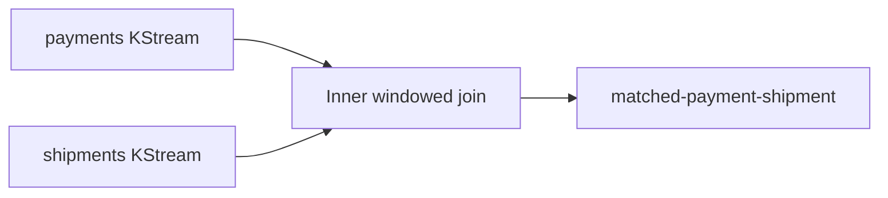
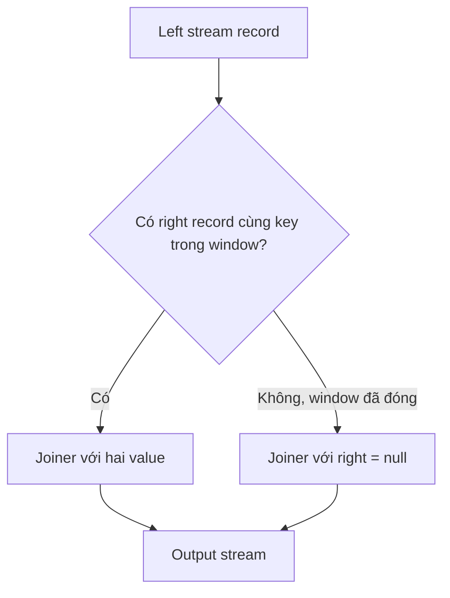
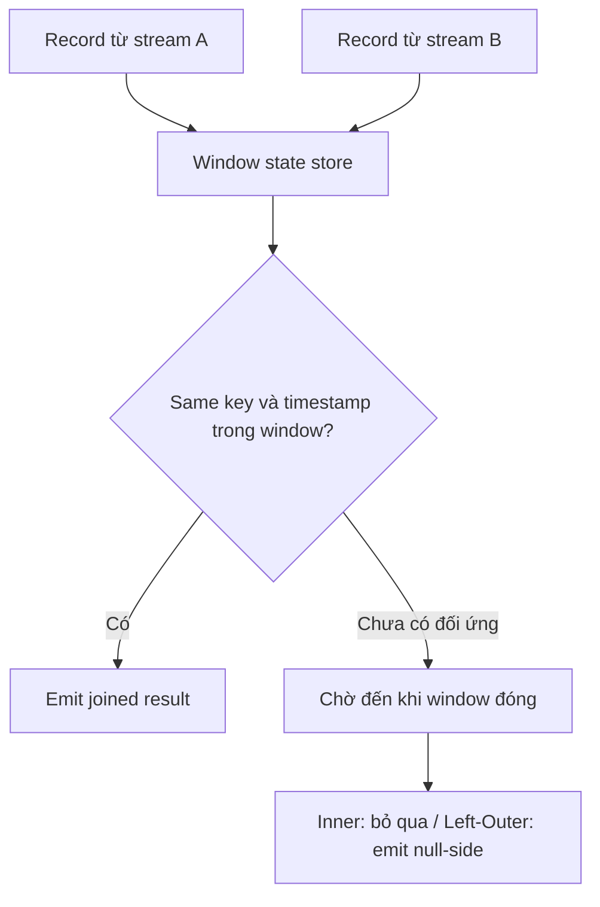

# Windowed join và dữ liệu không khớp trong khoảng thời gian

## Kết hợp hai event stream theo key và thời gian

Trong event streaming, hai sự kiện chỉ có thể kết hợp nếu chúng liên quan đến cùng một đối tượng và xảy ra trong một khoảng thời gian được nghiệp vụ chấp nhận. Ví dụ:

- Một khoản thanh toán được ghép với đơn hàng trong vòng 10 phút.
- Một lần quẹt thẻ được ghép với sự kiện xác thực thiết bị trong vòng 30 giây.
- Một event giao hàng được ghép với event đóng gói tương ứng trong vòng 2 giờ.

Kafka Streams cung cấp **KStream-KStream windowed join** để ghép hai luồng event theo record key và timestamp. Join tạo kết quả khi hai record có cùng key và timestamp của chúng nằm trong cửa sổ join. Dữ liệu không khớp có thể bị bỏ qua với inner join, được phát ra dưới dạng kết quả thiếu phía đối ứng với left/outer join, hoặc bị loại nếu đến muộn hơn grace period.

Muốn xử lý đúng, cần phân biệt ba khái niệm:

- **Join window:** khoảng chênh lệch thời gian tối đa giữa hai record được phép ghép.
- **Grace period:** khoảng dung sai để chấp nhận record đến không đúng thứ tự thời gian.
- **Unmatched record:** record không tìm thấy record đối ứng trong cửa sổ khi cửa sổ đã đủ điều kiện đóng.

Unmatched và late record không giống nhau. Một record không có đối ứng khi cửa sổ đóng có thể được phát ra bởi left/outer join; một record đến sau khi grace đã hết có thể bị loại khỏi phép join.

## 1. KStream-KStream join là gì?

### 1.1 Join theo key và timestamp

KStream-KStream join kết hợp hai luồng event. Mỗi record ở cả hai phía cần có:

- Key dùng để xác định hai record có liên quan hay không.
- Timestamp dùng để xác định chúng có nằm trong join window hay không.
- Value chứa dữ liệu nghiệp vụ đưa vào ValueJoiner.

Ví dụ hai topic:

| Topic | Key | Timestamp | Value |
|---|---|---|---|
| payments | order-42 | 10:00:00 | PaymentAuthorized |
| shipments | order-42 | 10:04:00 | ShipmentCreated |
| payments | order-99 | 10:20:00 | PaymentAuthorized |
| shipments | order-99 | 10:40:00 | ShipmentCreated |

Nếu join window cho phép chênh lệch tối đa 10 phút, hai record của order-42 có thể ghép; hai record của order-99 không khớp vì cách nhau 20 phút.

### 1.2 Một record có thể ghép với nhiều record

Windowed join không mặc định là quan hệ một-một. Nếu một payment có hai shipment event cùng key và đều nằm trong cửa sổ, join có thể tạo hai kết quả. Tương tự, một record phía phải có thể ghép với nhiều record phía trái.

Ví dụ:

```text
payments:
  order-42, 10:00, PaymentAuthorized

shipments:
  order-42, 10:02, ShipmentLabelCreated
  order-42, 10:05, ShipmentDispatched

join output:
  PaymentAuthorized + ShipmentLabelCreated
  PaymentAuthorized + ShipmentDispatched
```

Nếu nghiệp vụ yêu cầu đúng một kết quả, cần định nghĩa thêm khóa con, loại event, sequence hoặc điều kiện chọn record phù hợp. Không dựa vào window join để tự suy ra quan hệ một-một.

### 1.3 Co-partitioning vẫn là điều kiện bắt buộc

Hai input stream phải được co-partition theo join key:

- Cùng số partition.
- Cùng key phải được route vào partition tương ứng ở cả hai topic.
- Key serialization và partitioning strategy phải tương thích.

Kafka Streams xử lý join theo task/partition. Nếu order-42 ở partition 1 của payments nhưng partition 3 của shipments, task xử lý một phía không thể tự tìm record phía kia trong state cục bộ.

Nếu key hiện tại không phải join key, dùng selectKey() rồi repartition trước join. Kiểm tra topology và internal repartition topic sau khi đổi key.

## 2. Join window và grace period

### 2.1 Join window xác định khoảng thời gian ghép

Với một record có timestamp t, join window cho phép tìm record cùng key ở phía kia trong khoảng thời gian quanh t. Ví dụ dùng cửa sổ chênh lệch đối xứng 5 phút:

\[
|t_{left} - t_{right}| \leq 5\text{ phút}
\]

Nếu payment có timestamp 10:00, shipment timestamp 09:56 hoặc 10:04 có thể khớp; shipment timestamp 10:08 nằm ngoài cửa sổ.

Window phải phản ánh quy tắc nghiệp vụ, không chọn tùy tiện chỉ để giảm state. Cửa sổ quá rộng làm tăng số record phải giữ và số cặp có thể ghép; cửa sổ quá hẹp bỏ lỡ sự kiện hợp lệ đến chậm.

### 2.2 Grace period cho dữ liệu đến trễ

Trong hệ thống phân tán, record có timestamp sớm có thể đến Kafka Streams sau record có timestamp muộn vì:

- Network hoặc broker delay.
- Connector đọc log nguồn chậm.
- Producer retry hoặc batch buffering.
- Hai hệ thống nguồn có tốc độ phát khác nhau.
- Consumer/task tạm dừng rồi tiếp tục.

Grace period cho phép record đến không đúng thứ tự thời gian vẫn tham gia join trong một khoảng dung sai sau khi cửa sổ kết thúc theo stream time.

Ví dụ join window 5 phút, grace 2 phút. Nếu record phía trái có timestamp 10:00, record phía phải có timestamp 10:04 vẫn nằm trong cửa sổ. Nếu phía phải đến sau record khác, grace cho phép chờ thêm để record đến muộn có cơ hội được ghép.

Grace không mở rộng khoảng chênh lệch nghiệp vụ giữa hai timestamp. Nó mở rộng thời gian hệ thống chờ dữ liệu đến trễ trước khi đóng cửa sổ.

### 2.3 Stream time không phải wall-clock time

Kafka Streams dùng timestamp của record để tiến triển **stream time** trong task. Stream time được dẫn dắt bởi timestamp đã quan sát, không đơn giản là đồng hồ hiện tại của máy.

Một record được coi là quá muộn khi cửa sổ tương ứng đã đóng theo stream time và grace period. Vì vậy:

- Nếu không có record mới, wall clock có thể trôi qua nhưng stream time không nhất thiết tiến.
- Một record có timestamp cũ có thể bị loại khi stream time đã tiến xa hơn.
- Timestamp bất thường hoặc clock skew có thể làm stream time nhảy nhanh và khiến record khác trở nên late.

Đừng dùng Thread.sleep() hoặc wall clock để suy luận chính xác thời điểm join window đóng. Hãy hiểu timestamp extractor, stream time và grace của topology.

### 2.4 Cấu hình JoinWindows hiện đại

Với Kafka Streams phiên bản hỗ trợ API mới, có thể tạo cửa sổ đối xứng và grace như sau:

```java
JoinWindows windows = JoinWindows.ofTimeDifferenceAndGrace(
        Duration.ofMinutes(5),
        Duration.ofMinutes(2)
);
```

Ví dụ này cho phép hai record cùng key có timestamp cách nhau tối đa 5 phút, đồng thời chấp nhận out-of-order data trong grace period 2 phút.

Nếu ứng dụng dùng Kafka Streams phiên bản cũ, API tạo JoinWindows có thể khác. Hãy đối chiếu Javadoc của đúng dependency; không trộn các API deprecated với API mới một cách máy móc.

## 3. Inner join: chỉ phát cặp khớp

### 3.1 Semantics

join() giữa hai KStream là inner join. Kết quả chỉ được tạo khi:

1. Hai record có cùng key.
2. Timestamp của chúng nằm trong join window.
3. Cả hai record được chấp nhận theo stream-time/grace rules.

Record không tìm thấy đối ứng sẽ không tạo output inner join.



### 3.2 Java DSL example

Giả sử cả hai topic dùng orderId làm Kafka record key:

```java
KStream<String, PaymentEvent> payments = builder.stream(
        "payments",
        Consumed.with(Serdes.String(), paymentSerde)
);

KStream<String, ShipmentEvent> shipments = builder.stream(
        "shipments",
        Consumed.with(Serdes.String(), shipmentSerde)
);

JoinWindows windows = JoinWindows.ofTimeDifferenceAndGrace(
        Duration.ofMinutes(10),
        Duration.ofMinutes(2)
);

KStream<String, PaymentShipment> matched = payments.join(
        shipments,
        (payment, shipment) -> new PaymentShipment(
                payment.orderId(),
                payment.paymentId(),
                shipment.shipmentId()
        ),
        windows,
        StreamJoined.with(
                Serdes.String(),
                paymentSerde,
                shipmentSerde
        )
);

matched.to(
        "payment-shipment-matched",
        Produced.with(Serdes.String(), paymentShipmentSerde)
);
```

StreamJoined khai báo Serde cho key và hai value type. Key của output là join key, ở đây là orderId.

### 3.3 Khi nào dùng inner join?

Dùng inner join khi chỉ cặp đầy đủ mới có ý nghĩa:

- Ghép click với impression trong một khoảng thời gian.
- Ghép request với response khi cả hai đều tồn tại.
- Ghép payment với shipment khi chỉ quan tâm đơn đã có đủ hai event.

Nếu cần thống kê số record không khớp, inner join không tự phát ra chúng. Hãy dùng left/outer join hoặc xây dựng luồng kiểm soát riêng.

## 4. Left join: giữ record phía trái không có đối ứng

### 4.1 Semantics

leftJoin() tạo kết quả cho các cặp khớp như inner join. Ngoài ra, với record phía trái không có record phía phải trong cửa sổ khi cửa sổ đóng, joiner được gọi với giá trị phía phải là null.

Kết quả unmatched không được phát ngay lúc record trái vừa đến, vì record phải có thể đến sau trong cửa sổ hoặc grace period. Kafka Streams cần chờ đủ tiến triển stream time để xác định rằng không còn record hợp lệ có thể ghép.



### 4.2 Java DSL example

```java
KStream<String, PaymentShipment> result = payments.leftJoin(
        shipments,
        (payment, shipment) -> {
            if (shipment == null) {
                return new PaymentShipment(
                        payment.orderId(),
                        payment.paymentId(),
                        null,
                        "WAITING_FOR_SHIPMENT"
                );
            }

            return new PaymentShipment(
                    payment.orderId(),
                    payment.paymentId(),
                    shipment.shipmentId(),
                    "MATCHED"
            );
        },
        windows,
        StreamJoined.with(
                Serdes.String(),
                paymentSerde,
                shipmentSerde
        )
);
```

Kết quả unmatched được tạo sau khi cửa sổ có thể đóng, không phải ngay sau khi PaymentEvent được đọc. Consumer downstream cần chấp nhận độ trễ này.

### 4.3 Left join không có nghĩa là “không bao giờ có record phải”

Nếu record trái chưa có đối ứng tại thời điểm hiện tại nhưng record phải vẫn có thể đến trong window/grace, Kafka Streams chưa thể kết luận unmatched. Chỉ khi window đóng theo stream time và grace mới kết thúc thì kết quả null-side mới được phát.

Nếu hệ thống cần phản hồi ngay “chưa có shipment”, hãy phát một trạng thái pending từ luồng nghiệp vụ riêng; đừng nhầm nó với kết quả unmatched cuối cùng của window join.

## 5. Outer join: giữ unmatched từ cả hai phía

### 5.1 Semantics

outerJoin() giữ cả record trái và phải:

- Hai record khớp: joiner nhận cả hai value.
- Record trái không có đối ứng: joiner nhận (left, null) khi window đóng.
- Record phải không có đối ứng: joiner nhận (null, right) khi window đóng.

Outer join hữu ích khi muốn phân loại cả hai loại dữ liệu không khớp, ví dụ payment không có shipment và shipment không có payment.

### 5.2 Java DSL example

```java
KStream<String, PaymentShipmentAudit> audit = payments.outerJoin(
        shipments,
        (payment, shipment) -> {
            if (payment == null) {
                return PaymentShipmentAudit.unmatchedShipment(shipment);
            }
            if (shipment == null) {
                return PaymentShipmentAudit.unmatchedPayment(payment);
            }
            return PaymentShipmentAudit.matched(payment, shipment);
        },
        windows,
        StreamJoined.with(
                Serdes.String(),
                paymentSerde,
                shipmentSerde
        )
);
```

ValueJoiner phải xử lý null ở cả hai phía. Nếu code truy cập payment.orderId() mà không kiểm tra, record unmatched từ phía phải sẽ gây lỗi.

### 5.3 Chọn join type

| Join type | Cặp khớp | Left không khớp | Right không khớp |
|---|---|---|---|
| join() | Có output | Không output | Không output |
| leftJoin() | Có output | Output với right null | Không output |
| outerJoin() | Có output | Output với right null | Output với left null |

Hãy chọn join type theo yêu cầu nghiệp vụ và chính sách xử lý unmatched, không chỉ theo mong muốn có nhiều output.

## 6. Timestamp và event time

### 6.1 Event time khác processing time

Timestamp của record có thể đại diện cho:

- **Event time:** thời điểm sự kiện thực sự xảy ra ở hệ thống nguồn.
- **Ingestion time:** thời điểm broker ghi nhận record.
- **Processing time:** thời điểm ứng dụng Streams xử lý record.

Windowed join sử dụng record timestamp mà Kafka Streams nhìn thấy. Nếu producer không đặt timestamp hoặc timestamp extractor không đúng, cửa sổ có thể phản ánh thời điểm ingest thay vì thời điểm nghiệp vụ.

Ví dụ payment xảy ra lúc 10:00 nhưng connector publish lúc 10:15. Nếu dùng ingestion time, payment có thể không ghép được với shipment event lúc 10:05 dù hai nghiệp vụ chỉ cách nhau 5 phút.

### 6.2 Dùng timestamp extractor theo payload

Nếu event payload có occurredAt, có thể tạo TimestampExtractor:

```java
public final class PaymentTimestampExtractor implements TimestampExtractor {
    @Override
    public long extract(ConsumerRecord<Object, Object> record,
                        long partitionTime) {
        PaymentEvent event = (PaymentEvent) record.value();
        return event.occurredAt().toEpochMilli();
    }
}
```

Gắn extractor khi khai báo source:

```java
Consumed<String, PaymentEvent> paymentConsumed = Consumed
        .with(Serdes.String(), paymentSerde)
        .withTimestampExtractor(new PaymentTimestampExtractor());

KStream<String, PaymentEvent> payments =
        builder.stream("payments", paymentConsumed);
```

Đoạn code giả định payload đã deserialize thành PaymentEvent và occurredAt luôn hợp lệ. Production cần xử lý null, timestamp âm, sai định dạng và timestamp vượt xa hiện tại theo chính sách rõ ràng.

### 6.3 Clock skew và timestamp quality

Nếu hai hệ thống nguồn dùng clock không đồng bộ, event time có thể lệch. Ví dụ payment service nhanh hơn shipment service 3 phút, join window 2 phút có thể bỏ lỡ cặp nghiệp vụ hợp lệ.

Để giảm rủi ro:

- Đồng bộ clock các máy nguồn bằng NTP/PTP theo hạ tầng.
- Xác định nguồn timestamp có thẩm quyền cho từng event.
- Đặt giới hạn hợp lý cho timestamp tương lai/quá khứ.
- Theo dõi phân phối event-time lag và record lateness.
- Không tự động sửa timestamp bằng wall clock consumer nếu không có quy tắc nghiệp vụ.

## 7. Unmatched record và late record là hai trường hợp khác nhau

### 7.1 Unmatched: cửa sổ đóng nhưng không có cặp hợp lệ

Một payment có thể không có shipment nào cùng key trong khoảng join. Với left join, sau khi cửa sổ đóng, Kafka Streams phát kết quả có shipment null. Đây là unmatched hợp lệ theo chính sách window.

### 7.2 Late: record đến sau grace

Một shipment có timestamp phù hợp với payment nhưng chỉ đến sau khi stream time đã vượt window end cộng grace. Record đó quá muộn đối với phép join hiện tại và không làm sống lại cửa sổ đã đóng.

Ví dụ:

```text
Join window: 5 phút
Grace:       2 phút

Payment timestamp:       10:00
Shipment timestamp:      10:04
Shipment arrival:        sau khi stream-time đã đóng window

Kết quả:
- Nếu shipment đến trước khi grace kết thúc: có thể join.
- Nếu shipment đến sau grace: bị xem là late và không ghép vào window đã đóng.
```

Nếu left join đã phát unmatched result cho payment, record shipment quá muộn không tự động sửa output trước đó. Muốn xử lý late data sau grace, cần luồng correction/reconciliation riêng hoặc tăng grace theo SLA thực tế.

### 7.3 Vì sao tăng grace vô hạn không phải giải pháp?

Grace dài hơn cho phép chấp nhận nhiều dữ liệu đến trễ hơn, nhưng:

- State store phải giữ record lâu hơn.
- Join output và unmatched result bị trì hoãn.
- Disk, changelog và restore time tăng.
- Lỗi dữ liệu timestamp có thể giữ state quá lâu.

Chọn grace theo phân phối lateness thực tế, ví dụ p99/p99.9, cộng thêm biên vận hành. Đo lường sau khi chạy production và điều chỉnh bằng kế hoạch topology/version phù hợp.

## 8. Dữ liệu không khớp cần được xử lý thế nào?

### 8.1 Phân loại nguyên nhân

Không phải mọi unmatched đều là lỗi:

| Nguyên nhân | Ví dụ | Cách xử lý |
|---|---|---|
| Đối ứng chưa xảy ra | Payment được xác nhận, shipment chưa tạo | Phát trạng thái pending hoặc chờ luồng nghiệp vụ |
| Đối ứng không tồn tại | Record từ hệ thống nguồn bị thiếu | Ghi nhận unmatched và cảnh báo theo SLA |
| Key không giống nhau | order-42 và 42 | Chuẩn hóa key trước khi publish/join |
| Timestamp ngoài window | Hai event cách nhau quá xa | Điều chỉnh window nếu hợp lý hoặc coi là unmatched |
| Record đến sau grace | Connector lag hoặc outage | Correction/replay có kiểm soát |
| Record bị filter | Một phía bị lọc bởi predicate | Kiểm tra topology/filter logic |
| Null key | Producer không gán key | Sửa producer; record không thể join theo key |
| Sai Serde/schema | Key/value deserialize không như mong đợi | Sửa contract và xử lý record lỗi |

### 8.2 Tách matched và unmatched output

Có thể tạo output object chứa trạng thái join rồi phân nhánh:

```java
KStream<String, PaymentShipment> joined = payments.leftJoin(
        shipments,
        (payment, shipment) -> shipment == null
                ? PaymentShipment.unmatched(payment)
                : PaymentShipment.matched(payment, shipment),
        windows,
        StreamJoined.with(
                Serdes.String(),
                paymentSerde,
                shipmentSerde
        )
);

KStream<String, PaymentShipment>[] branches = joined.branch(
        (key, value) -> value.status().equals("MATCHED"),
        (key, value) -> value.status().equals("UNMATCHED")
);

branches[0].to("payment-shipment-matched");
branches[1].to("payment-shipment-unmatched");
```

branch() kiểm tra các điều kiện theo thứ tự; mỗi record đi vào nhánh đầu tiên phù hợp. Cần cấu hình Serde cho output và xác định retention/replay policy cho unmatched topic.

### 8.3 Unmatched topic không phải DLT

Unmatched là kết quả nghiệp vụ: hai record không có cặp trong cửa sổ. DLT là nơi chứa record không thể xử lý sau lỗi/retry. Không gộp hai khái niệm vào một topic nếu downstream cần phân biệt lỗi kỹ thuật với kết quả không khớp hợp lệ.

## 9. State store và chi phí của windowed join

### 9.1 Vì sao join phải giữ state?

Khi record từ một phía đến trước, Kafka Streams phải lưu record đó để chờ record cùng key từ phía kia. Window store giữ các record còn có khả năng tham gia join; khi cửa sổ và grace đã qua, state có thể được dọn theo retention.



### 9.2 Ước lượng state

State phụ thuộc vào:

- Tốc độ record mỗi giây của cả hai input.
- Kích thước join window và grace.
- Kích thước key/value sau serialize.
- Số record trùng key trong cửa sổ.
- Overhead của RocksDB, changelog và cache.

Ước lượng sơ bộ:

\[
StateBytes \approx InputRate \times RetentionTime \times AverageStoredRecordBytes
\]

Đây chỉ là ước lượng ban đầu; join có thể lưu state từ cả hai phía và overhead thực tế cao hơn nhiều. Benchmark bằng lưu lượng và kích thước record thực tế.

### 9.3 Retention phải bao phủ window và grace

Window store phải giữ record đủ lâu để join record đến trong window và grace. Kafka Streams quản lý retention theo cấu hình join/window và phiên bản API; nếu materialize/store tùy chỉnh, cần bảo đảm retention không ngắn hơn thời gian cần thiết.

Không giảm retention chỉ để tiết kiệm disk khi chưa xác nhận ảnh hưởng đến late data. State bị xóa sớm sẽ làm join bỏ lỡ cặp hợp lệ.

### 9.4 Local state và changelog

State store thường được backup bằng changelog topic để phục hồi sau task migration hoặc process restart. Theo dõi:

- Kích thước state store và disk usage.
- Changelog throughput/lag.
- Restore duration.
- RocksDB compaction/cache.
- Join processing latency và dropped records.

Không xóa window store changelog hoặc internal repartition topic thủ công khi ứng dụng đang hoạt động.

## 10. Repartition và key strategy trước join

### 10.1 Join key phải giống nhau

Giả sử payment topic key là paymentId, shipment topic key là orderId. Dù payload có cùng orderId, join mặc định vẫn so sánh Kafka record key. Phải chọn lại key:

```java
KStream<String, PaymentEvent> paymentsByOrder = payments
        .selectKey((paymentId, payment) -> payment.orderId())
        .repartition(Repartitioned.with(
                Serdes.String(),
                paymentSerde
        ));
```

Sau đó xác nhận shipments cũng dùng orderId làm key và hai input co-partition.

### 10.2 Repartition có chi phí

Repartition ghi record vào internal topic rồi đọc lại theo partition mới. Nó tăng network, disk, serialization và latency. Nếu join là xử lý trọng yếu, tốt hơn nên thiết kế producer phát record với join key ngay từ đầu khi phù hợp.

### 10.3 Null key không thể ghép theo key

Windowed join dựa trên key. Record không có key không thể được ghép theo cách thông thường. Xác thực key ở producer/ingestion layer; nếu record không có key là hợp lệ theo nghiệp vụ, cần một chiến lược correlation ID khác thay vì dựa vào join key null.

## 11. Kiểm thử windowed join

### 11.1 Kiểm thử timestamp rõ ràng

Trong Kafka Streams test, dùng TopologyTestDriver và TestInputTopic để cấp timestamp tường minh. Điều này giúp kiểm thử event-time mà không phụ thuộc thời gian chạy test:

```java
TestInputTopic<String, PaymentEvent> paymentInput =
        testDriver.createInputTopic(
                "payments",
                stringSerializer,
                paymentSerializer
        );

TestInputTopic<String, ShipmentEvent> shipmentInput =
        testDriver.createInputTopic(
                "shipments",
                stringSerializer,
                shipmentSerializer
        );

paymentInput.pipeInput(
        "order-42",
        payment,
        Instant.parse("2026-11-20T10:00:00Z")
);

shipmentInput.pipeInput(
        "order-42",
        shipment,
        Instant.parse("2026-11-20T10:04:00Z")
);
```

API test và overload timestamp cần đối chiếu với phiên bản Kafka Streams đang dùng. Test driver cho phép kiểm tra topology và output một cách xác định mà không cần cluster thật.

### 11.2 Các tình huống cần test

- Hai record cùng key và timestamp nằm trong window: phải có output matched.
- Cùng key nhưng timestamp ngoài window: inner join không output.
- Khác key dù timestamp gần nhau: không output.
- Left join không có record phải: phát unmatched khi window đóng.
- Outer join không có đối ứng ở hai phía: phát unmatched tương ứng.
- Record đến sai thứ tự nhưng còn trong grace: vẫn có cơ hội join.
- Record đến sau grace: bị loại khỏi join.
- Nhiều record cùng key trong window: xác nhận số cặp output mong muốn.
- Null key/value và lỗi deserialize: xử lý theo policy.
- Restart/restore state: không mất join state còn hiệu lực.

### 11.3 Test window đóng cần tiến stream time

Vì stream time được dẫn dắt bởi timestamp record, test unmatched output cần đưa thêm record có timestamp đủ tiến xa để đóng cửa sổ theo window và grace. Chỉ đợi wall-clock trong test có thể không làm stream time tiến.

## 12. Monitoring và vận hành

Theo dõi cả input lag và chất lượng thời gian:

| Metric/quan sát | Ý nghĩa |
|---|---|
| Consumer lag mỗi input | Một phía chậm có thể làm join thiếu cặp hoặc tăng latency |
| Event-time lag | Chênh lệch giữa event timestamp và thời điểm xử lý |
| Late/dropped record count | Record không còn được chấp nhận bởi window/grace hoặc bị loại ở bước khác |
| Join output rate | Số cặp được tạo |
| Unmatched output rate | Tỷ lệ record không có đối ứng sau khi window đóng |
| Window store size | State đang được giữ |
| Restore time | Thời gian phục hồi task/state |
| Repartition topic lag | Độ trễ do đổi key/phân vùng |
| Processing latency | Thời gian xử lý join và downstream |

Metric name cụ thể phụ thuộc Kafka Streams version và metrics reporter. Dùng JMX/metrics của phiên bản đang chạy, bổ sung business metric cho matched/unmatched theo event type và source.

Alert nên dựa trên baseline và SLA. Ví dụ unmatched rate tăng đột biến có thể do một connector dừng, key thay đổi hoặc timestamp extractor bị sai; late-record rate tăng có thể do source lag vượt grace.

## 13. Các lỗi thường gặp

| Lỗi | Hậu quả | Cách khắc phục |
|---|---|---|
| Chỉ join theo key, bỏ qua timestamp | Ghép event không còn liên quan về thời gian | Chọn window theo SLA nghiệp vụ |
| Dùng ingestion time thay event time | Cặp hợp lệ có thể bị xem là ngoài window | Cấu hình timestamp extractor đúng |
| Grace quá ngắn | Record đến trễ bị loại | Đo lateness p99 và chọn grace phù hợp |
| Grace quá dài | Tăng state, restore và latency unmatched | Giới hạn theo SLA và tài nguyên |
| Nghĩ unmatched được phát ngay | Downstream phản hồi trước khi window đóng | Thiết kế pending state hoặc chờ window closure |
| Nhầm late với unmatched | Bỏ qua dữ liệu đã bị loại | Theo dõi dropped/late riêng |
| Dùng inner join khi cần audit dữ liệu thiếu | Không thấy record không khớp | Dùng left/outer join hoặc nhánh giám sát |
| Không co-partition input | Join không tìm thấy record cùng key | Đồng bộ partition count/partitioner |
| Dùng key khác nhau giữa hai topic | Không tạo cặp dù payload có ID chung | Chuẩn hóa key và repartition |
| Nghĩ join là một-một | Tạo nhiều output ngoài dự kiến | Định nghĩa cardinality và dedupe nghiệp vụ |
| Không test stream time | Test không phát unmatched như mong đợi | Đưa timestamp đủ tiến để đóng window |
| Xóa changelog/window state | Mất khả năng phục hồi state | Bảo vệ internal topics và test restore |

## 14. Quy trình thiết kế windowed join

1. Xác định hai event type và quan hệ nghiệp vụ cần ghép.
2. Chọn join key ổn định, có cùng semantics ở hai topic.
3. Chọn timestamp có thẩm quyền và cấu hình extractor nếu cần.
4. Định nghĩa join window theo độ lệch thời gian hợp lệ.
5. Đo lateness thực tế và chọn grace period.
6. Chọn inner, left hay outer join theo cách xử lý unmatched.
7. Kiểm tra co-partitioning và quyết định có cần repartition.
8. Ước lượng state store, retention và changelog.
9. Xây dựng output schema phân biệt matched/unmatched.
10. Kiểm thử out-of-order, late, missing key, nhiều match và restart.
11. Theo dõi input lag, event-time lag, late/drop, unmatched và state size.
12. Xây dựng correction/reconciliation cho dữ liệu đến sau grace nếu nghiệp vụ yêu cầu.

## 15. Checklist production

- Join key ổn định và hai input co-partition.
- Timestamp biểu diễn đúng event time hoặc semantics đã chọn.
- Timestamp extractor có kiểm tra dữ liệu bất thường.
- Join window phản ánh khoảng thời gian nghiệp vụ.
- Grace period dựa trên lateness thực tế và SLA.
- Đã chọn đúng inner/left/outer semantics.
- Unmatched output được phân biệt với late/dropped record.
- ValueJoiner xử lý null ở đúng phía.
- Đã xác định cardinality: một-một, một-nhiều hay nhiều-nhiều.
- Window state retention đủ cho window và grace.
- Repartition/changelog topics có replication và monitoring phù hợp.
- Consumer downstream chịu được output đến trễ và duplicate nếu có.
- Có metrics cho matched, unmatched, late, dropped, lag và state size.
- Đã kiểm thử out-of-order, grace expiry, task restart và state restore.
- Có quy trình reconciliation khi record đến sau grace.

## Kết luận

Windowed join trong Kafka Streams ghép hai KStream theo cùng key và timestamp nằm trong khoảng thời gian cho phép. Inner join chỉ phát cặp khớp; left join giữ record phía trái không có đối ứng khi cửa sổ đóng; outer join giữ unmatched từ cả hai phía. Grace period cho phép dữ liệu đến không đúng thứ tự thời gian, nhưng record đến sau khi window đã đóng theo stream time và grace sẽ không làm join được mở lại.

Để xử lý đúng dữ liệu không khớp, hãy chọn event-time timestamp chính xác, co-partition input, đặt window/grace theo SLA, phân biệt unmatched với late record và theo dõi state store. Nếu nghiệp vụ cần sửa kết quả sau grace, xây dựng correction/reconciliation riêng. Các quyết định này giúp pipeline KAFKA kết hợp event đúng quan hệ thời gian mà vẫn kiểm soát latency, state và khả năng phục hồi.
