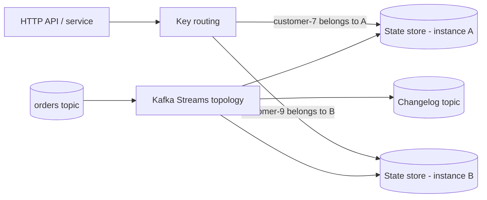
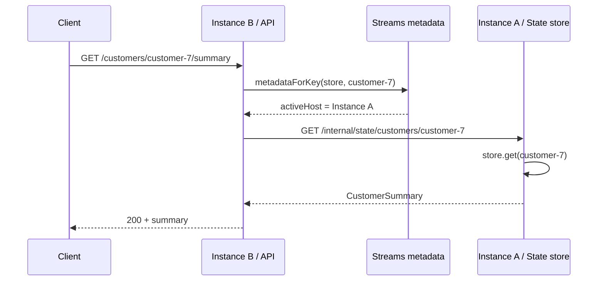

# Interactive Queries và định tuyến truy vấn theo trạng thái

Kafka Streams không chỉ biến đổi record rồi ghi kết quả sang topic. Ứng dụng còn có thể lưu trạng thái trong state store và đọc trạng thái đó trực tiếp khi phục vụ request, chẳng hạn lấy tổng chi tiêu của khách hàng, số dư đã tổng hợp hoặc trạng thái mới nhất của một đơn hàng. Cơ chế truy vấn state store từ bên ngoài topology được gọi là **Interactive Queries**.

Điểm cần hiểu rõ là state của Kafka Streams được phân vùng theo task và có thể nằm trên nhiều instance ứng dụng. Một instance chỉ đọc trực tiếp state store cục bộ mà nó đang sở hữu. Muốn truy vấn theo key trên toàn bộ ứng dụng, cần xác định instance đang giữ partition của key đó rồi định tuyến request đến instance tương ứng.

## 1. Interactive Queries giải quyết bài toán gì?

Giả sử một Kafka Streams application đọc topic `orders`, tổng hợp số đơn và doanh thu theo `customerId`, rồi materialize kết quả vào state store. Một API cần trả lời câu hỏi “khách hàng `customer-7` đã có bao nhiêu đơn và tổng tiền bao nhiêu?”.

Có hai cách tiếp cận:

- Đọc topic output và duy trì một database phục vụ truy vấn riêng.
- Truy vấn trực tiếp state store mà Kafka Streams đang duy trì.

Interactive Queries cho phép ứng dụng thứ hai đọc state store theo key hoặc range mà không cần phát một record truy vấn vào Kafka. Nó phù hợp với dữ liệu đã được xử lý và materialize trong Kafka Streams, đặc biệt khi cần truy vấn trạng thái cục bộ với độ trễ thấp.



State store được phân phối theo partition của ứng dụng. Nếu một key thuộc partition đang được active task trên instance A sở hữu, instance A là nơi phù hợp để đọc state hiện tại của key đó. Request đi vào instance B phải được chuyển tiếp đến A hoặc đến một gateway biết cách định tuyến.

## 2. Materialize state store để có thể truy vấn

Interactive Queries cần một state store có tên và kiểu dữ liệu xác định. Với DSL, có thể materialize kết quả aggregation bằng `Materialized.as("store-name")`.

Ví dụ tổng hợp số đơn và tổng tiền theo khách hàng:

```java
public record CustomerSummary(long orderCount, long totalAmountCents) {
    CustomerSummary add(long amountCents) {
        return new CustomerSummary(
                orderCount + 1,
                totalAmountCents + amountCents
        );
    }
}
```

```java
Serde<String> customerIdSerde = Serdes.String();
Serde<CustomerSummary> summarySerde = customerSummarySerde;

KTable<String, CustomerSummary> summaries = orders
        .groupBy(
                (orderId, event) -> event.customerId(),
                Grouped.with(customerIdSerde, orderEventSerde)
        )
        .aggregate(
                () -> new CustomerSummary(0, 0),
                (customerId, event, current) ->
                        current.add(event.amountCents()),
                Materialized.<String, CustomerSummary,
                        KeyValueStore<Bytes, byte[]>>as("customer-summary-store")
                        .withKeySerde(customerIdSerde)
                        .withValueSerde(summarySerde)
        );
```

`customerSummarySerde` là Serde do ứng dụng cung cấp cho kiểu `CustomerSummary`. Ví dụ giả định biến `orders` đã được tạo từ topic đầu vào và có kiểu `KStream<String, OrderEvent>`.

Tên store `customer-summary-store` là định danh ứng dụng dùng để truy vấn. Cần giữ tên ổn định giữa các lần triển khai nếu muốn tái sử dụng state và changelog tương ứng. Thay đổi tên store có thể tạo store mới và yêu cầu khôi phục hoặc tính toán lại state.

State store có thể là key-value, window hoặc session store. Chọn kiểu phù hợp với dạng truy vấn:

| Store type | Interface đọc | Truy vấn thường dùng |
|---|---|---|
| Key-value store | `ReadOnlyKeyValueStore<K, V>` | `get`, `range`, `all`, `approximateNumEntries` |
| Window store | `ReadOnlyWindowStore<K, V>` | Lấy các giá trị của key trong khoảng timestamp |
| Session store | `ReadOnlySessionStore<K, V>` | Lấy session theo key hoặc khoảng key |

## 3. Đọc state store cục bộ

Sau khi Kafka Streams instance đã khởi tạo và state store sẵn sàng, ứng dụng có thể lấy store bằng `KafkaStreams#store()` và `StoreQueryParameters`.

```java
ReadOnlyKeyValueStore<String, CustomerSummary> store = streams.store(
        StoreQueryParameters.fromNameAndType(
                "customer-summary-store",
                QueryableStoreTypes.keyValueStore()
        )
);

CustomerSummary summary = store.get("customer-7");
```

`QueryableStoreTypes.keyValueStore()` yêu cầu store có kiểu key-value. Kiểu generic của key/value phải khớp với Serdes đã materialize. API trả về read-only view để ứng dụng đọc state; không dùng Interactive Queries để sửa trực tiếp state store. State được cập nhật bởi topology khi xử lý record.

Ví dụ tạo service truy vấn:

```java
@Service
public class CustomerSummaryQueryService {
    private static final String STORE_NAME = "customer-summary-store";

    private final KafkaStreams streams;

    public CustomerSummaryQueryService(KafkaStreams streams) {
        this.streams = streams;
    }

    public Optional<CustomerSummary> findByCustomerId(String customerId) {
        ReadOnlyKeyValueStore<String, CustomerSummary> store = streams.store(
                StoreQueryParameters.fromNameAndType(
                        STORE_NAME,
                        QueryableStoreTypes.keyValueStore()
                )
        );
        return Optional.ofNullable(store.get(customerId));
    }
}
```

Đoạn code rút gọn này giả định ứng dụng đã quản lý vòng đời `KafkaStreams` và chỉ gọi khi store sẵn sàng. Trong quá trình startup, restore hoặc rebalance, `store()` có thể ném `InvalidStateStoreException` vì store chưa sẵn sàng hoặc tạm thời không truy cập được. API phục vụ request nên xử lý trạng thái này bằng retry ngắn có giới hạn hoặc trả lỗi tạm thời, không retry vô hạn.

Khi dùng `range()` hoặc `all()`, kết quả là iterator cần được đóng sau khi dùng:

```java
try (KeyValueIterator<String, CustomerSummary> iterator = store.all()) {
    while (iterator.hasNext()) {
        KeyValue<String, CustomerSummary> entry = iterator.next();
        process(entry.key, entry.value);
    }
}
```

Không giữ iterator lâu trong HTTP response hoặc truyền iterator ra ngoài service. Hãy đọc theo trang hoặc giới hạn số record để tránh giữ tài nguyên state store quá lâu.

## 4. Local store không tự tìm state trên instance khác

`streams.store(...)` truy vấn state store cục bộ trên instance đang gọi. Nếu key thuộc partition do instance khác quản lý, local store không tự gửi request qua mạng đến instance đó.

Điều này tạo ra một tình huống thường gặp:

- Client gửi request đến instance B qua load balancer.
- Key `customer-7` thuộc partition đang active trên instance A.
- B gọi `store.get("customer-7")`, nhưng local store của B không sở hữu key đó.
- B cần xác định owner và chuyển tiếp request đến A.

Kafka Streams cung cấp metadata để xác định host đang sở hữu key. Ứng dụng cần kết hợp metadata đó với một cơ chế RPC/HTTP để định tuyến truy vấn.

## 5. Khai báo `application.server` cho từng instance

Để các instance quảng bá địa chỉ mà instance khác có thể gọi, cấu hình `application.server` (`StreamsConfig.APPLICATION_SERVER_CONFIG`). Mỗi instance cần địa chỉ host/port có thể truy cập trực tiếp từ các instance còn lại hoặc từ query gateway.

Ví dụ cấu hình:

```java
Properties props = new Properties();
props.put(StreamsConfig.APPLICATION_ID_CONFIG, "customer-summary-app");
props.put(StreamsConfig.BOOTSTRAP_SERVERS_CONFIG, "kafka-1:9092,kafka-2:9092");
props.put(StreamsConfig.APPLICATION_SERVER_CONFIG, "streams-0.internal:8080");
```

Instance khác có cùng `application.id` nhưng phải quảng bá địa chỉ riêng, ví dụ `streams-1.internal:8080`. Tất cả instance trong cùng Kafka Streams application dùng cùng `application.id`; `application.server` là endpoint riêng của từng instance.

`application.server` chỉ công bố thông tin endpoint trong metadata. Nó không tự mở HTTP server, không tạo controller REST và không tự chuyển tiếp request. Ứng dụng phải triển khai endpoint truy vấn và logic routing riêng.

Địa chỉ được quảng bá phải truy cập được từ nơi gửi request. Trong Kubernetes, nên dùng DNS/service discovery có thể định tuyến tới đúng pod hoặc endpoint riêng. Nếu tất cả instance quảng bá cùng một load balancer chung, router có thể chuyển request đến một instance không sở hữu partition; điều đó tạo vòng lặp hoặc lỗi truy vấn.

## 6. Tìm instance sở hữu một key

`KafkaStreams#metadataForKey()` trả về metadata về partition và host active cho một key trong một state store. Với store `customer-summary-store` có key là `String`, ví dụ:

```java
KeyQueryMetadata metadata = streams.metadataForKey(
        "customer-summary-store",
        "customer-7",
        Serdes.String().serializer()
);

if (metadata == KeyQueryMetadata.NOT_AVAILABLE) {
    throw new IllegalStateException("Kafka Streams metadata is not available yet");
}

HostInfo activeHost = metadata.activeHost();
int partition = metadata.partition();
```

`activeHost` là host/port của instance đang sở hữu active task cho partition chứa key đó. `partition` cho biết partition được chọn. Metadata có thể chưa sẵn sàng khi ứng dụng vừa khởi động hoặc đang rebalance; khi đó không nên giả định host trả về luôn hợp lệ.

Việc tìm owner phải dùng đúng key serializer và cùng cách phân vùng mà topology sử dụng. Nếu key Serde, partitioner hoặc cấu hình topic không nhất quán, phép định tuyến có thể tìm sai partition.

Có thể dùng `allMetadataForStore(storeName)` để lấy metadata của các instance đang lưu store. Cách này hữu ích khi cần fan-out truy vấn nhiều host, xây dựng service discovery hoặc điều tra partition assignment. Với truy vấn một key, `metadataForKey()` thường là lựa chọn trực tiếp hơn.

## 7. Định tuyến truy vấn qua HTTP/RPC

Một kiến trúc phổ biến là mọi instance đều mở endpoint HTTP, nhưng trước khi đọc store sẽ kiểm tra owner của key:

1. Request đến bất kỳ instance nào.
2. Instance nhận request gọi `metadataForKey()` để tìm active host.
3. Nếu active host là chính instance hiện tại, đọc local store.
4. Nếu active host là instance khác, chuyển tiếp request đến endpoint của host đó.
5. Host đích đọc local store và trả kết quả cho caller.



Ví dụ mã giả cho router:

```java
public CustomerSummary query(String customerId) {
    KeyQueryMetadata metadata = streams.metadataForKey(
            STORE_NAME,
            customerId,
            Serdes.String().serializer()
    );

    if (metadata == KeyQueryMetadata.NOT_AVAILABLE) {
        throw new QueryTemporarilyUnavailableException();
    }

    HostInfo owner = metadata.activeHost();
    if (isLocal(owner)) {
        return localQueryService.findByCustomerId(customerId).orElse(null);
    }

    return remoteQueryClient.fetch(owner, customerId);
}
```

`isLocal()` so sánh host/port owner với endpoint mà instance hiện tại quảng bá. `remoteQueryClient` là HTTP/gRPC client do ứng dụng triển khai; Kafka Streams không cung cấp sẵn hàm RPC này. Endpoint nội bộ ở host đích nên gọi thẳng local query service, không chạy router lần nữa, để tránh chuyển tiếp vòng lặp.

Trong production, cần đặt timeout, giới hạn retry và circuit breaker cho RPC. Nếu host đích vừa rời group, metadata có thể cũ; router nên làm mới metadata và thử lại có giới hạn. Không retry request vô hạn vì có thể tạo vòng lặp giữa các instance.

## 8. Standby replica và khả năng dự phòng

Kafka Streams có thể duy trì standby replica của state store trên instance khác để giảm thời gian restore khi active task chuyển host. Cấu hình `num.standby.replicas` xác định số standby replica được duy trì cho mỗi task khi cluster có đủ tài nguyên.

Metadata cho key có thể cho biết active host và danh sách standby hosts. Khi active host không sẵn sàng, ứng dụng có thể cân nhắc phương án dự phòng, nhưng cần hiểu các giới hạn:

- Standby state được cập nhật bất đồng bộ từ changelog và có thể chậm hơn active state.
- Không nên mặc định standby có dữ liệu mới nhất tại thời điểm request.
- Cần xác nhận API/query mode của phiên bản Kafka Streams đang dùng có hỗ trợ đọc standby theo cách mong muốn.
- Nếu yêu cầu consistency cao, có thể trả lỗi tạm thời và chờ task mới được promote thành active thay vì đọc state có thể stale.

Standby replica giúp giảm thời gian phục hồi state, không biến truy vấn thành một database có replica đồng bộ tuyệt đối. Số standby tăng cũng tiêu tốn CPU, network, disk và dung lượng changelog restore.

## 9. Query nhiều key hoặc toàn bộ state trên cluster

`metadataForKey()` phù hợp với một key. Với truy vấn theo range hoặc quét toàn bộ store, dữ liệu có thể nằm trên nhiều partition và nhiều instance. Kafka Streams không tự hợp nhất kết quả từ mọi instance thành một truy vấn phân tán duy nhất.

Một cách triển khai là:

1. Gọi `allMetadataForStore()` để tìm các host đang sở hữu store.
2. Gửi truy vấn local đến từng host.
3. Phân trang hoặc giới hạn số kết quả trên mỗi host.
4. Hợp nhất, sắp xếp và loại trùng theo quy tắc ứng dụng.
5. Xử lý trường hợp một host rời group trong khi fan-out đang chạy.

Với truy vấn `range(from, to)`, cần xác định rõ thứ tự toàn cục, tính nhất quán giữa các partition và giới hạn số record. Một kết quả fan-out không phải snapshot nguyên tử của toàn bộ state store tại cùng một thời điểm. Nếu nghiệp vụ cần truy vấn ad hoc phức tạp, join nhiều thuộc tính hoặc phân trang ổn định trên toàn bộ dữ liệu, nên cân nhắc materialize kết quả sang một database/search index chuyên phục vụ truy vấn.

## 10. Consistency và thời điểm state được nhìn thấy

Interactive Queries đọc state store local đang được Kafka Streams cập nhật. Nó không tự tạo một snapshot nhất quán trên toàn bộ instance hoặc một transaction read toàn cluster.

Một số tình huống cần tính đến:

- Record đã được producer gửi nhưng Streams chưa xử lý: truy vấn chưa thấy thay đổi.
- Task đang restore hoặc rebalance: store có thể tạm thời không query được.
- Metadata vừa thay đổi: router có thể chuyển request đến owner cũ.
- Query nhiều key qua nhiều host: các kết quả có thể phản ánh những thời điểm cập nhật khác nhau.
- Standby replica: dữ liệu có thể stale so với active task.

Nếu API cần read-your-writes, cần định nghĩa mốc xác nhận rõ ràng. Ví dụ, sau khi ghi event, service có thể chờ event được xử lý/đánh dấu bằng correlation ID hoặc version trước khi trả kết quả đọc. Chỉ gửi record vào Kafka không có nghĩa state store đã cập nhật xong.

Kafka Streams có thể dùng processing guarantees cho quá trình xử lý và ghi state/changelog/output, nhưng guarantee đó không tự làm HTTP query trở thành linearizable read. Hợp đồng consistency của API phải được thiết kế riêng.

## 11. Xử lý lifecycle, rebalance và lỗi truy vấn

Các lỗi thường gặp:

| Tình huống | Nguyên nhân | Cách xử lý |
|---|---|---|
| `InvalidStateStoreException` | Store chưa khởi tạo, đang restore hoặc tạm không truy cập được | Retry ngắn có giới hạn; kiểm tra Streams state và rebalance |
| Metadata chưa có host | Application vừa start hoặc group chưa ổn định | Trả lỗi tạm thời, thử lại sau; không định tuyến đến host giả |
| Host owner không kết nối được | Worker/app instance chết hoặc metadata cũ | Làm mới metadata, retry có giới hạn hoặc chờ rebalance |
| Query trả state cũ | Event chưa được xử lý hoặc đang đọc standby | Xác định consistency contract, kiểm tra processing lag và task assignment |
| Query range quá chậm | Đọc quá nhiều key hoặc fan-out đồng thời lớn | Phân trang, giới hạn phạm vi và chuyển truy vấn phân tích sang storage phù hợp |
| Request chuyển tiếp vòng lặp | Endpoint nội bộ lại gọi router hoặc host metadata không khớp | Tách local endpoint và router; giới hạn hop/request ID |

Ứng dụng nên theo dõi `KafkaStreams.State` qua state listener. Chỉ nhận truy vấn khi instance ở trạng thái phù hợp và store sẵn sàng. Trong lúc shutdown, ngừng nhận request mới trước khi đóng KafkaStreams để tránh query vào store đã đóng.

## 12. Bảo mật endpoint truy vấn

`application.server` thường quảng bá địa chỉ nội bộ cho routing. Endpoint HTTP/RPC thực tế vẫn do ứng dụng tạo và cần bảo vệ:

- Chỉ cho phép traffic từ service/gateway đáng tin cậy đến internal query endpoint.
- Dùng TLS/mTLS hoặc cơ chế xác thực nội bộ phù hợp.
- Kiểm tra quyền truy cập dữ liệu ở API public; không coi việc request đã được route đến đúng host là đã được authorize.
- Giới hạn query range, số lượng kết quả và thời gian xử lý để tránh làm cạn tài nguyên state store.
- Không ghi payload nhạy cảm hoặc token vào log.
- Tránh để client bên ngoài tự gửi host tùy ý để proxy request, nhằm ngăn SSRF.

Nếu dùng một gateway chung, gateway nên lấy metadata và gọi đúng endpoint instance. Không để client có thể chỉ định URL tùy ý để router gọi thay.

## 13. Checklist triển khai Interactive Queries

- Materialize state store với tên ổn định và Serdes đúng kiểu dữ liệu.
- Xác định kiểu store: key-value, window hay session.
- Dùng `KafkaStreams#store()` để đọc local store và xử lý `InvalidStateStoreException` trong startup/rebalance.
- Cấu hình `application.server` riêng, có thể truy cập cho từng instance.
- Dùng `metadataForKey()` để tìm active host theo đúng store name và key serializer.
- Triển khai HTTP/RPC endpoint và router; nhớ `application.server` không tự tạo REST server.
- Tách endpoint local khỏi endpoint định tuyến để tránh forwarding loop.
- Xử lý metadata chưa sẵn sàng, host lỗi và rebalance bằng timeout/retry có giới hạn.
- Hiểu standby replica có thể stale và không mặc định đọc standby cho yêu cầu consistency cao.
- Với truy vấn toàn store, fan-out có phân trang và giới hạn; không giả định có snapshot toàn cục.
- Định nghĩa rõ read-your-writes, độ stale chấp nhận được và consistency của API.
- Bảo vệ endpoint nội bộ, phân quyền dữ liệu và giới hạn tài nguyên truy vấn.

Interactive Queries cho phép ứng dụng đọc state store do Kafka Streams duy trì. Truy vấn local rất nhanh nhưng chỉ thấy state trên instance hiện tại; truy vấn theo key trên toàn cluster cần dùng metadata để tìm active host rồi chuyển request qua HTTP/RPC. Khi bổ sung routing, standby và xử lý rebalance, cần thiết kế rõ consistency, retry, bảo mật và giới hạn truy vấn để API phản ánh đúng trạng thái mà topology đã xử lý.
