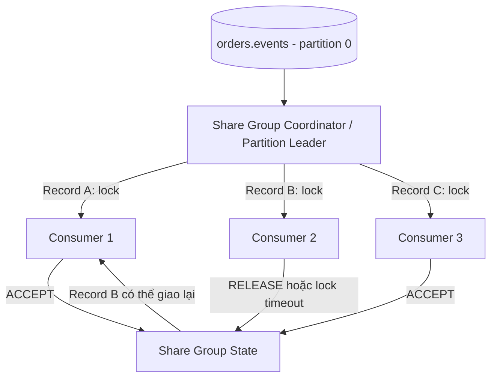
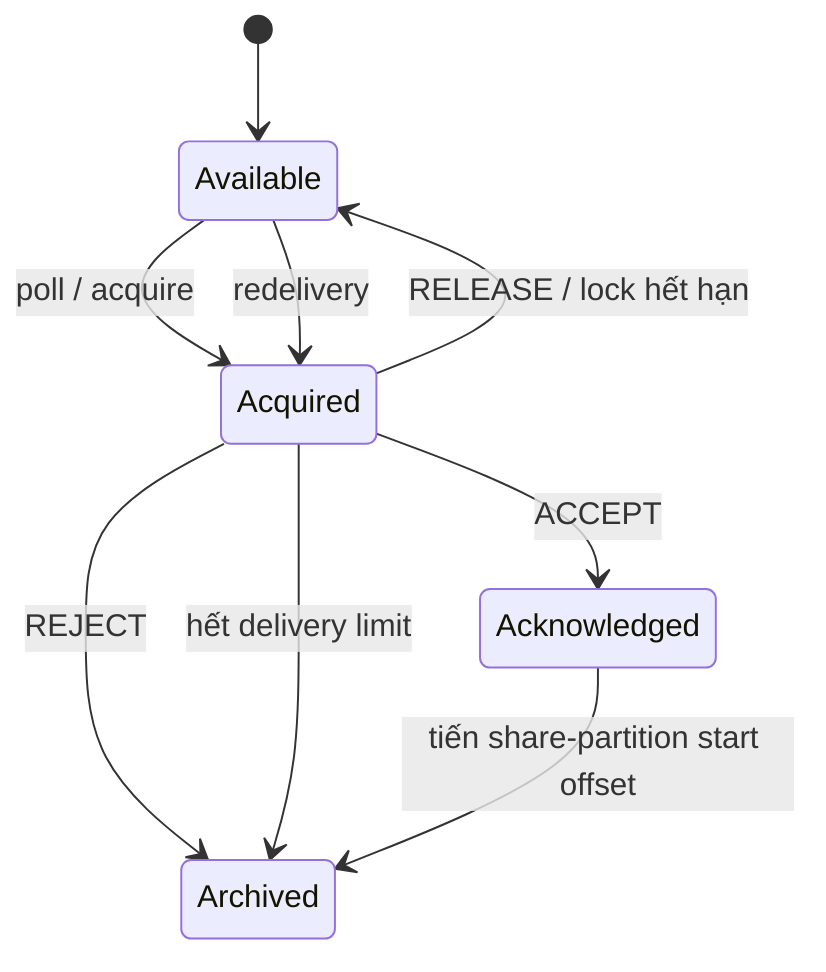

# Khóa bản ghi, thời hạn xử lý và cấp lại bản ghi

Kafka Share Groups cho phép nhiều consumer cùng chia sẻ việc xử lý record của một topic, kể cả khi chúng đọc từ cùng một partition. Broker cấp một **record acquisition lock** cho từng record được giao. Trong thời gian lock còn hiệu lực, record đó không được giao cho consumer khác trong cùng share group. Consumer có thể xác nhận đã xử lý, trả record về để thử lại, từ chối record không thể xử lý hoặc gia hạn lock khi công việc chưa hoàn tất.

Khóa bản ghi giúp Kafka thu hồi công việc khi consumer lỗi hoặc xử lý quá lâu. Tuy nhiên, Share Groups ưu tiên chia sẻ tải và xử lý độc lập từng record; chúng không giữ thứ tự xử lý nghiêm ngặt như consumer group truyền thống. Muốn thiết kế đúng cần hiểu vòng đời lock, acknowledgement, delivery count, timeout của consumer, redelivery, giới hạn số record đang in-flight và dead-letter queue.

**Lưu ý phiên bản:** Kafka 4.1 giới thiệu Share Groups ở trạng thái preview; Kafka 4.2 đưa tính năng vào trạng thái production-ready. Ví dụ Java, cấu hình group và DLQ trong bài này dựa trên Kafka 4.4. Cần dùng broker/client tương thích và kiểm tra release notes trước khi áp dụng các property hoặc API mới cho cluster cũ.

## 1. Share Group chia sẻ record như thế nào?

Trong consumer group thông thường, một partition tại một thời điểm được giao cho tối đa một consumer trong group. Nếu topic có 4 partition thì thêm consumer thứ 5 không làm partition được xử lý song song hơn; consumer thừa có thể ở trạng thái idle.

Share Group dùng mô hình khác:

- Các consumer có cùng `group.id` tham gia một share group.
- Nhiều consumer trong cùng group có thể nhận record từ cùng topic-partition.
- Broker quản lý trạng thái giao từng record và cấp lock cho consumer nhận record đó.
- Một record đang được lock không được giao cho consumer khác trong cùng group cho tới khi được acknowledge, release, reject hoặc lock hết hạn.
- Các share group khác nhau đọc cùng topic độc lập với nhau; một group không lấy mất record của group khác.

Ví dụ topic có một partition nhưng có ba share consumer:



Điều này hữu ích cho workload kiểu queue: mỗi record là một công việc độc lập, thời gian xử lý khác nhau và muốn tăng số worker mà không phải tạo thêm partition chỉ để phân chia consumer.

## 2. Khác biệt giữa partition assignment và record acquisition lock

Share Group vẫn có cơ chế quản lý thành viên và phân phối share-partition cho consumer. Tuy nhiên, quyền xử lý một record cụ thể được quản lý bằng lock riêng.

| Khái niệm | Phạm vi | Mục đích |
|---|---|---|
| Share group membership | Consumer và group | Theo dõi thành viên, heartbeat và thay đổi thành viên |
| Share-partition assignment | Topic-partition trong share group | Phân phối công việc giữa các consumer |
| Record acquisition lock | Một record/offset | Ngăn consumer khác nhận cùng record trong thời gian xử lý |
| Delivery count | Một record | Theo dõi gần đúng số lần record đã được giao |
| Acknowledgement state | Một record hoặc batch theo partition | Ghi nhận kết quả xử lý và tiến độ của share-partition |

Không nhầm record lock với partition lock. Một share-partition có thể có nhiều record đang được acquire đồng thời, tới giới hạn cấu hình. Do đó nhiều consumer có thể xử lý song song các record thuộc cùng partition.

## 3. Vòng đời trạng thái của một record

Ở mức khái niệm, record trong share group đi qua các trạng thái:

| Trạng thái | Ý nghĩa |
|---|---|
| `Available` | Record sẵn sàng để được giao cho consumer |
| `Acquired` | Record đã được giao cho một consumer và đang có acquisition lock |
| `Acknowledged` | Consumer xác nhận xử lý thành công |
| `Archived` | Record không còn được giao lại, ví dụ đã được chấp nhận hoàn tất hoặc bị từ chối/hết số lần thử |

Luồng xử lý thường gặp:



Mỗi lần record được acquire, delivery count tăng. Nếu consumer `ACCEPT`, record được ghi nhận thành công. Nếu consumer `RELEASE` hoặc lock hết hạn, record có thể quay lại trạng thái sẵn sàng khi chưa chạm giới hạn giao. Nếu consumer `REJECT`, record được đánh dấu không thể xử lý và không được giao lại. Khi chạm delivery count limit, record cũng không còn đủ điều kiện nhận thêm lần giao theo policy của group.

Đây là mô hình trạng thái logic. Kafka quản lý trạng thái share-partition bền vững ở phía broker; ứng dụng không tự cập nhật trạng thái này bằng cách commit một consumer offset như consumer group truyền thống.

## 4. Record acquisition lock hoạt động ra sao?

Khi consumer gọi `poll()`, broker chọn các record đang `Available` trong những partition thuộc subscription, chuyển chúng sang trạng thái `Acquired` và gắn thời hạn lock. Consumer nhận các record và bắt đầu xử lý.

Trong thời gian lock còn hiệu lực:

- Consumer đang giữ lock có thể xử lý record.
- Consumer khác trong cùng share group không nhận lại chính record đó.
- Các record khác trong cùng partition vẫn có thể được giao cho consumer khác nếu còn chỗ trong giới hạn in-flight.
- Consumer có thể gửi acknowledgement để kết thúc lần giao hoặc renew để tiếp tục xử lý.

Nếu consumer chết, mất kết nối hoặc không acknowledge trước khi lock hết hạn, broker tự giải phóng record để lần giao sau có thể nhận lại. Lock là cơ chế thu hồi công việc, không phải bằng chứng rằng nghiệp vụ đã hoàn tất.

Ví dụ lock mặc định 30 giây:

```text
T = 0s     Consumer A nhận record offset 120, lock 30 giây
T = 12s    A vẫn xử lý, chưa acknowledge
T = 30s    Lock hết hạn nếu không được renew/ack
T = 31s+   Record 120 có thể được giao cho consumer B
```

Nếu A đã ghi thành công vào database ở giây thứ 29 nhưng chết trước khi gửi acknowledgement, B có thể nhận lại record và thực hiện cùng side effect. Consumer cần idempotency để xử lý tình huống này.

## 5. `ACCEPT`, `RELEASE`, `REJECT` và `RENEW`

Kafka Java Share Consumer cung cấp `AcknowledgeType` để ứng dụng mô tả kết quả xử lý từng record.

| Acknowledge type | Ý nghĩa | Record tiếp theo sẽ thế nào? |
|---|---|---|
| `ACCEPT` | Xử lý thành công | Được ghi nhận hoàn tất, không giao lại trong group |
| `RELEASE` | Lỗi tạm thời hoặc muốn nhường record | Có thể quay lại `Available` và được giao cho consumer khác/lần sau |
| `REJECT` | Record không thể xử lý, lỗi vĩnh viễn hoặc dữ liệu poison | Không được giao lại; đi vào trạng thái archived hoặc DLQ nếu đã cấu hình |
| `RENEW` | Công việc vẫn đang chạy, cần kéo dài lock | Gia hạn acquisition lock để consumer tiếp tục xử lý |

Chọn loại acknowledgement theo bản chất lỗi:

- Database tạm thời không kết nối được: `RELEASE` để thử lại sau.
- API downstream trả 503 hoặc rate limit: cân nhắc `RELEASE` cùng backoff ở tầng ứng dụng.
- Payload sai schema vĩnh viễn hoặc vi phạm quy tắc không thể sửa: `REJECT` và chuyển sang quy trình DLQ/điều tra.
- Công việc xử lý lâu hơn lock duration nhưng vẫn tiến triển: `RENEW` theo chu kỳ phù hợp.
- Side effect đã commit thành công: `ACCEPT`.

Không dùng `REJECT` cho mọi exception. Một lỗi mạng tạm thời nếu bị reject sẽ không có cơ hội retry trong share group.

`RELEASE` không tự cấu hình một khoảng delay tăng dần như retry scheduler. Record có thể sớm trở lại trạng thái sẵn sàng. Nếu ứng dụng release ngay lập tức trong vòng lặp, poison message có thể được giao liên tục và tiêu tốn tài nguyên. Dùng backoff có kiểm soát ở ứng dụng, retry topic có thời gian chờ hoặc DLQ/correction flow tùy SLA; không giữ lock lâu chỉ để giả lập delay.

## 6. Explicit acknowledgement và implicit acknowledgement

Share consumer hỗ trợ hai chế độ xác nhận qua client config `share.acknowledgement.mode`.

### Implicit acknowledgement

Đây là chế độ mặc định. Consumer không gọi `acknowledge()` cho từng record. Các record đã trả về từ `poll()` được xem là xử lý thành công khi ứng dụng gọi `poll()` tiếp theo hoặc gọi `commitSync()`/`commitAsync()`. Nếu `close()` trước khi acknowledge, các record đang acquire được giải phóng mà không được xác nhận thành công.

Chế độ này đơn giản và phù hợp khi toàn bộ batch được xử lý thành công như một đơn vị trước lần poll kế tiếp. Nó nguy hiểm nếu ứng dụng dispatch record sang thread khác rồi gọi poll tiếp khi công việc chưa xong: lần poll tiếp theo có thể ngầm xác nhận record trước đó quá sớm.

### Explicit acknowledgement

Khi đặt `share.acknowledgement.mode=explicit`, ứng dụng phải acknowledge tất cả record trả về từ một lần `poll()` trước khi gọi `poll()` tiếp theo. Nếu còn record chưa acknowledge, lần poll tiếp theo sẽ ném `IllegalStateException`.

Trong explicit mode:

- `acknowledge(record, type)` cập nhật trạng thái acknowledgement cục bộ trong consumer.
- `commitSync()` hoặc `commitAsync()` gửi các acknowledgement đang chờ tới Kafka.
- Gọi `poll()` sau khi đã acknowledge hết cũng commit các acknowledgement bất đồng bộ.
- `close()` cố gắng commit acknowledgement đang chờ và giải phóng record còn chưa được acknowledge.

Với xử lý có thời gian biến động hoặc phân loại lỗi theo từng record, explicit acknowledgement giúp kiểm soát rõ hơn.

## 7. Ví dụ Java xử lý từng record bằng explicit acknowledgement

Ví dụ dưới đây dùng Kafka client 4.4 API. `processOrder()` và các exception là mã nghiệp vụ minh họa.

```java
import java.time.Duration;
import java.util.List;
import java.util.Properties;

import org.apache.kafka.clients.consumer.AcknowledgeType;
import org.apache.kafka.clients.consumer.ConsumerRecord;
import org.apache.kafka.clients.consumer.ConsumerRecords;
import org.apache.kafka.clients.consumer.KafkaShareConsumer;
import org.apache.kafka.common.serialization.StringDeserializer;

Properties props = new Properties();
props.put("bootstrap.servers", "localhost:9092");
props.put("group.id", "orders-workers");
props.put("key.deserializer", StringDeserializer.class.getName());
props.put("value.deserializer", StringDeserializer.class.getName());
props.put("share.acknowledgement.mode", "explicit");
props.put("share.acquire.mode", "record_limit");
props.put("max.poll.records", "20");

try (KafkaShareConsumer<String, String> consumer =
             new KafkaShareConsumer<>(props)) {

    consumer.subscribe(List.of("orders.events"));

    while (!Thread.currentThread().isInterrupted()) {
        ConsumerRecords<String, String> records =
                consumer.poll(Duration.ofSeconds(1));

        for (ConsumerRecord<String, String> record : records) {
            try {
                processOrder(record.key(), record.value());
                consumer.acknowledge(record, AcknowledgeType.ACCEPT);
            } catch (TemporaryDependencyException ex) {
                consumer.acknowledge(record, AcknowledgeType.RELEASE);
            } catch (InvalidOrderEventException ex) {
                consumer.acknowledge(record, AcknowledgeType.REJECT);
            } catch (Exception ex) {
                // Lỗi chưa phân loại: nhường record để thử lại có giới hạn.
                consumer.acknowledge(record, AcknowledgeType.RELEASE);
            }
        }

        // Gửi acknowledgement đang chờ tới Kafka.
        consumer.commitSync(Duration.ofSeconds(10));
    }
}
```

Lưu ý:

- Tất cả record trong batch phải được acknowledge trước lần `poll()` tiếp theo.
- `commitSync()` cần được kiểm tra kết quả theo từng topic-partition trong ứng dụng production; API trả về map lỗi theo partition.
- Nếu xử lý thành công nhưng acknowledgement commit thất bại, record có thể được giao lại. Side effect phải idempotent.
- Không để exception ngoài dự kiến thoát khỏi vòng lặp mà không có policy cho record đang acquire.
- Consumer không thread-safe. Nếu dùng worker thread, chỉ một thread được gọi các API consumer; đồng bộ hóa việc gửi acknowledgement theo đúng vòng đời record.

## 8. Implicit acknowledgement: ví dụ batch đơn giản

Nếu batch được xử lý đồng bộ và chỉ poll tiếp sau khi toàn bộ record đã xử lý thành công, implicit acknowledgement có thể ngắn gọn:

```java
import java.time.Duration;
import java.util.List;
import java.util.Properties;

import org.apache.kafka.clients.consumer.ConsumerRecord;
import org.apache.kafka.clients.consumer.ConsumerRecords;
import org.apache.kafka.clients.consumer.KafkaShareConsumer;
import org.apache.kafka.common.serialization.StringDeserializer;

Properties props = new Properties();
props.put("bootstrap.servers", "localhost:9092");
props.put("group.id", "notifications-workers");
props.put("key.deserializer", StringDeserializer.class.getName());
props.put("value.deserializer", StringDeserializer.class.getName());
// Không đặt share.acknowledgement.mode => implicit mặc định.

try (KafkaShareConsumer<String, String> consumer =
             new KafkaShareConsumer<>(props)) {
    consumer.subscribe(List.of("notifications"));

    while (true) {
        ConsumerRecords<String, String> records =
                consumer.poll(Duration.ofSeconds(1));

        for (ConsumerRecord<String, String> record : records) {
            sendNotification(record.value());
        }

        // Lần poll kế tiếp ngầm acknowledge batch trước đó.
    }
}
```

Nếu `sendNotification()` thất bại giữa batch nhưng code vẫn tiếp tục poll, các record đã trả về từ batch có thể bị implicit acknowledge như thành công. Với batch có lỗi từng record, dùng explicit acknowledgement và phân loại `ACCEPT`/`RELEASE`/`REJECT`.

## 9. Lock duration và thời gian xử lý

`share.record.lock.duration.ms` là thời lượng acquisition lock cho record. Trong Kafka 4.4, giá trị mặc định là 30.000 ms (30 giây). Đây là cấu hình của share group, không phải `max.poll.interval.ms` của client.

Chọn lock duration theo thời gian xử lý thực tế:

1. Đo processing time p50, p95, p99 và thời gian đỉnh khi downstream chậm.
2. Tính thêm thời gian deserialize, gọi database/API, retry nội bộ và acknowledge/commit.
3. Chọn lock đủ dài cho phần lớn công việc mà không giữ record quá lâu khi consumer chết.
4. Với công việc có thể vượt lock, dùng `RENEW` hoặc chia nhỏ công việc.
5. Theo dõi số lần record được giao lại do lock timeout.

Lock quá ngắn gây redelivery khi consumer vẫn đang làm việc, có thể tạo hai lần xử lý đồng thời. Lock quá dài làm chậm việc thu hồi record khi consumer chết. Không tăng lock để che giấu xử lý treo; cần timeout ở từng dependency và watchdog ở ứng dụng.

## 10. Lock duration khác session timeout và `max.poll.interval.ms`

Ba timeout giải quyết ba vấn đề khác nhau:

| Cấu hình | Phạm vi | Điều gì xảy ra khi hết hạn? |
|---|---|---|
| `share.record.lock.duration.ms` | Một record đang được acquire | Record được giải phóng để có thể giao lại |
| `share.session.timeout.ms` | Thành viên share group | Broker phát hiện consumer mất heartbeat và cập nhật membership/assignment |
| `max.poll.interval.ms` | Tiến độ poll của client | Client chủ động rời group nếu không poll đủ thường xuyên |

Một consumer có thể vẫn heartbeat nhưng đang xử lý quá lâu. Nếu không gọi `poll()` trong thời gian cho phép, client có thể bị xem là không tiến triển và rời group. Ngược lại, consumer vẫn sống nhưng record lock có thể hết hạn nếu không acknowledge/renew. Vì vậy, heartbeat không tự gia hạn record lock.

## 11. Gia hạn lock bằng `RENEW`

Với công việc dài hơn lock duration, Kafka Share Consumer hỗ trợ `AcknowledgeType.RENEW`. Cần bật explicit acknowledgement và tiếp tục gọi `poll()` định kỳ, đồng thời gửi `RENEW` cho record còn đang xử lý. Khi renewal thành công, record được trả lại trong lần poll tiếp theo theo API semantics để ứng dụng tiếp tục theo dõi.

Ví dụ vòng đời:

```text
T=0s    poll() nhận record R, lock 30s
T=10s   R vẫn chạy, gửi RENEW
T=15s   poll() tiếp tục, nhận thông tin record đã renew
T=20s   R vẫn chạy, gửi RENEW tiếp
T=35s   xử lý xong, gửi ACCEPT
T=36s   commit acknowledgement
```

`RENEW` không phải retry. Nó báo rằng consumer vẫn sở hữu công việc và cần tiếp tục giữ lock. Dùng renew quá thường xuyên hoặc cho mọi record có thể làm giảm tiến độ của share group vì record bị giữ in-flight lâu hơn.

Ví dụ pseudo-code:

```java
props.put("share.acknowledgement.mode", "explicit");
props.put("share.acquire.mode", "record_limit");
props.put("max.poll.records", "1");

// Pseudo-code: quản lý công việc bất đồng bộ và gửi RENEW
// theo acquisitionLockTimeoutMs() / 2.
int renewalIntervalMs = consumer.acquisitionLockTimeoutMs()
        .orElse(10_000) / 2;

// Mỗi chu kỳ poll:
// - ACCEPT khi công việc hoàn tất thành công.
// - REJECT khi lỗi vĩnh viễn.
// - RENEW khi công việc còn chạy và cần thêm thời gian.
```

Renewal chỉ phù hợp khi công việc thực sự tiến triển. Nếu dependency bị treo vô thời hạn, cần timeout và cuối cùng `RELEASE`/`REJECT` theo policy. Nếu leader của partition đổi hoặc kết nối tới leader mất, lần delivery hiện tại có thể kết thúc dù ứng dụng đang renew.

## 12. Giới hạn số record đang in-flight trên một partition

Kafka giới hạn số record được acquire cùng lúc cho mỗi topic-partition trong một share group bằng `share.partition.max.record.locks`. Trong Kafka 4.4, mặc định là 2.000 record trên mỗi share-partition.

Khi đạt giới hạn:

- Fetch tạm thời không trả thêm record từ share-partition bị đầy.
- Khi record được acknowledge, release hoặc lock hết hạn, số lock giảm và fetch có thể tiếp tục.
- Các partition khác trong group vẫn có thể còn khả năng cấp record nếu chưa chạm giới hạn riêng.

Giới hạn này là cơ chế backpressure. Đặt quá thấp sẽ giảm concurrency và throughput; đặt quá cao có thể tăng số record đang giữ trong memory, số công việc đồng thời, kết nối tới downstream và áp lực khi retry.

Ước lượng đơn giản:

```text
in-flight capacity per share-partition
    <= share.partition.max.record.locks

approximate work in progress
    = active consumers × records being processed per consumer
```

Số thực tế còn phụ thuộc số partition, phân bố record, batch size, prefetch, tốc độ acknowledge và các giới hạn tài nguyên của ứng dụng.

## 13. `share.acquire.mode`: batch optimized và record limit

Share consumer có hai chế độ lấy record:

| Mode | Hành vi | Khi nào cân nhắc |
|---|---|---|
| `batch_optimized` | Tối ưu theo batch boundary; có thể trả nhiều record hơn `max.poll.records` và prefetch trước | Record xử lý nhanh, batch đồng nhất, throughput là ưu tiên |
| `record_limit` | Giới hạn số record mỗi poll theo `max.poll.records`, không prefetch | Cần kiểm soát số record và thời gian bắt đầu lock chặt hơn, hoặc xử lý lâu |

`batch_optimized` là mặc định trong Kafka 4.4. Do có prefetch, một số record có thể đã được acquire/buffer trước khi ứng dụng bắt đầu xử lý chúng. Nếu processing time dài hoặc khó dự đoán, `record_limit` giúp ứng dụng kiểm soát lượng công việc nhận vào.

Không mặc định `max.poll.records` giới hạn tuyệt đối số record trong mọi mode. Khi dùng `batch_optimized`, batch alignment có thể khiến số record trả về vượt giá trị này.

## 14. Delivery count và giới hạn số lần giao

Kafka theo dõi delivery count cho mỗi record trong share group. Lần acquire đầu tiên có delivery count là 1; mỗi lần được acquire tiếp theo làm count tăng.

`share.delivery.count.limit` xác định số lần tối đa record được giao cho group. Trong Kafka 4.4, mặc định là 5 lần. Khi record bị release hoặc lock hết hạn:

- Nếu chưa đạt limit, record có thể trở lại `Available` và được giao lại.
- Nếu đã đạt limit, record được archive và không còn được giao tiếp.
- Nếu consumer `REJECT`, record bị xem là không thể xử lý và không được giao lại.

Delivery count được duy trì theo cơ chế gần đúng, không phải bộ đếm audit chính xác tuyệt đối. Các cập nhật trạng thái share group không có exactly-once semantics cho từng lần delivery count. Hãy dùng count để bảo vệ khỏi poison message, không dùng nó làm bằng chứng pháp lý hoặc số lần thử chính xác trong báo cáo nghiệp vụ.

Có thể đọc count từ `ConsumerRecord.deliveryCount()` trong Kafka client version hỗ trợ; API trả `Optional<Short>` vì count có thể không có sẵn với record không được giao qua share group.

## 15. Vì sao Share Groups có at-least-once và có thể xử lý lệch thứ tự?

Share Groups cho phép nhiều consumer cùng nhận record từ một partition. Giả sử:

1. Consumer A nhận offset 100–109 và bị treo.
2. Consumer B nhận offset 110–119, xử lý xong và acknowledge.
3. Lock của A hết hạn.
4. Offset 100–109 được giao lại cho consumer B hoặc consumer khác.

Lúc này offset 110–119 đã xử lý xong trước khi 100–109 được giao lại. Vì vậy, record được trả về trong một batch của từng share-partition có thứ tự offset tăng dần, nhưng không có bảo đảm thứ tự giữa các batch. Redelivery có thể làm offset cũ xuất hiện sau offset mới.

Điều này có nghĩa:

- Side effect phải idempotent.
- Không giả định offset tăng đơn điệu trong toàn bộ vòng đời xử lý của ứng dụng.
- Không dùng Share Group cho workflow bắt buộc xử lý đúng thứ tự theo key nếu không có cơ chế sequencing bổ sung.
- Không suy luận rằng record được acknowledge sau cùng có offset lớn nhất.

Share Group cung cấp delivery semantics kiểu at-least-once. Nếu consumer đã commit side effect nhưng acknowledgement chưa được broker ghi nhận, record có thể được giao lại. Exactly-once cho database/API bên ngoài cần transaction hoặc idempotency riêng của hệ thống đó.

## 16. Thiết kế idempotency cho redelivery

Ví dụ consumer nhận event `OrderPaid` và cập nhật database. Nếu consumer ghi database thành công rồi crash trước `ACCEPT`, record có thể được giao lại. Một cách xử lý là dùng `eventId` làm idempotency key:

```sql
CREATE TABLE processed_events (
    event_id VARCHAR(100) PRIMARY KEY,
    processed_at TIMESTAMP NOT NULL
);
```

Trong cùng transaction database:

1. Insert `eventId` vào `processed_events`.
2. Nếu khóa đã tồn tại, xem event đã xử lý và không lặp side effect.
3. Nếu insert thành công, cập nhật dữ liệu nghiệp vụ.
4. Commit database transaction.
5. Gửi `ACCEPT` cho Kafka record.

Nếu ứng dụng crash sau bước 4 nhưng trước bước 5, lần giao lại sẽ thấy `eventId` đã tồn tại và có thể acknowledge mà không lặp cập nhật. Đảm bảo insert idempotency marker và business update nằm trong cùng database transaction.

Với side effect HTTP, dùng idempotency key nếu API đích hỗ trợ. Nếu không, cần một outbox hoặc workflow reconciliation; Kafka acknowledgement không thể rollback một HTTP request đã hoàn tất.

## 17. Dead-letter queue cho record không thể xử lý

Trong các phiên bản trước khi có share-group DLQ, record bị `REJECT` hoặc hết delivery limit sẽ được archive và không tự động tạo một DLQ record nghiệp vụ. Kafka 4.4 bổ sung DLQ cho Share Groups theo KIP-1191; tính năng này yêu cầu cluster feature `share.version=2` được nâng cấp trên toàn bộ broker.

Khi DLQ đã bật:

- Share group được cấu hình `errors.deadletterqueue.topic.name`.
- Record bị `REJECT` hoặc đạt delivery attempt limit được ghi vào DLQ rồi chuyển sang archived.
- DLQ record luôn mang metadata nguồn như topic, partition, offset, group và delivery count trong headers `__dlq.errors.*`.
- Nội dung gốc của record không được copy mặc định; bật `errors.deadletterqueue.copy.record.enable=true` nếu cần giữ key/value/header gốc.

Các cấu hình quan trọng trong Kafka 4.4:

| Scope | Config | Mặc định | Ý nghĩa |
|---|---|---|---|
| Share group | `errors.deadletterqueue.topic.name` | Rỗng | Tên DLQ topic của group |
| Share group | `errors.deadletterqueue.copy.record.enable` | `false` | Có copy record gốc vào DLQ hay chỉ ghi context headers |
| Topic | `errors.deadletterqueue.group.enable` | `false` | Cho phép topic được dùng làm DLQ |
| Cluster | `errors.deadletterqueue.topic.name.prefix` | `dlq.` | Prefix được phép cho DLQ topic |
| Cluster | `errors.deadletterqueue.auto.create.topics.enable` | `false` | Có tự tạo DLQ topic hay không |

Ví dụ cấu hình group:

```bash
kafka-configs.sh --bootstrap-server localhost:9092 \
  --entity-type groups \
  --entity-name orders-workers \
  --alter \
  --add-config errors.deadletterqueue.topic.name=dlq.orders-workers,errors.deadletterqueue.copy.record.enable=true
```

Nếu không bật auto-create, DLQ topic phải được tạo trước và cấu hình `errors.deadletterqueue.group.enable=true`; topic name cũng phải tuân thủ prefix được broker cho phép. Kiểm tra hướng dẫn nâng cấp/feature version của Kafka 4.4 trước khi bật tính năng này.

Ví dụ bật quyền sử dụng một topic làm DLQ:

```bash
kafka-configs.sh --bootstrap-server localhost:9092 \
  --entity-type topics \
  --entity-name dlq.orders-workers \
  --alter \
  --add-config errors.deadletterqueue.group.enable=true
```

Lưu ý vận hành:

- Copy payload gốc có thể nhân đôi dữ liệu nhạy cảm; ACL và retention của DLQ phải chặt chẽ.
- Broker không bảo đảm DLQ produce và share-group state update là một transaction nguyên tử; trong tình huống hiếm, DLQ có thể chứa bản ghi trùng.
- Nếu DLQ produce lỗi, broker có thể vẫn archive record theo semantics của feature; cần theo dõi metric lỗi DLQ và có runbook điều tra.
- DLQ không thay thế quy trình sửa dữ liệu, replay và xác minh business state.

## 18. Cấu hình Share Group trong Kafka 4.4

Các cấu hình group-level dưới đây là ví dụ tham khảo. Giá trị thực tế chịu giới hạn bởi broker config và phiên bản cluster.

```bash
kafka-configs.sh --bootstrap-server localhost:9092 \
  --entity-type groups \
  --entity-name orders-workers \
  --alter \
  --add-config share.record.lock.duration.ms=45000,share.delivery.count.limit=6,share.partition.max.record.locks=1500,share.renew.acknowledge.enable=true
```

Kiểm tra cấu hình:

```bash
kafka-configs.sh --bootstrap-server localhost:9092 \
  --entity-type groups \
  --entity-name orders-workers \
  --describe
```

Một số giá trị mặc định Kafka 4.4:

| Group config | Default | Phạm vi/ý nghĩa |
|---|---:|---|
| `share.record.lock.duration.ms` | 30.000 ms | Thời hạn lock của record |
| `share.delivery.count.limit` | 5 | Số lần giao tối đa |
| `share.partition.max.record.locks` | 2.000 | Số record in-flight tối đa trên mỗi share-partition |
| `share.session.timeout.ms` | 45.000 ms | Timeout phát hiện consumer mất kết nối |
| `share.heartbeat.interval.ms` | 5.000 ms | Chu kỳ heartbeat |
| `share.renew.acknowledge.enable` | `true` | Cho phép `RENEW` |
| `share.isolation.level` | `read_uncommitted` | Cách đọc transactional record |

Broker có các giới hạn như `group.share.min.record.lock.duration.ms`, `group.share.max.record.lock.duration.ms`, `group.share.min.delivery.count.limit`, `group.share.max.delivery.count.limit` và các giới hạn tương ứng cho record lock count. Group config phải nằm trong khoảng mà broker cho phép. Trong các phiên bản cũ hơn, tên/default config có thể khác; đối chiếu tài liệu đúng release thay vì sao chép cấu hình 4.4 sang cluster 4.1/4.2/4.3.

## 19. Xử lý transaction khi dùng Share Group

Share Group có `share.isolation.level` để quyết định đọc transactional record:

- `read_uncommitted`: có thể nhận cả record thuộc transaction đã commit và transaction đã abort, theo high watermark.
- `read_committed`: chỉ nhận record non-transactional và record transactional đã commit; tiến độ bị giới hạn bởi last stable offset. Một transaction đang mở có thể chặn share group tiến qua vùng đó.

Isolation level là cấu hình của share group, không phải tùy chọn riêng từng consumer trong cùng group. Chọn `read_committed` nếu downstream không được phép nhìn thấy record từ transaction bị abort; theo dõi transaction mở lâu vì nó có thể ảnh hưởng độ trễ.

Acknowledgement của Share Group không tự tạo exactly-once transaction với database ngoài. Nếu consumer đọc record, ghi database rồi acknowledge, vẫn tồn tại cửa sổ crash giữa hai thao tác. Cần idempotency hoặc transaction coordination của hệ thống đích.

## 20. Theo dõi lock, redelivery và tiến độ xử lý

Các chỉ số nên theo dõi:

- Số record được acquire, accept, release và reject.
- Delivery count phân bố theo topic/partition hoặc nhóm lỗi.
- Số lần lock hết hạn và số record được giao lại.
- Số record đang in-flight so với `share.partition.max.record.locks`.
- Thời gian xử lý p50/p95/p99 so với lock duration.
- Consumer heartbeat, session timeout, `max.poll.interval.ms` và số lần membership thay đổi.
- Throughput, poll batch size, số lần fetch không có record do chạm in-flight limit.
- DLQ record count và DLQ produce failure rate nếu đã bật DLQ.

Kafka cung cấp client metrics qua `ShareConsumer.metrics()` và broker metrics cho share group. Tên metric cụ thể phụ thuộc Kafka release; dùng metric catalog/JMX của đúng version và bổ sung application metrics cho processing duration, business success/failure, idempotency hit và external dependency latency.

Không chỉ theo dõi consumer lag kiểu offset. Share Group có trạng thái per-record và nhiều record có thể đang acquired/acknowledged/archive ở những offset khác nhau; cần nhìn thêm số in-flight, delivery count và tiến độ share-partition.

## 21. Các tình huống lỗi thường gặp

| Hiện tượng | Nguyên nhân có thể | Hướng xử lý |
|---|---|---|
| Record được xử lý hai lần | Consumer hoàn tất side effect nhưng crash trước khi acknowledgement được commit | Dùng idempotency key/transaction ở hệ thống đích |
| Record liên tục được giao lại | `RELEASE`, lock timeout, consumer crash hoặc processing vượt lock | Kiểm tra processing p99, lock duration, heartbeat và downstream timeout |
| Record biến mất khỏi lần giao tiếp theo | Consumer gửi `REJECT` hoặc record chạm delivery count limit | Kiểm tra acknowledgement type/count; bật DLQ hoặc runbook archived record |
| `poll()` ném `IllegalStateException` | Explicit mode còn record chưa acknowledge từ poll trước | Acknowledge mọi record trước lần poll tiếp theo |
| Fetch không trả thêm record từ partition | Đã đạt `share.partition.max.record.locks` | Giảm in-flight, xử lý/ack nhanh hơn hoặc điều chỉnh limit theo capacity |
| Hai consumer xử lý cùng nghiệp vụ gần đồng thời | Lock đã hết hạn trong khi consumer cũ vẫn tiếp tục side effect | Giới hạn timeout, renew đúng lúc và idempotent/fencing ở hệ thống đích |
| Offset cũ xuất hiện sau offset mới | Redelivery có thể làm record cũ được giao sau record mới | Không dựa vào thứ tự toàn cục; dùng version/sequence nếu nghiệp vụ yêu cầu |
| Consumer còn heartbeat nhưng công việc không tiến triển | Livelock hoặc poll không được gọi trong thời gian cho phép | Theo dõi `max.poll.interval.ms`, xử lý công việc ngoài poll loop có kiểm soát |
| `RENEW` không giữ được record | Renewal không được commit/thực hiện, broker leadership đổi hoặc kết nối mất | Kiểm tra acknowledgement callback, poll cadence và broker/network |
| DLQ không có payload gốc | `errors.deadletterqueue.copy.record.enable=false` | Bật copy nếu cần và chấp nhận chi phí/bảo mật; nếu không, dùng context headers để truy xuất nguồn |
| DLQ có record trùng | Broker không ghi DLQ và share state trong cùng transaction nguyên tử | DLQ consumer phải idempotent theo source topic/partition/offset |
| Group config bị từ chối | Giá trị vượt min/max do broker đặt | Kiểm tra group config và broker bounds của đúng version |

## 22. Checklist thiết kế và vận hành

**Thiết kế workload:**

- Mỗi record có thể xử lý độc lập hoặc có idempotency/sequence rõ ràng.
- Chấp nhận khả năng redelivery và xử lý lệch thứ tự giữa các batch.
- Không dùng Share Group cho luồng cần strict ordering nếu không có lớp sequencing riêng.
- Xác định side effect nào cần idempotency key.

**Lock và timeout:**

- Đo processing time p95/p99 trước khi chọn lock duration.
- Phân biệt record lock, session timeout và `max.poll.interval.ms`.
- Dùng `RENEW` chỉ cho công việc dài nhưng vẫn tiến triển.
- Đặt timeout cho database/API và tránh giữ lock khi dependency treo.
- Cấu hình giới hạn in-flight theo memory, concurrency và capacity downstream.

**Acknowledgement và retry:**

- Dùng explicit mode nếu cần quyết định per-record.
- Đảm bảo acknowledge mọi record trước poll kế tiếp.
- Dùng `ACCEPT` cho thành công, `RELEASE` cho lỗi tạm thời, `REJECT` cho lỗi vĩnh viễn.
- Theo dõi delivery count nhưng không coi đó là bộ đếm chính xác.
- Có policy cho poison message và delivery limit.

**DLQ và bảo mật:**

- Xác minh Kafka feature level và version hỗ trợ DLQ cho Share Groups.
- Cấu hình DLQ topic name/prefix và topic opt-in.
- Quyết định có copy payload gốc hay chỉ context headers.
- Cấp ACL, retention và monitoring cho DLQ.
- DLQ consumer phải idempotent vì có thể xuất hiện record trùng.

**Kiểm thử:**

- Consumer crash ngay sau khi nhận record.
- Consumer crash sau side effect nhưng trước ACCEPT.
- Lock timeout trong khi xử lý vẫn đang chạy.
- RELEASE nhiều lần tới delivery count limit.
- REJECT một poison message.
- RENEW cho công việc dài hơn lock duration.
- Nhiều consumer đọc cùng partition và kiểm tra ordering thực tế.
- In-flight limit đạt ngưỡng và fetch được tiếp tục sau khi lock giảm.
- DLQ ghi thành công, ghi lỗi và xử lý duplicate.

## 23. Ghi nhớ

Share Group dùng record acquisition lock để nhiều consumer cùng chia sẻ record trong một topic-partition. Lock mặc định Kafka 4.4 là 30 giây; record đang acquire không được giao cho consumer khác trong group. Consumer xác nhận bằng `ACCEPT`, nhường để thử lại bằng `RELEASE`, loại bỏ record poison bằng `REJECT`, hoặc kéo dài công việc bằng `RENEW`.

Explicit acknowledgement cho phép quyết định theo từng record nhưng phải acknowledge hết record của poll trước lần poll kế tiếp. Lock duration khác session timeout và `max.poll.interval.ms`. Delivery count limit ngăn poison message được giao vô hạn; delivery count chỉ mang tính gần đúng. Share Groups có semantics at-least-once và không bảo đảm thứ tự giữa các batch, nên side effect cần idempotency. Khi dùng Kafka 4.4, có thể cấu hình DLQ theo KIP-1191 sau khi nâng feature `share.version=2`; phải quản lý payload, ACL, retention và duplicate của DLQ có chủ đích.

## Tài liệu tham khảo

- [Apache Kafka 4.4 – KafkaShareConsumer Javadoc](https://kafka.apache.org/44/javadoc/org/apache/kafka/clients/consumer/KafkaShareConsumer.html)
- [Apache Kafka 4.4 – AcknowledgeType Javadoc](https://kafka.apache.org/44/javadoc/org/apache/kafka/clients/consumer/AcknowledgeType.html)
- [Apache Kafka 4.4 – Group Configs](https://kafka.apache.org/44/configuration/group-configs/)
- [Apache Kafka 4.4 – Broker Configs](https://kafka.apache.org/44/configuration/broker-configs/)
- [Apache Kafka – KIP-932: Queues for Kafka](https://cwiki.apache.org/confluence/display/KAFKA/KIP-932%3A+Queues+for+Kafka)
- [Apache Kafka – KIP-1191: Dead-letter queues for share groups](https://cwiki.apache.org/confluence/spaces/KAFKA/pages/373885564/KIP-1191%2BDead-letter%2Bqueues%2Bfor%2Bshare%2Bgroups)
- [Apache Kafka 4.4 – Upgrade Guide](https://kafka.apache.org/44/getting-started/upgrade/)
