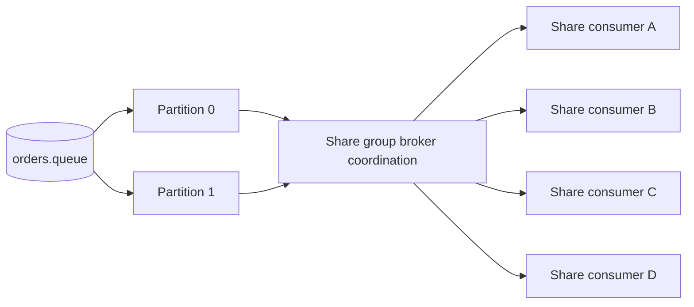
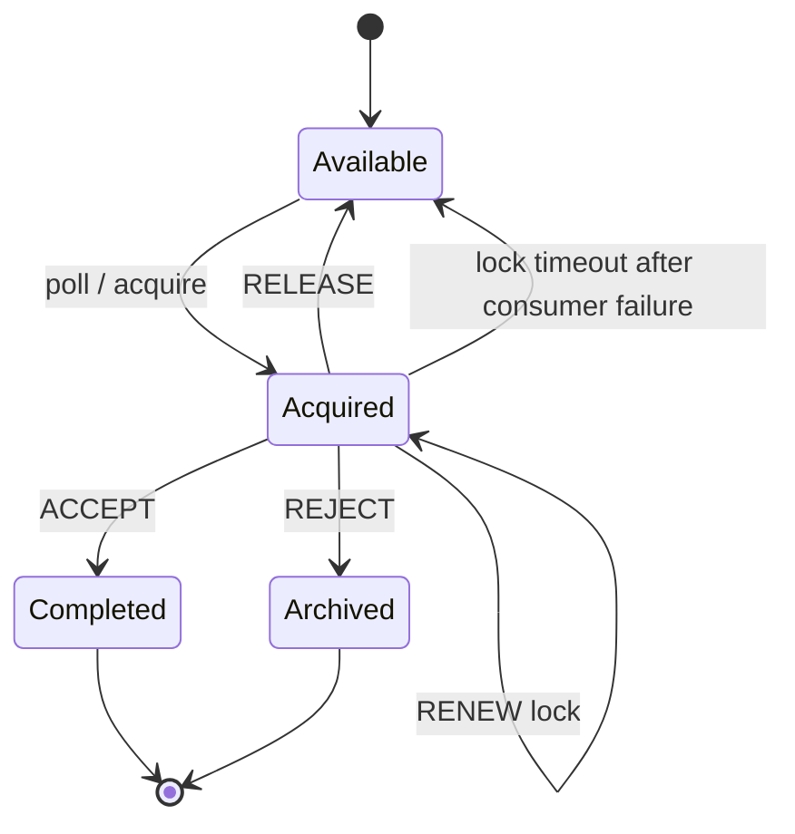

# Xác nhận ACCEPT, RELEASE, REJECT và gia hạn khi được hỗ trợ

## Mục tiêu

Consumer group truyền thống chia partition giữa các consumer member. Mỗi partition tại một thời điểm chỉ được một member trong group xử lý, nhờ đó Kafka giữ được thứ tự record trong partition và mở rộng xử lý bằng cách tăng partition. Mô hình này rất phù hợp với event stream có ordering, nhưng chưa tối ưu cho workload dạng hàng đợi khi nhiều worker cần cùng lấy việc từ một số ít partition.

**Share Group** là một loại group khác trong Kafka, cho phép nhiều consumer cùng chia sẻ record từ một partition. Broker cấp record cho consumer theo từng record, giữ khóa acquisition có thời hạn và nhận acknowledgment riêng cho từng record. Một consumer xử lý thành công có thể ACCEPT; lỗi tạm thời có thể RELEASE để record được giao lại; lỗi vĩnh viễn có thể REJECT. Kafka đếm số lần giao để giới hạn việc retry vô hạn.

Sau bài học này, bạn có thể:

- Phân biệt consumer group truyền thống với share group.
- Giải thích record acquisition lock và trạng thái giao nhận của record.
- Sử dụng `ACCEPT`, `RELEASE`, `REJECT` và `RENEW`.
- Cấu hình share consumer, lock duration, delivery count và acquire mode.
- Viết consumer Java với `KafkaShareConsumer`/`ShareConsumer`.
- Tích hợp share consumer với Spring Kafka.
- Cấu hình dead-letter queue cho share group khi cluster hỗ trợ.
- Quản trị, quan sát và xử lý lỗi share group.
- Chọn đúng mô hình cho workload cần ordering hoặc queue-style parallelism.

## 1. Share Group là gì?

Share group là một loại group được quản lý bởi Kafka Group Coordinator, tồn tại song song với consumer group và Kafka Streams group. Các consumer có cùng `group.id` tham gia cùng một share group. Broker phân phối record từ các topic/partition đã subscribe cho các member có thể nhận việc.

Điểm khác biệt quan trọng là partition có thể được nhiều share consumer cùng đọc và xử lý. Kafka khóa từng record đã giao cho một member trong khoảng thời gian nhất định, thay vì khóa cả partition cho một member như consumer group truyền thống.



Trong cùng một share group, các member phối hợp lấy record. Một partition có thể có nhiều consumer cùng nhận record từ partition đó, và số consumer có thể lớn hơn số partition. Mỗi record cụ thể chỉ được khóa cho một consumer tại một thời điểm trong group; các consumer khác có thể nhận các record khác thuộc cùng partition.

Nếu cùng topic được nhiều share group subscribe, mỗi share group là một logical subscriber độc lập và nhận luồng record của riêng mình. Điều này khác với nhiều member trong cùng một share group: các member trong cùng group chia sẻ công việc, còn các group khác nhau đều nhận dữ liệu.

## 2. Phiên bản Kafka và trạng thái tính năng

Share Groups được phát triển theo KIP-932 (Queues for Kafka). Cần kiểm tra phiên bản broker, client và feature level của cluster trước khi sử dụng:

| Phiên bản | Trạng thái |
|---|---|
| Kafka 4.0 | API share consumer ở giai đoạn phát triển sớm; không xem đây là nền tảng production mặc định |
| Kafka 4.1 | Share Groups được phát hành dưới dạng preview và không bật mặc định |
| Kafka 4.2 trở lên | Share Groups được nâng lên production-ready |
| Kafka 4.4, `share.version` feature level 2 | Bổ sung share group dead-letter queue theo KIP-1191 |

Các cluster cũ hơn không hỗ trợ share consumer API sẽ trả lỗi phiên bản/feature không hỗ trợ. Kafka client mới không thể tự bật tính năng trên broker cũ. Với Kafka 4.1 preview, quản trị viên cần nâng feature level `share.version` theo quy trình quản lý feature của cluster; không bật feature preview trực tiếp trên production nếu chưa kiểm tra release note và giới hạn tương ứng.

Kiểm tra feature level:

```bash
bin/kafka-features.sh --bootstrap-server localhost:9092 describe
```

Tìm `share.version` trong kết quả. DLQ cho share group yêu cầu feature level ít nhất 2 và các cấu hình DLQ tương ứng. Phiên bản Kafka cụ thể có thể bổ sung hoặc thay đổi config/API; luôn đối chiếu tài liệu đúng phiên bản đang chạy.

## 3. Consumer Group và Share Group khác nhau thế nào?

| Tiêu chí | Consumer group truyền thống | Share group |
|---|---|---|
| Đơn vị phân phối | Partition | Record trong partition |
| Quan hệ partition/member | Một partition được một member trong group sở hữu tại một thời điểm | Nhiều member có thể cùng chia sẻ một partition |
| Số consumer so với partition | Consumer dư có thể không được gán partition | Có thể có nhiều consumer hơn số partition |
| Tiến độ | Committed offset theo partition | Trạng thái giao nhận theo record và share-partition start offset |
| Xác nhận xử lý | Commit offset | Acknowledgment riêng từng record |
| Retry một record | Thường cần seek/retry topic/DLT và điều phối offset | RELEASE hoặc để acquisition lock hết hạn |
| Delivery attempt count | Ứng dụng thường tự quản lý | Broker đếm delivery attempt |
| Ordering | Dễ giữ thứ tự trong partition khi xử lý tuần tự | Không bảo đảm thứ tự hoàn tất theo partition khi nhiều record đang in-flight |
| Use case | Event stream, xử lý theo key, stateful processing | Queue/work distribution, task độc lập, xử lý record song song |

Ví dụ topic chỉ có 2 partition nhưng có 8 worker:

- Với consumer group truyền thống, tối đa 2 member được gán partition tại cùng thời điểm; 6 member còn lại không có partition để đọc.
- Với share group, cả 8 member có thể tham gia chia sẻ record từ 2 partition. Broker cấp các record chưa bị acquire cho các member.

Share group không làm Kafka bỏ partition. Partition vẫn là đơn vị lưu trữ, replication và giới hạn song song ở mức broker; share group chỉ thay đổi cách phân phối record cho consumer.

## 4. Khi nào nên dùng share group?

Share group phù hợp khi mỗi record là một công việc tương đối độc lập, có thể xử lý bởi bất kỳ worker nào và không cần bảo toàn thứ tự hoàn tất giữa các record.

Ví dụ phù hợp:

- Worker xử lý ảnh hoặc tạo thumbnail.
- Gửi email, SMS hoặc notification theo từng yêu cầu.
- Gọi webhook cho từng event độc lập.
- Xử lý tác vụ kiểm tra, enrichment hoặc indexing không phụ thuộc thứ tự.
- Job queue có số partition ít nhưng cần nhiều worker cùng lấy việc.
- Pipeline xử lý record theo từng item, có retry và reject rõ ràng.

Consumer group truyền thống thường phù hợp hơn nếu:

- Cần xử lý mọi event của một aggregate theo thứ tự.
- Consumer duy trì state tuần tự theo partition.
- Dùng Kafka Streams hoặc topology phụ thuộc partition assignment.
- Muốn replay theo offset và quản lý checkpoint đơn giản theo partition.
- Business rule yêu cầu event sau không được hoàn tất trước event trước.

Không nên chọn share group chỉ vì có thể chạy nhiều consumer hơn số partition. Nếu ordering là yêu cầu nghiệp vụ, parallelism record-level có thể làm thay đổi kết quả xử lý.

## 5. Record acquisition lock

Khi share consumer gọi `poll()`, broker chọn các record đang ở trạng thái có thể giao và chuyển chúng sang trạng thái acquired cho consumer đó. Mỗi record acquired có một acquisition lock với thời hạn. Trong thời gian lock còn hiệu lực, record không được giao cho member khác trong cùng share group.

Các trạng thái logic thường gặp:

| Trạng thái | Ý nghĩa |
|---|---|
| Available | Record có thể được giao cho một share consumer |
| Acquired | Record đã được giao và đang bị khóa cho một delivery attempt |
| Acknowledged/Completed | Record được xác nhận xử lý thành công |
| Archived | Record bị từ chối hoặc không còn được giao lại theo policy |

Luồng cơ bản:



Lock mặc định là 30 giây trong các cấu hình Kafka hiện hành. Group config `share.record.lock.duration.ms` điều khiển thời lượng này. Khi lock hết hạn mà chưa có terminal acknowledgment, record có thể quay lại trạng thái Available để được giao cho consumer khác.

Lock không phải lease của business database. Nó chỉ điều phối delivery trong share group. Nếu worker tiếp tục xử lý sau khi lock hết hạn, một worker khác có thể nhận lại cùng record. Vì vậy xử lý cần idempotent theo event ID hoặc business key.

### 5.1. Giới hạn record đang acquired

Broker giới hạn số record được acquire đồng thời trên mỗi partition trong một share group bằng `share.partition.max.record.locks`. Giá trị mặc định hiện hành thường là 2.000 record/partition. Khi chạm giới hạn, poll có thể tạm thời không nhận thêm record từ partition đó cho đến khi số lock giảm xuống.

Giới hạn này tránh một consumer pool acquire quá nhiều record chưa xử lý và giữ chúng trong thời gian dài. Nếu worker xử lý chậm, lock duration quá dài hoặc không acknowledge, số lock có thể đầy và throughput giảm dù vẫn còn nhiều record trong topic.

## 6. Các loại acknowledgment

Share consumer hỗ trợ bốn loại acknowledgment:

| Loại | Ý nghĩa | Khi dùng |
|---|---|---|
| `ACCEPT` | Xác nhận record đã xử lý thành công; record hoàn tất trong share group | Business processing thành công |
| `RELEASE` | Trả record về trạng thái có thể được giao lại | Lỗi tạm thời, dependency chưa sẵn sàng |
| `REJECT` | Đánh dấu record không thể xử lý và không tiếp tục giao lại | Payload sai vĩnh viễn hoặc lỗi nghiệp vụ không thể retry |
| `RENEW` | Gia hạn acquisition lock; không phải kết quả cuối cùng | Công việc còn chạy lâu hơn lock duration |

`ACCEPT`, `RELEASE` và `REJECT` là terminal acknowledgment cho delivery attempt hiện tại. `RENEW` chỉ kéo dài thời gian acquire; sau khi xử lý xong vẫn phải ACCEPT, RELEASE hoặc REJECT.

### 6.1. ACCEPT

Gọi ACCEPT sau khi side effect đã hoàn tất. Nếu ứng dụng crash sau khi side effect thành công nhưng trước khi acknowledgment được commit, record có thể được giao lại. Hãy dùng idempotency để không lặp side effect.

### 6.2. RELEASE

RELEASE phù hợp với lỗi tạm thời như database timeout, rate limit hoặc service downstream đang unavailable. Record trở lại trạng thái có thể giao lại; delivery count tăng theo các lần giao. Không dùng RELEASE vô hạn cho payload chắc chắn không hợp lệ vì sẽ tạo retry loop.

### 6.3. REJECT

REJECT dùng khi record không thể xử lý và không nên retry tiếp. Record được archive trong trạng thái share group. Nếu DLQ được cấu hình và cluster hỗ trợ, record bị reject có thể đủ điều kiện chuyển vào DLQ để operator điều tra/redrive.

### 6.4. RENEW

Nếu xử lý có thể vượt `share.record.lock.duration.ms`, consumer có thể gia hạn lock bằng RENEW. Group cần cho phép `share.renew.acknowledge.enable`; consumer tiếp tục poll/duy trì membership và gửi renewal trước khi lock hết hạn. Với Java API, record được renew có thể xuất hiện lại trong kết quả poll tiếp theo; ứng dụng nên theo dõi record đang in-flight để không khởi chạy cùng một business operation hai lần trên chính worker. Không dùng RENEW để che giấu worker bị treo; cần timeout và terminal decision.

## 7. Delivery count và giới hạn retry

Kafka theo dõi số lần một record được giao cho share group. Group config `share.delivery.count.limit` đặt giới hạn số delivery attempt; giá trị mặc định hiện hành là 5. Khi vượt giới hạn, record không tiếp tục được giao như một record bình thường và có thể được archive/đưa vào DLQ nếu tính năng DLQ được bật.

Ví dụ:

| Attempt | Kết quả | Delivery count |
|---:|---|---:|
| 1 | Worker A RELEASE do database timeout | 1 |
| 2 | Worker B không acknowledge, lock hết hạn | 2 |
| 3 | Worker C RELEASE | 3 |
| 4 | Worker A RELEASE | 4 |
| 5 | Worker D tiếp tục lỗi | 5 |
| Tiếp theo | Chạm/vượt policy delivery limit; xử lý archive/DLQ theo feature/config | Theo broker policy |

Delivery count được broker quản lý, nhưng nó không thay thế retry policy ở tầng nghiệp vụ. Hãy phân loại lỗi trước khi chọn RELEASE hay REJECT. Lỗi tạm thời cần retry; lỗi schema/validation vĩnh viễn thường nên reject hoặc đưa vào quy trình xử lý lỗi.

## 8. Cấu hình share group

Share group dùng `group.id` như định danh group của consumer. Một số cấu hình là group-level config được quản lý trên broker, một số là client config.

### 8.1. Group-level configuration

| Config | Ý nghĩa | Default hiện hành thường gặp |
|---|---|---:|
| `share.auto.offset.reset` | Khởi tạo share-partition start offset khi group chưa có tiến độ hợp lệ | `latest` |
| `share.record.lock.duration.ms` | Thời gian acquisition lock | `30000` ms |
| `share.delivery.count.limit` | Giới hạn delivery attempt | `5` |
| `share.partition.max.record.locks` | Số record tối đa được acquire trên mỗi partition | `2000` |
| `share.heartbeat.interval.ms` | Chu kỳ heartbeat member | `5000` ms |
| `share.session.timeout.ms` | Thời gian phát hiện member lỗi | `45000` ms |
| `share.isolation.level` | Cách đọc transactional records | `read_uncommitted` |
| `share.renew.acknowledge.enable` | Cho phép RENEW acknowledgment | `true` |

Các default, range và tên cấu hình có thể thay đổi theo phiên bản. Kiểm tra Group Configs reference của đúng Kafka broker.

Broker còn giới hạn tổng số member của một share group bằng `group.share.max.size` (default 200 trong Kafka 4.4). Vì vậy share group cho phép số consumer lớn hơn số partition nhưng không phải không giới hạn; hãy kiểm tra broker cap và capacity của coordinator trước khi scale worker pool lớn.

`share.auto.offset.reset` hỗ trợ `earliest`, `latest` và `by_duration:<ISO-8601 duration>` trên phiên bản hỗ trợ. Nó không phải `auto.offset.reset` của consumer group truyền thống; đây là group config riêng cho share group.

Ví dụ đặt lock 60 giây và delivery limit 6 cho một share group:

```bash
bin/kafka-configs.sh --bootstrap-server localhost:9092 \
  --alter --entity-type groups --entity-name order-workers \
  --add-config share.record.lock.duration.ms=60000,share.delivery.count.limit=6
```

Chỉ tăng lock duration khi thời gian xử lý thực tế cần thiết. Lock quá dài làm record lỗi phải chờ lâu hơn trước khi được giao lại. Delivery limit cao làm retry được nhiều lần hơn nhưng cũng có thể kéo dài thời gian xử lý poison record.

### 8.2. Client configuration

| Config | Ý nghĩa |
|---|---|
| `share.acknowledgement.mode` | `implicit` hoặc `explicit`; chọn cách xác nhận record |
| `share.acquire.mode` | `batch_optimized` hoặc `record_limit`; cách giới hạn record acquire trong mỗi poll |
| `max.poll.records` | Số record mong muốn mỗi poll; với `batch_optimized` có thể là soft limit |
| `group.id` | Tên share group |
| `bootstrap.servers` | Broker endpoints |
| `key.deserializer` / `value.deserializer` | Deserializer cho key/value |

Trong Kafka 4.4, `share.acknowledgement.mode` có default client là `implicit`. Ở implicit mode, không gọi `acknowledge()`; record được implicit-ack theo hành vi của client khi poll/commit. Với explicit mode, ứng dụng gọi API acknowledge cho từng record rồi commit acknowledgment state.

`share.acquire.mode=batch_optimized` ưu tiên lấy trọn batch để tăng hiệu quả; `max.poll.records` có thể bị vượt như soft limit. `record_limit` giới hạn chặt số record trả về mỗi poll, hữu ích khi cần kiểm soát memory hoặc thời gian xử lý.

## 9. Share-partition start offset không giống committed offset

Consumer group truyền thống lưu một committed offset cho mỗi topic-partition. Share group cần theo dõi trạng thái của từng record đang được giao, đã hoàn tất hoặc đã archive. Vì vậy không thể hiểu share group như một committed offset tăng đều qua từng record.

Share-partition có `start offset` làm frontier sớm nhất của các record còn đang được đánh giá giao nhận. Một số record ở offset lớn hơn start offset có thể đã hoàn tất. Công cụ quản trị hiển thị start offset và lag, nhưng trạng thái từng record bên trong partition có thể không đồng nhất.

Ví dụ:

| Offset | Trạng thái trong share group |
|---:|---|
| 100 | ACCEPTED |
| 101 | ACQUIRED bởi worker A |
| 102 | ACCEPTED |
| 103 | AVAILABLE |
| 104 | REJECTED/ARCHIVED |

Start offset có thể vẫn ở 101 dù offset 102 và 104 đã có kết quả cuối cùng. Khi offset 101 được hoàn tất, frontier có thể tiến qua các offset đã hoàn tất liên tiếp. Đây là lý do `START-OFFSET` không phải danh sách chính xác mọi record chưa xử lý.

## 10. Java Share Consumer API

Kafka client cung cấp `ShareConsumer<K,V>` và implementation `KafkaShareConsumer<K,V>`. API quen thuộc với `subscribe()`, `poll()` và `close()`, nhưng có `acknowledge()` theo record thay cho quản lý offset như `KafkaConsumer`.

Ví dụ explicit acknowledgment:

```java
import java.time.Duration;
import java.util.List;
import java.util.Properties;

import org.apache.kafka.clients.consumer.ConsumerConfig;
import org.apache.kafka.clients.consumer.ConsumerRecord;
import org.apache.kafka.clients.consumer.ConsumerRecords;
import org.apache.kafka.clients.consumer.KafkaShareConsumer;
import org.apache.kafka.clients.consumer.ShareConsumer;
import org.apache.kafka.clients.consumer.AcknowledgeType;
import org.apache.kafka.common.serialization.StringDeserializer;

public class OrderShareWorker {

    public static void main(String[] args) {
        Properties props = new Properties();
        props.put(ConsumerConfig.BOOTSTRAP_SERVERS_CONFIG, "localhost:9092");
        props.put(ConsumerConfig.GROUP_ID_CONFIG, "order-workers");
        props.put(ConsumerConfig.KEY_DESERIALIZER_CLASS_CONFIG,
                StringDeserializer.class.getName());
        props.put(ConsumerConfig.VALUE_DESERIALIZER_CLASS_CONFIG,
                StringDeserializer.class.getName());
        props.put("share.acknowledgement.mode", "explicit");
        props.put("share.acquire.mode", "record_limit");
        props.put(ConsumerConfig.MAX_POLL_RECORDS_CONFIG, 20);

        try (ShareConsumer<String, String> consumer =
                     new KafkaShareConsumer<>(props)) {
            consumer.subscribe(List.of("orders.queue"));

            while (!Thread.currentThread().isInterrupted()) {
                ConsumerRecords<String, String> records =
                        consumer.poll(Duration.ofSeconds(1));

                for (ConsumerRecord<String, String> record : records) {
                    try {
                        processOrder(record.value());
                        consumer.acknowledge(record, AcknowledgeType.ACCEPT);
                    } catch (RetryableOrderException ex) {
                        consumer.acknowledge(record, AcknowledgeType.RELEASE);
                    } catch (Exception ex) {
                        consumer.acknowledge(record, AcknowledgeType.REJECT);
                    }
                }

                // Ghi acknowledgment state đã đánh dấu lên Kafka.
                consumer.commitSync();
            }
        }
    }

    private static void processOrder(String value) throws Exception {
        // Deserialize, validate và thực hiện business operation.
    }
}
```

Đoạn code minh họa cho Kafka client có ShareConsumer API. Cần bổ sung model, exception, shutdown handling, logging, metrics và cấu hình bảo mật của môi trường thực tế. `acknowledge()` đánh dấu trạng thái trong client; `commitSync()` gửi acknowledgment state lên Kafka. Nếu commit lỗi hoặc process crash trước khi commit, record có thể được giao lại.

### 10.1. Consumer không thread-safe

`KafkaShareConsumer` không thread-safe. Chỉ một thread điều khiển `poll`, `acknowledge`, `commit` và `close` trên consumer instance. Nếu xử lý bất đồng bộ, worker thread không được gọi trực tiếp consumer API tùy ý; hãy gửi kết quả về poll thread để acknowledge/commit hoặc dùng container framework quản lý lifecycle.

### 10.2. Xử lý tác vụ dài bằng RENEW

Nếu một record cần xử lý lâu hơn lock duration, ứng dụng phải tiếp tục poll và renew lock theo nhịp phù hợp. Ví dụ khái niệm:

```java
// Pseudocode: chỉ minh họa quyết định acknowledgment.
if (processingCompleted) {
    consumer.acknowledge(record, AcknowledgeType.ACCEPT);
} else if (processingFailedPermanently) {
    consumer.acknowledge(record, AcknowledgeType.REJECT);
} else {
    consumer.acknowledge(record, AcknowledgeType.RENEW);
}
```

RENEW không thay thế polling và heartbeat. Nếu broker không nhận được renewal trước khi lock hết hạn, record có thể được giao cho worker khác. Nếu processing kéo dài vô hạn, cần timeout nghiệp vụ và terminal outcome.

## 11. Spring Kafka và Share Consumer

Spring Kafka hỗ trợ share consumer từ Spring Kafka 4.0. Từ Spring Kafka 4.1 kết hợp Apache Kafka 4.2, share consumer được hỗ trợ production đầy đủ theo tài liệu hiện hành. Không dùng `ConcurrentKafkaListenerContainerFactory` của consumer group thường cho share consumer; hãy dùng `ShareConsumerFactory` và `ShareKafkaListenerContainerFactory`.

### 11.1. Khai báo factory

```java
@Configuration
@EnableKafka
public class ShareKafkaConfiguration {

    @Bean
    ShareConsumerFactory<String, String> shareConsumerFactory() {
        Map<String, Object> props = new HashMap<>();
        props.put(ConsumerConfig.BOOTSTRAP_SERVERS_CONFIG, "localhost:9092");
        props.put(ConsumerConfig.KEY_DESERIALIZER_CLASS_CONFIG,
                StringDeserializer.class);
        props.put(ConsumerConfig.VALUE_DESERIALIZER_CLASS_CONFIG,
                StringDeserializer.class);
        props.put("share.acquire.mode", "record_limit");
        props.put(ConsumerConfig.MAX_POLL_RECORDS_CONFIG, 20);
        return new DefaultShareConsumerFactory<>(props);
    }

    @Bean
    ShareKafkaListenerContainerFactory<String, String>
    shareKafkaListenerContainerFactory(
            ShareConsumerFactory<String, String> shareConsumerFactory) {

        ShareKafkaListenerContainerFactory<String, String> factory =
                new ShareKafkaListenerContainerFactory<>(shareConsumerFactory);
        factory.setConcurrency(5);
        factory.getContainerProperties()
                .setShareAckMode(ContainerProperties.ShareAckMode.MANUAL);
        return factory;
    }
}
```

Các import và dependency cần khớp Spring Kafka 4.1.x và Kafka client tương thích. Với phiên bản Spring Kafka cũ hơn, API acknowledgment có thể khác; Spring Kafka 4.1 dùng `setShareAckMode(ShareAckMode)`.

### 11.2. Listener với manual acknowledgment

```java
@Component
public class OrderShareListener {

    @KafkaListener(
            topics = "orders.queue",
            groupId = "order-workers",
            containerFactory = "shareKafkaListenerContainerFactory")
    public void onOrder(
            ConsumerRecord<String, String> record,
            ShareAcknowledgment acknowledgment) {

        try {
            orderService.process(record.value());
            acknowledgment.acknowledge(); // ACCEPT
        } catch (RetryableOrderException ex) {
            acknowledgment.release();    // RELEASE
        } catch (Exception ex) {
            acknowledgment.reject();     // REJECT
        }
    }
}
```

`ShareAcknowledgment` chỉ khác null trong `ShareAckMode.MANUAL`. Listener phải thực hiện một terminal action cho từng record: `acknowledge()`, `release()` hoặc `reject()`. Nếu processing có thể vượt lock duration, có thể gọi `renew()` trong khi xử lý và sau đó vẫn cần terminal action.

Trong MANUAL mode, container chờ acknowledgment cho toàn bộ record đã giao trong poll hiện tại trước khi tiếp tục poll batch tiếp theo. Hãy bảo đảm mọi nhánh xử lý đều kết thúc bằng terminal acknowledgment; nếu bỏ quên một record, listener có thể ngừng nhận batch mới.

### 11.3. Các chế độ acknowledgment trong Spring Kafka

| Mode | Ai quyết định? | Khi listener thành công | Khi listener lỗi |
|---|---|---|---|
| `EXPLICIT` (default của Spring container) | Container | Container gửi ACCEPT | Recoverer quyết định; default recoverer thường REJECT |
| `MANUAL` | Listener | Listener gọi `acknowledge()` | Listener gọi `release()` hoặc `reject()` |
| `IMPLICIT` | Kafka client/broker | Broker implicit ACCEPT | Record vẫn bị implicit ACCEPT; không có recovery theo record |

`IMPLICIT` không phù hợp nếu ứng dụng cần retry theo record hoặc phân biệt lỗi tạm thời/vĩnh viễn. Với `EXPLICIT`, có thể để container tự ACCEPT khi listener return bình thường và cấu hình recoverer cho exception. Với `MANUAL`, business code quyết định từng kết quả.

### 11.4. Concurrency trong Spring

`ShareKafkaMessageListenerContainer` tạo nhiều consumer thread; mỗi thread có một `ShareConsumer` riêng và tham gia cùng share group. `concurrency=5` tạo năm member trong group từ container đó. Nếu chạy ba application instance, mỗi instance concurrency 5, share group có thể có tổng cộng 15 member.

Broker phân phối record cho pool consumer ở mức record. Khi volume thấp, không phải mọi thread đều luôn nhận record. Tăng concurrency không bảo đảm tăng throughput nếu bottleneck nằm ở database, downstream API hoặc giới hạn record lock.

## 12. Dead-letter queue cho share group

DLQ cho share group cho phép lưu record bị reject hoặc vượt delivery count để operator điều tra. Theo Kafka 4.4, share group DLQ yêu cầu feature `share.version` ít nhất 2.

### 12.1. Cấu hình DLQ topic

Đặt DLQ topic cho group:

```bash
bin/kafka-configs.sh --bootstrap-server localhost:9092 \
  --alter --add-config errors.deadletterqueue.topic.name=dlq.orders-workers \
  --entity-type groups --entity-name order-workers
```

Nếu broker không bật auto-create DLQ topic (mặc định là tắt), hãy tạo topic như topic Kafka bình thường rồi bật config:

```bash
bin/kafka-configs.sh --bootstrap-server localhost:9092 \
  --alter --add-config errors.deadletterqueue.group.enable=true \
  --entity-type topics --entity-name dlq.orders-workers
```

Tên DLQ phải tuân thủ prefix được broker cấu hình; mặc định là `dlq.`. Nếu bật `errors.deadletterqueue.auto.create.topics.enable=true` trên broker, topic auto-created có thể được cấu hình phù hợp theo cơ chế của phiên bản.

### 12.2. Nội dung DLQ

Mặc định, record DLQ có thể chỉ chứa metadata nguồn như share group, topic, partition, offset và delivery count. Group config `errors.deadletterqueue.copy.record.enable=true` cho phép copy key/value gốc vào DLQ.

Không mặc định rằng DLQ luôn có full payload. Hãy xác minh config copy record, retention, ACL và quy trình redrive. Khi redrive, cần giữ event identity và thêm replay metadata để consumer có thể deduplicate.

DLQ không thay thế business audit. Cần ghi lại lý do reject, phiên bản consumer, delivery count và người/hệ thống thực hiện redrive nếu yêu cầu vận hành cần truy vết.

## 13. Quản trị share group

Kafka cung cấp `kafka-share-groups.sh` để liệt kê, mô tả, reset và xóa share group. Không dùng `kafka-consumer-groups.sh` thay cho share group tool khi cần kiểm tra share state.

Liệt kê group:

```bash
bin/kafka-share-groups.sh --bootstrap-server localhost:9092 --list
```

Xem start offset và lag:

```bash
bin/kafka-share-groups.sh --bootstrap-server localhost:9092 \
  --describe --group order-workers
```

Xem member:

```bash
bin/kafka-share-groups.sh --bootstrap-server localhost:9092 \
  --describe --group order-workers --members
```

Xem state:

```bash
bin/kafka-share-groups.sh --bootstrap-server localhost:9092 \
  --describe --group order-workers --state
```

Kết quả `START-OFFSET` là frontier sớm nhất của record còn được đánh giá delivery; một số offset lớn hơn có thể đã được hoàn tất. Lag cần được đọc cùng với trạng thái member và tình trạng xử lý, không diễn giải y hệt consumer group lag.

### 13.1. Reset share group

Có thể reset share group về earliest/latest hoặc offset/time được hỗ trợ. Luôn chạy dry run trước:

```bash
bin/kafka-share-groups.sh --bootstrap-server localhost:9092 \
  --reset-offsets --group order-workers --topic orders.queue \
  --to-earliest --dry-run
```

Nếu kết quả đúng và đã dừng/điều phối member liên quan, mới thực thi:

```bash
bin/kafka-share-groups.sh --bootstrap-server localhost:9092 \
  --reset-offsets --group order-workers --topic orders.queue \
  --to-earliest --execute
```

Reset có thể làm record lịch sử được giao lại. Consumer phải idempotent. Không reset share group production chỉ để thử nghiệm.

### 13.2. Xóa group

```bash
bin/kafka-share-groups.sh --bootstrap-server localhost:9092 \
  --delete --group order-workers
```

Chỉ xóa share group không có active member. Xóa group sẽ ảnh hưởng trạng thái delivery/progress của group; cần xác nhận group không còn được ứng dụng sử dụng và đã lưu thông tin cần audit.

## 14. Ordering và xử lý song song

Share group tăng khả năng xử lý record độc lập bằng cách cho nhiều member acquire record từ cùng partition. Đổi lại, thứ tự hoàn tất không còn được bảo đảm như consumer group truyền thống.

Ví dụ partition chứa:

```text
offset 10: OrderCreated
offset 11: OrderPaid
offset 12: OrderShipped
```

Broker có thể giao offset 10 cho worker A, offset 11 cho worker B và offset 12 cho worker C. Worker C hoàn tất trước worker A. Dù record được đọc từ cùng partition, thứ tự hoàn tất business operation có thể là 12, 11, 10.

Nếu cả ba record là các chuyển trạng thái của cùng một đơn hàng, xử lý song song có thể làm trạng thái cuối sai. Khi ordering quan trọng:

- Dùng consumer group truyền thống và xử lý tuần tự theo partition.
- Hoặc serialize xử lý theo aggregate key ở tầng ứng dụng, có sequence check và buffering.
- Không xem Kafka key là bảo đảm ordering trong share group; key không ngăn broker giao nhiều record cùng partition cho nhiều worker.
- Dùng idempotency để xử lý duplicate do lock timeout/retry.

## 15. Retry, lock expiry và idempotency

Share group cung cấp delivery retry ở broker nhưng không tạo exactly-once side effect ở database hoặc API bên ngoài.

Các cửa sổ lỗi:

| Tình huống | Kết quả có thể xảy ra | Cách bảo vệ |
|---|---|---|
| Worker crash trước khi xử lý xong | Lock hết hạn, record được giao lại | Retry policy, lock phù hợp, idempotent handler |
| Worker xử lý xong nhưng crash trước ACCEPT commit | Record có thể được giao lại | Inbox/dedup theo event ID |
| Worker xử lý lâu hơn lock duration | Một worker khác có thể acquire lại record | RENEW hoặc tăng lock hợp lý; timeout nghiệp vụ |
| RELEASE liên tục do dependency lỗi | Delivery count tăng, cuối cùng archive/DLQ | Backoff ở ứng dụng, delivery limit, DLQ và alert |
| REJECT nhầm lỗi tạm thời | Record không được retry | Phân loại exception trước terminal acknowledgment |
| ACCEPT trước khi DB commit | Record hoàn tất nhưng side effect có thể rollback | Chỉ ACCEPT sau commit database |

Nếu database là nơi lưu side effect, có thể dùng inbox table với unique key `(consumer_name, event_id)`. Insert inbox và update business data trong cùng DB transaction. Chỉ ACCEPT sau khi transaction commit. Nếu consumer nhận lại record, inbox phát hiện duplicate và không lặp side effect.

## 16. Transactional records và isolation level

Share group có `share.isolation.level` để kiểm soát transactional records:

- `read_uncommitted`: có thể nhận transactional records kể cả transaction bị abort; đọc tới high watermark.
- `read_committed`: chỉ nhận non-transactional records và transactional records đã commit; tiến độ bị giới hạn bởi last stable offset.

Với `read_committed`, transaction đang mở lâu có thể chặn share group tiến qua last stable offset của partition. Chọn isolation level theo semantics dữ liệu mà worker cần nhận.

Share consumer acknowledgments không tự làm side effect database và Kafka atomic. Nếu worker cập nhật DB rồi ACK, crash giữa hai bước vẫn có thể gây redelivery; cần inbox/idempotency. Kafka transaction cũng không bao gồm HTTP API hoặc database ngoài Kafka.

## 17. Acquire mode và kiểm soát batch

`share.acquire.mode` điều khiển cách broker áp dụng `max.poll.records`:

| Mode | Hành vi | Khi dùng |
|---|---|---|
| `batch_optimized` | Soft limit; broker có thể trả nhiều record hơn `max.poll.records` để giữ ranh giới batch hiệu quả | Throughput là ưu tiên và worker có đủ memory |
| `record_limit` | Hard limit; mỗi poll không vượt `max.poll.records` | Cần kiểm soát memory, latency hoặc thời gian xử lý |

Ví dụ:

```properties
share.acquire.mode=record_limit
max.poll.records=10
```

Đừng đặt `max.poll.records` quá cao nếu mỗi record cần thời gian xử lý dài. Nhiều record acquire cùng lúc có thể giữ nhiều lock và làm record chờ lâu trong worker queue. Dùng bounded concurrency và backpressure.

## 18. Monitoring và troubleshooting

Theo dõi share group ở cả broker và ứng dụng:

| Quan sát | Ý nghĩa | Dấu hiệu cần điều tra |
|---|---|---|
| Share group member count/state | Số member và trạng thái group | Member liên tục rời/join hoặc group không stable |
| Share-partition start offset/lag | Frontier tiến độ delivery | Lag tăng lâu dài dù worker còn hoạt động |
| Acquired record count | Số record đang bị khóa/in-flight | Gần chạm `share.partition.max.record.locks` |
| Lock timeout/renew count | Record hết lock hoặc cần gia hạn | Timeout tăng, worker xử lý quá chậm |
| Delivery count distribution | Số lần record được giao | Nhiều record gần delivery limit |
| ACCEPT/RELEASE/REJECT rate | Kết quả xử lý | RELEASE/REJECT tăng bất thường |
| DLQ publish rate | Record chuyển sang DLQ | Tăng đột biến hoặc DLQ không nhận record |
| Consumer poll/processing latency | Sức khỏe worker | Poll bị ngắt quãng, processing kéo dài |
| Partition lock saturation | Giới hạn acquire theo partition | Poll trả rỗng dù topic còn dữ liệu |

Tên JMX metric cụ thể có thể thay đổi theo Kafka version. Lấy metric từ client/broker version thực tế và gắn group, topic, partition, client ID để điều tra. `kafka-share-groups.sh --describe` là điểm bắt đầu cho group state, start offset, lag và member assignment.

### 18.1. Lỗi thường gặp

| Hiện tượng | Nguyên nhân có thể | Hướng xử lý |
|---|---|---|
| `UnsupportedVersionException` | Broker chưa hỗ trợ ShareConsumer API hoặc feature level chưa bật | Kiểm tra broker version và `share.version` |
| Không tạo được share group | Thiếu quyền, broker chưa hỗ trợ, feature chưa enable | Kiểm tra ACL, feature level và server logs |
| Poll trả rỗng dù topic có dữ liệu | Record đang acquired, lock chưa hết hoặc partition lock limit đạt | Xem acquired records, lock duration và member health |
| Record bị giao lại liên tục | Worker không ACK, crash hoặc lock quá ngắn | Kiểm tra processing latency, renewal và delivery count |
| Nhiều record vào DLQ | Delivery limit thấp hoặc lỗi dữ liệu/systemic | Phân loại lỗi, xem payload/metadata và kiểm tra DLQ config |
| Thứ tự business event sai | Nhiều worker xử lý cùng partition song song | Chuyển sang consumer group truyền thống hoặc serialize theo key |
| Spring listener luôn nhận acknowledgment null | Container đang dùng EXPLICIT/IMPLICIT thay vì MANUAL | Cấu hình `ShareAckMode.MANUAL` |
| Manual listener không poll tiếp | Record trong poll trước chưa có terminal acknowledgment | Bảo đảm mỗi record được ACCEPT/RELEASE/REJECT |
| Lock hết hạn trong tác vụ dài | Thời gian xử lý vượt `share.record.lock.duration.ms` | RENEW định kỳ hoặc thiết kế job ngắn hơn |

## 19. Thực hành: nhiều worker chia sẻ một partition

Lab cần Kafka 4.2+ (hoặc version mới hơn có Share Groups production-ready), topic có ít nhất một partition và hai hoặc nhiều share consumer. Dùng môi trường local/staging, không dùng group production.

### 19.1. Tạo topic và dữ liệu

```bash
bin/kafka-topics.sh --bootstrap-server localhost:9092 \
  --create --topic orders.queue --partitions 1 --replication-factor 1
```

Gửi nhiều record với key khác nhau:

```bash
bin/kafka-console-producer.sh --bootstrap-server localhost:9092 \
  --topic orders.queue --property parse.key=true --property key.separator=:
```

Ví dụ nhập:

```text
ORD-1001:{"orderId":"ORD-1001","task":"email"}
ORD-1002:{"orderId":"ORD-1002","task":"invoice"}
ORD-1003:{"orderId":"ORD-1003","task":"webhook"}
```

### 19.2. Chạy nhiều share consumer

Chạy 3 process Java với cùng `group.id=order-workers`, subscribe `orders.queue`, nhưng mỗi process có `client.id` riêng. Mỗi process log client ID, topic, partition, offset, delivery attempt nếu API/version expose và thời gian xử lý.

Xác nhận nhiều consumer member cùng chia sẻ partition 0. Tăng concurrency lên 5 dù topic chỉ có một partition và quan sát các record được phân phối cho nhiều worker.

### 19.3. Thử acknowledgment

- ACCEPT: xử lý thành công và xác nhận record.
- RELEASE: cố tình ném lỗi tạm thời, release để record được giao lại.
- REJECT: gửi payload không hợp lệ, reject và quan sát record không được giao lại như record bình thường.
- Lock expiry: dừng process trước terminal acknowledgment, chờ lock hết hạn và xác nhận record có thể được giao lại.
- RENEW: tạo task dài hơn lock duration, renew trong khi xử lý rồi ACCEPT khi hoàn tất.

### 19.4. Quản trị group

```bash
bin/kafka-share-groups.sh --bootstrap-server localhost:9092 --list

bin/kafka-share-groups.sh --bootstrap-server localhost:9092 \
  --describe --group order-workers --members

bin/kafka-share-groups.sh --bootstrap-server localhost:9092 \
  --describe --group order-workers --state
```

Ghi lại số member, partition được chia sẻ, start offset và lag. So sánh với một consumer group truyền thống có cùng một partition để thấy khác biệt về số member có thể làm việc.

### 19.5. Thử DLQ (nếu cluster hỗ trợ)

Với cluster `share.version >= 2`, cấu hình DLQ topic, bật `errors.deadletterqueue.group.enable=true` nếu tự tạo topic và thử REJECT một record. Kiểm tra DLQ có metadata nguồn; bật copy record nếu cần giữ key/value gốc. Không giả định mọi broker version đều hỗ trợ tính năng này.

## 20. Checklist production

- [ ] Broker và client version hỗ trợ share consumer; feature level phù hợp.
- [ ] Workload là queue-style và không yêu cầu thứ tự hoàn tất theo partition.
- [ ] `group.id` được đặt riêng cho logical worker pool.
- [ ] Lock duration phù hợp processing latency và có RENEW cho tác vụ dài.
- [ ] `share.delivery.count.limit` phù hợp retry budget.
- [ ] `share.partition.max.record.locks` và acquire mode phù hợp memory/backpressure.
- [ ] Mỗi record có event ID hoặc idempotency key.
- [ ] Side effect database commit trước ACCEPT.
- [ ] RELEASE chỉ dùng cho lỗi có thể retry; REJECT dùng cho lỗi vĩnh viễn.
- [ ] DLQ được cấu hình, có retention/ACL và quy trình redrive nếu cần.
- [ ] Không trộn `IMPLICIT` mode với kỳ vọng retry/reject theo record.
- [ ] Consumer API được gọi trên đúng thread; `ShareConsumer` không thread-safe.
- [ ] Theo dõi acquired locks, delivery count, release/reject, lag và DLQ.
- [ ] Reset/delete group có dry run và maintenance procedure.
- [ ] Đã kiểm thử crash trước/sau xử lý, lock expiry và retry limit.

## 21. Câu hỏi tự kiểm tra

1. Share group khác consumer group truyền thống ở đơn vị phân phối nào?
2. Vì sao số share consumer có thể lớn hơn số partition?
3. Record acquisition lock ngăn hai member cùng xử lý một record như thế nào?
4. Điều gì xảy ra khi acquisition lock hết hạn mà không có acknowledgment?
5. `ACCEPT`, `RELEASE`, `REJECT` và `RENEW` khác nhau ra sao?
6. Vì sao `RENEW` không phải terminal acknowledgment?
7. `share.delivery.count.limit` giải quyết vấn đề gì?
8. Vì sao share group không bảo đảm thứ tự hoàn tất theo partition?
9. `share.auto.offset.reset` khác `auto.offset.reset` ở điểm nào?
10. Vì sao share-partition start offset không giống committed offset truyền thống?
11. `batch_optimized` khác `record_limit` như thế nào?
12. Khi nào nên dùng `KafkaShareConsumer` và khi nào nên dùng Spring `ShareKafkaListenerContainerFactory`?
13. `ShareAckMode.MANUAL` yêu cầu listener thực hiện điều gì?
14. DLQ cho share group cần feature level nào trong Kafka 4.4?
15. Vì sao consumer vẫn cần idempotency dù broker đã quản lý delivery count?

## Tài liệu tham khảo

- [Apache Kafka — Design: The Share Consumer](https://kafka.apache.org/44/design/design/): khác biệt share group/consumer group, record acquisition và lock.
- [Apache Kafka — Group Configs](https://kafka.apache.org/44/configuration/group-configs/): share group lock, delivery count, reset và isolation configuration.
- [Apache Kafka — Consumer and Share Consumer Configs](https://kafka.apache.org/44/configuration/consumer-configs/): acknowledgment mode và acquire mode.
- [Apache Kafka — ShareConsumer Java API](https://kafka.apache.org/44/javadoc/org/apache/kafka/clients/consumer/ShareConsumer.html): poll, acknowledge, commit và lifecycle API.
- [Apache Kafka — Managing Share Groups](https://kafka.apache.org/44/operations/basic-kafka-operations/): CLI quản trị, start offset, lag, member, reset và DLQ.
- [Apache Kafka — Upgrading](https://kafka.apache.org/44/getting-started/upgrade/): trạng thái tính năng share group và DLQ feature level.
- [Spring for Apache Kafka — Kafka Queues (Share Consumer)](https://docs.spring.io/spring-kafka/reference/kafka/kafka-queues.html): factory, listener container, concurrency và acknowledgment mode.

> Share group phân phối công việc theo record, còn consumer group truyền thống phân phối partition. Share group hữu ích cho queue-style workload cần nhiều worker cùng xử lý một partition; đổi lại, ứng dụng phải chủ động thiết kế acknowledgment, retry, idempotency và ordering theo yêu cầu nghiệp vụ.
