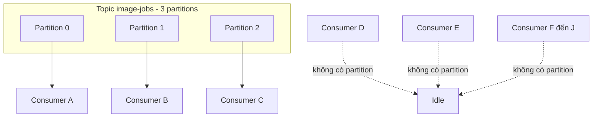
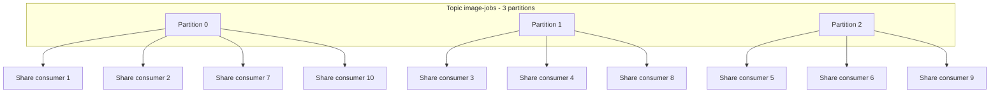
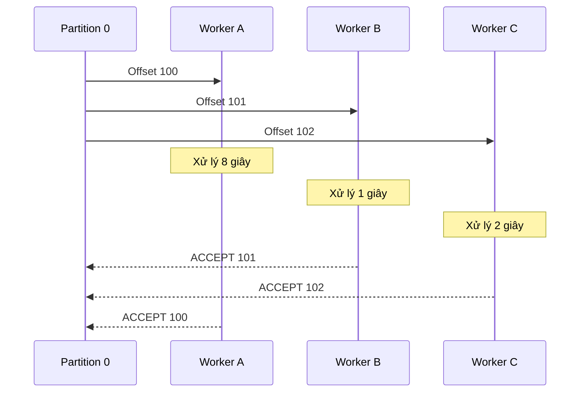

# Mức song song vượt số partition và đánh đổi thứ tự

Trong consumer group truyền thống, mỗi partition của một topic chỉ được giao cho tối đa một consumer trong cùng group tại một thời điểm. Vì vậy, nếu topic có 3 partition nhưng ứng dụng chạy 10 consumer, tối đa 3 consumer có partition để đọc; 7 consumer còn lại không tạo thêm mức song song cho topic đó.

Kafka Share Groups mở ra một mô hình khác: nhiều share consumer trong cùng một group có thể cùng lấy các record khác nhau từ một partition. Nhờ phân phối ở mức record và cơ chế acquisition lock/acknowledgement cho từng record, số consumer có thể lớn hơn số partition. Đổi lại, ứng dụng không còn nhận được bảo đảm xử lý theo thứ tự partition như consumer group truyền thống.

## 1. Giới hạn song song của consumer group truyền thống

Kafka lưu record theo partition. Trong một consumer group thông thường, coordinator phân chia các partition cho các member. Một partition chỉ thuộc về một consumer trong group tại một thời điểm, dù một consumer có thể nhận nhiều partition.

Ví dụ topic `image-jobs` có 3 partition:

| Partition | Consumer được gán trong group `image-workers` |
|---|---|
| `image-jobs-0` | Consumer A |
| `image-jobs-1` | Consumer B |
| `image-jobs-2` | Consumer C |
| Không có partition còn lại | Consumer D đến J ở trạng thái rảnh |

Nếu chạy 10 consumer trong group, chỉ 3 consumer có việc. Tăng số consumer vượt số partition không làm tăng số luồng đọc song song. Muốn tăng mức song song theo cách này, có thể tăng partition, nhưng thao tác đó có chi phí và ảnh hưởng đến partitioning, ordering theo key cũng như tài nguyên broker.



Mô hình này rất phù hợp với luồng cần giữ thứ tự trong từng partition, ví dụ các thay đổi trạng thái tài khoản hoặc đơn hàng được producer partition theo key. Nhưng nó không tối ưu cho mọi workload dạng queue, trong đó mỗi record độc lập và chỉ cần một worker xử lý.

## 2. Share Group phân phối công việc ở mức record

Share Group là một loại group riêng bên cạnh consumer group truyền thống. Các consumer trong cùng share group cùng đăng ký subscription và hợp tác lấy record từ các partition. Một partition có thể có nhiều share consumer cùng xử lý các record khác nhau; mỗi record được giao cho một consumer trong group tại một thời điểm khi acquisition lock còn hiệu lực.

Với cùng topic có 3 partition và 10 share consumer, cả 10 consumer đều có thể tham gia xử lý record từ ba partition. Broker không gán độc quyền toàn bộ partition cho một consumer; thay vào đó, share consumer lấy các record đang sẵn sàng và broker theo dõi trạng thái giao nhận từng record.



Sơ đồ minh họa khả năng nhiều consumer nhận record từ cùng partition; đây không phải sơ đồ gán partition cố định cho từng consumer. Trong thực tế, mỗi lần fetch có thể nhận record từ nhiều partition phù hợp với subscription, tùy lượng dữ liệu sẵn sàng và giới hạn acquisition.

Share Group là một logical subscriber dùng chung. Nếu hai share group khác nhau cùng subscribe một topic, mỗi group sẽ tiêu thụ luồng đó độc lập, tương tự hai logical subscriber riêng. Các member cùng một share group chia nhau công việc, không phải mỗi member nhận bản sao của mọi record.

## 3. Cơ chế acquisition lock cho từng record

Khi share consumer fetch record, broker tạo một acquisition lock có thời hạn cho record đó. Trong thời gian lock còn hiệu lực, record không được giao cho share consumer khác trong cùng group. Sau khi xử lý, consumer có thể gửi acknowledgement để xác định kết quả.

Các hành động chính:

| Acknowledge type | Ý nghĩa | Tình huống sử dụng |
|---|---|---|
| `ACCEPT` | Xác nhận record đã xử lý thành công | Ghi database hoặc hoàn tất công việc thành công |
| `RELEASE` | Trả record về trạng thái có thể được giao lại | Lỗi tạm thời, dependency timeout hoặc cần retry |
| `REJECT` | Từ chối record và kết thúc các lần giao tiếp theo cho record đó | Payload hoặc yêu cầu không thể xử lý theo chính sách hiện tại |
| `RENEW` | Gia hạn acquisition lock khi vẫn đang xử lý | Tác vụ lâu hơn thời gian lock mặc định |

Nếu consumer không gửi acknowledgement, lock tự hết hạn và record có thể được giao lại. Cơ chế này giúp tiến trình khác tiếp tục công việc khi consumer chết hoặc mất kết nối, nhưng cũng có nghĩa một record có thể được giao nhiều lần.

Trong tài liệu Kafka 4.4, thời gian lock mặc định là 30 giây và được điều khiển bằng `share.record.lock.duration.ms`. Giới hạn số record đang bị acquire trên mỗi share-partition được điều khiển bằng `share.partition.max.record.locks`; mặc định tài liệu cấu hình 4.4 nêu là 2.000. Các giá trị này có thể thay đổi theo phiên bản và cấu hình group/broker, vì vậy cần kiểm tra cấu hình thực tế của cluster.

### Delivery count và retry

Share Group theo dõi số lần record được giao. Cấu hình `share.delivery.count.limit` đặt giới hạn số lần giao; mặc định trong tài liệu Kafka 4.4 là 5. Sau khi đạt giới hạn, record không tiếp tục được giao như một record retry thông thường. Chính sách xử lý cuối cùng, bao gồm dead-letter queue nếu cluster đã bật và cấu hình tính năng tương ứng, cần được thiết kế rõ.

`RELEASE` không phải là một khoảng delay có lịch cố định như retry topic. Nó làm record có thể được giao lại; thời điểm nhận lại phụ thuộc trạng thái share-partition, record lock và khả năng fetch. Nếu cần retry với backoff dài, ứng dụng có thể phải phối hợp thêm retry topic hoặc một cơ chế lập lịch riêng.

## 4. Vì sao có thể chạy nhiều consumer hơn partition?

Consumer group truyền thống dùng partition làm đơn vị phân công độc quyền. Số consumer có việc trong một group vì thế bị giới hạn bởi số partition đang được subscribe.

Share Group dùng record làm đơn vị tranh nhận. Một partition có thể có nhiều record chưa được xử lý; các record khác nhau có thể được acquire bởi các share consumer khác nhau. Mức song song không còn bị chặn cứng bởi số partition, mà phụ thuộc vào:

- Số record sẵn sàng để giao.
- Số share consumer đang hoạt động và tốc độ xử lý của từng consumer.
- Giới hạn record lock trên mỗi share-partition.
- Throughput broker, network và group coordinator.
- Năng lực database, API hoặc hệ thống đích mà worker gọi.
- Thời gian acquisition lock và cách ứng dụng acknowledge/release/renew.

Ví dụ, topic có 3 partition nhưng mỗi partition có hàng nghìn công việc độc lập đang chờ. Share Group có thể phân phối record của cả ba partition cho 10, 20 hoặc nhiều consumer hơn, miễn là broker và hệ thống xử lý chịu được tải. Tuy nhiên, thêm consumer không làm tăng throughput vô hạn: broker vẫn phục vụ các partition đó, và một downstream chậm có thể trở thành nút thắt.

### Ví dụ ước lượng mức song song

Giả sử có 3 partition, mỗi partition có nhiều record sẵn sàng. Mỗi worker xử lý trung bình 20 record/giây:

| Mô hình | Số worker | Worker có thể hoạt động | Throughput lý thuyết nếu không có nút thắt khác |
|---|---:|---:|---:|
| Consumer group | 3 | 3 | 60 record/giây |
| Consumer group | 10 | Tối đa 3 | 60 record/giây |
| Share Group | 10 | Có thể cả 10 | Tối đa 200 record/giây |

Đây chỉ là phép tính minh họa. Throughput thực tế còn bị giới hạn bởi tốc độ fetch, batch, lock, acknowledgement, broker CPU/network và hệ thống downstream. Share Group giúp khai thác nhiều worker hơn khi partition count thấp nhưng có nhiều record độc lập; nó không bảo đảm đạt throughput tuyến tính theo số consumer.

## 5. Đánh đổi quan trọng: thứ tự xử lý không còn được bảo đảm

Kafka vẫn ghi record theo thứ tự offset trong từng partition. Share Group không thay đổi thứ tự log đó. Điều thay đổi là nhiều consumer có thể cùng xử lý các offset khác nhau trong một partition, nên **thứ tự hoàn tất xử lý và thứ tự side effect không còn được bảo đảm**.

Ví dụ partition có ba record:

| Offset | Consumer nhận | Thời gian xử lý | Thời điểm hoàn tất |
|---:|---|---:|---|
| 100 | Worker A | 8 giây | 8 giây sau |
| 101 | Worker B | 1 giây | 1 giây sau |
| 102 | Worker C | 2 giây | 2 giây sau |

Mặc dù record được đọc theo offset tăng dần trong batch/partition, worker B có thể hoàn tất offset 101 trước worker A hoàn tất offset 100. Nếu mỗi record cập nhật trạng thái của cùng một đơn hàng, side effect của offset 101 có thể xảy ra trước offset 100.



Điều này khác consumer group truyền thống, nơi một consumer xử lý partition có thể duy trì thứ tự xử lý trong partition nếu ứng dụng xử lý tuần tự và commit đúng cách. Với Share Group, producer vẫn có thể dùng key để đưa các event của cùng entity vào một partition, nhưng key không buộc các record đó được giao cho cùng một share consumer hay xử lý tuần tự.

### Ví dụ lỗi thứ tự nghiệp vụ

Một khách hàng có hai sự kiện:

1. `AccountCreated` tại offset 100.
2. `AccountClosed` tại offset 101.

Nếu worker xử lý offset 101 trước, hệ thống đích có thể nhận yêu cầu đóng tài khoản trước khi tài khoản được tạo. Một số hệ thống sẽ báo lỗi; một số hệ thống có thể tạo trạng thái sai nếu tự động tạo tài khoản khi nhận lệnh đóng.

Vì vậy, Share Group phù hợp nhất khi các record có thể xử lý độc lập hoặc khi hệ thống đích đã có cơ chế kiểm soát thứ tự riêng.

## 6. Khi nào thứ tự có thể bị phá vỡ?

Có nhiều trường hợp khiến thứ tự side effect không còn theo offset:

- Hai record liên tiếp trong cùng partition được giao cho hai worker khác nhau.
- Record sau xử lý nhanh hơn record trước.
- Record trước bị `RELEASE` hoặc hết lock rồi được giao lại sau khi record tiếp theo đã hoàn tất.
- Worker bị crash sau khi thực hiện side effect nhưng trước khi `ACCEPT` được commit; record có thể được giao lại.
- Một record cần nhiều lần retry, trong khi các record sau vẫn được xử lý.

Share Group không phải một hàng đợi FIFO nghiêm ngặt theo thứ tự hoàn tất. Việc record được fetch theo offset tăng dần trong một batch không tạo ra bảo đảm rằng side effect của batch sẽ hoàn tất theo cùng thứ tự.

## 7. Các cách giữ tính đúng đắn khi dùng Share Group

Nếu muốn tận dụng song song ở mức record nhưng vẫn cần bảo vệ dữ liệu, có thể áp dụng một số kỹ thuật ở tầng ứng dụng:

### Dùng version hoặc sequence number

Mỗi entity có một version tăng dần. Hệ thống đích chỉ chấp nhận cập nhật có version phù hợp:

```sql
UPDATE account_projection
SET status = :new_status,
    version = :incoming_version
WHERE account_id = :account_id
  AND version = :incoming_version - 1;
```

Nếu version trước chưa được áp dụng, cập nhật sau không thành công và cần retry hoặc đưa vào hàng chờ xử lý theo entity. Cách này phát hiện được event thiếu/thứ tự sai nhưng cần thiết kế trạng thái retry để tránh bỏ sót.

### Idempotency và deduplication

Share Group có thể giao lại record khi lock hết hạn hoặc consumer lỗi. Dùng event ID duy nhất và unique constraint/inbox table để side effect không bị thực hiện hai lần. Idempotency giải quyết xử lý lặp, nhưng tự nó không giải quyết thứ tự event.

### Serialize theo key ở tầng ứng dụng

Nếu chỉ cần thứ tự theo một entity, có thể dùng khóa phân tán hoặc một bộ điều phối theo key để chỉ cho phép một event của entity được áp dụng tại một thời điểm. Phải có lease, timeout và xử lý worker chết để khóa không bị giữ vô hạn.

### Chọn consumer group truyền thống khi ordering là yêu cầu cốt lõi

Nếu nghiệp vụ yêu cầu mọi event trong partition được xử lý tuần tự, consumer group truyền thống là lựa chọn phù hợp hơn. Producer có thể dùng entity ID làm key để giữ các event của cùng entity trong một partition; một consumer xử lý partition đó theo thứ tự.

## 8. Ví dụ Java với KafkaShareConsumer

Share Group dùng API share consumer riêng, không phải chỉ thay `group.id` trong một `KafkaConsumer` truyền thống. Kafka Java client cung cấp `KafkaShareConsumer`/`ShareConsumer` để subscribe và acknowledge record.

Ví dụ dùng explicit acknowledgement để chỉ `ACCEPT` sau khi xử lý thành công:

```java
import java.time.Duration;
import java.util.List;
import java.util.Properties;

import org.apache.kafka.clients.consumer.AcknowledgeType;
import org.apache.kafka.clients.consumer.ConsumerConfig;
import org.apache.kafka.clients.consumer.ConsumerRecord;
import org.apache.kafka.clients.consumer.ConsumerRecords;
import org.apache.kafka.clients.consumer.KafkaShareConsumer;
import org.apache.kafka.common.serialization.StringDeserializer;

Properties props = new Properties();
props.put(ConsumerConfig.BOOTSTRAP_SERVERS_CONFIG, "localhost:9092");
props.put(ConsumerConfig.GROUP_ID_CONFIG, "image-workers");
props.put(ConsumerConfig.KEY_DESERIALIZER_CLASS_CONFIG,
        StringDeserializer.class.getName());
props.put(ConsumerConfig.VALUE_DESERIALIZER_CLASS_CONFIG,
        StringDeserializer.class.getName());
props.put("share.acknowledgement.mode", "explicit");

try (KafkaShareConsumer<String, String> consumer =
        new KafkaShareConsumer<>(props)) {

    consumer.subscribe(List.of("image-jobs"));

    while (!Thread.currentThread().isInterrupted()) {
        ConsumerRecords<String, String> records =
                consumer.poll(Duration.ofSeconds(1));

        for (ConsumerRecord<String, String> record : records) {
            try {
                processImage(record.value());
                consumer.acknowledge(record, AcknowledgeType.ACCEPT);
            } catch (TemporaryProcessingException e) {
                consumer.acknowledge(record, AcknowledgeType.RELEASE);
            } catch (InvalidImageException e) {
                consumer.acknowledge(record, AcknowledgeType.REJECT);
            } catch (Exception e) {
                consumer.acknowledge(record, AcknowledgeType.RELEASE);
            }
        }

        consumer.commitSync();
    }
}
```

Ví dụ giả định `processImage()` và các exception là logic ứng dụng. `ACCEPT` đánh dấu xử lý thành công; `RELEASE` cho phép record được giao lại; `REJECT` kết thúc các lần giao tiếp theo cho record. `acknowledge()` cập nhật trạng thái acknowledgement phía client; `commitSync()` gửi các acknowledgement đang chờ lên Kafka.

Với explicit mode, ứng dụng phải acknowledge tất cả record trả về từ một lần `poll()` trước lần `poll()` tiếp theo. Nếu còn record chưa acknowledge, lần poll tiếp theo có thể ném `IllegalStateException`. Vì vậy, khi xử lý song song bất đồng bộ, cần quản lý trạng thái từng record và chỉ poll tiếp khi đã gửi acknowledgement tương ứng hoặc thiết kế luồng xử lý/renew phù hợp.

### Vì sao nên dùng explicit acknowledgement?

Share consumer mặc định có thể dùng implicit acknowledgement. Trong implicit mode, lần `poll()` tiếp theo có thể ngầm xác nhận các record đã trả về trước đó; `commitSync()`/`commitAsync()` cũng xác nhận các record đã giao. Nếu ứng dụng xử lý record bất đồng bộ hoặc một số record thất bại nhưng vẫn gọi poll tiếp, record có thể bị xác nhận nhầm là thành công.

Explicit mode giúp ứng dụng chọn kết quả cho từng record. Đây là lựa chọn dễ kiểm soát hơn khi cần phân biệt lỗi tạm thời, lỗi vĩnh viễn và thành công.

## 9. Xử lý công việc lâu hơn acquisition lock

Nếu xử lý record lâu hơn `share.record.lock.duration.ms`, lock có thể hết hạn trước khi worker hoàn tất. Một consumer khác có thể nhận lại record trong lúc worker đầu vẫn đang chạy, dẫn đến side effect trùng hoặc chạy đồng thời.

Có hai hướng:

- Thiết kế mỗi lần xử lý hoàn tất trong thời gian ngắn hơn lock, sau đó `ACCEPT`/`RELEASE`/`REJECT`.
- Dùng explicit acknowledgement và `AcknowledgeType.RENEW` để gia hạn lock trong khi vẫn tiếp tục gọi `poll()` theo chu kỳ.

Renew chỉ phù hợp cho tác vụ thực sự cần thời gian dài. Giữ lock lâu có thể làm giảm tiến độ giao record khác và làm giảm hiệu quả chia sẻ. Nếu công việc thường xuyên kéo dài nhiều phút, nên cân nhắc tách job thành các bước nhỏ hoặc dùng một hệ thống điều phối job chuyên dụng.

`KafkaShareConsumer` không thread-safe. Nếu xử lý trên worker thread khác, chỉ thread sở hữu consumer nên gọi `poll`, `acknowledge`, `commit` và các API consumer khác. Thread xử lý phụ cần gửi kết quả về thread sở hữu consumer để thread đó acknowledge đúng record.

## 10. Cấu hình và giới hạn cần quan sát

Một số cấu hình group liên quan đến Share Group trong tài liệu Kafka 4.4:

| Cấu hình | Vai trò | Giá trị mặc định trong Kafka 4.4 |
|---|---|---:|
| `share.record.lock.duration.ms` | Thời gian acquisition lock cho record | 30.000 ms |
| `share.partition.max.record.locks` | Số record lock tối đa trên mỗi share-partition | 2.000 |
| `share.delivery.count.limit` | Giới hạn số lần giao record | 5 |
| `share.auto.offset.reset` | Vị trí bắt đầu khi share-partition chưa có state | `latest` |
| `share.renew.acknowledge.enable` | Cho phép acknowledgement kiểu RENEW | `true` |

Giá trị mặc định có thể thay đổi theo phiên bản hoặc chính sách broker. Hãy kiểm tra tài liệu đúng phiên bản, dynamic group config và broker-level min/max trước khi áp dụng.

`share.acknowledgement.mode` là cấu hình phía consumer, không phải group config. Nó chọn `implicit` hoặc `explicit`; nếu không đặt, client dùng implicit acknowledgement. Khi cần quyết định riêng ACCEPT/RELEASE/REJECT cho từng record, đặt `share.acknowledgement.mode=explicit` như ví dụ Java ở trên.

Khi một share-partition đã đạt giới hạn record đang bị acquire, fetch có thể tạm thời không trả thêm record từ partition đó cho đến khi một số lock được giải phóng, hết hạn hoặc acknowledgement hoàn tất. Vì vậy, tăng số consumer mà không tăng được khả năng giải phóng record lock có thể không làm throughput tăng.

## 11. Khi nào chọn Share Group và khi nào chọn consumer group?

| Tiêu chí | Consumer group truyền thống | Share Group |
|---|---|---|
| Đơn vị phân phối | Partition | Record có acquisition lock |
| Một partition trong cùng group | Một consumer sở hữu tại một thời điểm | Nhiều share consumer có thể cùng lấy record khác nhau |
| Số consumer vượt số partition | Consumer dư thường idle | Có thể tiếp tục xử lý song song nếu còn record và tài nguyên |
| Ordering | Có thể giữ thứ tự trong partition khi xử lý tuần tự | Không bảo đảm thứ tự hoàn tất giữa các record trong partition |
| Acknowledgement | Thường commit offset theo partition | Acknowledge từng record hoặc batch theo chế độ share |
| Retry/failure | Thường xử lý qua retry, offset, rebalance hoặc retry topic | Record lock hết hạn, RELEASE, REJECT, RENEW và delivery count |
| Workload phù hợp | Ordered event stream, stateful processing theo key | Công việc độc lập dạng queue, xử lý từng record, worker pool |

Chọn Share Group khi:

- Record có thể xử lý độc lập hoặc thứ tự hoàn tất không quan trọng.
- Số partition thấp nhưng có nhiều record chờ và muốn nhiều worker cùng xử lý.
- Muốn broker quản lý record acquisition, acknowledgement và delivery attempts.
- Ứng dụng có thể chịu được redelivery và đã thiết kế idempotency.

Chọn consumer group truyền thống khi:

- Cần thứ tự xử lý trong từng partition.
- Cần dùng Kafka Streams hoặc logic stateful phụ thuộc thứ tự partition.
- Muốn đơn giản hóa quản lý offset theo partition.
- Số partition có thể được thiết kế đủ để đạt mức song song mong muốn.

## 12. Những hiểu nhầm thường gặp

| Hiểu nhầm | Thực tế |
|---|---|
| Share Group tăng số partition | Share Group không tạo partition mới; nó cho nhiều consumer chia record trong partition hiện có |
| Mỗi consumer nhận bản sao mọi record | Các member trong cùng share group chia nhau record; mỗi lần giao có một consumer giữ lock |
| Có key thì Share Group giữ thứ tự theo key | Key đưa record vào cùng partition, nhưng nhiều share consumer vẫn có thể xử lý các record của partition đó song song |
| ACCEPT bảo đảm side effect chỉ xảy ra một lần | Crash sau side effect nhưng trước acknowledgement commit có thể khiến record được giao lại; cần idempotency |
| RELEASE tương đương retry topic có delay | RELEASE làm record có thể được giao lại, không tự cung cấp lịch backoff cố định |
| Thêm càng nhiều consumer càng tăng throughput | Broker, lock limit, partition leader và downstream có thể trở thành nút thắt |
| Share Group thay thế mọi consumer group | Hai mô hình phục vụ workload khác nhau và có thể cùng đọc một topic trong các group riêng |

## 13. Phiên bản và điều kiện sử dụng

Share Groups được giới thiệu dưới dạng preview trong Apache Kafka 4.1 và trở thành production-ready từ Kafka 4.2. Trước khi triển khai, cần xác nhận broker/client version và feature level `share.version` của cluster đã hỗ trợ Share Groups. Việc chỉ nâng cấp thư viện client mà broker chưa hỗ trợ sẽ dẫn đến lỗi API không tương thích.

Share Group dùng internal topic `__share_group_state` để lưu trạng thái. Với cluster ít hơn ba broker, tài liệu nâng cấp Kafka yêu cầu đặt `share.coordinator.state.topic.replication.factor` và `share.coordinator.state.topic.min.isr` về `1` trước khi bắt đầu dùng Share Groups; cấu hình mặc định được thiết kế cho cluster có ít nhất ba broker.

API Java là `KafkaShareConsumer`/`ShareConsumer`, không phải `KafkaConsumer` thông thường. Kiểm tra khả năng hỗ trợ của framework tích hợp đang dùng trước khi giả định `@KafkaListener` có thể tiêu thụ bằng Share Group. Ví dụ trong bài sử dụng Kafka Java client trực tiếp.

## 14. Checklist thiết kế mức song song và ordering

- Đo số partition, số record chờ và throughput xử lý thực tế trước khi chọn mô hình.
- Dùng consumer group truyền thống nếu cần xử lý tuần tự trong partition.
- Dùng Share Group nếu record độc lập và cần nhiều worker cùng xử lý một partition.
- Không coi key partitioning là cơ chế giữ thứ tự khi dùng Share Group.
- Đặt acquisition lock phù hợp với thời gian xử lý; dùng RENEW có kiểm soát cho tác vụ dài.
- Dùng explicit acknowledgement khi cần phân biệt ACCEPT, RELEASE và REJECT theo từng record.
- Thiết kế idempotency vì record có thể được giao lại sau lock timeout hoặc worker failure.
- Theo dõi delivery count, record locks, lag/start offset, throughput, acknowledgement failure và downstream latency.
- Kiểm tra `share.partition.max.record.locks` và giới hạn broker trước khi tăng số consumer.
- Kiểm thử event đến sai thứ tự, worker chết giữa side effect và acknowledgement, lock hết hạn và retry vượt delivery count.
- Xác nhận broker/client version, `share.version` và cấu hình internal topic trước production rollout.

Share Group mở rộng mức song song vượt số partition bằng cách để nhiều consumer cùng lấy các record khác nhau từ một partition, với acquisition lock và acknowledgement ở mức record. Lợi ích này đặc biệt hữu ích cho công việc độc lập dạng queue. Đổi lại, ứng dụng phải chấp nhận xử lý out-of-order, redelivery và side effect lặp; nếu thứ tự trong partition là điều kiện nghiệp vụ, consumer group truyền thống vẫn là mô hình phù hợp hơn.

## Tài liệu tham khảo

- [Apache Kafka 4.4 Design: The Share Consumer](https://kafka.apache.org/44/design/design/)
- [KafkaShareConsumer Java API 4.4](https://kafka.apache.org/44/javadoc/org/apache/kafka/clients/consumer/KafkaShareConsumer.html)
- [Apache Kafka 4.4 Group Configs](https://kafka.apache.org/44/configuration/group-configs/)
- [Apache Kafka Upgrade Guide: Share Groups production-ready in 4.2](https://kafka.apache.org/44/getting-started/upgrade/)
