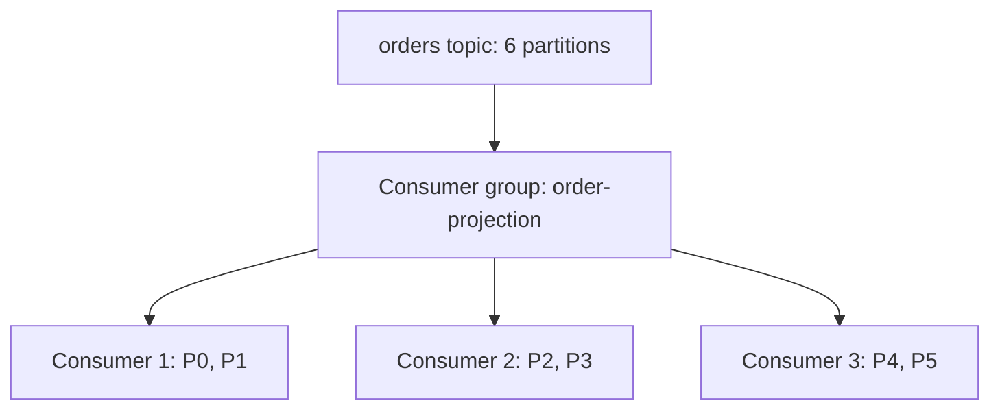
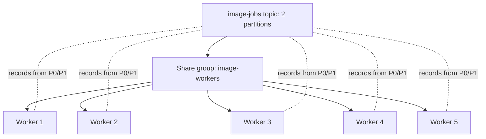
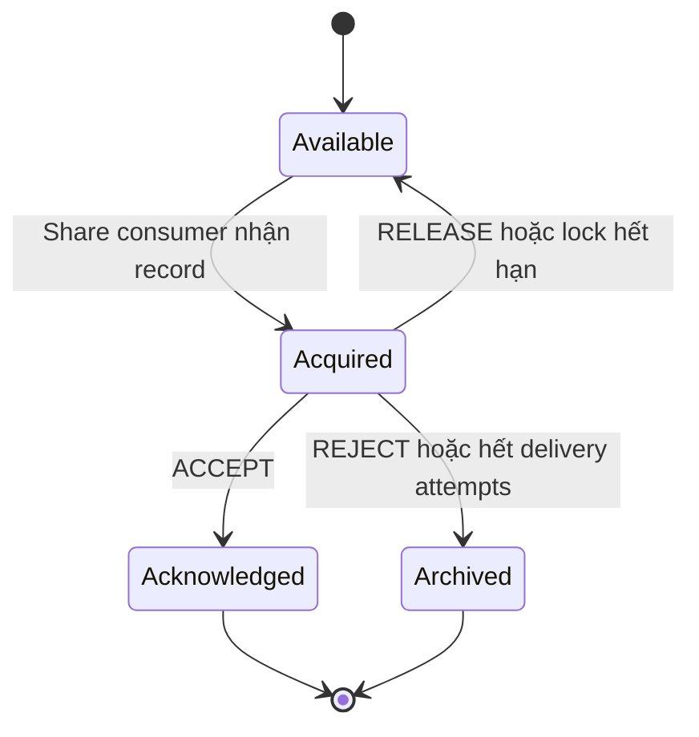

# Chọn share group hay consumer group theo yêu cầu nghiệp vụ

## Chọn mô hình tiêu thụ theo cách xử lý công việc

Kafka có hai mô hình nhóm tiêu thụ chính:

- **Consumer group** chia các partition giữa các consumer member. Trong cùng một group, mỗi partition được giao cho tối đa một consumer tại một thời điểm.
- **Share group** cho phép nhiều consumer cùng chia sẻ record từ một partition. Broker cấp record cho một consumer bằng acquisition lock có thời hạn; consumer xác nhận từng record sau khi xử lý.

Hai mô hình đều cho phép nhiều instance cùng làm việc trên một topic, nhưng phục vụ hai mục tiêu khác nhau. Consumer group phù hợp với event stream cần giữ thứ tự trong partition, xử lý theo key và quản lý tiến độ bằng offset. Share group phù hợp với hàng đợi công việc gồm các record độc lập, có thể xử lý song song và xác nhận/retry riêng từng record.

Không nên chọn share group chỉ vì muốn tăng số consumer. Nếu nghiệp vụ phụ thuộc thứ tự event, trạng thái tuần tự theo aggregate hoặc replay theo offset, consumer group thường là lựa chọn phù hợp hơn. Nếu mỗi record là một work item độc lập, thời gian xử lý khác nhau và cần phân phối công việc đến worker rảnh, share group có lợi thế rõ rệt.

## 1. Consumer group: chia partition giữa các consumer

### 1.1 Cách phân phối

Consumer group là mô hình tiêu thụ truyền thống của Kafka. Các consumer có cùng group.id tham gia một group; group coordinator và partition assignor phân phối partition cho các member.

Ví dụ topic orders có 6 partition và group có 3 consumer:



Mỗi partition chỉ thuộc một consumer member trong group tại một thời điểm. Một consumer có thể sở hữu nhiều partition; nếu số consumer lớn hơn số partition, một số consumer sẽ không có partition để xử lý.

Với 6 partition, tối đa 6 consumer có thể đồng thời đọc topic trong cùng group theo mô hình một consumer/partition. Tăng số consumer vượt mức này không làm tăng song song hữu ích của topic.

### 1.2 Ordering theo partition

Kafka lưu record theo thứ tự offset trong từng partition. Vì một consumer member sở hữu partition và đọc theo thứ tự offset, ứng dụng có thể xử lý event tuần tự trong partition để giữ ordering.

Ví dụ producer dùng orderId làm key:

```text
P2:
offset 100: OrderPlaced(order-42)
offset 101: AddressChanged(order-42)
offset 102: OrderPaid(order-42)
```

Ba event của order-42 được ghi vào cùng partition và consumer có thể xử lý theo thứ tự offset. Kafka không bảo đảm thứ tự toàn cục giữa các partition khác nhau.

Ordering này phụ thuộc cả cách ứng dụng xử lý. Nếu listener nhận record rồi đẩy vào thread pool và commit offset khi tác vụ sau hoàn thành trước tác vụ trước, ứng dụng có thể tự làm đảo thứ tự hoặc commit vượt qua record chưa xử lý. Muốn giữ ordering, xử lý tuần tự trong partition hoặc quản lý completion/offset cẩn thận.

### 1.3 Offset và replay

Consumer group lưu tiến độ tiêu thụ theo partition trong __consumer_offsets. Ứng dụng có thể commit tự động hoặc thủ công và có thể seek/reset offset để replay dữ liệu khi cần.

Ví dụ:

```java
Properties props = new Properties();
props.put(ConsumerConfig.BOOTSTRAP_SERVERS_CONFIG, "localhost:9092");
props.put(ConsumerConfig.GROUP_ID_CONFIG, "order-projection");
props.put(ConsumerConfig.ENABLE_AUTO_COMMIT_CONFIG, "false");
props.put(ConsumerConfig.AUTO_OFFSET_RESET_CONFIG, "earliest");
props.put(ConsumerConfig.KEY_DESERIALIZER_CLASS_CONFIG,
        StringDeserializer.class.getName());
props.put(ConsumerConfig.VALUE_DESERIALIZER_CLASS_CONFIG,
        StringDeserializer.class.getName());

try (KafkaConsumer<String, String> consumer =
             new KafkaConsumer<>(props)) {
    consumer.subscribe(List.of("orders"));

    while (true) {
        ConsumerRecords<String, String> records =
                consumer.poll(Duration.ofMillis(500));

        for (ConsumerRecord<String, String> record : records) {
            processOrderEvent(record);
        }

        consumer.commitSync();
    }
}
```

Đây là ví dụ minh họa consumer group với xử lý tuần tự và commit sau batch. Production cần xử lý exception, shutdown, rebalance callback và bảo đảm side effect thành công trước khi commit offset.

### 1.4 Khi nào consumer group phù hợp?

- Xử lý event theo thứ tự trong từng partition.
- Duy trì state theo key hoặc aggregate.
- Dùng Kafka Streams, Kafka Connect hoặc pipeline dựa trên offset.
- Cần replay theo offset và kiểm soát vị trí đọc.
- Mỗi partition có một luồng xử lý tuần tự tương đối ổn định.
- Cần tận dụng khả năng mở rộng bằng cách tăng partition và consumer tương ứng.

## 2. Share group: chia record giữa các worker

### 2.1 Cách phân phối

Share group là một loại group khác trong Kafka. Nhiều share consumer trong cùng group cùng tiêu thụ record của các topic đã subscribe. Một partition có thể được nhiều consumer trong share group xử lý; số consumer có thể lớn hơn số partition.

Các consumer trong cùng một share group chia sẻ công việc: một record được giao cho một member tại một thời điểm. Nếu cần hai hệ thống độc lập đều nhận toàn bộ record, hãy tạo hai group ID riêng. Mỗi share group hoặc consumer group là một subscriber logic độc lập; share group không phải broadcast cho mọi worker trong cùng group.

Ví dụ topic image-jobs chỉ có 2 partition nhưng có 5 worker:



Các worker không sở hữu độc quyền một partition. Broker cấp record đang khả dụng cho một member và giữ acquisition lock trong thời gian giới hạn. Trong lúc record đang được một consumer giữ lock, record đó không được cấp cho consumer khác trong cùng share group.

Mục tiêu là phân phối công việc theo record thay vì buộc số worker hoạt động phải bị giới hạn bởi số partition.

### 2.2 Record acquisition lock

Khi KafkaShareConsumer.poll() nhận record, broker đánh dấu record là Acquired cho consumer đó và bắt đầu acquisition lock timeout. Theo cấu hình mặc định Kafka 4.2, lock thường là 30 giây; có thể điều chỉnh bằng cấu hình group share.record.lock.duration.ms trong giới hạn broker cho phép.

Consumer có thể:

- ACCEPT: xử lý thành công; record được xác nhận.
- RELEASE: xử lý chưa thành công nhưng có thể thử lại; record trở về trạng thái khả dụng nếu chưa chạm giới hạn delivery attempt.
- REJECT: record không thể xử lý; record không được tự động giao lại như lỗi tạm thời.
- RENEW: gia hạn acquisition lock khi vẫn đang xử lý; có từ Kafka 4.2.

Nếu consumer crash hoặc không xác nhận trước khi lock hết hạn, record có thể trở lại trạng thái khả dụng và được giao cho worker khác. Cơ chế này giúp công việc tiếp tục ngay cả khi một worker gặp lỗi.

### 2.3 Vòng đời record



Archived nghĩa là record không còn được tự động giao lại trong share group theo chính sách delivery attempt. Không nên đồng nhất trạng thái này với một DLT topic. Nếu cần lưu bản ghi lỗi để điều tra/replay, ứng dụng phải có quy trình lưu trữ và khôi phục phù hợp.

### 2.4 Delivery attempt và poison record

Broker đếm số lần record được acquire để hạn chế một record lỗi làm tiêu tốn worker vô hạn. Cấu hình broker group.share.delivery.count.limit có giá trị mặc định 5 trong Kafka 4.2, với miền cấu hình được giới hạn bởi broker.

Khi record được acquire lại, delivery count tăng. Nếu đạt giới hạn, record có thể chuyển sang Archived thay vì tiếp tục được giao.

Delivery count là cơ chế bảo vệ poison message, không phải bộ đếm audit chính xác tuyệt đối. Trạng thái delivery được lưu bền vững theo cơ chế share state, nhưng cập nhật không cung cấp exactly-once cho con số lần giao trong mọi tình huống. Không dùng delivery count để tính phí, quyết định nghiệp vụ hoặc thay thế event ID deduplication.

### 2.5 Share group vẫn nhận dữ liệu theo batch

Share group xác nhận theo từng record nhưng API tối ưu cho việc fetch và xử lý batch. Một lần poll() có thể trả về record từ nhiều partition đã subscribe. Consumer có thể xác nhận từng record bằng explicit acknowledgement hoặc xác nhận thành công cả batch bằng implicit acknowledgement.

Đây là điểm quan trọng: share group cho phép chia nhỏ quyền xử lý theo record, nhưng không có nghĩa mỗi RPC chỉ fetch đúng một record.

## 3. So sánh consumer group và share group

| Tiêu chí | Consumer group | Share group |
|---|---|---|
| Đơn vị phân phối | Partition | Record |
| Quyền sở hữu partition | Một member tại một thời điểm | Nhiều member có thể cùng chia sẻ partition |
| Số consumer so với partition | Consumer hoạt động bị giới hạn bởi partition | Có thể nhiều consumer hơn partition |
| Tiến độ | Offset theo partition | Trạng thái và acknowledgement theo record |
| Xác nhận | Commit offset | ACCEPT, RELEASE, REJECT, RENEW |
| Ordering | Có thứ tự đọc trong partition; ứng dụng phải giữ tuần tự khi xử lý | Không bảo đảm thứ tự giao record qua các batch/worker |
| Retry | Thường retry trong consumer hoặc retry topic/DLT | Release hoặc lock timeout cho phép giao lại record |
| Poison record | Xử lý bằng error handler/DLT và offset policy | Delivery attempt limit, reject/archive |
| Replay | Seek/reset offset và đọc lại partition | Quản lý share-partition start offset; không dùng seek/position như KafkaConsumer |
| API Java | KafkaConsumer | KafkaShareConsumer |
| Workload | Event stream có thứ tự, stateful processing | Công việc độc lập, worker pool, xử lý từng record |
| Kafka Streams/Connect | Mô hình tiêu thụ tiêu chuẩn | Không thể chuyển sang bằng cách chỉ đổi group config |

## 4. Chọn mô hình theo yêu cầu nghiệp vụ

### 4.1 Chọn consumer group khi thứ tự là quan trọng

Ví dụ hệ thống xử lý vòng đời đơn hàng:

```text
OrderPlaced -> PaymentAuthorized -> OrderPacked -> OrderShipped
```

Các event cùng orderId cần được xử lý đúng thứ tự để cập nhật state machine. Producer dùng orderId làm key để đưa event vào cùng partition. Consumer group giúp một consumer member xử lý partition đó theo thứ tự offset.

Nếu dùng share group, event OrderShipped có thể được một worker nhận trước khi PaymentAuthorized được worker khác xử lý xong. Record retry còn có thể được giao lại sau những record có offset lớn hơn. Ứng dụng phải tự xây dựng sequence gate hoặc state coordination để sửa vấn đề này, làm mất lợi ích đơn giản của share group.

Chọn consumer group cho:

- Order lifecycle, account ledger và trạng thái aggregate.
- Event sourcing hoặc projection cần áp dụng event tuần tự theo key.
- Stream processing cần state cục bộ gắn với partition.
- Consumer cần seek/replay chính xác theo offset.
- Pipeline Kafka Streams và Kafka Connect.

### 4.2 Chọn share group khi mỗi record là một công việc độc lập

Ví dụ hệ thống xử lý ảnh:

- Mỗi record chứa một imageId và URL ảnh.
- Worker tải ảnh, resize và lưu kết quả.
- Công việc của ảnh A không phụ thuộc kết quả ảnh B.
- Thời gian xử lý mỗi ảnh khác nhau.
- Nếu worker lỗi ở một ảnh, ảnh đó có thể được giao lại cho worker khác.

Share group phù hợp vì worker rảnh có thể nhận record tiếp theo từ partition đang có việc, kể cả khi số worker lớn hơn số partition.

Các use case tương tự:

- Gửi email hoặc notification độc lập.
- Xử lý tài liệu, OCR, thumbnail và media transcoding.
- Tạo báo cáo theo từng yêu cầu độc lập.
- Chạy tác vụ enrichment không phụ thuộc thứ tự giữa các record.
- Gọi API bên ngoài với mỗi message là một job riêng.

### 4.3 Bảng quyết định nhanh

| Câu hỏi | Nếu câu trả lời là Có | Gợi ý |
|---|---|---|
| Event của cùng key phải được xử lý tuần tự? | Có | Consumer group |
| Record có thể xử lý độc lập và hoàn tất theo thứ tự bất kỳ? | Có | Share group |
| Muốn nhiều worker hơn số partition? | Có | Share group |
| Cần commit/replay theo offset từng partition? | Có | Consumer group |
| Một record lỗi không nên chặn các record sau? | Có | Share group |
| Cần stateful processing theo partition? | Có | Consumer group |
| Muốn retry từng record bằng RELEASE/lock timeout? | Có | Share group |
| Cần Kafka Streams hoặc Kafka Connect? | Có | Consumer group |

Nếu câu trả lời lẫn lộn, hãy xác định invariant nghiệp vụ quan trọng nhất. Ordering, idempotency và replay thường quan trọng hơn việc tăng số worker đơn thuần.

## 5. Ordering: trade-off lớn nhất của share group

### 5.1 Consumer group giữ thứ tự partition

Với consumer group, record trong một partition được đọc theo offset tăng dần. Nếu consumer xử lý tuần tự, thứ tự nghiệp vụ theo partition được giữ:

```text
offset 100 -> process 100 -> commit
offset 101 -> process 101 -> commit
offset 102 -> process 102 -> commit
```

Một partition có thể xử lý chậm hơn các partition khác, nhưng các event trong cùng partition không bị nhiều consumer member xử lý đồng thời.

### 5.2 Share group ưu tiên chia sẻ hơn ordering

Giả sử topic chỉ có một partition:

```text
Consumer A nhận offset 100-109
Consumer B nhận offset 110-119
Consumer B xử lý và ACCEPT 110-119
Consumer A crash trước khi xác nhận 100-109
```

Khi lock hết hạn, offset 100-109 trở lại trạng thái khả dụng và được giao lại. Worker khác có thể xử lý chúng sau khi 110-119 đã hoàn tất.

Do đó, offset được giao cho share group không nhất thiết tăng đơn điệu qua các lần poll hoặc giữa các worker. Các record trong cùng batch của một share-partition được trả theo thứ tự offset tăng dần, nhưng không có bảo đảm thứ tự offset giữa các batch.

### 5.3 Khi nào ordering vẫn có thể được xử lý ở ứng dụng?

Nếu workload cần một phần ordering, có thể đưa aggregateId và sequence vào payload, sau đó:

- Chỉ cho phép xử lý sequence kế tiếp của aggregate.
- Lưu checkpoint sequence ở database.
- Đưa event đến sớm vào buffer có giới hạn.
- Không áp dụng side effect nếu còn thiếu event trước.

Tuy nhiên, cách này cần state coordination, retry và xử lý gap. Nếu ordering là yêu cầu cốt lõi trên mọi event cùng key, consumer group thường đơn giản và phù hợp hơn.

## 6. Acknowledgement và retry trong Java ShareConsumer

### 6.1 Dùng KafkaShareConsumer

Share group có API riêng KafkaShareConsumer; không dùng KafkaConsumer rồi chỉ đổi group.id hoặc thêm một thuộc tính để biến consumer group thành share group.

KafkaShareConsumer không thread-safe. Chỉ một thread tại một thời điểm được gọi các method của consumer; wakeup() là ngoại lệ có thể gọi từ thread khác. Nếu cần xử lý song song, giữ poll/acknowledgement/commit trên consumer thread và chuyển phần xử lý sang worker pool với cơ chế quản lý kết quả, lock và timeout rõ ràng.

Ví dụ explicit acknowledgement với Kafka 4.2:

```java
Properties props = new Properties();
props.put(ConsumerConfig.BOOTSTRAP_SERVERS_CONFIG, "localhost:9092");
props.put(ConsumerConfig.GROUP_ID_CONFIG, "image-workers");
props.put("share.acknowledgement.mode", "explicit");

try (KafkaShareConsumer<String, String> consumer =
             new KafkaShareConsumer<>(
                     props,
                     new StringDeserializer(),
                     new StringDeserializer())) {

    consumer.subscribe(List.of("image-jobs"));

    while (true) {
        ConsumerRecords<String, String> records =
                consumer.poll(Duration.ofMillis(1000));

        for (ConsumerRecord<String, String> record : records) {
            try {
                processImageJob(record);
                consumer.acknowledge(record, AcknowledgeType.ACCEPT);
            } catch (TemporaryProcessingException exception) {
                consumer.acknowledge(record, AcknowledgeType.RELEASE);
            } catch (InvalidImageException exception) {
                consumer.acknowledge(record, AcknowledgeType.REJECT);
            }
        }

        consumer.commitSync();
    }
}
```

Đây là ví dụ khung. Trong ứng dụng thật, phân loại exception phải rõ ràng; không coi mọi Exception là lỗi vĩnh viễn. Nếu lỗi tạm thời có thể khắc phục, RELEASE cho phép record được giao lại. Nếu payload không thể xử lý do vi phạm contract, REJECT ngăn việc retry vô hạn.

Với explicit acknowledgement, phải xác nhận mọi record được trả về trong lần poll() trước khi gọi poll() tiếp theo. Các acknowledgement được gửi lên broker khi gọi commitSync(), commitAsync() hoặc lần poll kế tiếp theo semantics của API.

### 6.2 Implicit acknowledgement

Nếu không đặt share.acknowledgement.mode, mặc định là implicit. Trong chế độ này, ứng dụng không gọi acknowledge():

- Xử lý thành công batch.
- Gọi commitSync() hoặc commitAsync() để xác nhận các record của batch.
- Hoặc gọi poll() tiếp theo để xác nhận batch trước theo semantics implicit.

Implicit acknowledgement phù hợp khi toàn bộ batch được xem là thành công hoặc thất bại cùng nhau. Nếu cần phân loại lỗi từng record, explicit acknowledgement phù hợp hơn.

Không trộn implicit mode với các lệnh acknowledge(record, type). API sẽ từ chối cách sử dụng không phù hợp.

### 6.3 ACCEPT, RELEASE và REJECT

| Acknowledge type | Ý nghĩa | Hành vi mong đợi |
|---|---|---|
| ACCEPT | Xử lý thành công | Record được xác nhận |
| RELEASE | Lỗi tạm thời, có thể thử lại | Record trở lại Available nếu chưa đạt delivery limit |
| REJECT | Record không thể xử lý | Record không được tự động giao lại như lỗi tạm thời |
| RENEW | Vẫn đang xử lý | Gia hạn acquisition lock |

Không dùng RELEASE cho lỗi dữ liệu vĩnh viễn vì record có thể tiếp tục quay lại cho đến khi đạt delivery limit. Không dùng REJECT cho lỗi mạng tạm thời nếu muốn worker khác thử lại.

### 6.4 Xử lý thời gian xử lý dài bằng RENEW

Nếu một job thường xử lý lâu hơn acquisition lock, có thể dùng AcknowledgeType.RENEW với explicit acknowledgement để gia hạn lock trong khi xử lý. Cơ chế này có từ Kafka 4.2.

Consumer vẫn phải gọi poll() đều đặn và gửi RENEW trong vòng lặp theo hướng dẫn API. Nếu worker dừng poll hoặc mất kết nối với broker, lần delivery hiện tại có thể kết thúc và record được giao lại.

Ví dụ lời gọi acknowledgement khi record vẫn đang được xử lý:

§§§java
consumer.acknowledge(record, AcknowledgeType.RENEW);
§§§

Đây chỉ là một thao tác trong vòng lặp renewal; ứng dụng phải tiếp tục poll theo lịch, theo dõi acknowledgement callback/kết quả commit và cuối cùng ACCEPT hoặc RELEASE/REJECT khi tác vụ kết thúc.

Không gia hạn vô hạn. Renew giữ record khỏi được worker khác xử lý, vì vậy nếu một job treo hoặc worker không tiến triển, nó có thể làm giảm throughput của share group. Đặt deadline, timeout nghiệp vụ và cơ chế hủy tác vụ.

### 6.5 Lock timeout không phải transaction timeout

Acquisition lock chỉ điều khiển quyền giữ record trong share group. Nó không rollback side effect đã ghi vào database hoặc hệ thống bên ngoài.

Ví dụ:

1. Worker gọi API thanh toán và API đã thành công.
2. Worker crash trước khi ACCEPT record.
3. Lock hết hạn, record được giao lại.
4. Worker mới gọi API thanh toán lần nữa.

Consumer cần idempotency key hoặc API downstream có cơ chế deduplication. Share group không bảo đảm exactly-once cho side effect bên ngoài Kafka.

## 7. Delivery guarantee, duplicate và idempotency

### 7.1 Share group có delivery semantics at-least-once

Một record có thể được giao lại khi:

- Consumer crash trước khi acknowledgement được commit.
- Acquisition lock hết hạn.
- Consumer gọi RELEASE.
- Broker/connection lỗi trong quá trình xác nhận.

Vì vậy, cùng một event có thể đến nhiều lần. Hãy thiết kế consumer idempotent.

### 7.2 Dùng event ID để deduplicate

Nếu payload có eventId, consumer có thể lưu event ID đã xử lý trong database cùng transaction với side effect:

```sql
CREATE TABLE processed_jobs (
    consumer_name VARCHAR(100) NOT NULL,
    event_id UUID NOT NULL,
    processed_at TIMESTAMPTZ NOT NULL DEFAULT now(),
    PRIMARY KEY (consumer_name, event_id)
);
```

Nếu event ID đã tồn tại, consumer không thực hiện side effect lần nữa nhưng vẫn ACCEPT record được giao lại. Marker và side effect phải commit trong cùng transaction database để tránh trạng thái “đã đánh dấu nhưng chưa làm xong”.

### 7.3 Delivery count không thay thế deduplication

Delivery count dùng để hạn chế poison record, nhưng không phải event ID và không phải bộ đếm nghiệp vụ chính xác. Dùng eventId để nhận diện record logic; dùng delivery count để quan sát số lần broker đã acquire gần đúng và kiểm soát retry.

### 7.4 Phân biệt retry tạm thời và lỗi vĩnh viễn

| Loại lỗi | Ví dụ | Hành động |
|---|---|---|
| Tạm thời | API downstream timeout, database unavailable | RELEASE hoặc để lock hết hạn theo retry policy |
| Vĩnh viễn | Payload sai schema, thiếu trường bắt buộc, giá trị không hợp lệ | REJECT và lưu thông tin điều tra |
| Xử lý lâu | Job video transcode kéo dài | RENEW có giới hạn và deadline |
| Kết quả không xác định | API đã nhận request nhưng client timeout | Tra cứu theo idempotency key trước khi thử lại |

Sau khi record bị archived, cần quy trình giám sát và phục hồi. Không giả định Kafka tự động tạo một topic DLT cho mọi record bị reject.

## 8. Replay và điểm bắt đầu tiêu thụ

### 8.1 Consumer group

Consumer group dùng offset theo partition. Ứng dụng có thể:

- Dùng auto.offset.reset khi chưa có committed offset.
- Dùng seek() để điều chỉnh vị trí đọc của consumer đang sở hữu partition.
- Reset offset bằng công cụ quản trị khi group không hoạt động.
- Replay theo timestamp hoặc offset theo quy trình vận hành.

### 8.2 Share group

Share group quản lý share-partition start offset và trạng thái record đã acquire/acknowledge. Nó không có cùng mô hình position()/seek() như KafkaConsumer.

Trong Kafka 4.2, cấu hình group share.auto.offset.reset hỗ trợ:

- latest: bắt đầu từ cuối log; đây là mặc định.
- earliest: bắt đầu từ đầu log còn giữ.
- by_duration:<duration>: bắt đầu từ một khoảng thời gian lùi lại so với hiện tại, theo định dạng ISO-8601.

Việc reset/alter share-group offsets cần dùng API quản trị dành cho share group và group phải ở trạng thái phù hợp. Không dùng kafka-consumer-groups --reset-offsets như thể share group là consumer group truyền thống; hãy xác nhận công cụ/API đang dùng hỗ trợ đúng loại group.

### 8.3 Replay vẫn có thể tạo duplicate

Khi reset share-partition start offset hoặc replay từ earliest, các event đã xử lý trước đó có thể xuất hiện lại. Consumer vẫn cần event ID deduplication và side effect idempotent.

Nếu cần kiểm toán hoặc replay theo từng job, lưu event ID, business status và kết quả xử lý ở hệ thống nghiệp vụ. Không dựa vào trạng thái share group như một audit log hoàn chỉnh.

## 9. Kafka 4.x: trạng thái hỗ trợ và tương thích

Share Groups được triển khai theo KIP-932 và có các mốc:

| Phiên bản Kafka | Trạng thái |
|---|---|
| Kafka 4.0 | Early access, chỉ thử nghiệm; không dùng production |
| Kafka 4.1 | Preview, dùng làm quen và kiểm thử; chưa khuyến nghị production |
| Kafka 4.2 | Production-ready (GA) |

Với môi trường production, dùng broker/client có hỗ trợ Share Groups ổn định, tối thiểu Kafka 4.2. Nếu đang dùng nhánh 4.2, hãy triển khai patch release mới nhất được hỗ trợ; Kafka 4.2.1 đã sửa một lỗi deadlock nghiêm trọng trong đường xử lý Share Group của 4.2.0. Broker và client phải hỗ trợ protocol Share Group tương thích; nếu client gọi API không có trên broker, có thể nhận UnsupportedVersionException.

Java client dùng class riêng KafkaShareConsumer trong org.apache.kafka.clients.consumer. Không đổi group.id của một KafkaConsumer rồi kỳ vọng có semantics share group. Thiết kế API riêng giúp tránh vô tình chuyển một consumer tuần tự sang mô hình phân phối record có thể đảo thứ tự.

Nếu dùng Spring for Apache Kafka, kiểm tra phiên bản framework hỗ trợ Share Consumer trước khi thiết kế tích hợp. Spring Kafka 4.0 bổ sung hỗ trợ share consumer; các phiên bản cũ có thể cần tự quản lý KafkaShareConsumer hoặc nâng cấp framework. Không giả định chỉ cần thay group.id trên @KafkaListener.

## 10. Cấu hình và vận hành share group

### 10.1 Group ID phải được chọn riêng

Consumer group và share group dùng chung namespace group ID trong cluster. Một group ID đã được tạo như consumer group không thể được dùng lại để tạo share group, và ngược lại.

Đặt naming convention thể hiện loại group và workload, ví dụ:

```text
cg-order-projection
cg-payment-ledger
sg-image-workers
sg-email-dispatch
```

Không dùng cùng group ID cho hai loại group. Nếu ứng dụng vô tình tạo group sai loại từ lần kết nối đầu tiên, các thao tác quản trị theo loại group khác có thể thất bại.

### 10.2 Internal state topic

Share group dùng internal topic __share_group_state để lưu trạng thái bền vững của share-partition. Topic này được tạo khi cluster bắt đầu sử dụng share group.

Trong cấu hình mặc định, state topic dùng replication factor 3 và yêu cầu ít nhất 3 broker. Nếu cluster có ít hơn 3 broker, tài liệu Kafka 4.2 yêu cầu đặt cả share.coordinator.state.topic.replication.factor và share.coordinator.state.topic.min.isr thành 1 trước khi bắt đầu sử dụng share group. Đây là đánh đổi durability; chỉ áp dụng khi đã đánh giá rủi ro mất broker và có kế hoạch phù hợp, không hạ replication/min ISR trong production chỉ để làm topic tạo được.

Theo dõi replication, ISR, disk usage và lỗi coordinator của __share_group_state. Không xóa topic này để reset một share group; nó lưu trạng thái delivery cần thiết để phục hồi sau broker/worker restart.

### 10.3 Lock duration và giới hạn record đang acquire

Các cấu hình cần hiểu:

| Cấu hình | Vai trò |
|---|---|
| share.record.lock.duration.ms | Thời gian một record được giữ bởi consumer |
| share.auto.offset.reset | Điểm bắt đầu khi share-partition chưa có state |
| share.acknowledgement.mode | Chọn implicit hoặc explicit acknowledgement |
| share.isolation.level | Chọn cách đọc transactional record |
| group.share.delivery.count.limit | Giới hạn delivery attempt của record |
| group.share.partition.max.record.locks | Giới hạn số record đang acquire trên mỗi share-partition |

Các giới hạn thực tế do broker đặt ra. Không tăng lock duration quá dài để che giấu worker bị treo; điều đó trì hoãn redelivery và giảm khả năng phục hồi.

### 10.4 ACL

Share group sử dụng resource type GROUP giống consumer group. Thông thường:

- Cần quyền READ trên group để tiêu thụ/acknowledge.
- Cần quyền DESCRIBE trên group để đọc thông tin group.
- Cần quyền READ trên topic được subscribe.

Kiểm tra authorizer, principal và ACL trên cả group lẫn topic. Cấp quyền tối thiểu cho worker; không dùng superuser cho dịch vụ xử lý job nếu không cần.

## 11. Hiệu năng và khả năng mở rộng

### 11.1 Consumer group scale theo partition

Nếu topic có 12 partition, group có thể có tối đa 12 consumer member đang sở hữu partition. Để tăng mức song song vượt giới hạn này, phải cân nhắc tăng partition count, đồng thời đánh giá key distribution, ordering và chi phí broker.

### 11.2 Share group scale theo worker và số record khả dụng

Share group có thể có nhiều consumer hơn partition vì nhiều worker cùng chia sẻ record từ một partition. Điều này hữu ích khi:

- Có ít partition nhưng nhiều job độc lập.
- Thời gian xử lý mỗi record khác nhau.
- Worker thường xuyên thêm/bớt theo tải.
- Muốn một record lỗi không chặn các record khác.

Tuy nhiên, throughput không tăng tuyến tính theo số worker. Broker phải quản lý acquisition lock, acknowledgement và share state. Mỗi partition còn có giới hạn số record đang acquire; nếu đạt giới hạn, fetch mới có thể tạm thời không trả thêm record từ partition đó.

### 11.3 Batching và fetch mode

Share consumer tối ưu để trả các batch phù hợp với record batch được ghi vào Kafka. Điều này giảm overhead nhưng có thể khiến số record trả về vượt max.poll.records trong chế độ batch-optimized.

Nếu cần giới hạn chặt số record hoặc thời gian xử lý, kiểm tra share.acquire.mode của phiên bản client/broker đang dùng. Chế độ record-limit có thể kiểm soát số record tốt hơn nhưng giảm hiệu quả batching/prefetch.

Đừng chỉ tăng max.poll.records mà bỏ qua acquisition lock. Batch lớn có thể khiến xử lý kéo dài hơn lock duration, làm record được giao lại khi worker vẫn đang làm việc.

### 11.4 Chi phí ordering và hot key

Share group bỏ bớt ràng buộc một consumer/partition để tăng chia sẻ. Nếu nghiệp vụ vẫn cần tuần tự theo key, phải xây dựng cơ chế ordering ở tầng ứng dụng hoặc quay lại consumer group.

Nếu một record là job rất lớn và chiếm worker lâu, hãy cân nhắc RENEW, chia nhỏ job hoặc đưa phần xử lý dài vào hệ thống worker có lease riêng. Không giữ acquisition lock lâu hơn cần thiết.

## 12. Monitoring và xử lý sự cố

### 12.1 Consumer group cần theo dõi

- Consumer lag theo partition.
- Partition assignment và số consumer đang hoạt động.
- Rebalance count/duration.
- Commit latency và commit failure.
- Processing latency, throughput và retry/DLT rate.
- CPU, heap, GC và downstream saturation.

### 12.2 Share group cần theo dõi

- Số record Available, Acquired, Acknowledged và Archived nếu metric/version cung cấp.
- Delivery attempt và redelivery rate.
- Acquisition lock timeout và lỗi acknowledgement.
- Thời gian xử lý p95/p99 so với lock duration.
- Số record đang acquire theo partition và giới hạn lock.
- Share group lag/throughput.
- Tình trạng __share_group_state, coordinator load và replication.
- Số worker đang tham gia, heartbeat/session timeout và lỗi poll.

### 12.3 Một số tình huống thường gặp

| Triệu chứng | Nguyên nhân có thể | Hướng xử lý |
|---|---|---|
| Record xuất hiện nhiều lần | Lock hết hạn, worker crash hoặc RELEASE | Kiểm tra processing time, lock duration và idempotency |
| Record chuyển Archived | REJECT hoặc vượt delivery attempt limit | Kiểm tra payload, exception và quy trình replay |
| Worker không nhận thêm record | Đã đạt record lock limit hoặc không còn record Available | Kiểm tra acquired records và lock timeout |
| ACK bị InvalidRecordStateException | Lock đã hết hạn hoặc record không còn ở trạng thái Acquired cho member | Kiểm tra thời gian xử lý và renewal |
| Ordering bị đảo | Nhiều worker xử lý cùng partition và có redelivery | Xác định có cần ordering; chuyển consumer group nếu cần |
| Share group không khởi tạo | Broker/client không tương thích hoặc state topic không tạo được | Kiểm tra version, replication factor, min ISR và coordinator |
| Group ID bị báo sai loại | ID đã được tạo là consumer/share group khác | Dùng group ID mới theo naming convention |

## 13. Các lỗi thiết kế thường gặp

| Lỗi | Hậu quả | Cách khắc phục |
|---|---|---|
| Dùng share group cho event cần ordering theo key | Event sau có thể hoàn tất trước event trước | Dùng consumer group hoặc sequence gate |
| Nghĩ share group là broadcast | Các worker trong cùng group cùng nhận mọi record | Hiểu đây là work sharing; dùng group ID riêng cho từng subscriber độc lập |
| Dùng KafkaConsumer cho share group | API offset/assignment không phù hợp semantics share | Dùng KafkaShareConsumer |
| Dùng cùng group ID cho consumer và share group | Group type conflict | Tạo group ID riêng và có naming convention |
| Dùng RELEASE cho lỗi vĩnh viễn | Poison record bị giao lại nhiều lần | REJECT và quy trình điều tra |
| Dùng REJECT cho lỗi tạm thời | Record không còn tự động retry | RELEASE nếu có thể xử lý lại |
| Không xử lý duplicate | Side effect chạy nhiều lần | Event ID và idempotent consumer |
| Lock duration quá ngắn | Worker đang xử lý thì record được giao lại | Đo p99, điều chỉnh lock hoặc dùng RENEW |
| Lock duration quá dài | Redelivery chậm khi worker chết | Chọn lock theo SLA và timeout |
| Gọi poll tiếp khi explicit ACK chưa đủ | IllegalStateException | Acknowledge mọi record trong batch trước poll tiếp |
| Nghĩ delivery count là chính xác tuyệt đối | Quyết định retry/audit sai | Chỉ dùng delivery count để bảo vệ poison message |
| Xóa __share_group_state để reset | Mất trạng thái share group | Dùng API quản trị share-group offsets đúng quy trình |
| Bật share group trên Kafka 4.0/4.1 production | Dùng tính năng early access/preview chưa GA | Dùng Kafka 4.2+ cho production |

## 14. Quy trình chọn và triển khai

1. Xác định mỗi record là event trong một stream có thứ tự hay một job độc lập.
2. Ghi rõ invariant nghiệp vụ: ordering theo partition/key, idempotency, retry và replay.
3. Nếu cần tuần tự theo partition hoặc aggregate, chọn consumer group.
4. Nếu record độc lập, cần worker pool vượt số partition và ack riêng từng record, cân nhắc share group.
5. Chọn Kafka version: Share Groups production-ready từ Kafka 4.2.
6. Tạo group ID mới theo loại group; không tái sử dụng group ID đã thuộc loại khác.
7. Kiểm tra broker config và __share_group_state replication/min ISR trước khi sử dụng share group.
8. Cấp ACL cho group và topic.
9. Với share group, chọn implicit/explicit ACK, lock duration, delivery limit và xử lý RELEASE/REJECT/RENEW.
10. Thiết kế event ID và idempotent side effect.
11. Kiểm thử worker crash, lock expiry, duplicate delivery, poison record và broker restart.
12. Theo dõi lag, processing time, redelivery, archived record và state topic.

## 15. Checklist production

- Mô hình được chọn dựa trên ordering và đơn vị công việc.
- Consumer group dùng cho stream cần tuần tự; share group dùng cho record độc lập.
- Không nhầm work sharing trong một group với fan-out giữa nhiều group.
- Kafka broker/client hỗ trợ phiên bản Share Groups ổn định.
- Group ID riêng và không xung đột giữa consumer/share group.
- KafkaShareConsumer được dùng thay cho KafkaConsumer khi cần share group.
- Explicit/implicit acknowledgement được cấu hình nhất quán.
- Side effect hoàn tất trước ACCEPT và có idempotency key.
- RELEASE/REJECT được phân loại theo lỗi tạm thời/vĩnh viễn.
- Lock duration phù hợp p99 processing time; RENEW chỉ dùng khi cần.
- Delivery limit và Archived record có quy trình quan sát/điều tra.
- __share_group_state có replication và min ISR phù hợp.
- ACL group/topic được cấp tối thiểu.
- Có dashboard cho lag, lock timeout, redelivery, ack error và archived count.
- Đã thử nghiệm worker crash, broker failover, duplicate và replay trước production.

## Kết luận

Consumer group phân phối partition độc quyền giữa các member, phù hợp với event stream cần thứ tự trong partition, stateful processing và replay theo offset. Share group phân phối record cho nhiều worker cùng chia sẻ partition, phù hợp với các job độc lập cần xử lý song song và xác nhận/retry từng record.

Share group đổi một phần ordering để có khả năng chia sẻ linh hoạt hơn. Record có thể được giao lại sau lock timeout, delivery có semantics at-least-once và thứ tự offset không được bảo đảm tăng đơn điệu qua các batch. Vì vậy, hãy dùng event ID, idempotent side effect và phân loại ACCEPT/RELEASE/REJECT rõ ràng. Nếu nghiệp vụ cần thứ tự theo key hoặc aggregate, chọn consumer group; nếu cần worker pool cho công việc độc lập, share group là lựa chọn phù hợp khi cluster chạy Kafka 4.2 trở lên.

## Tài liệu tham khảo

- Apache Kafka KIP-932 — Queues for Kafka: https://cwiki.apache.org/confluence/display/KAFKA/KIP-932%3A+Queues+for+Kafka
- Apache Kafka 4.2 Upgrade Guide: https://kafka.apache.org/42/getting-started/upgrade/
- KafkaShareConsumer Java API 4.2: https://kafka.apache.org/42/javadoc/org/apache/kafka/clients/consumer/KafkaShareConsumer.html
- AcknowledgeType Java API 4.2: https://kafka.apache.org/42/javadoc/org/apache/kafka/clients/consumer/AcknowledgeType.html
- Apache Kafka 4.2 Group Configs: https://kafka.apache.org/42/configuration/group-configs/
- Spring for Apache Kafka — Share Consumer support: https://spring.io/blog/2025/10/14/introducing-spring-kafka-share-consumer/
