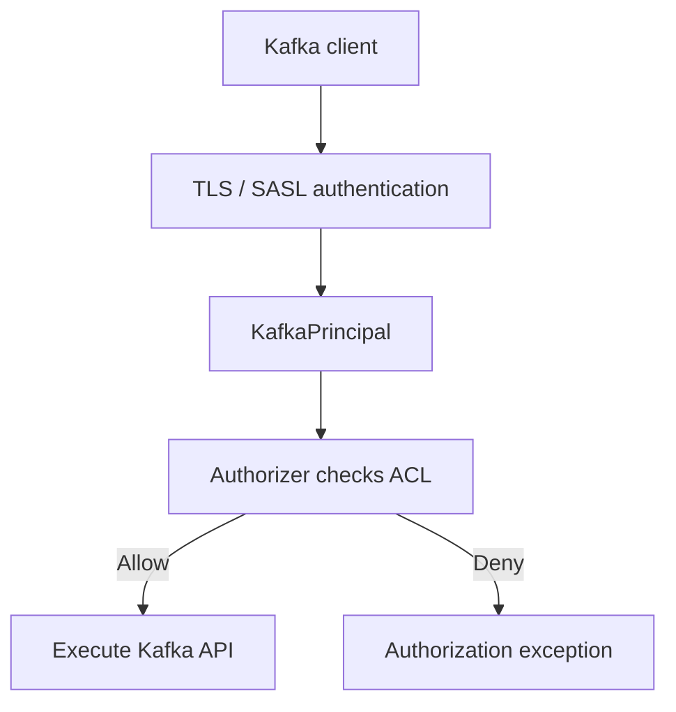

# ACL theo topic, group, cluster và transactional.id

Kafka ACL (Access Control List) xác định principal nào được phép thực hiện operation nào trên resource nào và từ host nào. Sau khi client đã xác thực bằng TLS hoặc SASL, broker dùng ACL để quyết định client có được đọc topic, ghi topic, tham gia consumer group, quản trị cluster hay dùng một `transactional.id` cụ thể hay không.

ACL cần được cấp theo đúng resource mà Kafka kiểm tra. Một consumer thông thường cần quyền `Read` trên topic và quyền `Read` trên group; một producer cần `Write` trên topic; producer dùng transaction cần thêm `Write` trên `TransactionalId`; producer idempotent không dùng transaction ID cần `IdempotentWrite` trên resource `Cluster`. Cấp `All` trên cluster cho ứng dụng chỉ để sửa lỗi authorization sẽ mở rộng quyền quá mức và làm mất ranh giới bảo mật.

## 1. Authentication và authorization là hai bước khác nhau

Kafka bảo vệ kết nối qua hai lớp:

1. **Authentication:** xác định client là ai. Ví dụ SASL/SCRAM xác thực username/password, SASL/OAUTHBEARER dùng token, còn SSL client authentication dùng certificate.
2. **Authorization:** kiểm tra principal đã xác thực có được thực hiện operation trên resource hay không. ACL là cơ chế authorization phổ biến của Kafka.

Ví dụ client kết nối bằng SASL/SCRAM thành công với username `orders-reader`. Broker có thể tạo principal `User:orders-reader`. Principal này vẫn bị từ chối đọc topic nếu không có ACL phù hợp.



Authentication không tự cấp quyền truy cập dữ liệu. Ngược lại, ACL không thay thế TLS/SASL: ACL không mã hóa traffic và không chứng minh danh tính của client.

## 2. ACL gồm những thành phần nào?

Một ACL có thể được hiểu qua các thành phần:

| Thành phần | Ý nghĩa | Ví dụ |
|---|---|---|
| Principal | Danh tính đã xác thực | `User:orders-reader` |
| Permission type | Cho phép hoặc từ chối | `ALLOW`, `DENY` |
| Operation | Hành động được kiểm tra | `Read`, `Write`, `Alter` |
| Resource type | Loại đối tượng được bảo vệ | `Topic`, `Group`, `Cluster`, `TransactionalId` |
| Resource name/pattern | Tên hoặc quy tắc khớp resource | `orders.events`, `orders-`, `*` |
| Pattern type | Cách so khớp tên | `LITERAL`, `PREFIXED` |
| Host | Địa chỉ nguồn được áp dụng ACL | `*`, `198.51.100.20` |

Ví dụ diễn giải: `User:orders-reader` được `ALLOW Read` trên topic `orders.events` từ mọi host. Một ACL khác có thể cho phép principal này `Read` trên group `orders-reader-v1` để consumer tham gia group và lưu tiến độ.

Principal phải khớp với danh tính broker nhìn thấy sau bước mapping. Với SASL/SCRAM, principal thường chứa username. Với SSL, principal mặc định có thể là distinguished name của certificate; `ssl.principal.mapping.rules` có thể rút gọn hoặc chuẩn hóa tên đó. Khi dùng Kerberos, `sasl.kerberos.principal.to.local.rules` có thể biến đổi principal. Vì vậy, hãy kiểm tra principal thực tế trong broker log trước khi tạo ACL.

`User` trong `User:orders-reader` phân biệt chữ hoa/chữ thường. `User:Orders-Reader` là principal khác với `User:orders-reader`.

## 3. Các resource chính trong Kafka ACL

| Resource | Bảo vệ | Ví dụ tên resource |
|---|---|---|
| `Topic` | Dữ liệu và thao tác trên topic/partition | `orders.events` |
| `Group` | Consumer group, group membership và offset liên quan | `orders-reader-v1` |
| `Cluster` | Thao tác ở phạm vi toàn cluster | Resource cluster duy nhất, dùng `--cluster` |
| `TransactionalId` | Producer transaction và transaction coordinator | `orders-tx-instance-1` |

Kafka còn có resource như `DelegationToken` và `User` cho các chức năng token. Bài này tập trung vào bốn resource được dùng thường xuyên trong ứng dụng producer/consumer và quản trị cluster.

### Topic

Topic ACL kiểm soát việc đọc, ghi, tạo, xóa, thay đổi cấu hình và mô tả topic. ACL được áp dụng cho resource topic, không tự động cấp quyền trên consumer group hoặc transactional ID có cùng tên.

### Group

Group ACL kiểm soát việc join/heartbeat/leave group, commit/fetch offset và mô tả/xóa group. Consumer đọc được topic nhưng thiếu quyền group vẫn có thể thất bại khi join group hoặc commit offset.

### Cluster

Cluster ACL dành cho thao tác ảnh hưởng toàn cluster, ví dụ cấp quyền quản lý ACL, tạo topic ở phạm vi cluster, xem metadata cluster, thay đổi cấu hình broker hoặc thao tác nội bộ theo API. Đây là resource có phạm vi rộng; chỉ cấp quyền cần thiết cho admin/operator hoặc service chuyên trách.

### TransactionalId

TransactionalId ACL kiểm soát producer dùng `transactional.id` để khởi tạo và hoàn tất transaction. Tên này độc lập với topic và consumer group. Hai ứng dụng dùng chung topic nhưng có transactional ID khác nhau vẫn cần ACL riêng cho transactional ID tương ứng.

## 4. Operation nào thường dùng trên từng resource?

Bảng dưới đây tóm tắt các operation thường gặp trong Kafka 4.4. Một số API quản trị hoặc tính năng mới có thể bổ sung kiểm tra authorization khác; khi cấp quyền cho một công cụ cụ thể, đối chiếu API protocol và tài liệu đúng phiên bản.

| Resource | Operation thường dùng | Mục đích |
|---|---|---|
| Topic | `Read` | Fetch record từ topic |
| Topic | `Write` | Produce record vào topic |
| Topic | `Create` | Tạo topic khi API cho phép kiểm tra ACL trên topic |
| Topic | `Delete` | Xóa topic hoặc xóa record theo API tương ứng |
| Topic | `Alter` | Thay đổi partition hoặc một số thuộc tính topic |
| Topic | `Describe` | Đọc metadata topic; cũng được ngầm cho phép bởi một số operation khác |
| Topic | `DescribeConfigs`, `AlterConfigs` | Xem hoặc sửa cấu hình topic |
| Group | `Read` | Join, heartbeat, leave group và các thao tác offset cần quyền đọc group |
| Group | `Describe` | Mô tả consumer group hoặc fetch offset theo API |
| Group | `Delete` | Xóa group hoặc xóa offset theo API |
| Cluster | `Create` | Một số thao tác tạo topic ở phạm vi cluster |
| Cluster | `Alter` | Thay đổi cluster hoặc quản lý ACL |
| Cluster | `Describe` | Mô tả cluster và một số thao tác liệt kê |
| Cluster | `ClusterAction` | Các API cluster/internal action; thường dành cho broker hoặc operator |
| Cluster | `IdempotentWrite` | Cho phép producer idempotent không dùng transactional ID |
| Cluster | `DescribeConfigs`, `AlterConfigs` | Xem hoặc sửa cấu hình broker/cluster |
| TransactionalId | `Write` | Khởi tạo, thêm partition vào transaction, commit/abort transaction |
| TransactionalId | `Describe` | Tìm transaction coordinator hoặc mô tả transaction |

Kafka có các operation implication. Một ACL `ALLOW Read` cũng cho phép `Describe`; `ALLOW Write`, `Delete` và `Alter` cũng ngầm cho phép `Describe`; `ALLOW AlterConfigs` ngầm cho phép `DescribeConfigs`. Điều này không có nghĩa mọi operation đều được suy ra từ nhau. Ví dụ `Write` trên topic không cấp `Write` trên transactional ID hoặc `IdempotentWrite` trên cluster.

## 5. Quy tắc allow, deny và mặc định từ chối

Khi authorizer được bật:

- Nếu có ACL `ALLOW` phù hợp và không có ACL `DENY` phù hợp, operation được phép.
- Nếu có ACL `DENY` phù hợp, operation bị từ chối ngay cả khi có một ACL `ALLOW` khác cũng khớp.
- Nếu không có ACL nào phù hợp, mặc định access bị từ chối.
- Principal nằm trong `super.users` bỏ qua kiểm tra ACL; đây là quyền đặc biệt cần được bảo vệ nghiêm ngặt.

Không cấu hình `allow.everyone.if.no.acl.found=true` cho production thông thường. Tùy chọn này cho phép mọi principal truy cập resource chưa có ACL nào; một topic mới tạo mà chưa kịp cấp ACL có thể trở thành resource mở. Nó chỉ phù hợp với giai đoạn chuyển đổi có kiểm soát hoặc môi trường thử nghiệm.

Nếu không cấu hình authorizer, authentication vẫn có thể diễn ra nhưng broker không thực thi ACL authorization; không được hiểu rằng bật SASL hoặc TLS tự động bật phân quyền.

## 6. Literal, wildcard và prefixed resource pattern

Kafka hỗ trợ các kiểu pattern để quản lý ACL:

| Pattern | Ví dụ | Phạm vi |
|---|---|---|
| `LITERAL` | `orders.events` | Chỉ resource có tên chính xác `orders.events` |
| `LITERAL` với tên `*` | `*` | Mọi resource cùng loại, ví dụ mọi topic nếu resource type là Topic |
| `PREFIXED` | `orders.` | Mọi resource cùng loại có tên bắt đầu bằng `orders.` |

Ví dụ cấp quyền ghi cho mọi topic có prefix `orders.`:

```bash
kafka-acls.sh --bootstrap-server kafka-1:9092 \
  --command-config admin.properties \
  --add \
  --allow-principal User:orders-service \
  --operation Write \
  --topic orders. \
  --resource-pattern-type prefixed
```

Prefix ACL giúp tránh tạo ACL riêng cho mỗi topic mới, nhưng cũng tự động cấp quyền cho topic tương lai có cùng prefix. Hãy chọn namespace rõ ràng, ví dụ `team-a.orders.`; tránh prefix chung như `app.` nếu nhiều team có thể tạo topic dưới đó.

Wildcard `*` rất rộng. Không cấp `--topic '*' --operation Write` cho một producer nghiệp vụ trừ khi thật sự cần ghi mọi topic trong cluster.

## 7. Cấu hình StandardAuthorizer trên KRaft

Với KRaft, Kafka cung cấp `org.apache.kafka.metadata.authorizer.StandardAuthorizer`. Cấu hình authorizer phải được áp dụng nhất quán trên các node liên quan (broker, controller hoặc node kết hợp broker/controller) theo topology cluster.

Ví dụ trong `server.properties`:

```properties
authorizer.class.name=org.apache.kafka.metadata.authorizer.StandardAuthorizer

# Phân tách bằng dấu chấm phẩy.
# Chỉ liệt kê principal quản trị/break-glass thật sự cần thiết.
super.users=User:kafka-admin;User:kafka-ops

# Giữ mặc định deny khi resource chưa có ACL.
allow.everyone.if.no.acl.found=false
```

ACL của StandardAuthorizer được lưu trong KRaft metadata log. Khi cấp ACL, dùng công cụ Kafka tương thích với cluster để tạo/xóa/liệt kê rule. Không sửa trực tiếp metadata log.

Nếu tùy biến `principal.builder.class` trong KRaft, principal builder phải hỗ trợ serialize/deserialize principal qua `KafkaPrincipalSerde`, vì một số admin request được broker forward tới controller kèm principal của client. Nếu không, request quản trị có thể lỗi dù authentication phía client thành công.

### `super.users` là quyền break-glass

`super.users` không phải danh sách user ứng dụng. Principal trong danh sách này bỏ qua ACL checks. Giữ danh sách nhỏ, bảo vệ credential/certificate tương ứng, ghi audit khi sử dụng và có quy trình luân chuyển thông tin xác thực. Dấu phân cách là `;` vì tên principal SSL có thể chứa dấu phẩy.

## 8. Cấu hình xác thực cho lệnh quản trị ACL

`kafka-acls.sh` cần kết nối tới cluster. Nếu listener yêu cầu SASL/SSL, truyền file cấu hình client qua `--command-config`.

Ví dụ `admin.properties` (thay placeholder bằng secret lấy từ secret manager):

```properties
security.protocol=SASL_SSL
sasl.mechanism=SCRAM-SHA-512
sasl.jaas.config=org.apache.kafka.common.security.scram.ScramLoginModule required username="kafka-admin" password="<secret-from-secret-manager>";
ssl.truststore.location=/etc/kafka/secrets/admin.truststore.jks
ssl.truststore.password=<truststore-password>
```

Không commit password thật vào Git hoặc ghi secret vào shell history. Với môi trường mTLS, cấu hình truststore/keystore và principal mapping phù hợp thay cho SASL/SCRAM.

Để tạo hoặc xóa ACL, principal chạy lệnh cần quyền quản trị ACL tương ứng trên resource Cluster (thường là `Alter`); để liệt kê ACL cần quyền `Describe` trên Cluster hoặc dùng `super.users`. Không dùng principal ứng dụng thông thường làm tài khoản quản trị ACL.

## 9. ACL tối thiểu cho consumer đọc topic và dùng group

Một consumer group truyền thống cần hai quyền độc lập:

1. `Read` trên mỗi topic được fetch.
2. `Read` trên group ID được dùng để join group, heartbeat và commit offset.

Ví dụ principal `User:orders-reader` đọc `orders.events` với group `orders-reader-v1`:

```bash
kafka-acls.sh --bootstrap-server kafka-1:9092 \
  --command-config admin.properties \
  --add \
  --allow-principal User:orders-reader \
  --operation Read \
  --topic orders.events

kafka-acls.sh --bootstrap-server kafka-1:9092 \
  --command-config admin.properties \
  --add \
  --allow-principal User:orders-reader \
  --operation Read \
  --group orders-reader-v1
```

Nếu consumer cần đọc nhiều topic, cấp `Read` cho từng topic hoặc một prefix hẹp được quản lý. Không cấp `Read` trên mọi topic chỉ để consumer có thể đọc thêm topic mới ngoài phạm vi.

Group ID cũng là resource được bảo vệ. Hai consumer có cùng principal nhưng dùng group ID khác nhau có thể có kết quả authorization khác nhau.

## 10. ACL tối thiểu cho producer ghi topic

Producer thông thường cần `Write` trên topic đích:

```bash
kafka-acls.sh --bootstrap-server kafka-1:9092 \
  --command-config admin.properties \
  --add \
  --allow-principal User:orders-writer \
  --operation Write \
  --topic orders.events
```

`Write` đã bao hàm `Describe` theo operation implication. Nếu topic đã được provision bởi platform/admin, producer không cần quyền `Create` chỉ để gửi record.

Kafka CLI có convenience option `--producer`, nhưng option này cấp `Write`, `Describe` và `Create` trên topic. Với least privilege, hãy cân nhắc dùng `--operation Write` tường minh để không cấp thêm quyền tạo topic ngoài nhu cầu.

Nếu bật auto topic creation, broker có thể kiểm tra `Create` trên Cluster hoặc fallback sang `Create` trên Topic tùy request/config. Trong production nên provision topic trước bằng IaC/Admin workflow và tắt auto-create nếu không cần.

## 11. Producer idempotent và quyền trên Cluster

Producer idempotent không dùng `transactional.id` cần quyền `IdempotentWrite` trên resource Cluster, ngoài `Write` trên topic đích.

```bash
kafka-acls.sh --bootstrap-server kafka-1:9092 \
  --command-config admin.properties \
  --add \
  --allow-principal User:orders-writer \
  --operation IdempotentWrite \
  --cluster
```

Quyền `IdempotentWrite` trên Cluster không phải quyền ghi mọi topic. Nó cho phép producer dùng giao thức idempotent; quyền `Write` trên từng topic vẫn quyết định producer được ghi dữ liệu vào đâu.

Nếu producer dùng `transactional.id` được cấp quyền phù hợp, Kafka tự bật idempotence theo cơ chế transactional producer. Khi đó, hãy cấp `Write` trên transactional ID cụ thể và `Write` trên các topic; không cấp cluster-wide `IdempotentWrite` rộng hơn nếu không cần.

## 12. ACL cho transactional producer

Transactional producer cần quyền trên cả `TransactionalId` và các topic mà nó ghi.

Ví dụ ứng dụng `orders-service` dùng transactional ID `orders-tx-instance-1` và ghi `orders.events`:

```bash
kafka-acls.sh --bootstrap-server kafka-1:9092 \
  --command-config admin.properties \
  --add \
  --allow-principal User:orders-service \
  --operation Write \
  --transactional-id orders-tx-instance-1

kafka-acls.sh --bootstrap-server kafka-1:9092 \
  --command-config admin.properties \
  --add \
  --allow-principal User:orders-service \
  --operation Write \
  --topic orders.events
```

`Write` trên TransactionalId cho phép producer thực hiện các thao tác transaction liên quan như khởi tạo producer ID, thêm partition vào transaction và kết thúc transaction. `Write` cũng ngầm cho phép `Describe`, cần cho một số bước tìm transaction coordinator.

### Transactional ID theo prefix

Nếu mỗi instance có transactional ID riêng, có thể cấp ACL theo prefix:

```bash
kafka-acls.sh --bootstrap-server kafka-1:9092 \
  --command-config admin.properties \
  --add \
  --allow-principal User:orders-service \
  --operation Write \
  --transactional-id orders-tx- \
  --resource-pattern-type prefixed
```

Ví dụ các ID `orders-tx-pod-0`, `orders-tx-pod-1` cùng khớp prefix `orders-tx-`. Prefix phải đủ riêng cho ứng dụng; tránh cấp `--transactional-id '*'` cho principal dùng chung.

Không cấu hình nhiều producer đang hoạt động cùng dùng một transactional ID chỉ vì chúng cùng thuộc một service. Kafka dùng transactional ID để nhận diện/fence producer instance cũ; mỗi producer logic cần ID ổn định và không xung đột theo chiến lược triển khai.

## 13. Transactional producer gửi offset của consumer vào transaction

Một workflow consume-process-produce có thể gửi output record và offset input trong cùng Kafka transaction bằng `sendOffsetsToTransaction()`. Ngoài quyền đọc topic nguồn, consumer group và ghi topic đích, principal còn cần:

- `Write` trên TransactionalId.
- `Write` trên topic output.
- `Read` trên group có offset được đưa vào transaction.
- `Read` trên topic nguồn theo yêu cầu fetch/transactional offset commit.

Ví dụ ACL cho service vừa đọc `orders.in`, vừa ghi `orders.out`, đồng thời commit offset vào group `orders-transformer-v1`:

```bash
# Đọc topic nguồn
kafka-acls.sh --bootstrap-server kafka-1:9092 --command-config admin.properties \
  --add --allow-principal User:orders-transformer \
  --operation Read --topic orders.in

# Ghi topic kết quả
kafka-acls.sh --bootstrap-server kafka-1:9092 --command-config admin.properties \
  --add --allow-principal User:orders-transformer \
  --operation Write --topic orders.out

# Đọc/commit tiến độ của group
kafka-acls.sh --bootstrap-server kafka-1:9092 --command-config admin.properties \
  --add --allow-principal User:orders-transformer \
  --operation Read --group orders-transformer-v1

# Dùng transaction ID
kafka-acls.sh --bootstrap-server kafka-1:9092 --command-config admin.properties \
  --add --allow-principal User:orders-transformer \
  --operation Write --transactional-id orders-transformer-tx-
```

Các lệnh trên minh họa quyền chính. Một ứng dụng thật có thể cần quyền bổ sung tùy API, topic nội bộ, AdminClient và cách tạo resource. Dùng broker authorization log để xác định chính xác resource/operation bị từ chối, rồi cấp đúng quyền còn thiếu.

## 14. ACL cho Cluster và quản trị viên

Cluster ACL bảo vệ thao tác toàn cluster. Ví dụ:

```bash
# Cho phép platform principal tạo topic ở phạm vi cluster
kafka-acls.sh --bootstrap-server kafka-1:9092 \
  --command-config admin.properties \
  --add --allow-principal User:topic-provisioner \
  --operation Create --cluster

# Cho phép operator mô tả cluster
kafka-acls.sh --bootstrap-server kafka-1:9092 \
  --command-config admin.properties \
  --add --allow-principal User:kafka-observer \
  --operation Describe --cluster
```

Các operation như `Alter`, `AlterConfigs` hoặc `ClusterAction` có thể cho phép thay đổi hoặc thao tác ở phạm vi lớn. Không cấp các quyền này cho producer/consumer chỉ vì ứng dụng gặp lỗi đọc hoặc ghi topic.

Đặc biệt, tạo/xóa ACL được kiểm tra trên Cluster: `Alter` Cluster cho thao tác tạo/xóa ACL; `Describe` Cluster cho thao tác mô tả ACL. Vì vậy, tài khoản chạy `kafka-acls.sh --add` hoặc `--remove` cần quyền quản trị ACL, không phải quyền `Write` trên topic nghiệp vụ.

## 15. Bảng quyền tham khảo theo vai trò

| Vai trò | Topic | Group | Cluster | TransactionalId |
|---|---|---|---|---|
| Consumer thông thường | `Read` trên topic nguồn | `Read` trên group | Không cần quyền cluster-wide | Không cần |
| Producer thông thường | `Write` trên topic đích | Không cần | Không cần nếu không dùng idempotence cần ACL riêng | Không cần |
| Producer idempotent không transaction ID | `Write` trên topic đích | Không cần | `IdempotentWrite` | Không cần |
| Transactional producer | `Write` trên topic đích | `Read` nếu gửi consumer offset trong transaction | Không cần cấp `IdempotentWrite` cluster-wide khi đã dùng transactional ID đúng cách | `Write` trên ID/prefix của ứng dụng |
| Kafka Streams EOS application | `Read` source, `Write` output và internal topic theo topology | `Read` trên `application.id`/group | Có thể cần quyền tạo internal topic nếu broker tự tạo | `Write` trên transactional ID/prefix do Streams sử dụng |
| Kafka Connect source connector | `Write` trên topic đích và quyền tạo topic nếu connector/worker cần | Group có thể không dùng cho source offset của connector | Worker có thể cần quyền quản trị/internal resource riêng | Chỉ cần nếu connector producer dùng transaction ID |
| Kafka Connect sink connector | `Read` trên topic nguồn | `Read` trên group ID của connector | Thường không cần | Không cần |
| ACL administrator | Tùy thao tác quản trị topic | Tùy thao tác group | `Alter` để quản lý ACL, `Describe` để list ACL | Tùy quản trị transaction |

Đây là bảng định hướng. Kafka Streams và Kafka Connect còn dùng internal topics, application/connector group IDs, Config/Offset/Status topics và Admin API. Hãy cấp ACL theo đúng topology và worker configuration thay vì chỉ dựa trên tên vai trò.

## 16. Xem ACL đang áp dụng cho resource

Liệt kê ACL trên một topic:

```bash
kafka-acls.sh --bootstrap-server kafka-1:9092 \
  --command-config admin.properties \
  --list --topic orders.events
```

Lệnh trên liệt kê ACL của pattern chính xác được chỉ định; nó có thể không hiện ACL wildcard hoặc prefix đang ảnh hưởng tới topic. Để xem các ACL matching topic:

```bash
kafka-acls.sh --bootstrap-server kafka-1:9092 \
  --command-config admin.properties \
  --list --topic orders.events \
  --resource-pattern-type match
```

Liệt kê ACL theo principal:

```bash
kafka-acls.sh --bootstrap-server kafka-1:9092 \
  --command-config admin.properties \
  --list --principal User:orders-reader
```

`match` hữu ích khi điều tra quyền hiệu lực do literal, wildcard và prefixed pattern cùng tác động. Khi dùng `--remove` với pattern type `match`, hãy kiểm tra kỹ vì lệnh có thể xóa nhiều ACL hơn dự định.

## 17. Xóa ACL có kiểm soát

Ví dụ xóa đúng quyền `Write` của `User:orders-writer` trên topic `orders.events`:

```bash
kafka-acls.sh --bootstrap-server kafka-1:9092 \
  --command-config admin.properties \
  --remove \
  --allow-principal User:orders-writer \
  --operation Write \
  --topic orders.events \
  --resource-pattern-type literal
```

Sau khi xóa, chạy `--list` với `--resource-pattern-type match` để xác nhận không còn wildcard/prefix ACL khác cấp quyền tương tự. Xóa một literal ACL không có nghĩa principal chắc chắn mất quyền nếu một ACL prefix hoặc wildcard vẫn cho phép.

Không xóa ACL `super.users` bằng `kafka-acls.sh`; `super.users` là cấu hình broker. Thay đổi danh sách này cần quy trình cấu hình và restart/rollout phù hợp.

## 18. Deny ACL và xung đột pattern

Có thể dùng `--deny-principal` hoặc `--deny-host` để từ chối một principal/host trong khi một rule rộng hơn cho phép. Ví dụ cho phép mọi user đọc topic nhưng từ chối một principal cụ thể:

```bash
kafka-acls.sh --bootstrap-server kafka-1:9092 \
  --command-config admin.properties \
  --add \
  --allow-principal 'User:*' --allow-host '*' \
  --deny-principal User:temporary-user --deny-host '*' \
  --operation Read --topic public.events
```

Deny ACL có thể tạo ra tình huống khó điều tra khi một ACL prefix cho phép nhưng một ACL literal từ chối. Với production, ưu tiên mô hình default-deny và chỉ tạo allow ACL cần thiết. Dùng deny khi có yêu cầu rõ ràng, ghi lại lý do, chủ sở hữu và thời hạn gỡ bỏ.

`--allow-host` và `--deny-host` nhận IP address, không nhận hostname. Khi ứng dụng chạy sau NAT, proxy hoặc container network, hãy xác minh địa chỉ nguồn mà broker thực sự nhìn thấy.

## 19. Xử lý lỗi authorization thường gặp

| Lỗi | Resource thường liên quan | Cách kiểm tra |
|---|---|---|
| `TOPIC_AUTHORIZATION_FAILED` | Topic | Principal có `Read`/`Write` đúng topic không? Có wildcard/prefix deny không? |
| `GROUP_AUTHORIZATION_FAILED` | Group | Group ID runtime có khớp ACL không? Consumer có `Read` trên group không? |
| `CLUSTER_AUTHORIZATION_FAILED` | Cluster | Admin API có yêu cầu `Create`, `Alter`, `Describe`, `ClusterAction` hoặc operation khác trên Cluster không? |
| `TRANSACTIONAL_ID_AUTHORIZATION_FAILED` | TransactionalId | `transactional.id` runtime có khớp literal/prefix ACL và có `Write` không? |
| Lỗi khi `sendOffsetsToTransaction()` | Group, Topic, TransactionalId | Kiểm tra `Write` TransactionalId, `Read` Group, `Read` topic nguồn và quyền topic liên quan |
| Không list được ACL | Cluster | Principal quản trị có `Describe` Cluster hoặc nằm trong `super.users` không? |
| Không tạo/xóa được ACL | Cluster | Principal quản trị có `Alter` Cluster không? |
| Principal không khớp ACL dù username đúng | Principal mapping | Kiểm tra SASL username, SSL DN, `ssl.principal.mapping.rules` hoặc Kerberos mapping |

Quy trình chẩn đoán:

1. Lấy principal thực tế từ broker log hoặc thông tin kết nối đã xác thực.
2. Ghi lại operation, resource type và resource name trong authorization failure log.
3. Liệt kê ACL theo resource với `--resource-pattern-type match`.
4. Kiểm tra literal, wildcard, prefixed pattern và deny ACL.
5. Xác nhận `group.id`, topic name và `transactional.id` trong runtime config đúng với ACL.
6. Cấp đúng operation trên đúng resource, không cấp `All` để thử nhanh.
7. Kiểm thử lại bằng chính principal của ứng dụng.

## 20. Nguyên tắc least privilege cho production

- Mỗi ứng dụng/service nên có principal riêng; không chia sẻ credential giữa producer, consumer và admin.
- Dùng ACL literal cho topic/group/transactional ID nếu danh sách resource ổn định.
- Dùng prefixed pattern chỉ khi namespace được quản lý và phạm vi prefix đủ hẹp.
- Không cấp wildcard `*` hoặc `All` cho principal nghiệp vụ.
- Producer chỉ cần `Write` trên output topic; consumer chỉ cần `Read` trên input topic và `Read` trên group của mình.
- Không cấp `Create` topic cho producer nếu topic do platform provision.
- Không cấp `Alter`/`ClusterAction` cho ứng dụng thông thường.
- Producer idempotent không transaction ID cần `IdempotentWrite` trên Cluster; transactional producer cần `Write` trên TransactionalId tương ứng.
- Tách ACL cho topic nguồn, topic output, internal topic và DLQ.
- Giữ `allow.everyone.if.no.acl.found=false` và giới hạn `super.users`.
- Audit thay đổi ACL, principal mapping, host và pattern; có quy trình revoke khi service ngừng hoạt động.
- Kiểm thử ACL sau khi đổi tên topic, group ID, transactional ID hoặc triển khai thêm instance.

## 21. Ghi nhớ

Kafka ACL là rule gắn principal, operation, resource pattern, permission và host. `Topic` bảo vệ dữ liệu; `Group` bảo vệ membership/offset; `Cluster` bảo vệ thao tác toàn cluster và quản trị ACL; `TransactionalId` bảo vệ producer transaction. Consumer cần `Read` trên topic và group; producer cần `Write` trên topic; producer idempotent không transaction ID cần `IdempotentWrite` trên Cluster; transactional producer cần `Write` trên transactional ID và topic đích.

Trên KRaft, dùng `StandardAuthorizer` và quản lý ACL qua `kafka-acls.sh` hoặc AdminClient. Mặc định không có ACL phù hợp là từ chối; `super.users` bỏ qua ACL và cần được giữ rất nhỏ. Literal, wildcard và prefixed pattern có phạm vi khác nhau; khi điều tra phải liệt kê ACL matching chứ không chỉ ACL literal. Cấp quyền theo least privilege, kiểm tra principal thực tế và không dùng `All` để chữa lỗi authorization.

## Tài liệu tham khảo

- [Apache Kafka 4.4 – Authorization and ACLs](https://kafka.apache.org/44/security/authorization-and-acls/)
- [Apache Kafka 4.4 – Security Model](https://kafka.apache.org/44/security/security-model/)
- [Apache Kafka 4.4 – AclOperation Javadoc](https://kafka.apache.org/44/javadoc/org/apache/kafka/common/acl/AclOperation.html)
- [Apache Kafka 4.4 – ResourceType Javadoc](https://kafka.apache.org/44/javadoc/org/apache/kafka/common/resource/ResourceType.html)
- [Apache Kafka – KIP-11: Authorization Interface](https://cwiki.apache.org/confluence/display/KAFKA/KIP-11+-+Authorization+Interface)
- [Apache Kafka – KIP-290: Support for prefixed ACLs](https://cwiki.apache.org/confluence/display/KAFKA/KIP-290%3A+Support+for+Prefixed+ACLs)
