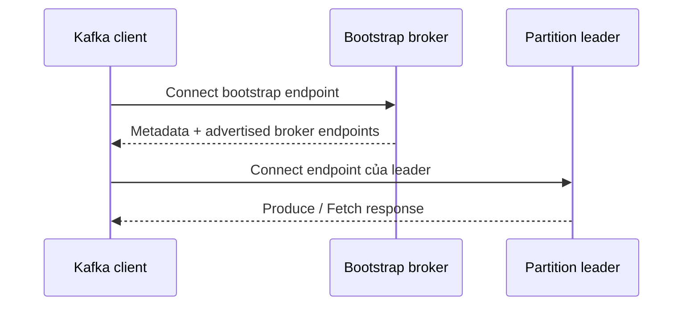
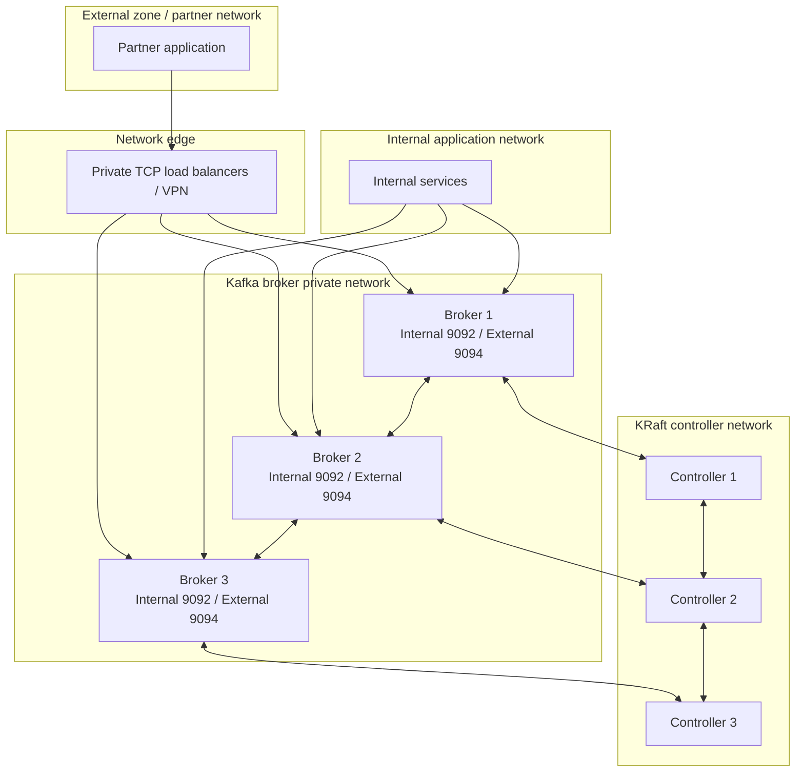

# Listener nội bộ, listener bên ngoài và phân đoạn mạng

Kafka broker có thể phục vụ nhiều nhóm client trên các mạng khác nhau: ứng dụng chạy cùng private network, service ở Kubernetes, hệ thống đối tác qua VPN hoặc client từ mạng bên ngoài. Để kiểm soát đường kết nối, Kafka hỗ trợ nhiều listener trên cùng broker. Mỗi listener có thể dùng địa chỉ, cổng và security protocol riêng.

Điểm dễ nhầm nhất là **địa chỉ broker lắng nghe** và **địa chỉ broker quảng bá cho client**. Client chỉ cần một bootstrap endpoint để bắt đầu, nhưng sau khi nhận metadata, nó sẽ kết nối trực tiếp tới các broker được metadata công bố. Vì vậy, listener và `advertised.listeners` phải phù hợp với từng vùng mạng. Một bootstrap endpoint truy cập được chưa đủ chứng minh client có thể sử dụng cluster.

## 1. `listeners` và `advertised.listeners` khác nhau thế nào?

Hai cấu hình có vai trò khác nhau:

| Cấu hình | Vai trò | Ví dụ |
|---|---|---|
| `listeners` | Địa chỉ và cổng mà broker bind socket để nhận kết nối | `INTERNAL://0.0.0.0:9092` |
| `advertised.listeners` | Địa chỉ và cổng broker công bố trong metadata để client kết nối | `INTERNAL://broker-1.kafka.svc:9092` |

`listeners` quyết định broker mở socket ở đâu. Có thể bind vào IP cụ thể hoặc `0.0.0.0` để lắng nghe trên mọi interface phù hợp. `advertised.listeners` phải là địa chỉ mà client trong network tương ứng thực sự truy cập được; không dùng `0.0.0.0` làm địa chỉ quảng bá.

Luồng kết nối Kafka diễn ra như sau:

1. Client kết nối đến một địa chỉ trong `bootstrap.servers`.
2. Broker bootstrap trả metadata về cluster, gồm broker ID và endpoint tương ứng với listener client đang sử dụng.
3. Client kết nối trực tiếp tới broker được metadata chỉ định để gửi/đọc dữ liệu hoặc truy cập partition leader.
4. Khi leader thay đổi, metadata mới có thể dẫn client đến broker khác.



Nếu client truy cập được bootstrap broker nhưng không truy cập được endpoint được quảng bá cho broker leader, request produce/consume vẫn thất bại. Đây là nguyên nhân phổ biến của lỗi timeout sau bước bootstrap.

## 2. Tại sao cần listener nội bộ và listener bên ngoài?

Một cluster có thể phục vụ client từ nhiều vùng mạng:

- **Internal listener:** dành cho service trong cùng VPC, private subnet, Kubernetes hoặc mạng datacenter.
- **External listener:** dành cho client nằm ngoài mạng broker, ví dụ ứng dụng đối tác qua VPN, client ở VPC khác hoặc hệ thống truy cập qua private endpoint.
- **Inter-broker listener:** đường giao tiếp broker với broker, thường đặt trong private network.
- **Controller listener:** đường giao tiếp giữa broker và KRaft controller, cũng như giữa các controller trong quorum.

“External” không nhất thiết có nghĩa là public Internet. Nó chỉ có nghĩa endpoint dành cho vùng mạng bên ngoài vùng broker nội bộ. Trong production, external access thường nên đi qua VPN, VPC peering, private link hoặc mạng riêng được kiểm soát. Nếu bắt buộc dùng Internet, cần giới hạn nguồn truy cập, TLS và xác thực mạnh.

Ví dụ, ứng dụng nội bộ dùng `broker-1.kafka.svc:9092`, trong khi hệ thống đối tác dùng `broker-1.kafka.example.net:19094`. Cả hai endpoint có thể kết nối đến cùng broker nhưng đi qua listener, firewall rule và security policy khác nhau.

## 3. Cấu hình nhiều listener trên một broker KRaft

Ví dụ sau minh họa một node chạy cả broker và controller trong môi trường nhỏ. Cluster production thường nên tách broker và controller thành các role riêng khi cần cô lập tài nguyên và security boundary.

```properties
process.roles=broker,controller
node.id=1

controller.quorum.voters=1@broker-1.internal:9093,2@broker-2.internal:9093,3@broker-3.internal:9093

listeners=INTERNAL://0.0.0.0:9092,EXTERNAL://0.0.0.0:9094,CONTROLLER://0.0.0.0:9093
advertised.listeners=INTERNAL://broker-1.kafka.svc:9092,EXTERNAL://broker-1.kafka.example.net:19094

listener.security.protocol.map=INTERNAL:SASL_SSL,EXTERNAL:SASL_SSL,CONTROLLER:SSL
inter.broker.listener.name=INTERNAL
controller.listener.names=CONTROLLER
```

Các điểm cần hiểu:

- `INTERNAL` và `EXTERNAL` là tên listener do quản trị viên đặt; tên này không bắt buộc phải là `PLAINTEXT`, `SSL` hoặc `SASL_SSL`.
- `listener.security.protocol.map` ánh xạ từng tên listener sang protocol Kafka hỗ trợ.
- `inter.broker.listener.name=INTERNAL` chọn đường broker dùng để giao tiếp với nhau.
- `controller.listener.names=CONTROLLER` xác định listener dùng cho KRaft controller traffic.
- `CONTROLLER` không xuất hiện trong `advertised.listeners`, vì đây không phải endpoint cho producer/consumer ứng dụng.
- `broker-1.kafka.example.net:19094` là endpoint bên ngoài mà client phải truy cập được. Ví dụ có thể dùng load balancer TCP ở cổng 19094 chuyển tiếp đến listener cổng 9094 của broker.

Mỗi broker cần quảng bá địa chỉ riêng của chính nó. Broker 2 phải quảng bá DNS/port của broker 2, broker 3 phải quảng bá DNS/port của broker 3. Không sao chép cùng một `advertised.listeners` host cho tất cả broker nếu endpoint đó không định tuyến chính xác đến node tương ứng.

`listeners` và `advertised.listeners` phải được thiết kế đồng bộ với DNS, NAT/load balancer và firewall. Nếu đổi cổng công khai, metadata phải trả về cổng công khai mà client dùng được, dù load balancer chuyển tiếp sang cổng nội bộ khác.

## 4. Listener trong cluster KRaft có role tách riêng

KRaft có hai mặt giao tiếp khác nhau: broker traffic và controller quorum traffic. Không nên coi controller listener là một listener client thứ ba.

### Broker-only node

Broker-only node nhận kết nối client và giao tiếp với broker khác. Nó cần biết controller listener để liên lạc với quorum, nhưng không bind controller listener như một endpoint client:

```properties
process.roles=broker
node.id=101

listeners=INTERNAL://0.0.0.0:9092,EXTERNAL://0.0.0.0:9094
advertised.listeners=INTERNAL://broker-1.kafka.svc:9092,EXTERNAL://broker-1.kafka.example.net:19094

listener.security.protocol.map=INTERNAL:SASL_SSL,EXTERNAL:SASL_SSL,CONTROLLER:SSL
inter.broker.listener.name=INTERNAL
controller.listener.names=CONTROLLER
controller.quorum.voters=1@controller-1.internal:9093,2@controller-2.internal:9093,3@controller-3.internal:9093
```

### Controller-only node

Controller-only node phục vụ quorum traffic. Không cấu hình listener ứng dụng hoặc quảng bá endpoint controller cho producer/consumer:

```properties
process.roles=controller
node.id=1

listeners=CONTROLLER://0.0.0.0:9093
controller.listener.names=CONTROLLER
controller.quorum.voters=1@controller-1.internal:9093,2@controller-2.internal:9093,3@controller-3.internal:9093

listener.security.protocol.map=CONTROLLER:SSL
```

Đây là các đoạn cấu hình minh họa cho static quorum. Khi dùng dynamic controller quorum hoặc cấu trúc triển khai khác, cần áp dụng đúng cấu hình quorum của phiên bản Kafka. Tất cả node phải thống nhất tên controller listener và protocol mapping cần thiết để giao tiếp.

Controller listener chỉ nên được mở giữa các broker/controller thuộc cluster. Chặn producer, consumer và hệ thống bên ngoài truy cập cổng này ở firewall/security group. Không đưa địa chỉ controller vào `bootstrap.servers` của ứng dụng nghiệp vụ.

## 5. Thiết kế endpoint cho từng vùng mạng

Một sơ đồ triển khai có thể chia thành các vùng:



Sơ đồ thể hiện các vùng logic. Trong triển khai thật, controller quorum traffic có thể đi qua network interface riêng; broker-to-broker và broker-to-controller cũng có thể dùng cùng private subnet nhưng vẫn cần rule và policy rõ ràng.

### Ma trận kết nối tối thiểu

| Nguồn | Đích | Cổng/listener | Quy tắc |
|---|---|---|---|
| Internal application | Broker | Internal listener | Chỉ mở từ subnet/service cần Kafka |
| External/partner application | Broker qua VPN/private edge | External listener | Allowlist CIDR hoặc private endpoint; xác thực riêng |
| Broker | Broker | Inter-broker listener | Chỉ cho phép các node Kafka trong cluster |
| Broker | Controller | Controller listener | Chỉ broker/controller trong cluster |
| Controller | Controller | Controller listener | Chỉ các controller voter |
| Admin/jump host | Broker | Listener quản trị phù hợp | Qua mạng quản trị có kiểm soát; quyền Kafka vẫn phải giới hạn |
| Monitoring | Broker/JMX/metrics endpoint | Cổng metrics riêng | Chỉ hệ thống giám sát được phép truy cập |

Không mở tất cả cổng broker cho toàn bộ VPC hoặc Internet chỉ để tránh lỗi kết nối. Rule nên giới hạn theo nguồn, đích, port và mục đích cụ thể. Nếu broker có nhiều interface, cần xác định rõ listener bind vào interface nào và firewall áp dụng cho từng interface.

## 6. Load balancer và NAT cho Kafka external listener

Kafka không hoạt động giống một HTTP service sau một load balancer round-robin đơn giản. Bootstrap broker trả metadata chứa endpoint của từng broker. Sau đó client cần kết nối đúng broker đang làm leader cho partition hoặc broker được chỉ định cho thao tác.

Vì vậy, một external listener thường cần endpoint ổn định cho từng broker:

| Broker | Endpoint public/private edge được quảng bá | Backend |
|---|---|---|
| Broker 1 | `broker-1.kafka.example.net:19094` | Broker 1 `:9094` |
| Broker 2 | `broker-2.kafka.example.net:19094` | Broker 2 `:9094` |
| Broker 3 | `broker-3.kafka.example.net:19094` | Broker 3 `:9094` |

Có thể dùng một bootstrap DNS riêng trỏ đến một hoặc vài endpoint broker, nhưng metadata sau bootstrap vẫn phải cung cấp các endpoint broker riêng và tất cả endpoint đó phải truy cập được từ client network. Không cấu hình mọi broker quảng bá cùng một load balancer round-robin có thể đưa kết nối của broker ID 1 đến broker ID 2; client sẽ gặp lỗi node mismatch, metadata hoặc timeout.

Một số nền tảng cung cấp một service bootstrap và nhiều service broker-specific. Cần kiểm tra hành vi của operator/managed Kafka service để bảo đảm metadata trả về hostname/port mà client có thể resolve và kết nối.

### DNS và certificate

Địa chỉ `advertised.listeners` phải resolve từ network của client. Nếu dùng split-horizon DNS, cần xác nhận mỗi vùng nhận được record phù hợp. Với TLS, certificate của broker phải có SAN khớp hostname mà client sử dụng trong endpoint được quảng bá.

Ví dụ broker quảng bá `broker-2.kafka.example.net`, certificate phải chứa DNS SAN tương ứng. Nếu certificate chỉ có `broker-2.kafka.svc`, client external có thể kết nối TCP nhưng thất bại ở TLS hostname verification.

## 7. Bảo vệ từng listener bằng TLS và SASL

Listener chỉ xác định endpoint và security protocol. Để bảo vệ dữ liệu, cần kết hợp mã hóa, xác thực và phân quyền:

- **TLS/SSL:** mã hóa traffic giữa client và broker, đồng thời xác minh danh tính broker qua certificate. Có thể dùng mutual TLS để xác thực client bằng certificate.
- **SASL:** xác thực client bằng cơ chế được cluster hỗ trợ, ví dụ SCRAM hoặc OAUTHBEARER. Nếu dùng `SASL_SSL`, SASL thực hiện authentication trên kết nối đã mã hóa TLS.
- **ACL/authorizer:** giới hạn principal được phép đọc/ghi topic, dùng consumer group, tạo/xóa topic hoặc thực hiện operation khác.
- **Network policy/firewall:** giới hạn nguồn nào được phép mở kết nối TCP đến listener.

Network segmentation không thay thế authentication hoặc ACL. Một client nằm trong private subnet vẫn phải xác thực và chỉ được cấp quyền đúng với workload. Ngược lại, SASL/ACL không thay thế firewall: listener không nên mở rộng ra các vùng không cần truy cập.

Ví dụ ánh xạ listener:

```properties
listener.security.protocol.map=INTERNAL:SASL_SSL,EXTERNAL:SASL_SSL,CONTROLLER:SSL
inter.broker.listener.name=INTERNAL
controller.listener.names=CONTROLLER
```

Broker cần cấu hình keystore/truststore phù hợp cho TLS. Với SASL, cần cấu hình mechanism và credential/JAAS cho từng listener theo chính sách xác thực. Có thể dùng cùng protocol nhưng credential, principal và ACL khác nhau giữa internal và external client. Không hard-code password trong file được commit; dùng secret manager hoặc cơ chế secret của nền tảng triển khai.

Nếu internal listener dùng `SASL_SSL` và external listener cũng dùng `SASL_SSL`, điều đó không bắt buộc hai nhóm client dùng chung principal. Hãy tạo principal riêng cho từng service/đối tác và cấp ACL tối thiểu. Với controller listener, dùng cơ chế xác thực/mã hóa phù hợp với mô hình KRaft của cluster và không chia sẻ credential controller với ứng dụng nghiệp vụ.

## 8. Listener-specific configuration

Kafka hỗ trợ cấu hình một số thuộc tính theo listener bằng tiền tố `listener.name.<listener-name>`. Tên listener trong phần thuộc tính thường được viết thường. Ví dụ khái niệm:

```properties
listener.name.internal.ssl.client.auth=required
listener.name.external.ssl.client.auth=none

listener.name.internal.sasl.enabled.mechanisms=SCRAM-SHA-512
listener.name.external.sasl.enabled.mechanisms=SCRAM-SHA-512
```

Ví dụ này minh họa khả năng đặt policy riêng, không phải cấu hình đầy đủ cho production. `ssl.client.auth=required` buộc client internal trình certificate nếu TLS listener hỗ trợ mutual TLS; external listener trong ví dụ không yêu cầu client certificate và vẫn có thể yêu cầu SASL authentication. Cần cấu hình truststore, keystore, SASL JAAS và ACL tương ứng.

Không phải mọi thuộc tính Kafka đều hỗ trợ override theo listener. Kiểm tra tài liệu cấu hình của phiên bản đang chạy trước khi dùng tiền tố listener-specific. Nếu một thuộc tính không hỗ trợ override, cấu hình theo listener có thể bị bỏ qua hoặc gây lỗi validation.

## 9. Quy tắc chọn listener cho broker-to-broker và controller

`inter.broker.listener.name` xác định listener broker dùng để kết nối với broker khác. Tất cả broker phải có thể resolve và truy cập endpoint nội bộ được quảng bá cho listener này. Không dùng external listener cho inter-broker traffic nếu không có lý do kiến trúc rõ ràng; traffic replication và metadata nội bộ nên ở private network.

Trong KRaft, `controller.listener.names` xác định listener dành cho controller communication. Controller quorum cần giao tiếp ổn định và có độ trễ thấp. Chỉ broker/controller thuộc cluster mới nên được phép kết nối đến cổng này.

Với node chạy cả `broker,controller`, `listeners` có thể chứa cả ba loại endpoint. Với broker-only node, `listeners` chứa broker endpoints còn controller listener được dùng để kết nối tới controller quorum. Với controller-only node, chỉ bind controller listener. Trong mọi trường hợp, không đưa controller listener vào `advertised.listeners` dành cho client ứng dụng.

## 10. Kiểm tra kết nối từ từng network zone

Không chỉ kiểm tra từ máy broker. Phải kiểm tra từ chính môi trường chạy client, vì DNS, route, firewall và certificate có thể khác nhau giữa các vùng.

### Bước 1: kiểm tra DNS và TCP

Từ internal client:

```bash
nc -vz broker-1.kafka.svc 9092
```

Từ external client:

```bash
nc -vz broker-1.kafka.example.net 19094
```

Trên Windows có thể dùng `Test-NetConnection -ComputerName broker-1.kafka.example.net -Port 19094`. Kiểm tra từng broker endpoint, không chỉ bootstrap endpoint.

### Bước 2: kiểm tra TLS

```bash
openssl s_client -connect broker-1.kafka.example.net:19094 \
  -servername broker-1.kafka.example.net
```

Xác minh certificate chain, hostname/SAN, thời hạn certificate và CA trust. Nếu dùng mTLS, client cần cung cấp certificate/key phù hợp.

### Bước 3: kiểm tra metadata Kafka

```bash
kcat -b broker-1.kafka.example.net:19094 -L \
  -X security.protocol=SASL_SSL \
  -X sasl.mechanism=SCRAM-SHA-512 \
  -X sasl.username=external-client \
  -X sasl.password="$KAFKA_PASSWORD"
```

Kiểm tra danh sách broker trả về. Tất cả hostname và port trong metadata phải truy cập được từ external client. Nếu metadata chứa `broker-1.kafka.svc:9092` hoặc hostname private không resolve được từ bên ngoài, cần sửa `advertised.listeners` cho external listener.

### Bước 4: kiểm tra authentication và authorization

Sau khi metadata và TLS hoạt động, dùng `kafka-topics.sh`, `kafka-console-producer.sh` hoặc ứng dụng thử nghiệm với `--command-config`/client properties để kiểm tra principal có đúng quyền trên topic và group hay không. Phân biệt lỗi xác thực (SASL/TLS) với lỗi phân quyền (ACL) và lỗi mạng (timeout/refused).

## 11. Triệu chứng thường gặp

| Triệu chứng | Nguyên nhân có thể | Hướng kiểm tra |
|---|---|---|
| Bootstrap thành công nhưng produce/fetch timeout | Broker quảng bá endpoint không truy cập được từ client zone | Dùng `kcat -L`, kiểm tra từng `advertised.listeners` endpoint |
| `UnknownHostException` | DNS advertised hostname không resolve được | Kiểm tra DNS từ đúng container/host của client |
| Connection refused | Sai port, listener không bind hoặc firewall/LB backend không mở | Kiểm tra `listeners`, route và backend mapping |
| TLS hostname verification failed | SAN không khớp advertised DNS | Kiểm tra certificate của đúng broker và endpoint |
| SSL handshake failure | CA/truststore, protocol/cipher hoặc mTLS không khớp | Kiểm tra TLS config hai phía và certificate chain |
| SASL authentication failed | Sai mechanism, credential hoặc JAAS config | Kiểm tra principal, mechanism và secret được inject |
| Topic/group authorization failed | ACL thiếu operation hoặc resource | Kiểm tra principal và ACL trên topic/group/cluster |
| Broker-to-broker timeout | Inter-broker listener quảng bá private endpoint sai hoặc firewall chặn | Kiểm tra `inter.broker.listener.name` và đường nội bộ |
| KRaft quorum mất kết nối | Controller listener, quorum endpoint hoặc firewall sai | Kiểm tra controller DNS/port và chỉ cho phép node trong cluster |

Một lỗi timeout không tự động có nghĩa broker bị down. Broker có thể đang hoạt động bình thường nhưng endpoint trong metadata không thể truy cập từ client. Luôn kiểm tra theo chuỗi DNS → TCP → TLS → SASL → metadata → ACL.

## 12. Quy trình triển khai listener mới an toàn

Khi thêm external listener vào cluster đang chạy, nên triển khai theo từng bước:

1. Xác định nhóm client, vùng mạng, port, DNS và security policy cần thiết.
2. Tạo endpoint riêng cho từng broker; chuẩn bị private/public DNS hoặc per-broker load balancer.
3. Cấp certificate có SAN khớp với hostname được quảng bá và chuẩn bị trust chain.
4. Mở firewall theo allowlist từ client zone tới external listener; không mở controller port.
5. Cấu hình listener, protocol mapping và `advertised.listeners` riêng trên từng broker theo quy trình rollout của phiên bản Kafka.
6. Kiểm tra broker-to-broker traffic vẫn dùng internal listener và KRaft quorum vẫn ổn định.
7. Từ external network, kiểm tra TCP, TLS, metadata và produce/consume thử bằng principal giới hạn quyền.
8. Chuyển từng client sang external bootstrap endpoint; theo dõi connection error, authentication failure và request latency.
9. Chỉ đóng listener cũ sau khi xác nhận không còn client sử dụng.

Không thay đổi đồng loạt `advertised.listeners` mà chưa chuẩn bị DNS, firewall và load balancer. Một broker quảng bá endpoint sai có thể làm client chỉ lỗi khi partition leader nằm trên broker đó, khiến sự cố xuất hiện không đều.

## 13. Checklist phân đoạn mạng Kafka

- Tách rõ internal, external, inter-broker và controller listener.
- Dùng `listeners` để bind socket và `advertised.listeners` để công bố endpoint client truy cập được.
- Đảm bảo mọi broker có endpoint riêng đúng với từng network zone.
- Không quảng bá `0.0.0.0` hoặc controller listener cho ứng dụng.
- Dùng private network cho inter-broker và KRaft controller traffic.
- Mở firewall theo nguồn/đích/port tối thiểu; không expose toàn bộ broker port ra Internet.
- Dùng TLS và SASL/mTLS cho client phù hợp; cấp ACL theo principal và topic/group.
- Bảo đảm TLS SAN khớp hostname được quảng bá.
- Dùng per-broker L4 routing; không dùng một load balancer round-robin chung làm địa chỉ cho tất cả broker ID.
- Kiểm tra metadata từ từng network zone, không chỉ kiểm tra bootstrap TCP.
- Theo dõi DNS, TLS, SASL, ACL, broker connection và KRaft quorum health.
- Thử nghiệm listener mới trước khi chuyển client và chỉ gỡ listener cũ sau migration.

Listener nội bộ và listener bên ngoài cho phép một Kafka cluster phục vụ nhiều vùng mạng với endpoint và security policy khác nhau. `listeners` xác định nơi broker nhận kết nối; `advertised.listeners` xác định địa chỉ client sẽ dùng sau khi nhận metadata. Trong KRaft, controller listener là control plane riêng cần được cô lập. Khi kết hợp per-broker routing, DNS/certificate đúng, firewall allowlist, TLS/SASL và ACL tối thiểu, cluster có thể cung cấp kết nối nội bộ và bên ngoài mà vẫn giữ ranh giới mạng rõ ràng.
