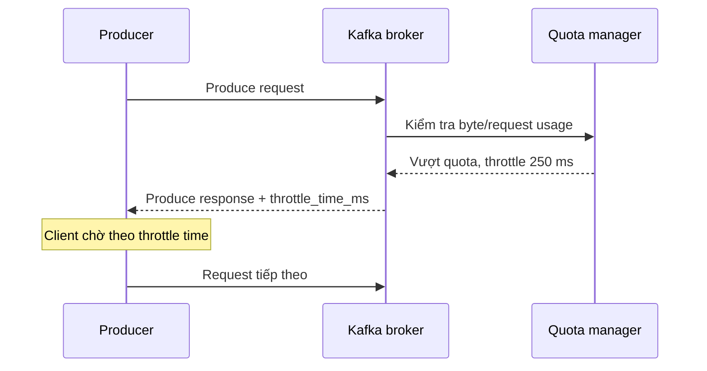

# Quota để cô lập tenant và giảm tác động của client quá tải

## Mục tiêu

Trong một Kafka cluster dùng chung, nhiều ứng dụng và tenant có thể cùng produce, consume hoặc gửi request tới broker. Một client bị lỗi retry liên tục, producer đột ngột tăng tốc hoặc consumer đọc dữ liệu quá nhanh có thể chiếm nhiều network, request handler, disk I/O và băng thông replication. Hậu quả là các client khác bị tăng latency dù bản thân chúng hoạt động bình thường.

Kafka **quota** giới hạn tốc độ sử dụng một số tài nguyên theo user, client ID hoặc cặp user/client ID. Khi client vượt quota, broker throttle request để đưa tốc độ về mức cho phép. Quota giúp giới hạn blast radius và phân bổ tài nguyên công bằng hơn; nó không thay thế authentication, ACL, capacity planning hoặc cơ chế backpressure của ứng dụng.

Sau bài học này, bạn có thể:

- Giải thích producer byte quota, consumer byte quota và request percentage quota.
- Phân biệt user principal, `client.id` và tenant ID ở tầng nghiệp vụ.
- Thiết kế quota theo tenant và workload.
- Tạo, mô tả, thay đổi và xóa quota bằng `kafka-configs.sh`.
- Hiểu quota precedence giữa default, user, client ID và cặp user/client ID.
- Đọc throttle time và nhận biết client bị broker điều tiết.
- Dùng quota để bảo vệ cluster trước client quá tải.
- Kết hợp quota với ACL, retry, timeout, monitoring và capacity planning.
- Kiểm thử quota và xử lý tình huống tenant bị throttle ngoài dự kiến.

## 1. Vì sao Kafka cần quota?

Kafka là hệ thống multi-tenant ở nhiều môi trường: nhiều team dùng chung broker, nhiều microservice dùng chung topic cluster, hoặc nhiều khách hàng cùng sử dụng một nền tảng streaming. Nếu không giới hạn, một client có thể tạo tải không cân xứng với phần tài nguyên mà nó được phép sử dụng.

Một số tình huống thường gặp:

- Producer bị retry loop và gửi cùng một lượng lớn request.
- Batch job chạy nhầm lịch, đẩy dữ liệu nhanh hơn năng lực broker hoặc downstream.
- Consumer group mới khởi động và đọc lịch sử với tốc độ cao, cạnh tranh bandwidth với workload realtime.
- Một tenant gửi message lớn hoặc tăng throughput đột biến.
- Một client gọi metadata/API liên tục, chiếm request handler dù byte rate không cao.
- Nhiều ứng dụng cùng chạy trên một cluster nhưng không có giới hạn tài nguyên rõ ràng.

Quota cung cấp một hàng rào ở broker để giới hạn tác động của các client này. Ví dụ tenant A được phép produce 5 MiB/s và consume 10 MiB/s; tenant B có quota riêng. Khi tenant A vượt mức, broker trì hoãn response của client A theo throttle time, thay vì để A tiếp tục chiếm tài nguyên không giới hạn.

### 1.1. Quota là cơ chế điều tiết, không phải giới hạn cứng của mọi tài nguyên

Quota trong Kafka chủ yếu điều tiết tốc độ produce, consume và mức sử dụng request-processing time. Nó không tự giới hạn:

- Số topic hoặc partition mà tenant có thể tạo.
- Dung lượng lưu trữ tối đa theo tenant.
- Kích thước tối đa của một record/message.
- Số consumer thread hoặc số request trong application thread pool.
- Số kết nối TCP hoặc số lần gọi API nghiệp vụ ở hệ thống ngoài Kafka.
- Quyền đọc/ghi topic.

Các yêu cầu này cần cấu hình bổ sung như ACL, topic policy, `max.message.bytes`, retention, partition planning, network policy và giới hạn ở application/API gateway.

## 2. Các loại quota chính

Kafka cung cấp ba loại quota client thường dùng:

| Quota | Config key | Đơn vị | Tác dụng |
|---|---|---|---|
| Producer byte rate | `producer_byte_rate` | bytes/second | Giới hạn tốc độ dữ liệu client ghi vào broker |
| Consumer byte rate | `consumer_byte_rate` | bytes/second | Giới hạn tốc độ dữ liệu client đọc từ broker |
| Request percentage | `request_percentage` | Phần trăm thời gian xử lý request | Giới hạn phần request-processing capacity mà client group được sử dụng |

### 2.1. `producer_byte_rate`

Giới hạn tốc độ produce của nhóm client tương ứng. Khi producer gửi nhanh hơn quota, broker áp dụng throttle để làm chậm request. Đây là lựa chọn phù hợp để giới hạn ingestion rate theo tenant hoặc theo workload producer.

Ví dụ quota 5 MiB/s:

\[
5 \times 1024 \times 1024 = 5.242.880\text{ bytes/second}
\]

Giá trị cấu hình được tính bằng byte/second, không phải MiB/second. Cần thống nhất đơn vị khi tính toán và ghi tài liệu quota.

### 2.2. `consumer_byte_rate`

Giới hạn tốc độ fetch data của client group. Nó hữu ích khi một consumer group chạy batch replay hoặc bootstrap projection và có nguy cơ cạnh tranh bandwidth với consumer realtime.

Ví dụ consumer realtime được cấp 20 MiB/s, còn consumer backfill chỉ được cấp 4 MiB/s. Khi backfill vượt mức, broker throttle fetch request để hạn chế ảnh hưởng tới workload khác.

### 2.3. `request_percentage`

Quota này giới hạn phần trăm thời gian request-processing mà client group có thể sử dụng trên broker. Nó hữu ích khi client tạo nhiều request nhỏ hoặc request metadata liên tục: byte rate có thể thấp nhưng request handler vẫn bị chiếm dụng.

Ví dụ `request_percentage=25` có nghĩa quota group được cấp ngân sách xử lý request tương đương 25% theo cách đo quota của broker trong quota window. Đây không phải giới hạn CPU toàn máy ở mức 25%; broker tính thời gian xử lý request theo các thread/cơ chế của Kafka.

Không nên dùng request percentage thay cho byte quota. Workload produce nhiều payload lớn và workload tạo rất nhiều request nhỏ gây áp lực theo những cách khác nhau; có thể cần phối hợp hai loại quota.

## 3. Quota được áp dụng cho ai?

Kafka nhóm request theo các định danh do broker nhận được:

- **User/principal:** danh tính đã xác thực của kết nối, ví dụ `tenant-a`, `service-orders`.
- **Client ID:** giá trị `client.id` do Kafka client gửi, ví dụ `orders-writer`, `billing-reader`.
- **User + client ID:** kết hợp principal và client ID để đặt quota cụ thể cho một workload của một user.
- **Default entity:** quota mặc định áp dụng cho những user/client không có quota cụ thể hơn.

Kafka không tự đọc `tenantId` trong JSON payload, Kafka key hoặc message header để áp quota. Muốn quota theo tenant, cần ánh xạ tenant vào authenticated principal hoặc client ID theo một quy ước được quản lý.

Quota client cũng không được gắn trực tiếp với một topic cụ thể. Một user/client ID có thể gửi hoặc đọc nhiều topic; quota áp dụng cho nhóm request của entity đó trên broker. Nếu cần giới hạn riêng từng tenant theo topic, phải kết hợp ACL, topic design và quota identity phù hợp, không kỳ vọng `producer_byte_rate` tự tách ngân sách theo topic.

### 3.1. User principal

User principal đến từ cơ chế authentication của Kafka, thường là SASL/SCRAM, SASL/OAUTHBEARER hoặc mTLS với principal mapping phù hợp. Với kết nối không xác thực, broker có thể gom các client vào principal chung như `ANONYMOUS` hoặc tên do `PrincipalBuilder` cấu hình; khi đó quota theo user không tự phân biệt được tenant.

Nếu cần quota isolation đáng tin cậy, hãy cấp principal riêng cho từng tenant hoặc workload và dùng ACL để giới hạn quyền truy cập. Quota không cấp quyền truy cập topic; nó chỉ điều tiết mức sử dụng tài nguyên.

### 3.2. Client ID

`client.id` là nhãn client gửi trong request. Nó giúp quan sát và nhóm quota theo ứng dụng/workload. Ví dụ:

```properties
client.id=tenant-a-orders-writer
```

Client ID phải được đặt rõ ràng thay vì dựa vào giá trị tự sinh như `producer-1` hoặc `consumer-1`. Nếu các instance của cùng workload dùng client ID khác nhau, quota theo client ID có thể bị chia thành nhiều nhóm ngoài dự định.

Client ID không phải danh tính bảo mật: client có thể tự khai báo một giá trị khác. Không dùng riêng `client.id` làm ranh giới tin cậy giữa các tenant không đáng tin cậy. Với multi-tenant cần cô lập thật sự, ưu tiên quota theo authenticated principal và ACL.

### 3.3. Quota theo user và client ID

Có thể đặt quota cho một cặp user/client ID để tách workload của cùng một principal:

```text
user = tenant-a
client.id = orders-backfill
```

Tenant A có thể có quota riêng cho producer realtime, consumer analytics và job backfill. Cách này giúp một workload batch không tiêu thụ hết ngân sách của workload realtime nếu các quota entity được thiết kế phù hợp.

## 4. Quota precedence và cách tính ngân sách

Kafka hỗ trợ quota ở nhiều cấp entity. Với mỗi request, broker chọn quota khớp cụ thể nhất theo principal và client ID. Thứ tự precedence đầy đủ là:

| Thứ tự | Entity khớp | Phạm vi |
|---:|---|---|
| 1 | User cụ thể + client ID cụ thể | Một workload của một principal |
| 2 | User cụ thể + default client ID | Mọi client ID thuộc principal đó, trừ override cặp cụ thể |
| 3 | User cụ thể | Mọi client ID thuộc principal đó, trừ override cặp/default-client cụ thể |
| 4 | Default user + client ID cụ thể | Client ID đó với mọi user, trừ override cụ thể hơn |
| 5 | Default user + default client ID | Mọi user và client ID nếu không có override cụ thể hơn |
| 6 | Default user | Mọi user, trừ các mức ưu tiên cao hơn |
| 7 | Client ID cụ thể | Client ID đó nếu không có user/default-user match ưu tiên cao hơn |
| 8 | Default client ID | Mọi client ID nếu không có mức ưu tiên cao hơn |

Không nên cộng các quota trong bảng như thể user quota và client quota luôn là hai ngân sách độc lập. Tất cả connection thuộc cùng quota entity chia sẻ ngân sách của entity đó. Hãy kiểm tra entity thực sự được áp dụng bằng cách mô tả cấu hình quota và thử nghiệm với principal/client ID đúng như production. Khi thiết kế tenant budget, ghi rõ quota effective cho từng tổ hợp workload.

### 4.1. Ví dụ phân chia workload

Giả sử tenant A có ba workload:

| Workload | Principal | Client ID | Producer quota | Consumer quota |
|---|---|---|---:|---:|
| Realtime writer | `tenant-a` | `orders-live` | 5 MiB/s | Không đặt riêng |
| Analytics reader | `tenant-a` | `analytics-reader` | Không đặt riêng | 8 MiB/s |
| Backfill reader | `tenant-a` | `backfill-reader` | Không đặt riêng | 2 MiB/s |

Quota theo cặp giúp đặt giới hạn khác nhau cho từng workload. Nếu tenant A còn có client ID khác không được khai báo, user/default quota sẽ là fallback theo precedence.

### 4.2. Default quota và quota override

Nếu không có quota override/default động hoặc default broker phù hợp, client mặc định có thể không bị giới hạn (unlimited). Vì vậy, với cluster multi-tenant nên đặt default quota bảo thủ để client mới không thể mặc định chiếm toàn bộ cluster. Sau đó cấp quota riêng cho tenant/workload có yêu cầu throughput cao hơn. Khi nâng quota, cần tính tổng ngân sách của tất cả tenant trên mỗi broker và headroom cho replication, controller, maintenance và traffic đột biến.

Quota là cơ chế chia sẻ tài nguyên theo broker. Không giả định một con số quota luôn tương đương tổng throughput cluster bất kể số broker hoặc cách client kết nối. Đo thực tế trên topology broker của cluster và thiết kế headroom phù hợp.

Vì quota được thực thi độc lập trên từng broker, client gửi request tới nhiều broker có thể đạt tổng throughput cộng dồn lớn hơn quota cấu hình trên một broker. Ví dụ một client có producer quota 5 MiB/s và ghi phân tán đều tới ba broker có thể quan sát tổng tốc độ gần 15 MiB/s trong điều kiện lý tưởng. Đây chỉ là minh họa cơ chế per-broker, không phải cam kết throughput; leader placement, request distribution, replication và broker capacity quyết định kết quả thực tế. Khi cần capacity planning, tính ngân sách theo từng broker và tổng lưu lượng của cluster.

## 5. Broker throttle hoạt động như thế nào?

Khi client vượt quota, broker không nhất thiết từ chối ngay request. Broker tính thời gian cần trì hoãn để client group trở lại ngân sách cho phép, rồi trả throttle time trong response. Kafka client chuẩn đọc thông tin này và trì hoãn request tiếp theo theo cơ chế của client.



Throttle là backpressure do broker áp dụng. Với client Kafka chuẩn, request vẫn có thể thành công sau thời gian chờ. Ứng dụng không nên coi mọi throttle là lỗi cần retry ngay; retry tức thì có thể làm tải tăng thêm và khiến client liên tục vượt quota.

### 5.1. Quota window và burst

Quota được tính theo các cửa sổ thời gian nội bộ của broker. Vì là cơ chế rate control theo cửa sổ, traffic ngắn hạn có thể burst rồi bị throttle để điều chỉnh trung bình. Quota không đồng nghĩa với token bucket application-level có một burst size cố định mà ứng dụng có thể dựa vào.

Không dùng quota làm giới hạn latency tuyệt đối. Nếu client cần SLA chặt, hãy kiểm soát batch size, producer rate, consumer concurrency, queue depth và timeout ở application layer.

### 5.2. Quota được thực thi ở từng broker

Quota manager áp dụng trên broker xử lý request. Một workload kết nối tới nhiều broker có thể quan sát throttle khác nhau giữa các broker; không mặc định rằng quota là một bộ điều tiết tập trung duy nhất cho toàn cluster. Khi lập capacity plan, tính tổng tải theo broker, partition leadership và cách phân phối request.

### 5.3. Throttle không thay thế client backpressure

Producer có thể tiếp tục tích lũy record trong buffer nếu application tạo dữ liệu nhanh hơn tốc độ broker chấp nhận. Consumer có thể tiếp tục tích lũy công việc sau khi fetch. Hãy kết hợp quota với:

- Bounded queue và giới hạn tốc độ tạo event ở producer.
- `buffer.memory`, `max.block.ms`, `delivery.timeout.ms` và batch sizing phù hợp.
- Consumer worker pool có giới hạn và backpressure.
- Timeout/retry có exponential backoff và jitter.
- Theo dõi throttle time, request latency và queue depth.

## 6. Tạo quota bằng `kafka-configs.sh`

Quota động có thể được quản lý bằng Kafka Admin CLI. Các thay đổi được lưu trong metadata/config của cluster theo cơ chế quản lý cấu hình động; không cần restart broker cho mỗi quota update được hỗ trợ động.

### 6.1. Đặt quota cho một user

Ví dụ giới hạn tenant A produce 5 MiB/s và consume 10 MiB/s:

```bash
bin/kafka-configs.sh --bootstrap-server localhost:9092 \
  --alter --entity-type users --entity-name tenant-a \
  --add-config 'producer_byte_rate=5242880,consumer_byte_rate=10485760'
```

Quota theo user áp dụng cho các client đã xác thực bằng principal `tenant-a`, trừ khi có cấu hình cụ thể hơn. Đảm bảo principal mapping trong broker thực sự tạo ra đúng tên user.

### 6.2. Đặt quota theo client ID

Ví dụ giới hạn client backfill:

```bash
bin/kafka-configs.sh --bootstrap-server localhost:9092 \
  --alter --entity-type clients --entity-name backfill-reader \
  --add-config 'consumer_byte_rate=2097152,request_percentage=20'
```

Quota này nhóm các request có `client.id=backfill-reader` theo entity client ID. Vì client ID do client khai báo, cần dùng cùng authentication/ACL nếu đây là ranh giới multi-tenant.

### 6.3. Đặt quota cho cặp user và client ID

Ví dụ giới hạn producer realtime của tenant A:

```bash
bin/kafka-configs.sh --bootstrap-server localhost:9092 \
  --alter \
  --entity-type users --entity-name tenant-a \
  --entity-type clients --entity-name orders-live \
  --add-config 'producer_byte_rate=5242880,request_percentage=30'
```

Entity cặp giúp quota khác nhau cho từng workload của cùng một principal. Cú pháp CLI có thể khác nhẹ theo phiên bản Kafka; xác nhận bằng `kafka-configs.sh --help` của distribution đang chạy.

### 6.4. Đặt default quota

Ví dụ default producer/consumer quota cho user chưa có override:

```bash
bin/kafka-configs.sh --bootstrap-server localhost:9092 \
  --alter --entity-type users --entity-default \
  --add-config 'producer_byte_rate=1048576,consumer_byte_rate=2097152'
```

Có thể đặt default cho client ID theo entity type `clients` nếu policy cần. Default quota giúp tenant/client mới có ngân sách ban đầu an toàn; quota riêng được thêm cho workload đã được phê duyệt.

Đặt default client ID quota cho mọi user:

```bash
bin/kafka-configs.sh --bootstrap-server localhost:9092 \
  --alter --entity-type clients --entity-default \
  --add-config 'producer_byte_rate=1048576,consumer_byte_rate=2097152'
```

Đặt default client ID quota riêng cho user `tenant-a`:

```bash
bin/kafka-configs.sh --bootstrap-server localhost:9092 \
  --alter --entity-type users --entity-name tenant-a \
  --entity-type clients --entity-default \
  --add-config 'producer_byte_rate=2097152,consumer_byte_rate=4194304'
```

## 7. Mô tả, cập nhật và xóa quota

### 7.1. Mô tả quota

```bash
bin/kafka-configs.sh --bootstrap-server localhost:9092 \
  --describe --entity-type users --entity-name tenant-a
```

Mô tả quota cho client ID:

```bash
bin/kafka-configs.sh --bootstrap-server localhost:9092 \
  --describe --entity-type clients --entity-name backfill-reader
```

Mô tả quota default:

```bash
bin/kafka-configs.sh --bootstrap-server localhost:9092 \
  --describe --entity-type users --entity-default
```

Mô tả quota cho cặp user/client ID:

```bash
bin/kafka-configs.sh --bootstrap-server localhost:9092 \
  --describe \
  --entity-type users --entity-name tenant-a \
  --entity-type clients --entity-name orders-live
```

Mô tả default client ID quota:

```bash
bin/kafka-configs.sh --bootstrap-server localhost:9092 \
  --describe --entity-type clients --entity-default
```

Để điều tra quota effective, kiểm tra cả default, user, client ID và cặp user/client ID. Một kết quả describe riêng lẻ có thể chỉ cho thấy entity đó, không cho biết toàn bộ cấu hình liên quan tới một request.

### 7.2. Cập nhật quota

`--add-config` thêm hoặc thay giá trị của config được chỉ định; giữ các quota key khác không được nhắc tới. Ví dụ nâng producer quota:

```bash
bin/kafka-configs.sh --bootstrap-server localhost:9092 \
  --alter --entity-type users --entity-name tenant-a \
  --add-config 'producer_byte_rate=8388608'
```

Thay đổi quota cần được quản lý như thay đổi capacity: ghi lý do, người phê duyệt, thời gian áp dụng và mức cũ/mới. Không nâng quota để xử lý incident mà chưa xác định broker còn headroom hay không.

### 7.3. Xóa một quota key

```bash
bin/kafka-configs.sh --bootstrap-server localhost:9092 \
  --alter --entity-type users --entity-name tenant-a \
  --delete-config producer_byte_rate
```

Xóa một quota key làm entity đó quay về fallback/precedence phù hợp; nó không đồng nghĩa đặt quota bằng 0. Đặt quota bằng 0 có thể khiến client không có throughput thực tế và thường không phải cách để xóa override.

### 7.4. Xóa toàn bộ quota override của entity

Chỉ xóa entity override khi đã hiểu cấu hình fallback và ảnh hưởng workload:

```bash
bin/kafka-configs.sh --bootstrap-server localhost:9092 \
  --alter --entity-type users --entity-name tenant-a \
  --delete-config producer_byte_rate,consumer_byte_rate,request_percentage
```

Sau thay đổi, chạy lại `--describe` và xác minh client nhận đúng quota dự kiến. Với default entity, việc xóa default có thể ảnh hưởng nhiều tenant/client cùng lúc nên cần quy trình thay đổi riêng.

## 8. Thiết kế quota cho multi-tenant

Quota design nên bắt đầu từ workload và SLO, không phải chọn một con số chung cho mọi tenant.

### 8.1. Phân loại workload

| Workload | Đặc điểm | Quota nên cân nhắc |
|---|---|---|
| Realtime producer | Cần latency thấp, throughput ổn định | Producer byte rate đủ headroom, request percentage phù hợp |
| Batch/backfill producer | Có thể burst, không cần latency thấp | Producer byte rate thấp hơn realtime |
| Realtime consumer | Cần đọc liên tục, lag thấp | Consumer byte rate đủ lớn để theo kịp input |
| Analytics/backfill consumer | Có thể đọc lịch sử và tạo tải lớn | Consumer byte rate giới hạn để bảo vệ realtime |
| Metadata-heavy client | Nhiều request nhỏ | Request percentage |
| Admin/automation client | Thao tác quản trị định kỳ | Request percentage và quyền ACL riêng |

### 8.2. Ánh xạ tenant vào principal

Một thiết kế đơn giản:

```text
Tenant A -> SASL principal tenant-a
Tenant B -> SASL principal tenant-b
Tenant C -> SASL principal tenant-c
```

Mỗi principal có ACL cho đúng topic/prefix và quota user-level. Các workload bên trong tenant có `client.id` khác nhau để quan sát hoặc đặt override theo cặp user/client ID.

Nếu mọi tenant dùng chung một principal `shared-app`, broker không thể phân biệt tenant bằng quota user. Nếu client ID cũng do tenant tự khai báo mà không kiểm soát, tenant có thể chọn ID khác để né quota client-level. Hãy thiết kế authentication/principal mapping trước khi triển khai quota isolation.

### 8.3. Tính quota từ capacity

Giả sử một broker có ngân sách producer ingress an toàn 80 MiB/s sau khi đã trừ headroom cho replication, compaction và tải nền. Nếu có bốn tenant với mức ưu tiên khác nhau, có thể phân bổ tổng quota thấp hơn 80 MiB/s để còn headroom:

| Tenant | Producer quota | Tỷ trọng ngân sách minh họa |
|---|---:|---:|
| A | 20 MiB/s | 25% |
| B | 12 MiB/s | 15% |
| C | 8 MiB/s | 10% |
| D | 8 MiB/s | 10% |
| Headroom | 32 MiB/s | 40% |

Đây là ví dụ capacity allocation, không phải giá trị mặc định hay bảo đảm quota cluster-wide. Thực tế phải xét partition leadership, số broker, replication factor, request distribution, compression và peak traffic.

Không cấp tổng quota bằng đúng throughput benchmark tối đa. Broker cần headroom cho rebalance, leader election, replication catch-up, compaction, rolling restart và traffic spike.

### 8.4. Quota theo tenant hay theo workload?

- Dùng user quota để giới hạn tổng tài nguyên của một tenant principal.
- Dùng client ID quota để phân loại workload hoặc nhóm client cùng client ID.
- Dùng cặp user/client ID khi cần override cụ thể cho một workload của tenant.
- Dùng default quota để bảo vệ cluster trước client mới chưa được cấp ngân sách riêng.

Nếu cần một tenant có tổng ngân sách chung bất kể số client, user quota là điểm bắt đầu tốt hơn client ID quota. Nếu đặt quota riêng cho từng client ID, tenant có thể đạt tổng throughput bằng tổng các quota workload; hãy tính ngân sách tổng và tránh cấp từng client mà không nhìn tổng.

## 9. Quota, authentication và ACL

Quota và ACL giải quyết hai câu hỏi khác nhau:

| Cơ chế | Câu hỏi |
|---|---|
| Authentication | Client là ai? |
| Authorization/ACL | Client được phép làm gì và trên tài nguyên nào? |
| Quota | Client được phép sử dụng tài nguyên với tốc độ nào? |

Ví dụ tenant A có principal `tenant-a`:

1. Authentication xác thực tenant A bằng SASL/SCRAM hoặc cơ chế được chọn.
2. ACL cho phép principal đọc `orders.tenant-a` và ghi `orders.commands.tenant-a`.
3. Quota user-level giới hạn producer/consumer byte rate và request percentage.

Không dùng quota để ngăn tenant đọc topic của tenant khác. Nếu principal không có ACL phù hợp, broker phải từ chối truy cập dù quota còn dư. Ngược lại, ACL cho phép đọc/ghi không có nghĩa client được dùng throughput không giới hạn.

## 10. Quota cho replication và reassignment

Quota client (`producer_byte_rate`, `consumer_byte_rate`, `request_percentage`) không phải cơ chế duy nhất để kiểm soát tải broker. Khi reassignment partition hoặc replica catch-up, replication traffic có thể chiếm network và disk bandwidth. Kafka có các replication throttle riêng, thường được cấu hình bằng broker/topic settings như:

- `leader.replication.throttled.rate`
- `follower.replication.throttled.rate`
- `leader.replication.throttled.replicas`
- `follower.replication.throttled.replicas`

Các cấu hình này phục vụ điều tiết replication/reassignment, không phải quota tenant. Khi di chuyển partition, có thể giới hạn tốc độ replication để tránh làm ảnh hưởng client traffic. Cần làm theo hướng dẫn reassignment của phiên bản Kafka và gỡ throttle sau khi hoàn tất.

Không đặt replication throttle quá thấp khiến reassignment kéo dài và replica rơi khỏi ISR; cũng không đặt quá cao khiến broker/network bị quá tải. Theo dõi under-replicated partitions, ISR shrink/expand, replication lag và network utilization.

## 11. AdminClient và quản lý quota tự động

Với nền tảng multi-tenant, quota có thể được quản lý qua automation thay vì chạy CLI thủ công. Kafka Admin API cung cấp `describeClientQuotas()` và `alterClientQuotas()`.

Ví dụ khái niệm Java:

```java
import java.util.List;
import java.util.concurrent.ExecutionException;

import org.apache.kafka.clients.admin.Admin;
import org.apache.kafka.clients.admin.ClientQuotaAlteration;
import org.apache.kafka.clients.admin.ClientQuotaEntity;

public class TenantQuotaManager {

    public void setProducerQuota(Admin admin, String principal,
                                 double bytesPerSecond)
            throws ExecutionException, InterruptedException {

        ClientQuotaEntity entity = new ClientQuotaEntity(
                java.util.Map.of(ClientQuotaEntity.USER, principal));

        ClientQuotaAlteration.Op operation =
                new ClientQuotaAlteration.Op("producer_byte_rate", bytesPerSecond);

        ClientQuotaAlteration alteration =
                new ClientQuotaAlteration(entity, List.of(operation));

        admin.alterClientQuotas(List.of(alteration)).all().get();
    }
}
```

Ví dụ cho thấy entity user và một quota operation. Production code cần xác thực tenant-to-principal mapping, kiểm tra quota hiện tại, validate ngân sách tổng, xử lý lỗi authorization/invalid config và ghi audit trước/sau thay đổi. `bytesPerSecond` dùng đơn vị byte/second; API nhận giá trị dạng `double`.

Khi quản lý quota theo user/client ID pair, entity map cần chứa cả hai key tương ứng. Không tự xây entity string theo cách riêng nếu chưa đối chiếu `ClientQuotaEntity` API của client version đang dùng.

## 12. Monitoring quota và throttle

Quota chỉ hữu ích khi vận hành biết client nào đang bị throttle, mức throttle kéo dài bao lâu và liệu quota có làm ảnh hưởng SLO hay không.

Các chỉ số cần quan sát:

| Metric/quan sát | Ý nghĩa | Cách dùng |
|---|---|---|
| Producer `produce-throttle-time-avg` | Throttle time trung bình của producer | Phát hiện producer bị quota điều tiết |
| Producer `produce-throttle-time-max` | Throttle time lớn nhất | Phát hiện spike hoặc quota quá chặt |
| Consumer `fetch-throttle-time-avg` | Throttle time trung bình của fetch | Phát hiện consumer bị giới hạn bandwidth |
| Consumer `fetch-throttle-time-max` | Throttle time lớn nhất | Phát hiện batch/backfill bị điều tiết mạnh |
| Produce/fetch request latency | Thời gian request end-to-end | Phân biệt quota throttle với broker/network latency |
| Bytes in/out theo broker | Tải ingress/egress | Đối chiếu với quota và capacity |
| Request handler/network processor idle | Headroom xử lý request | Phát hiện broker gần bão hòa |
| Consumer lag | Khả năng theo kịp dữ liệu | Xác định quota consumer quá thấp hay downstream chậm |
| Retry/error rate | Ảnh hưởng lên client | Phát hiện ứng dụng phản ứng sai với throttle |

Tên metric và MBean có thể thay đổi theo Kafka client/broker version. Hãy lấy metric từ JMX/metrics reporter thực tế và gắn `client.id`, principal, topic, broker và tenant mapping để dashboard có thể truy ngược tới owner.

### 12.1. Cảnh báo nên có

- Throttle time trung bình vượt ngưỡng trong nhiều cửa sổ liên tiếp.
- Throttle max tăng đột biến cùng consumer lag hoặc producer queue depth.
- Một tenant sử dụng gần hết quota liên tục trong giờ bình thường.
- Một broker có throttle cao bất thường so với broker khác.
- Request latency cao nhưng throttle time thấp, gợi ý bottleneck khác.
- Nhiều client dùng principal `ANONYMOUS` trong khi hệ thống yêu cầu quota theo user.
- Client ID không theo naming convention hoặc số lượng client ID tăng đột biến.

## 13. Troubleshooting

| Hiện tượng | Nguyên nhân có thể | Hướng xử lý |
|---|---|---|
| Producer throughput thấp, throttle time cao | `producer_byte_rate` quá thấp hoặc producer vượt ngân sách | Kiểm tra quota effective, principal và client ID; tăng quota chỉ khi broker còn headroom |
| Consumer lag tăng dù broker khỏe | `consumer_byte_rate` quá thấp | Kiểm tra quota và downstream processing; cân bằng realtime/backfill |
| Client bị throttle dù quota user cao | Có quota client ID hoặc user/client pair cụ thể hơn | Mô tả mọi entity liên quan và xác minh precedence |
| Hai tenant dùng chung một quota | Cùng principal hoặc cùng client ID | Sửa authentication/principal mapping và client ID convention |
| Tenant đổi client ID để né quota | Chỉ đặt quota theo client ID không tin cậy | Đặt quota theo authenticated principal và ACL |
| Một client mới không bị giới hạn | Chưa có default quota hoặc entity mới có override khác | Kiểm tra default user/client quota và cấu hình cụ thể |
| Request percentage cao nhưng byte rate thấp | Client tạo nhiều request nhỏ/metadata | Xem request rate và `request_percentage` |
| Quota mới không có hiệu lực như dự kiến | Sửa sai entity, config chưa được áp dụng hoặc đang quan sát broker/client khác | Describe config, kiểm tra principal/client ID trên request và thử lại |
| Throttle time cao nhưng throughput vẫn cao | Burst/window behavior hoặc nhiều broker/client connections | Đo theo broker, cửa sổ thời gian và tổng traffic thực tế |
| Broker latency cao dù client chưa chạm quota | Disk, network, ISR, request handler hoặc GC bottleneck | Điều tra broker metrics; không tăng quota một cách mù quáng |
| Reassignment làm ảnh hưởng client | Replication throttle chưa được cấu hình phù hợp | Điều chỉnh replication throttle và theo dõi ISR |

Quy trình điều tra:

1. Xác định principal, `client.id`, group, topic và broker đang nhận request.
2. Mô tả quota default, user, client ID và user/client ID pair.
3. Kiểm tra throttle time phía producer/consumer.
4. So sánh request latency, broker utilization, bytes in/out và consumer lag.
5. Kiểm tra client retry/backoff, queue depth và batch size.
6. Chỉ thay quota sau khi xác định nguyên nhân và tính lại headroom.

## 14. Thực hành: cô lập hai tenant bằng quota

Lab dùng Kafka cluster có authentication bật (SASL/SCRAM hoặc môi trường thử nghiệm tương đương), hai principal `tenant-a` và `tenant-b`, cùng hai producer workload. Không chạy lab bằng principal quản trị production.

### 14.1. Chuẩn bị client

Tạo hai producer config với principal khác nhau và client ID ổn định:

```properties
# tenant-a.properties
bootstrap.servers=localhost:9092
client.id=tenant-a-writer
security.protocol=SASL_PLAINTEXT
sasl.mechanism=SCRAM-SHA-512
```

```properties
# tenant-b.properties
bootstrap.servers=localhost:9092
client.id=tenant-b-writer
security.protocol=SASL_PLAINTEXT
sasl.mechanism=SCRAM-SHA-512
```

Phần `sasl.jaas.config` hoặc credential provider cần được cấp theo môi trường lab; không ghi password thật vào repository. Cấu hình SASL ở đây chỉ minh họa việc hai tenant có principal khác nhau.

### 14.2. Đặt default và tenant quota

Đặt default producer quota 1 MiB/s:

```bash
bin/kafka-configs.sh --bootstrap-server localhost:9092 \
  --alter --entity-type users --entity-default \
  --add-config 'producer_byte_rate=1048576'
```

Đặt tenant A 2 MiB/s và tenant B 4 MiB/s:

```bash
bin/kafka-configs.sh --bootstrap-server localhost:9092 \
  --alter --entity-type users --entity-name tenant-a \
  --add-config 'producer_byte_rate=2097152'

bin/kafka-configs.sh --bootstrap-server localhost:9092 \
  --alter --entity-type users --entity-name tenant-b \
  --add-config 'producer_byte_rate=4194304'
```

### 14.3. Tạo tải và quan sát

Chạy hai producer với payload đủ lớn trong một khoảng thời gian cố định. Ghi throughput, produce latency và `produce-throttle-time-avg/max` cho từng client. Tăng tốc producer tenant A vượt 2 MiB/s, quan sát broker throttle A trong khi tenant B vẫn có ngân sách riêng.

Kết quả cần ghi:

- Principal và client ID thực tế broker nhìn thấy.
- Quota effective của mỗi tenant.
- Throughput thực tế và throttle time.
- Broker nào áp dụng throttle.
- Ảnh hưởng tới latency và throughput của tenant còn lại.

### 14.4. Thử quota precedence

Đặt quota client ID thấp hơn cho `tenant-a-writer`, sau đó chạy lại producer A. Quan sát quota cụ thể hơn áp dụng. Thử xóa client-level override và xác minh tenant quay lại quota user-level.

### 14.5. Cleanup lab

Xóa quota override đã tạo hoặc khôi phục default theo cấu hình ban đầu. Chạy `--describe` để xác nhận. Không xóa default quota nếu nó đã tồn tại trước lab; ghi lại config ban đầu trước khi thay đổi.

## 15. Checklist production

- [ ] Tenant được ánh xạ vào authenticated principal riêng nếu cần quota isolation đáng tin cậy.
- [ ] ACL giới hạn topic/resource độc lập với quota.
- [ ] `client.id` ổn định và có naming convention để quan sát workload.
- [ ] Đã chọn producer byte, consumer byte và request percentage quota theo workload.
- [ ] Đã xác định quota effective và precedence của default/user/client/pair.
- [ ] Tổng quota được tính theo capacity từng broker và có headroom.
- [ ] Đã kiểm thử throttle behavior với client library/version thực tế.
- [ ] Producer/consumer có backpressure, timeout, retry backoff và bounded queue.
- [ ] Có dashboard throttle time, bytes in/out, request latency, lag và broker utilization.
- [ ] Có quy trình phê duyệt/audit cho quota update.
- [ ] Có default quota an toàn cho client mới nếu policy yêu cầu.
- [ ] Không dựa vào client ID hoặc tenant header do client tự khai báo làm danh tính bảo mật.
- [ ] Replication throttle được quản lý riêng khi reassignment/catch-up.
- [ ] Đã diễn tập client quá tải và xác nhận tenant khác vẫn đáp ứng SLO.

## 16. Câu hỏi tự kiểm tra

1. Vì sao Kafka quota cần thiết trong cluster multi-tenant?
2. `producer_byte_rate` và `consumer_byte_rate` khác nhau thế nào?
3. `request_percentage` kiểm soát loại tài nguyên nào?
4. Vì sao quota không thay thế ACL?
5. `client.id` khác authenticated principal như thế nào?
6. Vì sao quota theo user phù hợp để giới hạn tổng ngân sách tenant?
7. Khi nào cần quota theo cặp user/client ID?
8. Broker throttle request như thế nào khi client vượt quota?
9. Vì sao không nên retry ngay khi nhận throttle time?
10. Vì sao không nên xem quota là một giới hạn cứng cluster-wide độc lập với số broker?
11. Làm sao đặt default quota và override cho tenant?
12. Cách xác định quota effective khi có nhiều entity cùng khớp?
13. Quota client khác replication throttle ở đâu?
14. Metric nào giúp phát hiện tenant bị throttle ngoài dự kiến?
15. Cần làm gì trước khi nâng quota cho một tenant đang quá tải?

## Tài liệu tham khảo

- [Apache Kafka — Quotas](https://kafka.apache.org/documentation/#design_quotas): producer, consumer và request quotas; quota enforcement và throttling.
- [Apache Kafka — Broker Configs](https://kafka.apache.org/documentation/#brokerconfigs): cấu hình broker và replication throttling.
- [Apache Kafka — `kafka-configs.sh`](https://kafka.apache.org/documentation/#basic_ops_modify_topic_config): quản lý dynamic configs và quota entities.
- [Apache Kafka — Admin API: Client Quotas](https://kafka.apache.org/documentation/#adminapi): `describeClientQuotas` và `alterClientQuotas`.
- [Apache Kafka — Security Overview](https://kafka.apache.org/documentation/#security_overview): authentication, authorization và principal.

> Quota giới hạn tốc độ sử dụng tài nguyên theo principal/client workload và broker throttle client khi vượt ngân sách. Cô lập tenant hiệu quả cần kết hợp authenticated identity, ACL, quota theo workload, backpressure và monitoring; chỉ tăng quota khi capacity còn đủ headroom.
