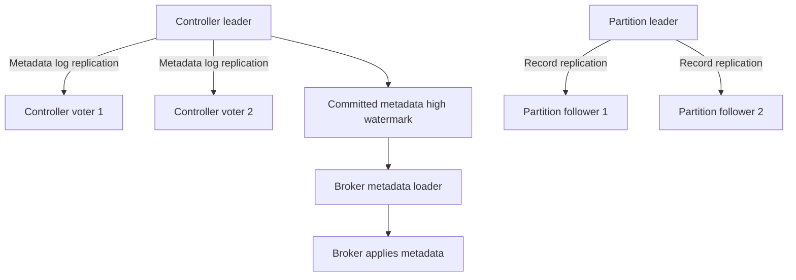

# Độ trễ nhân bản, tình trạng controller quorum và metadata

Kafka có hai luồng nhân bản quan trọng cần quan sát riêng. **Data replication** sao chép record của topic từ partition leader sang follower replica. **Metadata replication trong KRaft** sao chép metadata log giữa các controller voter để duy trì trạng thái cluster như broker registration, topic, partition, ACL và cấu hình. Sau khi metadata được commit trong quorum, từng broker còn phải áp dụng metadata mới vào trạng thái cục bộ.

Một cluster có thể có data replica lag dù controller quorum khỏe; cũng có thể controller quorum vẫn có majority nhưng một broker áp dụng metadata chậm. Nếu gộp mọi dấu hiệu thành một chỉ số “Kafka lag”, đội vận hành dễ chẩn đoán nhầm. Bài viết này trình bày cách đo lag của partition, kiểm tra ISR và high watermark, giám sát KRaft voter quorum, theo dõi metadata apply trên broker và xây dựng cảnh báo/runbook theo từng lớp.

## 1. Ba lớp cần quan sát

Khi theo dõi replication và metadata, hãy tách ba lớp:

| Lớp | Dữ liệu được nhân bản/áp dụng | Câu hỏi chính | Công cụ quan sát |
|---|---|---|---|
| Data-plane replication | Record của từng topic-partition | Follower có theo kịp leader và ISR có đủ replica không? | `kafka-topics --describe`, broker JMX, replica fetcher metrics |
| KRaft controller quorum | Metadata log giữa các controller voter | Có leader và majority để commit metadata không? Voter nào đang lag? | `kafka-metadata-quorum describe`, Raft JMX metrics, controller logs |
| Broker metadata application | Metadata đã commit được broker tải và áp dụng tới đâu | Broker có nhìn thấy cấu hình/topic/broker state mới nhất không? | Metadata loader/controller metrics, broker logs, Admin API |



Controller quorum và data replica đều dùng replication, nhưng chúng có log, protocol, trạng thái và failure mode riêng. Không dùng `UnderReplicatedPartitions` để kết luận controller quorum đang lag; cũng không dùng `HighWatermark` của metadata quorum để đánh giá follower của một topic.

## 2. Data replication: leader, follower, LEO, HW và ISR

Mỗi topic-partition có một replica leader và các follower replica. Producer gửi record tới leader; follower fetch record từ leader để duy trì bản sao.

Các thuật ngữ quan trọng:

| Thuật ngữ | Ý nghĩa |
|---|---|
| Leader | Replica đang nhận produce request và phục vụ đọc theo cơ chế Kafka |
| Follower | Replica fetch dữ liệu từ leader |
| LEO (Log End Offset) | Offset kế tiếp tại cuối log cục bộ của replica; LEO phản ánh log đã ghi tới đâu |
| HW (High Watermark) | Ranh giới record đã được replicate đủ theo ISR và được xem là committed đối với consumer theo semantics thông thường |
| ISR (In-Sync Replicas) | Tập replica được xem là đang đồng bộ với leader |
| Under-replicated partition | Partition có số replica trong ISR nhỏ hơn replication factor |
| Offline partition | Partition hiện không có leader khả dụng |

Ví dụ topic `orders.events` có replication factor 3:

```text
Partition 0
  Leader: broker-1, LEO=1200
  ISR: broker-1, broker-2, broker-3
  broker-2 LEO=1200
  broker-3 LEO=1198
```

Replica broker-3 đang thấp hơn leader 2 offset nhưng vẫn có thể còn trong ISR tùy thời điểm và ngưỡng lag. Nếu broker-3 bị loại khỏi ISR, ISR chỉ còn hai replica; partition trở thành under-replicated vì replication factor là ba.

### LEO không phải HW

Leader có thể đã ghi record tới LEO 1200 trong khi HW vẫn ở 1198 vì follower chưa replicate đủ. Consumer không đọc vượt qua giới hạn commit tương ứng. Với `read_committed`, giới hạn còn chịu ảnh hưởng của Last Stable Offset (LSO) khi có transaction đang mở.

Không dùng LEO của leader làm bằng chứng mọi record đã được replicate an toàn. Cần theo dõi HW, ISR và cấu hình producer `acks`/`min.insync.replicas` cùng nhau.

## 3. Đo follower lag

Một cách hiểu đơn giản về lag theo offset là:

\[
\text{FollowerLag} = \text{LeaderLEO} - \text{FollowerLEO}
\]

Giá trị này biểu diễn số offset follower còn thiếu so với leader tại thời điểm đo. Nó không trực tiếp cho biết số byte hoặc số giây bị trễ. Nếu tốc độ produce tăng nhanh, cùng 1.000 offset lag có thể tương đương vài giây ở tải cao hoặc hàng giờ ở tải thấp.

Nên kết hợp:

- Offset lag: follower còn thiếu bao nhiêu offset.
- Thời gian kể từ lần fetch/catch-up gần nhất.
- Tốc độ produce và replica fetch.
- ISR membership và ISR shrink/expand rate.
- Disk/network/request latency trên broker leader và follower.

Một follower có offset lag tăng liên tục cho thấy replication không theo kịp tốc độ ghi. Lag giảm dần cho thấy follower đang bắt kịp. Lag bằng 0 trong một lần scrape không đảm bảo replica sẽ tiếp tục khỏe nếu network hoặc disk sắp nghẽn.

## 4. ISR và ý nghĩa của `min.insync.replicas`

ISR là tập replica Kafka đang xem là đủ đồng bộ để tham gia cam kết ghi. Follower bị chậm hoặc không fetch trong thời gian cho phép có thể bị loại khỏi ISR; khi bắt kịp, nó có thể được thêm lại.

Hai cấu hình ảnh hưởng khả năng ghi:

```properties
# Ví dụ topic có replication factor 3
min.insync.replicas=2
```

Producer:

```properties
acks=all
```

Với `acks=all`, leader chỉ trả thành công khi record được replicate tới toàn bộ replica hiện nằm trong ISR theo semantics của Kafka. `min.insync.replicas=2` yêu cầu ISR có ít nhất hai replica để chấp nhận ghi. Nếu ISR giảm còn một, produce request với `acks=all` sẽ thất bại thay vì chấp nhận ghi với mức bảo vệ thấp hơn.

`min.insync.replicas` không bắt buộc ISR phải bằng replication factor. Với replication factor 3 và min ISR 2, ghi vẫn có thể thành công khi một follower tạm thời ngoài ISR. Đây là đánh đổi giữa availability và durability.

Không nhầm `acks=all` với việc chờ mọi replica đã cấu hình trong replication factor. Nó áp dụng với tập ISR hiện tại; min ISR đặt ngưỡng tối thiểu cho tập đó.

## 5. Vì sao data replica bị lag?

Nguyên nhân thường nằm ở đường produce/fetch, tài nguyên broker hoặc mạng:

| Nhóm nguyên nhân | Dấu hiệu | Hướng điều tra |
|---|---|---|
| Network | Replica fetch rate giảm, request timeout, retransmit hoặc latency cao | Kiểm tra packet loss, bandwidth, NIC, routing và firewall |
| Disk I/O | Log append/fetch chậm, disk await/queue tăng | Kiểm tra throughput, IOPS, disk latency, filesystem và dung lượng |
| Broker CPU/GC | Request handler chậm, GC pause, CPU bão hòa | Kiểm tra JVM, heap, GC, CPU và request queue |
| Produce burst | Bytes in tăng đột biến, follower lag tăng theo tải | So sánh produce rate với replica fetch rate; kiểm tra batching/compression |
| Partition skew | Một số leader/follower có tải cao bất thường | Kiểm tra partition distribution, key skew và leader placement |
| Broker down/restart | ISR shrink, replica offline, recovery fetch | Kiểm tra process, disk, broker logs và thời gian phục hồi |
| Reassignment/throttling | Replication bị giới hạn trong lúc di chuyển replica | Kiểm tra reassignment plan và replication throttle |
| Quá nhiều partition | Metadata/request overhead, disk file và thread overhead tăng | Kiểm tra partition count, controller/broker capacity và topic design |

Khi lag tăng, không vội tăng `replica.fetch.max.bytes` hoặc các batch limit. Trước hết xác định nút nghẽn là network, disk, CPU, broker request queue hay produce burst; thay đổi sai tham số có thể làm memory pressure tăng.

## 6. JMX metrics cho data replication

Các metric dưới đây thường được expose qua broker JMX. Tên object/label có thể khác nhẹ theo Kafka version và cách exporter chuẩn hóa metric; cần đối chiếu metric catalog của release đang chạy.

| Metric | Mục đích | Cách đọc |
|---|---|---|
| `kafka.server:type=ReplicaManager,name=UnderReplicatedPartitions` | Số partition under-replicated mà broker theo dõi | Giá trị lớn hơn 0 kéo dài cần điều tra |
| `kafka.server:type=ReplicaManager,name=IsrShrinksPerSec` | Tốc độ ISR bị thu hẹp | Spike cho thấy replica liên tục rời ISR |
| `kafka.server:type=ReplicaManager,name=IsrExpandsPerSec` | Tốc độ ISR mở rộng | Tăng sau sự cố cho thấy replica bắt kịp và quay lại ISR |
| `kafka.server:type=ReplicaFetcherManager,name=MaxLag,clientId=Replica` | Lag lớn nhất của replica fetcher theo follower fetcher | Theo dõi xu hướng và broker nguồn |
| `kafka.server:type=ReplicaFetcherManager,name=MinFetchRate,clientId=Replica` | Fetch rate thấp nhất trong các fetcher | Giá trị thấp kéo dài có thể chỉ ra follower không fetch được |
| `kafka.server:type=BrokerTopicMetrics,name=BytesInPerSec` | Throughput ghi vào broker | Đặt cạnh replication fetch throughput để tìm mất cân bằng |
| `kafka.server:type=BrokerTopicMetrics,name=BytesOutPerSec` | Throughput gửi ra broker | Giúp phát hiện áp lực network |

`UnderReplicatedPartitions` là metric broker-level. Khi tổng hợp cluster, cần hiểu metric được report theo broker và tránh cộng trùng một partition nếu cách export/version làm nhiều broker báo cùng trạng thái. Có thể dùng max hoặc phép tổng hợp đã xác minh với dashboard/metric semantics cụ thể.

### ISR shrink/expand cần đọc theo xu hướng

Một lần ISR shrink trong lúc broker restart có kế hoạch không nhất thiết là sự cố. ISR shrink liên tục trên cùng partition hoặc nhiều partition thường cho thấy follower không theo kịp. ISR expand sau đó cho thấy replica đã bắt kịp, nhưng cần xác minh lag không tái diễn.

## 7. Kiểm tra replica bằng Kafka CLI

Xem leader, replica và ISR của topic:

```bash
kafka-topics.sh --bootstrap-server broker-1:9092 \
  --describe --topic orders.events
```

Kết quả minh họa:

```text
Topic: orders.events  Partition: 0  Leader: 1  Replicas: 1,2,3  Isr: 1,2
Topic: orders.events  Partition: 1  Leader: 2  Replicas: 2,3,1  Isr: 2,3,1
```

Partition 0 có replication factor 3 nhưng ISR chỉ có broker 1 và 2, nên đang under-replicated. Partition 1 có đủ ba replica trong ISR.

Kiểm tra replica log directory và offset lag:

```bash
kafka-log-dirs.sh --bootstrap-server broker-1:9092 \
  --describe --broker-list 1,2,3 \
  --topic-list orders.events
```

Kết quả có thể cung cấp thông tin replica, log directory, size và offset lag tùy version. Lệnh này giúp xác định replica nằm trên broker/disk nào; nó không thay thế kiểm tra ISR và controller quorum.

Nếu đang chạy partition reassignment, kiểm tra tiến độ với file reassignment đã dùng:

```bash
kafka-reassign-partitions.sh --bootstrap-server broker-1:9092 \
  --verify --reassignment-json-file reassignment.json
```

Chỉ dùng `--verify` với đúng file kế hoạch đang chạy. Không tạo reassignment mới để “sửa lag” trước khi hiểu nguyên nhân và trạng thái reassignment hiện tại.

## 8. KRaft controller quorum là gì?

Trong KRaft, metadata cluster được lưu trong metadata log và replicate bằng Raft giữa các controller voter. Một controller giữ vai trò leader; các voter còn lại replicate log và tham gia bầu leader/commit metadata.

Metadata log chứa thông tin như:

- Broker đăng ký, broker fencing và trạng thái broker.
- Topic, partition và replica assignment.
- Thay đổi cấu hình topic/broker được quản lý qua metadata.
- ACL và principal/security metadata do cluster quản lý.
- Thay đổi liên quan controller quorum và cluster metadata.

Controller quorum cần majority của voter để tiếp tục commit metadata. Với N voter, majority là:

\[
\text{Majority} = \left\lfloor\frac{N}{2}\right\rfloor + 1
\]

| Số controller voter | Majority cần có | Số voter có thể mất mà vẫn còn majority |
|---:|---:|---:|
| 1 | 1 | 0 |
| 3 | 2 | 1 |
| 5 | 3 | 2 |

Observer không bỏ phiếu và không được tính vào majority. Không cộng observer vào số voter để tính khả năng chịu lỗi.

## 9. Controller quorum lag khác data replica lag

Data replica lag đo khoảng cách log của một topic-partition giữa leader và follower. Controller quorum lag đo khoảng cách metadata log giữa controller voter và leader của quorum.

| Đặc điểm | Data replication | Controller quorum replication |
|---|---|---|
| Log | Log của topic-partition | KRaft metadata log |
| Leader | Partition leader | Controller quorum leader |
| Follower | Partition replica follower | Controller voter follower/observer |
| Commit boundary | Partition HW/LSO theo semantics | Metadata quorum high watermark |
| Số lượng | Nhiều partition độc lập | Một metadata quorum cho cluster |
| Công cụ chính | `kafka-topics --describe`, ReplicaManager metrics | `kafka-metadata-quorum describe`, Raft metrics |
| Tác động khi lag | Giảm durability/availability của partition, tăng produce/fetch latency | Chậm hoặc mất khả năng commit thay đổi metadata; election có thể bị ảnh hưởng |

Một topic có thể under-replicated trong khi metadata quorum vẫn khỏe. Ngược lại, mọi partition data có thể đủ ISR nhưng controller quorum đang mất majority, khiến thay đổi metadata không thể commit.

## 10. High watermark và lag của metadata quorum

Mỗi controller voter có log end offset cục bộ. Controller leader replicate metadata records tới follower; metadata high watermark là ranh giới đã được quorum xác nhận commit.

Các trường thường thấy trong lệnh `describe --status`:

| Trường | Ý nghĩa |
|---|---|
| `LeaderId` | Node ID của controller leader hiện tại |
| `LeaderEpoch` | Epoch của leader, thay đổi qua các lần bầu leader |
| `HighWatermark` | Offset metadata log đã commit trong quorum |
| `MaxFollowerLag` | Lag lớn nhất giữa follower và leader theo offset |
| `MaxFollowerLagTimeMs` | Thời gian follower lag lớn nhất theo phép đo của quorum |
| `CurrentVoters` | Danh sách controller voter hiện tại |
| `CurrentObservers` | Danh sách observer hiện tại |

`HighWatermark` của metadata log không phải high watermark của topic `orders.events`. Nó phản ánh metadata records đã được commit trong quorum.

Nếu follower lag tăng nhưng leader vẫn có majority và commit được metadata, cluster có thể vẫn hoạt động nhưng khả năng chịu thêm lỗi giảm. Nếu mất majority, controller không thể commit metadata mới; các thao tác quản trị như tạo topic, thay partition assignment hoặc cập nhật ACL có thể thất bại/chờ.

## 11. Kiểm tra quorum bằng `kafka-metadata-quorum.sh`

Xem trạng thái quorum:

```bash
kafka-metadata-quorum.sh --bootstrap-server broker-1:9092 describe --status
```

Ví dụ kết quả minh họa:

```text
ClusterId:              MkU3OEVBNTcwNTJENDM2Qk
LeaderId:               100
LeaderEpoch:            42
HighWatermark:          187650
MaxFollowerLag:         0
MaxFollowerLagTimeMs:   0
CurrentVoters:          [100, 101, 102]
CurrentObservers:       []
```

Xem replication status của từng voter:

```bash
kafka-metadata-quorum.sh --bootstrap-server broker-1:9092 describe --replication
```

Lệnh replication cung cấp log end offset, lag, thời điểm fetch gần nhất và thời điểm voter bắt kịp gần nhất theo phiên bản. Nó giúp xác định node nào đang tụt lại phía sau leader.

Nếu cluster listener yêu cầu TLS/SASL, truyền client properties qua tùy chọn `--command-config` được hỗ trợ bởi script/version đang chạy. Dùng endpoint broker có thể truy cập được và xác minh node ID trong output với inventory cluster.

### Đọc output theo thứ tự

1. `LeaderId` có hợp lệ và ổn định không?
2. `CurrentVoters` có đủ số voter dự kiến không?
3. Có majority voter đang hoạt động không?
4. `HighWatermark` có tiếp tục tiến lên khi có metadata change không?
5. `MaxFollowerLag` và `MaxFollowerLagTimeMs` có tăng liên tục không?
6. Trong `describe --replication`, voter nào có fetch timestamp cũ hoặc log end offset đứng yên?

Một lần lag bằng 0 không đủ chứng minh quorum ổn định. Theo dõi nhiều lần scrape và trong lúc có metadata change để thấy xu hướng.

## 12. Controller voter và observer

Voter tham gia bầu leader và majority commit. Observer nhận metadata log nhưng không bỏ phiếu. Observer có thể hữu ích trong một số mô hình mở rộng/di chuyển, nhưng không tăng majority và không thay thế voter bị lỗi.

Trong cluster ba voter:

- Một voter down: còn hai voter, vẫn có majority.
- Hai voter down: chỉ còn một voter, mất majority; metadata commit bị dừng.
- Thêm hai observer không khôi phục majority nếu hai voter đã down.

Không thay đổi membership quorum bằng cách tự sửa danh sách voter hoặc xóa thư mục metadata của controller. Dùng quy trình quản lý quorum được hỗ trợ bởi Kafka version, đảm bảo majority hiện tại và xác minh trạng thái sau từng bước.

## 13. Controller election và các dấu hiệu bất ổn

Controller leader có thể thay đổi khi leader hiện tại dừng, mất kết nối hoặc bị quorum xem là không còn khả dụng. Một election đơn lẻ trong lúc bảo trì có kế hoạch không nhất thiết là sự cố; election lặp lại liên tục có thể chỉ ra:

- Network partition hoặc packet loss giữa controller nodes.
- Controller JVM pause/GC hoặc CPU bão hòa.
- Disk metadata log chậm hoặc đầy.
- Heartbeat/replication timeout không phù hợp với độ trễ thực tế.
- Một voter liên tục restart hoặc bị fencing.
- Clock skew hoặc hạ tầng mạng không ổn định.

Các chỉ số nên theo dõi gồm election latency, commit latency, số lần leader change, current leader/epoch, voter count, follower lag và controller request latency.

Nếu leader election xảy ra thường xuyên, đừng chỉ tăng timeout. Trước tiên kiểm tra network, disk, CPU, GC và controller logs để xác định nguyên nhân.

## 14. JMX metrics cho KRaft quorum

Kafka expose các metric Raft qua JMX domain/nhóm `raft-metrics` (tên object/metric format phụ thuộc version và exporter). Các metric thường gặp:

| Metric | Ý nghĩa | Dấu hiệu cần chú ý |
|---|---|---|
| `current-leader` | Node ID leader hiện tại | `-1`/không có leader hoặc thay đổi liên tục |
| `current-epoch` | Epoch Raft hiện tại | Tăng khi có bầu leader mới; tăng liên tục là dấu hiệu churn |
| `high-watermark` | Metadata log commit offset | Đứng yên khi có metadata writes cần kiểm tra |
| `log-end-offset` | Log end offset cục bộ của node | Chênh với leader cho biết follower lag |
| `commit-latency-avg` | Độ trễ commit trung bình | Tăng kéo dài cho thấy quorum/disk/network chậm |
| `commit-latency-max` | Độ trễ commit lớn nhất | Spike lớn có thể làm admin operation chậm |
| `election-latency-avg` | Độ trễ bầu leader trung bình | Tăng hoặc có election lặp lại cần điều tra |
| `election-latency-max` | Độ trễ bầu leader lớn nhất | Spike có thể kéo dài thời gian không có leader |
| `number-of-voters` | Số voter mà node nhận biết | So sánh với quorum membership dự kiến |
| `number-of-observers` | Số observer mà node nhận biết | Không cộng vào majority |

Tên metric có thể dùng camelCase, kebab-case hoặc JMX attribute khác khi qua exporter. Một số metric chỉ có ở version mới. Dùng JMX MBean thực tế của Kafka release và dashboard đã kiểm thử thay vì copy nguyên tên từ cluster khác.

### Controller metrics bổ sung

Có thể quan sát các metric controller như `ActiveControllerCount`, `FencedBrokerCount`, `TimedOutBrokerHeartbeatCount`, `MetadataErrorCount`, `GlobalTopicCount` và `GlobalPartitionCount` nếu version hỗ trợ. `ActiveControllerCount` cần được diễn giải theo broker/node: trong cluster khỏe chỉ nên có một active controller leader. Scrape thiếu node có thể làm phép tổng hợp sai, vì vậy phải kiểm tra coverage trước khi alert.

## 15. Broker đã áp dụng metadata mới chưa?

Controller quorum commit metadata không đồng nghĩa mọi broker đã áp dụng metadata đó ngay lập tức. Broker nhận metadata delta/snapshot và cập nhật metadata image cục bộ. Nếu một broker xử lý metadata chậm, broker có thể phản ứng chậm với topic mới, partition mới, ACL hoặc thay đổi cấu hình dù quorum đã commit thành công.

Ví dụ:

1. Admin tạo topic `orders.archive`.
2. Controller quorum commit metadata record.
3. Broker A nhận và áp dụng metadata mới.
4. Broker B đang GC pause hoặc tải cao, áp dụng metadata chậm.
5. Request tới broker B có thể thấy metadata cũ trong một khoảng thời gian hoặc bị trì hoãn.

Đây là **metadata apply lag**, khác với controller voter replication lag.

### Theo dõi metadata loader

Tùy Kafka version, broker expose metric liên quan MetadataLoader/metadata image như:

- Last applied metadata record offset/timestamp.
- Metadata load/apply latency.
- Metadata load error count.
- Metadata image age hoặc thời gian kể từ lần áp dụng gần nhất.

Tên JMX MBean cụ thể thay đổi giữa release. Khi triển khai dashboard, xác minh metric trên broker thực tế và so sánh last applied offset/timestamp với metadata quorum high watermark/commit progress. Nếu broker liên tục tụt sau trong khi controller quorum đã commit, kiểm tra broker log, GC, CPU, network và metadata load errors.

Không truy cập hoặc chỉnh sửa trực tiếp metadata image nội bộ để “đẩy” broker bắt kịp. Dùng broker restart/recovery theo runbook chính thức nếu đã xác định metadata loader bị kẹt và hiểu ảnh hưởng tới partition leadership.

## 16. Metadata log và snapshot

KRaft lưu metadata trong metadata log; controller tạo snapshot để rút ngắn thời gian khôi phục thay vì phải replay toàn bộ log từ đầu. Snapshot là điểm khôi phục metadata, không phải bản backup thay thế cho quorum hoặc quy trình backup cluster.

Các nguyên tắc:

- Giữ controller storage bền vững và đủ dung lượng.
- Theo dõi disk usage, log segment/snapshot activity và startup/recovery time.
- Không xóa thư mục metadata hoặc file snapshot để xử lý lỗi thông thường.
- Không dùng `kafka-storage.sh format` trên controller đang có metadata nếu không có quy trình recovery/cluster bootstrap được phê duyệt.
- Khi thay controller, tuân thủ quy trình membership và metadata directory ID của version đang chạy.

Metadata log là dữ liệu điều khiển của cluster. Mất metadata có thể làm cluster không khôi phục được trạng thái broker/topic/partition/ACL chính xác. Bảo vệ storage và quy trình vận hành controller quan trọng tương đương bảo vệ dữ liệu topic.

## 17. Quan sát metadata change và Admin API

Các thao tác như create topic, tăng partition, alter configs, thay ACL hoặc thay đổi broker registration tạo metadata change. Có thể dùng AdminClient để kiểm tra trạng thái tài nguyên sau thao tác:

```java
try (Admin admin = Admin.create(adminProperties)) {
    DescribeClusterResult cluster = admin.describeCluster();
    System.out.println("Cluster ID: " + cluster.clusterId().get());
    System.out.println("Controller: " + cluster.controller().get());

    TopicDescription topic = admin.describeTopics(
            List.of("orders.events"))
            .topicNameValues()
            .get("orders.events")
            .get();

    System.out.println(topic);
}
```

Admin API xác minh broker đang trả metadata cho client. Nó không thay thế `kafka-metadata-quorum describe`, vì Admin API không cung cấp đầy đủ voter replication lag/high watermark của metadata log.

Khi một Admin API timeout, không vội gửi lặp lại thao tác không idempotent hoặc thao tác có tác động rộng. Kiểm tra resource đã được tạo/thay đổi chưa, kiểm tra quorum health và sau đó mới quyết định retry.

## 18. Kết hợp dashboard data-plane và control-plane

Một dashboard hữu ích nên có ba nhóm panel:

### Data-plane panel

- Under-replicated partitions theo broker và cluster.
- Offline partitions.
- ISR shrink/expand rate.
- Replica fetcher max lag/fetch rate.
- Bytes in/out, produce/fetch request latency.
- Disk latency, disk utilization và network throughput.

### Controller quorum panel

- Current leader và leader epoch.
- Current voters/observers và số voter reachable.
- Metadata high watermark và log end offset theo voter.
- Max follower lag/lag time.
- Commit latency và election latency.
- Controller CPU, heap/GC, disk và network.

### Broker metadata panel

- Last applied metadata offset/timestamp trên từng broker.
- Metadata load/apply latency và error count.
- Broker registration/fencing state.
- Admin API latency/failure cho create topic, alter config và ACL.
- Broker logs có metadata load error hoặc stale metadata warning.

Tách dashboard theo cluster, broker/node ID, topic và partition. Không tạo label có cardinality quá cao như offset, record key hoặc request ID. Với metric partition-level, có thể dùng dashboard drill-down thay vì đưa toàn bộ partition vào một biểu đồ tổng hợp.

## 19. Thiết kế alert có ý nghĩa

Alert nên dựa trên tác động và thời gian kéo dài, không chỉ một giá trị đơn lẻ.

| Alert | Điều kiện tham khảo | Mức độ |
|---|---|---|
| Offline partition | `OfflinePartitionsCount > 0` kéo dài hoặc xuất hiện bất ngờ | Critical |
| Under-replicated partition | `UnderReplicatedPartitions > 0` liên tục qua nhiều chu kỳ scrape | Warning/Critical theo số lượng và thời gian |
| ISR shrink burst | ISR shrink rate tăng đột biến trên nhiều partition | Warning |
| ISR dưới min ISR | Partition có ISR thấp hơn `min.insync.replicas` và produce bị lỗi | Critical cho workload ghi quan trọng |
| Controller leader missing | Không có leader quorum | Critical |
| Quorum mất majority | Voter reachable nhỏ hơn majority | Critical |
| Controller follower lag | Lag/lag time tăng liên tục và follower không bắt kịp | Warning; Critical nếu giảm dự phòng majority |
| Election churn | Leader epoch/election rate tăng bất thường | Warning/Critical tùy thời gian mất leader |
| Metadata commit latency | Commit latency vượt SLO trong nhiều phút | Warning |
| Broker metadata apply lag | Last applied offset/timestamp tụt xa commit progress | Warning/Critical nếu broker phục vụ request sai/chậm |
| Metadata load errors | Error count tăng hoặc broker không áp dụng metadata mới | Critical khi ảnh hưởng broker |

Các ngưỡng cụ thể cần lấy từ baseline của cluster. Ví dụ, under-replicated partition trong vài giây khi rolling restart có thể chấp nhận được; kéo dài nhiều phút ngoài maintenance window cần cảnh báo. Với controller quorum, mất majority cần alert ngay vì metadata writes sẽ bị ảnh hưởng.

### Tránh alert giả

- Gắn maintenance window khi rolling restart hoặc reassignment có kế hoạch.
- Kiểm tra coverage của JMX exporter trước khi coi metric thiếu là 0.
- Dùng `for` duration cho lag transient nhưng không trì hoãn alert mất quorum.
- Alert theo số lượng và tỷ lệ partition bị ảnh hưởng, không chỉ một cluster-wide sum.
- Tách alert data-plane và control-plane để đúng đội xử lý.

## 20. Runbook: data replica lag tăng

Khi `UnderReplicatedPartitions` hoặc follower lag tăng:

1. Xác định topic/partition/leader/follower bị ảnh hưởng bằng `kafka-topics --describe`.
2. Xem ISR shrink/expand và replica fetcher lag trên broker liên quan.
3. Kiểm tra broker follower có sống, disk còn đủ dung lượng và log directory có lỗi không.
4. So sánh produce bytes/sec với follower fetch throughput.
5. Kiểm tra network giữa leader và follower, packet loss và request latency.
6. Kiểm tra disk I/O, CPU, GC và request handler queue trên cả hai broker.
7. Nếu có reassignment, kiểm tra throttle và tiến độ bằng `--verify`.
8. Xác định ISR còn đáp ứng `min.insync.replicas` không; theo dõi produce errors.
9. Khắc phục nút nghẽn rồi quan sát ISR expand và lag giảm.
10. Chỉ thay đổi replication throttle/partition assignment sau khi có kế hoạch và đo tác động.

Không xóa replica log hoặc giảm replication factor chỉ để làm metric under-replicated biến mất. Cần giữ bản sao dữ liệu theo durability requirement.

## 21. Runbook: controller quorum lag hoặc mất majority

Khi `describe --status` cho thấy follower lag tăng, leader thay đổi liên tục hoặc không có majority:

1. Chạy `kafka-metadata-quorum.sh describe --status` từ broker/controller có thể truy cập.
2. Chạy `describe --replication` để xác định voter nào đang lag, không fetch hoặc unreachable.
3. So sánh `CurrentVoters` với quorum membership dự kiến; không tính observer vào majority.
4. Kiểm tra controller process, node ID, metadata directory, disk space và controller logs.
5. Kiểm tra network latency/packet loss giữa tất cả controller voter.
6. Kiểm tra CPU, JVM GC pause, disk fsync latency và clock synchronization.
7. Nếu còn majority, ưu tiên khôi phục voter follower bị lỗi từng node và xác minh nó bắt kịp.
8. Nếu mất majority, dừng thay đổi cấu hình hoặc format storage; thu thập trạng thái và làm theo quy trình disaster recovery chính thức cho đúng Kafka version.
9. Sau khi quorum ổn định, xác minh leader/epoch/high watermark và thử một metadata operation an toàn trong môi trường/quy trình cho phép.
10. Kiểm tra broker metadata apply lag để bảo đảm broker đã nhận metadata mới.

**Không restart đồng thời toàn bộ controller.** Không xóa `__cluster_metadata` hoặc metadata directory, không format lại controller storage và không tự thêm/bớt voter bằng cách chỉnh file cấu hình tùy tiện khi quorum đang gặp sự cố. Những hành động này có thể làm mất khả năng phục hồi metadata.

## 22. Runbook: quorum khỏe nhưng broker metadata stale

Nếu controller quorum có majority, high watermark tiến bình thường nhưng một broker không thấy topic/ACL/config mới:

1. So sánh metadata apply offset/timestamp giữa broker đó và quorum commit progress.
2. Kiểm tra broker log về metadata loader, metadata image update hoặc load error.
3. Kiểm tra CPU, GC pause, disk và network của broker.
4. Xác minh broker registration/fencing state và kết nối tới controller.
5. Kiểm tra Admin API request có được route tới broker stale hay không.
6. Khắc phục nguyên nhân và theo dõi metadata apply progress bắt kịp.
7. Nếu cần restart broker, thực hiện theo rolling procedure và xác minh partition leadership/ISR trước-sau.

Đừng thay đổi controller quorum khi chỉ một broker áp dụng metadata chậm; xử lý đúng lớp broker metadata loader.

## 23. Lỗi thường gặp khi đọc số liệu

| Nhận định sai | Thực tế cần kiểm tra |
|---|---|
| `UnderReplicatedPartitions=0` nghĩa là controller khỏe | Chỉ phản ánh data partition replication; phải kiểm tra KRaft quorum riêng |
| Metadata `HighWatermark` bằng 0 nghĩa là cluster mất dữ liệu | Cần xem cluster mới khởi tạo, metric scrape và log offset thực tế; không kết luận từ một sample |
| Follower lag 1000 offset luôn nghiêm trọng | Cần quy đổi theo produce rate, thời gian lag, ISR và workload SLA |
| Có 3 controller process là có majority | Phải xác định chúng là voter hiện tại, reachable và thuộc cùng quorum |
| Có observer thay được voter | Observer không bỏ phiếu và không tính vào majority |
| Controller quorum leader khỏe nghĩa mọi broker có metadata mới | Broker metadata application có thể vẫn bị lag |
| Một ISR shrink luôn là data loss | Replica có thể được loại khỏi ISR để bảo vệ consistency; cần xem HW, min ISR và replica recovery |
| `acks=all` chờ mọi replica trong replication factor | `acks=all` chờ các replica hiện nằm trong ISR; `min.insync.replicas` đặt ngưỡng tối thiểu |
| Restart toàn bộ controller là cách đồng bộ metadata | Có thể làm mất majority và làm cluster không commit được metadata |

## 24. Checklist production

**Data replication:**

- Replication factor và `min.insync.replicas` phù hợp yêu cầu durability.
- Producer quan trọng dùng `acks=all` khi cần xác nhận theo ISR.
- Theo dõi UnderReplicatedPartitions, OfflinePartitionsCount, ISR shrink/expand.
- Theo dõi follower lag/fetch rate, produce/fetch latency và network/disk.
- Kiểm tra leader/replica distribution và partition skew.
- Có runbook reassignment/throttle và recovery replica.

**KRaft controller quorum:**

- Có số voter và majority phù hợp failure domain.
- Theo dõi leader ID/epoch, current voters/observers, metadata high watermark và follower lag.
- Theo dõi commit/election latency và controller process health.
- Controller storage bền vững, đủ dung lượng và có backup/recovery procedure phù hợp.
- Không tính observer vào majority.
- Không format/xóa metadata directory khi xử lý sự cố thông thường.

**Broker metadata application:**

- Theo dõi last applied metadata offset/timestamp và load errors nếu version expose.
- So sánh tiến độ broker với metadata quorum commit progress.
- Theo dõi GC, CPU, disk, network và broker registration/fencing.
- Kiểm tra Admin API và broker log khi metadata mới không xuất hiện đồng đều.

**Alert và vận hành:**

- Tách alert data-plane, controller quorum và metadata apply.
- Đặt ngưỡng theo baseline/SLO và thời gian kéo dài.
- Loại trừ maintenance window có kế hoạch.
- Kiểm thử runbook mất follower, mất một voter, leader election và broker metadata lag trong staging.
- Ghi lại cluster ID, node ID, version và output CLI khi điều tra.

## 25. Ghi nhớ

Data replication là quá trình follower sao chép record của topic-partition từ leader; theo dõi LEO, HW, ISR, under-replicated partition và replica fetcher lag. `acks=all` xác nhận theo ISR hiện tại; `min.insync.replicas` đặt ngưỡng ISR tối thiểu để chấp nhận ghi.

Trong KRaft, controller voter replicate metadata log qua Raft. Majority voter cần thiết để commit metadata; observer không tính vào majority. Dùng `kafka-metadata-quorum.sh describe --status` và `describe --replication` để xem leader, epoch, high watermark và lag của từng voter. Controller quorum khỏe vẫn chưa đảm bảo mọi broker đã áp dụng metadata mới: theo dõi metadata loader/apply progress riêng.

Khi điều tra, xác định lỗi nằm ở data replica, controller quorum hay broker metadata application trước khi hành động. Không restart đồng thời toàn bộ controller, không xóa metadata log/directory và không format storage để chữa lag. Dashboard và alert cần tách ba lớp, kết hợp CLI, JMX, log, disk/network metrics và runbook có kiểm soát.

## Tài liệu tham khảo

- [Apache Kafka – Monitoring](https://kafka.apache.org/documentation/#monitoring)
- [Apache Kafka – KRaft](https://kafka.apache.org/documentation/#kraft)
- [Apache Kafka – Operations](https://kafka.apache.org/documentation/#operations)
- [Apache Kafka – Replication](https://kafka.apache.org/documentation/#replication)
- [Apache Kafka – Broker Configs](https://kafka.apache.org/documentation/#brokerconfigs)
- [Apache Kafka – `kafka-metadata-quorum.sh` tool](https://kafka.apache.org/documentation/#kraft_monitoring)
