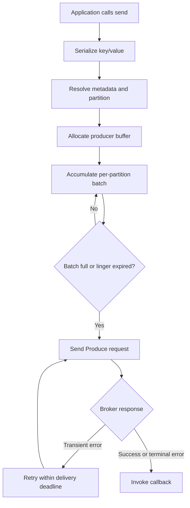
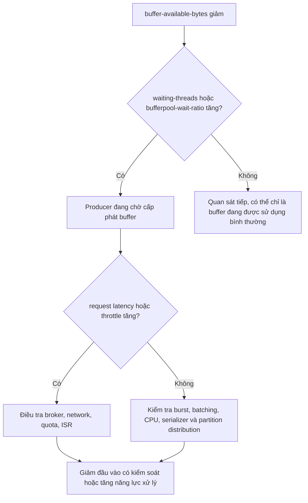

# Producer metrics: retry, buffer, batch và thời gian gửi

## Quan sát producer từ lúc gọi send() đến khi broker xác nhận

Kafka producer gửi record theo cơ chế bất đồng bộ. Ứng dụng gọi `send()`, producer serialize record, chọn partition, lấy metadata, cấp phát buffer, gom record thành batch, gửi request đến broker và chờ acknowledgement theo cấu hình `acks`. Khi có lỗi tạm thời, producer có thể retry trước khi callback hoàn tất.

Một con số latency đơn lẻ không đủ để đánh giá producer. Cần phân biệt:

- **Send-call time:** thời gian lời gọi `send()` chạy đồng bộ, bao gồm chờ metadata hoặc buffer khi cần.
- **Record queue time:** thời gian batch nằm trong bộ đệm chờ được gửi.
- **Request latency:** thời gian request Produce chờ phản hồi từ broker.
- **Application send latency:** thời gian từ lúc ứng dụng bắt đầu gửi đến callback thành công/thất bại; có thể bao gồm chờ buffer, batching, request và retry.

Khi theo dõi đúng các lớp này, ta có thể xác định producer chậm vì ứng dụng đẩy dữ liệu quá nhanh, batch chưa đủ, broker/network phản hồi chậm hay retry đang tăng.

## 1. Vòng đời gửi record và vị trí phát sinh độ trễ

### 1.1 Luồng gửi bất đồng bộ



`send()` thường trả về nhanh sau khi record được chấp nhận vào producer buffer. Tuy nhiên, nó có thể block khi cần lấy metadata hoặc chờ buffer memory; thời gian block này được giới hạn bởi `max.block.ms`. Serialization và custom partitioner chạy trong đường gọi ứng dụng, nên lỗi của chúng có thể xuất hiện đồng bộ trước khi callback được đăng ký.

Producer gom record theo partition. Khi batch đạt `batch.size` hoặc hết `linger.ms`, sender thread có thể gửi request. Một request Produce có thể chứa batch của nhiều partition trên broker đích. Broker phản hồi theo `acks`; nếu lỗi có thể retry, record vẫn nằm trong vòng đời gửi cho đến khi thành công hoặc hết deadline.

### 1.2 Bốn lớp latency cần phân biệt

| Lớp thời gian | Ý nghĩa | Chỉ số/đo lường |
|---|---|---|
| Lời gọi `send()` | Thời gian ứng dụng bị block trước khi nhận `Future` | Đo quanh lời gọi `send()` |
| Chờ trong producer | Batch chờ được gửi từ buffer | `record-queue-time-avg/max` |
| Request đến broker | Thời gian chờ phản hồi Produce | `request-latency-avg/max` |
| Đầu-cuối ở ứng dụng | Từ lúc bắt đầu gửi đến callback cuối cùng | Đo bằng timestamp ứng dụng |

Không cộng các metric một cách máy móc để suy ra end-to-end latency. Chúng có cửa sổ lấy mẫu và phạm vi đo khác nhau; dùng chúng để định vị tầng đang chậm.

## 2. Bộ metric producer quan trọng

Kafka Java producer công bố metrics qua Kafka Metrics và JMX; có thể lấy qua `KafkaProducer.metrics()` hoặc custom `MetricsReporter`. Tên metric dưới đây là tên trong producer metrics của Kafka 4.2. Khi chuyển qua Prometheus/JMX exporter, tên series có thể được chuẩn hóa theo cấu hình exporter.

### 2.1 Retry và lỗi gửi

| Metric | Phạm vi | Ý nghĩa |
|---|---|---|
| `record-retry-rate` | Producer/topic | Số record send được retry trung bình mỗi giây |
| `record-retry-total` | Producer/topic | Tổng số record send đã retry |
| `record-error-rate` | Producer/topic | Số record send kết thúc với lỗi trung bình mỗi giây |
| `record-error-total` | Producer/topic | Tổng số record send kết thúc với lỗi |
| `record-send-rate` | Producer/topic | Số record được gửi trung bình mỗi giây |
| `record-send-total` | Producer/topic | Tổng số record được gửi |

Retry và error là hai tín hiệu khác nhau. Retry tăng nhưng error vẫn bằng 0 có thể nghĩa là producer đang tự phục hồi sau lỗi tạm thời. Error tăng nghĩa là một phần record cuối cùng không được gửi thành công hoặc bị lỗi trước khi gửi.

Theo dõi retry theo `client-id` và `topic`. Một producer gửi nhiều topic có thể chỉ gặp lỗi ở một topic/partition hoặc một broker leader; metric tổng thể có thể che khuất vấn đề cục bộ.

### 2.2 Buffer và áp lực bộ nhớ

| Metric | Ý nghĩa |
|---|---|
| `buffer-total-bytes` | Tổng dung lượng buffer producer có thể dùng |
| `buffer-available-bytes` | Dung lượng buffer hiện chưa sử dụng hoặc đang ở free list |
| `buffer-exhausted-rate` | Số lần gửi bị từ chối do buffer cạn trung bình mỗi giây |
| `buffer-exhausted-total` | Tổng số lần gửi bị từ chối do buffer cạn |
| `waiting-threads` | Số thread ứng dụng đang block chờ buffer memory |
| `bufferpool-wait-ratio` | Tỷ lệ thời gian appender chờ cấp phát buffer |
| `bufferpool-wait-time` | Thời gian appender chờ cấp phát buffer theo metric của client |

`buffer.memory` là ngân sách bộ đệm cho record chờ gửi, không phải giới hạn cứng cho toàn bộ heap producer. Compression, in-flight request và các cấu trúc nội bộ còn dùng thêm bộ nhớ. Giá trị mặc định Kafka 4.2 là 32 MiB.

Khi producer đẩy record nhanh hơn khả năng broker nhận, buffer available giảm. Nếu buffer cạn, thread gọi `send()` có thể phải chờ đến `max.block.ms`; sau đó producer ném exception nếu vẫn không cấp phát được buffer.

### 2.3 Batch và compression

| Metric | Ý nghĩa |
|---|---|
| `batch-size-avg` | Kích thước trung bình batch gửi cho mỗi partition trong request |
| `batch-size-max` | Kích thước batch lớn nhất |
| `records-per-request-avg` | Số record trung bình trong một request |
| `batch-split-rate/total` | Số batch bị tách trung bình mỗi giây/tổng số lần tách |
| `compression-rate-avg` | Tỷ lệ kích thước batch nén so với batch trước nén |
| `record-size-avg/max` | Kích thước record trung bình/lớn nhất |

`batch-size-avg` thấp có thể do lưu lượng thấp, nhiều partition ít record, `linger.ms` nhỏ hoặc traffic phân tán không đều. Không thể kết luận `batch.size` quá nhỏ chỉ từ metric này.

`compression-rate-avg` là tỷ lệ compressed/uncompressed; giá trị càng thấp thường biểu thị nén hiệu quả hơn. Compression áp dụng trên record batch, do đó batch đầy hơn thường giúp tăng hiệu quả nén. Đổi compression type có trade-off CPU, throughput, network và latency.

### 2.4 Request và send latency

| Metric | Ý nghĩa |
|---|---|
| `record-queue-time-avg/max` | Thời gian batch nằm trong producer send buffer |
| `request-latency-avg/max` | Thời gian request chờ phản hồi |
| `requests-in-flight` | Số request hiện đang chờ phản hồi |
| `request-rate/total` | Tốc độ/tổng số request |
| `request-size-avg/max` | Kích thước request trung bình/lớn nhất |
| `produce-throttle-time-avg/max` | Thời gian broker throttle request |
| `outgoing-byte-rate` | Tốc độ byte gửi ra theo node |

`record-queue-time` phản ánh thời gian batch chờ trong client buffer, không phải thời gian callback end-to-end. `request-latency` phản ánh vòng request/response, không bao gồm toàn bộ thời gian chờ batch trước khi gửi.

Nếu `request-latency` tăng cùng `produce-throttle-time`, kiểm tra quota/throttling. Nếu request latency tăng nhưng throttle thấp, kiểm tra network, broker request queue, leader load và replication acknowledgement.

## 3. Retry: đo khả năng tự phục hồi của producer

### 3.1 Retry là gì?

Producer retry khi gặp lỗi tạm thời có thể khắc phục, chẳng hạn leader đổi trong lúc gửi, network timeout hoặc broker tạm thời không thể xử lý request. Retry gửi lại record/batch tương ứng. Lỗi không retry được sẽ được trả về ứng dụng.

Trong Kafka 4.2, `retries` mặc định là một giá trị rất lớn (`2147483647`). Tài liệu khuyến nghị thường để mặc định và kiểm soát tổng thời gian chờ bằng `delivery.timeout.ms`, thay vì tự đặt một số retry nhỏ.

`record-retry-rate` tăng không nhất thiết là lỗi nghiêm trọng nếu producer vẫn hoàn tất gửi trong SLA. Nhưng nếu retry tăng cùng `record-queue-time`, `request-latency`, buffer pressure hoặc callback latency, đó là dấu hiệu cần điều tra.

### 3.2 Phân biệt các timeout

| Cấu hình | Kiểm soát điều gì? |
|---|---|
| `max.block.ms` | Thời gian `send()` có thể block để chờ metadata hoặc buffer memory |
| `request.timeout.ms` | Thời gian chờ phản hồi của một request |
| `delivery.timeout.ms` | Giới hạn tổng thời gian record được giữ trước khi báo thành công/thất bại, gồm chờ gửi, chờ ACK và retry |
| `linger.ms` | Thời gian tối đa chờ thêm record để gom batch trước khi gửi nếu batch chưa đầy |

`delivery.timeout.ms` phải lớn hơn hoặc bằng `request.timeout.ms + linger.ms`. Producer có thể báo lỗi sớm hơn nếu gặp lỗi không retry được, retry cạn hoặc batch đã hết deadline riêng.

Ví dụ cấu hình:

```properties
request.timeout.ms=30000
linger.ms=10
delivery.timeout.ms=120000
```

Trong ví dụ, delivery deadline 120 giây đủ lớn so với request timeout cộng linger. Các giá trị production cần dựa trên SLA, network, broker và thời gian phục hồi mong muốn.

### 3.3 Retry và idempotence

Khi bật `enable.idempotence=true`, producer dùng producer ID và sequence để broker loại bỏ bản ghi trùng do retry trong cùng producer session. Idempotence được bật mặc định nếu không có cấu hình xung đột trong Kafka hiện đại.

Các điều kiện tương thích gồm:

- `acks=all`.
- `retries` lớn hơn 0.
- `max.in.flight.requests.per.connection` không vượt quá 5.

Idempotence bảo vệ việc retry ở Kafka producer protocol; nó không làm side effect ở database/API bên ngoài trở thành exactly-once. Nếu callback báo lỗi không xác định và ứng dụng tự gửi lại cùng nghiệp vụ bằng một lệnh send mới, cần event ID hoặc idempotency key ở tầng nghiệp vụ.

Khi idempotence tắt, retries bật và `max.in.flight.requests.per.connection` lớn hơn 1, batch sau có thể được ghi trước batch trước nếu batch đầu retry. Điều này có thể làm đảo thứ tự trong một partition. Nếu ordering quan trọng, bật idempotence và giữ các cấu hình tương thích.

### 3.4 Không tạo retry storm ở tầng ứng dụng

Không bọc mọi lỗi callback bằng vòng lặp retry tức thì không giới hạn. Producer đã có retry nội bộ; vòng retry ngoài có thể:

- Gửi trùng nghiệp vụ khi kết quả lần trước không xác định.
- Làm tăng tải đúng lúc broker đang quá tải.
- Giữ buffer và thread lâu hơn.
- Làm sai ordering giữa các record cùng key.

Nếu ứng dụng cần retry sau khi `delivery.timeout.ms` hết, dùng backoff có jitter, giới hạn số lần thử, event ID ổn định và dead-letter/reconciliation phù hợp với nghiệp vụ.

## 4. Buffer: nhận biết producer bị backpressure

### 4.1 Vì sao buffer cạn?

Producer giữ record trong memory cho đến khi batch được gửi và giải phóng buffer. Nếu tốc độ đầu vào lớn hơn tốc độ broker có thể nhận/acknowledge trong thời gian dài, lượng record chờ tăng.

Các nguyên nhân thường gặp:

- Broker/network chậm hoặc mất kết nối.
- Broker throttle theo quota.
- Leader partition quá tải hoặc ISR acknowledgement chậm.
- Compression hoặc serialization tốn CPU.
- Ứng dụng tạo nhiều record hơn throughput ổn định của cluster.
- `buffer.memory` quá thấp so với burst hợp lệ và thời gian chờ.

### 4.2 Nhận diện buffer pressure



Không cảnh báo chỉ vì `buffer-available-bytes` thấp trong một thời điểm ngắn. Buffer có thể được dùng bình thường khi traffic cao. Dấu hiệu đáng quan tâm là available bytes thấp kéo dài cùng waiting threads, bufferpool wait hoặc buffer exhausted tăng.

### 4.3 Phân biệt max.block.ms và delivery.timeout.ms

`max.block.ms` có thể làm `send()` ném exception trước khi record được xếp vào producer buffer nếu không lấy được metadata/buffer trong thời gian cho phép. `delivery.timeout.ms` giới hạn thời gian gửi sau khi `send()` đã trả về; nó bao gồm chờ batch, request và retry.

Nếu chỉ tăng `delivery.timeout.ms` trong khi buffer đã cạn, thread gọi `send()` vẫn có thể bị chặn bởi `max.block.ms`. Cần xem cả hai và đo send-call time.

### 4.4 Cách xử lý

- Kiểm tra broker throttle, request latency, broker request queue và lỗi Produce.
- Kiểm tra producer có gửi vào quá nhiều partition hoặc có partition hot.
- Tối ưu batch/compression để tăng throughput nếu CPU và latency cho phép.
- Điều tiết tốc độ đầu vào hoặc dùng bounded queue ở tầng ứng dụng.
- Tăng `buffer.memory` chỉ khi có đủ heap/container memory và burst là hợp lệ.
- Giới hạn thời gian block của caller và xử lý exception rõ ràng.

Tăng buffer chỉ kéo dài thời gian chịu burst; nó không làm cluster có throughput bền vững cao hơn.

## 5. Batch và linger: cân bằng throughput với latency

### 5.1 batch.size và linger.ms

`batch.size` là giới hạn kích thước batch mặc định theo partition. Producer cố gắng gom các record cùng partition thành ít request hơn. Nếu batch chưa đầy, producer có thể chờ đến `linger.ms` để nhận thêm record; nếu batch đầy trước, nó được gửi ngay.

Trong Kafka 4.2, `linger.ms` mặc định là 5 ms; giá trị mặc định thay đổi từ 0 lên 5 ms từ Kafka 4.0. Lý do là hiệu quả batching thường cải thiện throughput mà không làm tăng đáng kể hoặc thậm chí có thể giảm latency tổng thể khi tải phù hợp.

### 5.2 Đọc batch metrics

- `batch-size-avg` thấp và `records-per-request-avg` thấp: batch nhỏ hoặc request ít record.
- `batch-size-avg` gần `batch.size` thường xuyên: batch thường đầy; kiểm tra throughput và batch split.
- `batch-split-rate` tăng: batch bị chia trong đường gửi; kiểm tra kích thước record, request size và cấu hình giới hạn.
- `compression-rate-avg` gần 1: compression giảm kích thước ít; có thể do payload khó nén hoặc batch quá nhỏ.

Không cố làm batch luôn đầy. Với traffic thấp hoặc latency nhạy cảm, batch nhỏ có thể là lựa chọn đúng. Mục tiêu là đáp ứng đồng thời SLA latency, throughput và chi phí broker/network.

### 5.3 Điều chỉnh theo workload

| Workload | Hướng cấu hình ban đầu |
|---|---|
| Event nhỏ, throughput cao | Batch lớn hơn và linger vài ms để gom dữ liệu |
| Request tương tác, latency nhạy cảm | Linger thấp; chấp nhận batch nhỏ |
| Payload lớn | Kiểm tra `max.request.size`, giới hạn topic/broker và batch split |
| Payload nén tốt | Benchmark `lz4` hoặc `zstd` theo CPU/network |
| Nhiều partition, traffic rải mỏng | Đo batch size theo partition; tăng linger có thể giúp gom thêm record |

Thay đổi một nhóm cấu hình tại một thời điểm và so sánh cùng traffic profile. Không tăng `batch.size`, `linger.ms`, `buffer.memory` và compression level cùng lúc vì sẽ khó xác định thay đổi nào tạo tác động.

## 6. Đo send latency ở tầng ứng dụng

### 6.1 Vì sao cần callback latency?

`request-latency-avg` chỉ đo thời gian request/response. Người dùng ứng dụng quan tâm thời gian từ lúc service quyết định gửi event đến khi producer báo kết quả. Đo callback latency giúp bao gồm cả thời gian chờ batch và retry.

Ví dụ với Java `KafkaProducer`:

```java
long startedAt = System.nanoTime();

try {
    producer.send(record, (metadata, exception) -> {
        long elapsedMs = TimeUnit.NANOSECONDS.toMillis(
                System.nanoTime() - startedAt
        );

        sendLatencyTimer.record(elapsedMs, TimeUnit.MILLISECONDS);

        if (exception != null) {
            sendFailureCounter.increment();
            log.warn("Kafka send failed after {} ms", elapsedMs, exception);
            return;
        }

        sendSuccessCounter.increment();
        // metadata contains topic, partition and offset on success.
    });
} catch (RuntimeException exception) {
    // Serialization, metadata or buffer acquisition can fail synchronously.
    sendCallFailureCounter.increment();
    throw exception;
}
```

`sendLatencyTimer`, counters và logger là ví dụ instrumentation của ứng dụng, không phải API Kafka. Callback chạy trên thread của producer; giữ callback ngắn, không thực hiện I/O chậm hoặc gọi thao tác block trong callback. Nếu gửi lỗi đồng bộ, callback có thể không được gọi, vì vậy vẫn cần `try/catch` quanh `send()`.

### 6.2 Đo riêng thời gian gọi send()

Nếu muốn biết caller có bị block vì metadata/buffer hay không, đo thời gian quanh chính lời gọi `send()`:

```java
long callStarted = System.nanoTime();
Future<RecordMetadata> future = producer.send(record, callback);
long sendCallMs = TimeUnit.NANOSECONDS.toMillis(
        System.nanoTime() - callStarted
);
sendCallTimer.record(sendCallMs, TimeUnit.MILLISECONDS);
```

Không gọi `future.get()` ngay sau `send()` trong đường request thông thường nếu mục tiêu là asynchronous throughput; thao tác đó biến luồng gửi thành synchronous wait. Dùng callback hoặc pipeline future để xử lý kết quả.

### 6.3 Đọc metrics trực tiếp từ producer

KafkaProducer cung cấp `metrics()` để truy cập các metric đang có:

```java
producer.metrics().forEach((metricName, metric) -> {
    String name = metricName.name();
    if (Set.of(
            "record-retry-rate",
            "record-error-rate",
            "buffer-available-bytes",
            "waiting-threads",
            "batch-size-avg",
            "record-queue-time-avg",
            "request-latency-avg"
    ).contains(name)) {
        Object value = metric.metricValue();
        // Export value with metricName.tags() and metricName.group().
    }
});
```

Đoạn code minh họa cách đọc metric; không nên ghi log toàn bộ metrics ở mỗi lần gửi. Trong production, ưu tiên JMX hoặc custom `MetricsReporter` để scrape theo chu kỳ và giữ tag `client-id`, `topic` khi metric hỗ trợ.

## 7. Dashboard producer nên có gì?

### 7.1 Dashboard theo client-id

Một dashboard tổng quan nên có:

1. `record-send-rate` và `record-error-rate`.
2. `record-retry-rate`.
3. `record-queue-time-avg/max`.
4. `request-latency-avg/max`.
5. `buffer-available-bytes` và `buffer-total-bytes`.
6. `waiting-threads`, `bufferpool-wait-ratio`, `buffer-exhausted-rate`.
7. `batch-size-avg`, `records-per-request-avg`, `compression-rate-avg`.
8. `requests-in-flight` và `produce-throttle-time-avg/max`.
9. Application send-call latency và callback latency p50/p95/p99.

### 7.2 Dashboard theo topic

Với topic metrics, so sánh:

- `record-send-rate` và `record-error-rate`.
- `record-retry-rate`.
- `byte-rate`.
- `compression-rate`.

Nếu một topic có retry/error tăng trong khi các topic khác bình thường, kiểm tra leader/broker, ACL, quota, record size và cấu hình topic đó trước khi thay đổi toàn bộ producer.

### 7.3 Correlate với broker metrics

Producer metric chỉ phản ánh góc nhìn client. Khi latency/retry tăng, đối chiếu broker:

| Broker metric | Dùng để kiểm tra |
|---|---|
| `FailedProduceRequestsPerSec` | Produce request thất bại ở broker |
| `TotalProduceRequestsPerSec` | Lưu lượng request Produce |
| `RequestQueueTimeMs` | Thời gian request chờ trong broker queue |
| `LocalTimeMs` | Thời gian broker xử lý request tại leader |
| `RemoteTimeMs` | Thời gian chờ xử lý/replication ở remote replicas |
| `RequestChannel.RequestQueueSize` | Độ dài request queue |

Nếu client request latency tăng cùng broker request queue/local/remote time, vấn đề có thể ở broker hoặc replication. Nếu broker khỏe nhưng buffer wait tăng, kiểm tra producer app, serialization, CPU và burst.

## 8. Chẩn đoán theo tổ hợp metric

| Dấu hiệu | Khả năng | Việc nên kiểm tra |
|---|---|---|
| Retry tăng, error gần 0 | Producer đang tự retry và phục hồi | Leader election, network timeout, broker availability |
| Retry và error cùng tăng | Nhiều record không hoàn tất trong delivery deadline | Broker/network, `delivery.timeout.ms`, quota, ISR |
| Buffer available giảm, waiting threads tăng | Producer bị backpressure | Broker drain rate, throttle, request latency, đầu vào |
| Buffer exhausted tăng | Producer không cấp phát được buffer | `buffer.memory`, `max.block.ms`, heap và throughput |
| Record queue time tăng, request latency ổn định | Batch chờ lâu trong client hoặc sender bị chậm | `linger.ms`, batch fill, sender CPU, traffic theo partition |
| Request latency và throttle cùng tăng | Broker đang throttle producer | Quota client/user, broker capacity |
| Request latency tăng, throttle thấp | Network hoặc broker xử lý chậm | Broker queue, leader load, ISR/replication, network |
| Batch size thấp, records/request thấp | Batch không gom được nhiều record | Lưu lượng mỗi partition, key distribution, linger |
| Batch size tốt nhưng callback latency cao | Chờ ACK/retry hoặc send-call bị block | Request latency, retry, buffer wait, app timer |
| Record error tăng nhưng broker Produce error không tăng | Lỗi có thể xảy ra ở client trước/sau request | Serialization, metadata, buffer, callback exception |

Các tổ hợp chỉ là hướng điều tra. Một metric riêng lẻ không đủ để kết luận nguyên nhân; hãy so sánh với baseline cùng khung giờ và tải.

## 9. Cấu hình mẫu để bắt đầu benchmark

Ví dụ Java properties cho workload cần độ tin cậy và throughput cân bằng:

```java
Properties props = new Properties();
props.put(ProducerConfig.BOOTSTRAP_SERVERS_CONFIG,
        "kafka-1:9092,kafka-2:9092,kafka-3:9092");
props.put(ProducerConfig.CLIENT_ID_CONFIG, "orders-producer");
props.put(ProducerConfig.KEY_SERIALIZER_CLASS_CONFIG,
        StringSerializer.class.getName());
props.put(ProducerConfig.VALUE_SERIALIZER_CLASS_CONFIG,
        StringSerializer.class.getName());

props.put(ProducerConfig.ENABLE_IDEMPOTENCE_CONFIG, true);
props.put(ProducerConfig.ACKS_CONFIG, "all");
props.put(ProducerConfig.MAX_IN_FLIGHT_REQUESTS_PER_CONNECTION, 5);
props.put(ProducerConfig.REQUEST_TIMEOUT_MS_CONFIG, 30_000);
props.put(ProducerConfig.DELIVERY_TIMEOUT_MS_CONFIG, 120_000);

props.put(ProducerConfig.BATCH_SIZE_CONFIG, 32 * 1024);
props.put(ProducerConfig.LINGER_MS_CONFIG, 5);
props.put(ProducerConfig.BUFFER_MEMORY_CONFIG, 64L * 1024 * 1024);
props.put(ProducerConfig.COMPRESSION_TYPE_CONFIG, "lz4");
```

Đây là điểm bắt đầu để benchmark, không phải cấu hình tối ưu cho mọi hệ thống. Không cần đặt `retries` thủ công nếu đang dùng mặc định hiện đại; `delivery.timeout.ms` là giới hạn thời gian tổng thể hữu ích hơn để kiểm soát retry.

Đảm bảo `delivery.timeout.ms >= request.timeout.ms + linger.ms`. Đo latency p99, buffer pressure, batch size và broker throughput trước/sau khi điều chỉnh. Nếu producer dùng giao dịch, cần đánh giá thêm transaction timeout và transaction metrics riêng.

## 10. Alerting và SLO

Không dùng một ngưỡng cứng như “retry trên 1/s là lỗi” cho mọi producer. Ngưỡng phụ thuộc throughput, SLA, loại topic và baseline.

Gợi ý thiết kế alert:

- **Send failures:** `record-error-rate` lớn hơn 0 kéo dài hoặc vượt error budget.
- **Retry anomaly:** retry/send ratio tăng đột biến so với baseline, nhất là khi callback latency tăng.
- **Buffer pressure:** buffer available duy trì thấp cùng waiting threads hoặc bufferpool wait tăng.
- **Buffer exhaustion:** `buffer-exhausted-rate` khác 0 trong thời gian liên tục; xem đây là tín hiệu cần xử lý.
- **Latency SLO:** callback latency p95/p99 vượt SLA; phân rã bằng queue time và request latency.
- **Broker throttling:** `produce-throttle-time-max` tăng và ảnh hưởng đến send latency.
- **Batch regression:** batch size hoặc records/request giảm mạnh sau deploy/config change.

Alert nên có cửa sổ đánh giá, thời gian duy trì và mức độ nghiêm trọng. Ví dụ, một spike retry ngắn trong leader election có thể tự phục hồi; buffer exhaustion hoặc send failure kéo dài cần báo động cao hơn.

## 11. Checklist khi vận hành producer

- Mỗi producer có `client.id` ổn định và dễ truy vết.
- Thu thập producer metrics qua JMX hoặc custom `MetricsReporter`.
- Theo dõi retry, error, send rate theo client và topic.
- Theo dõi buffer available, waiting threads, wait ratio và exhausted rate.
- Theo dõi batch size, records/request, batch split và compression.
- Tách record queue time, request latency, send-call time và callback latency.
- Đặt `delivery.timeout.ms` theo SLA và bảo đảm quan hệ với request timeout/linger.
- Bật idempotence và cấu hình `acks`, retries, max in-flight tương thích.
- Không tạo vòng retry ngoài không giới hạn; dùng backoff và idempotency key.
- Kiểm tra buffer pressure cùng broker/network/quota trước khi tăng buffer.
- Benchmark `batch.size`, `linger.ms`, compression theo traffic thực tế.
- Correlate client metrics với broker Produce request metrics.
- Dùng baseline và SLO để đặt alert, không áp dụng một ngưỡng cho mọi workload.

## Kết luận

Producer observability cần kết hợp retry, buffer, batch và latency. `record-retry-rate` cho biết khả năng tự phục hồi; `buffer-available-bytes`, `waiting-threads` và `bufferpool-wait-ratio` cho thấy áp lực bộ đệm; `batch-size-avg` và `records-per-request-avg` phản ánh hiệu quả gom batch; `record-queue-time` và `request-latency` giúp tách thời gian chờ trong client khỏi thời gian request/response.

Hãy đo thêm send-call time và callback latency ở tầng ứng dụng để nhìn thấy trải nghiệm thực tế của service. Khi có sự cố, đối chiếu các metric theo `client-id`/topic với broker request queue, Produce failures, throttle và replication. Điều chỉnh retry deadline, buffer, batch và linger theo SLA cùng benchmark, rồi xác minh bằng dashboard trước khi đưa cấu hình vào production.

## Tài liệu tham khảo

- Apache Kafka 4.2 Monitoring: https://kafka.apache.org/42/operations/monitoring/
- Apache Kafka 4.2 Producer Configs: https://kafka.apache.org/42/configuration/producer-configs/
- KafkaProducer Java API 4.2: https://kafka.apache.org/42/javadoc/org/apache/kafka/clients/producer/KafkaProducer.html
- Producer Metrics Java API 4.2: https://kafka.apache.org/42/javadoc/org/apache/kafka/clients/producer/Producer.html
