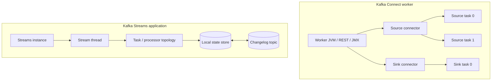
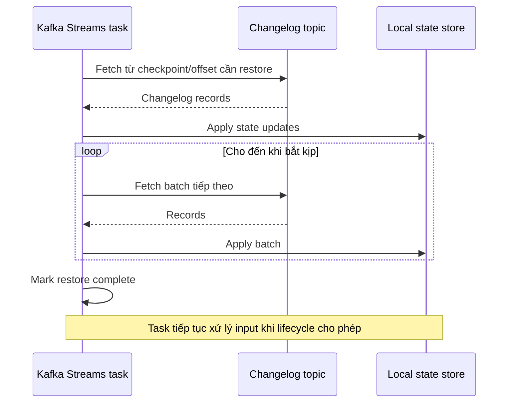

# Quan sát Connect task, Streams state store và quá trình restore

Kafka Connect và Kafka Streams đều có thể chạy ổn định ở mức process nhưng vẫn không hoàn thành công việc như mong đợi. Một Connect worker có thể đang sống trong khi một task liên tục thất bại; một Kafka Streams instance có thể ở trạng thái `RUNNING` nhưng task không tiến triển, processing lag tăng hoặc standby state vẫn chưa bắt kịp. Vì vậy, giám sát cần đi sâu hơn trạng thái JVM: phải quan sát connector/task, tốc độ xử lý record, lỗi, lag, state store và tiến độ khôi phục.

Bài này tập trung vào ba lớp tín hiệu: **Kafka Connect worker/connector/task**, **Kafka Streams task/state store** và **quá trình restore state từ changelog**. Các metric JMX cụ thể có thể khác theo phiên bản Kafka, connector plugin và cấu hình exporter; hãy xác minh MBean thực tế trước khi chuẩn hóa dashboard.

## 1. Phân biệt worker, connector, task và state store

Kafka Connect và Kafka Streams có mô hình thực thi khác nhau:

| Thành phần | Vai trò | Dấu hiệu cần quan sát |
|---|---|---|
| Connect worker | JVM process chạy framework, plugin, REST API và task | Worker availability, startup, CPU/heap, network, số connector/task |
| Connector | Mô tả tích hợp source hoặc sink | Connector state, cấu hình, số task, lỗi khởi động |
| Connect task | Đơn vị đọc nguồn hoặc ghi đích | Task state, record rate, poll/send latency, lag và lỗi |
| Streams application | Một Kafka Streams topology có chung `application.id` | Application/thread state, processing rate, rebalance, lỗi |
| Streams task | Đơn vị xử lý một hoặc nhiều partition được assign | Process rate/latency, active/standby, commit, record lateness |
| State store | Trạng thái cục bộ được topology materialize | Store availability, restore progress, RocksDB/disk, changelog |

Worker `RUNNING` không có nghĩa mọi connector/task đều `RUNNING`. Tương tự, Kafka Streams application ở trạng thái `RUNNING` không chứng minh mọi truy vấn state store đều sẵn sàng hoặc không có partition bị xử lý chậm.



## 2. Kiểm tra trạng thái connector và task qua REST API

Kafka Connect cung cấp REST API để xem connector và task đang ở trạng thái nào. Endpoint thường dùng nhất:

```bash
curl -s http://connect-1.internal:8083/connectors

curl -s http://connect-1.internal:8083/connectors/orders-source/status

curl -s http://connect-1.internal:8083/connectors/orders-source/tasks

curl -s http://connect-1.internal:8083/connectors/orders-source/tasks/0/status
```

Endpoint `/connectors/{name}/status` trả trạng thái connector và danh sách task, bao gồm state, worker ID và trace nếu task lỗi. Endpoint task riêng hữu ích khi connector có nhiều task và chỉ một task gặp vấn đề.

Các state thường gặp gồm:

| State | Ý nghĩa vận hành |
|---|---|
| `RUNNING` | Connector/task đang được framework chạy |
| `FAILED` | Khởi động hoặc thực thi thất bại; cần xem trace và worker log |
| `PAUSED` | Connector đã được tạm dừng theo yêu cầu |
| `RESTARTING` | Framework đang thực hiện restart |
| `UNASSIGNED` | Task chưa được gán cho worker trong thời điểm quan sát |
| `STOPPED` | Connector đã dừng theo trạng thái được hỗ trợ ở các phiên bản mới; không phải mọi task status đều có state này |

Tập state chính xác và cách biểu diễn có thể thay đổi theo phiên bản. Hãy đọc `state`, `worker_id` và `trace` thay vì chỉ kiểm tra HTTP 200 của REST endpoint.

REST status là snapshot tại thời điểm gọi. Connector có thể chuyển trạng thái ngay sau khi response được trả về. Với cảnh báo kéo dài, nên kết hợp polling có kiểm soát, JMX metrics và worker logs. Không gọi REST API quá dày từ mọi dashboard panel; cache kết quả hoặc dùng collector phù hợp.

## 3. Worker-level metrics của Kafka Connect

Worker metrics cho biết framework có đang khởi tạo và quản lý connector/task ổn định hay không. Một số MBean thường gặp thuộc nhóm `kafka.connect:type=connect-worker-metrics`:

| Metric | Ý nghĩa | Cách sử dụng |
|---|---|---|
| `connector-count` | Số connector worker đang quản lý | Phát hiện số connector thay đổi bất thường |
| `task-count` | Số task worker đang quản lý | Theo dõi tải và thay đổi phân bổ |
| `connector-startup-attempts-total` | Tổng số lần thử khởi động connector | Phát hiện restart lặp |
| `connector-startup-success-total` | Tổng số lần khởi động connector thành công | Đối chiếu với attempts/failures |
| `connector-startup-failure-total` | Tổng số lần khởi động connector thất bại | Cảnh báo lỗi cấu hình/plugin/kết nối |
| `task-startup-attempts-total` | Tổng số lần thử khởi động task | Phát hiện task churn |
| `task-startup-success-total` | Tổng số lần task khởi động thành công | Theo dõi độ ổn định |
| `task-startup-failure-total` | Tổng số lần task khởi động thất bại | Tìm worker hoặc plugin lỗi |

Các metric startup là counter tích lũy; nên dùng `rate()` hoặc `increase()` theo khoảng thời gian khi xuất sang Prometheus. Một lần restart có chủ đích cũng làm tăng attempts/success; cần đối chiếu với deployment event và log trước khi kết luận có sự cố.

Nếu `task-count` giảm bất thường, hãy kiểm tra connector status, task assignment và worker logs. Nếu số task tăng/giảm liên tục, có thể đang có rebalance, restart loop hoặc connector config thay đổi liên tục.

### Connector/task lifecycle và rebalance metrics

Ngoài worker metrics, Kafka Connect còn có nhóm `connector-metrics`, `connector-task-metrics` và `connect-worker-rebalance-metrics`:

| MBean/metric | Ý nghĩa |
|---|---|
| `connector-metrics`: `connector-class`, `connector-type`, `connector-version`, `status` | Nhận diện plugin và trạng thái connector |
| `connector-task-metrics`: `status`, `task-class`, `task-version` | Trạng thái và implementation của từng task |
| `batch-size-avg` / `batch-size-max` | Kích thước batch trung bình/lớn nhất của task |
| `offset-commit-avg-time-ms` / `offset-commit-max-time-ms` | Thời gian commit offset trung bình/lớn nhất |
| `offset-commit-failure-percentage` / `offset-commit-success-percentage` | Tỷ lệ commit offset thất bại/thành công |
| `pause-ratio` / `running-ratio` | Tỷ lệ thời gian task ở trạng thái pause/running |
| `completed-rebalances-total` | Tổng số lần worker hoàn tất rebalance |
| `rebalance-avg-time-ms` / `rebalance-max-time-ms` | Thời gian rebalance trung bình/lớn nhất |
| `rebalancing` / `time-since-last-rebalance-ms` | Worker đang rebalance hay không và thời gian từ lần gần nhất |

Nếu task startup failure tăng cùng rebalance count, hãy xem worker membership, network tới Kafka, plugin availability và thời gian khởi động task. Rebalance thường xuyên làm gián đoạn throughput và có thể tạo task movement liên tục.

## 4. Source task metrics

Source task đọc dữ liệu từ hệ thống ngoài rồi gửi record vào Kafka. Nhóm MBean thường gặp là `kafka.connect:type=source-task-metrics,connector=...,task=...`.

| Metric | Ý nghĩa | Diễn giải |
|---|---|---|
| `source-record-poll-total` | Tổng record task lấy từ nguồn qua `poll()` | Đo lượng dữ liệu nguồn trả về |
| `source-record-poll-rate` | Tốc độ record được poll | Throughput đọc nguồn |
| `source-record-write-total` | Tổng record được ghi thành công vào Kafka theo metric task | Đối chiếu với số record poll |
| `source-record-write-rate` | Tốc độ record được ghi ra Kafka | Throughput publish |
| `source-record-active-count` / `source-record-active-count-avg` / `source-record-active-count-max` | Số record đã poll nhưng chưa được ghi hoàn tất vào Kafka | Giá trị tăng kéo dài có thể chỉ ra write path bị nghẽn |
| `poll-batch-avg-time-ms` | Thời gian trung bình poll một batch từ nguồn | Đánh giá độ trễ đọc nguồn |
| `poll-batch-max-time-ms` | Thời gian poll batch lớn nhất | Phát hiện spike ở nguồn |
| `transaction-size-avg` / `transaction-size-max` | Kích thước transaction source task đã commit | Theo dõi batch/transaction size khi connector dùng transaction |

Tên và tập metric có thể thay đổi theo phiên bản. Một số plugin bổ sung metric riêng như số row đọc, số bảng, offset commit, snapshot progress hoặc log position; các metric này rất hữu ích nhưng không thuộc contract chung của mọi connector.

`source-record-poll-*` đo record trước khi áp dụng transformation; `source-record-write-*` đo record sau transformation và không tính record đã bị filter. Vì vậy, poll total cao hơn write total không nhất thiết là mất dữ liệu; hãy kiểm tra SMT/filter và source-record-active-count.

### Cách đọc source poll và write

- Poll rate thấp và poll batch time cao: có thể nguồn chậm, query tốn thời gian, API rate limit hoặc connector đang chờ dữ liệu.
- Poll rate cao nhưng write rate thấp: đường ghi Kafka có thể chậm, producer bị retry/throttle hoặc serialization tốn CPU.
- Poll total tăng nhưng write total không theo kịp trong thời gian dài: kiểm tra record đang active, batch write và worker log.
- Cả poll và write rate đều bằng 0: có thể nguồn không có dữ liệu, connector bị pause, task bị kẹt hoặc nguồn không truy cập được; cần đối chiếu trạng thái và source offset.

Không coi `poll-rate = 0` là lỗi nếu nguồn vốn không có thay đổi. Với CDC, cần theo dõi thêm vị trí log nguồn như PostgreSQL LSN hoặc MySQL binlog position qua metric/log của plugin.

## 5. Sink task metrics

Sink task đọc record từ Kafka rồi ghi sang hệ thống đích. Nhóm MBean thường gặp là `kafka.connect:type=sink-task-metrics,connector=...,task=...`.

| Metric | Ý nghĩa | Diễn giải |
|---|---|---|
| `sink-record-read-total` | Tổng record task đọc từ Kafka | Throughput đầu vào của sink |
| `sink-record-read-rate` | Tốc độ đọc record | Đối chiếu với khả năng ghi đích |
| `sink-record-send-total` | Tổng record được gửi/ghi theo metric sink task | Throughput xử lý phía đích |
| `sink-record-send-rate` | Tốc độ gửi record đến đích | Phát hiện sink chậm |
| `sink-record-active-count` / `sink-record-active-count-avg` / `sink-record-active-count-max` | Record đã đọc nhưng chưa được sink commit/flush/acknowledge hoàn tất | Giá trị tăng kéo dài có thể chỉ ra đích xử lý chậm |
| `sink-record-lag-max` | Lag lớn nhất tính theo số record task đang tụt sau consumer position trên các partition được gán | Phát hiện partition/task tụt xa |
| `put-batch-avg-time-ms` | Thời gian trung bình task gửi một batch vào sink | Đánh giá latency ghi đích |
| `put-batch-max-time-ms` | Thời gian lớn nhất để gửi một batch vào sink | Phát hiện spike hoặc timeout |
| `offset-commit-completion-rate` / `offset-commit-completion-total` | Tốc độ/tổng số lần commit offset hoàn tất thành công | Kiểm tra tiến độ commit của sink |
| `offset-commit-skip-rate` / `offset-commit-skip-total` | Tốc độ/tổng số lần completion đến muộn và bị bỏ qua | Phát hiện commit completion bị trễ |

Trong metric chuẩn Kafka 4.4, `sink-record-lag-max` là lag theo số record so với consumer position trên các partition được gán; không có `sink-record-lag-avg` tương ứng trong bảng metric chuẩn này. Không đồng nhất nó với consumer group lag tính từ log end offset trừ committed offset. Connector plugin có thể bổ sung metric riêng.

`sink-record-read-*` đo record trước transformation; `sink-record-send-*` đo record sau transformation và loại trừ record bị filter. Chênh lệch read/send vì vậy có thể là hành vi mong đợi của SMT, không nhất thiết là sink đang bỏ sót record.

### Cách đọc sink read/send

- Read rate cao nhưng send rate thấp kéo dài: hệ thống đích, batch flush hoặc connector transformation có thể là bottleneck.
- Read và send rate cùng thấp trong khi consumer lag tăng: task có thể bị lỗi, retry hoặc downstream không nhận dữ liệu.
- `put-batch-avg-time-ms` hoặc `put-batch-max-time-ms` tăng cùng lag: kiểm tra connection pool, database lock, API rate limit và timeout của đích.
- Một task lag cao trong khi task khác bình thường: có thể partition assignment không đều, một partition có key skew hoặc một endpoint đích chậm.

Với sink ghi database, nên theo dõi thêm connection pool, transaction duration, deadlock, commit latency và số lần retry. Kafka Connect chỉ cho thấy đường đi tới đích; metric của database mới giải thích được vì sao thao tác ghi chậm.

## 6. Error metrics, retry và dead-letter queue

Kafka Connect có nhóm task error metrics để quan sát lỗi record và DLQ. Một số metric thường gặp:

| Metric | Ý nghĩa |
|---|---|
| `total-record-errors` | Tổng lỗi record được framework ghi nhận |
| `total-record-failures` | Tổng record thất bại theo cơ chế error handling |
| `total-records-skipped` | Tổng record bị bỏ qua theo chính sách tolerance |
| `deadletterqueue-produce-requests` | Số request gửi record tới DLQ |
| `deadletterqueue-produce-failures` | Số lần gửi DLQ thất bại |
| `total-errors-logged` | Tổng số lỗi đã được ghi log |
| `last-error-timestamp` | Epoch timestamp của lần task gặp lỗi gần nhất |
| `total-retries` | Tổng số thao tác đã retry |

Metric và cách tính phụ thuộc version. Kết hợp với cấu hình error handling như `errors.tolerance`, `errors.deadletterqueue.topic.name`, `errors.deadletterqueue.context.headers.enable` và log của task.

DLQ không đồng nghĩa record đã được xử lý nghiệp vụ thành công. Khi record được bỏ qua hoặc chuyển DLQ, offset có thể tiếp tục tiến lên theo chính sách framework. Cần có quy trình điều tra, sửa dữ liệu và replay DLQ; nếu không, task có thể `RUNNING` nhưng dữ liệu ở đích vẫn thiếu.

Không phải mọi exception bên trong connector plugin đều tự động trở thành record error có thể chuyển DLQ. Một lỗi kết nối database hoặc lỗi task fatal có thể làm task `FAILED`. Hãy phân biệt lỗi chuyển đổi/record với lỗi hạ tầng hoặc lỗi connector implementation.

## 7. Quan sát Connect internal topics và worker group

Trong distributed mode, Kafka Connect dùng internal topics để lưu config, source offsets và status. Nếu các topic này không khỏe, task có thể khó khởi động, phục hồi hoặc đồng bộ trạng thái.

| Internal topic | Vai trò | Tín hiệu cần kiểm tra |
|---|---|---|
| `config.storage.topic` | Cấu hình connector/task | Topic tồn tại, một partition, replication và ISR khỏe |
| `offset.storage.topic` | Source offsets | Log compaction, replication, write availability và offset progress |
| `status.storage.topic` | Trạng thái connector/task | Worker có cập nhật state, topic không bị lỗi ISR |

Đây là control-plane topics. Không xóa, truncate hoặc chỉnh sửa record trực tiếp để xử lý một task lỗi. Theo dõi broker health, under-replicated partitions, request errors và disk usage của broker đang lưu internal topics.

Khi worker rời group hoặc tham gia lại, Connect có thể rebalance task. Cần đối chiếu thời điểm rebalance với task restart, throughput giảm và connector status. Nếu plugin version không đồng nhất giữa worker, task có thể được gán sang worker thiếu plugin rồi thất bại khi khởi động.

## 8. Kafka Streams application và task metrics

Kafka Streams cung cấp JMX metrics theo application/thread/task/processor node. Một số nhóm MBean thường gặp:

```text
kafka.streams:type=stream-metrics,...
kafka.streams:type=stream-thread-metrics,...
kafka.streams:type=stream-task-metrics,...
kafka.streams:type=stream-processor-node-metrics,...
kafka.streams:type=stream-state-metrics,...
```

Các metric quan trọng:

| Metric | Ý nghĩa | Khi tăng/giảm bất thường |
|---|---|---|
| `process-rate` / `process-total` | Tốc độ/tổng record được xử lý | Giảm đột ngột có thể do input idle, task pause hoặc processor chậm |
| `process-latency-avg` / `process-latency-max` | Thời gian xử lý record | Tăng có thể do CPU, Serde, state store hoặc downstream call |
| `poll-rate` / `poll-latency-avg` | Tốc độ và latency poll Kafka | Poll chậm có thể làm giảm throughput và tăng lag |
| `commit-rate` / `commit-latency-avg` | Tần suất và latency commit | Commit chậm có thể liên quan broker, transaction hoặc state |
| `punctuate-rate` / `punctuate-latency-avg` | Tần suất và thời gian chạy punctuation | Callback nặng có thể chặn stream thread |
| `active-process-ratio` | Tỷ lệ thời gian thread/task thực sự xử lý | Thấp có thể do chờ input, I/O hoặc không có task active |
| `record-lateness-avg` / `record-lateness-max` | Mức trễ timestamp của record so với tiến độ stream time | Tăng cho thấy out-of-order/late events |
| `skipped-records-total` | Record bị bỏ qua do lỗi hoặc chính sách | Tăng cần xem log, deserialization và timestamp |
| `record-rate` / `record-total` | Tốc độ/tổng số record được restore ở task | Theo dõi tiến độ restore task |
| `update-rate` / `update-total` | Tốc độ/tổng số state update được áp dụng | Theo dõi mức cập nhật state |

Không phải mọi metric đều có ở mọi scope hoặc mọi phiên bản. Ví dụ, metric theo task có thể mang `thread-id` và `task-id`, còn metric processor node có thêm `processor-node-id`. Khi xây dashboard, giữ các label này để xác định task hoặc processor gây bottleneck, nhưng kiểm soát cardinality khi export.

## 9. State store, changelog và quá trình restore

Stateful operation như `count()`, `aggregate()`, windowed aggregation và join có thể materialize state store. Kafka Streams thường duy trì local state store, ví dụ RocksDB, và ghi changelog topic để có thể khôi phục state sau khi task chuyển sang instance khác hoặc process restart.

Quá trình restore thường gồm:

1. Task được assign cho stream thread.
2. Kafka Streams xác định changelog partition và offset cần khôi phục.
3. State store được tạo hoặc mở ở local directory.
4. Records từ changelog được đọc và áp dụng vào store.
5. Khi restore hoàn tất, task có thể chuyển sang active processing (hoặc tiếp tục theo lifecycle của standby task).



Restore time phụ thuộc lượng changelog cần đọc, tốc độ broker/network, số partition, tốc độ ghi local disk, RocksDB compaction và CPU. Một task restore chậm có thể khiến partition chưa xử lý input mới; nếu ứng dụng phục vụ Interactive Queries, store tương ứng có thể tạm thời chưa truy vấn được.

### Active task và standby task

Active task xử lý input partition và cập nhật state. Standby task duy trì bản sao state bằng cách đọc changelog, nhằm giảm thời gian phục hồi khi active task chuyển instance. Có thể cấu hình số standby bằng `num.standby.replicas`. Standby thường không xử lý input như active task và state có thể trễ một khoảng so với active.

Khi active instance lỗi, Kafka Streams có thể promote standby phù hợp hoặc khởi tạo task mới và restore từ changelog. Nếu standby đã theo kịp, thời gian chuyển đổi thường ngắn hơn restore toàn bộ state. Tuy nhiên, standby replica tiêu tốn CPU, network, disk và tài nguyên broker.

## 10. Restore metrics và state restore listener

Kafka Streams có nhóm metric liên quan state store/restore, thường nằm trong `stream-state-metrics`; một số metric tiến độ record nằm ở `stream-task-metrics`. Với Kafka 4.4, các metric tiêu biểu gồm:

| Metric | Ý nghĩa |
|---|---|
| `restore-rate` | Tốc độ restore của state store |
| `restore-latency-avg` / `restore-latency-max` | Thời gian thực thi restore trung bình/lớn nhất, tính bằng nanosecond trong metric Kafka Streams |
| `record-rate` / `record-total` | Tốc độ/tổng số record được restore ở task |
| `commit-latency-avg` / `commit-latency-max` | Thời gian commit state store trung bình/lớn nhất |
| `put-rate`, `put-all-rate`, `get-rate`, `range-rate`, `all-rate` | Tần suất các thao tác state store; giúp nhận biết store đang chịu loại truy cập nào |
| `record-e2e-latency-avg` | End-to-end latency của record tại state store scope; metric này có recording level `trace` |

Metric state store chủ yếu có recording level `debug`; `record-e2e-latency-*` yêu cầu `trace`, còn `num-open-iterators` và `num-keys` có recording level `info`. Có thể đặt `metrics.recording.level=debug` khi cần điều tra sâu, nhưng cần đánh giá overhead và cardinality trước khi bật rộng trong production. `restore-rate` là metric riêng của store; không tự diễn giải nó thành byte/giây hoặc record/giây nếu metric description của phiên bản không nói như vậy.

Ngoài JMX, có thể đăng ký `StateRestoreListener` để nhận sự kiện restore:

```java
import org.apache.kafka.common.TopicPartition;
import org.apache.kafka.streams.processor.StateRestoreListener;

public final class RestoreObserver implements StateRestoreListener {

    @Override
    public void onRestoreStart(TopicPartition partition,
                               String storeName,
                               long startingOffset,
                               long endingOffset) {
        log.info("Restore started: store={}, partition={}, range={}..{}",
                storeName, partition, startingOffset, endingOffset);
    }

    @Override
    public void onBatchRestored(TopicPartition partition,
                                String storeName,
                                long batchEndOffset,
                                long numRestored) {
        log.debug("Restore batch: store={}, partition={}, end={}, records={}",
                storeName, partition, batchEndOffset, numRestored);
    }

    @Override
    public void onRestoreEnd(TopicPartition partition,
                             String storeName,
                             long totalRestored) {
        log.info("Restore completed: store={}, partition={}, records={}",
                storeName, partition, totalRestored);
    }
}
```

Đăng ký listener trước khi gọi `streams.start()`:

```java
streams.setGlobalStateRestoreListener(new RestoreObserver());
streams.start();
```

`StateRestoreListener` theo dõi restore của active task. Nó không theo dõi việc standby/warm-up task tiếp tục cập nhật state từ changelog. Muốn quan sát standby, dùng `StandbyUpdateListener`:

```java
import org.apache.kafka.common.TopicPartition;
import org.apache.kafka.streams.processor.StandbyUpdateListener;
import org.apache.kafka.streams.processor.TaskId;

streams.setStandbyUpdateListener(new StandbyUpdateListener() {
    @Override
    public void onUpdateStart(TopicPartition partition,
                              String storeName,
                              long startingOffset) {
        log.info("Standby update started: store={}, partition={}, offset={}",
                storeName, partition, startingOffset);
    }

    @Override
    public void onBatchLoaded(TopicPartition partition,
                              String storeName,
                              TaskId taskId,
                              long batchEndOffset,
                              long batchSize,
                              long currentEndOffset) {
        long offsetGapEstimate = Math.max(0, currentEndOffset - batchEndOffset - 1);
        log.debug("Standby batch: store={}, task={}, loaded={}, remainingOffsetGap={}",
                storeName, taskId, batchSize, offsetGapEstimate);
    }

    @Override
    public void onUpdateSuspended(TopicPartition partition,
                                  String storeName,
                                  long storeOffset,
                                  long currentEndOffset,
                                  StandbyUpdateListener.SuspendReason reason) {
        log.info("Standby update suspended: store={}, partition={}, reason={}",
                storeName, partition, reason);
    }
});
```

Đặt cả hai listener trước `streams.start()`. `offsetGapEstimate` chỉ là ước lượng theo offset; compacted changelog có thể có khoảng trống nên không luôn bằng số record còn lại. Listener được chia sẻ giữa các state updater threads nên implementation phải thread-safe; callback cần ngắn và không thực hiện I/O blocking. Hãy ghi metric/log rồi chuyển tác vụ nặng sang executor của ứng dụng. Standby update là quá trình liên tục, không có callback kết thúc tương đương `onRestoreEnd`.

`onRestoreStart` cung cấp starting/ending offset tại thời điểm bắt đầu. Có thể dùng chênh lệch offset để ước lượng khối lượng còn lại, nhưng offset không luôn tương đương số record chính xác vì compacted changelog có thể có khoảng trống. Dùng callback batch và metric restore thực tế để theo dõi tiến độ.

### RocksDB và state-store operation metrics

Với state store dùng RocksDB, nhóm `stream-state-metrics` còn cung cấp metric cho thao tác store và I/O cục bộ:

| Metric | Ý nghĩa |
|---|---|
| `put-latency-avg` / `put-latency-max`, `get-latency-avg` / `get-latency-max` | Latency đọc/ghi key-value state |
| `bytes-written-rate` / `bytes-written-total` | Byte được ghi vào RocksDB |
| `bytes-read-rate` / `bytes-read-total` | Byte được đọc từ RocksDB |
| `memtable-bytes-flushed-rate` | Tốc độ flush memtable xuống disk |
| `memtable-flush-time-avg` / `memtable-flush-time-max` | Thời gian flush memtable |
| `block-cache-data-hit-ratio` / `block-cache-index-hit-ratio` | Tỷ lệ cache hit cho data/index block |
| `write-stall-duration-avg` / `write-stall-duration-total` | Thời gian RocksDB bị write stall |
| `compaction-time-avg` / `compaction-time-max` | Thời gian compaction |
| `num-open-iterators`, `oldest-iterator-open-since-ms` | Số iterator còn mở và thời điểm iterator cũ nhất được tạo |

Phần lớn thống kê RocksDB có recording level `debug`; thu thập thống kê chi tiết có thể ảnh hưởng hiệu năng và một số giá trị được cập nhật theo chu kỳ. Các metric như `num-open-iterators` có recording level `info`. Có thể bật debug khi cần điều tra:

```properties
metrics.recording.level=debug
```

Không nên bật mức `trace` hoặc mọi metric debug trên toàn bộ ứng dụng mà không đánh giá overhead. Nếu iterator count hoặc iterator duration tăng liên tục, kiểm tra code Interactive Queries có đóng `KeyValueIterator` trong `try-with-resources` hay không.

## 11. Theo dõi lifecycle của Kafka Streams

Kafka Streams có các trạng thái ứng dụng như `CREATED`, `REBALANCING`, `RUNNING`, `PENDING_SHUTDOWN`, `NOT_RUNNING` và `ERROR` (tập trạng thái cụ thể theo version). Có thể đăng ký state listener:

```java
streams.setStateListener((newState, oldState) -> {
    log.info("Kafka Streams state changed: {} -> {}", oldState, newState);
    stateGauge.set(newState == KafkaStreams.State.RUNNING ? 1 : 0);
});
```

`RUNNING` cho biết instance đã vào trạng thái chạy theo lifecycle framework; nó không chứng minh mọi task đều có throughput tốt, standby replica đã bắt kịp hoặc dữ liệu đầu ra không bị trễ. Trong lúc rebalance, instance có thể tạm rời `RUNNING`; task active cần hoàn tất restore trước khi xử lý input, còn standby có thể tiếp tục bắt kịp trong nền. Vì vậy, nên theo dõi thêm restore callbacks, task assignment, processing rate và query readiness.

Không dùng một gauge RUNNING duy nhất làm readiness cho toàn bộ state store. Với API Interactive Queries, có thể kiểm tra store cụ thể bằng `KafkaStreams.store(...)`; xử lý `InvalidStateStoreException` khi store chưa sẵn sàng và chỉ báo readiness khi các store bắt buộc đã có thể query.

## 12. JMX Exporter và Prometheus cho Connect/Streams

Kafka Connect worker và Kafka Streams application đều có thể xuất JMX metrics. Có thể dùng Prometheus JMX Exporter Java agent hoặc cơ chế metrics của nền tảng đang triển khai để scrape từng process.

Ví dụ scrape Connect workers và Streams instances:

```yaml
scrape_configs:
  - job_name: kafka-connect
    static_configs:
      - targets:
          - connect-1.internal:9404
          - connect-2.internal:9404

  - job_name: kafka-streams
    static_configs:
      - targets:
          - streams-1.internal:9405
          - streams-2.internal:9405
```

Tên metric sau export phụ thuộc JMX Exporter rules. Nên chuẩn hóa labels như `cluster`, `worker`, `connector`, `task`, `application`, `thread`, `task_id` và `store` theo giới hạn cardinality. Không đưa stack trace, payload, event ID hoặc label thay đổi theo từng record vào metrics.

### Ví dụ PromQL minh họa

Các tên metric dưới đây là tên chuẩn hóa do hệ thống exporter giả định, không phải tên mặc định bắt buộc của mọi Kafka version.

Task startup failure rate của Connect:

```promql
sum by (cluster, worker) (
  rate(kafka_connect_task_startup_failure_total[5m])
)
```

Sink record send rate theo connector/task:

```promql
sum by (cluster, connector, task) (
  rate(kafka_connect_sink_record_send_total[5m])
)
```

Tổng lỗi record của Connect:

```promql
sum by (cluster, connector, task) (
  increase(kafka_connect_total_record_errors[10m])
)
```

Streams processing rate theo application/task:

```promql
sum by (application, task_id) (
  rate(kafka_streams_process_total[5m])
)
```

Restore record rate:

```promql
sum by (application, task_id, store) (
  rate(kafka_streams_task_record_total[5m])
)
```

Restore rate của state store (nếu exporter ánh xạ MBean meter thành gauge):

```promql
sum by (application, task_id, store) (
  kafka_streams_state_store_restore_rate
)
```

Nếu exporter xuất metric dạng gauge hoặc meter rate, không áp dụng `rate()`/`increase()` như với counter. Luôn xác định loại metric, đơn vị và reset behavior trước khi viết dashboard.

## 13. Dashboard và alert nên có

| Dashboard | Panel chính | Câu hỏi vận hành |
|---|---|---|
| Connect cluster | Worker availability, connector/task count, startup success/failure | Cluster có ổn định và phân bổ task đều không? |
| Connector/task | REST state, task state, trace/error, restart count | Task nào FAILED hoặc restart liên tục? |
| Source pipeline | Poll rate, write rate, poll/write latency, source offset progress | Nguồn có đọc được và Kafka có nhận dữ liệu không? |
| Sink pipeline | Read/send rate, sink lag, send latency, consumer group lag | Đích có theo kịp Kafka không? |
| Error handling | Record errors/failures/skipped, DLQ request/failure | Record nào bị bỏ qua hoặc chuyển DLQ? |
| Streams application | State, active threads/tasks, process/poll/commit rate and latency | Topology có xử lý đều không? |
| State store restore | `restore-rate`, `restore-latency-*`, task `record-rate/total`, offset gap từ callback, store readiness | Task đang restore bao lâu và còn bao nhiêu state? |
| RocksDB/local disk | `bytes-read/written-rate`, memtable flush, compaction time, block-cache hit ratio, write-stall duration, open iterators | State store có bị nghẽn I/O hoặc giữ iterator quá lâu không? |
| Changelog topics | Bytes in/out, ISR, under-replicated partitions, consumer lag | Broker có phục vụ restore ổn định không? |

Alert có giá trị:

- Connector hoặc task ở `FAILED` quá thời gian cho phép.
- Task startup failure tăng liên tục hoặc restart loop.
- Source poll/write rate bằng 0 bất thường trong khi nguồn có dữ liệu.
- Sink lag tăng kéo dài, read rate lớn hơn send rate hoặc send latency tăng.
- DLQ produce failure hoặc skipped record tăng.
- Streams application ở `ERROR`, thread chết hoặc rebalance liên tục.
- Restore duration vượt ngưỡng SLO hoặc offset gap của active/standby restore không giảm.
- State store không sẵn sàng sau thời gian startup dự kiến.
- Changelog topic có under-replicated partition hoặc broker disk gần đầy.

Đặt ngưỡng theo baseline và quy mô state. Một ứng dụng vừa khởi động có thể restore nhiều dữ liệu là bình thường; cảnh báo nên xét thời gian restore, tốc độ tiến triển và mức lag thay vì chỉ thấy restore activity.

## 14. Điều tra task lỗi hoặc pipeline không có dữ liệu

### Connect task ở RUNNING nhưng không có record

1. Kiểm tra connector/task status qua REST API.
2. Xác định source hay sink task và đọc poll/read/write/send rate.
3. Với source, kiểm tra nguồn có dữ liệu, source offset có tiến triển, poll latency và connector-specific metrics.
4. Với sink, kiểm tra Kafka consumer group lag, topic/partition assignment, sink send latency và downstream health.
5. Kiểm tra task logs, error metrics, retry và DLQ.
6. Kiểm tra worker group rebalance, internal topics và network/authentication.

`RUNNING` chỉ là trạng thái process/task; không chứng minh pipeline đang có throughput hoặc dữ liệu không bị skip.

### Kafka Streams restore kéo dài

1. Xác định task/store nào đang restore qua JMX và `StateRestoreListener`.
2. Đo lượng changelog cần đọc, `restore-rate`, `restore-latency-*`, task `record-rate/total` và offset gap từ callback.
3. Kiểm tra changelog partition leader, ISR, broker request latency và network throughput.
4. Kiểm tra local disk, RocksDB write/compaction, CPU và memory pressure.
5. Xác định có rebalance hoặc task movement lặp lại khiến restore bị khởi động lại hay không.
6. Kiểm tra standby replica có theo kịp không và số standby có phù hợp tài nguyên không.
7. Chỉ tăng parallelism hoặc standby sau khi xác định bottleneck; thêm task có thể làm tăng tải broker và restore traffic.

### Interactive Query trả InvalidStateStoreException

Lỗi này có thể xuất hiện khi store chưa được tạo, đang restore, task vừa rebalance hoặc instance đang shutdown. Kiểm tra application state, task assignment, restore callback và store readiness. API nên trả lỗi tạm thời hoặc retry ngắn có giới hạn; không giữ request thread chờ vô hạn.

## 15. Những nguyên nhân thường làm restore chậm

| Nguyên nhân | Dấu hiệu | Hướng xử lý |
|---|---|---|
| Changelog quá lớn | `record-total` cần restore lớn, restore kéo dài và offset gap cao | Đánh giá state retention, compaction và thiết kế aggregate |
| Broker/network chậm | Restore rate thấp, request/fetch latency cao | Kiểm tra broker load, ISR, network và partition leader |
| Local disk chậm | Changelog fetch bình thường nhưng apply/restore chậm | Kiểm tra disk latency, IOPS, filesystem và RocksDB |
| RocksDB compaction/write stall | CPU/disk spike, write stall tăng | Kiểm tra RocksDB metrics, cache và disk capacity |
| Rebalance lặp | Restore start xuất hiện nhiều lần, task liên tục đổi host | Tìm nguyên nhân instance restart, heartbeat, GC pause hoặc deployment |
| State store không ổn định | Store đóng/mở nhiều lần hoặc lỗi lock | Kiểm tra local state directory, quyền file và shutdown lifecycle |
| Standby không theo kịp | Offset gap standby cao khi active chuyển host | Đánh giá changelog throughput, số standby và tài nguyên |

Không xóa state directory hoặc changelog topic để “làm mới” khi chưa hiểu hậu quả. Xóa local state có thể buộc restore toàn bộ; xóa changelog topic có thể khiến state không thể khôi phục chính xác. Dùng cơ chế reset/rebuild có kế hoạch và bảo toàn dữ liệu cần thiết.

## 16. Quy trình kiểm tra thực tế

Khi một Kafka Streams instance restart và API truy vấn state chưa sẵn sàng:

1. Xác nhận process sống và `KafkaStreams.State` hiện tại.
2. Xác định task nào được assign và store nào đang restore.
3. Ghi nhận `onRestoreStart` offsets, batch progress và `onRestoreEnd`.
4. Đối chiếu `restore-rate`, `restore-latency-*`, task `record-rate/total` và offset gap ước lượng với changelog partition end offset.
5. Kiểm tra broker throughput, ISR, disk và network trong cùng time range.
6. Kiểm tra local RocksDB/disk latency, `bytes-read/written-rate`, compaction, write stall và CPU của instance.
7. Xác định task có bị rebalance/restart lặp không.
8. Chỉ bật readiness cho query endpoint khi các store bắt buộc sẵn sàng.
9. Sau khi restore xong, xác nhận process rate và query latency trở lại baseline.

Với Kafka Connect, quy trình tương tự: bắt đầu từ REST task status, sau đó so sánh source/sink throughput, error metrics, worker logs và trạng thái internal topics.

## 17. Checklist quan sát Connect và Streams

- Theo dõi worker, connector và task state riêng biệt; lưu worker ID và failure trace.
- Thu thập Connect startup attempts/success/failure và connector/task count.
- Theo dõi source poll/write rate, batch time, source offset progress và connector-specific metrics.
- Theo dõi sink read/send rate, lag, send latency và consumer group lag.
- Thu thập record errors, failures, skipped records và DLQ failures.
- Theo dõi Connect config/offset/status internal topics, replication và ISR.
- Theo dõi Kafka Streams application/thread/task state và processing/poll/commit latency.
- Materialize store có tên ổn định và giám sát state store theo task/store.
- Thu thập `restore-rate`, `restore-latency-*`, task `record-rate/total`, offset gap từ callback và standby update progress.
- Theo dõi changelog topic, broker/network, local disk và RocksDB trong cùng time range.
- Phân biệt active task với standby replica và hiểu standby có thể stale.
- Chỉ đánh dấu query readiness khi store cần thiết đã sẵn sàng.
- Đặt alert theo thời gian kéo dài và mức tiến triển, không chỉ theo một snapshot.
- Không xóa internal topic, changelog hoặc local state directory để xử lý lỗi nếu chưa có kế hoạch rebuild/restore.

Quan sát Connect task cần kết hợp REST status với worker/task JMX metrics, record throughput, lag và error handling. Quan sát Kafka Streams state store cần theo dõi task lifecycle, restore callbacks, standby updates, changelog progress và tài nguyên local store. Khi nối các tín hiệu này với broker/network metrics, đội vận hành có thể phân biệt task đang chạy nhưng không có dữ liệu, task lỗi do plugin/downstream và state store đang restore chậm sau restart hoặc rebalance.

## Tài liệu tham khảo

- [Apache Kafka 4.4 Monitoring: Connect và Streams metrics](https://kafka.apache.org/44/operations/monitoring/)
- [Kafka Streams 4.4 StateRestoreListener API](https://kafka.apache.org/44/javadoc/org/apache/kafka/streams/processor/StateRestoreListener.html)
- [Kafka Streams 4.4 StandbyUpdateListener API](https://kafka.apache.org/44/javadoc/org/apache/kafka/streams/processor/StandbyUpdateListener.html)
- [Kafka Streams 4.4 Running Applications: State restore và standby updates](https://kafka.apache.org/44/streams/developer-guide/running-app/)
