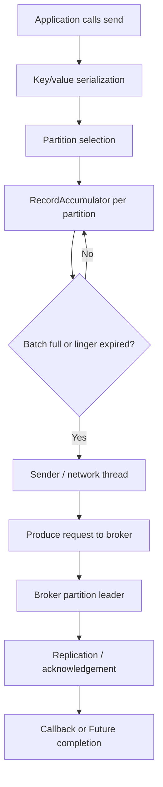

# Tối ưu batching, compression và số kết nối producer

Hiệu năng ghi Kafka phụ thuộc nhiều vào cách producer gom record thành batch, nén batch và tái sử dụng kết nối tới broker. Nếu gửi từng record với batch nhỏ, không nén và tạo producer mới cho mỗi request, ứng dụng có thể tạo nhiều request mạng, tăng CPU/socket overhead và giảm throughput. Ngược lại, batch quá lớn, `linger.ms` quá cao hoặc compression nặng có thể làm tăng latency, memory pressure và thời gian chờ.

Mục tiêu tối ưu là tìm điểm cân bằng giữa throughput, latency, CPU, network và tài nguyên broker. Cần đo theo payload, partition, key distribution và durability requirement thực tế; không có một bộ cấu hình producer tốt cho mọi workload.

## 1. Đường đi của một record qua KafkaProducer

Khi ứng dụng gọi `producer.send(record)`, Kafka producer không gửi ngay từng record thành một request riêng. Record được serialize, chọn partition rồi đưa vào bộ đệm của partition tương ứng. Producer gom record thành batch và gửi batch tới broker đang giữ leader của partition.



Các bước chính:

1. Serializer chuyển key/value thành bytes.
2. Partitioner chọn topic-partition đích.
3. RecordAccumulator giữ record trong buffer và batch theo partition.
4. Sender thread chọn các batch đã sẵn sàng và gửi produce request.
5. Broker leader xử lý record và replica theo cấu hình.
6. Khi có kết quả, producer hoàn tất callback/Future.

Điểm quan trọng là batching diễn ra theo partition. Một producer ghi vào nhiều partition sẽ có nhiều batch đang được tích lũy độc lập. Nếu mỗi partition chỉ nhận vài record rải rác, batch có thể không đầy dù tổng lưu lượng toàn ứng dụng khá cao.

## 2. Vì sao batching cải thiện throughput?

Mỗi request mạng có chi phí cố định: framing, syscall, network round trip, request queue, xử lý protocol và callback. Gửi 1.000 record trong 1.000 request thường tốn overhead hơn gửi chúng trong một số batch lớn.

Batching giúp:

- Giảm số produce request trên cùng lượng record.
- Giảm số lần xử lý request và response ở broker.
- Tận dụng network packet và compression tốt hơn.
- Tăng số record trên mỗi request.
- Giảm overhead serialization/protocol ở cấp request.

Batch lớn không tự động làm record được xử lý nhanh hơn. Producer phải chờ đủ dữ liệu hoặc hết thời gian linger; broker cũng phải xử lý batch và replicate theo cấu hình. Nếu latency là ưu tiên cao, batch nhỏ và linger thấp có thể phù hợp hơn dù throughput tối đa thấp hơn.

### Batching theo từng partition

Ví dụ producer ghi vào topic có 8 partition:

```text
Producer
  ├── partition 0 accumulator -> batch A
  ├── partition 1 accumulator -> batch B
  ├── partition 2 accumulator -> batch C
  ├── partition 3 accumulator -> batch D
  ├── partition 4 accumulator -> batch E
  ├── partition 5 accumulator -> batch F
  ├── partition 6 accumulator -> batch G
  └── partition 7 accumulator -> batch H
```

Nếu tổng lưu lượng là 8.000 record/giây nhưng phân bố đều trên 8 partition, mỗi partition nhận khoảng 1.000 record/giây. Nếu payload nhỏ và `linger.ms` rất thấp, batch ở từng partition có thể chỉ chứa ít record. Tăng partition count trong khi throughput không đổi có thể làm batch nhỏ hơn vì dữ liệu bị chia ra nhiều accumulator.

Đây là một trong những lý do không nên tăng partition chỉ để “tăng hiệu năng producer” mà chưa đo throughput, key skew và batch fullness.

## 3. `batch.size`: kích thước batch mục tiêu

`batch.size` là kích thước batch mục tiêu theo byte cho mỗi partition. Khi batch gần đầy hoặc không thể thêm record tiếp theo, producer có thể gửi batch đó. Giá trị thường gặp mặc định là 16 KiB trong nhiều phiên bản Kafka client, nhưng cần kiểm tra đúng phiên bản đang dùng.

Ví dụ:

```properties
batch.size=65536
```

Giá trị trên đặt batch mục tiêu 64 KiB cho mỗi partition. Nếu record trung bình 1 KiB, batch đầy có thể chứa khoảng vài chục record, tùy overhead record, headers và format. Nếu record trung bình 20 KiB, một batch chỉ chứa được ít record.

### Khi nào tăng batch.size?

Có thể thử tăng batch khi:

- `batch-size-avg` thấp đáng kể so với batch size cấu hình.
- `records-per-request-avg` thấp.
- Producer có throughput cao nhưng số request/giây quá lớn.
- CPU broker/request handler bị tiêu tốn bởi request overhead.
- Payload tương đối nhỏ và có thể gom thành batch lớn hơn.

Tăng batch size có thể không giúp nếu `linger.ms` quá thấp, lưu lượng theo partition quá thưa, producer chỉ ghi vào một số ít record hoặc buffer memory đã là nút nghẽn.

### Khi nào không nên tăng?

- Ứng dụng cần latency rất thấp.
- Payload vốn đã lớn và ít record có thể ghép chung.
- Có nhiều partition với lưu lượng thấp trên mỗi partition.
- Producer có nhiều batch đồng thời khiến memory tăng.
- Broker/network đã nghẽn và batch lớn chỉ làm request/queue lớn hơn.

`batch.size` không phải giới hạn kích thước message duy nhất. Record/batch còn chịu giới hạn `max.request.size` phía producer, `message.max.bytes` phía broker và `max.message.bytes` phía topic. Phải kiểm tra cả chuỗi giới hạn khi gửi record lớn.

`batch.size` cũng không phải giới hạn cứng khiến một record lớn hơn bị cắt hoặc tự động từ chối. Producer không cố gom record lớn hơn kích thước batch mục tiêu với các record khác; record vẫn cần thỏa giới hạn request và message của producer/broker/topic.

## 4. `linger.ms`: chờ thêm record để gom batch

`linger.ms` quy định khoảng thời gian producer có thể chờ thêm record trước khi gửi batch chưa đầy. Producer không nhất thiết chờ hết thời gian nếu batch đã đầy hoặc có điều kiện gửi khác.

Ví dụ:

```properties
linger.ms=5
```

Producer có thể chờ tối đa khoảng 5 ms để gom thêm record cho batch. Nếu batch đầy sớm hơn, nó có thể được gửi trước. Nếu không có record mới, batch được gửi khi linger hết hạn.

### Tác động của linger

| Thay đổi | Tác động thường gặp |
|---|---|
| Tăng `linger.ms` | Batch có cơ hội đầy hơn, request rate giảm, compression thường tốt hơn; latency enqueue-to-send tăng |
| Giảm `linger.ms` | Record được gửi sớm hơn, latency thấp hơn; batch có thể nhỏ và request rate cao |
| `linger.ms=0` | Không chủ động chờ để gom thêm record; batching vẫn có thể xảy ra khi record đến liên tục hoặc batch đầy |

Không hiểu `linger.ms=5` là mọi record luôn bị trì hoãn đúng 5 ms. Nếu batch đầy ngay, producer có thể gửi sớm. Nếu producer không có record mới, thời gian chờ của batch chưa đầy có thể gần với giá trị linger.

### Chọn linger theo SLA

- API tương tác yêu cầu p99 latency thấp: bắt đầu với linger thấp và đo end-to-end.
- Event streaming throughput cao, chấp nhận vài ms thêm: thử tăng dần 2–10 ms rồi đo.
- Batch ingest lớn: có thể dùng linger cao hơn nếu latency không phải ràng buộc chính.

Giá trị mặc định của `linger.ms` thay đổi giữa các thế hệ Kafka client; Kafka client mới đã thay đổi default so với các bản cũ. Hãy cấu hình rõ trong production thay vì dựa vào default không được kiểm soát.

## 5. `buffer.memory`: bộ đệm tổng của producer

`buffer.memory` là lượng bộ nhớ producer dành cho record đang chờ được gửi. Nó được chia cho các batch/partition và được tái sử dụng khi batch hoàn tất.

Ví dụ:

```properties
buffer.memory=67108864
```

Giá trị trên tương đương 64 MiB. Nếu ứng dụng gửi nhanh hơn broker có thể nhận, buffer dần đầy. Khi không còn buffer để cấp cho record mới, `send()` có thể block tới `max.block.ms` trong lúc chờ buffer hoặc metadata.

Các dấu hiệu buffer pressure:

- `bufferpool-wait-time` tăng.
- `bufferpool-wait-ratio` tăng.
- `waiting-threads` lớn hơn 0 kéo dài.
- `send()` block lâu hoặc ném `TimeoutException` khi chờ metadata/buffer.
- Heap/direct memory và số batch đang chờ tăng.

Tăng `buffer.memory` có thể hấp thụ burst ngắn, nhưng không sửa được tình trạng broker liên tục nhận thấp hơn tốc độ producer. Nếu backlog tăng không giới hạn, buffer lớn chỉ trì hoãn thời điểm lỗi và tăng memory footprint.

### Phân biệt buffer memory và batch size

`batch.size` là kích thước mục tiêu cho mỗi batch/partition; `buffer.memory` là ngân sách buffer tổng của producer. Ví dụ batch 64 KiB và buffer 64 MiB không có nghĩa chỉ có một batch hoặc đúng 1.024 batch; overhead, số partition, batch đang gửi và cách quản lý buffer ảnh hưởng số lượng thực tế.

## 6. Giới hạn request và thời gian gửi

Một số cấu hình liên quan cần được xem cùng nhau:

| Config | Vai trò | Khi cần chú ý |
|---|---|---|
| `max.request.size` | Giới hạn kích thước request producer gửi | Record/batch lớn hoặc payload có headers |
| `request.timeout.ms` | Thời gian chờ broker phản hồi request | Network/broker latency cao |
| `delivery.timeout.ms` | Thời hạn tối đa từ lúc `send()` tới khi báo thành công/thất bại, gồm delay batching và retry | Retry kéo dài hoặc broker không phản hồi |
| `max.block.ms` | Giới hạn thời gian các API như `send()` chờ metadata hoặc buffer cấp phát | Buffer cạn hoặc metadata chưa sẵn sàng |
| `retries` | Số lần retry trong một số phiên bản/cấu hình; hiện thường phối hợp với delivery timeout | Lỗi tạm thời và ordering |

`delivery.timeout.ms` nên lớn hơn hoặc bằng `request.timeout.ms + linger.ms`. Nếu cấu hình nhỏ hơn quan hệ này, producer có thể từ chối cấu hình hoặc hành vi không đạt mục tiêu dự kiến tùy client version.

`max.block.ms` không phải thời gian chờ broker xác nhận một record đã gửi. Nó chủ yếu giới hạn thời gian caller bị block khi chờ metadata/buffer trong `send()` và một số API liên quan. Sau khi `send()` trả về Future, thời gian giao record được kiểm soát bởi delivery timeout và retry/network behavior.

`max.request.size` phía producer cần tương thích với `message.max.bytes` của broker và `max.message.bytes` của topic. Compression có thể giảm kích thước trên wire nhưng không nên giả định nó cho phép gửi record vượt mọi giới hạn uncompressed hoặc cấu hình broker.

## 7. Compression hoạt động ở cấp batch

Kafka producer nén record batch trước khi gửi. Nén theo batch hiệu quả hơn nén từng record riêng lẻ vì codec có thể tận dụng mẫu lặp giữa nhiều record.

Các codec phổ biến:

| Codec | Đặc điểm | Đánh đổi |
|---|---|---|
| `none` | Không nén | CPU thấp hơn, network/disk bytes cao hơn |
| `gzip` | Tỷ lệ nén thường tốt | CPU cao hơn và tốn thời gian nén/giải nén |
| `snappy` | Tốc độ nhanh, tỷ lệ nén vừa phải | Tỷ lệ nén thường thấp hơn gzip/zstd |
| `lz4` | Tốc độ nén/giải nén cao, latency thấp | Tỷ lệ nén tùy dữ liệu, thường ưu tiên tốc độ |
| `zstd` | Tỷ lệ nén tốt, có nhiều mức compression level | CPU tăng theo mức nén; cần benchmark theo payload và phần cứng |

Ví dụ:

```properties
compression.type=zstd
```

Chọn codec dựa trên bottleneck:

- Network bandwidth là giới hạn: codec có tỷ lệ nén tốt có thể tăng throughput hiệu dụng.
- CPU producer/broker là giới hạn: codec nhanh hơn hoặc không nén có thể phù hợp.
- Consumer CPU là giới hạn: cần tính cả chi phí giải nén ở phía đọc.
- Storage là giới hạn: compression giúp giảm bytes lưu trên broker khi batch được giữ ở định dạng nén.

### Batch lớn giúp compression tốt hơn

Một batch có nhiều record tương tự nhau thường nén tốt hơn nhiều batch nhỏ. Vì vậy `batch.size` và `linger.ms` ảnh hưởng gián tiếp tới compression ratio. Nếu bật zstd nhưng mỗi batch chỉ có một record nhỏ, lợi ích có thể thấp và CPU overhead không đáng.

### Compression ở broker

Producer chọn codec trong record batch. Broker có cấu hình `compression.type` để quyết định giữ codec producer hay chuyển đổi codec theo policy. Nếu broker phải giải nén rồi nén lại, CPU broker tăng. Hãy kiểm tra cấu hình topic/broker và tránh giả định codec producer luôn được giữ nguyên ở mọi đường đi.

## 8. Compression ratio và cách đọc metric

Metric `compression-rate-avg` thường thể hiện tỷ lệ kích thước sau nén so với trước nén; cách diễn giải chính xác phụ thuộc metric/client version. Giá trị nhỏ hơn 1 thường biểu thị batch sau nén nhỏ hơn dữ liệu chưa nén. Không so sánh metric này giữa các producer nếu payload hoặc batch size khác nhau mà không ghi rõ điều kiện.

Đo compression bằng nhiều đại lượng:

- Bytes trước nén và sau nén.
- Compression ratio theo batch.
- CPU producer và broker.
- Network bytes/sec.
- Disk bytes/sec và storage growth.
- Record-send rate và request rate.
- p95/p99 latency.

Ví dụ dữ liệu JSON có field lặp lại như `customerId`, `eventType`, `timestamp`, `status` có thể nén tốt. Payload đã mã hóa, ảnh, ciphertext hoặc dữ liệu ngẫu nhiên có thể nén rất ít. Đừng chọn codec chỉ từ phần trăm nén của một payload mẫu.

## 9. Số kết nối producer tới broker

`KafkaProducer` duy trì các kết nối TCP tới broker cần giao tiếp. Bootstrap server chỉ là điểm khởi đầu để lấy metadata; sau đó producer gửi record trực tiếp tới broker đang là leader của các partition đích.

Một producer instance thường tái sử dụng connection tới broker thay vì mở một connection mới cho mỗi record. Nếu ứng dụng tạo quá nhiều producer instance, mỗi instance có buffer, sender thread, metadata cache, metrics và connection lifecycle riêng. Tổng số socket, thread và memory tăng theo số producer.

Mô hình khái niệm:

```text
Application process
  ├── KafkaProducer A ── connections to broker 1, 2, 3
  ├── KafkaProducer B ── connections to broker 1, 2, 3
  └── KafkaProducer C ── connections to broker 1, 2, 3

Mỗi producer giữ accumulator, sender/network resources và metrics riêng.
```

Số connection thực tế phụ thuộc broker leader của partition, coordinator cần thiết, trạng thái metadata, idle timeout, retry và client version. Không có công thức cố định “một producer luôn mở đúng một connection cho mỗi broker”, nhưng số producer instance nhân với số broker mà chúng phải truy cập là một ước lượng ban đầu hữu ích để dự báo socket.

## 10. Tái sử dụng producer thay vì tạo theo request

`KafkaProducer` thread-safe và được thiết kế để chia sẻ giữa nhiều application thread. Với ứng dụng thông thường, hãy tạo producer ở application lifecycle (singleton/service-level) rồi tái sử dụng.

Không nên:

```java
// Không tạo producer cho từng HTTP request hoặc từng record.
public void publish(OrderEvent event) {
    try (KafkaProducer<String, OrderEvent> producer =
                 new KafkaProducer<>(producerProperties)) {
        producer.send(new ProducerRecord<>("orders", event.id(), event));
    }
}
```

Mỗi lần gọi tạo mới serializer, accumulator, sender thread, metadata cache, metrics và kết nối. Việc close ngay sau send còn có thể khiến caller phải chờ hoàn tất, làm mất lợi ích bất đồng bộ.

Nên tạo và tái sử dụng:

```java
import java.time.Duration;
import java.util.Properties;

import org.apache.kafka.clients.producer.KafkaProducer;
import org.apache.kafka.clients.producer.ProducerRecord;

public final class OrderPublisher implements AutoCloseable {
    private final KafkaProducer<String, OrderEvent> producer;

    public OrderPublisher(Properties properties) {
        this.producer = new KafkaProducer<>(properties);
    }

    public void publish(OrderEvent event) {
        ProducerRecord<String, OrderEvent> record =
                new ProducerRecord<>("orders", event.id(), event);

        producer.send(record, (metadata, exception) -> {
            if (exception != null) {
                // Ghi log/metric có correlation ID; không log payload nhạy cảm.
                handlePublishFailure(event.id(), exception);
            } else {
                recordPublishSuccess(
                        event.id(), metadata.partition(), metadata.offset());
            }
        });
    }

    @Override
    public void close() {
        producer.close(Duration.ofSeconds(30));
    }
}
```

Đoạn code minh họa cần các method `handlePublishFailure` và `recordPublishSuccess` do ứng dụng định nghĩa. Trong production, khởi tạo publisher bằng dependency injection và đóng producer khi ứng dụng shutdown.

Callback được gọi trên luồng I/O của producer trong client implementation phổ biến; callback nên ngắn và không block bằng database/network call dài. Nếu cần xử lý hậu kỳ tốn thời gian, chuyển phần đó sang executor riêng có giới hạn.

### Có nên dùng một producer cho toàn ứng dụng?

Một producer có thể phục vụ nhiều topic và nhiều thread nếu dùng chung serializer/configuration và cùng security identity. Có thể cần producer riêng khi:

- Cấu hình security/principal khác nhau.
- Transactional ID và transaction lifecycle cần tách biệt.
- Cần isolation/bulkhead giữa workload latency thấp và bulk ingest.
- Cần codec, batching hoặc durability policy khác nhau rõ rệt.
- Một workload có thể gây buffer pressure ảnh hưởng workload khác.

Không tạo producer riêng chỉ vì mỗi service method gửi tới topic khác nhau. Topic/partition được chọn trong `ProducerRecord`; producer không gắn cứng với một topic.

## 11. Producer thread-safe nhưng transaction có ranh giới riêng

KafkaProducer hỗ trợ gọi `send()` đồng thời từ nhiều thread. Tuy nhiên, transaction là một đơn vị công việc có trạng thái: `beginTransaction()`, gửi record, `sendOffsetsToTransaction()` nếu có, rồi `commitTransaction()` hoặc `abortTransaction()`.

Không để nhiều thread tùy ý dùng chung một transactional producer và bắt đầu/commit transaction chồng lấn. Transactional producer cần được quản lý theo transaction scope, thường thông qua framework hoặc producer instance/cache phù hợp.

`transactional.id` còn dùng để fencing producer instance cũ khi một instance mới khởi tạo cùng logical ID. Do đó, không gán một transactional ID tĩnh cho nhiều producer đang chạy độc lập nếu không có chiến lược ownership rõ ràng.

Trong Spring Kafka, `DefaultKafkaProducerFactory` quản lý producer lifecycle và có cơ chế cache/transactional producer theo cấu hình. Hãy dùng `KafkaTemplate` và transaction manager theo tài liệu Spring Kafka version đang dùng thay vì tự tạo producer trong từng method.

## 12. Số partition ảnh hưởng batch và connection như thế nào?

Mỗi partition có accumulator/batch riêng. Tăng partition có thể:

- Tăng mức song song và số leader broker mà producer cần kết nối.
- Tăng số batch đang mở và overhead metadata.
- Chia lưu lượng thành nhiều batch nhỏ hơn nếu tổng throughput không đổi.
- Làm compression ratio giảm do batch ít record hơn.
- Tăng số connection tới broker nếu leader phân tán trên nhiều broker.

Ngược lại, quá ít partition có thể khiến một số broker/partition thành bottleneck và giảm khả năng song song. Chọn partition count dựa trên throughput mục tiêu, key cardinality, ordering, consumer parallelism và broker capacity; không tối ưu producer riêng lẻ.

### Key skew

Nếu một key nóng chiếm phần lớn traffic, partition chứa key đó có thể bão hòa trong khi partition khác rảnh. Tăng partition count không tự chia một key thành nhiều partition vì cùng key thường phải đi cùng partition để giữ ordering. Có thể cần thiết kế key sharding có chủ đích, nhưng phải chấp nhận xử lý hợp nhất và ordering phức tạp hơn.

## 13. Các cấu hình producer thường được tối ưu cùng nhau

Ví dụ cấu hình khởi đầu cho workload throughput tương đối cao, payload vừa và chấp nhận thêm vài ms batching delay:

```properties
bootstrap.servers=kafka-1:9092,kafka-2:9092,kafka-3:9092
client.id=orders-api-producer

key.serializer=org.apache.kafka.common.serialization.StringSerializer
value.serializer=com.example.kafka.OrderEventSerializer

acks=all
enable.idempotence=true
max.in.flight.requests.per.connection=5

batch.size=65536
linger.ms=5
compression.type=zstd
buffer.memory=67108864

request.timeout.ms=30000
delivery.timeout.ms=120000
max.block.ms=60000
max.request.size=1048576
```

Đây là điểm bắt đầu để benchmark, không phải cấu hình tối ưu phổ quát. `OrderEventSerializer` là serializer do ứng dụng cung cấp. Cần xác nhận broker/topic message size, replication, `min.insync.replicas`, network và CPU trước khi áp dụng.

### Vì sao vẫn giữ `acks=all` và idempotence?

Tuning batch/compression không nên làm giảm durability chỉ để tăng số record/giây mà không đánh giá rủi ro. `acks=all` kết hợp `min.insync.replicas` đặt yêu cầu replication; idempotence giúp xử lý retry mà hạn chế duplicate do producer retry trong phạm vi Kafka hỗ trợ.

`max.in.flight.requests.per.connection` là số request có thể đang chờ phản hồi trên một connection. Nó không phải số TCP connection. Khi idempotence bật, Kafka giới hạn giá trị tối đa được hỗ trợ để duy trì ordering; giá trị 5 thường được dùng với producer hiện đại.

## 14. Ví dụ cấu hình Spring Boot

Spring Boot ánh xạ một số producer property thành thuộc tính có kiểu, đồng thời cho phép truyền Kafka client property qua `spring.kafka.producer.properties`.

```yaml
spring:
  kafka:
    bootstrap-servers: kafka-1:9092,kafka-2:9092,kafka-3:9092
    producer:
      acks: all
      batch-size: 65536
      buffer-memory: 67108864
      compression-type: zstd
      properties:
        linger.ms: "5"
        enable.idempotence: "true"
        max.in.flight.requests.per.connection: "5"
        request.timeout.ms: "30000"
        delivery.timeout.ms: "120000"
        max.block.ms: "60000"
```

`batch-size`, `buffer-memory`, `compression-type` và `acks` là các thuộc tính Spring Boot có ánh xạ tương ứng. Các key như `linger.ms` là Kafka client property truyền qua map `properties`; dùng chuỗi trong YAML để tránh binding kiểu không mong muốn. Tên property và khả năng cấu hình có thể thay đổi giữa Spring Boot release.

Trong Spring application, inject một `KafkaTemplate` được quản lý bởi container. Không khởi tạo `KafkaProducer` mới trong mỗi controller/service call. Nếu dùng transaction, cấu hình `transaction-id-prefix` duy nhất theo instance/deployment strategy và để Spring Kafka quản lý transaction lifecycle.

## 15. `flush()` và `close()` ảnh hưởng batching

`flush()` buộc producer gửi các record đang buffer và chờ hoàn tất các request trước đó. Gọi `flush()` sau mỗi record sẽ phá hủy cơ hội gom batch:

```java
producer.send(record);
producer.flush(); // Không nên gọi sau từng record trong luồng throughput cao.
```

Thay vào đó, gửi bất đồng bộ và chỉ flush ở ranh giới cần bảo đảm, ví dụ shutdown có kiểm soát hoặc trước một bước đồng bộ đặc biệt. `close(Duration)` đóng producer và chờ hoàn tất trong thời gian được cấp; nếu timeout, các record chưa hoàn tất có thể thất bại.

Với Spring Kafka, để container quản lý lifecycle của producer factory/template. Không gọi flush tùy tiện trên shared producer sau từng `KafkaTemplate.send()`.

## 16. Producer metrics cần theo dõi

Các metric producer phổ biến (tên/định dạng có thể khác theo Kafka client và exporter):

| Metric | Ý nghĩa | Dấu hiệu cần chú ý |
|---|---|---|
| `record-send-rate` | Số record gửi mỗi giây | Throughput thực tế |
| `record-error-rate` | Tỷ lệ record lỗi | Retry, timeout, authorization hoặc serialization failure |
| `request-rate` | Số request mỗi giây | Request overhead và batching efficiency |
| `records-per-request-avg` | Số record trung bình trên mỗi request | Thấp kéo dài có thể cho thấy batch nhỏ |
| `batch-size-avg` / `batch-size-max` | Kích thước batch | So sánh với `batch.size` |
| `compression-rate-avg` | Tỷ lệ nén batch | Đánh giá codec/payload |
| `record-queue-time-avg` | Thời gian record nằm trong accumulator trước khi gửi | Tác động của linger, buffer pressure và sender throughput |
| `request-latency-avg` / `request-latency-max` | Latency request broker | Phân biệt network/broker latency |
| `bufferpool-wait-time` | Thời gian chờ buffer pool | Dấu hiệu buffer cạn hoặc gửi chậm |
| `bufferpool-wait-ratio` | Tỷ lệ thời gian chờ buffer | Áp lực buffer kéo dài |
| `waiting-threads` | Số thread chờ buffer | Caller có thể bị block |
| `connection-count` | Số kết nối broker hiện có | Phát hiện producer instance/connection tăng bất thường |
| `connection-creation-rate` | Tốc độ tạo connection | Connection churn, reconnect hoặc broker instability |

Không tối ưu dựa trên một metric duy nhất. Ví dụ `batch-size-avg` thấp có thể do throughput thấp hoặc nhiều partition, không nhất thiết do `batch.size` quá nhỏ. `request-latency-avg` cao có thể do broker/network, không thể sửa chỉ bằng tăng linger.

## 17. Phân tích các dấu hiệu thường gặp

| Dấu hiệu | Nguyên nhân có thể | Hướng thử nghiệm |
|---|---|---|
| `records-per-request-avg` thấp, request rate cao | Batch nhỏ, linger thấp hoặc lưu lượng phân tán | Tăng linger/batch có kiểm soát; xem phân bố theo partition |
| Batch size thấp nhưng producer throughput thấp | Không đủ record để lấp batch | Không cần tăng batch; kiểm tra nguồn phát và SLA latency |
| Batch size gần giới hạn nhưng buffer wait cao | Nhiều batch đồng thời, broker/network không theo kịp | Kiểm tra broker throughput; sizing buffer chỉ khi burst ngắn |
| Compression ratio gần 1 | Payload khó nén hoặc batch nhỏ | Thử codec khác và batch lớn hơn bằng dữ liệu thực |
| CPU producer cao khi nén | Codec/level nén nặng | So sánh lz4/snappy/zstd hoặc giảm compression level nếu hỗ trợ |
| Network outbound cao | Không nén hoặc compression ratio kém | Benchmark codec; kiểm tra batch fullness và payload |
| Connection count cao | Tạo nhiều producer hoặc connection churn | Tái sử dụng producer, xem idle/reconnect và lifecycle |
| `send()` block lâu | Buffer cạn hoặc metadata chưa sẵn sàng | Xem buffer wait, broker health, metadata và `max.block.ms` |
| p99 latency cao sau khi tăng linger | Batch chờ lâu hoặc downstream broker chậm | Giảm linger, kiểm tra queue time và request latency |
| Một partition nóng, các partition khác rảnh | Key skew hoặc partitioner | Kiểm tra key distribution và thiết kế sharding |

## 18. Quy trình benchmark batching và compression

Một benchmark có ý nghĩa phải giữ nguyên điều kiện giữa các lần chạy:

1. Chọn payload đại diện: JSON, Avro/Protobuf, event nhỏ/lớn, có/không có headers.
2. Chọn key distribution giống production: uniform, skewed hoặc key null.
3. Dùng cùng topic partition count, replication factor và broker hardware.
4. Giữ nguyên `acks`, idempotence, TLS/SASL và consumer isolation.
5. Warm-up producer và broker trước khi lấy số liệu.
6. Chạy đủ lâu để loại bỏ ảnh hưởng startup, cache và burst ngắn.
7. Đo records/sec, MiB/sec, p50/p95/p99 latency, request/sec, batch size, compression ratio, CPU, network và disk.
8. Thay một nhóm cấu hình tại một thời điểm để biết nguyên nhân thay đổi.
9. Lặp lại nhiều lần và so sánh kết quả ổn định, không chọn theo một lần chạy tốt nhất.

Ma trận thử nghiệm khởi đầu:

| Lần chạy | `batch.size` | `linger.ms` | Compression | Mục tiêu |
|---|---:|---:|---|---|
| A | 16 KiB | 0 | none | Baseline gần mặc định |
| B | 64 KiB | 5 | none | Tác động batching |
| C | 64 KiB | 5 | lz4 | Compression ưu tiên tốc độ |
| D | 64 KiB | 5 | zstd | Compression cân bằng |
| E | 128 KiB | 10 | zstd | Thử throughput cao hơn và đo latency |

Đây chỉ là ma trận ví dụ. Nếu workload có SLA latency 5 ms, không nên thử linger 10 ms như cấu hình mục tiêu; hãy thiết kế ma trận quanh ngân sách latency thật.

### Tiêu chí chọn cấu hình

- Đáp ứng throughput đỉnh với headroom hợp lý.
- p95/p99 latency nằm trong SLA.
- CPU producer/broker/consumer không bão hòa.
- Network và disk throughput có dự phòng.
- Buffer wait gần 0 trong điều kiện bình thường.
- Connection count ổn định, không tăng theo số request.
- Không giảm durability hoặc ordering requirement để lấy throughput nếu chưa được chấp thuận.

## 19. Tuning số producer và connection

Quy trình thực tế:

1. Đo số producer instance trong mỗi process và toàn cluster ứng dụng.
2. Kiểm tra producer có được tạo theo request/message hay được tái sử dụng.
3. Quan sát `connection-count`, `connection-creation-rate`, thread count và memory.
4. Kiểm tra leader distribution: producer có phải kết nối tới tất cả broker hay chỉ một phần.
5. Hợp nhất producer có cùng security/configuration nếu có thể.
6. Tách producer chỉ khi cần transaction isolation, bulkhead hoặc policy khác nhau.
7. Đóng producer đúng lifecycle và tránh reconnect liên tục.

Một process chạy 20 producer instance trên cluster 6 broker có thể tạo ra số lượng connection lớn hơn đáng kể so với một producer dùng chung. Nếu mỗi request HTTP tạo một producer rồi close, connection creation/close rate có thể tăng vọt dù số connection đồng thời không quá lớn.

### Connection idle timeout

`connections.max.idle.ms` quy định thời gian connection không hoạt động trước khi producer đóng connection idle. Đây không phải giới hạn tổng số connection hoặc thời gian sống của producer. Đặt quá thấp có thể gây đóng/mở connection liên tục; đặt quá cao giữ socket idle lâu hơn. Thường nên giữ default phù hợp và chỉ thay đổi khi metric cho thấy connection churn hoặc giới hạn socket là vấn đề.

Các cấu hình `reconnect.backoff.ms`, `reconnect.backoff.max.ms` và `socket.connection.setup.timeout.ms` liên quan retry/kết nối khi broker không sẵn sàng. Chúng không thay thế việc tái sử dụng producer hoặc sizing connection pool.

## 20. Producer connection không phải request in-flight

Một connection TCP có thể mang nhiều request đang chờ phản hồi. `max.in.flight.requests.per.connection` điều khiển số request chưa hoàn tất trên mỗi connection; nó không điều khiển số socket.

| Khái niệm | Điều khiển |
|---|---|
| Số `KafkaProducer` instance | Số accumulator, sender resource, metadata cache và connection lifecycle |
| `connection-count` | Số connection đang mở tới broker |
| `max.in.flight.requests.per.connection` | Số request có thể chờ phản hồi trên mỗi connection |
| `batch.size` | Kích thước batch mục tiêu cho mỗi partition |
| `linger.ms` | Thời gian chờ gom thêm record trước khi gửi batch chưa đầy |
| `buffer.memory` | Ngân sách buffer tổng của producer |

Tăng `max.in.flight.requests.per.connection` có thể tăng throughput khi broker xử lý request song song tốt, nhưng cần xem retry/ordering và idempotence. Không tăng nó để chữa connection count cao.

## 21. Lưu ý khi có retry và ordering

Producer có thể retry request tạm thời khi lỗi network hoặc broker. Nếu cần ordering khi retry, bật idempotence và giữ cấu hình tương thích. Producer hiện đại thường bật idempotence mặc định, nhưng nên cấu hình rõ nếu durability/duplicate behavior là yêu cầu.

```properties
enable.idempotence=true
acks=all
max.in.flight.requests.per.connection=5
```

Với idempotence bật, Kafka producer hỗ trợ nhiều request in-flight trong giới hạn được client cho phép mà vẫn giữ ordering của record trong partition khi retry theo semantics idempotent. Nếu tắt idempotence, retry với nhiều request in-flight có thể làm batch sau thành công trước batch trước sau lỗi/retry, dẫn tới thứ tự thay đổi.

Idempotence chống duplicate do producer retry trong phạm vi session/producer protocol hỗ trợ; nó không biến side effect downstream thành exactly-once và không loại bỏ duplicate do ứng dụng gửi cùng event hai lần.

## 22. Các lỗi cấu hình thường gặp

| Lỗi | Nguyên nhân | Cách sửa |
|---|---|---|
| `RecordTooLargeException` | Record/request vượt `max.request.size` hoặc broker/topic message limit | Kiểm tra payload, serializer, compression và giới hạn broker/topic; tránh tăng limit mù quáng |
| `TimeoutException` khi gọi send | Chờ buffer/metadata vượt `max.block.ms` | Kiểm tra broker, metadata, buffer wait và throughput |
| Delivery timeout | Record không được xác nhận trước `delivery.timeout.ms` | Kiểm tra request latency, retry, broker health và timeout relation |
| Compression codec lỗi | Client/broker không hỗ trợ codec hoặc dependency không phù hợp | Kiểm tra Kafka client version và codec support |
| Batch không đầy | Lưu lượng theo partition thấp hoặc linger quá thấp | Đo batch metrics; thử linger/batch phù hợp SLA |
| Memory tăng mạnh | Nhiều producer instance, nhiều partition hoặc buffer quá lớn | Tái sử dụng producer, giảm instance và sizing buffer |
| Broker connection tăng liên tục | Producer tạo/đóng liên tục hoặc reconnect | Dùng singleton lifecycle, kiểm tra network và idle timeout |
| Ordering thay đổi sau retry | Idempotence tắt hoặc in-flight/retry config không phù hợp | Bật idempotence và dùng cấu hình tương thích |
| Spring app tạo nhiều producer | Khởi tạo factory/template không đúng lifecycle hoặc cấu hình producer-per-thread không cần thiết | Dùng bean singleton và kiểm tra producer factory cache/lifecycle |

## 23. Checklist production

**Batching:**

- Chọn `batch.size` theo payload và lưu lượng mỗi partition.
- Chọn `linger.ms` theo ngân sách latency.
- Theo dõi batch size, records per request và request rate.
- Đánh giá partition count và key skew vì batching diễn ra theo partition.
- Không gọi `flush()` sau từng record.

**Compression:**

- Benchmark `none`, `lz4`, `snappy`, `gzip` và `zstd` với payload thực.
- Theo dõi compression ratio và CPU ở producer/broker/consumer.
- Kiểm tra broker/topic compression policy.
- Không kỳ vọng dữ liệu mã hóa hoặc random nén tốt.

**Buffer và timeout:**

- Sizing `buffer.memory` cho burst ngắn, không dùng để che backlog liên tục.
- Đảm bảo `delivery.timeout.ms` tương thích `request.timeout.ms + linger.ms`.
- Phân biệt `max.block.ms` với delivery timeout.
- Kiểm tra `max.request.size`, broker `message.max.bytes` và topic `max.message.bytes`.

**Producer lifecycle và connection:**

- Tái sử dụng `KafkaProducer` thread-safe hoặc `KafkaTemplate` do Spring quản lý.
- Không tạo producer theo HTTP request hoặc theo record.
- Tách producer khi có khác biệt security, transaction hoặc isolation cần thiết.
- Theo dõi connection count/creation rate và đóng producer khi shutdown.
- Không nhầm `max.in.flight.requests.per.connection` với số TCP connection.

**Reliability và benchmark:**

- Giữ `acks`, idempotence và replication theo durability requirement.
- Kiểm tra ordering/retry khi thay đổi in-flight config.
- Benchmark với payload, key distribution, partition count và replication giống production.
- Đo throughput, p95/p99 latency, CPU, network, disk và buffer wait.
- Thay đổi từng nhóm config, ghi lại baseline và rollback value.

## 24. Ghi nhớ

Kafka producer gom record thành batch theo partition trước khi gửi. `batch.size` là kích thước batch mục tiêu; `linger.ms` cho thêm thời gian gom record; `buffer.memory` là ngân sách buffer tổng. Tăng batch và linger thường cải thiện throughput/request efficiency nhưng có thể tăng latency và memory. Compression chạy trên batch; `lz4` thường ưu tiên tốc độ, `gzip` thiên về tỷ lệ nén, `zstd` cân bằng tùy mức nén và CPU. Phải benchmark trên payload thực.

`KafkaProducer` thread-safe và nên được tái sử dụng trong application lifecycle. Mỗi producer có buffer, sender resource, metadata cache và các connection riêng; tạo producer theo request làm tăng socket/thread/memory và connection churn. Một producer có thể gửi tới nhiều topic/partition; chỉ tách instance khi có yêu cầu security, transaction hoặc isolation khác nhau. `max.in.flight.requests.per.connection` là số request chờ phản hồi trên mỗi connection, không phải số connection.

Tối ưu cần nhìn đồng thời throughput, p95/p99 latency, batch fullness, compression ratio, buffer wait, connection count, CPU, network và disk. Giữ durability/idempotence/ordering theo yêu cầu hệ thống, không hy sinh chúng chỉ để đạt số record/giây cao hơn.

## Tài liệu tham khảo

- [Apache Kafka – Producer Configs](https://kafka.apache.org/documentation/#producerconfigs)
- [Apache Kafka – Producer API](https://kafka.apache.org/documentation/#producerapi)
- [Apache Kafka – Monitoring](https://kafka.apache.org/documentation/#monitoring)
- [Apache Kafka – Message Delivery Semantics](https://kafka.apache.org/documentation/#semantics)
- [Spring for Apache Kafka – Sending Messages](https://docs.spring.io/spring-kafka/reference/kafka/sending-messages.html)
- [Spring Boot – Kafka Properties](https://docs.spring.io/spring-boot/appendix/application-properties/index.html#appendix.application-properties.integration)
