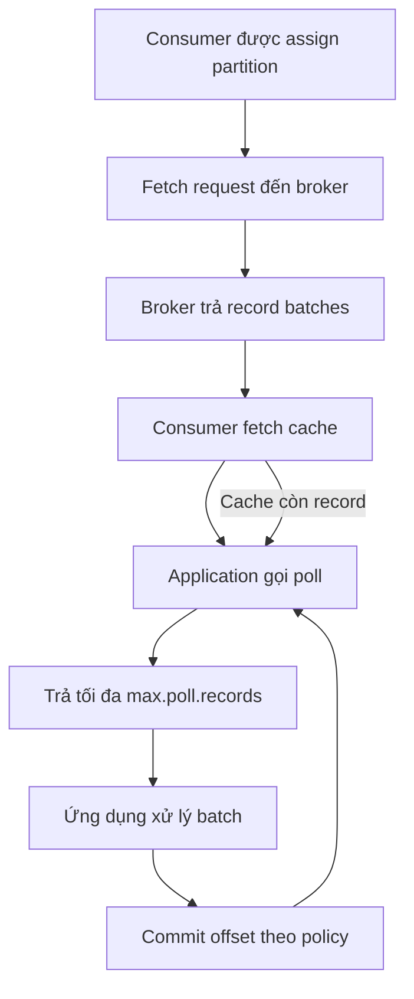

# Tối ưu fetch, poll và kích thước lô consumer

## Tăng throughput mà vẫn kiểm soát độ trễ và rebalance

Kafka consumer nhận dữ liệu theo các request Fetch. Broker trả record theo record batch, client giữ dữ liệu đã fetch trong bộ nhớ và API poll() đưa record cho ứng dụng theo từng đợt. Ứng dụng xử lý record, quản lý offset rồi tiếp tục gọi poll().

Muốn tối ưu consumer cần phân biệt ba lớp:

- **Fetch:** lượng byte broker trả về trong một request, theo giới hạn từng partition và toàn request.
- **Poll batch:** số record ứng dụng nhận trong một lần poll().
- **Processing batch:** số record ứng dụng thực sự xử lý cùng lúc và thời gian xử lý trước lần poll() tiếp theo.

Ba lớp liên quan nhưng không thay thế nhau. Tăng max.poll.records không làm broker fetch nhiều byte hơn; tăng fetch.max.bytes không bảo đảm ứng dụng xử lý nhanh hơn; tăng max.poll.interval.ms chỉ kéo dài thời gian giữa các lần poll được phép, không làm giảm thời gian xử lý.

## 1. Consumer nhận dữ liệu như thế nào?

### 1.1 Fetch và poll là hai bước khác nhau

Consumer gửi Fetch request đến broker leader của các partition được gán. Một fetch request có thể chứa nhiều partition. Broker trả record batch theo giới hạn byte; consumer lưu các batch đã nhận vào vùng đệm nội bộ.

Khi ứng dụng gọi poll(), consumer trả về một tập ConsumerRecords lấy từ dữ liệu đã có trong cache. Nếu cache còn record, poll() có thể trả dữ liệu ngay mà không cần chờ một fetch mới. Nếu chưa có dữ liệu, consumer tiếp tục chờ hoặc thực hiện fetch theo cơ chế nội bộ.



Vì vậy, khi nhìn thấy poll() trả về 100 record, không thể kết luận consumer chỉ fetch 100 record. Một fetch response có thể đã chứa nhiều record hơn; các lần poll tiếp theo sẽ lấy dần từ cache.

### 1.2 Ba lớp giới hạn

| Lớp | Cấu hình chính | Đơn vị |
|---|---|---|
| Tổng dữ liệu trong fetch response | fetch.max.bytes | Byte/request |
| Dữ liệu mỗi partition trong fetch | max.partition.fetch.bytes | Byte/partition |
| Số record ứng dụng nhận mỗi poll | max.poll.records | Record/poll |

fetch.min.bytes và fetch.max.wait.ms điều khiển broker chờ bao lâu và cần tích lũy bao nhiêu dữ liệu trước khi trả fetch response. max.poll.interval.ms điều khiển thời gian tối đa giữa các lần poll() khi consumer dùng group management.

## 2. Các cấu hình fetch quan trọng

Các giá trị mặc định dưới đây theo Kafka 4.2. Khi dùng phiên bản khác, hãy đối chiếu cấu hình của đúng client version.

### 2.1 fetch.min.bytes: kích thước tối thiểu mong muốn

fetch.min.bytes là lượng dữ liệu tối thiểu broker cố gắng tích lũy trước khi trả một Fetch response. Mặc định là 1 byte, vì vậy broker có thể trả ngay khi có dữ liệu.

Tăng giá trị này có thể gom nhiều dữ liệu hơn vào một response, giảm số request và cải thiện throughput. Đổi lại, broker có thể phải chờ dữ liệu mới đến, làm tăng latency khi traffic thấp hoặc rải mỏng.

Ví dụ:

- Consumer đọc topic có throughput cao, nhiều record liên tục: có thể thử fetch.min.bytes lớn hơn 1.
- Consumer xử lý event tương tác, cần nhận record nhanh: giữ giá trị thấp.
- Topic ít traffic: tăng quá cao có thể khiến mỗi fetch thường xuyên chờ đến fetch.max.wait.ms.

Không hiểu fetch.min.bytes là cam kết response luôn đạt đúng số byte đó. Giới hạn theo partition và giới hạn response vẫn có thể làm dữ liệu trả về thấp hơn.

### 2.2 fetch.max.wait.ms: thời gian broker chờ

fetch.max.wait.ms là thời gian tối đa broker chờ trước khi trả fetch request khi chưa đủ fetch.min.bytes. Mặc định Kafka 4.2 là 500 ms.

Hai cấu hình này cần được cân bằng:

| Cấu hình | Tăng lên sẽ |
|---|---|
| fetch.min.bytes | Yêu cầu tích lũy nhiều byte hơn trước khi trả response |
| fetch.max.wait.ms | Cho broker thêm thời gian chờ dữ liệu tích lũy |

Tăng cả hai có thể giảm số fetch request và tăng kích thước response ở workload throughput cao. Với workload latency-sensitive, thời gian chờ dài có thể làm event mới đến phải chờ lâu hơn.

Lưu ý: trong Kafka 4.2, fetch.max.wait.ms áp dụng cho local log fetch. Với remote fetch từ tiered storage, thời gian chờ tối đa còn liên quan đến cấu hình broker remote.fetch.max.wait.ms.

### 2.3 max.partition.fetch.bytes: giới hạn theo partition

max.partition.fetch.bytes giới hạn số byte broker trả cho một partition trong fetch response. Mặc định Kafka 4.2 là 1 MiB.

Nếu consumer được assign nhiều partition, tổng dữ liệu nhận có thể lớn hơn giới hạn của một partition. Cấu hình này đặc biệt quan trọng khi:

- Record batch lớn.
- Consumer nhận nhiều partition.
- Một partition có throughput cao hơn hẳn các partition khác.
- Ứng dụng cần kiểm soát lượng dữ liệu fetch trước khi xử lý.

Có một ngoại lệ quan trọng để tránh consumer không thể tiến lên: nếu record batch đầu tiên của partition không rỗng trong fetch lớn hơn max.partition.fetch.bytes, broker vẫn trả batch đó. Kích thước batch tối đa được broker chấp nhận chịu ảnh hưởng bởi message.max.bytes hoặc topic config max.message.bytes.

Do đó, đây không phải giới hạn cứng tuyệt đối cho mọi trường hợp. Khi thay đổi kích thước record batch ở producer hoặc broker, cần kiểm tra cả consumer fetch limit.

### 2.4 fetch.max.bytes: giới hạn response theo request

fetch.max.bytes giới hạn lượng dữ liệu broker nên trả về cho một fetch request, tính trên nhiều partition trong request. Mặc định Kafka 4.2 là 50 MiB.

Consumer có thể thực hiện nhiều fetch song song đến các broker khác nhau, vì vậy không xem fetch.max.bytes là giới hạn cứng cho toàn bộ bộ nhớ consumer. Ngoài ra, nếu record batch đầu tiên ở partition không rỗng lớn hơn giá trị này, batch vẫn được trả để consumer có thể tiếp tục tiến lên.

Khi tăng fetch.max.bytes, cân nhắc:

- Số partition đang được assign.
- Số broker mà consumer fetch đồng thời.
- Kích thước record batch.
- Bộ nhớ heap và mức tăng kích thước sau deserialize.
- Thời gian xử lý batch và khả năng gọi poll() đúng hạn.

Tăng fetch limit mà không có đủ memory hoặc năng lực xử lý có thể chuyển bottleneck từ network sang heap, GC và thời gian xử lý ứng dụng.

## 3. max.poll.records: kích thước lô trả cho ứng dụng

### 3.1 Ý nghĩa

max.poll.records giới hạn số record tối đa được trả trong một lần gọi poll(). Mặc định Kafka 4.2 là 500.

Đây là giới hạn số record ứng dụng nhận trong một poll, không phải giới hạn byte và không điều khiển underlying fetch. Consumer vẫn fetch và cache record; các lần poll tiếp theo lấy dần từ cache.

Ví dụ:

```properties
max.poll.records=200
```

Ứng dụng nhận tối đa 200 record trong một lần poll. Nếu fetch cache đang có 700 record, consumer có thể trả thành nhiều batch poll liên tiếp.

### 3.2 Vì sao cần điều chỉnh?

Batch quá lớn:

- Một lần xử lý có thể kéo dài, làm lần poll() kế tiếp đến muộn.
- Tăng số object sống đồng thời sau deserialize.
- Tăng áp lực heap và garbage collection.
- Nếu một record lỗi, việc quản lý retry/commit cả batch phức tạp hơn.

Batch quá nhỏ:

- Tăng số vòng lặp xử lý và số lần gọi poll().
- Tăng overhead ở tầng ứng dụng.
- Có thể giảm hiệu quả xử lý theo batch ở database hoặc downstream.
- Tăng số lần commit nếu ứng dụng commit theo từng poll.

Chọn kích thước batch theo thời gian xử lý và bộ nhớ, không chỉ theo số record. 100 record nhỏ có thể nhẹ hơn 10 record lớn.

### 3.3 Ước lượng processing budget

Nếu xử lý tuần tự, có thể ước lượng sơ bộ:

\[
T_{batch} \approx N \times T_{record}
\]

Trong đó:

- N là số record nhận mỗi poll.
- T_record là thời gian xử lý trung bình hoặc p95/p99 mỗi record.
- T_batch là thời gian cần để xử lý batch.

Ví dụ, nếu một record mất 8 ms và batch có 200 record, thời gian xử lý tuần tự xấp xỉ 1.6 giây, chưa tính deserialize, commit và các bước phụ.

Đây chỉ là ước lượng. Thời gian thực tế còn phụ thuộc kích thước record, I/O, cache, downstream, GC và phân bố độ trễ. Khi thiết kế batch, dùng p95/p99 processing time và chừa biên an toàn so với max.poll.interval.ms.

## 4. max.poll.interval.ms và nguy cơ rebalance

### 4.1 Consumer phải gọi poll đúng hạn

max.poll.interval.ms là khoảng thời gian tối đa giữa hai lần gọi poll() khi dùng consumer group management. Mặc định Kafka 4.2 là 300000 ms, tương đương 5 phút.

Nếu ứng dụng xử lý batch quá lâu và không gọi poll() trước khi hết thời gian này, consumer bị xem là không còn tiến triển. Group có thể rebalance và partition được giao cho member khác.

Điều này khác với session.timeout.ms:

- max.poll.interval.ms theo dõi mức độ thường xuyên ứng dụng gọi poll().
- session.timeout.ms theo dõi heartbeat/session của consumer khi dùng Classic group protocol.

Với group.protocol=consumer, heartbeat interval và session timeout được quản lý theo cấu hình broker tương ứng; không áp dụng máy móc các cấu hình heartbeat của Classic protocol.

### 4.2 Vì sao batch lớn có thể gây rebalance?

Giả sử:

- max.poll.interval.ms = 300000 ms.
- max.poll.records = 1000.
- Mỗi record mất 400 ms để gọi dịch vụ ngoài.

Nếu xử lý tuần tự, thời gian lý thuyết có thể lên đến 400 giây, vượt 5 phút. Consumer có thể mất quyền tham gia group trong lúc vẫn đang xử lý batch.

Khi rebalance xảy ra:

- Partition có thể được giao cho consumer khác.
- Record chưa commit có thể được đọc lại.
- Downstream có thể nhận side effect trùng nếu xử lý không idempotent.
- Throughput toàn group giảm do pause/reassign/rejoin.

### 4.3 Cách xử lý

- Giảm max.poll.records để giới hạn thời gian xử lý mỗi batch.
- Tối ưu xử lý record và giảm latency downstream.
- Dùng pause() khi hàng đợi xử lý nội bộ đầy, nhưng tiếp tục gọi poll() định kỳ.
- Chuyển công việc nặng sang worker pool có bounded queue; consumer thread vẫn duy trì poll và quản lý offset.
- Tăng max.poll.interval.ms chỉ khi processing time hợp lệ và đã đo p99/p99.9.

Không tăng max.poll.interval.ms vô hạn để che giấu consumer bị treo. Điều đó làm chậm quá trình phát hiện một consumer thực sự không còn hoạt động.

## 5. Tối ưu theo từng loại workload

### 5.1 Throughput cao, record nhỏ

Mục tiêu là giảm số request và tăng lượng record xử lý mỗi vòng.

- Tăng fetch.min.bytes từ từ để broker gom dữ liệu tốt hơn.
- Thử fetch.max.wait.ms phù hợp với latency budget.
- Tăng max.poll.records nếu ứng dụng xử lý batch nhanh.
- Điều chỉnh fetch.max.bytes và max.partition.fetch.bytes nếu response đang bị giới hạn.
- Theo dõi heap, GC và p99 processing time.

### 5.2 Latency thấp, event đến rải rác

Mục tiêu là lấy record sớm:

- Giữ fetch.min.bytes thấp.
- Không đặt fetch.max.wait.ms cao hơn mức cần thiết.
- Dùng max.poll.records vừa phải để ứng dụng không giữ batch quá lâu.
- Theo dõi fetch-latency, thời gian giữa poll và end-to-end event latency.

### 5.3 Record lớn hoặc payload nặng

Mục tiêu là tránh fetch bị giới hạn quá thấp và tránh áp lực memory:

- Kiểm tra max.partition.fetch.bytes so với record batch lớn nhất.
- Kiểm tra fetch.max.bytes và số partition được assign.
- Đối chiếu giới hạn consumer với broker message.max.bytes và topic max.message.bytes.
- Đo kích thước object sau deserialize, không chỉ kích thước byte trên wire.
- Giảm max.poll.records nếu xử lý payload nặng kéo dài.

### 5.4 Xử lý database theo batch

Nếu downstream hỗ trợ insert/update theo batch:

- Chọn max.poll.records gần với batch size database có thể xử lý ổn định.
- Đảm bảo thời gian xử lý database nằm trong poll interval budget.
- Commit offset sau khi transaction database thành công.
- Với batch lỗi một phần, xác định rõ record nào đã hoàn tất trước khi commit offset.

Không commit offset cao nhất của partition nếu còn record offset thấp hơn chưa xử lý thành công. Offset commit biểu thị vị trí tiếp theo cần đọc, nên xử lý song song phải quản lý thứ tự completion theo partition.

## 6. Cấu hình mẫu theo hướng throughput cân bằng

Ví dụ cho consumer xử lý event nhỏ đến vừa, có khả năng xử lý batch:

```properties
group.id=order-projection
client.id=order-projection-1
enable.auto.commit=false

fetch.min.bytes=65536
fetch.max.wait.ms=100
max.partition.fetch.bytes=1048576
fetch.max.bytes=52428800

max.poll.records=200
max.poll.interval.ms=300000
```

Đây là cấu hình khởi điểm để benchmark, không phải giá trị tối ưu mặc định. Với topic ít traffic hoặc cần latency thấp, fetch.min.bytes=65536 có thể làm broker chờ lâu hơn; hãy giảm về 1 hoặc một giá trị nhỏ nếu latency tăng. Nếu mỗi record xử lý chậm, 200 record có thể quá nhiều; giảm batch và đo lại.

### 6.1 Ví dụ poll loop với manual commit

```java
Properties props = new Properties();
props.put(ConsumerConfig.BOOTSTRAP_SERVERS_CONFIG,
        "kafka-1:9092,kafka-2:9092,kafka-3:9092");
props.put(ConsumerConfig.GROUP_ID_CONFIG, "order-projection");
props.put(ConsumerConfig.CLIENT_ID_CONFIG, "order-projection-1");
props.put(ConsumerConfig.ENABLE_AUTO_COMMIT_CONFIG, false);
props.put(ConsumerConfig.MAX_POLL_RECORDS_CONFIG, 200);
props.put(ConsumerConfig.MAX_POLL_INTERVAL_MS_CONFIG, 300_000);
props.put(ConsumerConfig.FETCH_MIN_BYTES_CONFIG, 64 * 1024);
props.put(ConsumerConfig.FETCH_MAX_WAIT_MS_CONFIG, 100);
props.put(ConsumerConfig.MAX_PARTITION_FETCH_BYTES_CONFIG, 1024 * 1024);
props.put(ConsumerConfig.FETCH_MAX_BYTES_CONFIG, 50 * 1024 * 1024);

try (KafkaConsumer<String, OrderEvent> consumer =
             new KafkaConsumer<>(props, keyDeserializer, valueDeserializer)) {
    consumer.subscribe(List.of("orders"));

    while (running) {
        ConsumerRecords<String, OrderEvent> records =
                consumer.poll(Duration.ofMillis(250));

        for (ConsumerRecord<String, OrderEvent> record : records) {
            processOrderEvent(record);
        }

        // Commit only after every record in this batch completed successfully.
        consumer.commitSync();
    }
}
```

Ví dụ giả định xử lý tuần tự và chỉ commit sau khi toàn bộ batch thành công. Production cần xử lý exception, shutdown, rebalance callback và commit offset theo từng partition khi có partial failure. Không dùng cách commit cả batch nếu một phần record đã thất bại nhưng phần sau vẫn hoàn tất.

### 6.2 Giữ poll đều khi có worker pool

Nếu xử lý record bằng worker pool:

1. Consumer thread gọi poll() và chuyển record vào bounded queue.
2. Khi queue đạt ngưỡng, gọi pause() cho các partition đang được assign.
3. Vẫn tiếp tục gọi poll() để duy trì group management.
4. Khi queue giảm, gọi resume() để tiếp tục fetch.
5. Chỉ commit offset của các record đã xử lý thành công liên tục theo thứ tự trong từng partition.

KafkaConsumer không thread-safe. Giữ các thao tác consumer như poll, pause, resume, commit và close trên một thread điều khiển; worker thread chỉ xử lý record và trả kết quả về consumer thread.

## 7. Consumer metrics để đánh giá tuning

Kafka Java consumer cung cấp metrics qua JMX và consumer.metrics(). Các metric thường dùng trong Kafka 4.2:

| Metric | Ý nghĩa |
|---|---|
| fetch-size-avg/max | Byte trung bình/lớn nhất nhận được trong mỗi fetch request |
| fetch-latency-avg/max | Thời gian fetch request hoàn tất |
| fetch-rate | Số fetch request mỗi giây |
| fetch-throttle-time-avg/max | Thời gian broker throttle fetch |
| records-per-request-avg | Số record trung bình trong mỗi fetch request |
| bytes-consumed-rate | Tốc độ byte consumer đọc |
| records-consumed-rate | Tốc độ record consumer đọc |
| records-lag-max | Lag lớn nhất theo record giữa consumer position và log end theo metric |
| time-between-poll-avg/max | Khoảng thời gian trung bình/lớn nhất giữa các lần poll |
| last-poll-seconds-ago | Số giây kể từ lần poll gần nhất |
| poll-idle-ratio-avg | Tỷ lệ thời gian poll idle so với thời gian ứng dụng xử lý record |
| assigned-partitions | Số partition đang được assign cho consumer |
| commit-latency-avg/max | Thời gian commit offset |

records-lag-max dựa trên current consumer position, không phải committed offset. Khi so sánh với lag từ công cụ quản trị group, cần hiểu hai phép đo có thể khác nhau.

### 7.1 Cách đọc tổ hợp metric

- fetch-size-avg thấp, fetch-rate cao, records-per-request-avg thấp: request có thể quá nhỏ; xem fetch.min.bytes, fetch.max.wait.ms, throughput từng partition.
- fetch-size-avg cao, records-consumed-rate thấp, lag tăng: consumer có thể fetch nhanh hơn khả năng xử lý; xem max.poll.records, processing time, GC và downstream.
- fetch-latency cao cùng fetch-throttle-time cao: kiểm tra quota hoặc broker throttling.
- time-between-poll-max tiến gần max.poll.interval.ms: giảm batch hoặc processing time, xem xét worker pool/pause-resume.
- poll-idle-ratio-avg thấp kéo dài: ứng dụng dành nhiều thời gian xử lý record giữa các poll; có thể đang bị giới hạn bởi CPU hoặc downstream.
- poll-idle-ratio-avg cao nhưng lag vẫn tăng: consumer có thể không fetch đủ nhanh, bị throttle, ít partition được assign hoặc không có đủ consumer capacity.

Không kết luận chỉ từ một metric. Luôn so sánh với throughput đầu vào, lag từng partition, broker Fetch request metrics, CPU, GC và thời gian downstream.

## 8. Dashboard và cảnh báo

Dashboard consumer nên có các nhóm:

**Fetch**

- Fetch size avg/max.
- Fetch latency avg/max.
- Fetch rate và fetch throttle time.
- Bytes consumed rate và records consumed rate.
- Records per request.

**Poll và xử lý**

- Time between poll avg/max.
- Last poll seconds ago.
- Poll idle ratio.
- Application processing time p50/p95/p99.
- Số record xử lý mỗi poll và số record lỗi.

**Group và tiến độ**

- Assigned partitions.
- Records lag max và lag theo partition.
- Commit latency avg/max.
- Rebalance rate/count.

Gợi ý cảnh báo:

- time-between-poll-max duy trì gần max.poll.interval.ms.
- last-poll-seconds-ago tăng bất thường.
- Lag tăng liên tục trong khi input rate lớn hơn consume rate.
- Fetch throttle tăng kéo dài.
- Processing p99 vượt ngân sách trước lần poll tiếp theo.
- Commit latency hoặc rebalance rate tăng đột biến.

Đặt ngưỡng theo baseline và SLA của từng workload. Một consumer idle vì topic không có dữ liệu không phải sự cố; cần kết hợp lag và input rate để tránh alert sai.

## 9. Chẩn đoán các vấn đề thường gặp

| Triệu chứng | Nguyên nhân có thể | Hướng xử lý |
|---|---|---|
| Fetch request nhiều nhưng fetch size nhỏ | Traffic rải mỏng, fetch.min.bytes thấp hoặc wait ngắn | Thử tăng min bytes/wait nếu latency budget cho phép |
| Consumer latency tăng sau khi tăng min bytes | Broker chờ tích lũy dữ liệu | Giảm fetch.min.bytes hoặc fetch.max.wait.ms |
| Record batch lớn không đọc được | max.partition.fetch.bytes thấp hơn batch thường gặp hoặc broker/topic limit không tương thích | Kiểm tra record batch size và các giới hạn broker/topic/client |
| Heap/GC tăng sau khi tăng fetch limit | Nhiều dữ liệu được cache hoặc object deserialize lớn | Giảm fetch limits, kiểm tra số partition và payload |
| Poll xử lý quá lâu, group rebalance | Batch lớn hoặc downstream chậm | Giảm max.poll.records, tối ưu xử lý, bounded worker pool |
| Lag tăng dù fetch rate cao | Consumer lấy dữ liệu nhưng xử lý/commit không theo kịp | Xem processing p99, CPU, downstream, GC và commit |
| Lag tăng, fetch rate thấp | Consumer không fetch đủ nhanh hoặc bị throttle | Kiểm tra broker, network, assigned partitions và fetch wait |
| Commit latency tăng | Coordinator/network quá tải hoặc commit quá thường xuyên | Kiểm tra coordinator, commit strategy và rebalance |
| Một partition lag lớn hơn nhiều | Hot partition hoặc key skew | Kiểm tra key distribution, xử lý partition và partition count |
| Duplicate sau rebalance | Offset chưa commit nhưng side effect đã chạy | Dùng idempotent processing và commit sau side effect |

## 10. Quy trình tuning có kiểm soát

1. Ghi baseline: input rate, consume rate, lag, fetch size, fetch latency, processing p99, heap và GC.
2. Xác định mục tiêu: throughput, latency, memory hay ổn định poll/rebalance.
3. Kiểm tra partition assignment và phân bố lag trước khi thay đổi fetch config.
4. Điều chỉnh fetch.min.bytes/fetch.max.wait.ms để cân bằng request rate với latency.
5. Kiểm tra max.partition.fetch.bytes và fetch.max.bytes theo record batch size, số partition và memory.
6. Điều chỉnh max.poll.records dựa trên thời gian xử lý p95/p99 và kích thước record.
7. Bảo đảm thời gian từ poll đến poll tiếp theo có biên an toàn so với max.poll.interval.ms.
8. Thử một thay đổi mỗi lần với cùng traffic profile.
9. So sánh throughput, p99, lag, heap, GC, fetch size và rebalance.
10. Giữ cấu hình nếu đạt SLO mà không làm tăng lỗi hoặc áp lực tài nguyên.

## 11. Checklist production

- Phân biệt rõ fetch byte limit và poll record limit.
- Hiểu fetch.min.bytes và fetch.max.wait.ms tác động latency/throughput.
- max.partition.fetch.bytes đủ lớn cho record batch hợp lệ.
- fetch.max.bytes phù hợp với số partition, số broker fetch song song và memory.
- Không xem các fetch byte limit là hard cap trong trường hợp first batch cần được trả để consumer tiến lên.
- max.poll.records phù hợp với processing p99 và kích thước payload.
- Processing batch hoàn tất trước max.poll.interval.ms với biên an toàn.
- Consumer tiếp tục poll khi dùng pause() và worker pool.
- Commit offset chỉ sau khi side effect tương ứng thành công.
- Xử lý partial batch failure và commit theo partition đúng thứ tự offset.
- Theo dõi fetch size/rate/latency, records per request, lag và poll interval.
- Correlate consumer metrics với broker Fetch request, throttle, CPU, GC và downstream.
- Đã benchmark với kích thước record và traffic gần production.

## Kết luận

Tối ưu consumer cần điều chỉnh đồng thời fetch, poll và processing batch. fetch.min.bytes cùng fetch.max.wait.ms quyết định mức độ broker gom dữ liệu trước khi trả; max.partition.fetch.bytes và fetch.max.bytes giới hạn byte theo partition và request; max.poll.records giới hạn số record ứng dụng nhận mỗi poll. max.poll.interval.ms đặt ngân sách thời gian giữa hai lần poll và ảnh hưởng trực tiếp đến khả năng tránh rebalance.

Hãy bắt đầu bằng baseline và xác định đúng bottleneck. Nếu request quá nhỏ, điều chỉnh fetch batching; nếu ứng dụng xử lý quá lâu, giảm poll batch hoặc tối ưu xử lý; nếu heap tăng, xem tổng dữ liệu fetch/cache và kích thước object sau deserialize. Kết hợp fetch metrics, poll metrics, lag và processing latency để chọn cấu hình phù hợp với workload KAFKA thay vì tăng mọi giới hạn cùng lúc.

## Tài liệu tham khảo

- Apache Kafka 4.2 Consumer Configs: https://kafka.apache.org/42/configuration/consumer-configs/
- Apache Kafka 4.2 Monitoring: https://kafka.apache.org/42/operations/monitoring/
- KafkaConsumer Java API 4.2: https://kafka.apache.org/42/javadoc/org/apache/kafka/clients/consumer/KafkaConsumer.html
- ConsumerRecords Java API 4.2: https://kafka.apache.org/42/javadoc/org/apache/kafka/clients/consumer/ConsumerRecords.html
