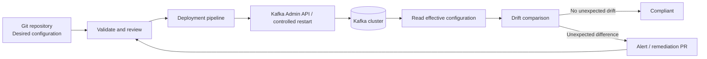
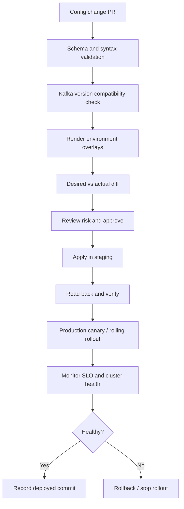

# Quản lý cấu hình có phiên bản và kiểm tra sai lệch môi trường

## Mục tiêu

Một Kafka cluster có nhiều lớp cấu hình: broker, topic, security, quota, producer/consumer client, Kafka Connect và Kafka Streams. Khi dev, staging và production được cấu hình bằng các file rời rạc hoặc chỉnh tay trên từng broker, rất dễ xuất hiện tình trạng cùng một ứng dụng chạy khác hành vi giữa các môi trường. Sai lệch nhỏ như `min.insync.replicas`, retention, listener, TLS hoặc fetch limit có thể dẫn tới lỗi ghi dữ liệu, mất khả năng phục hồi, tăng latency hoặc khó tái hiện sự cố.

Quản lý cấu hình có phiên bản (versioned configuration) coi cấu hình mong muốn là một artifact có lịch sử thay đổi, được review và triển khai có kiểm soát. Kiểm tra sai lệch môi trường (configuration drift detection) so sánh cấu hình mong muốn với cấu hình thực tế mà broker/client đang sử dụng, phân biệt khác biệt được phép với khác biệt ngoài dự kiến.

Sau bài học này, bạn có thể:

- Phân loại broker, topic, client, security và application configuration.
- Phân biệt static config, dynamic broker config và dynamic topic config.
- Thiết kế cấu trúc cấu hình dùng chung và overlay theo môi trường.
- Quản lý cấu hình trong Git với version, review và rollback.
- Đọc cấu hình thực tế cùng nguồn áp dụng (config source/synonyms).
- Dùng `kafka-configs.sh` và AdminClient để kiểm tra/thay đổi cấu hình.
- Phát hiện drift theo broker, topic và client deployment.
- Xây dựng allowlist cho khác biệt hợp lệ giữa dev/staging/prod.
- Triển khai thay đổi theo từng giai đoạn, xác minh và khôi phục an toàn.
- Tránh đưa secret vào Git hoặc log khi snapshot cấu hình.

## 1. Vì sao cần versioned configuration?

Kafka là nền tảng event streaming dùng chung cho nhiều service và workload. Một cluster có thể chứa hàng trăm topic, nhiều broker, nhiều tenant, Connect worker, Streams application và client library với vòng đời riêng. Nếu cấu hình chỉ tồn tại trong `server.properties`, lệnh CLI lịch sử hoặc biến môi trường trên từng máy, team khó trả lời các câu hỏi:

- Vì sao broker 1 có `num.network.threads=8` nhưng broker 2 là 4?
- Ai thay `retention.ms` của topic `orders.events` và thay đổi lúc nào?
- Staging có cùng `min.insync.replicas` và `acks` với production không?
- Sau lần nâng Kafka, default config nào đã thay đổi?
- Cấu hình đang chạy có đúng với cấu hình đã được review không?
- Nếu thay đổi làm tăng lỗi, có thể quay lại trạng thái trước đó bằng cách nào?

Versioned configuration tạo ra một nguồn sự thật có thể kiểm tra. Mỗi thay đổi có diff, lý do, người review, phiên bản Kafka mục tiêu và cách rollback. Broker metadata và file trên máy vẫn là trạng thái runtime; Git lưu lịch sử mong muốn và lý do của thay đổi.

### 1.1. Desired state và actual state



- **Desired state:** cấu hình đã được chấp thuận và lưu trong repository.
- **Actual state:** cấu hình thực tế broker/topic đang áp dụng, bao gồm giá trị mặc định, static config và dynamic override.
- **Drift:** khác biệt ngoài allowlist giữa desired và actual state.
- **Reconciliation:** quy trình đưa actual state về desired state sau khi đã xác minh và phê duyệt.

Không nên tự động ghi đè mọi drift ngay khi phát hiện. Một khác biệt có thể là thay đổi khẩn cấp đã được operator thực hiện để khôi phục dịch vụ. Hệ thống cần phát hiện, phân loại, lưu audit và đưa ra quyết định reconcile có kiểm soát.

## 2. Các lớp cấu hình trong Kafka

Trước khi tổ chức repository, hãy xác định cấu hình thuộc lớp nào và được thực thi ở đâu.

| Lớp | Ví dụ | Nơi áp dụng |
|---|---|---|
| Broker static | `process.roles`, `node.id`, `listeners`, `log.dirs` | File cấu hình broker/controller; thường cần restart |
| Broker dynamic | `num.network.threads`, `log.retention.ms` nếu config hỗ trợ dynamic update | Metadata/config của cluster, áp dụng theo broker hoặc cluster |
| Topic | `retention.ms`, `cleanup.policy`, `min.insync.replicas` | Config của từng topic |
| Security | Listener protocol, SASL mechanism, truststore/keystore references, ACL | Broker, client và authorization layer |
| Producer client | `acks`, `enable.idempotence`, `batch.size`, `linger.ms` | Ứng dụng producer |
| Consumer client | `group.id`, `max.poll.records`, `fetch.max.bytes` | Ứng dụng consumer |
| Kafka Connect | Worker config, connector config, converter, SMT | Connect worker/connector |
| Kafka Streams | `application.id`, `num.stream.threads`, state directory, standby replicas | Streams application |
| Quota | `producer_byte_rate`, `consumer_byte_rate`, `request_percentage` | User/client quota entity trên cluster |

Không phải mọi cấu hình đều nằm trong `server.properties`. Ví dụ `max.poll.records` là cấu hình client; thay nó trong file broker không làm consumer thay đổi. Tương tự, topic `retention.ms` có thể override broker default mà không cần sửa broker config.

### 2.1. Tách cấu hình theo ownership

Mỗi cấu hình cần có owner:

- Platform team quản lý broker, listener, storage, replication và cluster defaults.
- Data/platform team hoặc topic owner quản lý topic retention, cleanup policy và partition-related policy theo quy trình.
- Application team quản lý producer/consumer client properties và timeout/retry.
- Security team quản lý principal, ACL, certificate và secret lifecycle.
- Integration team quản lý Connect/Streams worker và connector/application config.

Ownership giúp biết ai review thay đổi và ai chịu trách nhiệm khi drift xuất hiện. Một repository có thể chứa nhiều lớp, nhưng không nên để mọi team tự sửa mọi file mà không có boundary.

## 3. Static và dynamic broker configuration

Broker config có thể được cung cấp trong file cấu hình lúc khởi động hoặc được thay đổi động qua Kafka Admin API. Khả năng dynamic update phụ thuộc từng config key và phiên bản Kafka.

### 3.1. Static configuration

Static config được đọc khi broker khởi động. Thay đổi file không tự động thay đổi broker đang chạy; cần restart theo quy trình phù hợp.

Ví dụ các cấu hình thường gắn với định danh, listener hoặc storage:

```properties
process.roles=broker,controller
node.id=1
listeners=CONTROLLER://broker-1:9093,INTERNAL://broker-1:9092
controller.listener.names=CONTROLLER
log.dirs=/var/lib/kafka/data
```

Đây là ví dụ KRaft combined-role; production có thể tách broker và controller. `node.id`, `process.roles`, listener topology và storage path không phải các giá trị có thể thay tùy tiện khi cluster đang chạy. Thay đổi sai có thể làm node không khởi động, không gia nhập quorum hoặc không tìm thấy log data.

### 3.2. Dynamic broker configuration

Một số broker config hỗ trợ cập nhật khi cluster đang chạy. Kafka phân biệt khả năng cập nhật theo config: có loại dynamic per-broker, dynamic cluster-wide hoặc read-only. Dynamic config được lưu trong metadata/config của cluster; broker nhận thay đổi mà không cần restart cho những key hỗ trợ cơ chế đó.

Ví dụ đặt `log.retention.ms` làm dynamic default broker config:

```bash
bin/kafka-configs.sh --bootstrap-server kafka-1:9092 \
  --alter --entity-type brokers --entity-default \
  --add-config log.retention.ms=604800000
```

Ví dụ đặt override cho broker ID `1`:

```bash
bin/kafka-configs.sh --bootstrap-server kafka-1:9092 \
  --alter --entity-type brokers --entity-name 1 \
  --add-config num.network.threads=8
```

Chỉ dùng ví dụ với config key có update mode tương ứng trong Kafka version đang chạy. `num.network.threads` và `log.retention.ms` là ví dụ để minh họa cách quản lý; hãy kiểm tra broker config reference để xác định key cụ thể có thể dynamic trong release mục tiêu.

### 3.3. Dynamic cluster default và per-broker override

Có thể đặt một giá trị chung cho broker bằng `--entity-default`, rồi ghi đè riêng cho một broker bằng `--entity-name <broker-id>`. Per-broker dynamic override cụ thể hơn cluster-wide dynamic default.

Ví dụ:

```text
Dynamic broker default: num.network.threads = 8
Broker 1 override:      num.network.threads = 12
Broker 2:                dùng dynamic default = 8
Broker 3:                dùng dynamic default = 8
```

Đây là cách tổ chức cấu hình khi broker có phần cứng hoặc workload khác nhau. Nếu broker 1 được nâng cấp phần cứng và không còn cần override, hãy xóa override để broker quay về cluster default thay vì giữ một giá trị cũ vô thời hạn.

### 3.4. Nguồn giá trị và precedence

Giá trị hiệu lực có thể đến từ nhiều nguồn. Với broker config, dynamic per-broker override có ưu tiên cao hơn dynamic cluster default; dynamic config có ưu tiên cao hơn static config; nếu không có override, broker dùng static value hoặc Kafka default theo quy tắc của config đó.

Topic config override broker default cho topic tương ứng. Client property được ứng dụng truyền vào Kafka client là một lớp riêng, không được broker topic config ghi đè.

Khi điều tra drift, đừng chỉ so giá trị. Hãy xem cả **nguồn** của giá trị. Hai broker có thể đang có cùng effective value nhưng một bên lấy từ default, bên kia có override thủ công; chúng có thể lệch nhau sau lần nâng version hoặc thay default.

## 4. Dynamic topic configuration

Topic config là nơi quản lý các thuộc tính gắn với log của topic, ví dụ retention, cleanup policy, compression type hoặc minimum ISR. Topic override broker default khi config key được hỗ trợ ở topic scope.

Ví dụ cấu hình topic:

```bash
bin/kafka-configs.sh --bootstrap-server kafka-1:9092 \
  --alter --entity-type topics --entity-name orders.events \
  --add-config cleanup.policy=delete,retention.ms=1209600000,min.insync.replicas=2
```

Ví dụ trên đặt retention 14 ngày và `min.insync.replicas=2` cho topic `orders.events`. Các giá trị phải phù hợp replication factor, producer `acks` và yêu cầu nghiệp vụ. Nếu topic có RF=1, đặt min ISR=2 sẽ làm producer `acks=all` không thể ghi thành công.

Xóa một override để topic quay về broker default:

```bash
bin/kafka-configs.sh --bootstrap-server kafka-1:9092 \
  --alter --entity-type topics --entity-name orders.events \
  --delete-config retention.ms
```

Không xóa config chỉ vì muốn dùng default mà chưa biết default hiện tại là bao nhiêu. Default có thể thay đổi theo broker version hoặc environment. Desired configuration nên ghi rõ topic nào cố ý dùng default và topic nào có override.

### 4.1. Config thay đổi hành vi dữ liệu

Các config như `cleanup.policy`, `retention.ms`, `retention.bytes`, `min.insync.replicas`, `max.message.bytes` có ảnh hưởng vận hành và semantics dữ liệu. Thay đổi chúng có thể làm dữ liệu bị xóa sớm hơn, producer fail khi ISR giảm hoặc client không gửi được batch lớn.

Đặt policy theo loại topic:

| Loại topic | Policy cần xác định |
|---|---|
| Event history | Retention theo thời gian/dung lượng, replication, min ISR |
| Compacted entity state | `cleanup.policy=compact`, tombstone retention và key semantics |
| Retry/DLT | Retention đủ dài để điều tra và redrive |
| Internal changelog/repartition | Để Kafka Streams quản lý theo semantics của ứng dụng; không áp policy tùy tiện |

Không dùng một topic template cho mọi loại dữ liệu nếu retention, compaction và recovery requirement khác nhau.

## 5. KRaft và quản lý cấu hình cluster

Kafka hiện đại dùng KRaft để quản lý metadata; các thay đổi dynamic broker/topic config được lưu qua cơ chế metadata của cluster. Khi quản trị cluster KRaft, dùng Admin API/CLI kết nối bằng `--bootstrap-server`.

Không sửa trực tiếp metadata log, file snapshot hoặc thư mục metadata để thay config. Không dùng quy trình ZooKeeper-based cũ cho cluster KRaft. Những thay đổi liên quan `process.roles`, `node.id`, controller listener và quorum membership cần tuân thủ quy trình vận hành KRaft của đúng phiên bản.

### 5.1. Broker config và controller config

Trong cluster tách role:

- Broker node phục vụ produce/fetch và lưu partition replicas.
- Controller node tham gia metadata quorum và quản lý cluster metadata.
- Một số config chỉ có ý nghĩa ở broker, một số ở controller, một số dùng chung.

Repository nên thể hiện role của node để tránh apply nhầm broker-only config lên controller hoặc ngược lại. Nếu dùng combined role, xác định rõ node mang cả hai vai trò.

### 5.2. Quorum membership là thay đổi có kiểm soát riêng

Thay đổi voter/controller membership không phải thao tác config drift thông thường. Nó ảnh hưởng quorum và khả năng điều khiển cluster. Hãy dùng quy trình KRaft membership được tài liệu Kafka version mục tiêu hỗ trợ; kiểm tra quorum health trước/sau và không tự động reconcile membership chỉ từ một file diff.

## 6. Thiết kế repository cấu hình

Một cấu trúc dễ quản lý là tách baseline dùng chung, môi trường, node-specific values và secret references.

```text
kafka-config/
  README.md
  versions/
    kafka-4.2.yaml
  common/
    broker-baseline.yaml
    topic-templates.yaml
    client-baseline.yaml
  environments/
    dev/
      cluster.yaml
      brokers.yaml
      topics.yaml
      clients.yaml
    staging/
      cluster.yaml
      brokers.yaml
      topics.yaml
      clients.yaml
    production/
      cluster.yaml
      brokers.yaml
      topics.yaml
      clients.yaml
  nodes/
    production/
      broker-1.yaml
      broker-2.yaml
  schemas/
    config-policy.schema.json
  scripts/
    snapshot-configs.sh
    compare-configs.sh
```

Đây là cấu trúc minh họa, không phải cấu trúc bắt buộc của Kafka. Có thể dùng Terraform, Ansible, Helm, Kubernetes manifests hoặc công cụ nội bộ; điều quan trọng là một thay đổi có thể truy ngược về commit và environment.

### 6.1. Baseline và overlay

- `common/`: policy chung, ví dụ replication factor mục tiêu hoặc config baseline.
- `environments/dev`: giá trị phù hợp môi trường phát triển.
- `environments/staging`: gần production để kiểm thử nâng cấp và thay đổi.
- `environments/production`: giá trị production đã được phê duyệt.
- `nodes/`: khác biệt thực sự theo broker, ví dụ `node.id`, hostname hoặc storage mount.
- `versions/`: Kafka version, client compatibility và migration notes.

Tránh copy toàn bộ file config từ production sang staging rồi sửa vài dòng. Cách đó tạo nhiều bản sao dễ drift. Dùng baseline và overlay có quy tắc merge rõ ràng; pipeline phải hiển thị kết quả cuối cùng sau khi merge.

### 6.2. Ví dụ manifest mong muốn

```yaml
apiVersion: platform.example/v1
cluster: kafka-production
kafkaVersion: "4.2.x"
environment: production

brokerDefaults:
  log.retention.ms: "604800000"
  num.network.threads: "8"

topics:
  orders.events:
    partitions: 24
    replicationFactor: 3
    configs:
      cleanup.policy: "delete"
      retention.ms: "1209600000"
      min.insync.replicas: "2"

  customers.state:
    partitions: 12
    replicationFactor: 3
    configs:
      cleanup.policy: "compact"
      min.insync.replicas: "2"

nodes:
  broker-1:
    nodeId: 1
    advertisedHost: "kafka-1.internal.example"
    logDirs:
      - "/data/kafka-1"
```

Manifest trên là schema nội bộ minh họa. Kafka không tự đọc file YAML này; pipeline cần validate và chuyển các phần tương ứng thành broker/topic config, node startup config hoặc topic provisioning. `partitions` và `replicationFactor` là metadata của topic, không phải topic config key trong `kafka-configs.sh`.

### 6.3. Ghi rõ config key và kiểu dữ liệu

Kafka Admin API biểu diễn config entry dưới dạng tên và giá trị string. Repository nên thống nhất biểu diễn giá trị, đơn vị và comment:

```yaml
retention.ms: "1209600000"       # 14 ngày, milliseconds
min.insync.replicas: "2"         # replica trong ISR tối thiểu
cleanup.policy: "delete"
```

Đừng để một nơi dùng `14d`, nơi khác dùng `1209600000`, nơi khác dùng `14`. Nếu công cụ nội bộ hỗ trợ duration type, hãy chuẩn hóa trước khi render thành Kafka config string.

## 7. Versioning và quy trình review

Kafka không tự cung cấp Git-like history cho mọi thay đổi config. Dynamic config lưu trạng thái runtime hiện tại; repository versioned lưu lịch sử mong muốn, lý do và review.

Một thay đổi cấu hình nên có:

- Commit/PR ID.
- Cluster và environment mục tiêu.
- Kafka broker/client version.
- Config key cũ và mới.
- Nguồn áp dụng: static, dynamic per-broker, dynamic cluster default hoặc topic.
- Lý do thay đổi và SLO/risk liên quan.
- Tác động dự kiến tới throughput, latency, durability, retention và storage.
- Kế hoạch triển khai, verification và rollback.
- Người sở hữu/approve.

### 7.1. Ví dụ config change record

```yaml
changeId: KAFKA-OPS-142
cluster: kafka-production
environment: production
target:
  type: topic
  name: orders.events
change:
  retention.ms:
    from: "604800000"
    to: "1209600000"
reason: "Tăng thời gian lưu event để hỗ trợ replay 14 ngày"
risk: "Tăng dung lượng log segment cần thiết"
rollout: "Apply dynamic topic config, verify effective value và disk forecast"
rollback:
  retention.ms: "604800000"
```

Change record là metadata quản trị của repository, không phải Kafka config. Nó giúp audit và khôi phục giá trị trước đó nếu thay đổi gây vấn đề.

### 7.2. Pin version và quản lý nâng cấp

Ghi rõ Kafka broker version và client library version. Một config key có thể:

- Chưa tồn tại ở version cũ.
- Được thêm default mới ở version mới.
- Đổi tên hoặc deprecated.
- Thay đổi update mode từ static sang dynamic hoặc ngược lại.
- Có range/validation khác.

Không copy cấu hình từ tài liệu `latest` vào cluster cũ mà không kiểm tra version. Mỗi lần nâng Kafka cần có config migration review: key deprecated, default changed, config removed, listener/security changes và internal topic behavior.

## 8. Phát hiện configuration drift

Drift detection so sánh desired state với actual state đã đọc từ cluster và node. Một hệ thống tốt không chỉ so chuỗi key/value; nó phải hiểu entity, nguồn cấu hình, version, secret và khác biệt được phép.

### 8.1. Các loại drift

| Loại drift | Ví dụ | Mức độ |
|---|---|---|
| Missing config | Desired có `min.insync.replicas=2`, actual không có override và effective default là 1 | Cao nếu durability policy yêu cầu 2 |
| Value drift | Desired retention 14 ngày, actual 7 ngày | Cao vì ảnh hưởng replay/retention |
| Source drift | Giá trị bằng nhau nhưng actual đang đến từ manual override thay vì baseline | Trung bình; có thể lệch sau upgrade |
| Node drift | Broker 2 có thread count khác baseline ngoài allowlist | Tùy workload/host |
| Version drift | Staging chạy Kafka 4.2, production chạy 4.1 ngoài kế hoạch | Cao |
| Client drift | Một service deploy với `acks=1` thay vì `acks=all` | Cao với durability |
| Secret reference drift | Production dùng certificate/secret version cũ | Cao tùy security policy |
| Expected environment difference | Dev retention 1 ngày, production 14 ngày theo policy | Không phải drift nếu được khai báo |

### 8.2. So sánh effective value và config source

Khi lấy broker config, yêu cầu broker trả synonyms để thấy các nguồn giá trị. Admin API có thể cung cấp `ConfigEntry.source()`, `isDefault()`, `isSensitive()` và danh sách synonyms tùy resource/version.

Một report drift nên ghi:

| Entity | Key | Desired | Actual effective | Actual source | Kết quả |
|---|---|---|---|---|---|
| broker 1 | `num.network.threads` | 8 | 8 | DYNAMIC_BROKER_CONFIG | Source drift nếu policy yêu cầu baseline |
| broker 2 | `num.network.threads` | 8 | 4 | STATIC_BROKER_CONFIG | Value drift |
| topic `orders.events` | `retention.ms` | 1209600000 | 604800000 | DYNAMIC_TOPIC_CONFIG | Value drift |

Tên `ConfigSource` chính xác phụ thuộc API version; report cần giữ nguyên source enum trả về và không tự suy luận source chỉ từ việc key xuất hiện trong file.

### 8.3. Chuẩn hóa trước khi diff

Trước khi so sánh:

1. Chuẩn hóa tên entity và broker ID.
2. Chuẩn hóa giá trị số/duration về cùng đơn vị.
3. Chuẩn hóa list config theo semantics của key, không sort nếu thứ tự có ý nghĩa.
4. Loại bỏ timestamp, generated ID hoặc metadata không thuộc desired config.
5. Che sensitive value; so secret reference/version thay vì secret plaintext.
6. Áp allowlist cho node-specific và environment-specific differences.
7. Giữ lại nguồn config và Kafka version trong snapshot.

Không coi `null`, empty string, default value và explicit override là luôn tương đương. Với một số config, xóa override sẽ làm broker quay về default; nếu default thay đổi sau upgrade, effective value cũng thay đổi.

### 8.4. Allowlist cho khác biệt hợp lệ

Dev, staging và production không cần có mọi giá trị giống nhau. Ví dụ hợp lệ:

- Broker count và node ID khác nhau.
- Hostname, advertised listener và storage path khác nhau.
- Dev retention ngắn hơn để tiết kiệm dung lượng.
- Production có TLS certificate/secret reference riêng.
- Staging có quota hoặc throughput thấp hơn để phù hợp capacity.

Những khác biệt này cần được khai báo trong overlay hoặc allowlist có owner. Không dùng wildcard rộng như “bỏ qua mọi khác biệt trong production”; allowlist nên chỉ rõ entity, key, environment và lý do.

## 9. Snapshot cấu hình bằng CLI

### 9.1. Đọc broker dynamic configs

```bash
bin/kafka-configs.sh --bootstrap-server kafka-1:9092 \
  --describe --entity-type brokers --entity-name 1
```

Đọc cluster-wide broker defaults:

```bash
bin/kafka-configs.sh --bootstrap-server kafka-1:9092 \
  --describe --entity-type brokers --entity-default
```

Để xem thêm config/default/synonym nếu Kafka CLI version hỗ trợ:

```bash
bin/kafka-configs.sh --bootstrap-server kafka-1:9092 \
  --describe --entity-type brokers --entity-name 1 --all
```

### 9.2. Đọc topic config

```bash
bin/kafka-configs.sh --bootstrap-server kafka-1:9092 \
  --describe --entity-type topics --entity-name orders.events --all
```

Lệnh `--describe` không phải lúc nào cũng thể hiện mọi lớp config giống nhau giữa các version; hãy xác minh `--all` và output của CLI distribution đang dùng. Có thể dùng `kafka-topics.sh --describe --topic ...` để kiểm tra partition/replica assignment, nhưng topic config cần đọc qua config API/CLI phù hợp.

### 9.3. Snapshot topic metadata

```bash
bin/kafka-topics.sh --bootstrap-server kafka-1:9092 \
  --describe --topic orders.events
```

Lệnh này giúp lưu partition count, leader, replicas và ISR. Đây là metadata topology, không thay thế topic config snapshot.

Lưu snapshot theo run ID và thời điểm UTC, ví dụ:

```text
snapshots/
  production/
    2026-11-20T120000Z/
      brokers.json
      broker-defaults.json
      topics.json
      topic-configs.json
      manifest.json
```

Không lưu password, private key hoặc secret plaintext trong snapshot. Nếu CLI output có sensitive field bị redacted, giữ trạng thái `sensitive=true` và tham chiếu tới secret version trong secret manager.

## 10. Kiểm tra cấu hình bằng AdminClient

AdminClient cho phép automation đọc config của broker/topic và xem config source/synonyms. Ví dụ đọc broker config:

```java
Properties props = new Properties();
props.put(AdminClientConfig.BOOTSTRAP_SERVERS_CONFIG,
        "kafka-1:9092,kafka-2:9092");

try (Admin admin = Admin.create(props)) {
    ConfigResource broker = new ConfigResource(
            ConfigResource.Type.BROKER, "1");

    DescribeConfigsOptions options = new DescribeConfigsOptions()
            .includeSynonyms(true);

    Config config = admin.describeConfigs(List.of(broker), options)
            .all().get().get(broker);

    for (ConfigEntry entry : config.entries()) {
        String value = entry.isSensitive() ? "<redacted>" : entry.value();
        System.out.printf("%s=%s source=%s default=%s%n",
                entry.name(), value, entry.source(), entry.isDefault());
    }
}
```

Ví dụ cần imports từ `org.apache.kafka.clients.admin` và `org.apache.kafka.common.config`. Dùng `ConfigResource.Type.BROKER` với broker ID thực tế; để đọc topic config, dùng `ConfigResource.Type.TOPIC` và topic name. Broker có thể redacted giá trị sensitive; không tìm cách log plaintext để so sánh.

### 10.1. Thay đổi config bằng incrementalAlterConfigs

AdminClient cung cấp `incrementalAlterConfigs()` để thay đổi từng config entry mà không thay thế toàn bộ tập config như thao tác alter toàn phần.

```java
ConfigResource topic = new ConfigResource(
        ConfigResource.Type.TOPIC, "orders.events");

ConfigEntry retention = new ConfigEntry("retention.ms", "1209600000");
AlterConfigOp setRetention = new AlterConfigOp(
        retention, AlterConfigOp.OpType.SET);

Map<ConfigResource, Collection<AlterConfigOp>> changes = Map.of(
        topic, List.of(setRetention));

admin.incrementalAlterConfigs(changes).all().get();
```

Để xóa override và quay về giá trị được kế thừa, dùng `AlterConfigOp.OpType.DELETE` cho config key tương ứng. Chỉ dùng `APPEND`/`SUBTRACT` cho config list hỗ trợ semantics đó. Kiểm tra Admin API của đúng client/broker version trước khi triển khai automation.

Không dùng một snapshot config rồi gửi lại toàn bộ như một lần replace nếu không hiểu rõ semantics; có thể vô tình xóa dynamic override không có trong snapshot. Với thay đổi nhỏ, incremental operation thường dễ kiểm soát hơn.

## 11. Quản lý client, Connect và Streams config

Broker Admin API không thể cho biết đầy đủ mọi giá trị client đã được ứng dụng truyền lúc khởi tạo producer/consumer. Vì vậy drift detection cần nhiều nguồn:

- Git/application deployment manifests cho client config.
- Runtime metrics/logging có kiểm soát để xác minh `client.id`, group ID và version.
- Connect REST API cho connector config/status (nhớ che secret và config provider reference).
- Kafka Streams application deployment config và metrics.
- Secret manager/certificate inventory cho secret reference và version.

### 11.1. Producer/consumer client

Ví dụ cấu hình producer versioned:

```yaml
producer:
  acks: "all"
  enable.idempotence: "true"
  compression.type: "lz4"
  linger.ms: "5"
  batch.size: "65536"
```

Ví dụ consumer:

```yaml
consumer:
  enable.auto.commit: "false"
  isolation.level: "read_committed"
  max.poll.records: "200"
  max.poll.interval.ms: "300000"
```

Đây là ví dụ policy cho workload cụ thể, không phải baseline chung cho mọi ứng dụng. Mỗi application cần profile phù hợp ordering, retry, durability, latency và downstream processing.

### 11.2. Kafka Connect

Connect worker config và connector config có lifecycle khác nhau. Worker có bootstrap servers, config/storage/offset/status topics, converter và plugin path; connector có connector class, tasks, topic mapping, SMT và credentials/reference.

Quản lý connector config qua Connect REST API hoặc deployment automation; snapshot connector config và status nhưng phải redaction secret. Nếu dùng ConfigProvider, version hóa reference và provider configuration, không commit secret value.

### 11.3. Kafka Streams

Các config như `application.id`, `num.stream.threads`, `num.standby.replicas`, `state.dir` và processing guarantee thuộc ứng dụng Streams. `application.id` còn quyết định tên internal topics và consumer group; thay đổi nó có thể tạo application state mới, không phải chỉnh một tham số vô hại.

Đưa topology/store schema compatibility và migration plan vào review khi thay đổi stateful Streams application.

## 12. Secrets và cấu hình nhạy cảm

Versioned configuration không có nghĩa lưu mọi giá trị vào Git. Các giá trị như SASL password, keystore password, private key, OAuth client secret và credential database phải được quản lý trong secret manager hoặc cơ chế secret provider phù hợp.

Repository chỉ nên chứa reference:

```yaml
security:
  protocol: SASL_SSL
  sasl.mechanism: SCRAM-SHA-512
  sasl.jaas.config: "${SECRET_REF:kafka/tenant-a/sasl-jaas}"
  ssl.truststore.location: "/etc/kafka/secrets/client.truststore.jks"
  ssl.truststore.password: "${SECRET_REF:kafka/client/truststore-password}"
```

`${SECRET_REF:...}` chỉ là placeholder minh họa. Cần thay bằng cơ chế secret injection/provider được runtime thực tế hỗ trợ; Kafka client không tự hiểu placeholder này nếu không có bước resolve.

Một số Kafka Connect deployment hỗ trợ ConfigProvider để resolve secret reference trong connector config. Cấu hình provider và plugin phải có mặt trên mọi worker cần sử dụng. Với broker/client app, dùng cơ chế secret injection phù hợp môi trường triển khai. Không giả định ConfigProvider của Connect tự động áp dụng cho mọi Kafka component.

### 12.1. Quy tắc bảo vệ secret

- Không commit secret plaintext hoặc private key vào Git.
- Không in full config có sensitive values vào log/CI artifact.
- Giới hạn quyền đọc snapshot và deployment credentials.
- Dùng secret reference và version ID để kiểm tra drift.
- Xoay secret theo quy trình có thể rollback và theo dõi kết nối.
- Redact `sasl.jaas.config`, password, token, keystore/truststore credential trong report.
- Tách quyền đọc config với quyền alter config nếu nền tảng hỗ trợ.

## 13. CI/CD cho cấu hình Kafka

Một pipeline quản lý cấu hình nên có các giai đoạn sau:



### 13.1. Validate trước khi apply

Pipeline nên kiểm tra:

- YAML/JSON syntax và schema nội bộ.
- Config key có tồn tại trong Kafka version mục tiêu.
- Update mode của broker config: read-only, per-broker hay cluster-wide.
- Giá trị có đúng kiểu, range và đơn vị.
- Cross-field constraint, ví dụ `min.insync.replicas` không lớn hơn replication factor dự kiến.
- `message.max.bytes`, topic `max.message.bytes` và consumer fetch limits tương thích.
- Listener/security config có đủ trust/credential references.
- Topic cleanup policy và retention phù hợp data lifecycle.
- Desired state không chứa secret plaintext.
- Khác biệt ngoài allowlist được review.

### 13.2. Apply theo mức rủi ro

| Loại thay đổi | Cách triển khai gợi ý |
|---|---|
| Dynamic topic config | Apply một topic thử nghiệm, read back, sau đó mở rộng |
| Dynamic per-broker config | Apply từng broker/canary nếu key hỗ trợ; quan sát metrics trước khi tiếp tục |
| Dynamic cluster-wide config | Xác minh ảnh hưởng toàn cluster, apply trong cửa sổ phù hợp và theo dõi tất cả broker |
| Static broker config | Lên lịch restart/rolling restart; kiểm tra ISR, quorum và capacity giữa từng node |
| KRaft role/quorum/listener topology | Quy trình change riêng, review kỹ và có kế hoạch phục hồi cluster |
| Client config | Deploy canary application instance, so sánh metric trước/sau |

Không restart toàn bộ broker cùng lúc chỉ để đồng bộ một static config. Rolling restart phải bảo đảm đủ replica/ISR và quorum controller còn khỏe.

### 13.3. Verify sau apply

Sau khi pipeline áp dụng:

1. Đọc lại config từ Admin API/CLI.
2. Xác minh effective value và config source.
3. Xác minh tất cả broker liên quan đã nhận config.
4. Kiểm tra topic config và partition metadata nếu thay đổi ở topic.
5. Theo dõi request latency, ISR, under-replicated partitions, produce/fetch errors và consumer lag.
6. Lưu snapshot actual state cùng commit ID đã triển khai.

Lệnh CLI trả exit code 0 không đủ để kết luận mọi broker đã hội tụ và workload không bị ảnh hưởng. Cần read back và theo dõi metric sau khi thay đổi.

## 14. Rollback và audit

Rollback cần khôi phục cả giá trị và nguồn cấu hình mong muốn. Nếu thay một dynamic override, có thể set giá trị trước đó hoặc delete override để quay về default. Nếu thay static config, cần restore file/version cũ và thực hiện rolling restart theo quy trình.

### 14.1. Rollback dynamic topic config

Nếu topic retention được đổi từ 7 lên 14 ngày và cần quay lại 7 ngày:

```bash
bin/kafka-configs.sh --bootstrap-server kafka-1:9092 \
  --alter --entity-type topics --entity-name orders.events \
  --add-config retention.ms=604800000
```

Nếu trước đó topic không có override và kế thừa broker default, dùng `--delete-config retention.ms` để quay về kế thừa thay vì set một giá trị cụ thể. Chọn cách rollback theo trạng thái desired trước thay đổi.

### 14.2. Rollback không luôn đảo ngược tác động dữ liệu

Giảm retention sau khi dữ liệu cũ đã bị xóa không khôi phục lại dữ liệu đó. Tăng retention sau khi log segment đã bị xóa cũng không làm dữ liệu quay lại. Thay `cleanup.policy`, replication hoặc topic partition count có thể có tác động khó đảo ngược.

Vì vậy review cần phân loại:

- **Reversible config:** đổi lại giá trị có thể khôi phục hành vi nhưng không nhất thiết khôi phục side effect đã xảy ra.
- **Data lifecycle config:** retention/compaction có thể làm mất dữ liệu; rollback chỉ ngăn tác động tiếp theo.
- **Topology/identity config:** node ID, listener, quorum, partition count có thể cần migration hoặc maintenance.

### 14.3. Audit log

Ghi lại:

- Ai/automation nào thực hiện thay đổi.
- Thời điểm và cluster/environment.
- Config entity và key.
- Giá trị trước/sau (đã redact nếu sensitive).
- Commit/PR ID và lý do.
- Kết quả apply/readback.
- Metric hoặc incident liên quan.
- Rollback ID nếu có.

## 15. Ví dụ phát hiện drift giữa staging và production

Giả sử desired policy yêu cầu hai môi trường có cùng `min.insync.replicas=2` cho topic `orders.events`, nhưng retention được phép khác nhau:

| Config | Staging desired | Production desired | Allowlist |
|---|---:|---:|---|
| `min.insync.replicas` | 2 | 2 | Không; phải giống |
| `retention.ms` | 259200000 (3 ngày) | 1209600000 (14 ngày) | Có; theo environment |
| `cleanup.policy` | delete | delete | Không; phải giống |
| `replication.factor` | 3 | 3 | Không; phải giống |
| Broker hostname | staging DNS | production DNS | Có; theo node inventory |

Actual state:

| Environment | Config | Desired | Actual | Kết quả |
|---|---|---:|---:|---|
| Staging | min ISR | 2 | 2 | PASS |
| Production | min ISR | 2 | 1 | DRIFT |
| Staging | retention | 259200000 | 259200000 | PASS |
| Production | retention | 1209600000 | 1209600000 | PASS |

Pipeline không nên cảnh báo retention khác nhau vì khác biệt đó đã được khai báo. Nhưng production `min.insync.replicas=1` là drift cần điều tra vì làm giảm durability policy.

Quy trình xử lý:

1. Xác minh topic RF và ISR hiện tại.
2. Xác minh actual config source (topic override hay broker default).
3. Kiểm tra có incident/temporary override được phê duyệt không.
4. Nếu không có exception hợp lệ, tạo change để reconcile về 2.
5. Apply và read back.
6. Theo dõi producer errors, ISR và under-replicated partitions.
7. Lưu audit kết quả.

## 16. Troubleshooting

| Hiện tượng | Nguyên nhân có thể | Hướng xử lý |
|---|---|---|
| File config khác actual broker | Chỉnh dynamic config qua CLI sau lần commit gần nhất | Snapshot Admin API, tạo PR reconcile hoặc ghi nhận emergency change |
| Config không đổi sau khi sửa `server.properties` | Key là dynamic config đang bị override hoặc broker chưa restart | Kiểm tra config source; xác định update mode; restart nếu static |
| Broker không nhận dynamic config | Key không hỗ trợ dynamic update, sai entity hoặc thiếu quyền | Kiểm tra broker config reference, entity ID và ACL |
| Một broker khác các broker còn lại | Per-broker override hoặc static file drift | Describe từng broker và so source/synonyms |
| Topic config không giống broker default | Topic có override riêng | Describe topic config và quyết định giữ/xóa override |
| Staging/prod diff quá nhiều | Copy toàn bộ file, thiếu baseline/overlay hoặc version khác nhau | Chuẩn hóa common config và allowlist rõ ràng |
| Pipeline báo drift dù giá trị giống nhau | Khác config source, kiểu dữ liệu hoặc đơn vị | Normalize value và quyết định có theo dõi source drift không |
| Secret xuất hiện trong CI log | Snapshot/describe không redact sensitive fields | Redact trước log/artifact, rotate nếu secret đã lộ |
| Config apply thành công nhưng latency tăng | Giá trị hợp lệ nhưng không phù hợp workload | Theo dõi metric, rollback hoặc tune theo benchmark |
| Rolling restart làm ISR giảm | Restart quá nhanh hoặc cluster thiếu capacity | Dừng rollout, chờ ISR phục hồi và kiểm tra replica placement |
| KRaft node không khởi động sau config change | Node ID, role, listener hoặc quorum config sai | Dùng bản config đã lưu, khôi phục node theo runbook KRaft |
| Config key không tồn tại sau upgrade/downgrade | Version incompatibility hoặc key deprecated | Kiểm tra config reference theo Kafka version và migration guide |

## 17. Thực hành: snapshot và so sánh cấu hình môi trường

Lab dùng hai cluster dev/staging hoặc hai profile giả lập. Mục tiêu là lưu desired state, lấy actual config, phát hiện một drift có chủ đích và reconcile.

### 17.1. Tạo desired configuration

1. Tạo manifest cho broker baseline và topic `orders.events`.
2. Khai báo Kafka version, environment và node inventory.
3. Khai báo khác biệt retention dev/staging được phép.
4. Commit manifest vào Git với change ID.
5. Review các config có tác động durability, retention hoặc listener.

### 17.2. Snapshot actual state

Chạy `kafka-configs.sh --describe` cho broker defaults, từng broker và topic. Lưu topic partition/replica metadata riêng. Ghi snapshot timestamp, Kafka version, cluster ID và secret references đã redact.

### 17.3. Tạo drift có chủ đích

Trong lab, thay `retention.ms` của topic staging hoặc `min.insync.replicas` của topic test bằng CLI. Không dùng topic production. Chạy lại snapshot và so sánh với desired manifest.

Xác nhận detector phân loại:

- Retention khác nhau giữa dev/staging nhưng có allowlist: expected difference.
- `min.insync.replicas` khác desired: unexpected drift.
- Config source thay đổi nhưng effective value giống nhau: source drift nếu policy yêu cầu theo dõi.

### 17.4. Reconcile và xác minh

1. Xác minh drift không phải emergency exception đang hoạt động.
2. Tạo change record/PR để đưa actual về desired.
3. Apply dynamic topic config bằng Admin API/CLI.
4. Đọc lại config và source.
5. So sánh snapshot lần cuối.
6. Lưu audit, commit ID và kết quả.

Không chạy script auto-remediation trên toàn cluster trong lab đầu tiên. Bắt đầu bằng report-only, sau đó mới bật apply có approval.

## 18. Checklist production

- [ ] Mỗi lớp config có owner và nguồn sự thật rõ ràng.
- [ ] Kafka broker/client version được pin và review khi nâng cấp.
- [ ] Static/dynamic broker config được phân loại theo update mode.
- [ ] Topic config được version hóa theo loại dữ liệu và retention requirement.
- [ ] Common baseline và environment overlay có quy tắc merge rõ ràng.
- [ ] Node-specific values được khai báo riêng và có lý do.
- [ ] Secret chỉ được tham chiếu; không lưu plaintext trong Git/log.
- [ ] CI kiểm tra syntax, schema, version compatibility và cross-field constraints.
- [ ] Snapshot actual state có broker/topic entity và config source.
- [ ] Drift detector chuẩn hóa value, version, units và sensitive fields.
- [ ] Allowlist chỉ rõ environment/entity/key và owner.
- [ ] Dynamic change có canary/readback/monitoring.
- [ ] Static change có rolling restart plan và ISR/quorum guardrails.
- [ ] Rollback phân biệt config revert với side effect dữ liệu không thể đảo ngược.
- [ ] Audit lưu commit, actor, before/after, apply result và rollback.
- [ ] Automation ban đầu chạy report-only trước khi bật auto-reconcile.
- [ ] KRaft quorum membership và node identity dùng quy trình thay đổi riêng.

## 19. Câu hỏi tự kiểm tra

1. Vì sao cấu hình Kafka cần được quản lý như code có phiên bản?
2. Desired state và actual state khác nhau như thế nào?
3. Broker static config khác dynamic config ở đâu?
4. Dynamic per-broker override và dynamic cluster default có quan hệ precedence thế nào?
5. Topic config override broker default ra sao?
6. Vì sao cần đọc config source/synonyms thay vì chỉ đọc value?
7. `kafka-configs.sh --alter` khác việc sửa `server.properties` như thế nào?
8. Vì sao không được sửa trực tiếp KRaft metadata log để thay config?
9. Baseline và environment overlay giúp giảm drift thế nào?
10. Những khác biệt nào giữa dev/staging/prod nên nằm trong allowlist?
11. Vì sao AdminClient snapshot phải redact sensitive config?
12. `incrementalAlterConfigs()` có lợi gì so với thay toàn bộ config?
13. CI cần kiểm tra những cross-field constraint nào?
14. Vì sao lệnh apply thành công chưa đủ chứng minh cluster đã hội tụ?
15. Những loại config nào có rollback không thể khôi phục side effect dữ liệu?

## Tài liệu tham khảo

- [Apache Kafka — Broker Configs](https://kafka.apache.org/documentation/#brokerconfigs): broker properties và update mode.
- [Apache Kafka — Topic Configs](https://kafka.apache.org/documentation/#topicconfigs): retention, compaction, replication-related topic settings.
- [Apache Kafka — `kafka-configs.sh`](https://kafka.apache.org/documentation/#basic_ops_modify_topic_config): quản lý dynamic broker/topic configs.
- [Apache Kafka — Admin API](https://kafka.apache.org/documentation/#adminapi): `describeConfigs`, `incrementalAlterConfigs` và config resources.
- [Apache Kafka — KRaft](https://kafka.apache.org/documentation/#kraft): metadata quorum và quản trị KRaft cluster.
- [Apache Kafka — Security Overview](https://kafka.apache.org/documentation/#security_overview): authentication, authorization và bảo vệ credential.

> Versioned configuration lưu trạng thái mong muốn và lịch sử review; drift detection so sánh nó với cấu hình thực tế cùng nguồn áp dụng. Quản lý tốt cần phân biệt static/dynamic, baseline/overlay, secret reference và khác biệt hợp lệ giữa môi trường, sau đó triển khai có canary, readback, monitoring và rollback.
