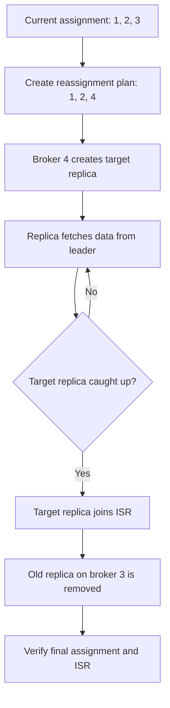

# Partition reassignment, throttle và theo dõi tiến độ

Partition reassignment là quá trình thay đổi broker lưu các replica của topic-partition. Quản trị viên thường dùng nó khi thêm broker mới, loại broker cũ, cân bằng dung lượng, chuyển replica giữa rack hoặc thay đổi replication factor. Kafka phải sao chép dữ liệu sang replica đích, đưa replica mới bắt kịp leader rồi mới hoàn tất việc loại replica cũ. Trong lúc đó, replication traffic có thể cạnh tranh network, disk I/O và CPU với produce/fetch traffic của ứng dụng.

Vì vậy, một lần reassignment cần có kế hoạch, giới hạn tốc độ sao chép phù hợp và theo dõi tiến độ theo từng partition. Bài viết trình bày cách tạo/review reassignment plan, thực thi bằng Kafka CLI, điều chỉnh throttle, giám sát ISR/replica lag, xử lý reassignment chậm hoặc thất bại và xác minh cluster sau khi hoàn tất.

## 1. Partition reassignment giải quyết vấn đề gì?

Mỗi topic-partition có một tập replica được gán vào các broker. Reassignment thay đổi tập broker giữ replica của partition đó.

Các tình huống thường gặp:

- **Thêm broker:** phân phối một phần replica từ các broker cũ sang broker mới để tăng dung lượng và giảm tải.
- **Loại broker:** di chuyển replica ra khỏi broker cần bảo trì, thay thế hoặc ngừng hoạt động.
- **Cân bằng disk:** chuyển replica khỏi broker có disk gần đầy sang broker còn dung lượng.
- **Cân bằng leader/traffic:** điều chỉnh replica assignment để phân phối leader và network load tốt hơn.
- **Thay đổi replication factor:** thêm hoặc bớt replica để thay đổi durability/storage footprint.
- **Rack awareness:** bố trí replica trên các rack/failure domain khác nhau để giảm rủi ro mất nhiều bản sao cùng lúc.
- **Di chuyển log directory:** chuyển replica giữa các ổ đĩa trên cùng broker; đây là intra-broker replica movement, khác với di chuyển replica giữa broker.

Reassignment không làm tăng số partition của topic. Nó thay đổi nơi lưu replica và có thể thay đổi replication factor nếu danh sách replica đích có số broker khác danh sách hiện tại.

## 2. Reassignment diễn ra như thế nào?

Giả sử partition có replica trên broker 1, 2 và 3. Cần chuyển replica từ broker 3 sang broker 4.



Ở mức khái niệm:

1. Controller nhận reassignment plan và cập nhật trạng thái partition assignment.
2. Broker đích tạo replica và bắt đầu fetch dữ liệu từ leader hoặc replica nguồn phù hợp.
3. Replica đích sao chép log, tiếp tục bắt kịp các record mới phát sinh.
4. Khi replica đích đủ đồng bộ, nó có thể tham gia ISR.
5. Kafka hoàn tất thay đổi assignment và loại replica cũ không còn nằm trong danh sách đích.
6. Quản trị viên xác minh assignment, ISR, leader và trạng thái reassignment.

Trong thời gian di chuyển, một partition có thể tạo thêm replication traffic đáng kể. Reassignment không phải thao tác copy file tức thời; nó cần thời gian tỷ lệ với dữ liệu phải sao chép, throughput replication và tải broker.

## 3. Phân biệt inter-broker và intra-broker reassignment

| Loại | Di chuyển từ đâu tới đâu | Ví dụ | Throttle liên quan |
|---|---|---|---|
| Inter-broker reassignment | Replica từ broker này sang broker khác | Broker 3 sang broker 4 | `--throttle` |
| Intra-broker log-dir reassignment | Replica trên cùng broker nhưng sang log directory khác | `/data1` sang `/data2` trên broker 2 | `--replica-alter-log-dirs-throttle` |

Inter-broker reassignment tạo network traffic giữa broker và thường ảnh hưởng cả network lẫn disk trên nguồn/đích. Intra-broker movement chủ yếu tạo disk read/write trên cùng máy; nó vẫn có thể ảnh hưởng latency của partition đang phục vụ client.

Không dùng nhầm hai throttle. Nếu di chuyển replica giữa broker, cần xem replication throttle. Nếu chỉ chuyển replica giữa các ổ đĩa trên cùng broker, cần xem log-dir throttle và khả năng IOPS của thiết bị.

## 4. Chuẩn bị trước khi tạo kế hoạch

Trước khi chạy reassignment, thu thập thông tin cluster và xác định phạm vi thay đổi.

### Kiểm tra broker và partition hiện tại

```bash
kafka-broker-api-versions.sh --bootstrap-server kafka-1:9092

kafka-topics.sh --bootstrap-server kafka-1:9092 \
  --describe --topic orders.events
```

Kiểm tra:

- Broker ID đang hoạt động và broker nào sẽ được thêm/loại.
- Leader, replicas và ISR của từng partition.
- Partition nào đã under-replicated hoặc offline.
- Broker nào có disk/network/CPU cao.
- Replication factor và `min.insync.replicas` của topic.
- Rack/failure-domain của từng broker nếu cluster có rack awareness.
- Dung lượng disk còn trống sau khi tính cả retention và growth.

Không bắt đầu một đợt di chuyển lớn khi cluster đang có offline partition, ISR liên tục shrink hoặc broker nguồn/đích đã bão hòa. Hãy ổn định cluster trước, trừ trường hợp reassignment chính là biện pháp khẩn cấp để loại broker sắp hỏng và đã có runbook phục hồi.

### Ước lượng dung lượng và thời gian

Nếu phải sao chép tổng cộng `D` byte và replication throughput thực tế duy trì được là `R` byte/s, thời gian lý tưởng tối thiểu:

\[
T_{min} = \frac{D}{R}
\]

Ví dụ cần chuyển 600 GiB với throughput replication 30 MiB/s:

\[
T_{min} \approx \frac{600 \times 1024}{30}
             = 20{,}480\text{ giây}
             \approx 5.7\text{ giờ}
\]

Thời gian thực tế thường dài hơn do replica vẫn phải theo kịp dữ liệu mới, throttle dùng chung, nhiều partition tranh chấp I/O, broker load và network overhead. Dùng phép tính này để lập maintenance window sơ bộ, không coi là ETA cam kết.

## 5. Tạo danh sách topic cần di chuyển

Kafka CLI dùng file JSON để chỉ định topic nằm trong phạm vi reassignment. Ví dụ `topics-to-move.json`:

```json
{
  "version": 1,
  "topics": [
    { "topic": "orders.events" },
    { "topic": "payments.events" }
  ]
}
```

File này chỉ định topic cần xem xét, không phải danh sách partition đích cuối cùng. Broker list được truyền riêng trong lệnh generate.

Nên bắt đầu với một tập topic/partition có phạm vi rõ ràng. Tránh đưa toàn bộ cluster vào một lần di chuyển lớn nếu chưa đánh giá tổng byte cần sao chép và tác động tới production traffic.

## 6. Generate reassignment plan

Ví dụ cluster có broker ID 1, 2, 3, 4; muốn Kafka đề xuất assignment cho các topic trong file JSON:

```bash
kafka-reassign-partitions.sh --bootstrap-server kafka-1:9092 \
  --topics-to-move-json-file topics-to-move.json \
  --broker-list "1,2,3,4" \
  --generate
```

Lệnh generate hiển thị assignment hiện tại và assignment đề xuất. Hãy lưu phần JSON đề xuất vào file riêng, ví dụ `reassignment.json`, sau khi review. Không gửi thẳng output văn bản chứa cả hai phần vào `--execute`; file execute phải là JSON reassignment hợp lệ.

Ví dụ cấu trúc reassignment JSON:

```json
{
  "version": 1,
  "partitions": [
    {
      "topic": "orders.events",
      "partition": 0,
      "replicas": [1, 2, 4]
    },
    {
      "topic": "orders.events",
      "partition": 1,
      "replicas": [2, 3, 4]
    }
  ]
}
```

Mảng `replicas` là danh sách broker đích. Thứ tự broker trong danh sách có ý nghĩa: replica đầu tiên là preferred replica cho partition. Kiểm tra broker ID tồn tại, replication factor mong muốn và rack distribution trước khi execute.

### Không mặc định assignment generate đã tối ưu

Generated plan là điểm bắt đầu. Trước khi thực thi, cần review:

- Số replica mỗi broker sau di chuyển.
- Tổng dung lượng replica dự kiến trên từng broker.
- Số partition leader dự kiến trên từng broker.
- Replica của cùng partition có nằm trên các broker/rack độc lập không.
- Broker mới có đủ disk/network headroom không.
- Có tập trung quá nhiều partition nóng lên cùng broker không.
- Danh sách replica có thay đổi replication factor ngoài dự kiến không.

Nếu mục tiêu là loại một broker, xác nhận broker đó không còn xuất hiện trong bất kỳ replica assignment đích nào. Nếu mục tiêu là thêm broker, kiểm tra broker mới thực sự nhận đủ replica để giảm tải thay vì chỉ thêm broker vào danh sách cho phép.

## 7. Review assignment JSON thủ công

Một partition entry thường có dạng:

```json
{
  "topic": "orders.events",
  "partition": 7,
  "replicas": [4, 2, 1]
}
```

Ý nghĩa:

- `topic`: tên topic.
- `partition`: partition ID.
- `replicas`: broker ID theo thứ tự replica assignment.

Một số phiên bản/loại reassignment còn hỗ trợ `log_dirs` để chỉ định log directory đích theo từng replica:

```json
{
  "topic": "orders.events",
  "partition": 7,
  "replicas": [4, 2, 1],
  "log_dirs": ["/data/kafka-a", "any", "any"]
}
```

`log_dirs` phải có số phần tử tương ứng với `replicas`. Giá trị `any` cho phép Kafka chọn log directory phù hợp. Đường dẫn phải tồn tại và được cấu hình hợp lệ trên broker tương ứng; không dùng path của broker này cho broker khác nếu layout khác nhau.

Không thêm cùng một partition nhiều lần trong một plan. Kiểm tra JSON syntax, broker ID, partition ID và danh sách replica trước khi execute.

## 8. Thực thi reassignment

Sau khi review file `reassignment.json`, chạy:

```bash
kafka-reassign-partitions.sh --bootstrap-server kafka-1:9092 \
  --reassignment-json-file reassignment.json \
  --execute
```

Lệnh này yêu cầu Kafka bắt đầu di chuyển replica theo assignment trong file. Đây là thao tác thay đổi cluster state; chỉ chạy sau khi đã review capacity, failure domain, replication factor và maintenance impact.

Với cluster yêu cầu xác thực, truyền client properties bằng `--command-config admin.properties` nếu script/version hỗ trợ. Principal chạy lệnh cần quyền quản trị topic/partition phù hợp.

### Thực thi theo từng đợt nhỏ

Thay vì di chuyển hàng nghìn partition cùng lúc, có thể chia theo batch:

1. Di chuyển một tập partition đại diện nhỏ.
2. Theo dõi replication rate, ISR, broker load và client latency.
3. Điều chỉnh throttle nếu cần.
4. Chỉ bắt đầu batch tiếp theo khi batch trước hoàn tất và cluster ổn định.

Cách này giảm blast radius và giúp dự đoán throughput thực tế trước khi mở rộng phạm vi.

## 9. Throttle là gì?

Throttle giới hạn tốc độ replication traffic được dùng cho reassignment. Mục đích là ngăn việc sao chép dữ liệu chiếm hết network và disk bandwidth của broker, làm tăng latency của producer/consumer đang phục vụ production.

Ví dụ giới hạn replication throughput ở mức 20 MiB/s:

```bash
kafka-reassign-partitions.sh --bootstrap-server kafka-1:9092 \
  --reassignment-json-file reassignment.json \
  --throttle 20971520 \
  --execute
```

Giá trị throttle tính bằng byte/giây. 20 MiB/s tương đương `20 * 1024 * 1024` byte/s.

Throttle thấp:

- Giảm cạnh tranh network/disk với client traffic.
- Kéo dài thời gian reassignment.
- Có thể khiến replica mới bắt kịp rất chậm nếu tốc độ replication thấp hơn tốc độ dữ liệu mới được ghi.

Throttle cao:

- Rút ngắn thời gian sao chép.
- Tăng network/disk/CPU pressure trên broker nguồn và đích.
- Có thể làm produce/fetch latency tăng, ISR shrink hoặc broker request queue bão hòa.

Không có một throttle rate chung cho mọi cluster. Hãy bắt đầu thận trọng, đo tác động và tăng/giảm theo SLO của ứng dụng.

## 10. Throttle áp dụng ở đâu?

Kafka dùng các cấu hình replication throttle ở broker và topic để giới hạn replication traffic liên quan tới reassignment. Các config thường gặp:

| Config | Scope | Ý nghĩa |
|---|---|---|
| `leader.replication.throttled.rate` | Broker | Giới hạn tốc độ replica fetch từ góc nhìn broker leader |
| `follower.replication.throttled.rate` | Broker | Giới hạn tốc độ replication từ góc nhìn broker follower |
| `leader.replication.throttled.replicas` | Topic | Chỉ định replica/partition được throttle ở phía leader |
| `follower.replication.throttled.replicas` | Topic | Chỉ định replica/partition được throttle ở phía follower |

CLI `--throttle` có thể thiết lập các cấu hình liên quan cho reassignment được chỉ định. Điều này giúp giới hạn replica movement mà không cần tự sửa từng broker/topic config bằng tay.

### Kiểm tra throttle hiện tại

Kiểm tra dynamic broker configs:

```bash
kafka-configs.sh --bootstrap-server kafka-1:9092 \
  --entity-type brokers --entity-name 1 \
  --describe --all
```

Kiểm tra topic configs:

```bash
kafka-configs.sh --bootstrap-server kafka-1:9092 \
  --entity-type topics --entity-name orders.events \
  --describe --all
```

Tên config được hiển thị có thể gồm dynamic override và default theo Kafka version. Ghi lại giá trị trước reassignment để có thể xác định cấu hình nào do đợt di chuyển tạo ra.

## 11. Điều chỉnh throttle khi reassignment đang chạy

Nếu cluster còn headroom và reassignment quá chậm, có thể tăng throttle bằng cách thực thi lại reassignment command với cùng assignment JSON và throttle mới theo khả năng của Kafka CLI version. Nếu production latency tăng, giảm throttle để nhường tài nguyên cho client traffic.

Ví dụ minh họa tăng giới hạn lên 40 MiB/s:

```bash
kafka-reassign-partitions.sh --bootstrap-server kafka-1:9092 \
  --reassignment-json-file reassignment.json \
  --throttle 41943040 \
  --execute
```

Hãy xác minh CLI báo đang cập nhật reassignment/throttle hiện có thay vì tạo một reassignment không mong muốn. Không thay đổi JSON giữa lúc đang có reassignment active nếu chưa hiểu semantics `--additional`/version của công cụ.

Nếu hạ throttle, replica có thể bắt kịp chậm hơn. Nếu tốc độ replication thấp hơn tốc độ produce mới liên tục, replica có thể không bao giờ bắt kịp. Khi đó cần tăng throttle trong maintenance window, giảm write load có kế hoạch hoặc điều chỉnh phạm vi di chuyển.

## 12. Throttle cho intra-broker log directory movement

Khi di chuyển replica giữa các log directory trên cùng broker, dùng tùy chọn `--replica-alter-log-dirs-throttle` của CLI tương ứng:

```bash
kafka-reassign-partitions.sh --bootstrap-server kafka-1:9092 \
  --reassignment-json-file log-dir-reassignment.json \
  --replica-alter-log-dirs-throttle 10485760 \
  --execute
```

Ví dụ đặt giới hạn 10 MiB/s cho log directory movement. Đây là throttle riêng cho replica alter log dirs; không nhầm với inter-broker `--throttle`.

Di chuyển nội bộ vẫn có thể ảnh hưởng disk latency vì broker phải đọc log nguồn và ghi log đích. Theo dõi disk utilization, I/O wait, request latency và dung lượng từng mount point.

## 13. Theo dõi tiến độ bằng `--list` và `--verify`

Liệt kê reassignment đang chạy:

```bash
kafka-reassign-partitions.sh --bootstrap-server kafka-1:9092 --list
```

Xác minh trạng thái của plan:

```bash
kafka-reassign-partitions.sh --bootstrap-server kafka-1:9092 \
  --reassignment-json-file reassignment.json \
  --verify
```

`--verify` cho biết partition nào đã hoàn tất và partition nào còn đang reassignment. Một số phiên bản cũng hiển thị thông tin throttle đang áp dụng hoặc trạng thái liên quan. Dùng output của CLI làm nguồn trạng thái reassignment, sau đó đối chiếu với ISR và broker metrics.

Không suy ra tiến độ chỉ từ việc broker đích đã xuất hiện trong `Replicas`. Replica có thể đã được khai báo trong assignment nhưng vẫn đang sao chép và chưa bắt kịp leader.

### Lặp lại verify theo chu kỳ

Trong đợt di chuyển dài, chạy `--list` và `--verify` theo chu kỳ phù hợp, ví dụ mỗi 1–5 phút. Tránh gọi liên tục mỗi giây vì không làm replication nhanh hơn và chỉ tạo thêm thao tác quản trị.

Lưu output theo timestamp để thấy partition nào tiến triển, partition nào đứng yên và thời điểm reassignment hoàn tất.

## 14. Theo dõi leader, replicas và ISR

Kiểm tra topic trong khi reassignment:

```bash
kafka-topics.sh --bootstrap-server kafka-1:9092 \
  --describe --topic orders.events
```

Đối chiếu:

- `Replicas`: danh sách broker trong assignment hiện tại.
- `Isr`: replica đang đồng bộ.
- `Leader`: broker phục vụ produce và read theo cấu hình.
- Replication factor: số replica mong muốn trong assignment cuối.

Trong quá trình di chuyển, ISR có thể thay đổi khi replica đích bắt kịp hoặc replica cũ bị loại. Điều quan trọng là partition không mất leader và ISR vẫn đáp ứng yêu cầu durability của workload.

Nếu ISR giảm dưới `min.insync.replicas`, producer dùng `acks=all` có thể nhận lỗi `NotEnoughReplicas` hoặc `NotEnoughReplicasAfterAppend`. Đây là dấu hiệu cần ưu tiên ổn định replica/cluster và đánh giá throttle/load.

## 15. JMX metrics cần theo dõi

Tên metric và MBean có thể thay đổi nhẹ theo Kafka release và exporter. Xác minh metric catalog của broker đang chạy.

| Metric/nhóm metric | Ý nghĩa | Cách dùng trong reassignment |
|---|---|---|
| `UnderReplicatedPartitions` | Số partition có ISR nhỏ hơn replication factor | Cảnh báo khi tăng hoặc kéo dài |
| `OfflinePartitionsCount` | Số partition không có leader khả dụng | Critical; reassignment không được làm tăng chỉ số này |
| `IsrShrinksPerSec` | Tốc độ ISR thu hẹp | Phát hiện follower bị tụt hoặc broker không ổn định |
| `IsrExpandsPerSec` | Tốc độ ISR mở rộng | Cho biết replica bắt kịp và quay lại ISR |
| Replica fetcher `MaxLag` | Lag lớn nhất của replica fetcher | Theo dõi replica đích có bắt kịp leader không |
| Replication bytes in/out | Throughput replication | Đối chiếu với throttle và network capacity |
| `BytesInPerSec` / `BytesOutPerSec` | Client/broker traffic | Phát hiện cạnh tranh với production traffic |
| Request handler/network processor idle | Mức rảnh của broker request processing | Phát hiện broker bão hòa |
| Disk utilization/latency | Áp lực đọc/ghi disk | Phát hiện nút nghẽn trên broker nguồn/đích |

Nên xem metric theo broker và theo topic/partition nếu exporter hỗ trợ. Cluster average có thể che giấu một broker đích đang bị nghẽn hoặc một partition lớn không có tiến triển.

## 16. Theo dõi dung lượng và log directory

Reassignment có thể làm broker đích cần dung lượng cho replica mới trước khi replica cũ bị loại. Trong một số giai đoạn, tổng disk usage tạm thời có thể tăng.

Kiểm tra log directory:

```bash
kafka-log-dirs.sh --bootstrap-server kafka-1:9092 \
  --describe --broker-list 1,2,3,4
```

Theo dõi:

- Dung lượng từng log directory và disk free percentage.
- Replica size trên broker nguồn và đích.
- Log directory offline hoặc lỗi I/O.
- Disk read/write throughput và latency.
- Tăng trưởng dữ liệu trong lúc reassignment chạy.

Không chỉ kiểm tra tổng dung lượng broker. Nếu broker có nhiều mount point, một log directory có thể đầy dù tổng disk còn trống ở mount khác.

## 17. Preferred replica và leader balance sau reassignment

Thứ tự broker trong `replicas` quyết định preferred replica. Tuy nhiên, reassignment hoàn tất không đồng nghĩa leader của mọi partition đã nằm trên preferred replica ngay lập tức. Nếu leader hiện tại vẫn hợp lệ, nó có thể tiếp tục làm leader cho tới khi có preferred leader election hoặc một sự kiện leader change.

Kiểm tra leader distribution sau reassignment:

```bash
kafka-topics.sh --bootstrap-server kafka-1:9092 \
  --describe --topic orders.events
```

Nếu cần đưa leader về preferred replica, thực hiện preferred replica election bằng công cụ/API phù hợp với Kafka version và phạm vi đã review. Không chạy election hàng loạt trong khi reassignment còn đang hoạt động hoặc cluster đang under-replicated.

Replica placement và leader placement là hai mục tiêu khác nhau:

- Replica placement quyết định broker nào lưu bản sao dữ liệu.
- Leader placement quyết định broker nào nhận produce request và phục vụ traffic leader.

Một assignment phân bố replica đều nhưng leader vẫn lệch có thể tiếp tục tạo network/CPU hotspot.

## 18. Reassignment làm thay đổi replication factor

Replication factor của partition bằng số broker trong danh sách replica cuối cùng.

Ví dụ:

```json
{
  "version": 1,
  "partitions": [
    {
      "topic": "orders.events",
      "partition": 0,
      "replicas": [1, 2, 4, 5]
    }
  ]
}
```

Nếu partition trước đó có ba replica và assignment mới có bốn broker, replication factor tăng từ 3 lên 4. Điều này tăng storage và replication traffic; cần bảo đảm đủ disk/network và đánh giá `min.insync.replicas`.

Ngược lại, giảm từ 3 replica xuống 2 làm giảm redundancy. Chỉ thực hiện khi durability policy cho phép, broker/rack placement vẫn đáp ứng failure requirement và đã đánh giá tác động khi thêm một broker lỗi.

Không thay đổi replication factor ngoài mục tiêu reassignment ban đầu. Nếu chỉ muốn di chuyển vị trí replica, giữ nguyên số broker trong mảng `replicas`.

## 19. Rack awareness và failure domain

Nếu broker có `broker.rack` được cấu hình, Kafka có thể dùng rack-aware replica assignment để phân bố replica qua các rack. Reassignment thủ công cần giữ nguyên nguyên tắc này.

Ví dụ ba replica nên nằm ở ba rack độc lập:

```text
Partition 0
  Replica 1 -> broker 1 -> rack-a
  Replica 2 -> broker 4 -> rack-b
  Replica 3 -> broker 7 -> rack-c
```

Nếu đưa hai replica của cùng partition vào cùng rack, một sự cố rack có thể làm mất nhiều bản sao cùng lúc dù replication factor vẫn là 3.

Khi review plan, kiểm tra rack của từng broker đích và không chỉ nhìn số lượng replica. Với cluster nhỏ hơn số rack, đánh giá rõ failure domain thực tế và chấp nhận rủi ro còn lại.

## 20. Reassignment chậm hoặc không tiến triển

Một reassignment có thể đứng yên nếu replica đích không fetch được, disk chậm, network bị nghẽn, throttle quá thấp hoặc broker đang xử lý tải lớn.

Quy trình điều tra:

1. Chạy `--list` và `--verify` để xác nhận reassignment vẫn active.
2. Xác định partition/replica đích chưa tiến triển.
3. Kiểm tra leader, ISR và replica assignment bằng `kafka-topics --describe`.
4. Kiểm tra broker nguồn/đích có sống, log directory online và còn disk không.
5. Kiểm tra replica fetcher lag/rate và replication bytes.
6. Kiểm tra throttle hiện tại có thấp hơn tốc độ produce mới hay không.
7. Kiểm tra network, disk I/O, CPU, GC và request queue.
8. Nếu cluster còn headroom, tăng throttle từng bước; nếu production bị ảnh hưởng, giảm throttle hoặc tạm dừng theo runbook.
9. Xác minh ISR mở rộng và replica đích bắt kịp.

Nếu replica đích không tiến triển dù throttle cao, tìm lỗi gốc như network partition, disk error, broker fencing, log directory failure hoặc replica fetcher exception. Không tăng throttle liên tục khi nút nghẽn thực tế là disk/network.

## 21. Cancel reassignment khi cần

Một số Kafka CLI version hỗ trợ `--cancel` để hủy reassignment đang chạy:

```bash
kafka-reassign-partitions.sh --bootstrap-server kafka-1:9092 \
  --reassignment-json-file reassignment.json \
  --cancel
```

Hành vi cancel và điều kiện hỗ trợ phụ thuộc Kafka version/trạng thái reassignment. Cancel không nhất thiết đưa cluster trở lại đúng trạng thái ban đầu ngay lập tức; replica đã được tạo hoặc assignment đã được cập nhật có thể cần thời gian cleanup/ổn định.

Trước khi cancel:

- Xác định đúng reassignment JSON/partition đang chạy.
- Kiểm tra có reassignment khác trên cùng partition không.
- Đánh giá replica nào đang là leader/ISR.
- Xác minh CLI version hỗ trợ `--cancel` và hiểu output.
- Sau cancel, chạy `--list`, `--verify` và `kafka-topics --describe` để xác nhận trạng thái.

Không dùng cancel như cách thay throttle. Nếu chỉ cần giảm tốc độ, điều chỉnh throttle phù hợp thường ít xáo trộn hơn.

## 22. Throttle cleanup sau khi hoàn tất

Khi reassignment hoàn tất, các throttle tạm thời do CLI tạo cho reassignment thường được gỡ trong quá trình verify/cleanup theo hành vi của Kafka version. Tuy nhiên, cần kiểm tra broker/topic config sau khi kết thúc:

```bash
kafka-configs.sh --bootstrap-server kafka-1:9092 \
  --entity-type brokers --entity-name 1 \
  --describe --all

kafka-configs.sh --bootstrap-server kafka-1:9092 \
  --entity-type topics --entity-name orders.events \
  --describe --all
```

Nếu throttle config do đợt reassignment tạo ra vẫn còn, xác định chính xác override và ownership trước khi xóa. Không xóa giá trị throttle đang được một reassignment khác sử dụng hoặc là policy vận hành chủ động của broker.

Sau cleanup, kiểm tra throughput replication trở lại baseline và không có throttle ngoài ý muốn làm replica recovery chậm.

## 23. Xác minh hoàn tất reassignment

Một đợt reassignment chỉ nên được coi là hoàn tất khi các kiểm tra sau đều đạt:

1. `--verify` báo các partition trong plan đã hoàn tất.
2. `--list` không còn reassignment tương ứng đang chạy.
3. `Replicas` của từng partition khớp assignment đích.
4. ISR có đủ replica theo replication factor và policy.
5. Partition có leader hợp lệ, không có offline partition.
6. Under-replicated partition trở về mức baseline/0 ngoài các trường hợp đã biết.
7. Disk usage và replica distribution trên broker nguồn/đích hợp lý.
8. Leader distribution phù hợp mục tiêu; chạy preferred leader election riêng nếu cần.
9. Throttle tạm thời đã được cleanup hoặc được giữ lại có chủ đích.
10. Produce/fetch latency, error rate và consumer lag trở lại mức ổn định.

Không dừng ở thông báo “reassignment completed” nếu ISR vẫn thiếu replica hoặc broker đích đang có disk pressure.

## 24. Ví dụ end-to-end: thêm broker mới

Giả sử cluster hiện có broker 1, 2, 3 và vừa thêm broker 4. Mục tiêu chuyển một phần replica của topic `orders.events` sang broker 4 mà giữ replication factor 3.

### Bước 1: xác minh broker 4

```bash
kafka-broker-api-versions.sh --bootstrap-server kafka-1:9092
kafka-topics.sh --bootstrap-server kafka-1:9092 \
  --describe --topic orders.events
```

Xác nhận broker 4 đăng ký, có disk/log directory online và có rack metadata đúng.

### Bước 2: tạo danh sách topic

`topics-to-move.json`:

```json
{
  "version": 1,
  "topics": [
    { "topic": "orders.events" }
  ]
}
```

### Bước 3: generate và review

```bash
kafka-reassign-partitions.sh --bootstrap-server kafka-1:9092 \
  --topics-to-move-json-file topics-to-move.json \
  --broker-list "1,2,3,4" \
  --generate
```

Review output và lưu assignment đích đã chỉnh vào `reassignment.json`. Xác nhận broker 4 nhận một phần replica, không có partition nào giảm replication factor ngoài ý muốn và rack distribution vẫn đúng.

### Bước 4: execute với throttle thận trọng

```bash
kafka-reassign-partitions.sh --bootstrap-server kafka-1:9092 \
  --reassignment-json-file reassignment.json \
  --throttle 20971520 \
  --execute
```

### Bước 5: monitor

```bash
kafka-reassign-partitions.sh --bootstrap-server kafka-1:9092 --list

kafka-reassign-partitions.sh --bootstrap-server kafka-1:9092 \
  --reassignment-json-file reassignment.json \
  --verify

kafka-topics.sh --bootstrap-server kafka-1:9092 \
  --describe --topic orders.events
```

Theo dõi replica fetcher lag, ISR shrink/expand, broker disk/network và produce/fetch latency. Nếu ứng dụng vẫn trong SLO và replica bắt kịp đều, có thể tiếp tục. Nếu latency tăng, giảm throttle hoặc giảm phạm vi batch tiếp theo.

### Bước 6: xác minh và cleanup

Sau khi verify hoàn tất, kiểm tra assignment cuối, ISR, leader distribution, disk balance và throttle config. Ghi lại kết quả trước/sau để làm baseline cho lần reassignment tiếp theo.

## 25. Checklist production

**Trước reassignment:**

- Xác định mục tiêu: thêm broker, loại broker, cân bằng disk, đổi RF hay log directory.
- Kiểm tra broker health, ISR, offline/under-replicated partition.
- Kiểm tra disk free, network, CPU, GC và rack/failure domain.
- Ước lượng tổng dữ liệu phải copy và thời gian tối thiểu.
- Generate plan, review từng partition và lưu bản current/proposed.
- Chia batch theo blast radius và maintenance window.
- Chọn throttle ban đầu dựa trên headroom production.

**Trong khi chạy:**

- Theo dõi `--list` và `--verify` theo chu kỳ.
- Theo dõi Replicas, ISR và Leader.
- Theo dõi UnderReplicatedPartitions, OfflinePartitionsCount, ISR shrink/expand và replica fetcher lag.
- Theo dõi network, disk, CPU, request latency, produce errors và consumer lag.
- Điều chỉnh throttle từng bước; tránh thay đổi plan đang active tùy tiện.
- Không chạy reassignment lớn thứ hai nếu chưa đánh giá tài nguyên còn lại.

**Sau khi hoàn tất:**

- Verify tất cả partition trong plan.
- Xác nhận replica assignment, ISR và leader.
- Xác nhận broker/disk distribution và rack awareness.
- Cleanup throttle tạm thời sau khi xác minh ownership.
- Chạy preferred replica election riêng nếu cần cân bằng leader.
- Theo dõi SLO và replication health sau maintenance.
- Lưu reassignment JSON, CLI output, throttle rate và kết quả sau cùng.

## 26. Ghi nhớ

Partition reassignment thay đổi broker giữ replica và có thể dùng để thêm/loại broker, cân bằng dung lượng, thay replication factor hoặc chuyển log directory. Quy trình gồm chuẩn bị, generate plan, review assignment JSON, execute, theo dõi replica catch-up và verify trạng thái cuối.

Throttle giới hạn replication traffic để bảo vệ production workload. `--throttle` dành cho inter-broker reassignment; `--replica-alter-log-dirs-throttle` dành cho di chuyển replica giữa log directory trên cùng broker. Chọn rate dựa trên network/disk headroom, theo dõi ISR, replica fetcher lag và client latency rồi điều chỉnh từng bước.

`--verify` và `--list` cho biết tiến độ reassignment; `kafka-topics --describe` xác minh leader/replicas/ISR; JMX và broker metrics cho biết tác động tài nguyên. Reassignment chỉ hoàn tất về mặt vận hành khi assignment đúng, ISR khỏe, không có offline partition, throttle được cleanup có kiểm soát và production latency trở lại ổn định.

## Tài liệu tham khảo

- [Apache Kafka – Operations: Partition reassignment](https://kafka.apache.org/documentation/#basic_ops_partition_reassignment)
- [Apache Kafka – `kafka-reassign-partitions.sh` tool](https://kafka.apache.org/documentation/#basic_ops_cluster_expansion)
- [Apache Kafka – Broker Configs](https://kafka.apache.org/documentation/#brokerconfigs)
- [Apache Kafka – Monitoring](https://kafka.apache.org/documentation/#monitoring)
- [Apache Kafka – Replication](https://kafka.apache.org/documentation/#replication)
