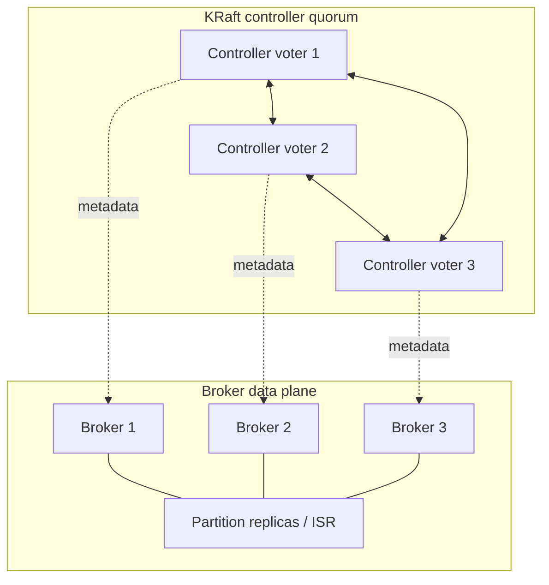
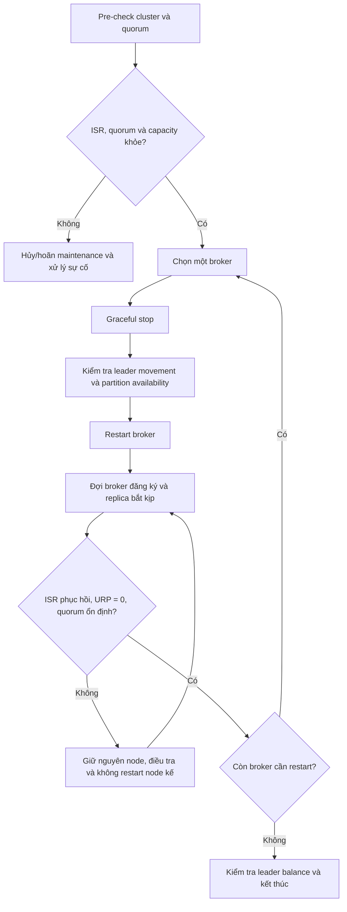

# Dừng có kiểm soát, rolling restart và thứ tự thao tác

Vận hành Kafka cluster thường cần dừng broker để bảo trì hệ điều hành, thay certificate, cập nhật cấu hình hoặc khởi động lại sau thay đổi tài nguyên. Nếu dừng sai thứ tự, cluster có thể mất partition leader, giảm số replica trong ISR dưới ngưỡng ghi, mất KRaft quorum hoặc khiến client timeout kéo dài.

Quy trình an toàn phải phân biệt ba tình huống: **rolling restart** khi cluster vẫn phục vụ traffic, **dừng toàn bộ cluster có kế hoạch**, và **khởi động lại cluster**. Với KRaft, controller quorum là control plane riêng cần được giữ đủ majority. Với broker, cần bảo đảm partition còn replica trong ISR và không làm số ISR giảm dưới `min.insync.replicas` của topic quan trọng.

## 1. Phân biệt ba loại thao tác

| Thao tác | Mục tiêu | Điều kiện vận hành |
|---|---|---|
| Graceful/controlled shutdown | Dừng một broker hoặc process sau khi hoàn tất các bước đóng có kiểm soát | Client có thể retry; broker khác và quorum vẫn khỏe |
| Rolling restart | Restart lần lượt từng node trong khi cluster tiếp tục phục vụ | Mỗi bước chỉ làm mất một node/replica set trong giới hạn an toàn; chờ phục hồi trước node tiếp theo |
| Full cluster shutdown/startup | Dừng và khởi động lại toàn bộ Kafka cluster | Chấp nhận downtime; dừng client trước, giữ controller đến khi broker dừng, khởi động controller trước broker |

Rolling restart không đồng nghĩa rolling upgrade. Nếu thay binary version hoặc feature level, cần thêm kiểm tra tương thích và tuân thủ upgrade guide của phiên bản Kafka đích. Không nên gộp nâng cấp major version, thay đổi quorum và thay đổi cấu hình replication vào cùng một lần bảo trì nếu chưa có kế hoạch riêng.

## 2. Hai mặt cần giữ an toàn: broker và KRaft quorum

Kafka KRaft có hai mặt vận hành liên quan nhưng khác nhau:

- **Broker/data plane:** nhận Produce/Fetch, giữ partition replica, phục vụ leader và follower replication.
- **Controller/control plane:** duy trì metadata log, bầu controller leader và điều phối metadata/partition state.

Node có thể chạy role `broker`, `controller` hoặc cả hai (`broker,controller`). Trước khi lập lịch, phải biết chính xác role của từng node. Một lần restart node chạy cả hai role tác động đồng thời đến broker và voter của quorum.



### Majority của controller quorum

Quorum cần majority của số voter đã cấu hình:

\[
Majority = \lfloor N/2 \rfloor + 1
\]

| Số voter | Majority cần có | Số voter tối đa có thể mất cùng lúc |
|---:|---:|---:|
| 3 | 2 | 1 |
| 5 | 3 | 2 |
| 7 | 4 | 3 |

Trong rolling restart, cách đơn giản và an toàn nhất là restart một controller voter tại một thời điểm. Chỉ chuyển sang voter tiếp theo khi node trước đã quay lại, quorum có leader ổn định và replication của metadata log đã bắt kịp.

Không được suy ra majority từ số process đang chạy trên máy. Phải dựa vào danh sách voter thực tế của quorum. Observer không được tính là voter để đạt majority.

## 3. Điều kiện trước khi restart broker

Trước mỗi broker restart, kiểm tra tối thiểu:

- Tất cả broker còn lại đang hoạt động và cluster không có offline partition.
- Không có under-replicated partition kéo dài; các replica của partition quan trọng đã nằm trong ISR.
- Với topic yêu cầu `acks=all`, số ISR còn lại sau khi dừng broker vẫn không thấp hơn `min.insync.replicas`.
- Không có broker khác đang restart, rolling maintenance, partition reassignment hoặc recovery lớn.
- Controller quorum có đủ majority và metadata log đang tiến triển.
- Broker còn lại có đủ disk, network, CPU và capacity để nhận leader/replication traffic chuyển sang.
- Consumer lag, producer error và request latency đang ở baseline chấp nhận được.
- Có bản lưu cấu hình, listener, ACL, quota, topic config và kế hoạch rollback.

Ví dụ topic có replication factor 3 và `min.insync.replicas=2`. Nếu ISR hiện có đủ 3 replica, dừng một broker có thể làm ISR tạm còn 2 và write `acks=all` vẫn được chấp nhận. Nếu trước khi restart ISR đã chỉ còn 2, dừng thêm một broker sẽ khiến ISR còn 1, thấp hơn min ISR; write `acks=all` có thể bị từ chối với `NOT_ENOUGH_REPLICAS`.

Topic replication factor 1 không có replica thay thế. Khi broker chứa replica đó dừng, partition sẽ unavailable cho đến khi broker quay lại. Không thể khắc phục giới hạn này bằng cách thêm consumer hoặc tăng timeout.

## 4. Lệnh kiểm tra sức khỏe trước bảo trì

Chạy lệnh từ một host có Kafka CLI và kết nối tới cluster. Điều chỉnh bootstrap endpoint, TLS/SASL client config và đường dẫn theo môi trường.

Kiểm tra trạng thái KRaft quorum:

```bash
bin/kafka-metadata-quorum.sh \
  --bootstrap-server broker-1.internal:9092 \
  describe --status
```

Kiểm tra replication của metadata quorum:

```bash
bin/kafka-metadata-quorum.sh \
  --bootstrap-server broker-1.internal:9092 \
  describe --replication
```

Kiểm tra under-replicated và unavailable partitions:

```bash
bin/kafka-topics.sh --bootstrap-server broker-1.internal:9092 \
  --describe --under-replicated-partitions

bin/kafka-topics.sh --bootstrap-server broker-1.internal:9092 \
  --describe --unavailable-partitions
```

Kiểm tra consumer group lag:

```bash
bin/kafka-consumer-groups.sh \
  --bootstrap-server broker-1.internal:9092 \
  --describe --all-groups
```

Các lệnh trên là snapshot. Cần theo dõi lặp trong một khoảng thời gian để chắc chắn ISR và quorum ổn định, không chỉ dựa vào một lần output. Với cluster lớn, `--all-groups` có thể tạo nhiều request; có thể kiểm tra riêng các group quan trọng.

## 5. Graceful shutdown của một broker

Graceful shutdown cho broker cơ hội đóng listener, dừng request mới, hoàn tất các thao tác nội bộ và thực hiện controlled shutdown để chuyển partition leadership sang replica đủ điều kiện khi có thể.

Trình tự tổng quát:

1. Xác nhận broker được chọn là node duy nhất đang bảo trì.
2. Xác nhận các partition leader trên broker có replica khác trong ISR và cluster đủ capacity.
3. Gửi tín hiệu dừng mềm qua service manager hoặc orchestration platform; process nên nhận `SIGTERM` và có đủ thời gian đóng.
4. Theo dõi broker log để xác nhận controlled shutdown/partition leadership movement và tiến trình đóng.
5. Chờ process thoát hoàn toàn; xác nhận broker đã rời khỏi cluster metadata theo trạng thái vận hành.
6. Kiểm tra partition availability, ISR và request error trên broker còn lại.

Ví dụ với systemd:

```bash
sudo systemctl stop kafka
sudo systemctl status kafka
```

Với container, đặt termination grace period đủ dài để broker hoàn tất shutdown. Kiểm tra entrypoint có chuyển tiếp `SIGTERM` đến JVM hay không; một shell wrapper không forward signal đúng có thể khiến JVM bị kill cưỡng bức sau timeout.

Không dùng `kill -9` làm cách dừng thường lệ. Nếu graceful shutdown bị treo, hãy đọc log và xác định partition/replica/network đang ngăn quá trình đóng. Forced termination là biện pháp cuối cùng trong tình huống đã đánh giá rủi ro, vì broker có thể phải phục hồi log và replica khi khởi động lại.

Controlled shutdown không thể tạo replica thay thế nếu partition không có replica khác trong ISR. Với partition thiếu replica hợp lệ, cần xử lý nguyên nhân replication trước khi kỳ vọng chuyển leader an toàn.

## 6. Rolling restart broker từng node

Đây là quy trình mẫu cho broker-only nodes hoặc các broker trong cluster có controller quorum độc lập. Mỗi broker phải hoàn tất restart và replica recovery trước khi chuyển sang broker tiếp theo.



### Các bước chi tiết

**Bước 1 — Chọn broker.** Ưu tiên node không đồng thời là điểm nghẽn về disk/network và không có replica duy nhất của dữ liệu quan trọng. Kiểm tra partition leader/replica placement và rack awareness.

**Bước 2 — Dừng mềm.** Dừng broker bằng service manager hoặc orchestration theo cách đã kiểm thử. Theo dõi log để xác nhận quá trình controlled shutdown và leader movement.

**Bước 3 — Kiểm tra cluster sau khi node dừng.** Xác nhận partition vẫn có leader, ISR còn đủ theo policy, không phát sinh unavailable partition và request error không vượt ngưỡng. Nếu một topic quan trọng rơi dưới min ISR, dừng quy trình tại đây.

**Bước 4 — Khởi động lại broker.** Dùng đúng cấu hình và data directory hiện có. Không format storage, không tạo cluster ID mới và không xóa log directory trong một lần restart thông thường.

**Bước 5 — Chờ replica phục hồi.** Broker cần đăng ký lại, replica cần fetch và bắt kịp leader. Chỉ tiếp tục khi broker đã tham gia ổn định, ISR trở về mức mong muốn, under-replicated partitions bằng 0 (hoặc baseline đã được phê duyệt) và latency/throughput ổn định.

**Bước 6 — Sang broker tiếp theo.** Lặp lại từ bước 1. Không restart đồng thời broker kế tiếp chỉ vì process trước đã lên; cần đợi replication recovery hoàn tất.

Nếu một broker không quay lại hoặc replica không bắt kịp, giữ nguyên các broker còn lại, điều tra disk, log recovery, network, authentication và replication fetcher. Không tiếp tục rolling restart trong khi cluster đang suy giảm.

## 7. Rolling restart controller-only nodes trong KRaft

Controller-only node không phục vụ Produce/Fetch nhưng giữ metadata quorum. Restart controller không nên được đánh giá bằng broker request rate; phải theo dõi leader, voter membership, metadata log high watermark và replication progress.

Trình tự cho từng voter:

1. Xác nhận quorum có leader và đủ majority.
2. Xác nhận metadata log replication không bị lag bất thường.
3. Dừng một controller voter bằng graceful signal.
4. Xác nhận quorum vẫn có majority và bầu/duy trì controller leader.
5. Khởi động lại voter đó với đúng `node.id`, cluster ID, listener và metadata storage.
6. Chờ voter tái gia nhập và bắt kịp metadata log.
7. Kiểm tra quorum status/replication ổn định rồi mới chuyển sang voter tiếp theo.

Ví dụ quorum có 3 voter: chỉ dừng một voter, còn hai voter duy trì majority. Không dừng voter thứ hai khi voter đầu tiên chưa trở lại và chưa bắt kịp. Nếu quorum mất majority, thao tác metadata có thể ngừng hoạt động và việc phục hồi cần quy trình xử lý quorum riêng.

Kiểm tra sau mỗi controller restart:

- `LeaderId` có hợp lệ và ổn định không?
- Số current voters có đúng cấu hình không?
- High watermark có tiến triển không?
- Voter vừa restart đã bắt kịp metadata log chưa?
- Broker có còn kết nối controller và nhận metadata update bình thường không?

Nếu controller leader được restart, quorum sẽ cần bầu leader mới. Điều này có thể tạo khoảng gián đoạn ngắn cho metadata operation; không nên thực hiện thêm thay đổi cluster trong lúc election/replication chưa ổn định.

## 8. Rolling restart node chạy cả broker và controller

Trong cluster nhỏ, một node có thể có `process.roles=broker,controller`. Khi restart node này, cả data plane và một voter của KRaft quorum đều bị ảnh hưởng.

Quy trình phải thỏa mãn đồng thời:

- Broker còn lại đủ replica/ISR và capacity.
- Controller quorum vẫn giữ majority.
- Không có node combined-role thứ hai đang restart.
- Sau khi node lên, broker replica recovery và controller metadata catch-up đều hoàn tất trước node kế tiếp.

Với 3 combined nodes, restart một node làm quorum còn 2 voter; majority vẫn đạt. Chỉ tiếp tục sau khi node đó quay lại đủ vai trò và quorum trở về ổn định. Nếu restart hai node cùng lúc, quorum chỉ còn một voter và không còn majority.

Khi thiết kế lịch restart, cần tính theo số voter thực tế chứ không chỉ số broker. Với node có cả hai role, một lần bảo trì tiêu thụ đồng thời một broker slot và một controller voter slot.

## 9. Dừng toàn bộ cluster có kế hoạch

Full shutdown chấp nhận downtime, nhưng thứ tự vẫn quan trọng để client không tiếp tục tạo tải và controller metadata còn sẵn sàng trong lúc broker đóng.

### Bước 1 — Dừng hoặc drain ứng dụng

- Ngừng nhận request mới ở upstream hoặc chuyển hệ thống sang maintenance mode.
- Producer flush các record đang chờ callback rồi close.
- Consumer dừng nhận record mới, hoàn tất in-flight work và commit offset liên tục an toàn theo semantics ứng dụng.
- Kafka Streams gọi `close()` có timeout phù hợp để hoàn tất shutdown/transaction.
- Kafka Connect pause connector nếu muốn giữ nguyên task state và tránh tiếp tục poll/ghi trong lúc dừng hệ thống; chờ status phản ánh trạng thái pause.
- Dừng các service phụ thuộc Kafka như schema registry hoặc REST API theo dependency plan nếu maintenance yêu cầu.

Không chỉ dừng client process ngay lập tức nếu còn event trong buffer hoặc side effect chưa hoàn tất. Cần xác định rõ event nào đã được broker acknowledge, event nào đã xử lý xong và offset nào đã commit.

### Bước 2 — Dừng broker nodes

Với cluster có controller-only nodes tách riêng, dừng các broker trước trong khi controller quorum vẫn chạy. Có thể dừng broker lần lượt bằng graceful shutdown để giữ quá trình đóng có kiểm soát; khi cluster đã được xác định sẽ offline hoàn toàn, không yêu cầu mọi partition tiếp tục có leader trong suốt quá trình.

### Bước 3 — Dừng controller nodes sau cùng

Khi broker đã dừng, dừng controller-only nodes. Với controller quorum, dừng các voter theo kế hoạch full shutdown đã kiểm thử; khi dừng voter cuối cùng, quorum sẽ ngừng hoạt động theo chủ đích.

### Trường hợp combined broker/controller

Nếu tất cả node đều chạy cả broker và controller, không có nhóm controller riêng để dừng sau broker. Dừng các node theo từng bước, giữ majority trong phần đầu của quy trình và chỉ làm quorum mất majority khi chủ đích là hoàn tất full shutdown. Ghi rõ điểm mà metadata quorum ngừng hoạt động trong runbook.

## 10. Khởi động lại toàn bộ cluster

Với controller-only nodes tách riêng:

1. Khởi động controller voters trước.
2. Chờ quorum có majority, bầu được leader và metadata log replication ổn định.
3. Khởi động broker nodes.
4. Chờ tất cả broker đăng ký, partition leader được bầu và replica bắt kịp.
5. Xác nhận offline partitions bằng 0, ISR đạt yêu cầu, under-replicated partitions trở về 0/baseline.
6. Khởi động Schema Registry, Kafka Connect, Kafka Streams và các service phụ thuộc theo dependency order.
7. Mở lại producer traffic và consumer workload; theo dõi lag, retry, latency và error rate.

Với combined nodes, khởi động đủ số node để hình thành majority trước khi chờ cluster hoàn chỉnh. Ví dụ quorum 3 voter cần ít nhất 2 node hoạt động để có majority; sau đó khởi động node còn lại và chờ broker replication recovery.

Không format lại storage directory trong quá trình startup cluster hiện hữu. `kafka-storage.sh format` dùng cho quy trình chuẩn bị storage của node/cluster mới hoặc quy trình tái tạo được thiết kế riêng; chạy nhầm trên metadata/log directory đang chứa dữ liệu có thể làm mất khả năng nhận diện cluster và dữ liệu.

## 11. Khôi phục preferred leader sau rolling restart

Controlled shutdown thường chuyển partition leadership sang replica khác đủ điều kiện. Khi broker quay lại, nó có thể trở thành follower; cluster không nhất thiết tự đưa mọi partition về preferred replica ngay lập tức.

Sau khi tất cả broker đã khỏe, ISR đầy đủ và không còn recovery đáng kể, có thể:

- Để cơ chế automatic preferred leader election của cluster tự cân bằng theo cấu hình.
- Hoặc thực hiện preferred leader election có kiểm soát nếu cần khôi phục phân bố leader theo replica assignment.

Ví dụ CLI:

```bash
bin/kafka-leader-election.sh \
  --bootstrap-server broker-1.internal:9092 \
  --election-type preferred \
  --all-topic-partitions
```

Không chạy preferred election giữa lúc broker vẫn restart hoặc ISR chưa đầy đủ. Preferred replica không có trong ISR có thể không được chọn; cần khôi phục replication trước. Leader rebalance có thể tạo thêm traffic và latency, nên quan sát sau thao tác.

Không dùng partition reassignment chỉ để thay thế một rolling restart thông thường. Reassignment thay đổi replica placement và có thể tạo lượng network/disk traffic lớn; chỉ thực hiện khi mục tiêu thực sự là thay đổi phân bố replica hoặc loại broker khỏi cluster.

## 12. Các trường hợp phải dừng quy trình

| Dấu hiệu | Hành động |
|---|---|
| Controller quorum không có leader hoặc thiếu majority | Dừng maintenance; khôi phục quorum trước |
| Offline partition xuất hiện | Không restart node tiếp theo; xác định replica/leader và phục hồi availability |
| ISR của topic quan trọng thấp hơn min ISR | Dừng quy trình; khôi phục replica và kiểm tra write availability |
| Under-replicated partitions tăng liên tục | Chờ/điều tra replication, disk và network; không chồng thêm restart |
| Broker restart loop hoặc log recovery kéo dài | Giữ các node còn lại, kiểm tra storage, permission, cluster ID và log |
| Consumer lag hoặc producer error vượt SLO | Tạm dừng bước tiếp theo và đánh giá tải/khả năng phục hồi |
| Metadata high watermark không tiến triển | Kiểm tra controller replication và network trước khi thao tác tiếp |
| Disk gần đầy trên broker còn lại | Hoãn restart; broker còn lại có thể không đủ chỗ nhận replica/segment |
| Có reassignment hoặc maintenance khác đang chạy | Chờ hoàn tất hoặc phối hợp một kế hoạch duy nhất |

Nguyên tắc là không tiêu thụ thêm failure budget khi cluster đã mất một phần dự phòng. Restart tiếp theo chỉ được thực hiện sau khi nguyên nhân được xử lý và các precondition trở lại trạng thái chấp nhận.

## 13. Checklist runbook trước, trong và sau bảo trì

### Trước bảo trì

- [ ] Ghi rõ loại thao tác: rolling restart hay full shutdown/startup.
- [ ] Lập danh sách node, role, broker ID, controller voter ID và thứ tự thao tác.
- [ ] Xác nhận quorum majority, leader và metadata replication khỏe.
- [ ] Xác nhận offline partitions bằng 0 và ISR/under-replicated partitions đạt baseline.
- [ ] Kiểm tra `replication.factor`, `min.insync.replicas` của topic quan trọng.
- [ ] Xác nhận capacity, disk, network và rack placement của node còn lại.
- [ ] Kiểm tra không có reassignment, recovery hoặc maintenance chồng lấn.
- [ ] Ghi lại producer/consumer error, latency, throughput và lag baseline.
- [ ] Backup cấu hình và xác nhận rollback/restore procedure.
- [ ] Thông báo maintenance window và người chịu trách nhiệm quyết định dừng/tiếp tục.

### Trong rolling restart

- [ ] Chỉ restart một broker hoặc controller voter tại một thời điểm theo failure domain.
- [ ] Dùng graceful stop và theo dõi log controlled shutdown.
- [ ] Kiểm tra partition leader movement và controller quorum sau khi dừng.
- [ ] Khởi động node với đúng identity, cluster ID, listener và data directory.
- [ ] Chờ broker/voter tái gia nhập và replication bắt kịp.
- [ ] Xác nhận ISR, quorum high watermark, latency và error trở lại baseline.
- [ ] Không tiếp tục nếu bất kỳ điều kiện an toàn nào không đạt.

### Sau bảo trì

- [ ] Tất cả broker/controller node đã đăng ký và ổn định.
- [ ] Controller quorum có leader và majority.
- [ ] Không có offline/under-replicated partition ngoài baseline được chấp nhận.
- [ ] ISR của topic quan trọng đáp ứng min ISR.
- [ ] Consumer lag đã ổn định hoặc drain về mục tiêu.
- [ ] Producer success rate, request latency và throughput đạt baseline/SLO.
- [ ] Kafka Connect/Streams task và state store đã sẵn sàng.
- [ ] Preferred leader distribution được kiểm tra; chỉ rebalance nếu cần.
- [ ] Ghi lại thời gian restart, sự cố phát sinh và metric trước/sau bảo trì.

## 14. Ví dụ thứ tự thao tác theo topology

| Topology | Rolling restart | Full shutdown | Startup |
|---|---|---|---|
| 3 broker-only + 3 controller-only | Broker từng node; controller từng voter, mỗi lần một node và chờ recovery/quorum | Dừng client → broker → controller | Controller đủ majority → broker → client |
| 5 broker-only + 5 controller-only | Mỗi nhóm restart từng node; vẫn giữ controller majority và broker ISR | Dừng client → broker → controller | Controller ít nhất 3 voter → broker → client |
| 3 combined broker/controller | Restart từng node; chờ broker và quorum cùng phục hồi | Dừng client → dừng combined nodes theo kế hoạch, quorum mất majority ở bước cuối | Khởi động ít nhất 2 node để có majority, sau đó node còn lại và chờ replication |

Thứ tự này giả định cluster không có failure đang tồn tại và các node có cấu hình quorum/replication đúng. Nếu cluster có controller observer, nhiều cluster link, tiered storage hoặc hệ thống điều phối riêng, cần bổ sung dependency tương ứng vào runbook.

## 15. Những sai lầm thường gặp

- Restart nhiều broker cùng lúc chỉ vì mỗi broker còn nhiều replica trên giấy, mà không kiểm tra ISR hiện tại.
- Quên rằng `acks=all` kết hợp `min.insync.replicas` có thể từ chối write khi ISR giảm dưới ngưỡng.
- Restart hai controller voter liên tiếp khi voter trước chưa catch up.
- Nhầm broker count với controller voter count trong cluster dùng combined roles.
- Dừng controller trước broker trong full shutdown, khiến metadata control plane mất trong khi broker còn đang đóng.
- Khởi động broker trước khi KRaft quorum có majority trong topology controller-only.
- Dùng `kill -9` hoặc container grace period quá ngắn khiến controlled shutdown không hoàn tất.
- Xóa log directory hoặc format storage khi chỉ cần restart process.
- Chạy preferred leader election hoặc partition reassignment trong lúc ISR chưa phục hồi.
- Đánh dấu node healthy ngay khi process mở port, dù replica và metadata log chưa catch up.
- Tiếp tục maintenance khi consumer lag, producer errors hoặc under-replicated partitions đang tăng.

## 16. Tài liệu tham khảo

- [Apache Kafka 4.4 Operations: Basic Kafka Operations](https://kafka.apache.org/44/operations/basic-kafka-operations/)
- [Apache Kafka 4.4 KRaft Operations](https://kafka.apache.org/44/operations/kraft/)
- [Apache Kafka 4.4 Broker Configs](https://kafka.apache.org/44/configuration/broker-configs/)
- [Apache Kafka 4.4 Metadata Quorum CLI](https://kafka.apache.org/44/operations/kraft/)

Dừng có kiểm soát và rolling restart an toàn phụ thuộc vào việc giữ đủ ISR cho data plane và giữ majority cho KRaft control plane. Trong rolling restart, chỉ xử lý một node trong mỗi failure domain và chờ broker replica hoặc controller voter bắt kịp trước bước tiếp theo. Với full shutdown, dừng client trước, broker trước controller; khi startup, khôi phục controller quorum trước broker và chỉ mở lại traffic sau khi partition, ISR và consumer đã ổn định.
