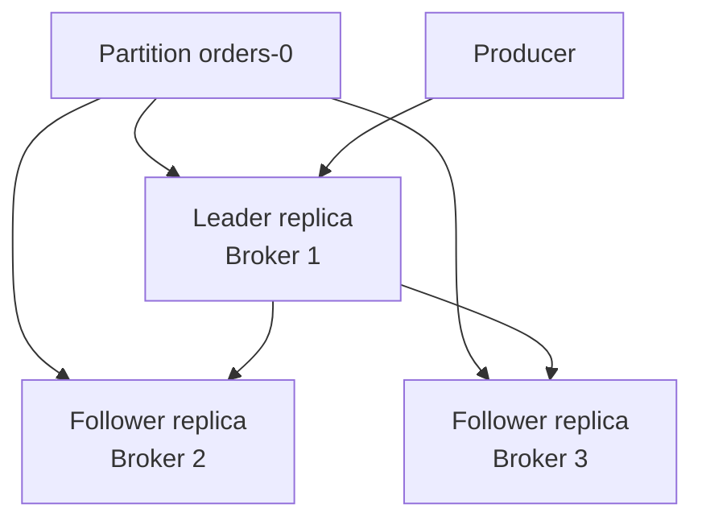
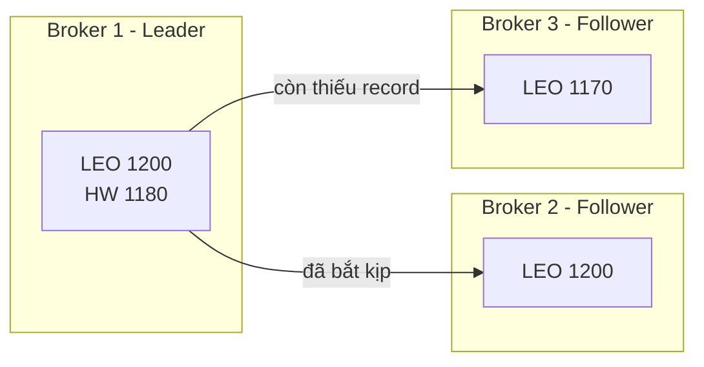

# Phục hồi replica mà không phá vỡ điều kiện độ bền

## Khôi phục khả năng sao chép mà vẫn giữ an toàn dữ liệu

Kafka lưu dữ liệu của một partition trên nhiều broker thông qua replication factor (RF). Một replica là bản sao log của partition trên một broker; tại mỗi thời điểm, một replica trong nhóm được chọn làm leader để nhận produce/fetch request, các replica còn lại theo leader bằng cách fetch dữ liệu.

Khi broker hoặc ổ đĩa gặp sự cố, mục tiêu vận hành là đưa replica trở lại trạng thái đồng bộ, khôi phục ISR và bảo đảm các lần ghi mới tiếp tục đáp ứng chính sách độ bền. Phục hồi replica không chỉ là làm cho broker chạy lại: phải xác nhận replica nào đang có dữ liệu mới nhất, leader nào hợp lệ, ISR có đủ số lượng theo min.insync.replicas hay không và việc reassignment có làm giảm mức an toàn của các partition khác không.

Nguyên tắc quan trọng nhất: **không ép một replica đã lỗi thời lên làm leader chỉ để partition online nếu điều đó có thể làm mất dữ liệu đã được xác nhận**. Hãy ưu tiên clean leader election, khôi phục replica từ leader hợp lệ và chỉ hoàn tất sự cố khi replication factor/ISR đã trở lại mục tiêu.

## 1. Mô hình replication và các mốc dữ liệu

### 1.1 Leader và follower

Mỗi partition có một danh sách replica được phân bổ trên các broker:



Producer ghi vào leader. Follower chủ động fetch record từ leader để bắt kịp log. Leader và controller theo dõi replica nào còn đủ đồng bộ để thuộc In-Sync Replicas (ISR).

RF=3 nghĩa là partition có ba replica được cấu hình. Điều đó không có nghĩa cả ba replica luôn online hoặc luôn nằm trong ISR. Nếu một broker dừng, RF vẫn là 3 nhưng ISR có thể chỉ còn 2.

### 1.2 LEO và High Watermark

Hai mốc offset thường dùng khi điều tra replication:

- **Log End Offset (LEO):** offset tiếp theo mà replica sẽ ghi; cho biết log cục bộ đã đi đến đâu.
- **High Watermark (HW):** ranh giới dữ liệu đã được replicate đủ theo quy tắc ISR và được consumer đọc theo isolation phù hợp.

Follower có LEO thấp hơn leader nghĩa là follower còn thiếu dữ liệu. Follower phải fetch phần log còn thiếu từ leader trước khi có thể được xem là đồng bộ.



Các con số chỉ minh họa. Replica có LEO lớn hơn không tự động có nghĩa replica đó là bản sao hợp lệ để làm leader; cần xét leader epoch, ISR và trạng thái metadata của partition.

### 1.3 ISR và replica ngoài ISR

ISR là tập replica mà Kafka hiện xem là đủ đồng bộ để tham gia các quyết định replication/leader election an toàn. Một follower chậm hoặc mất kết nối có thể bị loại khỏi ISR; khi hoạt động trở lại, nó fetch phần còn thiếu và chỉ được thêm lại sau khi đáp ứng điều kiện đồng bộ.

Phân biệt:

| Trạng thái | Ý nghĩa vận hành |
|---|---|
| Assigned replica | Replica nằm trong cấu hình RF của partition |
| ISR replica | Replica hiện nằm trong tập đồng bộ |
| Out-of-sync replica | Replica được cấu hình nhưng chưa theo kịp ISR |
| Offline replica | Replica không khả dụng do broker/disk/network hoặc lỗi khởi động |
| Offline partition | Không có leader hợp lệ để phục vụ partition |

Không xóa replica khỏi assignment chỉ vì nó tạm thời bị out of sync. Nếu nguyên nhân là broker hoặc network có thể sửa, khôi phục broker và để follower catch up thường ít rủi ro hơn thay đổi RF.

## 2. Điều kiện độ bền: RF, min ISR và acks

### 2.1 Ba cấu hình cần đọc cùng nhau

Độ bền khi producer ghi phụ thuộc ít nhất vào:

- replication.factor: số replica được gán cho partition.
- min.insync.replicas: số replica tối thiểu phải có trong ISR để broker chấp nhận produce request với acks=all.
- Producer acks: mức acknowledgement producer yêu cầu.

Một cấu hình thường dùng cho dữ liệu quan trọng:

```text
replication.factor = 3
min.insync.replicas = 2
producer acks = all
```

Với cấu hình này, một partition vẫn có thể nhận ghi khi một trong ba replica bị lỗi, miễn là còn ít nhất hai replica trong ISR. Nếu ISR giảm xuống một, producer với acks=all bị từ chối thay vì tiếp tục ghi trong trạng thái độ bền thấp hơn chính sách.

### 2.2 acks=all không có nghĩa luôn chờ đủ RF

acks=all yêu cầu leader chờ acknowledgement từ các replica hiện thuộc ISR. Nếu một replica đã bị loại khỏi ISR, producer không chờ replica đó. min.insync.replicas là ngưỡng kiểm tra tối thiểu để bảo vệ việc ghi khi ISR quá nhỏ.

Ví dụ RF=3, min ISR=2:

| Trạng thái | ISR | Kết quả với acks=all |
|---|---:|---|
| Bình thường | 3 | Ghi được, chờ ISR |
| Một follower lỗi | 2 | Ghi được, vẫn đạt ngưỡng |
| Hai replica lỗi hoặc bị loại | 1 | Produce bị từ chối do ISR dưới ngưỡng |

Producer có thể nhận NotEnoughReplicasException nếu ISR thấp hơn ngưỡng trước khi append; nếu ISR giảm trong lúc request đang được xử lý, có thể nhận NotEnoughReplicasAfterAppendException. Đây là tín hiệu bảo vệ durability, không phải lý do để tự động hạ min.insync.replicas.

### 2.3 High Watermark và dữ liệu được xác nhận

Với acks=all, producer chỉ nhận thành công sau khi record được replicate theo semantics của ISR và điều kiện min ISR được đáp ứng. HW phản ánh ranh giới record đã được replicate đủ theo ISR. Consumer đọc ở read_uncommitted vẫn không đọc vượt HW; read_committed còn áp dụng thêm ranh giới transaction.

Không nhầm producer ACK với việc tất cả replica theo cấu hình RF đều đã ghi record. Nếu một replica đã out of sync, acks=all chỉ chờ ISR hiện tại.

### 2.4 Unclean leader election

unclean.leader.election.enable=false ngăn Kafka chọn replica ngoài ISR làm leader khi không còn ISR replica khả dụng. Đây là lựa chọn ưu tiên an toàn dữ liệu cho phần lớn workload quan trọng.

Nếu bật unclean election, partition có thể online nhanh hơn bằng cách chọn một replica ngoài ISR, nhưng replica đó có thể thiếu các record đã được xác nhận trước đó. Khi replica này thành leader, log của partition có thể bị lùi và dữ liệu đã ACK bị mất đối với ứng dụng.

Chỉ cân nhắc unclean election khi tổ chức chấp nhận rõ ràng rủi ro mất dữ liệu để khôi phục availability. Đây không phải bước phục hồi replica thông thường.

## 3. Đánh giá tình trạng trước khi thao tác

### 3.1 Thu thập trạng thái partition

Dùng kafka-topics.sh để xem leader, replicas và ISR:

```bash
kafka-topics.sh --bootstrap-server kafka-1:9092 \
  --describe --topic orders
```

Ví dụ kết quả:

```text
Topic: orders  Partition: 0  Leader: 1
Replicas: 1,2,3  Isr: 1,2
```

Trong ví dụ, broker 3 vẫn là replica được cấu hình nhưng chưa nằm trong ISR. Partition vẫn có leader và còn hai replica đồng bộ.

Với nhiều topic, có thể bỏ --topic để xem danh sách partition trên cluster; giới hạn phạm vi điều tra khi cluster lớn để tránh output quá nhiều.

### 3.2 Kiểm tra broker và controller

Trước khi thay đổi replica assignment, kiểm tra:

- Broker có đang chạy, đăng ký đúng node.id và tham gia cluster không.
- Controller/KRaft metadata quorum có khỏe mạnh không.
- Broker log directory có online và còn dung lượng không.
- Network giữa follower và leader có packet loss, timeout hoặc throughput thấp không.
- CPU, disk I/O, page cache và request queue có bị bão hòa không.
- Broker có bị restart loop, lỗi permission hoặc lỗi mount không.

Trong KRaft, metadata quorum và data replication là hai lớp khác nhau. Controller quorum quản lý metadata cluster và trạng thái partition; controller không phải bản sao log dữ liệu của topic. KRaft quorum khỏe không đồng nghĩa ISR của mọi partition đều khỏe, và ISR đầy đủ không thay thế yêu cầu quorum controller.

Có thể kiểm tra trạng thái quorum metadata bằng công cụ phù hợp với bản Kafka đang triển khai:

```bash
kafka-metadata-quorum.sh --bootstrap-server kafka-1:9092 describe --status
```

### 3.3 Ghi nhận baseline trước khi sửa

Ghi lại cho partition bị ảnh hưởng:

- Topic, partition, leader, replica assignment và ISR.
- RF và min.insync.replicas hiệu lực.
- unclean.leader.election.enable.
- Log end/high watermark nếu công cụ quan sát cung cấp.
- Under-replicated/offline partitions và consumer lag.
- Broker/disk/network đang lỗi và thời điểm bắt đầu.

Không bắt đầu reassignment hoặc xóa log khi chưa biết replica nào chứa dữ liệu hợp lệ mới nhất.

## 4. Kịch bản A: broker follower tạm thời bị lỗi

### 4.1 Ưu tiên khôi phục broker cũ

Nếu broker follower bị dừng do lỗi process, network hoặc bảo trì:

1. Xác định nguyên nhân broker dừng và sửa nguyên nhân.
2. Bảo đảm các log directory còn dữ liệu và mount đúng.
3. Khởi động lại broker với đúng identity và cấu hình cluster.
4. Theo dõi replica fetcher để follower fetch phần log còn thiếu từ leader.
5. Kiểm tra ISR tăng trở lại và under-replicated partition giảm.

Nếu disk còn nguyên vẹn, để broker khởi động lại với log hiện có thường cho phép nó tiếp tục replication. Không xóa log directory chỉ để “làm sạch” lỗi; thao tác đó biến phục hồi incremental thành bootstrap toàn bộ replica và có thể phá hủy dữ liệu cần điều tra.

### 4.2 Follower catch up

Sau khi broker online, follower cần:

- Kết nối được leader.
- Đọc metadata và leader epoch đúng.
- Fetch các record còn thiếu.
- Ghi log batch vào disk.
- Bắt kịp ranh giới đồng bộ để được thêm lại vào ISR.

Thời gian catch-up phụ thuộc replication lag, disk/network throughput, số partition, tốc độ produce mới và replication throttle. Một broker có thể online nhưng vẫn còn nhiều partition under-replicated.

### 4.3 Không ép follower vào ISR

Không có thao tác an toàn kiểu “thêm replica vào ISR bằng tay”. ISR là trạng thái do Kafka quản lý dựa trên tiến độ replication. Hãy sửa nguyên nhân khiến follower không theo kịp; không sửa metadata nội bộ hoặc ép trạng thái ISR bằng công cụ ngoài Kafka.

## 5. Kịch bản B: broker hoặc disk mất vĩnh viễn

### 5.1 Xác định phạm vi mất dữ liệu

Nếu broker không thể phục hồi hoặc disk mất dữ liệu:

1. Xác định partition nào có replica trên broker đó.
2. Kiểm tra mỗi partition còn leader hợp lệ và ISR còn bao nhiêu replica.
3. Xác nhận các replica còn lại có đủ dữ liệu đã được xác nhận.
4. Đánh giá số broker khỏe, rack placement và dung lượng trống.
5. Lập kế hoạch thay broker hoặc di chuyển replica sang broker khỏe.

Nếu một partition chỉ còn một ISR replica trong khi min ISR=2, producer acks=all sẽ bị từ chối. Đây là hành vi bảo vệ dữ liệu; ưu tiên phục hồi thêm một replica để đạt ngưỡng.

### 5.2 Thay disk và khôi phục broker

Khi thay disk:

- Giữ nguyên broker identity và cluster identity theo quy trình vận hành.
- Xác nhận log.dirs trỏ tới filesystem đã mount đúng, owner/permission phù hợp.
- Kiểm tra dung lượng và I/O trước khi đưa broker trở lại.
- Để replica được tái tạo từ leader hợp lệ hoặc dùng quy trình restore đã được kiểm chứng.

Không copy thủ công segment files từ một broker khác vào log directory để thay thế replica. Không xóa meta.properties, không format lại KRaft storage của một node đang có dữ liệu cần giữ, và không khởi tạo cluster ID mới cho broker cần gia nhập cluster hiện hữu.

Nếu cần bootstrap một broker mới hoàn toàn, phải dùng quy trình cấp phát node ID, storage formatting và join cluster dành cho môi trường đó; xác minh identity/cluster ID trước khi khởi động. Đây là quy trình thay node, không phải thao tác xóa dữ liệu để chữa under-replication.

### 5.3 Không còn ISR replica khả dụng

Nếu tất cả replica trong ISR đều offline:

- Partition trở thành offline vì không có leader clean hợp lệ.
- Không bật unclean election một cách tự động.
- Tìm cách khôi phục ít nhất một replica từ disk gốc, snapshot/backup hoặc bản sao có thể chứng minh chứa dữ liệu cần thiết.
- Đối chiếu leader epoch, log end và thời điểm ACK trước khi chọn nguồn phục hồi.
- Nếu buộc phải chọn replica ngoài ISR, ghi nhận rõ khả năng mất record và thực hiện theo quyết định chấp nhận rủi ro của tổ chức.

Khi không còn bản sao hợp lệ, không có lệnh Kafka nào có thể tái tạo các byte đã mất. Cần dựa vào backup, upstream event source hoặc quy trình business reconciliation.

## 6. Reassignment: di chuyển hoặc tái tạo replica có kiểm soát

### 6.1 Khi nào cần reassignment?

Dùng partition reassignment khi:

- Broker hỏng vĩnh viễn và cần thay replica bằng broker khác.
- Cân bằng lại tải giữa broker.
- Di chuyển replica khỏi disk/broker sắp bảo trì.
- Điều chỉnh RF theo kế hoạch durability.
- Khôi phục phân bố replica theo rack.

Nếu broker chỉ tạm thời dừng và disk còn nguyên, thường nên khôi phục broker trước. Reassignment quá sớm có thể tạo thêm bản sao dữ liệu, tăng network/disk load và làm cluster phục hồi chậm hơn.

### 6.2 Lập kế hoạch placement

Ví dụ partition orders-0 hiện có replica trên broker 1, 2, 3; broker 3 mất vĩnh viễn và broker 4 là đích thay thế:

```json
{
  "version": 1,
  "partitions": [
    {
      "topic": "orders",
      "partition": 0,
      "replicas": [1, 2, 4]
    }
  ]
}
```

Trước khi thực thi, kiểm tra:

- Broker đích online và có dung lượng disk đủ.
- Không có hai replica của cùng partition trên cùng broker.
- Replica được phân bố theo rack/zone nếu cluster có cấu hình rack awareness.
- Broker đích không bị quá tải bởi reassignment đồng thời.
- Số ISR hiện tại và min ISR cho phép duy trì ghi trong quá trình di chuyển.
- Reassignment không làm các partition khác mất thêm một replica khỏe.

Nếu dùng broker.rack, giữ replica của cùng partition trên các rack khác nhau theo thiết kế chịu lỗi. Reassignment tới broker khác nhưng cùng rack có thể không cải thiện khả năng chịu lỗi của toàn cụm.

### 6.3 Thực thi và xác minh

Sau khi review file reassignment, chạy:

```bash
kafka-reassign-partitions.sh \
  --bootstrap-server kafka-1:9092 \
  --reassignment-json-file reassignment.json \
  --execute
```

Kiểm tra tiến độ:

```bash
kafka-reassign-partitions.sh \
  --bootstrap-server kafka-1:9092 \
  --reassignment-json-file reassignment.json \
  --verify
```

--execute bắt đầu di chuyển replica; --verify cho biết reassignment đã hoàn tất hay còn partition đang di chuyển. Sau đó tiếp tục kiểm tra kafka-topics --describe để xác nhận replica mới đã bắt kịp và vào ISR.

Không coi việc lệnh --execute trả về thành công là bằng chứng replica đã đồng bộ. Reassignment có thể chạy nền trong một khoảng thời gian.

### 6.4 Throttle để tránh làm quá tải cluster

Reassignment tạo lưu lượng replication lớn. Nếu di chuyển quá nhiều partition đồng thời, nó có thể cạnh tranh network, disk I/O và CPU với produce/fetch traffic.

Có thể dùng tùy chọn --throttle của công cụ reassignment ở mức phù hợp, sau đó theo dõi:

- Replica fetcher throughput và lag.
- Disk utilization và disk await.
- Network throughput.
- Produce/fetch request latency.
- Under-replicated partitions.
- ISR shrink/expand rate.

Đặt throttle quá thấp làm phục hồi kéo dài; quá cao có thể làm ứng dụng production tăng latency. Tăng/giảm theo quan sát thực tế và tránh reassignment lớn trong giờ cao điểm nếu không cần thiết.

### 6.5 Thêm replica không làm replica đó vào ISR ngay lập tức

Khi reassignment thêm broker mới, replica đích phải fetch log từ leader. Trong thời gian catch-up, replica có thể chưa nằm trong ISR. Chỉ khi theo kịp, nó mới góp phần tăng khả năng chịu lỗi của partition.

Không hạ min.insync.replicas chỉ để producer tiếp tục ghi trong khi replica mới đang catch up. Nếu ISR hiện tại dưới ngưỡng, việc producer bị từ chối là hành vi đúng theo chính sách durability.

## 7. Leader election trong quá trình phục hồi

### 7.1 Clean election

Khi leader lỗi, controller chọn leader mới từ ISR. Các replica trong ISR được xem là đồng bộ theo trạng thái cluster, nên clean election bảo toàn dữ liệu đã được replicate theo cam kết của Kafka.

Sau khi leader mới được chọn:

- Kiểm tra partition có leader và không còn offline.
- Xác nhận ISR có đủ replica theo mục tiêu.
- Kiểm tra producer error và consumer fetch/lag.
- Theo dõi follower cũ catch up và quay lại ISR.

### 7.2 Preferred leader election

Preferred replica là replica đứng đầu danh sách replica assignment. Sau khi broker hồi phục, preferred leader có thể không còn là leader hiện tại. Nếu cần cân bằng leader sau sự cố, có thể yêu cầu preferred election sau khi xác nhận replica ưu tiên đã nằm trong ISR:

```bash
kafka-leader-election.sh \
  --bootstrap-server kafka-1:9092 \
  --election-type preferred \
  --topic orders --partition 0
```

Preferred election chỉ nên thực hiện sau khi cluster ổn định. Nó không phải thao tác catch-up và không thể biến replica ngoài ISR thành replica an toàn. Chuyển leader có thể tạo thêm network traffic và latency ngắn hạn.

### 7.3 Không dùng unclean election để “sửa” ISR

Unclean election có thể đưa partition online bằng replica ngoài ISR, nhưng có thể bỏ các record mà leader cũ đã xác nhận. Nó không sửa follower lag và không tái tạo dữ liệu thiếu.

Nếu availability buộc phải ưu tiên hơn durability, cần:

- Xác định partition và replica sẽ được chọn.
- Ước lượng khoảng offset có thể mất.
- Ghi nhận quyết định chấp nhận data loss.
- Kiểm tra downstream có thể phát hiện gap hoặc cần replay/reconcile không.
- Sau khi partition online, tái tạo các replica còn lại từ leader được chọn và kiểm tra dữ liệu nghiệp vụ.

Không tự động bật unclean election toàn cluster để xử lý một sự cố đơn lẻ.

## 8. KRaft: phân biệt metadata quorum và data replica

KRaft dùng controller quorum để lưu và replicate metadata cluster. Topic partition data vẫn được replicate giữa các broker theo RF/ISR.

| Thành phần | Chịu trách nhiệm | Cách kiểm tra |
|---|---|---|
| KRaft controller quorum | Metadata, broker registration, partition state và controller leadership | Metadata quorum status/health |
| Partition leader | Nhận produce/fetch request cho partition | Topic describe |
| Follower replica | Fetch log từ partition leader | ISR, replication lag, broker metrics |
| Producer | Ghi theo acks và delivery semantics | Producer retry/error metrics |

Nếu controller quorum mất majority, metadata operations và điều phối cluster có thể bị ảnh hưởng. Nếu controller quorum khỏe nhưng broker chứa replica bị lỗi, data replication vẫn có thể under-replicated. Chẩn đoán đúng lớp trước khi thao tác.

Không đưa controller-only node vào danh sách broker replica của topic. Controller quorum và broker data plane có vai trò khác nhau, kể cả khi cluster dùng combined broker/controller nodes.

## 9. Theo dõi sức khỏe replication

### 9.1 Broker và partition metrics

Các metric thường dùng để phát hiện và xác nhận phục hồi:

| Metric | Ý nghĩa |
|---|---|
| UnderReplicatedPartitions | Số partition có replica chưa nằm trong ISR |
| UnderMinIsrPartitionCount | Số partition có ISR thấp hơn min.insync.replicas |
| OfflinePartitionsCount | Số partition không có leader khả dụng |
| IsrShrinksPerSec | Tốc độ ISR giảm |
| IsrExpandsPerSec | Tốc độ ISR tăng |
| FailedProduceRequestsPerSec | Produce request thất bại |
| ReplicationBytesInPerSec | Lưu lượng replication vào broker |
| ReplicationBytesOutPerSec | Lưu lượng replication ra broker |
| RequestQueueTimeMs | Thời gian request chờ trong broker queue |

Tên metric và MBean có thể khác theo phiên bản/exporter. Kiểm tra tài liệu monitoring của Kafka version đang chạy.

### 9.2 Dấu hiệu phục hồi thành công

- Offline partition trở về 0.
- Under-replicated partitions giảm về 0 hoặc baseline đã giải thích.
- Under-min-ISR partition trở về 0.
- ISR của partition phục hồi đạt RF mong muốn.
- ISR shrink không còn tăng bất thường.
- Replica lag giảm và LEO follower bắt kịp leader.
- Produce errors do insufficient replicas chấm dứt.
- Consumer lag và end-to-end latency trở lại baseline.

Không chỉ nhìn UnderReplicatedPartitions=0: một partition RF=3 nhưng chỉ còn ISR=2 vẫn có thể under-replicated. Nếu mục tiêu là RF đầy đủ, kiểm tra từng partition và xác nhận ISR có đủ ba replica.

## 10. Runbook phục hồi replica

### Bước 1 — Khoanh vùng

- Xác định broker, disk, rack hoặc network bị lỗi.
- Xác định topic/partition bị ảnh hưởng.
- Kiểm tra controller quorum và broker registration.
- Dừng các thay đổi topology không liên quan trong lúc điều tra.

### Bước 2 — Đánh giá durability

- Lấy leader, replicas và ISR của partition.
- Kiểm tra RF và min.insync.replicas hiệu lực.
- Xác nhận acks producer và unclean election policy.
- Xác định partition nào đang dưới min ISR hoặc offline.
- Bảo toàn log directory và metadata cần cho điều tra.

### Bước 3 — Chọn phương án ít rủi ro nhất

- Broker tạm thời lỗi, disk còn nguyên: sửa broker và cho follower catch up.
- Disk lỗi nhưng còn ISR khỏe: thay disk/node và tái tạo replica từ leader hợp lệ.
- Broker mất vĩnh viễn: lập reassignment tới broker khỏe, có rack/capacity review.
- Không còn ISR replica: dừng thao tác có thể ghi đè dữ liệu; tìm disk/backup/upstream source trước khi quyết định phục hồi có mất dữ liệu.

### Bước 4 — Thực hiện và theo dõi

- Thực hiện restart hoặc reassignment theo kế hoạch.
- Throttle replication nếu cần bảo vệ traffic production.
- Theo dõi fetcher lag, disk/network, ISR shrink/expand và request latency.
- Không thay min.insync.replicas hoặc bật unclean election chỉ để làm mất cảnh báo.

### Bước 5 — Xác minh

- Chạy lại topic describe.
- Xác nhận replica mới/đã phục hồi vào ISR.
- Xác nhận RF và ISR đạt mục tiêu.
- Xác nhận produce với acks=all hoạt động theo chính sách.
- Kiểm tra consumer lag, dữ liệu downstream và log broker.
- Chỉ sau khi ổn định mới cân nhắc preferred leader election hoặc kết thúc bảo trì.

## 11. Ví dụ tình huống: RF=3, min ISR=2

Cluster có ba broker:

```text
orders-0:
  Replicas = [1, 2, 3]
  Leader   = 1
  ISR      = [1, 2, 3]
```

Broker 3 mất kết nối:

```text
orders-0:
  Replicas = [1, 2, 3]
  Leader   = 1
  ISR      = [1, 2]
```

Producer acks=all vẫn ghi được vì ISR=2 và min ISR=2. Khi broker 3 hoạt động trở lại, follower fetch phần còn thiếu. Sau khi bắt kịp:

```text
orders-0:
  Replicas = [1, 2, 3]
  Leader   = 1
  ISR      = [1, 2, 3]
```

Nếu broker 2 cũng lỗi trước khi broker 3 bắt kịp:

```text
orders-0:
  Replicas = [1, 2, 3]
  Leader   = 1
  ISR      = [1]
```

Producer acks=all bị từ chối vì ISR dưới 2. Hành vi này bảo vệ chính sách durability. Ưu tiên khôi phục broker 2 hoặc 3 và đưa thêm replica trở lại ISR. Không hạ min ISR về 1 như một phản xạ vận hành.

## 12. Những lỗi cần tránh

| Lỗi | Rủi ro | Cách làm đúng |
|---|---|---|
| Bật unclean leader election để partition online nhanh | Mất record đã ACK | Khôi phục replica trong ISR hoặc phục hồi dữ liệu từ nguồn hợp lệ |
| Hạ min ISR trong lúc sự cố | Producer tiếp tục ghi với mức độ bền thấp hơn chính sách | Giữ ngưỡng; phục hồi replica để đạt lại ngưỡng |
| Xóa log directory của broker chỉ vì replica lag | Mất dữ liệu cục bộ và kéo dài bootstrap | Giữ log, điều tra disk/network trước |
| Reassign quá nhiều partition cùng lúc | Bão hòa disk/network, ảnh hưởng production | Chia đợt và throttle theo capacity |
| Xem --execute là reassignment đã xong | Replica có thể vẫn đang catch up | Dùng --verify và kiểm tra ISR |
| Coi replica mới là ISR ngay sau khi thêm | Đánh giá sai durability | Chờ follower bắt kịp và được Kafka thêm vào ISR |
| Copy segment files thủ công giữa broker | Log/metadata không nhất quán | Dùng replication/reassignment hoặc quy trình restore được hỗ trợ |
| Nhầm KRaft quorum với ISR | Chẩn đoán sai lớp sự cố | Kiểm tra metadata quorum và data replicas riêng |
| Chỉ nhìn UnderReplicatedPartitions | Bỏ sót ISR dưới min ISR hoặc partition offline | Theo dõi UnderMinIsr và OfflinePartitions cùng topic describe |
| Preferred election khi replica chưa đồng bộ | Không đạt mục tiêu hoặc tạo thêm gián đoạn | Chỉ chạy sau khi preferred replica nằm trong ISR |

## 13. Checklist production

- RF phù hợp mức chịu lỗi và phân bố replica qua broker/rack.
- min.insync.replicas không vượt RF và khớp với producer acks.
- Producer quan trọng dùng acks=all và idempotence phù hợp.
- unclean.leader.election.enable được đặt theo chính sách durability.
- Có dashboard UnderReplicated, UnderMinIsr, OfflinePartitions và ISR shrink/expand.
- Có quy trình broker restart, disk replacement và replica reassignment.
- Reassignment plan được review về capacity, rack placement và số partition đồng thời.
- Có throttle và rollback/stop plan khi reassignment ảnh hưởng production.
- Không xóa log directory hoặc format storage khi chưa xác định dữ liệu cần giữ.
- KRaft controller quorum được giám sát độc lập với data replication.
- Có backup/upstream replay/reconciliation cho kịch bản mất toàn bộ ISR.
- Sau phục hồi xác nhận RF, ISR, produce ACK, consumer lag và end-to-end behavior.

## Kết luận

Phục hồi replica an toàn bắt đầu bằng việc hiểu RF, ISR, LEO, HW và ngưỡng min.insync.replicas. Với producer acks=all, Kafka chỉ chấp nhận ghi khi ISR đáp ứng ngưỡng; khi ISR giảm dưới min ISR, lỗi produce là cơ chế bảo vệ dữ liệu. Hãy khôi phục broker/follower, để replica catch up hoặc reassignment có kiểm soát, sau đó xác nhận ISR đã trở lại mục tiêu.

Clean leader election và việc giữ unclean.leader.election.enable=false giúp tránh chọn replica lỗi thời làm leader. Reassignment phải được lập kế hoạch theo dung lượng, rack, throttle và tác động tới các partition khác. Trong KRaft, luôn chẩn đoán metadata quorum riêng với replication của topic. Không xóa log, format storage hoặc hạ durability policy chỉ để xóa cảnh báo; chỉ kết thúc sự cố khi replica, ISR và hành vi producer/consumer đều đã được xác minh.

## Tài liệu tham khảo

- Apache Kafka 4.2 Design — Replication: https://kafka.apache.org/42/design/design/
- Apache Kafka 4.2 Broker Configs: https://kafka.apache.org/42/configuration/broker-configs/
- Apache Kafka 4.2 Topic Configs: https://kafka.apache.org/42/configuration/topic-configs/
- Apache Kafka 4.2 Operations — Basic Kafka Operations: https://kafka.apache.org/42/operations/basic-kafka-operations/
- Apache Kafka 4.2 Monitoring: https://kafka.apache.org/42/operations/monitoring/
- Apache Kafka 4.2 KRaft: https://kafka.apache.org/42/operations/kraft/
