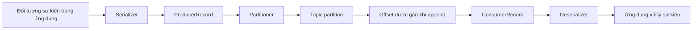

# Cấu trúc record: key, value, headers, timestamp, partition và offset

Trong Apache Kafka, record là đơn vị dữ liệu logic mà producer gửi vào topic và consumer đọc ra. Một record thường mang nội dung sự kiện trong `key` và `value`, kèm metadata như `headers` và `timestamp`. Khi được ghi vào log, record thuộc về một `partition` và có một `offset` xác định vị trí của nó trong partition đó.

Hiểu rõ từng thành phần giúp thiết kế khóa phân vùng đúng, giữ thứ tự sự kiện theo yêu cầu nghiệp vụ, truy vết request xuyên các dịch vụ và xử lý việc đọc lại dữ liệu an toàn. Trong module Kafka, các khái niệm này là nền tảng để triển khai producer, consumer group, retry, replication và các luồng sự kiện bằng Java/Spring Kafka.

## 1. Record trong luồng sự kiện Kafka

Một luồng cơ bản có thể hình dung như sau:



Producer bắt đầu với một đối tượng trong ứng dụng, chẳng hạn `OrderCreated`. Serializer chuyển key và value thành byte. Producer tạo record, chọn partition, rồi gửi dữ liệu đến broker. Broker leader append record vào log của partition và gán offset. Consumer fetch dữ liệu và Kafka client cung cấp một `ConsumerRecord` cho ứng dụng sau khi deserialize key/value.

Cần phân biệt hai cách nhìn:

- **Record trong giao thức/lưu trữ Kafka** chứa các trường dữ liệu như key, value, headers và timestamp. Record được đặt trong record batch.
- **API của Java client** cung cấp `ProducerRecord` để gửi và `ConsumerRecord` để nhận. API nhận còn có topic, partition, offset và thông tin timestamp để ứng dụng biết record đến từ đâu.

Partition và offset là ngữ cảnh vị trí của record trong log Kafka. Chúng không phải là dữ liệu nghiệp vụ mà ứng dụng cần nhúng vào value.

## 2. Nhìn tổng thể các thành phần

| Thành phần | Vai trò | Câu hỏi cần trả lời khi thiết kế |
| --- | --- | --- |
| `key` | Định danh hoặc phân nhóm record; thường tham gia quyết định partition. | Các sự kiện nào phải đi cùng một partition để giữ thứ tự? |
| `value` | Payload chính, chứa nội dung sự kiện. | Consumer cần dữ liệu gì để xử lý và phiên bản schema được quản lý ra sao? |
| `headers` | Metadata phụ đi kèm record dưới dạng cặp key/byte value. | Cần truyền trace ID, loại sự kiện hoặc thông tin schema nào? |
| `timestamp` | Mốc thời gian của record theo chính sách timestamp của Kafka. | Cần dùng thời gian tạo sự kiện hay thời gian broker ghi nhận? |
| `partition` | Phân vùng log mà record được ghi vào. | Cần phân phối tải và bảo toàn thứ tự theo khóa nào? |
| `offset` | Vị trí logic của record trong một partition. | Consumer đã đọc đến đâu và cần tiếp tục từ vị trí nào? |

Ví dụ một sự kiện đơn hàng có thể được mô tả ở mức ứng dụng như sau:

```json
{
  "key": "ORD-1001",
  "value": {
    "orderId": "ORD-1001",
    "customerId": "CUS-42",
    "total": 129000,
    "currency": "VND",
    "occurredAt": "2026-11-20T08:30:00Z"
  },
  "headers": {
    "event-type": "OrderCreated",
    "schema-version": "1",
    "trace-id": "trc-8f31"
  },
  "timestamp": "2026-11-20T08:30:00Z",
  "partition": 2,
  "offset": 105
}
```

Đây là cách minh họa để đọc một record, không phải JSON wire format của Kafka. Trong ví dụ, `partition=2` và `offset=105` là metadata do Kafka xác định khi ghi; ứng dụng không tự đặt hai giá trị này trong payload.

## 3. Key: định tuyến và nhận diện sự kiện

Key là phần dữ liệu tùy chọn được serialize thành byte. Producer có thể dùng key để định tuyến các record liên quan đến cùng một partition. Ví dụ, nếu các thay đổi của một đơn hàng phải được xử lý theo thứ tự, dùng `orderId` làm key thường là lựa chọn phù hợp.

### Cách partitioner sử dụng key

Nếu ứng dụng không chỉ định partition cụ thể, producer gọi partitioner để chọn partition. Với partitioner mặc định của Java producer, key đã serialize được băm để xác định partition. Những record có cùng key thường được đưa đến cùng partition khi số partition và cấu hình định tuyến không đổi.

Khi key là null, producer có thể sử dụng cơ chế sticky partitioning để gửi nhiều record liên tiếp vào một partition trong một khoảng thời gian, giúp gom batch hiệu quả. Hành vi chính xác phụ thuộc partitioner và phiên bản client; ứng dụng có thể thay partitioner mặc định bằng cấu hình riêng.

Ví dụ:

| Key | Ý nghĩa | Mục tiêu định tuyến |
| --- | --- | --- |
| `ORD-1001` | Đơn hàng 1001 | Gom các sự kiện của đơn hàng này vào cùng partition. |
| `ORD-1002` | Đơn hàng 1002 | Có thể nằm ở partition khác để tăng khả năng xử lý song song. |
| `CUS-42` | Khách hàng 42 | Phù hợp nếu thứ tự cần bảo toàn theo khách hàng thay vì theo đơn hàng. |
| `null` | Không có khóa định tuyến | Producer chọn partition theo chiến lược dành cho record không có key. |

### Chọn key theo bất biến nghiệp vụ

Chọn key dựa trên thực thể mà thứ tự sự kiện cần được bảo toàn. Nếu yêu cầu là mọi thay đổi trạng thái của một đơn hàng phải theo đúng trình tự, key nên là `orderId`. Nếu yêu cầu là mọi giao dịch của một tài khoản phải được tuần tự hóa, key có thể là `accountId`.

Kafka bảo đảm thứ tự append trong một partition. Kafka không bảo đảm thứ tự tổng thể giữa nhiều partition. Vì vậy, hai sự kiện cùng thuộc một nghiệp vụ nhưng có key khác nhau có thể được xử lý song song và quan sát theo thứ tự khác nhau.

### Lưu ý khi thay đổi số partition

Với cách phân vùng dựa trên hash, tăng số partition có thể làm thay đổi partition được chọn cho một key ở các lần gửi sau. Các record cũ vẫn nằm ở partition cũ, trong khi record mới có thể đi sang partition khác. Nếu ứng dụng phụ thuộc vào thứ tự theo key trong thời gian dài, cần lập kế hoạch mở rộng partition và đánh giá tác động đến routing trước khi thay đổi.

Key cũng có thể tham gia cơ chế log compaction. Với topic bật `cleanup.policy=compact`, Kafka giữ lại giá trị mới nhất theo key trong quá trình compact (cùng các quy tắc về tombstone và retention). Vì thế, key cần ổn định và phản ánh đúng danh tính của thực thể mà topic muốn lưu trạng thái.

## 4. Value: nội dung chính của sự kiện

Value là payload của record, được serializer chuyển thành byte trước khi gửi. Ứng dụng có thể dùng JSON, Avro, Protocol Buffers, String, byte array hoặc định dạng riêng. Kafka lưu byte và không tự hiểu ý nghĩa nghiệp vụ của payload.

Một value tốt nên chứa đủ thông tin để consumer xử lý sự kiện theo hợp đồng đã thống nhất. Ví dụ:

```java
public record OrderCreated(
        String orderId,
        String customerId,
        BigDecimal total,
        String currency,
        Instant occurredAt
) {}
```

Serializer JSON có thể chuyển đối tượng này thành JSON. Consumer cần cấu hình deserializer tương ứng để chuyển byte trở lại thành `OrderCreated`. Producer và consumer phải thống nhất schema, quy tắc tương thích phiên bản và cách xử lý field mới hoặc field bị bỏ.

### Phân biệt value null và value rỗng

Hai trường hợp sau không giống nhau:

- **Value null**: record không có payload value. Với topic compacted, record có key và value null được dùng làm *tombstone* để đánh dấu key đó cần bị xóa khỏi trạng thái đã compact.
- **Value rỗng**: value là một mảng byte có độ dài 0. Đây vẫn là một value tồn tại, không phải tombstone.

Tombstone phải có key để xác định bản ghi nào bị xóa. Tombstone được giữ theo chính sách xóa tombstone của topic trước khi log cleaner có thể loại bỏ nó; consumer cần hiểu rằng việc compact không nhất thiết xóa dữ liệu ngay lập tức. Với topic không bật compaction, value null chỉ là record có payload null và không tự mang ý nghĩa xóa theo key.

Không nên đưa mọi dữ liệu lớn vào một record mà không cân nhắc giới hạn kích thước message, bộ nhớ producer/consumer, độ trễ và chi phí replication. Payload nên tập trung vào sự kiện; dữ liệu nhị phân lớn có thể được lưu ở object storage và chỉ đưa tham chiếu cùng metadata cần thiết vào Kafka.

## 5. Headers: metadata đi kèm record

Headers cho phép producer đính kèm metadata mà không phải thêm các trường kỹ thuật vào schema value. Trong Java Kafka client, mỗi header có tên dạng chuỗi và giá trị là byte array. Một record có thể có nhiều header cùng tên; do đó không nên giả định tên header luôn duy nhất.

Một số mục đích thường gặp:

- `trace-id` hoặc `correlation-id`: liên kết log và trace giữa các dịch vụ.
- `event-type`: nhận diện loại sự kiện khi một topic chứa nhiều loại event.
- `schema-version` hoặc schema ID: hỗ trợ chọn schema/phiên bản phù hợp.
- `content-type`: mô tả định dạng payload.
- Metadata phục vụ tích hợp hoặc định tuyến ở tầng ứng dụng.

Headers không thay thế value. Nếu consumer cần dữ liệu để thực hiện nghiệp vụ, dữ liệu đó nên thuộc payload và hợp đồng schema. Headers phù hợp với metadata hỗ trợ truyền tải, quan sát và giải mã.

Ví dụ thêm header trong Java:

```java
List<Header> headers = List.of(
    new RecordHeader("event-type",
        "OrderCreated".getBytes(StandardCharsets.UTF_8)),
    new RecordHeader("trace-id",
        traceId.getBytes(StandardCharsets.UTF_8)),
    new RecordHeader("schema-version",
        "1".getBytes(StandardCharsets.UTF_8))
);
```

Ở phía consumer, dùng `lastHeader(name)` nếu chỉ cần giá trị cuối cùng của một header có tên đó. Nếu hợp đồng cho phép nhiều header cùng tên, duyệt toàn bộ `headers(name)` để không bỏ sót giá trị. Header value có thể null; kiểm tra null trước khi chuyển byte thành chuỗi.

Không nên dùng headers để chuyển payload lớn hoặc bí mật. Header vẫn là dữ liệu của record, có thể được lưu trong log và truyền qua các broker/consumer; hãy áp dụng chính sách bảo vệ dữ liệu và tránh đưa token, mật khẩu hay thông tin nhạy cảm vào đây.

## 6. Timestamp: thời gian của record

Timestamp của Kafka được biểu diễn bằng số mili giây tính từ Unix epoch. Cần phân biệt timestamp của record Kafka với trường thời gian nghiệp vụ trong payload, chẳng hạn `occurredAt`.

Kafka hỗ trợ hai loại timestamp thường gặp:

| Loại | Ý nghĩa |
| --- | --- |
| `CreateTime` | Thời gian do producer cung cấp. Nếu producer không đặt timestamp tường minh, client thường dùng thời điểm gửi record. |
| `LogAppendTime` | Thời gian broker ghi record vào log; broker đặt lại timestamp khi append. |

Chính sách timestamp được điều khiển bởi cấu hình timestamp của topic/broker, thường được gọi là `message.timestamp.type`. Khi cần phân tích độ trễ đầu-cuối, hãy xác định timestamp nào đang được sử dụng. Với `CreateTime`, timestamp có thể bị ảnh hưởng bởi đồng hồ máy producer. Với `LogAppendTime`, thời điểm ghi nhận phản ánh broker append record, nhưng không phải thời điểm nghiệp vụ thực sự xảy ra.

Ví dụ, đơn hàng được tạo lúc 08:30 nhưng mạng bị gián đoạn và producer gửi thành công lúc 08:32. Trường `occurredAt` trong value có thể giữ 08:30. Timestamp Kafka có thể là 08:30 nếu dùng CreateTime và producer gửi timestamp sự kiện, hoặc gần 08:32 nếu dùng LogAppendTime. Giữ riêng thời gian nghiệp vụ trong payload giúp consumer không mất ngữ nghĩa khi chính sách timestamp thay đổi.

Timestamp hữu ích cho quan sát độ trễ, xử lý theo thời gian sự kiện và một số thao tác quản trị log. Tuy nhiên, không nên xem nó là đồng hồ thứ tự tuyệt đối giữa nhiều producer; đồng hồ hệ thống có thể lệch và record được ghi vào các partition khác nhau.

## 7. Partition: phạm vi lưu trữ và thứ tự

Topic được chia thành một hoặc nhiều partition. Mỗi partition là một log append-only có thứ tự riêng, được lưu trên broker và có thể được replication sang broker khác. Producer gửi record vào một partition cụ thể hoặc để partitioner lựa chọn.

Có ba cách phổ biến để xác định partition:

1. Ứng dụng chỉ định partition trong `ProducerRecord`. Cách này hữu ích khi có chiến lược định tuyến riêng, nhưng ứng dụng phải quản lý hệ quả khi topology thay đổi.
2. Ứng dụng cung cấp key và để partitioner mặc định chọn partition dựa trên key đã serialize.
3. Ứng dụng không cung cấp key hoặc partition; producer dùng chiến lược phân phối record không key để tận dụng batching và phân phối tải.

Partition quyết định phạm vi thứ tự. Nếu các record của một đơn hàng cùng vào partition 2, Kafka giữ thứ tự append của chúng trong partition 2. Consumer group có thể phân phối các partition cho nhiều consumer để xử lý song song, nhưng một partition tại một thời điểm chỉ được gán cho tối đa một consumer trong cùng group.

Số partition là quyết định kiến trúc: quá ít partition có thể giới hạn khả năng song song; quá nhiều partition làm tăng metadata, file log, chi phí recovery và tải quản trị. Chọn số partition dựa trên throughput mục tiêu, số consumer cần chạy song song, kích thước dữ liệu và khả năng vận hành.

## 8. Offset: vị trí record trong một partition

Offset là số thứ tự logic được Kafka gán cho record khi append vào partition. Offset chỉ có ý nghĩa trong phạm vi một partition. Vì vậy, `partition=2, offset=105` xác định vị trí cụ thể; chỉ nói `offset=105` thì chưa đủ để xác định record trong toàn cluster.

Ví dụ:

| Partition | Các offset minh họa |
| --- | --- |
| 0 | 0, 1, 2, 3, 4 |
| 1 | 0, 1, 2 |
| 2 | 0, 1, 2, 3 |

Offset giữa các partition không tạo thành một dãy toàn cục. Record mới trong partition nhận offset tăng dần theo log của partition đó. Consumer dùng offset để theo dõi vị trí đọc và khôi phục tiến trình sau khi restart hoặc rebalance.

### Offset đã đọc và offset commit

Trong Kafka consumer, `ConsumerRecord.offset()` là offset của record đang được xử lý. Offset được commit cho consumer group thường biểu thị vị trí tiếp theo cần đọc. Nếu xử lý thành công record offset 105 và muốn tiếp tục từ record kế tiếp, consumer commit offset 106.

Commit quá sớm có thể làm mất xử lý: ứng dụng commit offset rồi crash trước khi hoàn tất side effect, khi khởi động lại consumer sẽ tiếp tục sau record đó. Commit quá muộn có thể khiến record được xử lý lại sau crash. Vì thế, consumer cần chọn chiến lược commit phù hợp với yêu cầu at-least-once, at-most-once hoặc phối hợp transaction/idempotency cho luồng xử lý.

### Vì sao offset có thể không liên tục?

Consumer không nên giả định các offset nhìn thấy luôn liên tiếp. Có thể xuất hiện khoảng trống do log compaction loại bỏ record cũ, do record thuộc transaction bị abort hoặc do các control record và cơ chế nội bộ của log. Với `read_committed`, consumer chỉ nhận record thuộc transaction đã commit và có thể bỏ qua dữ liệu chưa được phép hiển thị. Việc thấy offset nhảy không tự động có nghĩa là dữ liệu đang bị mất.

Các mốc như log start offset, high watermark và last stable offset phục vụ những mục đích khác nhau trong quản lý log và đọc dữ liệu. Khi debug lag hoặc retention, cần phân biệt offset hiện tại của consumer với các mốc của partition, thay vì chỉ so sánh một con số.

## 9. Ví dụ gửi và nhận record bằng Spring Kafka

Ví dụ sau dùng Spring Kafka 3.x, với `KafkaTemplate` và `CompletableFuture`. Ứng dụng đã cấu hình serializer/deserializer JSON phù hợp cho `OrderCreated`.

### Producer

```java
import java.nio.charset.StandardCharsets;
import java.util.List;
import java.util.concurrent.CompletableFuture;

import org.apache.kafka.clients.producer.ProducerRecord;
import org.apache.kafka.common.header.Header;
import org.apache.kafka.common.header.internals.RecordHeader;
import org.springframework.kafka.core.KafkaTemplate;
import org.springframework.kafka.support.SendResult;
import org.springframework.stereotype.Service;

@Service
public class OrderEventPublisher {
    private final KafkaTemplate<String, OrderCreated> kafkaTemplate;

    public OrderEventPublisher(
            KafkaTemplate<String, OrderCreated> kafkaTemplate) {
        this.kafkaTemplate = kafkaTemplate;
    }

    public CompletableFuture<SendResult<String, OrderCreated>> publish(
            OrderCreated event, String traceId) {

        List<Header> headers = List.of(
            new RecordHeader("event-type",
                "OrderCreated".getBytes(StandardCharsets.UTF_8)),
            new RecordHeader("trace-id",
                traceId.getBytes(StandardCharsets.UTF_8)),
            new RecordHeader("schema-version",
                "1".getBytes(StandardCharsets.UTF_8))
        );

        ProducerRecord<String, OrderCreated> record =
            new ProducerRecord<>(
                "orders",
                null, // Để partitioner chọn partition theo key
                event.occurredAt().toEpochMilli(),
                event.orderId(),
                event,
                headers
            );

        return kafkaTemplate.send(record);
    }
}
```

Ở đây:

- `event.orderId()` là key để các sự kiện của cùng đơn hàng được định tuyến nhất quán theo partitioner mặc định.
- `event` là value được serializer chuyển thành byte.
- Headers chứa loại event, trace ID và phiên bản schema.
- Timestamp producer truyền vào là `occurredAt`; broker có thể giữ hoặc ghi đè tùy chính sách timestamp.
- Partition được để null để producer tự chọn. Offset chỉ có sau khi broker append thành công.

Ứng dụng cần quan sát kết quả gửi. Với Spring Kafka 3.x, có thể xử lý future như sau:

```java
publisher.publish(event, traceId)
    .whenComplete((result, error) -> {
        if (error != null) {
            log.error("Không gửi được OrderCreated", error);
            return;
        }

        RecordMetadata metadata = result.getRecordMetadata();
        log.info("topic={}, partition={}, offset={}, timestamp={}",
            metadata.topic(),
            metadata.partition(),
            metadata.offset(),
            metadata.timestamp());
    });
```

Không xem việc gọi `send()` là bằng chứng record đã được ghi thành công. Chỉ khi future hoàn tất thành công mới có metadata xác nhận từ broker theo cấu hình producer hiện tại. Nếu dùng Spring Kafka phiên bản cũ hơn, kiểu future trả về có thể khác.

### Consumer

```java
import java.nio.charset.StandardCharsets;

import org.apache.kafka.clients.consumer.ConsumerRecord;
import org.apache.kafka.common.header.Header;
import org.springframework.kafka.annotation.KafkaListener;
import org.springframework.stereotype.Component;

@Component
public class OrderEventListener {
    @KafkaListener(topics = "orders", groupId = "order-projection")
    public void onOrderCreated(
            ConsumerRecord<String, OrderCreated> record) {

        Header traceHeader = record.headers().lastHeader("trace-id");
        String traceId = traceHeader == null || traceHeader.value() == null
            ? null
            : new String(traceHeader.value(), StandardCharsets.UTF_8);

        OrderCreated event = record.value();

        log.info(
            "Nhận orderId={}, partition={}, offset={}, timestamp={}, traceId={}",
            event.orderId(),
            record.partition(),
            record.offset(),
            record.timestamp(),
            traceId
        );

        // Thực hiện xử lý nghiệp vụ và quản lý commit theo chiến lược của ứng dụng.
    }
}
```

Consumer nhận được key/value đã deserialize cùng metadata về topic, partition, offset và timestamp. Header được truy xuất riêng. Nếu topic chứa nhiều loại event, listener cần kiểm tra loại sự kiện và schema trước khi ép kiểu hoặc xử lý payload.

## 10. Cấu hình serializer và deserializer

Key và value được lưu dưới dạng byte, vì vậy producer và consumer phải thống nhất cách chuyển đổi. Ví dụ cấu hình cơ bản cho String key và JSON value trong Spring Boot:

```yaml
spring:
  kafka:
    producer:
      key-serializer: org.apache.kafka.common.serialization.StringSerializer
      value-serializer: org.springframework.kafka.support.serializer.JsonSerializer
    consumer:
      key-deserializer: org.apache.kafka.common.serialization.StringDeserializer
      value-deserializer: org.springframework.kafka.support.serializer.JsonDeserializer
      properties:
        spring.json.trusted.packages: com.example.orders
```

Đây là ví dụ cấu hình khởi đầu. Ứng dụng thực tế cần cấu hình kiểu đích/default type và chính sách trusted packages phù hợp với phiên bản Spring Kafka, đồng thời tránh tin cậy mọi package một cách tùy tiện. Khi dùng schema registry hoặc Avro/Protobuf, serializer và deserializer tương ứng phải cùng tuân theo hợp đồng schema.

Headers thường được giữ ở dạng byte. Nếu gửi chuỗi UTF-8, consumer cần dùng cùng charset để giải mã. Không được giả định mọi header value đều là chuỗi; một số tích hợp dùng byte format riêng hoặc schema ID dạng nhị phân.

## 11. Các lỗi thiết kế thường gặp

| Lỗi | Hệ quả | Cách xử lý |
| --- | --- | --- |
| Dùng key ngẫu nhiên cho sự kiện cần giữ thứ tự theo thực thể | Sự kiện của cùng thực thể có thể nằm ở nhiều partition. | Chọn key theo định danh của thực thể cần tuần tự hóa. |
| Dùng null key cho mọi record dù cần thứ tự theo đơn hàng | Partitioner không có căn cứ định tuyến theo đơn hàng. | Gửi key ổn định như `orderId`. |
| Cho rằng offset là duy nhất toàn cluster | Có thể xác định nhầm record khi tra cứu hoặc log. | Luôn ghi nhận cặp topic, partition, offset. |
| Coi timestamp Kafka là thời gian nghiệp vụ | Sai lệch khi broker dùng LogAppendTime hoặc đồng hồ producer lệch. | Giữ `occurredAt` trong payload và hiểu loại timestamp Kafka. |
| Dùng headers thay cho payload | Consumer thiếu dữ liệu nghiệp vụ hoặc phụ thuộc metadata không được quản lý schema. | Đặt dữ liệu nghiệp vụ trong value; chỉ dùng headers cho metadata phụ trợ. |
| Coi value rỗng và value null là giống nhau | Có thể phát sinh tombstone ngoài ý muốn hoặc không xóa được key cần xóa. | Kiểm tra null riêng biệt và hiểu chính sách compaction. |
| Commit offset trước khi xử lý xong | Có thể bỏ qua sự kiện sau khi ứng dụng crash. | Chọn thời điểm commit phù hợp và làm side effect idempotent. |
| Tăng partition mà không đánh giá key routing | Các sự kiện mới của cùng key có thể chuyển sang partition khác. | Lập kế hoạch mở rộng và đánh giá yêu cầu thứ tự theo key. |

## 12. Thực hành: theo dấu một sự kiện qua producer và consumer

Tạo một topic thử nghiệm `orders-lab` có ít nhất ba partition. Viết producer gửi các sự kiện cho hai đơn hàng với key lần lượt là `ORD-1001` và `ORD-1002`. Mỗi sự kiện nên có value JSON, header `trace-id`, `event-type` và timestamp được đặt rõ ràng.

Thực hiện lần lượt:

1. Gửi nhiều sự kiện cập nhật trạng thái cho `ORD-1001`, rồi gửi sự kiện cho `ORD-1002`.
2. Ghi lại metadata trả về từ producer: topic, partition, offset và timestamp.
3. Dùng consumer group riêng để đọc topic. In key, value, headers, partition, offset và timestamp của từng record.
4. Kiểm tra các record cùng key có đi vào cùng partition hay không và thứ tự offset của chúng trong partition.
5. Khởi động lại consumer để quan sát cách group tiếp tục từ committed offset.
6. Thử gửi value null cho một key trên topic compacted trong môi trường thử nghiệm; quan sát ý nghĩa tombstone và lưu ý rằng log cleaner không nhất thiết xóa record ngay lập tức.
7. Thử thay đổi số partition trên topic thử nghiệm và quan sát cách key được định tuyến ở các lần gửi mới. Không dùng thao tác này trên topic production khi chưa đánh giá tác động.

Mẫu bảng ghi kết quả:

| Key | Event type | Partition | Offset | Timestamp type/time | Trace ID |
| --- | --- | ---: | ---: | --- | --- |
| ORD-1001 | OrderCreated | — | — | — | — |
| ORD-1001 | OrderPaid | — | — | — | — |
| ORD-1002 | OrderCreated | — | — | — | — |

Điền kết quả thực tế từ lần chạy. Không tự giả định hai key khác nhau chắc chắn nằm ở hai partition khác nhau; kết quả phụ thuộc partitioner, số partition và hash của key.

## 13. Những điểm cần nhớ

- Key giúp định tuyến và xác định phạm vi thứ tự; chọn key theo thực thể mà nghiệp vụ cần xử lý tuần tự.
- Value chứa payload sự kiện và được serialize thành byte; producer/consumer phải thống nhất schema và serializer.
- Headers mang metadata dạng byte, có thể có nhiều header cùng tên; chúng không thay thế dữ liệu nghiệp vụ trong value.
- Timestamp Kafka có thể là CreateTime hoặc LogAppendTime. Giữ thời gian nghiệp vụ riêng trong payload nếu cần ngữ nghĩa ổn định.
- Partition là phạm vi log có thứ tự. Kafka không tạo thứ tự toàn cục giữa các partition.
- Offset là vị trí trong một partition, không phải số thứ tự toàn cluster. Offset commit của consumer group biểu thị vị trí tiếp theo cần đọc.
- Khi quan sát offset có khoảng trống, hãy xét compaction, transaction và trạng thái log trước khi kết luận dữ liệu bị mất.

Một record Kafka không chỉ là một payload. Key quyết định cách các sự kiện liên quan được nhóm lại, value mang nội dung nghiệp vụ, headers hỗ trợ truyền metadata, timestamp cung cấp mốc thời gian, còn partition và offset xác định vị trí cùng thứ tự trong log. Thiết kế đúng các thành phần này giúp hệ thống event streaming bằng Kafka có thể mở rộng, truy vết và xử lý sự kiện đáng tin cậy.

