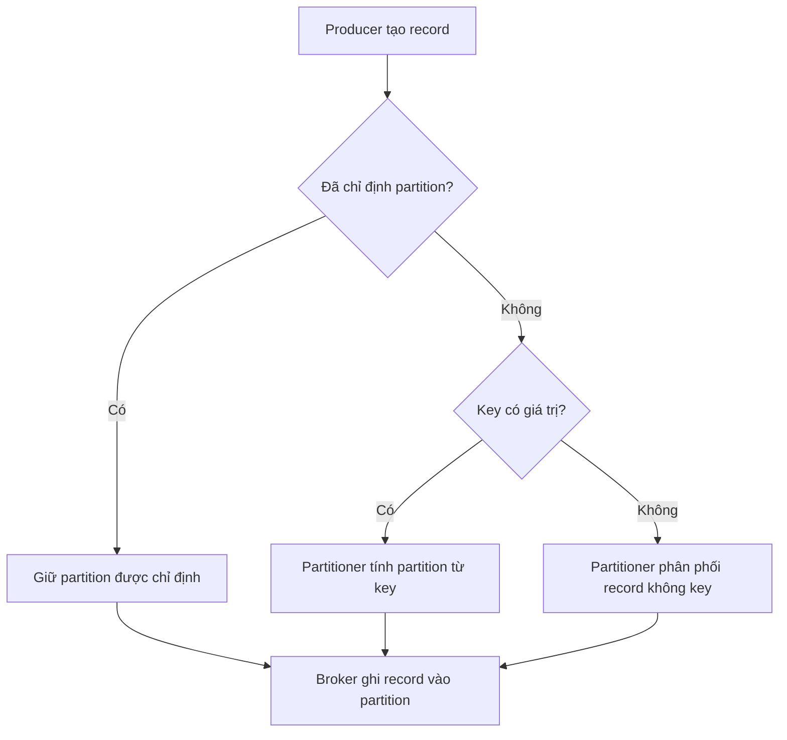
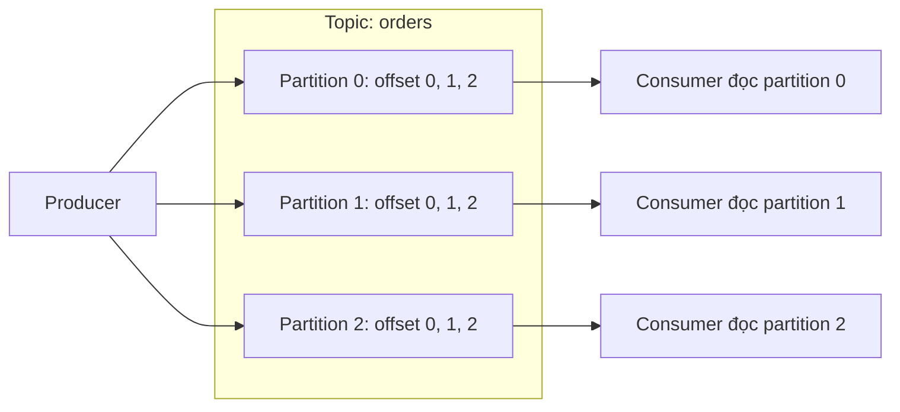

# Key ảnh hưởng đến phân vùng và thứ tự xử lý như thế nào

## Vì sao record cần có key?

Một Kafka record thường gồm key, value, timestamp và headers. Value chứa dữ liệu sự kiện; key cho Kafka biết record thuộc về thực thể hoặc nhóm logic nào. Key thường được dùng để chọn partition, nhờ đó các sự kiện liên quan có thể đi vào cùng một partition và được đọc theo thứ tự offset.

Ví dụ, một đơn hàng có thể phát ra `OrderCreated`, `OrderPaid`, `OrderPacked` và `OrderShipped`. Nếu producer dùng `orderId` làm key cho tất cả sự kiện của đơn hàng đó, Kafka sẽ định tuyến chúng đến cùng partition khi cách phân vùng ổn định. Consumer khi đọc partition sẽ nhận các record theo thứ tự chúng được ghi vào log.

Đây là một quyết định thiết kế quan trọng trong hệ thống KAFKA. Key tác động đến phân bố tải, khả năng song song hóa, thứ tự nghiệp vụ và cả cách dữ liệu được compact. Một key được chọn tốt giúp consumer xử lý đúng phạm vi dữ liệu cần tuần tự; một key không phù hợp có thể tạo partition nóng hoặc khiến các sự kiện cần thứ tự bị phân tán.

## 1. Kafka chọn partition cho record như thế nào?

### 1.1 Luồng quyết định partition

Khi producer gửi record, partition được xác định theo thứ tự ưu tiên tổng quát sau:

1. Nếu producer chỉ định partition cụ thể trong `ProducerRecord`, partition đó được sử dụng.
2. Nếu không chỉ định partition nhưng record có key, partitioner của producer chọn partition dựa trên key.
3. Nếu key là `null`, partitioner mặc định phân phối record theo cơ chế dành cho record không có key. Các Kafka Java producer hiện đại thường dùng sticky partitioning để gom record vào một partition trong một khoảng gửi/batch trước khi chuyển sang partition khác.
4. Nếu ứng dụng cấu hình partitioner tùy chỉnh, quy tắc chọn partition có thể khác.



Điểm cần nhớ là key không phải tên partition. Key là dữ liệu đầu vào cho partitioner; partitioner mới quyết định record được ghi vào partition nào.

### 1.2 Key được băm để chọn partition

Với Java producer và partitioner mặc định, key được serialize thành byte trước khi tính toán. Partitioner áp dụng hàm băm lên byte của key rồi ánh xạ kết quả vào số partition hiện có. Có thể hình dung đơn giản:

\[
partition = positive(hash(serializedKey)) \bmod partitionCount
\]

Trong Kafka Java client, thuật toán mặc định cho key thường dùng Murmur2 trên byte đã serialize. Công thức trên mô tả ý tưởng; chi tiết cụ thể phụ thuộc phiên bản client, partitioner và cấu hình của ứng dụng.

Ví dụ topic `orders` có 6 partition, các record mang key `order-1001` được ánh xạ đến một partition xác định, chẳng hạn partition 4. Nếu key và cách serialize không đổi, các record tiếp theo có cùng key sẽ tiếp tục được đưa vào partition 4 khi số partition và partitioner vẫn giữ nguyên.

| Key của record | Partition minh họa | Ý nghĩa |
|---|---:|---|
| `order-1001` | 4 | Các sự kiện của đơn 1001 cùng luồng partition |
| `order-1002` | 1 | Đơn 1002 có thể được xử lý song song với đơn 1001 |
| `order-1003` | 5 | Đơn 1003 có thể được xử lý độc lập |
| `order-1001` | 4 | Record tiếp theo của đơn 1001 tiếp tục vào partition 4 |

Các số partition trong bảng chỉ là ví dụ để minh họa. Không nên tự tính hoặc hard-code partition từ tên key; hãy để producer và partitioner chịu trách nhiệm, trừ khi hệ thống có yêu cầu rõ ràng về custom partitioner.

### 1.3 Vì sao key `null` có hành vi khác?

Khi key là `null`, producer không có định danh để gom các record liên quan vào cùng partition. Partitioner mặc định của các Kafka Java client hiện đại thường dùng sticky partitioning: chọn một partition và gửi nhiều record vào đó để tận dụng batching, sau đó chuyển sang partition khác. Chi tiết hành vi có thể thay đổi theo phiên bản client và cấu hình.

Điều này giúp phân phối record không key mà vẫn tạo batch hiệu quả. Tuy nhiên, các record `null` key không có bảo đảm rằng chúng thuộc cùng một thực thể sẽ được đưa về cùng partition. Nếu nghiệp vụ cần thứ tự theo đơn hàng, tài khoản hoặc khách hàng, hãy cung cấp key tương ứng.

### 1.4 Key serializer phải ổn định

Partitioner làm việc trên byte đã serialize, không trực tiếp trên ý nghĩa của object trong Java. Vì vậy, hai object biểu diễn cùng một ID nhưng được serialize thành byte khác nhau có thể đi vào partition khác nhau.

Ví dụ, nếu `orderId` lúc được serialize bằng `StringSerializer`, lúc khác lại dùng JSON serializer với cấu trúc hoặc cách mã hóa khác, kết quả băm có thể thay đổi. Hãy thống nhất kiểu dữ liệu và serializer cho key giữa các producer. Với key phức hợp, cần một quy tắc serialize ổn định, có phiên bản và được chia sẻ giữa các dịch vụ.

## 2. Key tạo thứ tự trong partition như thế nào?

### 2.1 Kafka bảo đảm thứ tự ở phạm vi partition

Mỗi partition là một log có thứ tự. Record được ghi vào partition sẽ nhận offset; consumer đọc các record theo thứ tự offset của partition đó.



Kafka không tạo một thứ tự tổng thể giữa các partition. Offset 8 của partition 0 và offset 8 của partition 2 là hai vị trí độc lập; không thể kết luận record nào xảy ra trước chỉ bằng cách so sánh hai offset đó.

Nếu tất cả sự kiện của một đơn hàng cùng key và cùng được ghi vào một partition, consumer có thể đọc chuỗi sự kiện của đơn hàng theo thứ tự log. Đây là cơ sở để xử lý trạng thái đơn hàng, số dư tài khoản hoặc vòng đời của một thực thể.

### 2.2 Key bảo toàn thứ tự theo thực thể

Giả sử một đơn hàng có chuỗi sự kiện:

| Thứ tự nghiệp vụ dự kiến | Event | Key |
|---:|---|---|
| 1 | `OrderCreated` | `order-1001` |
| 2 | `OrderPaid` | `order-1001` |
| 3 | `OrderPacked` | `order-1001` |
| 4 | `OrderShipped` | `order-1001` |

Vì key giống nhau, partitioner mặc định sẽ ánh xạ các record này về cùng partition nếu số partition, key serializer và partitioner không thay đổi. Consumer đọc partition theo offset và có thể cập nhật trạng thái đơn hàng lần lượt.

Ngược lại, nếu producer dùng một UUID ngẫu nhiên mới cho mỗi event làm key, các sự kiện của cùng đơn hàng có thể rơi vào các partition khác nhau. Consumer không còn một luồng có thứ tự duy nhất cho đơn hàng đó. UUID vẫn có ích làm `eventId` để nhận diện sự kiện, nhưng không nhất thiết là key phù hợp cho phân vùng.

### 2.3 Thứ tự được xác định khi record được ghi, không phải theo timestamp nghiệp vụ

Thứ tự offset phản ánh thứ tự record được append vào partition. Nó không tự động sắp xếp theo `createdAt`, thời gian máy gửi hoặc thời điểm nghiệp vụ xảy ra.

Nếu hai producer cùng phát sự kiện cho một `orderId`, Kafka vẫn đưa chúng về cùng partition khi dùng cùng partitioner và key. Tuy nhiên, nếu hai producer gửi đồng thời, thứ tự trong log phụ thuộc thứ tự broker nhận và append các record. Kafka không thể tự suy ra quan hệ trước/sau của hai sự kiện chỉ từ timestamp nghiệp vụ.

Khi thứ tự nhân quả quan trọng, ứng dụng cần điều phối việc phát sự kiện ở nguồn, ví dụ một producer tuần tự theo aggregate, dùng sequence/version tăng dần cho thực thể hoặc kiểm tra phiên bản trước khi cập nhật trạng thái. Không nên coi timestamp của máy khách là nguồn thứ tự tuyệt đối vì đồng hồ giữa các máy có thể lệch.

## 3. Chọn key theo yêu cầu nghiệp vụ

Key nên đại diện cho phạm vi mà hệ thống cần giữ thứ tự hoặc phân phối cùng nhau. Không có một key đúng cho mọi topic; hãy bắt đầu từ câu hỏi: những record nào không được xử lý vượt qua nhau?

| Yêu cầu nghiệp vụ | Key thường phù hợp | Lý do và đánh đổi |
|---|---|---|
| Giữ thứ tự vòng đời đơn hàng | `orderId` | Mọi event của một đơn hàng cùng partition; nhiều đơn hàng vẫn song song |
| Giữ thứ tự cập nhật tài khoản | `accountId` | Các thay đổi số dư của một tài khoản có cùng luồng xử lý |
| Tuần tự hóa sự kiện theo khách hàng | `customerId` | Các sự kiện cùng khách hàng được gom lại; khách hàng có lưu lượng lớn có thể tạo partition nóng |
| Duy trì trạng thái thiết bị | `deviceId` | Event telemetry hoặc trạng thái của cùng thiết bị được định tuyến nhất quán |
| Ghi dữ liệu độc lập, không cần thứ tự theo thực thể | Có thể dùng `null` hoặc key phân phối tải | Có thể tận dụng batching và song song; không có bảo đảm gom nhóm theo thực thể |

### 3.1 Chọn key có đủ tính phân biệt

Nếu mọi record đều dùng cùng một key như `all-orders`, tất cả record sẽ đi vào cùng partition. Topic có thể có hàng chục partition nhưng phần lớn tải vẫn dồn vào một partition. Đây là hiện tượng hot partition.

Ở chiều ngược lại, key ngẫu nhiên cho từng record phân tán tải tốt nhưng làm mất khả năng giữ thứ tự theo thực thể. Hãy chọn key có độ phân biệt phù hợp với số lượng thực thể và yêu cầu thứ tự. Một topic sự kiện đơn hàng thường dùng `orderId`; một topic ghi nhận trạng thái tài khoản thường dùng `accountId`.

### 3.2 Cân bằng ordering và throughput

Trong một consumer group, một partition tại một thời điểm chỉ được gán cho một consumer trong group. Do đó, số partition giới hạn mức song song tối đa của group đối với topic đó. Nhưng tăng partition không làm một key đơn lẻ được xử lý song song mà vẫn giữ thứ tự; các record của key đó vẫn phải đi theo một luồng partition.

Nếu một khách hàng hoặc tài khoản có lưu lượng vượt trội, key tương ứng có thể làm partition chứa key đó quá tải trong khi partition khác nhàn rỗi. Cần quan sát phân bố record/byte theo partition và consumer lag để phát hiện tình trạng này.

Có thể thêm thành phần shard vào key để chia một thực thể nóng thành nhiều luồng, ví dụ `customerId + shardId`. Tuy nhiên, cách này làm mất thứ tự tổng thể giữa các shard của cùng khách hàng. Chỉ áp dụng khi nghiệp vụ cho phép xử lý song song và có bước tổng hợp hoặc đồng bộ phù hợp.

### 3.3 Key phức hợp

Đôi khi phạm vi ordering được xác định bởi nhiều trường. Ví dụ, hệ thống cần thứ tự riêng cho từng sản phẩm trong từng kho. Key có thể là `warehouseId:productId`:

```text
warehouse-01:product-100
warehouse-01:product-200
warehouse-02:product-100
```

Cần quy định delimiter, chuẩn hóa chữ hoa/thường, encoding và cách xử lý giá trị rỗng. Nếu các producer ghép key khác nhau cho cùng một thực thể logic, sự kiện sẽ bị phân tán. Với key nhạy cảm hoặc dài, hãy cân nhắc mã định danh ổn định, ngắn gọn thay vì đưa toàn bộ dữ liệu nghiệp vụ vào key.

## 4. Ví dụ Java và Spring Kafka

### 4.1 Gửi record với key là orderId

Với Spring Kafka, overload `send(topic, key, value)` cho phép truyền key tường minh:

```java
public record OrderEvent(
        String orderId,
        String eventType,
        long sequence,
        Instant occurredAt
) {}

@Service
public class OrderEventPublisher {

    private final KafkaTemplate<String, OrderEvent> kafkaTemplate;

    public OrderEventPublisher(KafkaTemplate<String, OrderEvent> kafkaTemplate) {
        this.kafkaTemplate = kafkaTemplate;
    }

    public void publish(OrderEvent event) {
        kafkaTemplate.send("orders", event.orderId(), event);
    }
}
```

Producer gửi `OrderCreated`, `OrderPaid` và `OrderShipped` của cùng một đơn hàng với cùng `orderId`. Producer cần cấu hình key serializer nhất quán, ví dụ `StringSerializer` nếu key là chuỗi.

### 4.2 Đọc key và record ở consumer

Consumer có thể nhận `ConsumerRecord` để truy cập key, partition và offset:

```java
@KafkaListener(topics = "orders", groupId = "order-projection")
public void consume(ConsumerRecord<String, OrderEvent> record) {
    String orderId = record.key();
    int partition = record.partition();
    long offset = record.offset();
    OrderEvent event = record.value();

    // Cập nhật projection cho orderId theo thứ tự record của partition.
}
```

Trong ví dụ, `record.key()` là key producer gửi; `record.partition()` và `record.offset()` giúp quan sát vị trí của record trong log. Nếu consumer xử lý bất đồng bộ bằng cách đẩy record sang nhiều thread rồi hoàn tất tùy ý, side effect có thể xảy ra sai thứ tự dù Kafka đã giao record theo offset. Khi cần tuần tự, hãy xử lý tuần tự trong partition hoặc thiết kế cơ chế tuần tự hóa ở tầng ứng dụng.

### 4.3 Gửi partition tường minh

Kafka API cho phép producer chỉ định partition trực tiếp:

```java
ProducerRecord<String, OrderEvent> record =
        new ProducerRecord<>("orders", 2, event.orderId(), event);

kafkaTemplate.send(record);
```

Cách này bỏ qua việc partitioner tự chọn partition cho record. Nó có thể hữu ích trong một số pipeline đặc biệt, nhưng gắn cứng partition trong code làm ứng dụng phụ thuộc vào topology của topic. Nếu số partition thay đổi hoặc các producer dùng quy tắc khác nhau, cùng một key có thể bị ghi vào nhiều partition và mất ordering theo key. Chỉ định partition tường minh cần một quy ước chung và kế hoạch vận hành rõ ràng.

## 5. Những thay đổi có thể làm key đi sang partition khác

### 5.1 Tăng số partition

Với partitioner dựa trên phép băm và modulo số partition, thay đổi `partitionCount` có thể làm một key được ánh xạ sang partition khác. Record cũ vẫn nằm trong partition cũ; record mới có thể nằm ở partition mới. Khi đó, hai phần của cùng một chuỗi sự kiện có thể được consumer xử lý độc lập, không còn một thứ tự chung được Kafka bảo đảm.

Ví dụ, topic ban đầu có 4 partition. Sau khi tăng lên 8, kết quả modulo có thể đổi với một số key. Không phải mọi key đều chắc chắn đổi partition, nhưng ứng dụng phải coi việc thay đổi số partition là thay đổi có thể ảnh hưởng ordering.

Nếu thứ tự theo key là yêu cầu nghiêm ngặt, hãy lập kế hoạch mở rộng trước: tạo topic mới với topology đã tính toán, chuyển producer/consumer theo một mốc nghiệp vụ, drain hoặc đối soát dữ liệu cũ, rồi chuyển hoàn toàn sang topic mới. Một custom partitioner dùng mapping ổn định có thể là lựa chọn trong hệ thống chuyên biệt, nhưng cần được kiểm thử và triển khai nhất quán trên mọi producer.

### 5.2 Thay key hoặc key serializer

Đổi từ `orderId` sang `customerId` thay đổi phạm vi ordering. Đổi serializer hoặc cách chuẩn hóa key cũng có thể thay đổi byte đầu vào của hàm băm. Các producer cần thống nhất quy tắc key trong suốt vòng đời của topic.

Nếu cần đổi key, hãy xem đó là thay đổi hợp đồng dữ liệu. Có thể tạo topic mới, dual-publish có kiểm soát trong thời gian chuyển đổi, hoặc xây dựng một luồng chuyển tiếp có đối soát. Tránh để các phiên bản producer khác nhau âm thầm dùng hai kiểu key cho cùng một sự kiện.

### 5.3 Thay partitioner

Partitioner tùy chỉnh có thể phân phối theo vùng, tenant, loại sự kiện hoặc quy tắc nghiệp vụ. Nhưng tất cả producer ghi cùng topic phải dùng cùng thuật toán, cùng dữ liệu đầu vào và cùng phiên bản quy tắc. Nếu không, cùng một key có thể bị gửi đến các partition khác nhau.

## 6. Các giới hạn cần hiểu khi nói về ordering

### 6.1 Kafka không sắp xếp toàn topic

Một topic nhiều partition không có thứ tự toàn cục. Nếu một nghiệp vụ cần tất cả record được xử lý theo đúng một chuỗi duy nhất, có thể phải dùng một partition hoặc một cơ chế tuần tự hóa ở tầng ứng dụng. Một partition giúp đơn giản hóa ordering nhưng giới hạn song song và thông lượng.

### 6.2 Cùng partition không tự giải quyết mọi race condition

Key đưa record vào cùng partition; nó không tự bảo đảm các thao tác ở database, HTTP API hoặc hệ thống ngoài hoàn tất đúng thứ tự. Consumer có thể đọc record theo offset nhưng xử lý bất đồng bộ, gọi dịch vụ ngoài với độ trễ khác nhau hoặc commit offset không phù hợp.

Để bảo toàn trạng thái nghiệp vụ, consumer có thể dùng sequence/version của aggregate, kiểm tra phiên bản hiện tại trước khi cập nhật, hoặc ghi inbox/event ID để chống xử lý trùng. Với xử lý song song, cần thiết kế hàng đợi nội bộ theo partition hoặc theo key để các thao tác của cùng thực thể vẫn tuần tự.

### 6.3 Retry và dead-letter có thể làm thay đổi thứ tự quan sát

Khi record lỗi được retry sau một khoảng thời gian hoặc chuyển sang retry topic, các record sau trong partition có thể tiếp tục được xử lý tùy cấu hình error handler. Khi record lỗi được phát lại sau, consumer có thể quan sát side effect theo thứ tự khác với thứ tự offset ban đầu.

Nếu thứ tự nghiệp vụ nghiêm ngặt, hãy quyết định rõ có dừng partition khi gặp lỗi hay cho phép bỏ qua tạm thời và xử lý bù. Với Spring Kafka, cần xem xét `DefaultErrorHandler`, backoff, dead-letter topic và cơ chế retry topic theo đúng phiên bản đang sử dụng. Không nên bật retry độc lập với yêu cầu ordering.

### 6.4 Producer retry và thứ tự gửi

Khi producer gửi nhiều request đồng thời và gặp lỗi có retry, cấu hình producer ảnh hưởng đến thứ tự append. Idempotent producer giúp xử lý retry an toàn hơn và duy trì thứ tự trong các điều kiện cấu hình được hỗ trợ. Hãy dùng cấu hình idempotence phù hợp với phiên bản Kafka client và tránh tự tắt các ràng buộc cần thiết như `max.in.flight.requests.per.connection` khi cần ordering.

Ngay cả khi idempotence được bật, nó không xác định thứ tự nghiệp vụ giữa hai producer độc lập cùng phát event cho một key. Nguồn dữ liệu vẫn cần xác định ai có quyền phát phiên bản tiếp theo của thực thể.

## 7. Key còn được dùng cho log compaction

Ngoài phân vùng, key còn có ý nghĩa trong log compaction. Với topic bật `cleanup.policy=compact`, Kafka dùng key để nhận diện các record thuộc cùng một thực thể logic và giữ lại giá trị mới nhất theo key trong quá trình compact. Record có key nhưng value `null` có thể đóng vai trò tombstone để biểu thị việc xóa key.

Ví dụ, topic `customer-state` có thể dùng `customerId` làm key. Mỗi record cập nhật trạng thái mới nhất của khách hàng đó. Một consumer dựng cache trạng thái có thể đọc log và nhận được giá trị mới nhất theo từng key sau khi compaction diễn ra.

Compaction không đồng nghĩa mọi bản ghi cũ biến mất ngay lập tức; quá trình dọn dẹp diễn ra nền và phụ thuộc cấu hình. Nếu topic cần lưu toàn bộ lịch sử event, hãy chọn retention phù hợp và không dựa vào compaction như kho lưu trữ lịch sử đầy đủ.

## 8. Cách kiểm tra thiết kế key trong thực tế

Trước khi đưa topic vào production, hãy kiểm tra các điểm sau:

1. **Phạm vi ordering:** Xác định chính xác entity nào cần xử lý tuần tự: đơn hàng, tài khoản, khách hàng, thiết bị hay một nhóm khác.
2. **Key ổn định:** Mọi event của cùng entity có dùng cùng key và cùng quy tắc serialize hay không?
3. **Phân bố tải:** Số lượng key, tần suất mỗi key và kích thước payload có làm một số partition quá tải hay không?
4. **Partition count:** Số partition có đáp ứng mức song song mong muốn mà không phá vỡ kế hoạch ordering khi mở rộng hay không?
5. **Producer đồng thời:** Có nhiều producer cùng phát cho một key không? Nếu có, nguồn nào xác định thứ tự nghiệp vụ?
6. **Consumer:** Consumer có xử lý tuần tự trong partition hay chuyển record sang xử lý bất đồng bộ có thể đảo thứ tự?
7. **Retry:** Chính sách retry, backoff và dead-letter có giữ được hoặc chủ động nới lỏng ordering như yêu cầu không?
8. **Thay đổi hợp đồng:** Nếu đổi key, serializer, partitioner hoặc số partition, kế hoạch chuyển đổi và đối soát là gì?

Trong vận hành, nên theo dõi record/byte in rate theo partition, consumer lag theo partition, thời gian xử lý và tỷ lệ lỗi. Tổng lag của topic có thể che giấu một partition nóng; số liệu chi tiết theo partition giúp xác định key hoặc nhóm key gây lệch tải.

## 9. Những lỗi thiết kế key thường gặp

| Lỗi | Hậu quả | Cách xử lý |
|---|---|---|
| Dùng UUID mới cho mỗi event làm key | Event cùng entity bị phân tán, khó giữ thứ tự | Dùng entity ID làm key; giữ UUID riêng trong payload làm event ID |
| Dùng một key cố định cho mọi record | Một partition nhận gần như toàn bộ tải | Chọn key có độ phân biệt theo entity |
| Dùng `null` key dù cần thứ tự theo entity | Không có định tuyến ổn định theo entity | Cung cấp key nghiệp vụ rõ ràng |
| Mỗi producer serialize key khác nhau | Cùng entity có thể vào partition khác nhau | Chuẩn hóa kiểu key và serializer |
| Tăng partition mà không đánh giá mapping | Một key có thể chuyển partition và mất thứ tự xuyên thời điểm thay đổi | Lập kế hoạch migration hoặc giữ topology ổn định |
| Xử lý consumer bất đồng bộ không kiểm soát | Side effect có thể hoàn tất sai thứ tự | Tuần tự hóa theo partition/key hoặc kiểm tra sequence |
| Retry record lỗi mà không xét thứ tự | Record sau có thể hoàn tất trước record lỗi | Chọn chính sách dừng, retry hoặc bù theo yêu cầu nghiệp vụ |

## Kết luận

Key là tín hiệu để Kafka gom các record liên quan vào partition. Với partitioner mặc định, key được serialize rồi băm để chọn partition; cùng key thường tiếp tục vào cùng partition khi key serializer, partitioner và số partition không đổi. Vì Kafka bảo đảm thứ tự trong từng partition, lựa chọn key phù hợp giúp giữ thứ tự cho một thực thể như đơn hàng hoặc tài khoản, đồng thời cho phép các thực thể khác nhau được xử lý song song.

Khi thiết kế topic KAFKA, hãy chọn key theo phạm vi ordering của nghiệp vụ, kiểm tra độ phân biệt và nguy cơ hot partition, thống nhất serializer giữa producer, và đánh giá kỹ tác động của việc tăng partition hoặc đổi partitioner. Sau đó kiểm tra cả consumer, retry và side effect bên ngoài: Kafka có thể giao record theo thứ tự offset, nhưng ứng dụng phải bảo toàn thứ tự đó trong toàn bộ quá trình xử lý.
