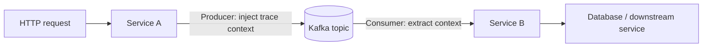

# Headers trong Kafka: mã tương quan, truy vết và phiên bản sự kiện

Kafka record gồm key, value, timestamp và headers. Key và value mang dữ liệu chính của sự kiện; headers mang các metadata nhỏ đi kèm record để producer, consumer và các thành phần trung gian trao đổi ngữ cảnh. Trong ứng dụng event streaming, headers thường được dùng để truyền mã tương quan (correlation ID), ngữ cảnh distributed tracing và thông tin phiên bản hoặc loại sự kiện.

Headers giúp các dịch vụ liên kết một record với hoạt động đã tạo ra nó mà không phải nhúng mọi thông tin vận hành vào payload. Tuy nhiên, header vẫn là một phần của hợp đồng dữ liệu: các bên cần thống nhất tên, kiểu mã hóa, ý nghĩa, quy tắc thiếu dữ liệu và cách xử lý khi giá trị không hợp lệ.

## 1. Cấu trúc và đặc điểm của Kafka record headers

Trong Kafka Java client, mỗi header có một tên dạng chuỗi và một giá trị dạng mảng byte (`byte[]`). Một record có thể chứa nhiều header. API `Headers` cho phép thêm, tìm và loại bỏ header:

```java
import java.nio.charset.StandardCharsets;

import org.apache.kafka.clients.producer.ProducerRecord;

ProducerRecord<String, byte[]> record =
    new ProducerRecord<>("orders", "order-42", payload);

record.headers().add(
    "correlation-id",
    "req-8f31".getBytes(StandardCharsets.UTF_8)
);
```

Một số đặc điểm cần nhớ:

- Header không tham gia lựa chọn partition theo key mặc định. Partition thường được xác định bởi partition được chỉ định hoặc partitioner dựa trên key và metadata topic.
- Header không thay thế key hoặc value. Key thường phục vụ định tuyến, phân vùng và ngữ nghĩa xử lý theo khóa; value chứa nội dung sự kiện.
- Header value là byte array. Khi dùng chuỗi, ứng dụng phải thống nhất encoding, thông thường là UTF-8.
- Kafka cho phép nhiều header có cùng tên. `lastHeader(name)` trả về header cuối cùng có tên đó; `headers(name)` trả về tất cả header cùng tên.
- Header có thể bị thiếu, có giá trị không hợp lệ hoặc bị thay đổi bởi ứng dụng trung gian. Consumer phải kiểm tra trước khi sử dụng.

Vì tên header có thể lặp, ứng dụng nên định nghĩa rõ một header là đơn trị hay đa trị. Với các metadata như `correlation-id` và `event-version`, thông thường chỉ nên có một giá trị. Khi ghi đè, hãy loại bỏ giá trị cũ rồi thêm giá trị mới thay vì vô tình tạo nhiều giá trị mâu thuẫn.

## 2. Dùng correlation ID để liên kết một luồng nghiệp vụ

Correlation ID là mã định danh giúp liên kết các thông điệp thuộc cùng một yêu cầu hoặc một luồng nghiệp vụ. Ví dụ, một yêu cầu tạo đơn hàng có thể phát sinh `OrderCreated`, `PaymentRequested` và `InventoryReserved` ở các dịch vụ khác nhau. Nếu mỗi record mang cùng một correlation ID, đội vận hành có thể tìm các sự kiện liên quan trong log, trace hoặc công cụ phân tích.

Correlation ID thường được tạo tại ranh giới tiếp nhận yêu cầu, chẳng hạn API gateway hoặc dịch vụ đầu tiên. Mỗi dịch vụ tiếp tục truyền mã này khi phát sinh sự kiện kế tiếp. Nếu một thông điệp được xử lý độc lập hoặc bắt đầu một luồng nghiệp vụ mới, ứng dụng cần quy định rõ việc giữ hay tạo correlation ID mới.

### Ví dụ producer Java

```java
import java.nio.charset.StandardCharsets;
import java.util.UUID;

import org.apache.kafka.clients.producer.ProducerRecord;

String correlationId = UUID.randomUUID().toString();
String eventVersion = "1";

ProducerRecord<String, OrderCreated> record =
    new ProducerRecord<>("orders", order.id(), event);

record.headers().add(
    "correlation-id",
    correlationId.getBytes(StandardCharsets.UTF_8)
);
record.headers().add(
    "event-version",
    eventVersion.getBytes(StandardCharsets.UTF_8)
);

kafkaTemplate.send(record);
```

Đoạn mã minh họa cách thêm metadata trước khi gửi một `ProducerRecord` bằng `KafkaTemplate`. Trong hệ thống thực tế, correlation ID thường đã được tạo ở tầng HTTP hoặc message consumer. Hãy lấy mã từ ngữ cảnh hiện có để truyền tiếp, thay vì tạo UUID mới cho mọi lần publish; nếu tạo mới ở mỗi chặng, khả năng liên kết toàn bộ luồng sẽ mất.

### Đọc correlation ID ở consumer

```java
import java.nio.charset.StandardCharsets;

import org.apache.kafka.common.header.Header;
import org.apache.kafka.clients.consumer.ConsumerRecord;

void handle(ConsumerRecord<String, OrderCreated> record) {
    Header header = record.headers().lastHeader("correlation-id");

    String correlationId = header == null || header.value() == null
        ? null
        : new String(header.value(), StandardCharsets.UTF_8);

    if (correlationId == null || correlationId.isBlank()) {
        // Áp dụng chính sách cho record thiếu correlation ID.
        // Ví dụ: ghi log với record.topic(), partition() và offset().
    }

    // Xử lý sự kiện và truyền correlationId vào log/ngữ cảnh nghiệp vụ.
}
```

Không nên loại bỏ record chỉ vì thiếu correlation ID nếu đây không phải điều kiện bắt buộc của hợp đồng sự kiện. Có thể ghi nhận metadata dự phòng từ `topic`, `partition` và `offset` để điều tra. Nếu correlation ID là yêu cầu bắt buộc, hãy xác thực rõ ràng và chuyển record lỗi sang luồng xử lý lỗi phù hợp.

Correlation ID không đồng nghĩa với Kafka key. Correlation ID thường phục vụ tìm kiếm và liên kết; key thường ảnh hưởng đến phân vùng. Dùng correlation ID làm key chỉ khi nó cũng phù hợp với yêu cầu phân vùng và ordering của nghiệp vụ.

## 3. Phân biệt correlation ID với distributed trace context

Correlation ID trả lời câu hỏi: “Các sự kiện này thuộc cùng một yêu cầu hoặc luồng nghiệp vụ nào?”. Distributed tracing trả lời câu hỏi: “Yêu cầu đã đi qua những dịch vụ và thao tác nào, mất bao lâu ở từng bước, và có lỗi ở đâu?”. Hai khái niệm có thể cùng xuất hiện trên một record nhưng có mục đích khác nhau.

Với W3C Trace Context, ngữ cảnh truy vết thường được truyền qua `traceparent` và `tracestate`. `baggage` thuộc chuẩn W3C Baggage riêng, dùng để truyền các thuộc tính ngữ cảnh khi chính sách cho phép:

- `traceparent`: chứa trace ID, parent span ID và trace flags theo định dạng chuẩn.
- `tracestate`: mang thông tin bổ sung theo hệ sinh thái tracing của nhà cung cấp.
- `baggage`: mang các thuộc tính ngữ cảnh được truyền xuyên suốt trace theo quy tắc của W3C Baggage.

Không tự ghép chuỗi `traceparent` bằng UUID hoặc correlation ID. Trace ID và span ID có độ dài, định dạng và ý nghĩa riêng; mỗi thao tác trong trace có thể tạo span mới. Hãy dùng OpenTelemetry hoặc thư viện tracing tương thích để inject và extract context.

### Minh họa luồng trace qua Kafka



Khi Service A publish record, instrumentation có thể ghi trace context vào Kafka headers. Khi Service B nhận record, instrumentation đọc context đó để tạo span consumer có quan hệ với trace trước. Tùy chế độ instrumentation, span consumer có thể là child span hoặc liên kết (link) với span producer; cách biểu diễn cụ thể phụ thuộc thư viện và cấu hình.

Trong ứng dụng Java, nên ưu tiên instrumentation tự động của OpenTelemetry cho Kafka producer và consumer khi đã được cấu hình phù hợp. Nếu cần tự quản lý propagation, `TextMapPropagator` cung cấp cơ chế inject/extract trên carrier. Ví dụ setter tối giản cho Kafka `Headers`:

```java
import java.nio.charset.StandardCharsets;

import io.opentelemetry.context.Context;
import io.opentelemetry.context.propagation.TextMapSetter;
import org.apache.kafka.common.header.Headers;

TextMapSetter<Headers> kafkaSetter = (headers, key, value) -> {
    headers.remove(key);
    headers.add(key, value.getBytes(StandardCharsets.UTF_8));
};

// Trước khi gửi record:
propagator.inject(Context.current(), record.headers(), kafkaSetter);
```

Ở phía consumer, tạo `TextMapGetter<Headers>` để đọc tên và giá trị header rồi gọi `propagator.extract(Context.current(), record.headers(), getter)`. Ví dụ getter và cách kích hoạt context trong phạm vi xử lý:

```java
import java.nio.charset.StandardCharsets;
import java.util.ArrayList;
import java.util.List;

import io.opentelemetry.context.Context;
import io.opentelemetry.context.Scope;
import io.opentelemetry.context.propagation.TextMapGetter;
import org.apache.kafka.common.header.Header;
import org.apache.kafka.common.header.Headers;

TextMapGetter<Headers> kafkaGetter = new TextMapGetter<>() {
    @Override
    public Iterable<String> keys(Headers headers) {
        List<String> keys = new ArrayList<>();
        for (Header header : headers) {
            keys.add(header.key());
        }
        return keys;
    }

    @Override
    public String get(Headers headers, String key) {
        Header header = headers.lastHeader(key);
        return header == null || header.value() == null
            ? null
            : new String(header.value(), StandardCharsets.UTF_8);
    }
};

Context extracted = propagator.extract(
    Context.current(), record.headers(), kafkaGetter
);
try (Scope scope = extracted.makeCurrent()) {
    handle(record.value());
}
```

`propagator` là `TextMapPropagator` đã được cấu hình, thường lấy từ OpenTelemetry SDK. Đưa context được trích xuất thành current context trong phạm vi xử lý record để các span tiếp theo nối đúng trace. Không nên chỉ đọc `traceparent` rồi tự dựng span nếu thư viện tracing đã quản lý vòng đời span.

Không đưa dữ liệu nhạy cảm, token, thông tin định danh cá nhân hoặc thuộc tính có kích thước lớn vào `baggage`. Baggage có thể được truyền qua nhiều dịch vụ và được ghi lại ở nhiều nơi. Chỉ truyền các thuộc tính cần thiết, giới hạn kích thước và áp dụng chính sách bảo mật của hệ thống.

## 4. Đưa phiên bản sự kiện vào header

Khi cấu trúc payload thay đổi theo thời gian, consumer cần biết cách diễn giải sự kiện. Một header do ứng dụng định nghĩa, chẳng hạn `event-version`, có thể mang phiên bản hợp đồng sự kiện:

```text
event-type: OrderCreated
event-version: 2
content-type: application/json
```

Các giá trị trên chỉ là ví dụ về quy ước của ứng dụng, không phải header bắt buộc do Kafka tự tạo. Có thể dùng `event-type` để phân biệt loại sự kiện, `event-version` để biểu thị phiên bản hợp đồng và `content-type` để chỉ định định dạng nội dung.

Consumer có thể đọc phiên bản trước khi chọn bộ giải mã hoặc handler:

```java
Header versionHeader = record.headers().lastHeader("event-version");

if (versionHeader == null || versionHeader.value() == null) {
    throw new IllegalArgumentException("Missing event-version header");
}

String version = new String(
    versionHeader.value(),
    StandardCharsets.UTF_8
);

switch (version) {
    case "1" -> handleV1(record.value());
    case "2" -> handleV2(record.value());
    default -> throw new IllegalArgumentException(
        "Unsupported event version: " + version
    );
}
```

Ví dụ trên giả định ứng dụng có thể đọc payload thành kiểu chung trước khi dispatch. Nếu cấu trúc payload khác nhau đến mức không thể deserialize trước, hãy dùng serializer/deserializer phù hợp hoặc đọc metadata trước khi giải mã value. Khi gặp phiên bản chưa hỗ trợ, chính sách có thể là retry có giới hạn, đưa vào dead-letter topic hoặc cách ly để xử lý sau; không nên âm thầm diễn giải payload theo phiên bản gần nhất.

### Header phiên bản không thay thế Schema Registry

`event-version` là metadata do ứng dụng quy định. Nó không tự xác thực schema, không bảo đảm backward/forward compatibility và không tự chuyển đổi payload. Nếu dùng Avro, Protobuf hoặc JSON Schema với Schema Registry, serializer có thể đã mang schema ID trong định dạng wire hoặc metadata riêng. Cần phân biệt schema ID với phiên bản nghiệp vụ của event.

Hãy chọn một nguồn có thẩm quyền cho thông tin schema/version. Nếu cả payload, header và Schema Registry cùng biểu diễn phiên bản nhưng không đồng bộ, consumer có thể chọn sai bộ giải mã. Có thể giữ `event-version` khi nó giúp định tuyến hoặc quan sát, nhưng phải quy định rõ cách đối chiếu với schema ID và quy tắc tương thích.

Khi thay đổi hợp đồng sự kiện:

1. Xác định thay đổi có tương thích với consumer cũ hay không.
2. Kiểm tra chính sách compatibility của schema và các consumer đang triển khai.
3. Quy định phiên bản mới, cách consumer xử lý phiên bản cũ và thời gian hỗ trợ song song.
4. Kiểm thử producer mới với consumer cũ và producer cũ với consumer mới theo ma trận tương thích cần hỗ trợ.
5. Chỉ ngừng phiên bản cũ khi dữ liệu còn lưu trong topic, consumer chậm và luồng replay đều đã được tính đến.

## 5. Quy ước đặt tên và hợp đồng headers

Một quy ước rõ ràng giúp nhiều dịch vụ và nhóm phát triển trao đổi metadata nhất quán. Bảng dưới đây là gợi ý; tổ chức có thể chuẩn hóa prefix hoặc namespace riêng.

| Header | Mục đích | Quy ước giá trị |
|---|---|---|
| `correlation-id` | Liên kết một yêu cầu hoặc luồng nghiệp vụ | Chuỗi định danh ổn định trong phạm vi luồng |
| `traceparent` | Truyền W3C trace context | Do OpenTelemetry hoặc thư viện tương thích tạo |
| `tracestate` | Metadata tracing theo nhà cung cấp | Theo W3C Trace Context |
| `baggage` | Thuộc tính ngữ cảnh truyền xuyên dịch vụ | Chỉ chứa thuộc tính được phép, có giới hạn |
| `event-type` | Nhận diện loại sự kiện | Tên loại ổn định, có namespace nếu cần |
| `event-version` | Phiên bản hợp đồng sự kiện | Chuỗi phiên bản theo quy ước đã công bố |
| `content-type` | Định dạng payload | MIME type hoặc quy ước đã thống nhất |

Với mỗi header, tài liệu hợp đồng nên mô tả:

- Tên chính xác và ý nghĩa nghiệp vụ/kỹ thuật.
- Encoding và định dạng giá trị, ví dụ UTF-8, UUID hoặc định dạng chuẩn W3C.
- Header là bắt buộc hay tùy chọn; consumer làm gì khi thiếu.
- Header có đơn trị hay đa trị; cách xử lý nếu xuất hiện nhiều giá trị.
- Giới hạn độ dài, tập giá trị được chấp nhận và chính sách dữ liệu nhạy cảm.
- Thành phần nào tạo, giữ nguyên, thay thế hoặc loại bỏ header khi forward/retry/replay.

Tên header cần nhất quán giữa producer và consumer. Tránh tạo nhiều tên cho cùng một ý nghĩa như `correlationId`, `correlation-id` và `request-id` nếu không có quy tắc chuyển đổi. Nếu cần tương thích hệ thống cũ, hãy lập kế hoạch alias và thời hạn loại bỏ.

## 6. Bảo toàn headers khi forward, retry và replay

Một consumer có thể nhận record rồi phát sinh record mới sang topic khác. Kafka không tự suy luận mọi metadata nghiệp vụ cần được sao chép sang record mới. Ứng dụng phải quyết định header nào được giữ, header nào cần cập nhật và header nào không được truyền tiếp.

Ví dụ, khi một dịch vụ chuyển tiếp sự kiện:

- Giữ correlation ID nếu sự kiện mới vẫn thuộc cùng luồng nghiệp vụ.
- Tạo hoặc inject trace context phù hợp với span hiện tại; không sao chép nguyên trace context cũ một cách mù quáng.
- Giữ event type/version nếu payload vẫn tuân theo hợp đồng đó; cập nhật nếu đã chuyển đổi sang hợp đồng mới.
- Có thể thêm metadata như `original-topic` hoặc `replay-source` theo hợp đồng nội bộ, nhưng cần giới hạn và kiểm soát quyền ghi.

Khi retry, cần phân biệt retry cùng một lần xử lý với việc tạo một sự kiện nghiệp vụ mới. Correlation ID thường được giữ để liên kết; trace context có thể thay đổi theo lần xử lý hoặc span mới. Với dead-letter topic, nên giữ metadata gốc cần thiết và bổ sung thông tin lỗi như tên exception đã được lọc, thời điểm lỗi hoặc topic nguồn. Tránh đưa stack trace đầy đủ hay dữ liệu nhạy cảm vào header.

Khi replay, correlation ID cũ có thể giúp tìm nguồn gốc sự kiện, nhưng trace context cũ có thể đã hết ý nghĩa vận hành. Hãy cân nhắc tạo trace mới cho phiên replay và lưu một metadata tham chiếu đến lần chạy replay. Quy tắc cụ thể cần nhất quán để dashboard không trộn lẫn trace lịch sử với trace của lần phát lại.

## 7. Ví dụ với Spring Kafka

Spring Kafka cho phép gửi trực tiếp `ProducerRecord` qua `KafkaTemplate`, nên có thể thao tác Kafka headers bằng API Kafka Java như ví dụ producer ở trên. Với listener, tham số `ConsumerRecord` cho phép đọc headers và metadata gốc:

```java
import java.nio.charset.StandardCharsets;

import org.apache.kafka.clients.consumer.ConsumerRecord;
import org.springframework.kafka.annotation.KafkaListener;
import org.springframework.stereotype.Component;

@Component
class OrderListener {

    @KafkaListener(topics = "orders", groupId = "order-service")
    void onMessage(ConsumerRecord<String, OrderCreated> record) {
        var header = record.headers().lastHeader("correlation-id");
        String correlationId = header == null || header.value() == null
            ? "missing"
            : new String(header.value(), StandardCharsets.UTF_8);

        // Đặt correlationId vào MDC hoặc context log trong phạm vi xử lý.
        // Gọi application service để xử lý record.
    }
}
```

Nếu dùng Spring Messaging `Message<?>`, Spring Kafka cũng hỗ trợ ánh xạ Kafka headers sang message headers thông qua header mapper. Cần kiểm tra cấu hình mapper, kiểu dữ liệu và danh sách header được phép ánh xạ. Không giả định mọi header tùy chỉnh đều được chuyển đổi đúng kiểu giữa `byte[]`, chuỗi và object khi đi qua các adapter.

Với MDC (Mapped Diagnostic Context), luôn xóa giá trị sau khi xử lý vì thread consumer có thể được tái sử dụng cho record khác:

```java
try {
    MDC.put("correlationId", correlationId);
    process(record.value());
} finally {
    MDC.remove("correlationId");
}
```

Nếu ứng dụng xử lý bất đồng bộ, không dựa vào MDC theo thread để truyền context sang thread khác. Hãy truyền context rõ ràng hoặc dùng cơ chế context propagation tương ứng.

## 8. Bảo mật, hiệu năng và khả năng quan sát

Headers được lưu cùng record và có thể được đọc bởi các consumer hoặc thành phần có quyền đọc topic. Vì vậy:

- Không đưa password, access token, session cookie, khóa bí mật hoặc dữ liệu cá nhân nhạy cảm vào headers.
- Xác thực độ dài và định dạng của header trước khi dùng. Không để một header bất thường làm tăng chi phí xử lý hoặc tạo log không kiểm soát.
- Giới hạn số lượng và kích thước header. Metadata lớn làm tăng kích thước record, lưu lượng mạng và dung lượng lưu trữ.
- Chỉ ghi log các giá trị được phép. Correlation ID thường hữu ích để tìm kiếm, nhưng vẫn cần đánh giá liệu nó có chứa hoặc tiết lộ thông tin định danh hay không.
- Theo dõi tỷ lệ record thiếu correlation ID, event version không hỗ trợ, trace context không hợp lệ và lỗi ánh xạ header.

Kafka có giới hạn kích thước message/request ở client và broker. Headers cũng góp phần vào kích thước record; tăng metadata không giới hạn có thể khiến record vượt giới hạn và bị từ chối. Không dùng headers để vận chuyển payload hoặc danh sách dữ liệu lớn.

Trong dashboard, nên phân biệt metric tổng hợp với giá trị định danh. Correlation ID phù hợp để tra cứu log hoặc trace cho một yêu cầu; không nên dùng ID có độ phân biệt cao làm nhãn metric vì sẽ tạo cardinality lớn. Với metrics, ưu tiên các nhãn có tập giá trị giới hạn như `event-type`, kết quả xử lý hoặc nhóm phiên bản.

## 9. Kiểm thử hợp đồng headers

Producer và consumer nên có kiểm thử hợp đồng để bảo đảm metadata không bị mất hoặc hiểu sai khi nâng cấp ứng dụng. Một bộ kiểm thử hữu ích gồm:

1. Producer tạo đúng tên header và mã hóa giá trị theo UTF-8 hoặc định dạng đã quy định.
2. Consumer đọc đúng giá trị khi header tồn tại và xử lý có chủ đích khi header thiếu.
3. Consumer xử lý an toàn header rỗng, byte không hợp lệ, giá trị quá dài và phiên bản không được hỗ trợ.
4. Khi có header trùng tên, ứng dụng áp dụng chính sách đã công bố thay vì chọn ngẫu nhiên.
5. Luồng forward, retry, dead-letter và replay giữ hoặc cập nhật đúng các metadata cần thiết.
6. Instrumentation tracing tạo trace liên tục qua producer và consumer; kiểm tra traceparent bằng công cụ tracing thay vì chỉ xác nhận header có mặt.
7. Kiểm tra tương thích khi producer hoặc consumer được triển khai phiên bản mới.

Có thể kiểm tra headers trong Kafka integration test bằng cách gửi record có headers, đọc `ConsumerRecord` và xác nhận `record.headers().lastHeader("correlation-id")` cùng các giá trị liên quan. Nên bổ sung trường hợp thiếu header và header lặp để kiểm tra đúng chính sách của ứng dụng.

## 10. Nguyên tắc áp dụng

Hãy dùng correlation ID để liên kết sự kiện trong một luồng nghiệp vụ, dùng W3C Trace Context/OpenTelemetry để theo dõi đường đi và thời gian của thao tác phân tán, và dùng event version để giúp consumer chọn cách diễn giải hợp đồng sự kiện khi thực sự cần. Mỗi header cần có tên, encoding, ý nghĩa, giới hạn và chính sách vòng đời rõ ràng.

Headers là metadata nhỏ gắn với record, không phải nơi thay thế payload, key, schema registry hay hệ thống tracing. Khi producer, consumer và các thành phần trung gian tuân thủ cùng hợp đồng, headers giúp việc điều tra, quan sát và tiến hóa sự kiện trong hệ thống Kafka dễ kiểm soát hơn.
