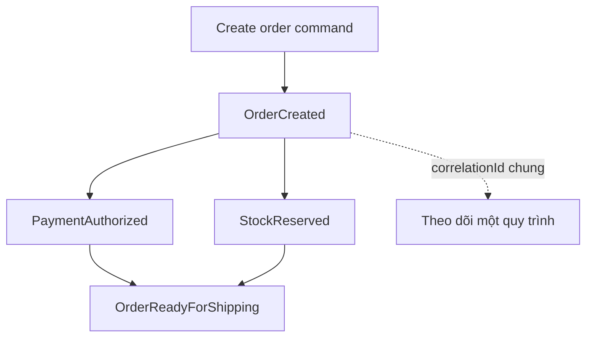
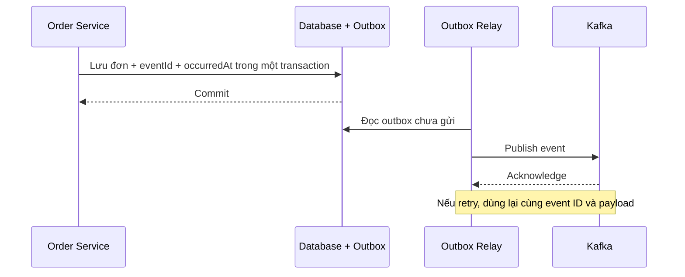

# Thiết kế event ID, nguồn phát và thời điểm phát sinh

Một event cần trả lời được ba câu hỏi: **đây là sự kiện nào**, **sự kiện bắt nguồn từ đâu** và **sự kiện xảy ra khi nào**. Ba thông tin này giúp consumer nhận diện sự kiện, kiểm tra nguồn gốc, loại bỏ lần giao trùng và xử lý dữ liệu theo thời gian.

Trong hệ thống event streaming với Apache Kafka, broker lưu và phân phối record, nhưng ý nghĩa nghiệp vụ của event do ứng dụng xác định. Kafka cấp partition và offset cho record; producer và hợp đồng sự kiện phải xác định event ID, source và thời điểm phát sinh. Không nên dùng metadata vận chuyển của Kafka để thay thế định danh và thời gian nghiệp vụ.

Bài này sử dụng tình huống Order Service phát `OrderCreated`, sau đó Payment, Inventory và Reporting Service nhận sự kiện. Các ví dụ tập trung vào cách tạo một event ổn định, giữ nguyên danh tính khi retry hoặc relay qua Kafka, và phân biệt thời điểm nghiệp vụ với thời điểm Kafka nhận hay consumer xử lý.

## 1. Ba thông tin định danh và thời gian trong một event

Một envelope sự kiện thường chứa các trường sau:

| Trường | Câu hỏi được trả lời | Ví dụ |
|---|---|---|
| `eventId` | Đây là lần phát sinh event nào? | `f47ac10b-...` |
| `source` | Hệ thống hoặc bounded context nào tạo ra sự kiện? | `urn:acme:orders` |
| `eventType` | Sự kiện mô tả điều gì đã xảy ra? | `com.acme.orders.order-created.v1` |
| `occurredAt` | Sự kiện nghiệp vụ xảy ra khi nào? | `2026-11-20T10:15:30Z` |
| `subject` / `aggregateId` | Sự kiện liên quan đến thực thể nào? | `order-1042` |
| `correlationId` | Sự kiện thuộc quy trình hoặc yêu cầu nào? | `req-7a91` |
| `causationId` | Event hoặc command nào trực tiếp gây ra sự kiện này? | `evt-previous` |

Các trường này có mục đích khác nhau. `eventId` định danh một lần phát sinh; `eventType` phân loại ý nghĩa; `source` chỉ ra nguồn gốc; `subject` chỉ ra đối tượng nghiệp vụ. `correlationId` và `causationId` giúp nối các sự kiện thành một luồng xử lý. Không nên dùng một trường duy nhất để thay thế tất cả.



Ví dụ, `OrderCreated` và `StockReserved` là hai event khác nhau nên phải có `eventId` khác nhau, dù chúng cùng liên quan đến `order-1042` và cùng nằm trong một quy trình có `correlationId` giống nhau.

## 2. Event ID: định danh một lần phát sinh

### Event ID phải đại diện cho điều gì?

Event ID nhận diện một lần phát sinh cụ thể của một sự kiện. Nếu Order Service phát `OrderCreated` cho đơn `order-1042`, ID được tạo cho event đó. Khi producer gửi lại cùng event vì timeout hoặc relay khởi động lại, lần gửi lại phải giữ nguyên ID.

Đây là điểm quan trọng để consumer xử lý idempotent. Kafka có thể giao lại record trong một số tình huống, ví dụ consumer đã cập nhật database nhưng chết trước khi commit offset. Một relay outbox cũng có thể phát lại record nếu không nhận được xác nhận gửi. Consumer cần nhận ra các lần giao lại của cùng event thông qua ID ổn định.

Không dùng `orderId` làm `eventId`: một đơn hàng có thể phát sinh `OrderCreated`, `PaymentAuthorized`, `StockReserved`, `OrderShipped` và nhiều event khác. Không dùng timestamp làm ID vì nhiều event có thể có cùng thời điểm, đồng hồ có thể lệch và độ chính xác thời gian không đảm bảo tính duy nhất. Cũng không dùng Kafka offset làm event ID vì offset chỉ có ý nghĩa trong một partition của một topic và chỉ được biết sau khi record được ghi.

### Chọn cách sinh ID

Một số lựa chọn thường gặp:

| Cách tạo | Ưu điểm | Lưu ý |
|---|---|---|
| UUID v4 | Dễ tạo độc lập trên nhiều instance, xác suất trùng cực thấp | Không có thứ tự thời gian tự nhiên |
| UUID v7 | Có thành phần thời gian, thuận tiện hơn cho sắp xếp và lưu trữ | Cần thư viện/runtime hỗ trợ; không thay thế sequence nghiệp vụ |
| ULID | Biểu diễn gọn, có khả năng sắp xếp gần theo thời gian | Cần thống nhất cách sinh và xử lý khi nhiều ID cùng thời điểm |
| ID do database cấp | Dễ quản lý trong một database | Có thể xung đột hoặc khó hợp nhất khi nhiều nguồn phát độc lập nếu không namespace |
| `aggregateId + version` | Hữu ích khi mỗi phiên bản aggregate chỉ phát đúng một event | Chỉ an toàn khi mô hình nghiệp vụ bảo đảm tính duy nhất của cặp này |

UUID v4 là lựa chọn đơn giản, phổ biến cho nhiều ứng dụng. UUID v7 hoặc ULID có thể hữu ích khi muốn ID có tính sắp xếp gần theo thời gian. Dù chọn cách nào, hệ thống vẫn phải xem ID là bất biến sau khi event được tạo. Thứ tự từ ID có thời gian không phải bằng chứng tuyệt đối về thứ tự nghiệp vụ vì đồng hồ giữa các máy có thể lệch.

Với định dạng theo CloudEvents, cặp `source` và `id` xác định duy nhất một event trong phạm vi nguồn đó. Có thể dùng UUID đủ duy nhất toàn hệ thống, hoặc đảm bảo ID duy nhất trong từng source và dùng cặp `(source, id)` làm khóa deduplication. Hãy chọn một quy tắc rõ ràng và áp dụng nhất quán ở mọi consumer.

### Tạo ID một lần và giữ nguyên khi retry

Sai lầm thường gặp là tạo ID mới mỗi lần gọi hàm publish. Nếu ứng dụng retry toàn bộ thao tác sau timeout, cùng một nghiệp vụ có thể tạo ra hai event ID khác nhau. Consumer sẽ xem chúng là hai event độc lập và có thể thực hiện tác động nghiệp vụ hai lần.

Cần phân biệt retry gửi lại **cùng event** với việc client gửi lại **cùng command**. Khi relay retry publish, phải dùng lại event đã lưu với ID cũ. Khi client gửi lại lệnh tạo đơn vì không nhận được phản hồi, Order Service cần một `commandId` hoặc idempotency key để xác định lệnh đã được thực hiện hay chưa; nếu lệnh đã thành công thì trả lại kết quả cũ thay vì tạo đơn và event mới. Idempotency ở command boundary và deduplication ở consumer là hai lớp khác nhau.

Quy trình đúng là tạo event cùng với chuyển đổi trạng thái nghiệp vụ, lưu event hoặc envelope vào outbox, rồi relay bản ghi đó đến Kafka. Khi relay retry, nó gửi lại cùng payload, `eventId`, `source` và `occurredAt`.



Outbox không tự loại bỏ mọi lần gửi trùng. Nó bảo đảm dữ liệu nghiệp vụ và ý định phát event được lưu cùng transaction database; relay vẫn có thể gửi lặp, vì vậy consumer vẫn cần idempotency.

## 3. Source: nguồn gốc của event

`source` xác định ngữ cảnh hoặc hệ thống tạo ra sự kiện. Ví dụ:

- `urn:acme:orders`: bounded context quản lý đơn hàng;
- `urn:acme:payments`: bounded context thanh toán;
- `urn:acme:inventory`: bounded context kho hàng.

Source giúp consumer biết ai chịu trách nhiệm về sự kiện, hỗ trợ điều tra dữ liệu và phân biệt hai nguồn có thể phát cùng một loại event. Hai hệ thống có thể cùng phát loại `CustomerUpdated`, nhưng ý nghĩa và quyền sở hữu dữ liệu có thể khác nhau.

### Source không phải topic hoặc broker

Topic là đích vận chuyển và lưu trữ record, còn source là nơi event bắt nguồn về mặt nghiệp vụ. Ví dụ, `OrderCreated` có thể được lưu trong topic `orders.events`, được mirror sang topic khác hoặc được chuyển tiếp qua một relay. Việc đổi topic không làm thay đổi nguồn gốc của sự kiện.

Tương tự, `source` thường không nên là hostname, IP, tên pod hoặc ID của một container. Các giá trị đó thay đổi khi triển khai và autoscaling, trong khi nguồn gốc nghiệp vụ vẫn là Order Service. Nếu cần biết chính xác instance nào gửi record lên Kafka, hãy ghi thông tin publisher/producer instance vào metadata vận hành riêng, chẳng hạn header `producer-instance`, và không nhầm nó với `source` của event.

Nếu một relay hoặc Kafka Connect chuyển tiếp event, hãy giữ nguyên source gốc. Có thể bổ sung metadata cho biết event đã được relay qua đâu hoặc thời điểm relay, nhưng không ghi đè source thành tên relay vì như vậy sẽ làm mất provenance của event.

### Source trong CloudEvents

CloudEvents là một đặc tả chung để mô tả event giữa các hệ thống. Một số thuộc tính cốt lõi:

| Thuộc tính CloudEvents | Ý nghĩa |
|---|---|
| `specversion` | Phiên bản đặc tả CloudEvents |
| `id` | ID của event, duy nhất trong phạm vi `source` |
| `source` | URI-reference xác định ngữ cảnh nguồn phát |
| `type` | Loại event, thường dùng tên có namespace và phiên bản |
| `subject` | Đối tượng mà event liên quan đến, nếu có |
| `time` | Thời điểm event xảy ra, nếu có |
| `data` | Nội dung nghiệp vụ của event |

Ví dụ CloudEvent ở dạng JSON:

```json
{
  "specversion": "1.0",
  "id": "f47ac10b-58cc-4372-a567-0e02b2c3d479",
  "source": "urn:acme:orders",
  "type": "com.acme.orders.order-created.v1",
  "subject": "orders/order-1042",
  "time": "2026-11-20T10:15:30Z",
  "datacontenttype": "application/json",
  "data": {
    "orderId": "order-1042",
    "total": 1250000,
    "currency": "VND"
  }
}
```

Trong ví dụ này, `id` nhận diện lần phát sinh, `source` xác định Order Service, `type` cho biết event là `OrderCreated`, `subject` chỉ ra đơn hàng liên quan và `time` biểu diễn thời điểm nghiệp vụ. `data` chứa payload nghiệp vụ. Topic Kafka vẫn được cấu hình riêng ở producer/consumer.

Một trường `source` trong JSON chỉ là dữ liệu do producer khai báo. Nó không tự chứng minh producer thực sự là hệ thống đó. Cần kết hợp xác thực client, TLS và ACL của Kafka để giới hạn dịch vụ nào được ghi vào topic; ở ranh giới tin cậy cao, có thể cần chữ ký hoặc cơ chế xác minh nguồn gốc bổ sung.

## 4. Occurred time: thời điểm nghiệp vụ xảy ra

`occurredAt` hoặc thuộc tính `time` trong CloudEvents biểu diễn thời điểm sự kiện nghiệp vụ thực sự xảy ra theo định nghĩa của domain. Với `OrderCreated`, đó có thể là thời điểm đơn hàng chuyển sang trạng thái đã được chấp nhận và event được ghi nhận trong cùng transaction nghiệp vụ.

Nên dùng một thời điểm tuyệt đối, không phụ thuộc múi giờ của máy. Trong Java, `Instant` phù hợp để biểu diễn thời điểm UTC. Khi serialize ra JSON, dùng định dạng ISO 8601/RFC 3339 có hậu tố `Z` hoặc offset rõ ràng, ví dụ `2026-11-20T10:15:30Z`.

Không nên gửi chuỗi thời gian như `20/11/2026 17:15` mà không có múi giờ. Cùng một chuỗi có thể được hiểu khác nhau ở hai khu vực. Nếu nghiệp vụ cần lưu ngày giờ địa phương như giờ mở cửa cửa hàng, cần lưu thêm múi giờ hoặc quy tắc địa phương thích hợp; đó là một khái niệm khác với instant của event.

### Phân biệt các mốc thời gian

Một event đi qua hệ thống có thể có nhiều mốc thời gian:

| Mốc | Ý nghĩa | Ví dụ |
|---|---|---|
| `occurredAt` / CloudEvents `time` | Sự kiện nghiệp vụ xảy ra | Đơn hàng được chấp nhận lúc 10:15:30Z |
| `publishedAt` | Ứng dụng hoặc relay thực hiện publish | Outbox relay gửi lúc 10:15:31Z |
| Kafka record timestamp | Timestamp metadata của record theo cấu hình Kafka | CreateTime hoặc LogAppendTime |
| `processedAt` | Consumer bắt đầu hoặc hoàn tất xử lý | Payment Service xử lý lúc 10:15:34Z |

Không ghi đè `occurredAt` bằng thời điểm retry hoặc thời điểm relay publish. Nếu cần đo thời gian chờ, hãy lưu thêm `publishedAt`, đọc Kafka record timestamp và ghi `processedAt` ở consumer. Từ đó có thể phân tích độ trễ từ lúc nghiệp vụ xảy ra đến lúc Kafka nhận và đến lúc consumer xử lý.

Kafka record timestamp có thể là `CreateTime` do producer gửi hoặc `LogAppendTime` do broker gắn khi append, tùy `message.timestamp.type`. Trường `occurredAt` trong payload không tự động đồng nhất với Kafka record timestamp. Nếu cần event time cho Kafka Streams hoặc pipeline xử lý thời gian, hãy cấu hình timestamp extractor phù hợp với trường thời gian nghiệp vụ.

### Đồng hồ và độ chính xác

Các máy trong hệ thống phân tán có thể lệch đồng hồ. Đồng bộ thời gian bằng NTP hoặc dịch vụ tương đương giúp giảm sai lệch, nhưng không tạo ra một đồng hồ toàn cục hoàn hảo. Đồng hồ hệ thống cũng có thể bị điều chỉnh; vì vậy, timestamp không phải cơ chế sequence đáng tin cậy.

Java `Instant` có thể biểu diễn độ chính xác nano giây, trong khi Kafka record timestamp sử dụng mili giây. Độ chính xác biểu diễn cao hơn không có nghĩa đồng hồ thực sự chính xác đến mức đó. Hãy chọn độ chính xác phù hợp với domain và tránh so sánh các timestamp sát nhau như một cách chứng minh thứ tự tuyệt đối.

Với event đến muộn hoặc được phát lại, `occurredAt` có thể cũ hơn thời điểm consumer nhận. Đây không nhất thiết là lỗi. Hệ thống phân tích cần chính sách late event, watermark hoặc cửa sổ xử lý phù hợp thay vì loại bỏ mọi event có timestamp cũ.

## 5. Phân biệt event ID với các ID liên quan

Các ID sau thường xuất hiện cùng nhau nhưng có vai trò khác nhau:

| ID | Mục đích | Ví dụ |
|---|---|---|
| `eventId` | Định danh một event cụ thể | `evt-1001` |
| `aggregateId` / `subject` | Định danh thực thể nghiệp vụ | `order-1042` |
| `correlationId` | Gom các hoạt động thuộc một yêu cầu hoặc quy trình | `checkout-88` |
| `causationId` | Chỉ ra event/command trực tiếp gây ra event hiện tại | `evt-1001` |
| `traceId` | Theo dõi đường đi kỹ thuật qua service và span | `trace-abc` |
| `commandId` | Định danh yêu cầu hành động được gửi đến service | `cmd-55` |
| `aggregateVersion` | Số phiên bản hoặc sequence của aggregate | `order-1042` version `7` |

Ví dụ: `OrderCreated` có `eventId=evt-1001`, `aggregateId=order-1042`, `correlationId=checkout-88`. Khi Payment Service nhận event và phát `PaymentAuthorized`, event mới có `eventId=evt-2001`, `causationId=evt-1001` và có thể giữ `correlationId=checkout-88`. Như vậy có thể nhận ra hai event khác nhau nhưng thuộc cùng một quy trình và có quan hệ nhân quả.

`traceId` chủ yếu phục vụ tracing kỹ thuật, còn `correlationId` là định danh quy trình nghiệp vụ. Một hệ thống có thể ánh xạ hai giá trị này với nhau, nhưng không nên mặc định chúng luôn có cùng vòng đời hoặc cùng phạm vi.

## 6. Tạo event envelope trong Java/Spring Kafka

Ví dụ sau dùng một Java record để mô tả event. `source` là URI ổn định của bounded context; `eventId` được tạo một lần; `occurredAt` được lấy từ `Clock` để dễ kiểm thử:

```java
import java.net.URI;
import java.time.Clock;
import java.time.Instant;
import java.util.UUID;

public record OrderCreatedEvent(
    String eventId,
    URI source,
    String eventType,
    Instant occurredAt,
    String orderId,
    long total,
    String currency,
    String correlationId,
    String causationId
) {}

public class OrderEventFactory {
    private final Clock clock;

    public OrderEventFactory(Clock clock) {
        this.clock = clock;
    }

    public OrderCreatedEvent create(
            String orderId,
            long total,
            String currency,
            String correlationId,
            String causationId) {
        return new OrderCreatedEvent(
            UUID.randomUUID().toString(),
            URI.create("urn:acme:orders"),
            "com.acme.orders.order-created.v1",
            Instant.now(clock),
            orderId,
            total,
            currency,
            correlationId,
            causationId
        );
    }
}
```

Trong ví dụ, `total` dùng `long` để giữ đoạn code ngắn; hệ thống tiền tệ thực tế nên chọn kiểu biểu diễn phù hợp như số nguyên theo đơn vị nhỏ nhất hoặc `BigDecimal`, đồng thời quy định currency và scale.

Producer gửi event với `orderId` làm Kafka key để các event của cùng đơn hàng có cơ hội được đặt cùng partition:

```java
@Service
public class OrderEventPublisher {
    private final KafkaTemplate<String, OrderCreatedEvent> kafkaTemplate;

    public OrderEventPublisher(
            KafkaTemplate<String, OrderCreatedEvent> kafkaTemplate) {
        this.kafkaTemplate = kafkaTemplate;
    }

    public void publish(OrderCreatedEvent event) {
        kafkaTemplate.send(
            "orders.events",
            event.orderId(),
            event
        );
    }
}
```

Đoạn publisher giả định ứng dụng đã cấu hình serializer phù hợp cho `OrderCreatedEvent`. Nếu cần bảo đảm không mất ý định phát event khi database commit nhưng Kafka publish thất bại, hãy tạo event và ghi outbox trong cùng transaction database; relay đọc outbox và gửi event đã lưu. Không tạo lại ID hoặc timestamp khi relay thử gửi lần nữa.

Trong ứng dụng dùng CloudEvents, có thể dùng SDK CloudEvents hoặc một envelope tương thích đặc tả để ánh xạ các trường `id`, `source`, `type`, `subject`, `time` và `data`. Không nên tự gọi một JSON envelope là CloudEvents nếu thiếu các thuộc tính bắt buộc hoặc sai định dạng đặc tả.

## 7. Consumer deduplication bằng event ID

Consumer có thể nhận cùng một event nhiều lần do retry, rebalance hoặc relay publish lại. Một cách phổ biến là lưu `(source, eventId)` vào inbox table có unique constraint. Việc ghi inbox và cập nhật trạng thái nghiệp vụ phải nằm trong cùng transaction database.

Ví dụ về cấu trúc bảng:

```sql
CREATE TABLE processed_events (
    source      VARCHAR(300) NOT NULL,
    event_id    VARCHAR(100) NOT NULL,
    processed_at TIMESTAMP WITH TIME ZONE NOT NULL,
    PRIMARY KEY (source, event_id)
);
```

Luồng xử lý ở mức khái niệm:

1. Consumer nhận event và đọc `source`, `eventId`.
2. Bắt đầu transaction database.
3. Thử insert cặp `(source, eventId)` vào inbox.
4. Nếu cặp này đã tồn tại, xem đây là lần giao lại và không lặp tác động nghiệp vụ.
5. Nếu insert thành công, áp dụng thay đổi nghiệp vụ trong cùng transaction rồi commit.
6. Chỉ sau khi xử lý thành công mới commit Kafka offset theo chính sách consumer.

Nếu insert inbox thành công nhưng cập nhật nghiệp vụ thất bại, transaction database phải rollback cả hai. Nếu nghiệp vụ thành công nhưng Kafka offset chưa commit, record có thể được giao lại; inbox sẽ giúp nhận diện lần giao trùng. Với lời gọi tới hệ thống ngoài như cổng thanh toán, transaction database không bao trùm HTTP call; cần dùng idempotency key của nhà cung cấp, outbox hoặc một workflow phục hồi phù hợp.

Thời gian lưu inbox phải phù hợp với khả năng replay của hệ thống. Nếu Kafka giữ event 30 ngày nhưng inbox chỉ giữ 7 ngày, một lần replay sau 10 ngày có thể thực hiện lại nghiệp vụ. Với tác động tài chính hoặc nghiệp vụ không thể lặp, cần lưu dấu deduplication đủ lâu hoặc có quy tắc kiểm tra trạng thái domain bổ sung.

## 8. Ordering: timestamp không thay thế sequence

Không thể suy ra thứ tự tuyệt đối chỉ từ `occurredAt`. Hai service có thể lệch đồng hồ; hai event có thể có timestamp bằng nhau; event phát sinh trước có thể đến Kafka sau do retry hoặc mạng.

Kafka bảo đảm thứ tự trong một partition. Nếu cần thứ tự theo đơn hàng, hãy dùng `orderId` làm key và giữ xử lý tuần tự ở consumer. Nếu cần phát hiện event thiếu hoặc đến sai thứ tự, thêm `aggregateVersion` hoặc sequence do aggregate cấp:

| Event | Aggregate | Version | Ý nghĩa |
|---|---|---:|---|
| `OrderCreated` | `order-1042` | 1 | Đơn hàng được tạo |
| `AddressChanged` | `order-1042` | 2 | Địa chỉ giao hàng được đổi |
| `PaymentAuthorized` | `order-1042` | 3 | Thanh toán được xác nhận |

Consumer có thể kiểm tra version tiếp theo mong đợi. Nếu nhận version 3 khi đang có version 1, nó biết version 2 còn thiếu hoặc đang đến muộn và có thể chờ, retry hoặc yêu cầu đồng bộ lại tùy nghiệp vụ. Version phải được cấp nhất quán trong quá trình cập nhật aggregate, thường bằng optimistic locking hoặc cơ chế transaction tương đương.

Timestamp vẫn có ích cho phân tích, SLA và cửa sổ event-time, nhưng sequence nghiệp vụ hoặc offset trong partition phù hợp hơn khi cần kiểm soát thứ tự. Offset chỉ thể hiện thứ tự append trong partition, không thể thay thế version của aggregate trên toàn hệ thống.

## 9. Kiểm tra và bảo vệ event metadata

Trước khi publish hoặc xử lý event, nên kiểm tra hợp đồng:

- `eventId` không rỗng, có định dạng và độ dài được chấp nhận;
- `source` là URI-reference hợp lệ theo quy ước hệ thống và thuộc nguồn được phép;
- `eventType` thuộc danh mục event đã công bố, có version rõ ràng;
- `occurredAt` parse được thành instant và tuân theo chính sách sai lệch đồng hồ;
- `subject` hoặc `aggregateId` phù hợp với payload;
- `correlationId` và `causationId` được truyền tiếp đúng quan hệ khi có;
- payload tương thích schema và không chứa secret hoặc dữ liệu cá nhân không cần thiết.

Không nên loại bỏ event chỉ vì `occurredAt` cũ hơn thời điểm consumer hiện tại. Đó có thể là event đến muộn hoặc event replay hợp lệ. Nếu timestamp nằm quá xa trong tương lai, có thể cảnh báo hoặc đưa vào luồng kiểm tra tùy chính sách clock skew, nhưng phải cân nhắc sự khác biệt giữa đồng hồ và thời gian nghiệp vụ.

`source` trong payload không phải bằng chứng xác thực. Hãy cấp quyền ghi topic cho đúng service principal, bật TLS và xác thực client, giới hạn ACL theo topic và môi trường. Nếu một producer có thể giả mạo source của hệ thống khác, consumer không thể chỉ dựa vào trường JSON để tin cậy nguồn phát.

## 10. Những lỗi thiết kế thường gặp

- **Tạo event ID mới mỗi lần retry:** consumer không nhận ra hai lần gửi là cùng một event. Tạo ID một lần và lưu cùng event/outbox.
- **Dùng aggregate ID làm event ID:** một aggregate có nhiều event trong suốt vòng đời. Dùng ID riêng cho từng lần phát sinh.
- **Dùng timestamp làm ID:** thời gian không bảo đảm duy nhất và có thể lệch giữa các máy.
- **Dùng Kafka offset làm event ID:** offset chỉ được cấp sau khi ghi và chỉ có ý nghĩa trong một topic-partition.
- **Dùng tên topic làm source:** topic là đích vận chuyển; source là nguồn gốc nghiệp vụ.
- **Đặt pod ID làm source:** source thay đổi theo lần triển khai và autoscaling, làm provenance thiếu ổn định.
- **Ghi đè source khi relay:** mất thông tin hệ thống gốc đã tạo event.
- **Ghi đè occurredAt khi retry:** làm sai thời gian nghiệp vụ và khiến phép đo độ trễ không còn ý nghĩa.
- **Dùng correlation ID để deduplicate:** nhiều event hợp lệ trong cùng quy trình chia sẻ correlation ID.
- **Dùng timestamp để kết luận ordering:** cần partition key và/hoặc aggregate sequence cho yêu cầu thứ tự.
- **Tin source do producer tự khai báo:** cần xác thực client và ACL để kiểm soát ai được ghi dữ liệu vào topic.

Thiết kế tốt giữ `eventId` bất biến qua mọi lần gửi, duy trì `source` ổn định theo nguồn gốc nghiệp vụ và ghi `occurredAt` tại thời điểm sự kiện thực sự xảy ra. Khi kết hợp ba trường này với correlation/causation ID, sequence của aggregate, outbox và inbox, các dịch vụ có thể truy vết, chống xử lý lặp và xử lý event đến muộn một cách có kiểm soát.
