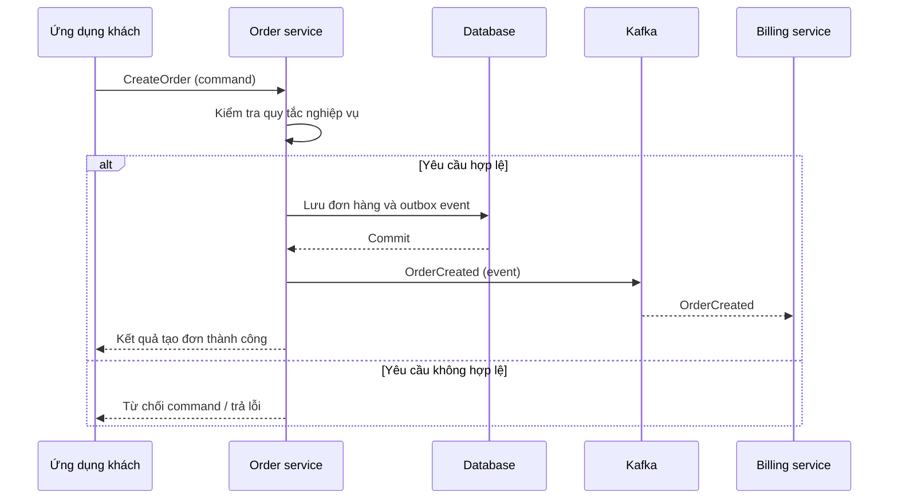

# Thiết kế sự kiện bất biến và phân biệt sự kiện với lệnh

## Mục tiêu

Trong hệ thống event streaming, một message có thể biểu diễn yêu cầu cần xử lý hoặc một sự việc đã xảy ra. Hai ý nghĩa này quyết định cách đặt tên, phát hành, định tuyến, lưu trữ và xử lý message. Nếu nhầm command với event, consumer có thể thực hiện một hành động nhiều lần hoặc hiểu một yêu cầu chưa được chấp nhận như một sự thật đã hoàn tất.

Sau bài học này, bạn có thể:

- Phân biệt command (lệnh) với event (sự kiện) dựa trên ý nghĩa nghiệp vụ và thời điểm phát sinh.
- Thiết kế event bất biến, có danh tính ổn định và payload đủ ngữ cảnh.
- Phân biệt `eventId`, `aggregateVersion` và Kafka `offset`.
- Chọn event key để giữ thứ tự các sự kiện của cùng một aggregate trong một partition.
- Thiết kế schema có khả năng tiến hóa và consumer có khả năng xử lý message trùng.
- Giải thích cách phát hành event sau khi thay đổi nghiệp vụ được commit, kể cả khi ứng dụng dùng database cùng Kafka.

## 1. Bắt đầu từ một tình huống nghiệp vụ

Giả sử một cửa hàng có API nhận yêu cầu tạo đơn hàng. Khi khách hàng nhấn nút đặt hàng, ứng dụng nhận một yêu cầu `CreateOrder`. Hệ thống kiểm tra khách hàng, sản phẩm, tồn kho và các quy tắc nghiệp vụ. Chỉ khi thao tác thành công, đơn hàng mới được tạo và hệ thống mới có sự kiện `OrderCreated` để thông báo cho các thành phần khác.

Hai message có quan hệ với nhau nhưng không thể thay thế cho nhau:

- `CreateOrder` diễn đạt điều người gọi muốn hệ thống thực hiện.
- `OrderCreated` diễn đạt sự thật rằng một đơn hàng đã được tạo thành công.



Nếu địa chỉ giao hàng không hợp lệ hoặc sản phẩm không còn khả dụng, command có thể bị từ chối. Khi đó không được phát hành `OrderCreated`, vì sự kiện này khẳng định đơn hàng đã tồn tại. Một kết quả từ chối có thể được trả trực tiếp cho người gọi; nếu nghiệp vụ cần thông báo bất đồng bộ cho hệ thống khác, ứng dụng có thể phát một event riêng mô tả việc từ chối.

## 2. Phân biệt command và event

| Khía cạnh | Command (lệnh) | Event (sự kiện) |
|---|---|---|
| Ý nghĩa | Yêu cầu một hành động | Ghi nhận một sự việc đã xảy ra |
| Cách đặt tên | Động từ mệnh lệnh: `CreateOrder`, `CancelOrder` | Sự kiện ở quá khứ: `OrderCreated`, `OrderCancelled` |
| Thời điểm | Trước khi hành động được quyết định hoặc thực hiện | Sau khi sự việc đã xảy ra |
| Kết quả | Có thể thành công, thất bại hoặc bị từ chối | Không thể từ chối một sự thật đã được ghi nhận; consumer có thể phản ứng hoặc bỏ qua |
| Người nhận | Thường có một handler chịu trách nhiệm xử lý | Có thể có nhiều subscriber độc lập |
| Mục đích | Điều khiển hành vi của một thành phần | Thông báo sự thật để các thành phần phối hợp |
| Ví dụ | `ReserveInventory`, `CapturePayment` | `InventoryReserved`, `PaymentCaptured` |

Tên gọi phải phản ánh ngữ nghĩa, không chỉ phản ánh cấu trúc JSON hay công nghệ truyền tải. `CreateOrder` vẫn là command dù nó được gửi qua Kafka. `OrderCreated` vẫn là event dù nó được gửi qua HTTP webhook. Kafka không tự biến một message thành event; chính hợp đồng nghiệp vụ quyết định ý nghĩa của message.

Một command có thể được gửi qua một API đồng bộ, một hàng đợi hoặc một Kafka topic. Nếu dùng Kafka để phân phối command, hãy thiết kế consumer group như một nhóm xử lý công việc: các instance trong cùng group chia nhau xử lý mỗi record. Không tạo nhiều group độc lập cho cùng command nếu mỗi group không được phép thực hiện lại cùng một hành động. Với event, nhiều service thường dùng các consumer group riêng để mỗi service nhận được bản sao luồng sự kiện và xây dựng trạng thái riêng.

Command và event đều có thể được biểu diễn bằng object bất biến trong Java. Điểm khác nhau quan trọng là ý nghĩa nghiệp vụ: command yêu cầu hệ thống thay đổi trạng thái; event xác nhận một thay đổi hoặc sự việc đã xảy ra. Vì vậy, một object `CreateOrderCommand` bất biến về mặt cấu trúc vẫn không phải là event.

## 3. Event bất biến có nghĩa là gì?

Một event mô tả sự thật tại thời điểm phát sinh. Sau khi event đã được công bố cho các subscriber, producer không được âm thầm thay đổi ý nghĩa hoặc sửa payload cũ để phản ánh trạng thái hiện tại. Consumer có thể đã đọc event, lưu bản sao, gửi email hoặc tạo dữ liệu đối soát dựa trên nội dung ban đầu. Nếu nội dung cũ bị thay đổi, các hệ thống sẽ không còn cùng hiểu một lịch sử nghiệp vụ.

Ví dụ, `OrderCreated` ghi nhận đơn hàng được tạo với tổng tiền 500.000 VND. Sau đó phát hiện hệ thống tính sai phí vận chuyển. Không sửa bản ghi `OrderCreated` thành 520.000 VND. Hãy phát một event mới, chẳng hạn `OrderShippingFeeCorrected` hoặc `OrderAmountAdjusted`, kèm mã đơn hàng, số tiền điều chỉnh, lý do và tham chiếu đến dữ liệu liên quan. Lịch sử khi đó thể hiện cả sự kiện ban đầu lẫn việc hiệu chỉnh.

Tính bất biến gồm các nguyên tắc:

1. **Không sửa lại sự thật đã công bố.** Nếu nghiệp vụ thay đổi sau đó, phát event mới diễn tả thay đổi đó.
2. **Danh tính event ổn định.** Một event được retry hoặc gửi lại phải giữ nguyên `eventId`; không tạo ID mới chỉ vì lần gửi trước chưa nhận được xác nhận.
3. **Ý nghĩa event ổn định.** Không tái sử dụng tên `OrderCreated` cho một nghiệp vụ khác hoặc thay đổi ý nghĩa của field hiện có mà không có chiến lược tương thích.
4. **Dữ liệu mô tả thời điểm phát sinh.** Không dùng event cũ như một bản đọc trực tiếp trạng thái hiện tại của database.
5. **Mọi hiệu chỉnh đều có dấu vết.** Ghi nhận sự kiện điều chỉnh, hủy hoặc bù trừ để subscriber có thể cập nhật trạng thái của họ.

### Bất biến của event và vòng đời lưu trữ Kafka

Kafka ghi record nối tiếp vào partition log; ứng dụng không cập nhật một record cũ tại chỗ như cập nhật một hàng trong database. Tuy vậy, không nên suy ra rằng mọi record sẽ được lưu vĩnh viễn. Chính sách retention có thể xóa record cũ theo thời gian hoặc dung lượng. Topic compacted có thể giữ lại giá trị mới nhất theo key và loại bỏ các record cũ hơn cùng key; tombstone cũng có thể được dùng để biểu thị việc xóa key trong log compacted.

Do đó, tính bất biến là cam kết về ý nghĩa của event và cách producer công bố dữ liệu. Nó không đồng nghĩa Kafka là kho lưu trữ lịch sử vô thời hạn. Nếu nghiệp vụ cần lưu toàn bộ lịch sử để kiểm toán hoặc tái dựng trạng thái, phải thiết kế retention, lưu trữ dài hạn, backup và quyền truy cập phù hợp.

Event streaming cũng không tự động đồng nghĩa với event sourcing. Trong event streaming, event thường được phát để các hệ thống tích hợp và xây dựng projection; topic có thể có retention hữu hạn hoặc compaction. Event sourcing dùng một event store làm nguồn sự thật để tái dựng trạng thái aggregate, nên cần bảo đảm đầy đủ lịch sử và quy tắc replay. Hãy xác định rõ mục tiêu trước khi chọn chính sách lưu trữ.

## 4. Thiết kế hợp đồng event

Một event contract cần trả lời được: sự kiện gì đã xảy ra, với đối tượng nghiệp vụ nào, xảy ra khi nào, phiên bản trạng thái nào và subscriber cần dữ liệu nào để phản ứng. Có thể đặt metadata trong một envelope bao quanh payload nghiệp vụ.

### 4.1. Các trường thường dùng

| Trường | Vai trò | Lưu ý |
|---|---|---|
| `eventId` | Định danh duy nhất của event | Giữ nguyên khi retry hoặc phát lại cùng event |
| `eventType` | Tên loại sự kiện, ví dụ `OrderCreated` | Dùng tên ổn định, có ý nghĩa nghiệp vụ |
| `schemaVersion` | Phiên bản cấu trúc hợp đồng | Không phải offset hoặc phiên bản aggregate |
| `occurredAt` | Thời điểm nghiệp vụ xảy ra | Phân biệt với thời điểm broker ghi nhận record |
| `aggregateType` | Loại đối tượng sở hữu sự kiện | Ví dụ `Order` hoặc `Payment` |
| `aggregateId` | Định danh aggregate | Thường được dùng làm Kafka record key |
| `aggregateVersion` | Phiên bản tăng dần của aggregate sau thay đổi | Giúp phát hiện thiếu, trùng hoặc sai thứ tự sự kiện của aggregate |
| `data` | Payload mô tả sự kiện | Chỉ chứa dữ liệu cần thiết để hiểu sự thật và xử lý hợp đồng |

Ví dụ event `OrderCreated` ở dạng JSON:

```json
{
  "eventId": "b56d7f2a-3c73-4f75-9b47-cf81b0a46a19",
  "eventType": "OrderCreated",
  "schemaVersion": 1,
  "occurredAt": "2026-11-20T08:15:30Z",
  "aggregateType": "Order",
  "aggregateId": "ORD-2026-001",
  "aggregateVersion": 1,
  "data": {
    "orderId": "ORD-2026-001",
    "customerId": "CUS-018",
    "currency": "VND",
    "totalAmount": 1250000
  }
}
```

`eventId` là danh tính nghiệp vụ của event. `aggregateVersion` cho biết thứ tự thay đổi của một đơn hàng. Kafka `offset` cho biết vị trí record trong một partition cụ thể. Ba trường này giải quyết ba vấn đề khác nhau và không thể dùng thay thế cho nhau.

### 4.2. Event ID, aggregate version và Kafka offset

| Giá trị | Phạm vi | Dùng để |
|---|---|---|
| `eventId` | Danh tính event xuyên suốt các lần gửi | Deduplicate, trace và đối chiếu cùng một event |
| `aggregateVersion` | Một aggregate, ví dụ một `orderId` | Kiểm tra chuỗi thay đổi của aggregate và phát hiện version bị thiếu |
| `(topic, partition, offset)` | Vị trí trong một Kafka partition | Resume consumer, đọc lại log và xác định vị trí record |

Giả sử `OrderCreated` có `eventId=E-100`, được ghi ở `orders.events-2` offset `41`. Khi producer gửi lại cùng event do mất xác nhận, Kafka có thể ghi một record khác ở offset `42` nhưng payload vẫn có `eventId=E-100`. Consumer dùng offset để theo dõi vị trí đọc, nhưng dùng event ID để nhận biết đây là cùng một sự kiện nghiệp vụ.

Offset chỉ tăng trong phạm vi một partition, không phải số thứ tự toàn topic. Không dùng offset làm mã event hoặc so sánh offset giữa hai partition để suy ra thứ tự nghiệp vụ. Tương tự, `occurredAt` có thể trùng hoặc lệch do đồng hồ giữa các máy; timestamp không thay thế cho version hoặc offset.

### 4.3. Key và thứ tự sự kiện

Nếu các sự kiện của cùng một đơn hàng phải được xử lý theo thứ tự, hãy dùng `aggregateId` làm record key. Ví dụ `OrderCreated`, `OrderPaid` và `OrderCancelled` của `ORD-2026-001` đều dùng key `ORD-2026-001`. Với cùng partitioning strategy và số partition ổn định, các record cùng key được định tuyến về cùng partition, nơi Kafka duy trì thứ tự append.

Kafka chỉ đảm bảo thứ tự trong một partition. Nó không tạo thứ tự toàn cục giữa nhiều partition. Nếu tăng số partition, phép ánh xạ key sang partition có thể thay đổi; cần đánh giá tác động tới ordering khi mở rộng topic có yêu cầu thứ tự nghiêm ngặt. Consumer nên kiểm tra `aggregateVersion` khi thứ tự nghiệp vụ là điều kiện quan trọng, thay vì chỉ dựa vào timestamp.

### 4.4. Payload đủ nghĩa nhưng không phình to

Event nên chứa các dữ liệu subscriber cần để hiểu sự thật mà không phải gọi ngược producer cho mọi field. Ví dụ `PaymentCaptured` nên có `paymentId`, `orderId`, số tiền, loại tiền và mã tham chiếu giao dịch. Nhưng không nên đính kèm toàn bộ hồ sơ khách hàng, lịch sử giỏ hàng và mọi dữ liệu không liên quan chỉ vì chúng đang có sẵn trong memory.

Tránh hai cực đoan:

- Event chỉ chứa một ID khiến mọi consumer phải gọi đồng bộ sang service phát event để lấy phần dữ liệu còn thiếu. Điều này tạo phụ thuộc thời gian chạy và làm replay khó khăn khi service nguồn thay đổi hoặc ngừng hoạt động.
- Event chứa toàn bộ database entity hoặc một object lớn gắn chặt với cấu trúc nội bộ của service. Điều này làm lộ chi tiết triển khai, tăng payload và khiến thay đổi database ảnh hưởng tới subscriber.

Hãy công bố các sự thật nghiệp vụ cần thiết, dùng ID để liên kết tới đối tượng liên quan và hạn chế dữ liệu nhạy cảm. Nếu event chứa thông tin cá nhân, xác định rõ mục đích sử dụng, thời hạn lưu, quyền truy cập và yêu cầu xóa/ẩn danh của hệ thống.

## 5. Biểu diễn command và event bằng Java

Java `record` phù hợp để biểu diễn message contract vì các component được khai báo rõ và không có setter. Tuy nhiên, record chỉ bất biến nông: nếu component tham chiếu tới một `List` có thể sửa, người gọi vẫn có thể thay đổi nội dung list. Vì vậy cần sao chép collection ở constructor và ưu tiên các kiểu dữ liệu bất biến.

Ví dụ sau dùng Java 17 trở lên:

```java
import java.util.List;
import java.util.Objects;
import java.util.UUID;
import java.time.Instant;

public record OrderLine(
        String productId,
        int quantity,
        long unitPriceVnd
) {
    public OrderLine {
        Objects.requireNonNull(productId, "productId");
        if (quantity <= 0 || unitPriceVnd < 0) {
            throw new IllegalArgumentException("Invalid order line");
        }
    }
}

// Command: yêu cầu tạo đơn hàng.
public record CreateOrderCommand(
        UUID commandId,
        String orderId,
        String customerId,
        List<OrderLine> lines
) {
    public CreateOrderCommand {
        Objects.requireNonNull(commandId, "commandId");
        Objects.requireNonNull(orderId, "orderId");
        Objects.requireNonNull(customerId, "customerId");
        lines = List.copyOf(lines);
        if (lines.isEmpty()) {
            throw new IllegalArgumentException("Order must have at least one line");
        }
    }
}

// Event payload: xác nhận đơn hàng đã được tạo.
public record OrderCreated(
        String orderId,
        String customerId,
        List<OrderLine> lines,
        long totalAmountVnd
) {
    public OrderCreated {
        Objects.requireNonNull(orderId, "orderId");
        Objects.requireNonNull(customerId, "customerId");
        lines = List.copyOf(lines);
        if (totalAmountVnd < 0) {
            throw new IllegalArgumentException("totalAmountVnd must not be negative");
        }
    }
}

// Envelope chứa metadata dùng chung cho các loại event.
public record EventEnvelope<T>(
        UUID eventId,
        String eventType,
        int schemaVersion,
        Instant occurredAt,
        String aggregateType,
        String aggregateId,
        long aggregateVersion,
        T data
) {
    public EventEnvelope {
        Objects.requireNonNull(eventId, "eventId");
        Objects.requireNonNull(eventType, "eventType");
        Objects.requireNonNull(occurredAt, "occurredAt");
        Objects.requireNonNull(aggregateType, "aggregateType");
        Objects.requireNonNull(aggregateId, "aggregateId");
        Objects.requireNonNull(data, "data");
        if (schemaVersion < 1 || aggregateVersion < 1) {
            throw new IllegalArgumentException("Versions must be positive");
        }
    }
}
```

`CreateOrderCommand` có `commandId` để ứng dụng nhận biết yêu cầu được gửi lặp. `OrderCreated` mô tả kết quả nghiệp vụ. Hai kiểu có thể dùng chung `OrderLine`, nhưng không nên dùng chung một class tổng quát có field `status`, `action` hoặc `isCommand` để biểu diễn mọi ý nghĩa message.

Handler xử lý command và tạo event sau khi kiểm tra quy tắc nghiệp vụ. Ví dụ rút gọn:

```java
public OrderCreated handle(CreateOrderCommand command) {
    // Trong ứng dụng thực tế, kiểm tra orderId chưa tồn tại,
    // quyền của khách hàng và các quy tắc nghiệp vụ tại đây.
    long total = command.lines().stream()
            .mapToLong(line -> Math.multiplyExact(
                    line.unitPriceVnd(), line.quantity()))
            .reduce(0L, Math::addExact);

    return new OrderCreated(
            command.orderId(),
            command.customerId(),
            command.lines(),
            total
    );
}
```

Đoạn code minh họa việc chuyển từ yêu cầu sang sự kiện. Ở ứng dụng thật, handler còn phải lưu trạng thái aggregate, kiểm soát trùng `commandId` và chỉ phát hành event khi thay đổi nghiệp vụ được commit. `aggregateVersion` trong envelope phải lấy từ version thực tế của aggregate sau commit, không gán một hằng số cho mọi event.

## 6. Phát hành event lên Kafka với Spring Kafka

Giả sử ứng dụng đã tạo `EventEnvelope<OrderCreated>` sau khi xử lý thành công. Có thể serialize envelope thành JSON và gửi lên topic `orders.events`. Dùng `aggregateId` làm key để các event của cùng đơn hàng đi cùng partition.

```java
@Service
public class OrderEventPublisher {
    private final KafkaTemplate<String, String> kafkaTemplate;
    private final ObjectMapper objectMapper;

    public OrderEventPublisher(
            KafkaTemplate<String, String> kafkaTemplate,
            ObjectMapper objectMapper
    ) {
        this.kafkaTemplate = kafkaTemplate;
        this.objectMapper = objectMapper;
    }

    public void publish(EventEnvelope<OrderCreated> event)
            throws JsonProcessingException {
        String json = objectMapper.writeValueAsString(event);

        kafkaTemplate.send(
                "orders.events",
                event.aggregateId(),
                json
        );
    }
}
```

Ví dụ giả định producer đã cấu hình key/value serializer phù hợp với `String`. Trong ứng dụng thực tế, cần theo dõi kết quả gửi bất đồng bộ, ghi log lỗi có correlation/event ID và có chính sách retry rõ ràng. Nếu retry cùng một event, hãy gửi lại cùng `eventId` và payload.

### Tránh lỗi dual-write bằng Transactional Outbox

Một lỗi thường gặp là ghi đơn hàng vào database rồi gửi event lên Kafka bằng hai thao tác độc lập. Nếu database commit thành công nhưng ứng dụng dừng trước khi gửi Kafka, đơn hàng đã tồn tại nhưng subscriber không nhận được event. Nếu gửi Kafka trước rồi database rollback, subscriber lại nhận thông báo về một đơn hàng chưa được tạo.

Transactional Outbox giải quyết khoảng hở này bằng cách ghi trạng thái nghiệp vụ và một dòng outbox trong cùng transaction database:

1. Transaction lưu đơn hàng và event cần phát hành vào bảng outbox.
2. Một publisher đọc các dòng outbox chưa gửi và publish lên Kafka.
3. Sau khi Kafka xác nhận, publisher đánh dấu dòng outbox đã gửi.
4. Nếu publisher dừng sau khi Kafka nhận event nhưng trước khi cập nhật trạng thái outbox, event có thể được gửi lại. Consumer vẫn cần idempotency dựa trên `eventId`.

Outbox bảo đảm thay đổi nghiệp vụ và ý định phát event được lưu nguyên tử trong database. Nó không tự biến toàn bộ luồng thành exactly-once end-to-end; producer và consumer vẫn phải xử lý retry, duplicate và lỗi từng bước.

## 7. Xử lý event ở consumer

Một event có thể được nhiều service quan tâm. Ví dụ sau khi nhận `OrderCreated`:

- Billing service chuẩn bị khoản phải thu.
- Notification service gửi email xác nhận.
- Analytics service cập nhật số liệu đơn hàng.
- Fulfillment service bắt đầu quy trình chuẩn bị giao hàng.

Mỗi service dùng consumer group riêng nếu cần nhận toàn bộ luồng. Các instance thuộc cùng một group chia partition để mở rộng khả năng xử lý. Việc một service đã xử lý event không có nghĩa service khác cũng đã xử lý.

Consumer nên được thiết kế idempotent. Một cách phổ biến là lưu `eventId` đã xử lý cùng transaction với cập nhật projection:

```java
@KafkaListener(topics = "orders.events", groupId = "billing-projection")
public void onOrderCreated(String json) throws JsonProcessingException {
    EventEnvelope<OrderCreated> event = objectMapper.readValue(
            json,
            new TypeReference<EventEnvelope<OrderCreated>>() {}
    );

    transactionTemplate.executeWithoutResult(status -> {
        if (processedEventRepository.existsById(event.eventId())) {
            return; // Event này đã được áp dụng trước đó.
        }

        billingProjection.apply(event.data());
        processedEventRepository.save(event.eventId());
    });
}
```

Trong ví dụ, cập nhật projection và lưu `eventId` đã xử lý phải nằm trong cùng transaction database. Nếu chỉ lưu dấu đã xử lý trước khi cập nhật projection, lỗi giữa hai thao tác có thể làm mất tác động nghiệp vụ. Nếu cập nhật projection trước nhưng không lưu dấu, lần nhận lại có thể áp dụng lần thứ hai. Cần cấu hình acknowledgment/offset commit để record chỉ được xác nhận sau khi xử lý thành công; khi xử lý thất bại, retry hoặc chuyển lỗi sang dead-letter topic theo chính sách của hệ thống.

Đối với event theo aggregate, consumer có thể kiểm tra `aggregateVersion`:

- Version bằng version mong đợi tiếp theo: áp dụng event.
- Version nhỏ hơn hoặc bằng version đã áp dụng: event có thể là duplicate hoặc đến muộn; kiểm tra `eventId` và chính sách replay.
- Version nhảy cóc: có thể thiếu event trước đó; tạm dừng aggregate đó, retry, đọc bù hoặc phát cảnh báo tùy yêu cầu nghiệp vụ.

Không phải mọi consumer đều cần lưu projection version, nhưng các luồng đòi hỏi thứ tự nghiệp vụ nghiêm ngặt nên có cách phát hiện khoảng trống và xử lý sự kiện đến sai thứ tự.

## 8. Tiến hóa schema mà vẫn giữ hợp đồng ổn định

Event được nhiều service tiêu thụ nên thay đổi schema cần được quản lý như thay đổi API công khai. Một producer có thể triển khai phiên bản mới trong khi consumer cũ vẫn đang chạy hoặc chưa được nâng cấp.

Các nguyên tắc thường dùng:

- Ưu tiên thêm field tùy chọn có giá trị mặc định hoặc quy tắc xử lý rõ ràng.
- Không đổi ý nghĩa của field hiện có, không đổi kiểu dữ liệu theo cách consumer cũ không đọc được.
- Khi bỏ field, thực hiện theo lộ trình tương thích: ngừng sử dụng, quan sát subscriber, rồi mới loại bỏ trong phiên bản phù hợp.
- Không tái sử dụng tên field cũ cho ý nghĩa mới.
- Quản lý schema bằng JSON Schema, Avro hoặc Protobuf và dùng Schema Registry nếu hệ thống cần kiểm soát compatibility tập trung.
- Phân biệt `schemaVersion` với `aggregateVersion`: schema version mô tả cấu trúc message; aggregate version mô tả thứ tự thay đổi của một đối tượng nghiệp vụ.

Ví dụ, phiên bản đầu của `OrderCreated` có `orderId`, `customerId` và `totalAmount`. Phiên bản sau bổ sung `salesChannel` dạng tùy chọn. Consumer cũ có thể bỏ qua field mới; consumer mới có thể xử lý giá trị vắng mặt bằng một mặc định đã thống nhất. Nếu đổi `totalAmount` từ số nguyên VND sang chuỗi tiền tệ tự do mà không có migration, consumer có thể parse sai hoặc tính toán sai.

Một event type nên mô tả một sự thật có ý nghĩa. Không dùng cùng tên `OrderUpdated` cho mọi thay đổi không liên quan nếu subscriber cần biết chính xác điều gì đã xảy ra. Các tên cụ thể như `OrderAddressChanged`, `OrderItemAdded` hoặc `OrderCancelled` giúp consumer phản ứng đúng và làm hợp đồng dễ hiểu hơn.

## 9. Các lỗi thiết kế thường gặp

| Lỗi | Hậu quả | Cách thiết kế tốt hơn |
|---|---|---|
| Phát `OrderCreated` ngay khi nhận `CreateOrder` | Subscriber tưởng đơn hàng đã tồn tại dù command có thể thất bại | Chỉ phát event sau khi nghiệp vụ tạo đơn thành công và được commit |
| Dùng tên command làm tên event | Consumer không biết message là yêu cầu hay sự thật | Đặt tên command ở dạng mệnh lệnh, event ở dạng sự kiện đã xảy ra |
| Sửa payload event cũ khi dữ liệu thay đổi | Các subscriber có lịch sử khác nhau | Phát event hiệu chỉnh hoặc bù trừ mới |
| Dùng Kafka offset làm event ID | Retry tạo offset mới nên không nhận ra duplicate | Dùng `eventId` ổn định, giữ offset cho vị trí đọc |
| Dùng timestamp để đảm bảo thứ tự aggregate | Đồng hồ lệch hoặc event có cùng timestamp | Dùng key theo aggregate, thứ tự partition và `aggregateVersion` |
| Cho mọi service xử lý cùng command qua nhiều group | Một yêu cầu có thể bị thực hiện nhiều lần | Định tuyến command tới một logical handler; dùng event để fan-out kết quả |
| Consumer giả định chỉ nhận một lần | Retry/rebalance gây áp dụng nghiệp vụ trùng | Dùng idempotency key và lưu dấu xử lý nguyên tử với cập nhật dữ liệu |
| Event chỉ chứa ID và bắt consumer gọi ngược producer | Tăng coupling, phụ thuộc availability và khó replay | Đưa đủ dữ liệu nghiệp vụ cần thiết vào payload |
| Event chứa toàn bộ entity nội bộ | Contract lớn, lộ mô hình database và khó tiến hóa | Công bố payload nhỏ, ổn định theo ngôn ngữ nghiệp vụ |
| Coi topic là kho lịch sử vĩnh viễn | Retention hoặc compaction có thể loại bỏ record cũ | Thiết kế chính sách lưu trữ và archive theo yêu cầu replay/audit |

## 10. Checklist trước khi công bố một event

Trước khi đưa event contract vào sử dụng, hãy tự kiểm tra:

- [ ] Tên event mô tả một sự thật đã xảy ra và dùng cách gọi nhất quán.
- [ ] Event chỉ được phát khi thay đổi nghiệp vụ tương ứng đã thành công.
- [ ] `eventId` duy nhất, ổn định qua retry và có thể dùng để deduplicate.
- [ ] Payload có đủ ngữ cảnh cho subscriber nhưng không sao chép cả database entity.
- [ ] `occurredAt`, `aggregateId`, `aggregateVersion` có ý nghĩa và quy tắc tạo rõ ràng.
- [ ] Kafka key phù hợp với yêu cầu ordering; nhóm event của cùng aggregate được định tuyến nhất quán.
- [ ] Schema có quy tắc compatibility và consumer xử lý field tùy chọn.
- [ ] Producer có retry/observability; consumer có idempotency và xử lý lỗi.
- [ ] Chính sách retention/compaction phù hợp với nhu cầu replay, audit và lưu trữ.
- [ ] Dữ liệu nhạy cảm được giới hạn và bảo vệ theo yêu cầu của hệ thống.

## 11. Câu hỏi tự kiểm tra

1. Vì sao `CreateOrder` là command nhưng `OrderCreated` là event dù hai message có thể chứa cùng `orderId`?
2. Nếu command bị từ chối vì hết hàng, event nào không được phát? Khi nào cần một event riêng mô tả việc từ chối?
3. Vì sao một event đã công bố không nên bị sửa payload? Hãy mô tả cách ghi nhận việc điều chỉnh tổng tiền đơn hàng.
4. `eventId`, `aggregateVersion` và Kafka `offset` khác nhau ở phạm vi và mục đích nào?
5. Vì sao dùng `aggregateId` làm Kafka key giúp giữ thứ tự của event thuộc cùng aggregate? Kafka không bảo đảm thứ tự nào?
6. Vì sao một Java `record` chứa `List` chưa chắc đã bất biến? `List.copyOf` giúp giải quyết vấn đề gì?
7. Nếu database commit thành công nhưng producer dừng trước khi publish event, Transactional Outbox xử lý khoảng hở đó như thế nào?
8. Consumer nên lưu dấu `eventId` đã xử lý cùng transaction với projection vì lý do gì?
9. Retention và log compaction ảnh hưởng thế nào tới khả năng dùng topic làm lịch sử sự kiện dài hạn?
10. Một event contract có thể bổ sung field mới như thế nào để giảm nguy cơ phá vỡ consumer cũ?

## Tài liệu tham khảo

- [Apache Kafka — Documentation](https://kafka.apache.org/documentation/): khái niệm record, topic, partition, key, offset, consumer group và log compaction.
- [Spring for Apache Kafka — Reference](https://docs.spring.io/spring-kafka/reference/): cấu hình producer/consumer, `KafkaTemplate`, listener, acknowledgment và xử lý lỗi.
- [CloudEvents Specification](https://github.com/cloudevents/spec): tham khảo cách chuẩn hóa metadata như event ID, source, type, subject và time trong event envelope.

> Bài học tập trung vào thiết kế hợp đồng event trong hệ thống Kafka. Các ví dụ lược bỏ phần xác thực, phân quyền, serializer configuration và triển khai database để làm rõ ranh giới giữa command, event và dữ liệu được công bố.
