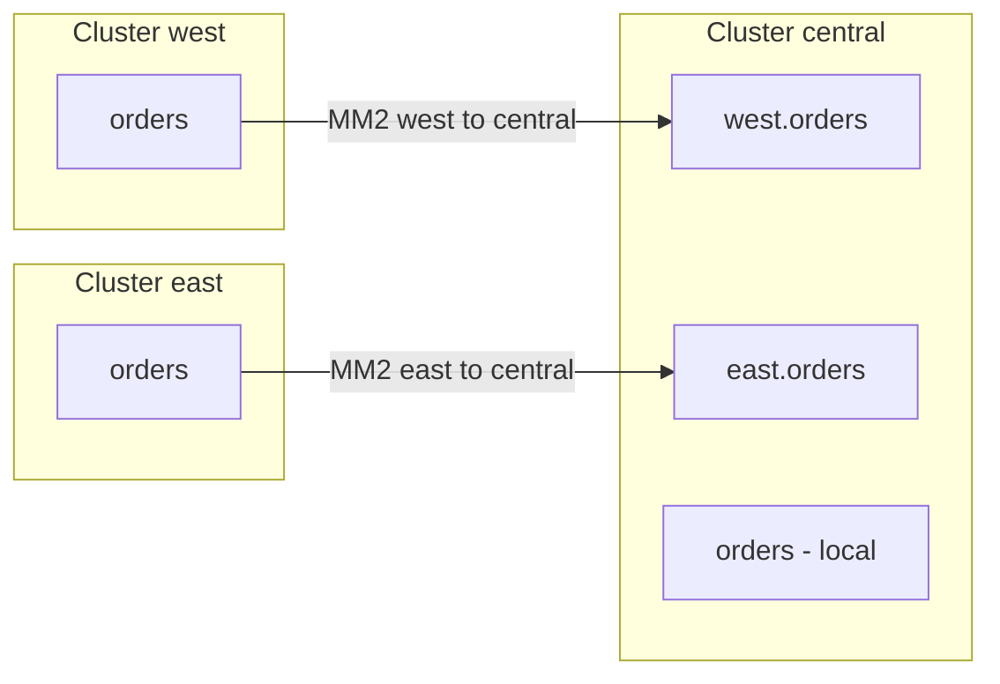
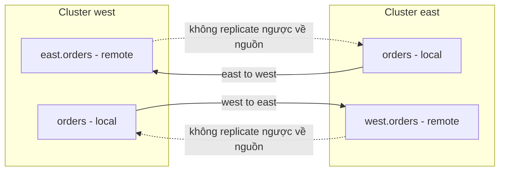
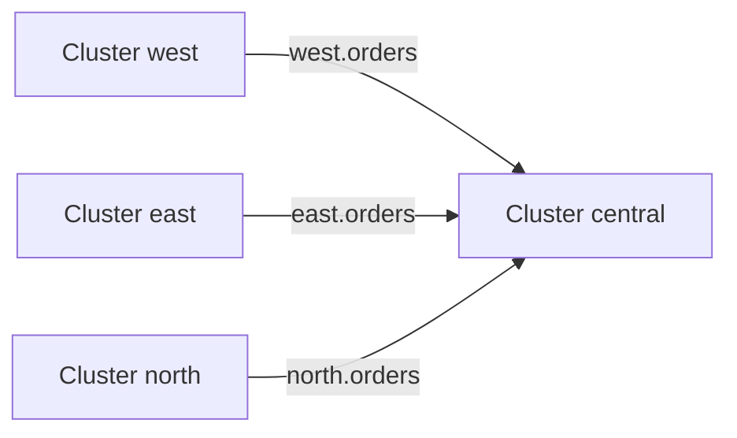

# Đặt tên topic đích, lọc dữ liệu và tránh vòng lặp sao chép

Khi sao chép dữ liệu giữa nhiều Kafka cluster, cùng một tên topic có thể tồn tại độc lập ở nhiều nơi. Nếu không phân biệt topic gốc và topic được mirror, dữ liệu từ hai cluster có thể ghi đè về mặt ngữ nghĩa, bị nhân bản lặp lại hoặc đi vòng qua nhiều cluster. Một thiết kế multi-cluster cần xác định rõ **tên topic ở cluster đích, phạm vi topic được phép sao chép và cách nhận diện dữ liệu đã đi qua replication flow**.

Kafka MirrorMaker 2 (MM2) thực hiện geo-replication thông qua Kafka Connect source/connector tasks. MM2 có thể sao chép record, topic configuration, consumer group checkpoints/offsets và ACL theo cấu hình. Việc sao chép giữa cluster khác với replication factor của partition bên trong một cluster: MM2 tạo luồng consume từ source và produce sang target, có độ trễ và offset riêng.

## 1. Vì sao cần quy ước tên topic đích?

Giả sử hai cluster `west` và `east` đều có topic `orders`:

- `west.orders` chứa event được tạo tại vùng West.
- `east.orders` chứa event được tạo tại vùng East.
- Một cluster tổng hợp nhận dữ liệu từ cả hai vùng.

Nếu target chỉ có một topic tên `orders`, dữ liệu từ hai nguồn có thể trộn vào cùng topic-partition. Khi đó consumer khó xác định nguồn gốc, ownership, thứ tự và cách xử lý khi hai vùng cùng phát event cho một entity.

Tên remote topic nên biểu diễn nguồn tạo ra bản sao. Với replication policy mặc định, MM2 thêm cluster alias của source vào trước tên topic:

| Source cluster | Topic nguồn | Topic trên target |
|---|---|---|
| `west` | `orders` | `west.orders` |
| `east` | `orders` | `east.orders` |
| `west` | `payments.v1` | `west.payments.v1` |

Nhờ đó, topic local `orders` trên target có thể cùng tồn tại với `west.orders` và `east.orders`. Consumer chọn đúng luồng theo nguồn và chính sách nghiệp vụ.



Tên topic là một phần của contract giữa producer, consumer, ACL, schema và hệ thống replay. Hãy quyết định naming policy trước khi bật replication; đổi policy sau này có thể tạo remote topic mới thay vì đổi tên topic cũ.

## 2. `ReplicationPolicy` trong MirrorMaker 2

MM2 sử dụng `ReplicationPolicy` để ánh xạ tên topic nguồn sang tên topic remote trên target. API có hai implementation thường gặp:

| Policy | Cách đặt tên | Khi sử dụng |
|---|---|---|
| `DefaultReplicationPolicy` | Thêm source cluster alias và separator trước tên topic | Lựa chọn mặc định, giúp nhận diện nguồn và hỗ trợ topology nhiều cluster |
| `IdentityReplicationPolicy` | Giữ nguyên tên topic nguồn | Chỉ dùng khi kiến trúc chủ động quản lý collision, ownership và loop bằng quy tắc riêng |

Ví dụ default policy:

```text
source alias = west
source topic = orders
separator = .
remote topic = west.orders
```

Có thể đổi separator:

```properties
replication.policy.class=org.apache.kafka.connect.mirror.DefaultReplicationPolicy
replication.policy.separator=_
```

Khi đó topic remote sẽ có dạng `west_orders`. Separator là quy ước tên, không phải dấu phân cách trong regex tự động được escape. Nếu dùng dấu `.` trong regex, cần escape thành `\.` vì dấu chấm trong regex có nghĩa là khớp một ký tự bất kỳ.

### Vai trò của các method trong policy

`ReplicationPolicy` không chỉ tạo tên remote. API còn xác định nguồn của topic, tên topic upstream và các topic nội bộ:

- `formatRemoteTopic(sourceClusterAlias, topic)`: tạo tên remote.
- `topicSource(topic)`: trả cluster alias nguồn nếu topic là remote topic.
- `upstreamTopic(topic)`: trả tên topic ở cluster upstream trực tiếp.
- `originalTopic(topic)`: tìm tên topic ban đầu qua nhiều hop replication.
- `isInternalTopic(topic)` và `isMM2InternalTopic(topic)`: nhận diện topic nội bộ cần xử lý riêng.

Các method nhận diện này giúp MM2 phân biệt topic local với topic đã được mirror. Khi triển khai custom policy, phải giữ semantics nhận diện remote topic và internal topic; chỉ đổi chuỗi tên mà không cập nhật logic nhận diện có thể làm sai loop prevention hoặc khiến internal topic bị sao chép.

## 3. Cấu hình replication flow và tên topic đích

MM2 cấu hình các cluster bằng alias và định nghĩa flow có hướng theo cú pháp `{source}->{target}`.

Ví dụ active/passive từ `primary` sang `dr`:

```properties
clusters=primary,dr

primary.bootstrap.servers=broker-1.primary:9092,broker-2.primary:9092
dr.bootstrap.servers=broker-1.dr:9092,broker-2.dr:9092

replication.policy.class=org.apache.kafka.connect.mirror.DefaultReplicationPolicy
replication.policy.separator=.

primary->dr.enabled=true
primary->dr.topics=orders,orders\..*,payments\..*
```

Với cấu hình trên, các topic `orders`, `orders.v1` và `payments.v2` từ primary được tạo trên DR theo prefix `primary.`. Ví dụ `orders.v1` trở thành `primary.orders.v1`.

Flow là directional. Cấu hình `primary->dr.enabled=true` không tự bật chiều ngược lại. Muốn sao chép hai chiều phải khai báo thêm `dr->primary.enabled=true` và quyết định rõ topic nào được phép đi theo từng chiều.

### Alias phải ổn định

Cluster alias xuất hiện trong tên remote topic và metadata của MM2. Vì vậy:

- Dùng alias ngắn, duy nhất và ổn định trong toàn bộ topology.
- Không dùng hostname broker thay cho cluster identity.
- Không đổi alias tùy tiện khi chuyển MirrorMaker process hoặc data center.
- Nếu hai nguồn có cùng alias, remote topic có thể đụng tên và mất khả năng phân biệt nguồn.

Prefix làm tên topic dài hơn. Hãy kiểm tra tên sau khi thêm alias và separator vẫn nằm trong giới hạn topic name của Kafka, đặc biệt khi source topic đã gần độ dài tối đa.

## 4. Lọc topic bằng include và exclude

MM2 hỗ trợ danh sách topic hoặc regular expression:

- `topics`: chọn topic nguồn được phép replicate; mặc định là `.*`.
- `topics.exclude`: loại topic khỏi tập đã chọn; exclude có ưu tiên cao hơn include.
- `topic.filter.class`: thay implementation lọc mặc định khi cần logic phức tạp hơn.

Ví dụ chỉ replicate domain topic và loại retry/DLQ:

```properties
primary->dr.topics=orders\..*,payments\..*,customers
primary->dr.topics.exclude=.*\.retry,.*\.dlq,.*\.test,connect-configs,connect-offsets,connect-status
```

Ba tên Connect trong ví dụ là tên thường gặp; thay chúng bằng đúng giá trị `config.storage.topic`, `offset.storage.topic` và `status.storage.topic` của worker đang chạy. Nếu các topic này đã có tên riêng, phải exclude đúng tên thực tế.

Các regex ở đây dùng dấu `.` đã escape để chỉ dấu chấm thật trong tên topic. Tên topic `orders.v1` khớp `orders\..*`; tên `ordersXv1` không khớp.

MM2 cũng hỗ trợ cấu hình include/exclude ở mức toàn cục, sau đó override cho từng flow. Nếu nhiều flow có phạm vi khác nhau, nên cấu hình rõ ở từng flow để tránh vô tình dùng chung một bộ lọc quá rộng.

### Ví dụ chọn theo namespace

Giả sử topic ứng dụng có namespace `sales`, `billing`, `identity`, còn topic vận hành có namespace `ops`:

```properties
west->central.enabled=true
west->central.topics=sales\..*,billing\..*
west->central.topics.exclude=.*\.retry,.*\.dlq,sales\.sandbox\..*
```

Kết quả:

| Topic ở `west` | Kết quả |
|---|---|
| `sales.orders` | Replicate |
| `sales.customers` | Replicate |
| `billing.invoice` | Replicate |
| `sales.orders.retry` | Exclude |
| `sales.orders.dlq` | Exclude |
| `sales.sandbox.events` | Exclude |
| `identity.users` | Không khớp include |
| `ops.audit` | Không khớp include |

Không nên dùng `topics=.*` trong production mà không xem xét topic hệ thống, dữ liệu thử nghiệm, retry/DLQ và dữ liệu nhạy cảm. Một bộ lọc allowlist rõ ràng giúp tránh replicate nhầm dữ liệu ngoài phạm vi DR hoặc compliance.

## 5. Topic nội bộ và các luồng MM2 đặc biệt

Không phải topic nào trong cluster nguồn cũng là business event cần mirror. MM2 sử dụng một số topic để quản lý replication:

| Loại topic | Vai trò | Cách xử lý |
|---|---|---|
| Heartbeats | Báo hiệu flow/cluster còn kết nối và có thể quan sát đường replication | Để MM2 quản lý; cấu hình heartbeat replication theo mục tiêu giám sát |
| Checkpoints | Lưu thông tin ánh xạ offset consumer group từ source sang remote topic | Không coi là business topic; để MirrorCheckpointConnector quản lý |
| Offset-syncs | Ánh xạ offset source với offset remote | Không tự copy thủ công; để MM2 quản lý vị trí và replication |
| `__consumer_offsets` | Internal topic của consumer group coordinator | Không replicate như topic business; dùng checkpoint/offset translation của MM2 |
| Kafka Connect internal topics | Lưu config, status và source offsets của Connect worker | Explicitly exclude các topic Connect đang dùng nếu không có thiết kế riêng; không phải tất cả đều bị MM2 loại tự động |
| Retry/DLQ topics | Lưu record lỗi và retry state của ứng dụng | Chỉ replicate nếu DR/replay policy yêu cầu rõ |

Default topic filter của MM2 4.4 loại một số tên internal như topic có prefix `__`, topic `.replica` và MM2 internal topics. Các tên Connect như `connect-configs`, `connect-offsets` hoặc `connect-status` không khớp `__.*`; nếu `topics=.*`, chúng có thể được chọn trừ khi được exclude rõ. Tên thực tế phụ thuộc `config.storage.topic`, `offset.storage.topic` và `status.storage.topic` của Connect worker. Tuy nhiên, `heartbeats.replication.enabled` mặc định có thể cho phép heartbeat topic được replicate ngay cả khi không khớp `topics`; nếu đặt thành `false`, heartbeat chỉ được replicate khi topic filter cho phép.

Không thêm `__.*`, `mm2.*\.internal` hoặc pattern tương tự vào include với mục đích “copy tất cả” mà chưa hiểu tác động. Đặc biệt, không copy trực tiếp `__consumer_offsets` để thay cho checkpoint translation: offset trên remote topic không nhất thiết bằng offset source vì replication là luồng append độc lập.

## 6. Tránh vòng lặp replication với DefaultReplicationPolicy

Vòng lặp xảy ra khi record được tạo ở cluster A, replicate sang B, rồi bản sao đó lại được replicate về A, tiếp tục đi qua các flow khác. Nếu không nhận diện được nguồn gốc, dữ liệu có thể được append nhiều lần, làm tăng traffic và tạo topic không mong muốn.

Với `DefaultReplicationPolicy`, remote topic có prefix source cluster alias. MM2 nhận diện topic remote để quản lý replication path. Trong cấu hình active/active chuẩn, nếu các flow hai chiều được khai báo trong cùng một cấu hình MirrorMaker, MM2 có thể ngăn việc replicate ngược về cluster nguồn mà không cần tự thêm `topics.exclude` chỉ để phá loop.

Ví dụ:

```properties
clusters=west,east
west.bootstrap.servers=broker-west:9092
east.bootstrap.servers=broker-east:9092

west->east.enabled=true
east->west.enabled=true
```

Giả sử `orders` được tạo tại West:

1. West có topic local `orders`.
2. Flow `west->east` tạo remote topic `west.orders` trên East.
3. Flow ngược `east->west` không được dùng để đưa bản sao `west.orders` quay lại thành một bản sao mới của chính nó ở West.
4. East vẫn có thể tạo event local trong topic `orders`; event đó được replicate về West dưới tên `east.orders`.



Điều kiện quan trọng là các flow active/active liên quan được quản lý nhất quán trong cùng cấu hình MM2 và dùng replication policy có khả năng nhận diện remote topic. Nếu chia flow thành các hệ thống độc lập, dùng custom policy hoặc dùng `IdentityReplicationPolicy`, phải thiết kế và kiểm thử loop prevention riêng; không mặc định rằng chỉ cần bật hai connector là không có loop.

## 7. `IdentityReplicationPolicy` và rủi ro mất dấu nguồn

`IdentityReplicationPolicy` giữ nguyên tên topic khi replicate. Ví dụ `orders` ở West vẫn tên `orders` ở East. Điều này có vẻ thuận tiện cho ứng dụng vì không cần đổi subscription, nhưng tạo ra các rủi ro:

- Không thể phân biệt rõ `orders` local với `orders` đến từ cluster khác chỉ bằng tên.
- Nếu target đã có topic cùng tên với dữ liệu local, hai luồng có thể tranh cùng topic.
- Active/active có thể trộn event do hai vùng tạo và khó xác định ownership.
- Loop prevention và multi-hop origin tracking không còn được hỗ trợ bằng prefix mặc định.
- Việc replay, failback hoặc kiểm tra nguồn gốc record trở nên khó hơn.

Chỉ chọn identity policy khi kiến trúc đã có quy tắc thay thế để cô lập topic, ownership và đường replication. Ví dụ, có thể dùng allowlist một chiều nghiêm ngặt, chỉ một cluster được quyền ghi topic trong mỗi giai đoạn, và không bật flow ngược cho cùng tập topic. Phải test failover/failback và record origin trước khi production.

Nếu cần tên remote theo quy tắc riêng, nên triển khai custom `ReplicationPolicy` có kiểm thử cho `formatRemoteTopic`, `topicSource`, `upstreamTopic`, `originalTopic` và nhận diện internal topic. Không chỉ override hàm format tên rồi bỏ qua các method còn lại.

## 8. Multi-hop và topology nhiều cluster

MM2 có thể triển khai các topology:

| Topology | Flow | Mục đích |
|---|---|---|
| Active/passive | `A->B` | DR một chiều, B nhận bản sao từ A |
| Active/active | `A->B`, `B->A` | Hai vùng cùng tạo dữ liệu local, trao đổi remote topics |
| Fan-in | `A->C`, `B->C`, `D->C` | Tổng hợp dữ liệu nhiều vùng về một cluster |
| Fan-out | `A->B`, `A->C`, `A->D` | Phân phối dữ liệu từ một nguồn đến nhiều vùng |
| Forwarding/multi-hop | `A->B`, `B->C` | Chuyển tiếp dữ liệu qua cluster trung gian |

Ví dụ fan-in:



Với default naming, alias giúp phân biệt cùng tên topic từ các nguồn khác nhau. Với multi-hop, MM2 API có thể xác định upstream topic và original topic qua nhiều hop; tên remote ở mỗi chặng mang thông tin nguồn của flow hiện tại. Cần thống nhất topology và alias để người vận hành hiểu nguồn gốc, tránh tự tạo flow vòng giữa các cluster.

Không phải topology nào cũng nên dùng forwarding. Mỗi hop tăng replication latency, thêm connector/task và tạo thêm nơi cần quan sát. Nếu mục tiêu là fan-in, thường nên định nghĩa trực tiếp các flow nguồn về central thay vì tạo đường vòng không cần thiết.

## 9. Consume remote, produce local

Trong active/active, một quy tắc hữu ích là ứng dụng **đọc dữ liệu remote nhưng ghi event mới vào topic local**. Ví dụ ứng dụng ở East đọc `west.orders`, thực hiện xử lý tại East rồi phát event mới vào `orders` local của East. Flow `east->west` sẽ replicate event mới thành `east.orders`.

Lợi ích:

- Giữ rõ nguồn gốc của event.
- Không ghi ngược trực tiếp vào remote topic do MM2 quản lý.
- Dễ đặt ACL riêng cho local topic và remote topic.
- Giảm nguy cơ consumer/producer vô tình tạo vòng echo.

Tuy nhiên, consume remote/produce local không giải quyết xung đột nghiệp vụ nếu hai vùng cùng cập nhật một entity. Kafka MM2 không phải hệ thống multi-master database và không tự hợp nhất hai thay đổi cạnh tranh. Ứng dụng vẫn cần ownership theo entity, version/sequence, conflict resolution hoặc phân vùng quyền ghi.

## 10. Lọc dữ liệu theo domain, môi trường và độ nhạy

Topic filter là một lớp kiểm soát dữ liệu. Nên chia danh mục topic thành:

- **Business topics:** event cần có ở DR hoặc cluster tổng hợp.
- **Operational topics:** metrics, audit kỹ thuật, retry, DLQ và internal stream; chỉ replicate nếu có yêu cầu.
- **Environment-specific topics:** sandbox, test, replay tạm; thường loại khỏi production DR.
- **Sensitive topics:** dữ liệu cá nhân, thanh toán hoặc bí mật; chỉ replicate khi chính sách pháp lý, encryption và quyền truy cập cho phép.

Ví dụ allowlist cho DR:

```properties
primary->dr.topics=orders\..*,payments\..*,inventory\..*
primary->dr.topics.exclude=.*\.retry,.*\.dlq,.*\.sandbox\..*,.*\.test
```

Không dựa vào tên topic là lớp bảo mật duy nhất. Cần phối hợp:

- ACL trên source để MM2 chỉ đọc topic được phép.
- ACL trên target để MM2 chỉ tạo/ghi remote topic cần thiết.
- TLS/SASL cho kết nối giữa MM2 và hai cluster.
- Schema/subject naming policy phù hợp nếu dùng Schema Registry.
- Data retention, encryption at rest và quyền consumer ở target.
- Audit log để biết topic nào được replicate và ai đã thay đổi filter.

## 11. Đồng bộ topic config và ACL có chủ đích

MM2 có thể đồng bộ topic configuration và ACL. Các tùy chọn thường dùng:

```properties
sync.topic.configs.enabled=true
sync.topic.acls.enabled=true
```

Việc đồng bộ không có nghĩa mọi cấu hình source đều phù hợp target. Ví dụ replication factor, `min.insync.replicas`, retention, quota, cleanup policy hoặc security principal có thể khác giữa hai cluster. MM2 có cấu hình `config.properties.exclude` để bỏ qua một số thuộc tính; mặc định có các thuộc tính liên quan throttling, timestamp và durability như `min.insync.replicas` hoặc `unclean.leader.election.enable` trong danh sách loại trừ.

Hãy quyết định ai là chủ sở hữu cấu hình topic ở target:

- Nếu target là DR thuần, có thể đồng bộ phần lớn config nhưng vẫn giữ các durability setting phù hợp với target.
- Nếu target có workload local, tránh để MM2 ghi đè config mà operator quản trị độc lập.
- Nếu ACL principal khác nhau giữa cluster, cần mapping/automation riêng thay vì sao chép mù quáng.

## 12. Kiểm tra tên topic và filter trước khi bật flow

Trước khi chạy MM2, lập bảng mapping dự kiến:

| Source cluster | Source topic | Include? | Exclude? | Target topic dự kiến |
|---|---|---:|---:|---|
| `primary` | `orders` | Có | Không | `primary.orders` |
| `primary` | `orders.retry` | Có theo broad pattern | Có | Không replicate |
| `primary` | `payments.v1` | Có | Không | `primary.payments.v1` |
| `primary` | `connect-offsets` | Có theo `.*` | Không tự động bị loại bởi pattern `__.*`; cần exclude rõ nếu muốn giữ local | `primary.connect-offsets` nếu được include và không exclude |
| `primary` | `__consumer_offsets` | Không | Có theo internal filter | Dùng checkpoint translation, không copy trực tiếp |

Kiểm tra regex bằng một danh sách topic thật trước khi rollout. Với tên topic có dấu chấm, dấu gạch ngang hoặc hậu tố version, kiểm tra cả trường hợp match và non-match. Exclude nên bao phủ retry/DLQ/test nếu chúng không thuộc DR scope.

Sau khi bật flow, kiểm tra target:

```bash
bin/kafka-topics.sh --bootstrap-server broker-dr:9092 --list

bin/kafka-topics.sh --bootstrap-server broker-dr:9092 \
  --describe --topic primary.orders
```

Kiểm tra source và target bằng một tập event có `eventId`, key và timestamp duy nhất. Đừng chỉ dựa vào việc topic target đã được tạo; cần xác nhận record thực sự đến, đúng partition mapping và không có record ngoài filter.

## 13. Kiểm chứng loop prevention

Một test loop nên có thể phát hiện cả việc nhân bản sai và việc replicate hợp lệ:

1. Tạo topic `orders` trên cluster A.
2. Gửi một record có `eventId=A-001`.
3. Chờ record xuất hiện ở topic `A.orders` trên B.
4. Chờ thêm nhiều chu kỳ refresh/replication; xác nhận `A-001` không quay về A thành một record mới.
5. Gửi record local `eventId=B-001` vào topic `orders` trên B.
6. Xác nhận record xuất hiện ở `B.orders` trên A.
7. Kiểm tra số lần xuất hiện theo event ID, topic name, partition và timestamp.

Với fan-in hoặc multi-hop, tạo event từ từng nguồn và kiểm tra origin alias trên mọi target. Dùng số liệu đủ lâu để bắt được loop chậm theo chu kỳ connector, không chỉ kiểm tra ngay sau lần poll đầu.

### Các tín hiệu cần quan sát

- Danh sách remote topic được tạo trên mỗi target.
- Số record/byte replicate theo từng flow.
- Replication latency và source/target partition lag.
- Heartbeat topic và thời điểm heartbeat gần nhất.
- Checkpoint/offset-sync progress nếu có migration consumer group.
- Task failure/restart và lỗi authorization khi tạo/ghi topic.
- Số event ID lặp lại hoặc xuất hiện ở topic không mong muốn.

Nếu byte/record tăng theo cấp số nhân hoặc topic alias lồng nhau xuất hiện bất thường, dừng flow có vấn đề trước khi xóa topic. Giữ lại metadata, log và event ID để xác định đường đi. Không xóa remote topic trong khi connector vẫn chạy vì MM2 có thể tạo lại hoặc tiếp tục ghi.

## 14. Các lỗi cấu hình thường gặp

| Lỗi | Hậu quả | Cách xử lý |
|---|---|---|
| Dùng `IdentityReplicationPolicy` mà không có ownership/filter rõ | Local và remote data trộn tên; khó nhận diện nguồn và loop | Trở về default policy hoặc thiết kế custom policy có origin tracking |
| Alias trùng hoặc thay đổi | Remote topic collision hoặc topic mới phát sinh | Chuẩn hóa alias duy nhất, ổn định |
| `topics=.*` không có exclude phù hợp | Replicate nhầm retry, test, internal hoặc sensitive topics | Dùng allowlist theo domain và exclude cụ thể |
| Regex không escape dấu chấm | Match quá rộng hoặc thiếu topic | Kiểm thử regex với tên thật; dùng `\.` cho dấu chấm literal |
| Hai MM2 process đến cùng target dùng config khác nhau | Cấu hình connector có thể tranh chấp | Đồng bộ một cấu hình nhất quán cho mọi process cùng target |
| Flow active/active tách rời và custom policy không nhận diện remote topic | Có nguy cơ replicate vòng | Dùng cùng topology/config hoặc kiểm thử loop prevention riêng |
| Replicate `__consumer_offsets` trực tiếp | Offset target không ánh xạ đúng remote topic | Dùng MirrorCheckpointConnector và offset translation |
| Đồng bộ topic config không kiểm soát | Target nhận durability/retention config không phù hợp | Dùng `config.properties.exclude` và quản trị ownership config |
| Chỉ kiểm tra topic tồn tại | Không phát hiện missing, duplicate hoặc wrong destination | Audit record bằng event ID và flow mapping |

## 15. Quy trình rollout naming/filter mới

1. Lập inventory topic và xác định owner, classification, source cluster và consumer phụ thuộc.
2. Chọn alias và `ReplicationPolicy`; ghi rõ remote topic name dự kiến.
3. Xác định topology one-way, active/passive, active/active, fan-in hoặc multi-hop.
4. Viết include/exclude cho từng flow; liệt kê internal, retry, DLQ, test và sensitive topics.
5. Kiểm tra topic name sau prefix, regex match và collision với topic đã có trên target.
6. Chuẩn bị ACL, topic config, replication factor và schema compatibility ở target.
7. Chạy thử trên topic canary với event ID có thể đối chiếu.
8. Kiểm tra remote naming, record count, partition, offset mapping và loop prevention.
9. Mở rộng allowlist theo từng domain; theo dõi replication latency, task errors và byte rate.
10. Khi đổi policy, lập migration plan cho remote topic cũ/mới, consumer subscription và retention; không đổi alias hoặc separator giữa chừng mà chưa chuyển ứng dụng.

## 16. Checklist thiết kế multi-cluster replication

- [ ] Mỗi cluster có alias duy nhất và ổn định.
- [ ] Dùng `DefaultReplicationPolicy` trừ khi có lý do cụ thể để dùng policy khác.
- [ ] Xác định remote topic name cho mọi topic quan trọng.
- [ ] Flow source-target được khai báo rõ; không giả định flow tự hai chiều.
- [ ] Include/exclude được kiểm thử bằng danh sách topic thật.
- [ ] Retry, DLQ, test, internal và sensitive topics có quyết định rõ.
- [ ] Không replicate trực tiếp `__consumer_offsets`; dùng checkpoint/offset translation.
- [ ] Heartbeat, checkpoint và offset-sync topics do MM2 quản lý.
- [ ] Active/active dùng topology/config nhất quán và test loop trước production.
- [ ] Custom/identity policy có thiết kế origin tracking và loop prevention riêng.
- [ ] Ứng dụng consume remote, produce local khi phù hợp; conflict resolution theo entity được thiết kế riêng.
- [ ] Topic config và ACL sync không ghi đè policy riêng của target.
- [ ] Theo dõi replication latency, task errors, heartbeat và duplicate event ID.
- [ ] Có kế hoạch migration khi thay naming policy hoặc cluster alias.

## Tài liệu tham khảo

- [Apache Kafka 4.4 Geo-Replication: Cross-Cluster Data Mirroring](https://kafka.apache.org/44/operations/geo-replication-cross-cluster-data-mirroring/)
- [Apache Kafka 4.4 MirrorMaker Configs](https://kafka.apache.org/44/configuration/mirrormaker-configs/)
- [Kafka 4.4 ReplicationPolicy API](https://kafka.apache.org/44/javadoc/org/apache/kafka/connect/mirror/ReplicationPolicy.html)
- [Kafka 4.4 DefaultReplicationPolicy API](https://kafka.apache.org/44/javadoc/org/apache/kafka/connect/mirror/DefaultReplicationPolicy.html)

Đặt tên topic đích theo nguồn, lọc topic theo domain và để replication policy nhận diện remote topic là ba lớp phối hợp với nhau. `DefaultReplicationPolicy` giúp phân biệt bản sao và hỗ trợ MM2 tránh replicate vòng trong topology được cấu hình nhất quán; include/exclude giới hạn dữ liệu cần chuyển; còn custom/identity policy đòi hỏi thiết kế origin tracking riêng. Khi kiểm thử cả topic mapping, event ID và flow hai chiều, hệ thống multi-cluster sẽ dễ vận hành, replay và khôi phục hơn.
