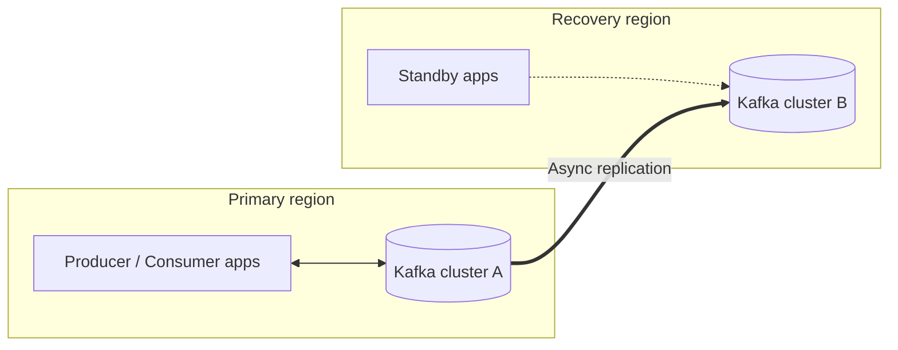
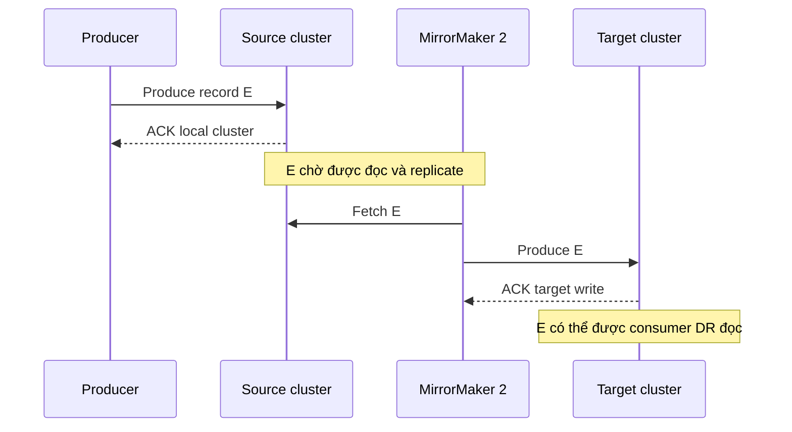
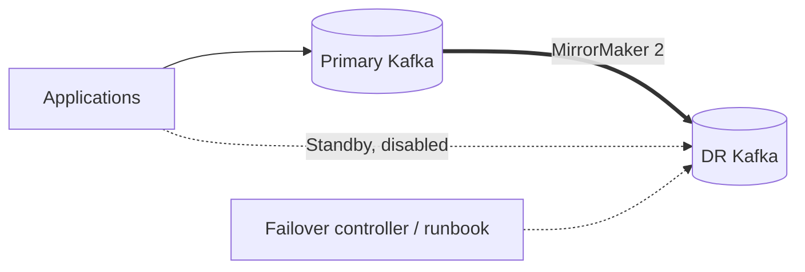
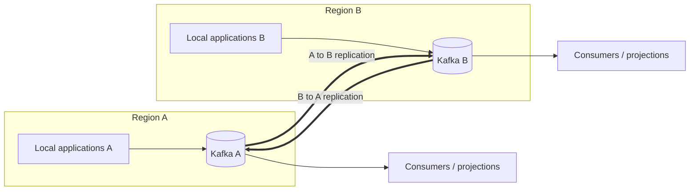
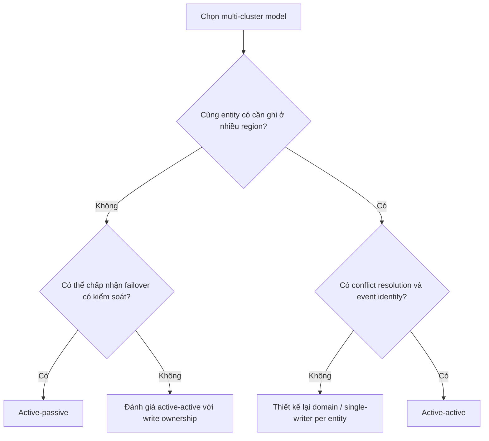

# Mô hình active-passive và active-active

## Mục tiêu

Một Kafka cluster có thể bị gián đoạn do lỗi hạ tầng, mất vùng khả dụng, sự cố vận hành hoặc lỗi phần mềm. Replication factor bảo vệ partition trong phạm vi cluster, nhưng không bảo vệ đầy đủ trước sự cố làm mất toàn bộ cluster hoặc cả failure domain chứa cluster. Để duy trì dịch vụ khi một cluster không còn khả dụng, hệ thống có thể triển khai nhiều cluster ở các vùng độc lập và sao chép dữ liệu giữa chúng.

Hai mô hình phổ biến là **active-passive** và **active-active**:

- Active-passive có một cluster chính nhận traffic ghi; cluster dự phòng nhận dữ liệu sao chép và chờ được promote khi có sự cố.
- Active-active cho phép nhiều cluster cùng phục vụ workload. Mỗi cluster có thể nhận traffic cục bộ; dữ liệu được trao đổi giữa các cluster và ứng dụng phải xử lý định tuyến, thứ tự và xung đột.

Sau bài học này, bạn có thể:

- Phân biệt active-passive và active-active theo luồng dữ liệu, traffic và failover.
- Chọn mô hình dựa trên RPO, RTO, latency, consistency và chi phí.
- Giải thích cách MirrorMaker 2 (MM2) sao chép topic giữa Kafka clusters.
- Hiểu remote topic naming, heartbeat, checkpoint và offset translation.
- Thiết kế failover, promotion, failback và fencing để tránh split-brain.
- Thiết kế active-active với write domain độc lập và xử lý conflict.
- Xác định dữ liệu/cấu hình không tự động được sao chép giữa các cluster.
- Kiểm thử replication lag, consumer offset, data completeness và recovery time.

## 1. Multi-cluster recovery giải quyết vấn đề gì?

Replication trong một cluster tạo nhiều replica của partition trên các broker khác nhau. Cơ chế này xử lý broker failure, nhưng các replica vẫn phụ thuộc vào cùng cluster metadata, network, storage domain và control plane. Nếu toàn bộ cluster hoặc một vùng địa lý bị mất, replica nội bộ cũng có thể không truy cập được.

Multi-cluster recovery đặt một Kafka cluster khác ở failure domain độc lập. Dữ liệu được sao chép bất đồng bộ hoặc bằng một cơ chế replication liên cluster. Khi cluster chính gặp sự cố, hệ thống có thể chuyển producer/consumer sang cluster còn hoạt động.



Cluster B chỉ có thể đảm nhiệm vai trò recovery nếu đã chuẩn bị đủ topic, partition, ACL, credentials, consumer offsets, schema và capacity. Có bản sao record thôi chưa đủ để một ứng dụng khởi động được ở cluster dự phòng.

### 1.1. Cluster replication không phải broker replication

| Phạm vi | Cơ chế | Mục tiêu |
|---|---|---|
| Trong cluster | Partition replication, ISR, leader election | Chịu lỗi broker/disk trong cluster |
| Giữa clusters | MirrorMaker 2 hoặc giải pháp liên cluster khác | Chịu lỗi cluster/region và di chuyển workload |
| Ở ứng dụng | Retry, idempotency, deduplication, conflict resolution | Bảo vệ side effect và semantics nghiệp vụ |

Không nhầm replication factor 3 với ba bản sao ở ba cluster. RF=3 vẫn chỉ tạo replica trong một cluster. Cross-cluster replication cần một pipeline riêng, có lag và failure mode riêng.

## 2. RPO và RTO cho multi-cluster

Trước khi chọn kiến trúc, hãy xác định hai mục tiêu phục hồi:

- **RPO (Recovery Point Objective):** lượng dữ liệu tối đa có thể mất khi chuyển sang cluster dự phòng.
- **RTO (Recovery Time Objective):** thời gian tối đa để khôi phục dịch vụ về mức hoạt động chấp nhận được.

Ví dụ:

```text
Primary cluster: region-a
Recovery cluster: region-b
Replication: asynchronous
RPO objective: <= 30 seconds of source data
RTO objective: <= 10 minutes to restore producer and consumer service
```

Đây là mục tiêu minh họa. RPO/RTO thực tế phải được xác minh bằng replication lag và failover drill, không suy ra chỉ từ cấu hình connector.

### 2.1. Replication bất đồng bộ tạo ra replication lag

MirrorMaker 2 đọc record từ source cluster rồi produce sang target cluster. Việc đọc, truyền qua network, ghi vào target và cập nhật checkpoint diễn ra bất đồng bộ. Producer ghi thành công vào primary không có nghĩa record đã tồn tại ở recovery cluster.



`acks=all` ở producer chỉ xác nhận theo ISR của source partition. Nó không chờ MM2 ghi record sang cluster thứ hai. Nếu primary mất trước khi record được replicate, target có thể thiếu record đó. Vì vậy cross-cluster replication thông thường không cung cấp synchronous, zero-RPO commit.

### 2.2. Ước lượng RPO từ lag

Một cách đo thực tế là theo dõi chênh lệch thời gian hoặc offset giữa source và target cho từng partition. RPO cần xem xét:

- Record đã được source ACK nhưng chưa được MM2 fetch.
- Record đang in-flight qua network.
- Record đã produce nhưng chưa được xác nhận ở target.
- Checkpoint/offset-sync bị trễ so với data replication.
- Partition hoặc connector task bị lỗi kéo dài.

Replication lag theo số record không trực tiếp tương đương số giây mất dữ liệu nếu tốc độ ingest thay đổi. Hãy đo cả lag records/bytes và replication latency/time lag theo partition. Lấy worst-case hoặc percentile phù hợp với SLO; average lag có thể che một partition bị tụt xa.

### 2.3. RTO gồm nhiều bước

\[
T_{RTO} = T_{detect} + T_{decision} + T_{fence} + T_{promote} + T_{offset} + T_{app} + T_{verify}
\]

Trong đó:

- `T_detect`: phát hiện primary cluster không còn phục vụ.
- `T_decision`: xác nhận failover và chọn recovery cluster.
- `T_fence`: ngăn primary cũ tiếp tục nhận ghi nếu có nguy cơ split-brain.
- `T_promote`: chuẩn bị topic/ACL/config và kích hoạt cluster dự phòng.
- `T_offset`: xác định vị trí đọc tiếp theo trên target.
- `T_app`: chuyển producer, consumer, Connect và service dependency.
- `T_verify`: xác nhận throughput, lag và correctness đạt tiêu chí.

Nếu runbook chỉ đổi DNS/bootstrap servers, có thể bỏ sót fencing, consumer offset translation hoặc connector/schema dependency. Những bước này thường chiếm phần lớn RTO.
Các bước có thể chồng lấp trong một số triển khai; công thức là mô hình phân rã để lập kế hoạch. Khi đo RTO, thống nhất mốc bắt đầu và kết thúc, đồng thời ghi rõ bước nào chạy song song.

## 3. Mô hình active-passive

Active-passive có một cluster active nhận traffic chính. Cluster passive ở vùng khác nhận bản sao topic và được giữ ở trạng thái sẵn sàng. Ứng dụng ở passive có thể đã chạy nhưng không consume/produce business traffic, hoặc chỉ chạy health check và kiểm tra dữ liệu.



### 3.1. Luồng hoạt động bình thường

1. Producer ghi event vào primary cluster.
2. Consumer group xử lý event trên primary.
3. MM2 replicate các topic được chọn sang DR cluster.
4. Checkpoint connector phát checkpoint/offset mapping cho các consumer group được cấu hình.
5. DR cluster giữ replica topic và các cấu hình cần thiết.
6. Ứng dụng DR không chạy business consumer đồng thời với primary nếu điều đó có thể tạo side effect trùng lặp.

### 3.2. Ưu điểm

- Mô hình vận hành và quyền ghi đơn giản: một nơi là source of truth.
- Dễ tránh xung đột khi nhiều region cùng cập nhật một entity.
- Có thể kiểm soát failover bằng quy trình phê duyệt rõ ràng.
- Ứng dụng ở DR có thể được giữ nóng để rút ngắn RTO.
- Phù hợp với workload cần ordering theo aggregate và không có chiến lược conflict resolution đa vùng.

### 3.3. Hạn chế

- Passive cluster thường có tài nguyên nhàn rỗi nếu không chạy workload khác.
- Replication bất đồng bộ tạo RPO khác 0.
- Failover cần chuyển producer/consumer và kiểm soát consumer offsets.
- Failback phức tạp nếu DR đã nhận ghi trong thời gian primary mất.
- Nếu chỉ kiểm thử cluster mà không kiểm thử ứng dụng, DR có thể không đáp ứng RTO.

### 3.4. Active-passive với MirrorMaker 2

MirrorMaker 2 chạy trên Kafka Connect framework và gồm các connector chính:

| Connector | Vai trò |
|---|---|
| `MirrorSourceConnector` | Đọc topic ở source và produce record sang target |
| `MirrorCheckpointConnector` | Tạo checkpoint/offset mapping cho consumer group |
| `MirrorHeartbeatConnector` | Phát heartbeat để quan sát kết nối và replication path |

MM2 không phải broker feature tự bật trên topic. Cần triển khai Connect worker/standalone hoặc distributed mode, cấu hình cluster alias, bootstrap servers, connector flow và quyền truy cập hai cluster.

Ví dụ cấu hình flow primary sang DR:

```properties
clusters=primary,dr

primary.bootstrap.servers=kafka-primary-1:9092,kafka-primary-2:9092
dr.bootstrap.servers=kafka-dr-1:9092,kafka-dr-2:9092

primary->dr.enabled=true
primary->dr.topics=orders\..*,payments\..*,inventory\..*
primary->dr.groups=orders-service,inventory-service

primary->dr.emit.heartbeats.enabled=true
primary->dr.emit.checkpoints.enabled=true
primary->dr.sync.group.offsets.enabled=true

replication.factor=3
checkpoints.topic.replication.factor=3
heartbeats.topic.replication.factor=3
offset-syncs.topic.replication.factor=3
```

Đây là ví dụ MirrorMaker 2 properties; các config phải được xác nhận theo Kafka version và cách triển khai Connect. Trong lab một broker, replication factor của internal topics phải giảm cho phù hợp. Nếu dùng TLS/SASL, cần khai báo security config cho từng cluster alias và cấp ACL tương ứng.

### 3.5. Remote topic naming

Với `DefaultReplicationPolicy`, MM2 thường đặt tên remote topic theo dạng:

```text
<source-alias>.<source-topic>
```

Ví dụ:

```text
Source topic:  orders.events
Target topic:  primary.orders.events
```

Consumer chạy ở DR phải subscribe đúng remote topic `primary.orders.events` nếu dùng default policy. Không giả định topic ở target giữ nguyên tên source. Remote topic naming giúp nhận diện nguồn và hỗ trợ loop prevention trong mô hình replication nhiều chiều.

Đối với active-passive, cần quyết định trước topic nào sẽ là log ghi tiếp sau promotion. Có hai cách tổ chức thường gặp:

- Giữ `DefaultReplicationPolicy`: DR đọc lịch sử từ `primary.orders.events`; sau promotion, producer có thể ghi vào topic local `orders.events`. Khi đó hai topic là hai log riêng. Consumer không được tự ghép chúng rồi giả định có thứ tự toàn cục; cần một bước cutover/merge có sequence hoặc một quy ước topic rõ ràng.
- Dùng `org.apache.kafka.connect.mirror.IdentityReplicationPolicy` cho luồng một chiều đã kiểm soát để target giữ cùng tên topic `orders.events`, thuận tiện cho ứng dụng tiếp tục trên cùng topic name. Khi failback phải dừng hướng cũ, đổi replication direction theo runbook và xác minh không có vòng lặp. Không dùng cách này cho bidirectional replication nếu chưa có loop prevention riêng.

Chọn một chiến lược naming/promotion và kiểm thử từ đầu tới cuối. Đừng để producer ghi vào topic local trong khi consumer chỉ đọc remote topic (hoặc ngược lại) mà không có kế hoạch chuyển lịch sử.

Không đổi `replication.policy.class` giữa các cluster tùy tiện sau khi đã có dữ liệu. Topic naming policy là một phần của contract vận hành; đổi policy có thể tạo topic khác tên hoặc khiến ứng dụng đọc nhầm luồng.

## 4. Failover active-passive

Failover là quá trình chuyển workload từ primary sang DR sau khi xác nhận primary không còn là nơi ghi hợp lệ.

### 4.1. Điều kiện kích hoạt

Không tự động failover chỉ vì một vài request timeout. Có thể là lỗi network giữa application và primary trong khi primary vẫn hoạt động; nếu DR được promote đồng thời, hai cluster có thể cùng nhận ghi.

Điều kiện failover cần xét:

- Broker/controller availability và cluster health.
- Khả năng kết nối từ nhiều điểm quan sát độc lập.
- Replication lag của topic quan trọng.
- Trạng thái source/target MM2 connectors.
- Khả năng fencing primary hoặc xác nhận primary đã ngừng nhận ghi.
- Tác động tới downstream database/payment/external systems.
- Quyền phê duyệt failover và incident commander.

### 4.2. Runbook failover

1. Xác nhận incident và phạm vi primary cluster bị ảnh hưởng.
2. Kiểm tra replication lag cuối cùng của topic cần phục hồi.
3. Fencing primary: dừng producer routing, thu hồi/disable write credential hoặc cô lập network theo runbook để ngăn primary cũ tiếp tục nhận ghi.
4. Xác định data boundary mà DR đã nhận được; lưu lại checkpoint/offset mapping và replication status.
5. Kiểm tra topic, partition count, replication factor, ACL, quota và retention trên DR.
6. Chuyển producer sang DR cluster và bật đúng topic theo naming/promotion strategy đã chọn; xác minh lịch sử và record mới nằm trong luồng consumer dự kiến.
7. Xác định consumer group offsets trên DR; translate/reset offset dựa trên checkpoint, không copy số offset source một cách trực tiếp.
8. Bật consumer và Connect/Streams workload theo thứ tự dependency.
9. Kiểm tra output, duplicate, missing event, consumer lag và downstream side effects.
10. Ghi lại thời gian service recovered và RPO quan sát được.

Fencing là bước quan trọng. Nếu không thể chứng minh primary cũ đã ngừng ghi, không được mặc định DR là primary duy nhất.

### 4.3. Consumer offset khi chuyển cluster

Offset là vị trí trong một partition log cụ thể của một cluster. Offset 10.000 ở primary không nhất thiết trỏ tới cùng record ở target vì MM2 có thể replicate chậm, bỏ qua record theo policy hoặc tạo remote topic khác tên.

MM2 dùng offset-syncs và checkpoint topics để ánh xạ offset source sang offset target. `MirrorCheckpointConnector` phát checkpoint cho consumer groups được theo dõi; `sync.group.offsets.enabled` có thể đồng bộ group offsets sang target theo điều kiện cấu hình. Việc đồng bộ này không đồng nghĩa mọi consumer group đang hoạt động ở target luôn có offset chính xác tức thời. Với cơ chế sync group offset, target group cần ở trạng thái phù hợp (thường không có consumer active đang dùng group đó) để MM2 có thể cập nhật offset; hãy kiểm tra hành vi cụ thể của Kafka version và không để consumer DR chạy trước bước offset sync nếu runbook phụ thuộc vào nó.

Khi failover:

- Dùng checkpoint/offset translation của MM2 hoặc quy trình được kiểm thử theo version.
- Xác minh group đã được đồng bộ và không có consumer đang chạy cạnh tranh trên target.
- Nếu phải reset thủ công, xác định target topic, target partition và offset đã translate.
- Chọn điểm bắt đầu theo RPO/duplicate policy: đọc lại có thể tạo duplicate; nhảy qua record có thể làm mất side effect.
- Đảm bảo consumer idempotent theo event ID.

Không lấy committed offset source rồi dùng nguyên giá trị đó làm offset target. Không reset group production khi chưa có dry-run, backup offset và approval.

### 4.4. Failback về primary

Failback không đơn giản là đổi bootstrap server về primary sau khi primary khởi động lại. Trong thời gian DR active, DR có thể đã nhận event mới mà primary chưa có.

Quy trình failback cần:

1. Khôi phục primary và xác minh cluster/topic/ACL/capacity khỏe.
2. Xác định cluster nào đang là source of truth sau failover.
3. Thiết lập replication direction từ DR về primary theo naming/replication policy đã chọn.
4. Đồng bộ dữ liệu phát sinh trong thời gian DR active.
5. Xác minh completeness, partition mapping, consumer checkpoints và downstream state.
6. Dừng ghi ở DR hoặc chuyển về dual-write policy có kiểm soát.
7. Fencing DR write path trước khi mở lại primary nếu quay về active-passive.
8. Translate consumer offsets về topic/cluster đích.
9. Chuyển producer/consumer theo thứ tự và theo dõi duplicate/lag.
10. Chỉ đánh dấu failback hoàn tất khi primary nhận ghi và DR trở lại standby.

Không chạy hai hướng replication và hai writer một cách tùy tiện. Cần kiểm tra remote topic naming, loop prevention và nguồn dữ liệu authoritative để không tạo vòng lặp hoặc ghi đè logic nghiệp vụ.

Với `DefaultReplicationPolicy`, nếu DR được promote và producer ghi vào topic local `orders.events`, khi mirror ngược về primary topic nhận được thường là `dr.orders.events`; MM2 không tự nhập các record đó vào topic `orders.events` cũ của primary. Nếu ứng dụng cần một log canonical duy nhất sau failback, phải có bước merge/replay có sequence hoặc đã chọn từ đầu một chiến lược giữ nguyên topic name như `IdentityReplicationPolicy` cho replication một chiều có kiểm soát. Identity policy không cung cấp loop prevention theo remote prefix; phải dừng hướng replication cũ trước khi đảo chiều và kiểm thử quy trình trong môi trường riêng.

## 5. Mô hình active-active

Active-active cho phép nhiều cluster cùng phục vụ traffic. Mỗi region có thể nhận request từ client gần nó, giảm latency và tiếp tục hoạt động khi một region mất kết nối. Đổi lại, hệ thống cần giải quyết dữ liệu được ghi đồng thời ở nhiều nơi.



### 5.1. Hai write domain độc lập

Thiết kế active-active an toàn thường xác định write domain cho từng record/entity. Ví dụ:

- Region A sở hữu đơn hàng được tạo ở A.
- Region B sở hữu đơn hàng được tạo ở B.
- Mỗi region ghi vào topic local của mình.
- MM2 replicate topic sang region còn lại.
- Consumer hợp nhất hai luồng hoặc duy trì projection theo event ID/aggregate ID.

Với default remote naming, ví dụ:

```text
Kafka A local topic: orders.events
Kafka B receives:   region-a.orders.events

Kafka B local topic: orders.events
Kafka A receives:   region-b.orders.events
```

Ứng dụng ở mỗi region có thể đọc topic local và remote để tạo read model chung. Hai topic local là hai luồng ghi riêng; không giả định chúng là một log toàn cục có offset hoặc ordering chung.

### 5.2. Ưu điểm

- Ứng dụng có thể ghi vào cluster gần client, giảm round-trip latency.
- Một region có thể tiếp tục nhận traffic khi region kia gặp sự cố.
- Tăng khả năng phân phối workload theo địa lý.
- Có thể triển khai read/write local theo tenant hoặc ownership domain.

### 5.3. Hạn chế

- Không có total ordering giữa hai cluster.
- Cùng entity có thể được cập nhật đồng thời ở hai region.
- Replication bất đồng bộ tạo dữ liệu đến không cùng thời điểm.
- Consumer có thể nhìn thấy event theo thứ tự khác nhau giữa các region.
- Conflict resolution, deduplication và business ownership trở thành trách nhiệm của ứng dụng.
- Chi phí vận hành, network, storage và observability cao hơn.

### 5.4. Active-active không phải multi-master database transaction

Kafka không tự giải quyết conflict khi hai region cùng produce event thay đổi một order/customer. Kafka partition ordering chỉ có ý nghĩa trong một partition log. Hai cluster có partition, offset và leader độc lập.

Nếu Region A ghi `OrderStatus=PAID` và Region B đồng thời ghi `OrderStatus=CANCELLED`, MM2 chỉ sao chép cả hai event. Nó không biết business rule nào thắng. Ứng dụng cần một trong các cách:

- Single-writer per aggregate: mỗi aggregate có home region.
- Version/sequence check: chỉ chấp nhận transition hợp lệ theo version.
- Conflict-free data model/CRDT nếu domain cho phép.
- Explicit conflict event và quy trình reconciliation.
- Deterministic resolution policy; nếu dùng timestamp, phải tính đến clock skew.

Không dùng “last message đến consumer” làm conflict policy vì replication/network delay có thể làm thứ tự đến khác thứ tự phát sinh.

## 6. Bidirectional MirrorMaker 2

MM2 có thể cấu hình replication hai chiều giữa cluster aliases. Với `DefaultReplicationPolicy`, remote topic được đặt prefix theo cluster nguồn và remote topic thường không được mirror ngược như một local topic, giúp tránh vòng lặp replication cơ bản.

Ví dụ flow hai chiều:

```properties
clusters=region-a,region-b

region-a.bootstrap.servers=kafka-a-1:9092,kafka-a-2:9092
region-b.bootstrap.servers=kafka-b-1:9092,kafka-b-2:9092

region-a->region-b.enabled=true
region-a->region-b.topics=orders\..*,payments\..*
region-a->region-b.groups=orders-.*
region-a->region-b.emit.heartbeats.enabled=true
region-a->region-b.emit.checkpoints.enabled=true

region-b->region-a.enabled=true
region-b->region-a.topics=orders\..*,payments\..*
region-b->region-a.groups=orders-.*
region-b->region-a.emit.heartbeats.enabled=true
region-b->region-a.emit.checkpoints.enabled=true

replication.factor=3
```

Ví dụ chỉ minh họa hai flow; cần cấu hình Connect worker, connector deployment, security, topic filters, group filters và internal topic replication factor cho cả hai hướng. Không đưa remote topic pattern vào source filters một cách vô tình. Kiểm tra connector status và topic naming trước khi bật producer/consumer ở cả hai region.

Với active-active, consumer group nên được định danh theo region hoặc write/read domain nếu chúng có tiến độ độc lập, ví dụ `orders-reader-region-a` và `orders-reader-region-b`. Tránh bật đồng bộ offset hai chiều cho cùng một group ID đang được sử dụng độc lập ở cả hai cluster; hai tiến độ đọc khác nhau có thể ghi đè hoặc gây hiểu nhầm về checkpoint. Chỉ bật group offset sync cho kịch bản failover/standby đã xác định rõ source group và target group.

### 6.1. Loop prevention và replication policy

Default replication policy gắn source alias vào remote topic name. Cách này giúp phân biệt local topic với remote topic và hỗ trợ ngăn remote topic bị replicate vòng lại như dữ liệu local.

Không đổi sang identity replication policy (giữ nguyên topic name) trong bidirectional topology nếu chưa có chiến lược loop prevention rõ ràng. Cùng một tên topic ở hai cluster có thể chứa event độc lập; nếu mirror qua lại mà không có cơ chế nhận diện nguồn, record có thể bị replicate lặp hoặc nhập nhằng ownership.

### 6.2. Topic filters và group filters

Chỉ replicate topic cần thiết. Tránh replicate toàn bộ internal topics như `__consumer_offsets`, transaction state hoặc topic nội bộ của Connect/Streams bằng filter rộng. MM2 quản lý một số internal topics riêng cho heartbeat, checkpoint và offset sync.

Chọn group filters cụ thể cho consumer group cần offset checkpoint. Không đồng nghĩa mọi group trên source sẽ được đồng bộ tự động. Ghi rõ group owner, topic subscription và offset migration strategy.

### 6.3. Topic config và ACL sync

MM2 có các tùy chọn đồng bộ topic config và ACL trong những phiên bản/điều kiện phù hợp, ví dụ `sync.topic.configs.enabled` và `sync.topic.acls.enabled`. Hãy kiểm tra default, quyền admin và hỗ trợ của release đang dùng.

Không giả định MM2 sao chép toàn bộ cluster state. Các thành phần sau cần quy trình riêng:

- Broker configs, listener và KRaft quorum.
- User credentials, certificates và secret values.
- Quota entities và mọi ACL không nằm trong phạm vi sync.
- Schema Registry subjects, compatibility settings và schema IDs.
- Kafka Connect worker configs, plugin binaries và connector secrets.
- Kafka Streams local state store, application deployment và downstream state.
- DNS, load balancer, service discovery và application configuration.

## 7. Chọn active-passive hay active-active

| Tiêu chí | Active-passive | Active-active |
|---|---|---|
| Nơi nhận ghi bình thường | Một cluster | Nhiều cluster |
| Complexity | Thấp hơn | Cao hơn |
| RPO với async replication | Khác 0, phụ thuộc lag | Khác 0 theo từng hướng |
| RTO | Có promotion/failover steps | Có thể chuyển traffic nhanh hơn nếu hai region đã active |
| Ordering | Dễ giữ trong một write domain | Không có global ordering giữa cluster |
| Conflict resolution | Ít phức tạp khi chỉ một writer | Bắt buộc nếu cùng entity có thể được ghi ở nhiều nơi |
| Resource utilization | Passive capacity có thể nhàn rỗi | Cả hai cluster phục vụ traffic |
| Failback | Phải reverse replication và chuyển ownership | Phải điều chỉnh traffic/ownership, thường không có một primary duy nhất |
| Phù hợp | DR, workload có single source of truth | Multi-region service, local writes, domain có conflict strategy |

### 7.1. Cây quyết định



Nếu business không có conflict resolution, active-active không tự làm hệ thống resilient hơn; nó có thể tạo ra hai lịch sử dữ liệu không thể hợp nhất.

## 8. Chuẩn bị cluster DR

Cluster dự phòng phải được provision và kiểm thử định kỳ. Một cluster mới chỉ có broker trống không thể tiếp quản workload ngay.

### 8.1. Topic và partition

Kiểm tra:

- Topic filters có bao gồm toàn bộ business topics cần DR.
- Partition count ở target tương thích với source; với offset translation đơn giản, giữ cùng số partition và không tự tạo target topic có partition count thấp hơn source.
- Consumer concurrency dự kiến phù hợp partition count sau promotion.
- Replication factor và `min.insync.replicas` phù hợp số broker target.
- Retention đủ dài để phục vụ RPO, outage window và replay.
- Cleanup policy/compaction phù hợp semantics của topic.
- Max message size, compression và config cần thiết được đồng bộ/khai báo.

Không chỉ kiểm tra topic đã tồn tại; xác minh partition count, leader/replica placement, retention và data completeness.

### 8.2. Security và identity

Tạo principal/service account riêng cho MM2 ở cả source và target. Cấp quyền tối thiểu cần thiết để:

- Describe/consume topic nguồn.
- Produce topic đích.
- Tạo/ghi heartbeat, checkpoint và offset-sync topics.
- Describe group và thực hiện group offset sync nếu bật.
- Đọc metadata/ACL hoặc topic configs nếu connector cần.

Kết nối liên vùng cần TLS và SASL phù hợp. Quản lý certificate rotation, DNS, firewall và secret injection. Không commit JAAS password/private key vào file MM2 config trong Git.

### 8.3. Capacity và network

Tính network egress từ source, ingress target, replication fan-out và peak traffic. Nếu replicate hai chiều, mỗi region vừa nhận client traffic vừa nhận remote replication traffic.

Ước lượng tối thiểu:

\[
B_{replication} \approx R_{source} \times K_{compression} \times (1 + O)
\]

Trong đó `R_source` là byte rate nguồn được replicate, `K_compression` là tỷ lệ byte sau compression nếu đã đo, `O` là protocol/transport overhead. Đây chỉ là ước lượng; đo thực tế bằng network metrics và MM2 throughput/lag.

DR cluster cần capacity cho:

- Replicated write traffic.
- Producer traffic sau promotion.
- Consumer fetch và replay/backfill.
- Compaction, retention và replication nội bộ RF.
- Connector task, checkpoint và heartbeat.
- Traffic tăng đột biến khi failover.

Không sizing DR chỉ theo traffic replication bình thường nếu sau promotion nó phải nhận toàn bộ production workload.

## 9. Vận hành MirrorMaker 2

### 9.1. Triển khai trên Kafka Connect

MM2 dùng Kafka Connect. Trong distributed mode, Connect worker cần internal topics riêng cho config, offset và status. Các worker trong cùng Connect cluster phải dùng chung cấu hình worker và cùng cluster identity.

Ví dụ worker properties rút gọn:

```properties
bootstrap.servers=connect-kafka-1:9092,connect-kafka-2:9092
group.id=mm2-connect-cluster

config.storage.topic=mm2-connect-configs
offset.storage.topic=mm2-connect-offsets
status.storage.topic=mm2-connect-status

key.converter=org.apache.kafka.connect.converters.ByteArrayConverter
value.converter=org.apache.kafka.connect.converters.ByteArrayConverter
```

Đây là worker config minh họa. Cần đặt replication factor phù hợp cho internal topics và thêm security config. MM2 properties/connector config là lớp khác với worker properties.

### 9.2. Quản lý connector status

Với Connect REST API, kiểm tra connector và task:

```bash
curl http://connect-1:8083/connectors

curl http://connect-1:8083/connectors/primary-to-dr-source/status

curl http://connect-1:8083/connectors/primary-to-dr-checkpoint/status
```

Tên connector cụ thể phụ thuộc cách deploy MM2. Theo dõi connector state, task state, restart count, error trace và throughput. Connector RUNNING không có nghĩa lag bằng 0 hoặc mọi topic đã được replicate.

### 9.3. Kiểm tra heartbeat và checkpoint

Heartbeat topic cho biết replication path còn hoạt động và giúp phát hiện connectivity issue. Checkpoint topic cung cấp offset mapping cho consumer groups được theo dõi. Theo dõi:

- Heartbeat arrival time ở target.
- Source/target offset lag theo partition.
- Checkpoint age và số group được checkpoint.
- Source connector/task failures.
- Target produce errors, quota throttle và authorization failures.
- Topic/partition chưa được tạo hoặc không đủ replication factor.

## 10. Monitoring multi-cluster

Dashboard cần có view theo source-target pair và theo từng topic/partition.

| Chỉ số | Ý nghĩa | Cảnh báo khi |
|---|---|---|
| Replication throughput | Bytes/records được mirror mỗi giây | Thấp hơn source ingest kéo dài |
| Replication lag | Chênh lệch offset/records | Vượt RPO budget |
| Replication latency | Thời gian từ source append tới target append | P95/P99 vượt SLO |
| Heartbeat age | Thời gian từ heartbeat gần nhất | Không nhận heartbeat trong ngưỡng |
| Checkpoint age | Tuổi checkpoint consumer group | Offset translation không đủ mới |
| Connector/task state | Tình trạng MM2 task | FAILED/PAUSED/restarting liên tục |
| Target topic health | Partition, ISR, RF và disk | Topic thiếu partition/replica |
| Target consumer readiness | Consumer group offsets và lag | Group không thể tiếp tục từ điểm mong muốn |
| Network egress/ingress | Tải liên cluster | Network saturation hoặc packet loss |
| DLQ/error topic | Record lỗi khi có custom pipeline | Error count tăng hoặc payload không được xử lý |

Metric name thay đổi theo Kafka/Connect version và exporter. Xác minh JMX metrics của MM2/Connect đang chạy và gắn cluster alias, connector, task, topic, partition.

### 10.1. Alert theo RPO, không chỉ connector state

Một connector có thể RUNNING nhưng replication lag vẫn tăng do source traffic vượt năng lực target/network. Cảnh báo nên dựa trên lag và heartbeat age, không chỉ state RUNNING.

Ví dụ policy:

- Warning khi replication lag vượt 10 giây trong 3 cửa sổ liên tiếp.
- Critical khi lag vượt RPO 30 giây hoặc heartbeat mất quá ngưỡng.
- Critical khi topic quan trọng thiếu partition hoặc target ISR thấp hơn min ISR.
- Warning khi checkpoint age lớn hơn thời gian cho phép trước failover drill.

Các ngưỡng trên là ví dụ; dùng RPO/RTO thực tế của workload.

## 11. Split-brain và fencing

Split-brain xảy ra khi hai cluster cùng được xem là primary và cùng nhận ghi cho một logical dataset mà không có ownership/conflict policy. Một partition log không thể tự hợp nhất hai lịch sử độc lập thành một thứ tự toàn cục.

### 11.1. Tình huống split-brain

1. Application mất network tới primary nhưng primary vẫn hoạt động.
2. Operator promote DR vì cho rằng primary đã chết.
3. Một phần producer vẫn ghi primary; phần còn lại ghi DR.
4. MM2 replication chậm hoặc mất kết nối trong thời gian đó.
5. Khi network phục hồi, hai lịch sử có event khác nhau và cùng aggregate có thể conflict.

### 11.2. Cơ chế fencing

Để active-passive chỉ có một writer, cần một cơ chế ngăn primary cũ nhận ghi trước khi DR được promote:

- Thu hồi/disable producer credential hoặc ACL ghi ở primary.
- Cô lập network route tới primary.
- Tắt producer service hoặc workload scheduler.
- Dùng external orchestration/lease với epoch hoặc fencing token để chỉ một cluster được quyền ghi.
- Xác nhận qua nhiều kênh độc lập trước khi promote.

DNS switch không phải fencing: client đã giữ connection cũ hoặc có route khác vẫn có thể ghi vào primary.

Với active-active, không nhất thiết fencing toàn bộ cluster khi một region lỗi, nhưng phải có ownership per entity/tenant hoặc conflict resolution để không có hai writer không kiểm soát cho cùng dữ liệu.

## 12. Exactly-once và idempotency qua nhiều cluster

Kafka producer idempotence và transactions bảo vệ một số semantics trong một cluster. MirrorMaker 2 là pipeline replication độc lập; không tạo một transaction atomic bao trùm source cluster, target cluster và downstream database.

Vì vậy:

- Một record có thể được replicate lại sau restart/retry theo semantics của connector.
- Consumer có thể xử lý lại record khi failover/reset offset.
- Consumer group offset ở hai cluster có thể lệch.
- Side effect database/HTTP không nằm trong Kafka transaction liên cluster.

Thiết kế event ID ổn định và idempotent consumer. Nếu dùng inbox table, đặt unique constraint theo `(consumer_name, event_id)` và cập nhật business state trong cùng DB transaction. Ghi lại cluster origin, source topic/partition/offset và replay/failover metadata để audit.

Không dùng source offset làm event ID vì offset chỉ duy nhất trong một partition log của một cluster. Một event ID nghiệp vụ ổn định phù hợp hơn để deduplicate qua failover và replication.

## 13. Schema, Connect và application dependencies

Multi-cluster recovery phải chuẩn bị các dependency nằm ngoài Kafka record log:

### 13.1. Schema Registry

Nếu record dùng Avro/Protobuf/JSON Schema với Schema Registry, target cluster cần registry tương ứng và schema tương thích. Schema ID trong payload có thể không có cùng mapping ở registry khác. Dùng schema replication/export/import hoặc cơ chế registry linking phù hợp; không giả định copy topic là copy schema.

### 13.2. Kafka Connect

Connector config, plugin binaries, offset/status topics và secret provider không tự được MM2 replicate như business topic. Cần triển khai Connect worker ở DR, cài đúng plugin version, provision internal topics và restore connector config/credentials theo runbook.

### 13.3. Kafka Streams

Streams local state store là state trên disk của application instance. Changelog topic có thể được mirror như topic khác nếu được include và cấu hình phù hợp, nhưng local state store và task assignment không tự chuyển nguyên vẹn. Sau failover, Streams app có thể cần restore state từ changelog trên target; tính thời gian restore vào RTO.

### 13.4. Security, quota và topic policy

Chuẩn bị ACL/principal, quotas, topic config, retention, TLS certificates, SASL credentials, secret references và network policy cho DR. Nếu target cluster có policy khác, producer/consumer có thể khởi động nhưng bị authorization failure, throttling hoặc record size error.

## 14. Runbook failover/failback có thể diễn tập

### 14.1. Trước sự cố

- Provision cluster DR ở failure domain độc lập.
- Cấu hình MM2 source/target và security.
- Replicate topic/group cần thiết; xác minh remote topic naming.
- Chuẩn bị application config và deployment artifact ở DR.
- Chuẩn bị consumer offset translation và idempotency.
- Kiểm tra schema, Connect, Streams, ACL, quota và downstream dependencies.
- Đặt dashboard replication lag, heartbeat, checkpoint và connector state.
- Định kỳ diễn tập failover/failback và lưu RPO/RTO thực tế.

### 14.2. Trong failover

1. Mở incident và xác định primary/DR cluster.
2. Xác nhận tình trạng replication và data boundary.
3. Fencing primary hoặc chứng minh primary không thể nhận ghi.
4. Promote DR theo change record/runbook.
5. Kiểm tra topic, partition, ISR, ACL và quota.
6. Chuyển producer endpoint/config sang DR.
7. Translate/reset consumer offsets theo checkpoint.
8. Khởi động consumer/Streams/Connect theo dependency.
9. Xác minh event completeness, duplicate, ordering và downstream state.
10. Theo dõi SLO và thông báo service recovered.

### 14.3. Sau sự cố và failback

1. Giữ nguyên DR là source of truth cho tới khi có quyết định chuyển lại.
2. Khôi phục primary mà không mở producer traffic ngay.
3. Replicate các event mới từ DR về primary.
4. Reconcile conflict/data gap nếu có.
5. Xác minh offset mapping và consumer readiness.
6. Fencing DR write path trước khi mở primary nếu quay về active-passive.
7. Chuyển client có kiểm soát và kiểm tra output.
8. Xác nhận MM2 direction, lag và target standby state.
9. Đo lại RPO/RTO và cập nhật runbook.

## 15. Thực hành: mô phỏng active-passive với MirrorMaker 2

Lab cần hai Kafka clusters độc lập, mỗi cluster có ít nhất một broker cho môi trường học tập, cùng một Connect worker có thể kết nối cả hai cluster. Với production-like lab, dùng replication factor phù hợp và security bật.

### 15.1. Chuẩn bị topic

Tạo topic `orders.events` trên primary với partition count và config phù hợp. Cấp quyền MM2 consume source và produce target. Khởi động MM2 với flow `primary->dr` và bật heartbeat/checkpoint.

### 15.2. Xác minh replication

1. Produce event có `eventId` duy nhất vào primary.
2. Kiểm tra remote topic `primary.orders.events` trên DR.
3. So sánh record count/offset và replication lag.
4. Kiểm tra heartbeat topic và checkpoint topic.
5. Tạo consumer group thử nghiệm, kiểm tra checkpoint/offset sync.

### 15.3. Diễn tập failover

1. Dừng producer ở primary.
2. Ghi lại source/target lag và checkpoint cuối.
3. Mô phỏng primary outage hoặc fence primary write path.
4. Bật consumer ở DR với remote topic.
5. Translate/reset offset theo checkpoint và kiểm tra event ID.
6. Produce event mới ở DR sau khi promotion.
7. Đo RTO và RPO quan sát được.

### 15.4. Diễn tập failback

1. Khôi phục primary.
2. Cấu hình flow DR về primary.
3. Replicate event phát sinh ở DR trong thời gian failover.
4. Xác minh không có vòng lặp remote topic.
5. Translate offset và chuyển workload về primary theo runbook.

Không chạy đồng thời hai producer active cho cùng logical entity trong lab active-passive nếu chưa có fencing/ownership policy.

## 16. Thực hành: mô hình active-active với write domain riêng

1. Tạo cluster A và B với cùng topology topic local `orders.events`.
2. Cấu hình MM2 hai chiều với default remote topic naming.
3. Producer tại A chỉ ghi event thuộc ownership domain A vào local topic.
4. Producer tại B chỉ ghi event thuộc ownership domain B vào local topic.
5. Mỗi cluster đọc local topic và remote topic của region còn lại.
6. Dùng `eventId`, `aggregateId`, `originRegion` và `aggregateVersion` để deduplicate/validate.
7. Thử cập nhật cùng aggregate ở hai region để quan sát conflict.
8. Xây dựng policy từ chối version cũ hoặc phát conflict event.
9. Mô phỏng network partition và kiểm tra ứng dụng tiếp tục hoạt động theo ownership policy.

Ví dụ event envelope:

```json
{
  "eventId": "evt-01JABC",
  "originRegion": "region-a",
  "aggregateId": "order-1001",
  "aggregateVersion": 17,
  "eventType": "OrderPaid",
  "occurredAt": "2026-11-20T10:15:30Z",
  "payload": {
    "paymentId": "pay-9001"
  }
}
```

Đây là schema minh họa. `aggregateVersion` phải được tạo bởi logic domain có khả năng phát hiện concurrent update; không dùng timestamp đơn lẻ làm thứ tự toàn cục nếu clock giữa region không được kiểm soát.

## 17. Troubleshooting

| Hiện tượng | Nguyên nhân có thể | Hướng xử lý |
|---|---|---|
| Connector RUNNING nhưng target thiếu record | Filter topic sai, task lag, ACL hoặc target produce error | Kiểm tra source/target topic filter, task logs và offset lag |
| Replication lag tăng liên tục | Source rate cao hơn network/target capacity | Tăng capacity có kiểm soát, kiểm tra throttle và partition distribution |
| Target topic có prefix khác dự kiến | DefaultReplicationPolicy dùng source alias | Xác minh remote topic naming và cập nhật consumer subscription |
| Consumer đọc lại nhiều record sau failover | Offset sync/checkpoint trễ hoặc offset chưa translate | Kiểm tra checkpoint age, event ID và idempotency |
| Consumer bỏ sót record sau failover | Dùng source offset trực tiếp hoặc reset quá xa | Dừng consumer, xác minh target offsets và phục hồi từ checkpoint/backup |
| Hai region cùng ghi một aggregate | Thiếu ownership/fencing hoặc conflict policy | Chọn single-writer per aggregate hoặc conflict resolution rõ ràng |
| Record bị mirror lặp qua lại | Replication policy/filter không ngăn loop hoặc custom policy sai | Dùng policy phù hợp, tách local/remote namespace và kiểm thử hai chiều |
| Heartbeat dừng nhưng connector RUNNING | Heartbeat connector/task lỗi hoặc network partition | Kiểm tra heartbeat task và connectivity độc lập |
| DR app không khởi động | Thiếu ACL, secret, schema, connector plugin hoặc config | Kiểm tra dependency checklist ngoài business topics |
| Failback tạo dữ liệu phân kỳ | Không reverse replication/reconcile trước khi mở primary | Dừng chuyển traffic, chọn source of truth và reconcile history |
| MM2 không sync consumer offsets | Group filter/config sai hoặc group đang active ở target | Kiểm tra checkpoint connector, sync settings và group lifecycle |
| Schema ID không resolve ở DR | Schema Registry không đồng bộ | Replicate/import schema và kiểm tra compatibility |

## 18. Checklist production

- [ ] RPO/RTO được định nghĩa và đo theo workload/topic quan trọng.
- [ ] Active-passive hay active-active được chọn dựa trên write ownership và conflict policy.
- [ ] Cluster đặt ở failure domain độc lập.
- [ ] MM2/replication flow có topic filter và group filter rõ ràng.
- [ ] Remote topic naming và replication policy được ghi thành contract.
- [ ] Replication lag, heartbeat age và checkpoint age có dashboard/alert.
- [ ] Consumer offsets được translate/reset theo checkpoint, không copy source offset nguyên trạng.
- [ ] Event ID ổn định và consumer idempotent qua redelivery/failover.
- [ ] Active-passive có fencing để tránh split-brain.
- [ ] Active-active có ownership per entity/tenant hoặc conflict resolution.
- [ ] Target cluster đủ partition, RF, ISR, retention và capacity sau promotion.
- [ ] ACL, principal, quotas, TLS/SASL và secret references được chuẩn bị.
- [ ] Schema Registry, Connect plugins/config và Streams state recovery được tính vào DR.
- [ ] Failover và failback runbook có owner, approval và bước verify.
- [ ] Đã diễn tập mất primary, network partition, lag vượt RPO và failback.
- [ ] Đã ghi RPO/RTO thực tế và cập nhật runbook sau mỗi drill.

## 19. Câu hỏi tự kiểm tra

1. Vì sao replication factor trong một cluster không bảo vệ được toàn bộ cluster failure?
2. RPO và RTO khác nhau như thế nào?
3. Vì sao `acks=all` không đảm bảo record đã tới DR cluster?
4. Active-passive có những ưu điểm và hạn chế nào?
5. MirrorSource, MirrorCheckpoint và MirrorHeartbeat connector có vai trò gì?
6. DefaultReplicationPolicy đặt tên remote topic như thế nào?
7. Vì sao không được dùng source committed offset trực tiếp ở target?
8. Failover active-passive cần fencing để tránh tình huống nào?
9. Vì sao failback phức tạp khi DR đã nhận ghi?
10. Active-active cần write ownership hoặc conflict resolution vì lý do gì?
11. Vì sao hai cluster không có global ordering dù mỗi partition đều có thứ tự?
12. MM2 bidirectional replication ngăn loop và phân biệt remote topic ra sao?
13. Những cluster state nào không tự động được MM2 replicate?
14. Vì sao cần đồng bộ Schema Registry và chuẩn bị Connect/Streams riêng?
15. Metric nào giúp phát hiện RPO đang bị đe dọa?

## Tài liệu tham khảo

- [Apache Kafka — MirrorMaker 2](https://kafka.apache.org/documentation/#georeplication): kiến trúc, connector, topic replication, heartbeat và checkpoint.
- [Apache Kafka — MirrorMaker 2 Configuration](https://kafka.apache.org/documentation/#georeplication_config): cluster aliases, topic/group filters, replication policy và offset sync settings.
- [Apache Kafka — Kafka Connect](https://kafka.apache.org/documentation/#connect): worker deployment, connector lifecycle và REST API.
- [Apache Kafka — Consumer Configs](https://kafka.apache.org/documentation/#consumerconfigs): group ID, offset reset và isolation level.
- [Apache Kafka — Security](https://kafka.apache.org/documentation/#security): TLS, SASL và ACL cho kết nối liên cluster.

> Active-passive ưu tiên một write authority và failover có kiểm soát; active-active cho phép nhiều region phục vụ traffic nhưng yêu cầu write ownership, idempotency và conflict resolution. MirrorMaker 2 sao chép record bất đồng bộ, vì vậy RPO, offset translation, fencing và failback phải được kiểm thử như một quy trình hoàn chỉnh.
