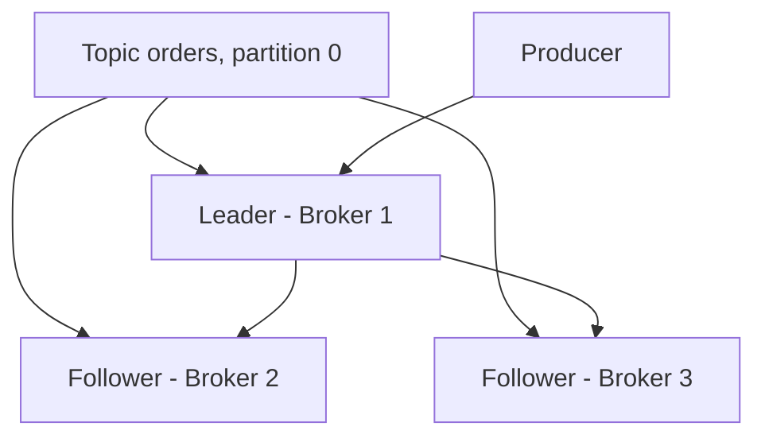
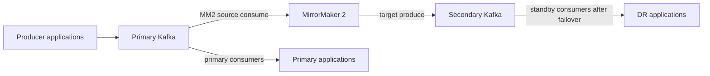
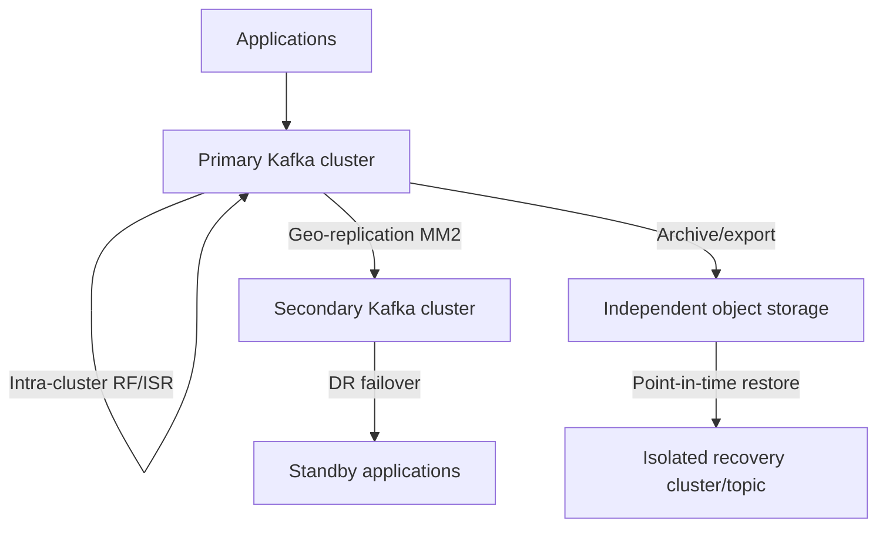

# Phân biệt sao chép dữ liệu, backup và khả năng khôi phục dữ liệu đã xóa

## Thiết kế nhiều lớp bảo vệ dữ liệu Kafka

Replication, backup và recovery giải quyết ba vấn đề khác nhau:

- **Replication** tạo bản sao để duy trì khả năng phục vụ khi broker, disk hoặc cả một cluster gặp sự cố.
- **Backup** giữ một bản dữ liệu độc lập tại một thời điểm hoặc trong một khoảng thời gian, để có thể quay lại trạng thái trước khi xảy ra lỗi.
- **Recovery** là quy trình tìm đúng bản dữ liệu, khôi phục dữ liệu và metadata, xác minh tính toàn vẹn rồi đưa ứng dụng hoạt động trở lại.

Một cluster có replication factor (RF) cao vẫn có thể mất dữ liệu do lệnh xóa topic, retention, log compaction, producer ghi sai dữ liệu hoặc thao tác quản trị nhầm. Geo-replication sang cluster thứ hai tăng khả năng sống sót khi mất cả cluster, nhưng bản sao có thể nhận cùng record sai hoặc cùng thao tác xóa từ nguồn. Vì vậy, **replica không tự động là backup**.

Với hệ thống Apache Kafka, cần thiết kế riêng mục tiêu RPO, RTO, retention, khả năng replay và bản backup bất biến. Bài này phân tích cách kết hợp replication trong cluster, MirrorMaker 2, backup độc lập và runbook khôi phục dữ liệu đã xóa.

## 1. Ba khái niệm và mục tiêu khác nhau

### 1.1 Replication trong cùng cluster

Kafka lưu mỗi partition trên nhiều broker. Một replica làm leader, các replica còn lại theo leader và được quản lý trong ISR. Khi broker lỗi, controller có thể bầu một replica còn đồng bộ làm leader để partition tiếp tục phục vụ.



Replication trong cluster chủ yếu bảo vệ trước lỗi hạ tầng cục bộ:

- Broker process bị dừng.
- Disk hoặc máy chủ bị lỗi.
- Một replica bị chậm hoặc mất kết nối.
- Một rack bị mất, nếu replica được phân bố đúng rack.

Ví dụ RF=3 và `min.insync.replicas=2` kết hợp producer `acks=all` cho phép ghi khi ISR còn ít nhất hai replica. Cơ chế này tăng durability trước lỗi broker, nhưng không tạo ra lịch sử phiên bản độc lập để quay lại trước một lần xóa hợp lệ về mặt Kafka.

Nếu quản trị viên xóa topic, producer ghi nhầm dữ liệu hoặc ứng dụng gửi tombstone cho một key, Kafka vẫn thực hiện thao tác đó trên cluster theo semantics đã cấu hình. Replication không biết thao tác đó là sai về nghiệp vụ.

### 1.2 Replication giữa các cluster

Geo-replication sao chép dữ liệu từ cluster nguồn sang cluster đích qua mạng. Với Apache Kafka, MirrorMaker 2 (MM2) chạy trên Kafka Connect và hỗ trợ:

- Sao chép topic và record.
- Sao chép một số cấu hình topic.
- Sao chép ACL.
- Tạo checkpoint và ánh xạ offset cho consumer group.
- Giám sát replication latency và throughput.

Cluster đích có thể được đặt ở data center hoặc region khác, giúp ứng dụng chuyển sang nơi dự phòng khi cluster nguồn không còn khả dụng.

Replication giữa cluster thường là bất đồng bộ. Khi nguồn gặp sự cố, có thể có một phần record mới chưa kịp tới đích. Khoảng dữ liệu chưa được replicate là một phần RPO của thiết kế.

### 1.3 Backup độc lập

Backup là bản sao có thể khôi phục về một thời điểm hoặc phiên bản trước đó, được quản lý với chính sách lưu trữ độc lập. Một thiết kế backup tốt thường có:

- Kho lưu trữ khác cluster và khác failure domain.
- Versioning hoặc snapshot theo thời điểm.
- Quyền xóa tách biệt với tài khoản vận hành Kafka.
- Retention dài hơn retention của topic.
- Khả năng khóa/xóa chậm (immutability hoặc object lock) nếu yêu cầu chống ransomware và thao tác nhầm.
- Manifest, checksum và metadata đủ để khôi phục.
- Kiểm thử restore định kỳ.

Backup độc lập cho phép khôi phục dữ liệu đã bị xóa hoặc ghi sai sau khi lỗi đã lan sang cluster dự phòng.

### 1.4 Bảng so sánh

| Tiêu chí | Replica cùng cluster | Geo-replication | Backup độc lập |
|---|---|---|---|
| Mục tiêu chính | Chịu lỗi broker/disk | Chịu lỗi cluster/region | Quay lại dữ liệu ở thời điểm trước |
| Độ trễ | Thường thấp trong cluster | Phụ thuộc network và connector lag | Phụ thuộc lịch export/snapshot |
| Dữ liệu sai từ producer | Được replicate | Thường tiếp tục được replicate | Có thể giữ phiên bản trước nếu backup đã hoàn tất |
| Tombstone/xóa key | Áp dụng theo log semantics | Tombstone có thể được replicate như record | Có thể giữ giá trị trước khi xóa |
| Retention | Theo topic/broker | Có thể đồng bộ cấu hình và có retention riêng | Theo chính sách kho backup |
| Xóa topic | Replica mất theo topic | Vòng đời topic đích phụ thuộc công cụ/config | Có thể phục hồi nếu backup còn |
| Khôi phục point-in-time | Không phải mục tiêu | Không mặc nhiên hỗ trợ | Là mục tiêu chính |
| Khả năng chống xóa nhầm | Thấp | Thấp nếu lỗi được replicate | Cao hơn nếu bản backup độc lập và bất biến |

## 2. Vì sao replication không thay thế backup?

### 2.1 Replica cùng cluster chia sẻ cùng chính sách dữ liệu

Các replica của một partition giữ log theo cùng cấu hình retention và compaction của topic. Khi segment hết hạn, log cleaner compact dữ liệu hoặc topic bị xóa, thao tác áp dụng ở cấp topic/partition chứ không phải một replica riêng lẻ.

Ví dụ:

1. Topic `orders` có RF=3.
2. Producer ghi một record sai do bug.
3. Record được replicate tới các follower.
4. Ứng dụng downstream xử lý record sai.

Ba replica đều giữ record sai. RF=3 không tạo bản “trước khi bug chạy”.

### 2.2 Geo-replication cũng có thể sao chép lỗi logic

MM2 đọc record từ source cluster rồi produce sang target cluster. Nếu source phát một record nghiệp vụ sai, record đó có thể được replicate như record bình thường.

Nếu topic dùng compaction, tombstone là record có key và value null. Tombstone biểu thị xóa key; nó được ghi vào log và có thể được replicate sang cluster đích. Log cleaner sau đó có thể xóa giá trị cũ và cuối cùng xóa chính tombstone theo `delete.retention.ms`.

Nếu MM2 đồng bộ topic configs, target còn có thể kế thừa `cleanup.policy`, `retention.ms`, `retention.bytes` và các cấu hình topic khác theo filter. Trong Kafka 4.2, `sync.topic.configs.enabled` và `sync.topic.acls.enabled` mặc định bật. Do đó, cluster đích cần được rà soát để bảo đảm retention/compaction thực sự phù hợp với mục tiêu DR hoặc archive. Không mặc định coi target có thời hạn lưu dài hơn source.

### 2.3 Replication có độ trễ

Giả sử source ghi đến offset 1.000.000 nhưng target mới replicate đến offset tương ứng 998.500. Khi source mất hoàn toàn, phần đuôi chưa replicate có thể không có trên target.

RPO của geo-replication phụ thuộc:

- Replication lag theo record/byte.
- Tần suất source tạo record.
- Thời gian phát hiện và xử lý lỗi connector.
- Network partition giữa hai region.
- Khả năng target tiếp tục nhận dữ liệu trong lúc source không ổn định.

Replication latency bằng 0 tại một thời điểm không bảo đảm RPO luôn bằng 0. Phải theo dõi liên tục và kiểm thử failover trong điều kiện lag thực tế.

### 2.4 Replication không phải bản lưu trữ lịch sử bất biến

Replica là bản sao hoạt động của hệ thống. Nó thường có quyền ghi, retention và lifecycle tương tự nguồn. Backup phải có khả năng giữ nhiều phiên bản, cô lập quyền xóa và phục hồi về mốc trước sự cố.

## 3. Các loại xóa dữ liệu trong Kafka

Muốn khôi phục đúng, trước hết phải phân loại thao tác đã xóa dữ liệu.

### 3.1 Tombstone trên compacted topic

Với topic có `cleanup.policy=compact`, record có key và value null được hiểu là tombstone:

```text
offset 100: customer-42 -> {"email":"old@example.com"}
offset 180: customer-42 -> {"email":"new@example.com"}
offset 250: customer-42 -> null
```

Tombstone tại offset 250 biểu thị key `customer-42` bị xóa. Log compaction có thể loại bỏ các giá trị trước đó của key và sau thời gian giữ tombstone có thể loại bỏ luôn marker.

`delete.retention.ms` quy định thời gian giữ tombstone; mặc định Kafka 4.2 là một ngày. Một consumer rebuild state từ đầu log phải theo kịp đến head trong khoảng thời gian phù hợp để chắc chắn nhìn thấy delete marker. Nếu tombstone đã bị cleaner xóa, chỉ đọc lại topic hiện tại không thể tái tạo giá trị cũ.

**Muốn khôi phục giá trị trước tombstone**, cần một nguồn còn giữ phiên bản cũ: backup độc lập, archive đầy đủ hoặc hệ thống nguồn-of-truth. Replica hay cluster mirror đã nhận tombstone không phải nguồn phục hồi đáng tin cậy cho giá trị cũ.

### 3.2 Retention xóa segment

Với `cleanup.policy=delete`, Kafka xóa các log segment cũ khi vượt `retention.ms` hoặc `retention.bytes`. Retention là chính sách vòng đời dữ liệu, không phụ thuộc consumer group đã đọc hết hay chưa.

Ví dụ:

```properties
cleanup.policy=delete
retention.ms=604800000
retention.bytes=-1
```

Ví dụ này giữ log theo giới hạn thời gian bảy ngày và không đặt giới hạn dung lượng theo partition. Khi segment đủ điều kiện xóa, consumer không thể seek về dữ liệu đã bị loại khỏi log.

Nếu MM2 chưa đọc kịp một segment trước khi source retention xóa segment, connector không thể lấy lại record đã mất từ source. Target cũng có thể xóa record theo retention riêng hoặc do topic config được đồng bộ.

### 3.3 Xóa toàn bộ topic

Xóa topic là thao tác quản trị ở cấp cluster. Nó khác với gửi tombstone cho một key:

- Tombstone là record trong một compacted topic.
- Topic deletion là thao tác quản trị xóa topic và dữ liệu các partition của nó.

Không giả định việc có geo-replication sẽ giúp khôi phục topic đã xóa. Vòng đời topic đích, topic discovery và xử lý deletion phụ thuộc công cụ, phiên bản và cấu hình replication. Hãy kiểm tra hành vi của chính topology đang triển khai và luôn giữ backup độc lập cho topic quan trọng.

### 3.4 Ghi nhầm hoặc dữ liệu bị hỏng về nghiệp vụ

Các trường hợp như producer gửi sai giá, cập nhật nhầm trạng thái, replay nhầm event hoặc lộ credential rồi ghi dữ liệu phá hoại đều có thể được replicate sang cluster khác.

Kafka chỉ xác thực protocol, schema (nếu tích hợp) và quyền truy cập theo cấu hình. Nó không tự biết một event hợp lệ về nghiệp vụ hay không. Backup theo phiên bản và quy trình point-in-time recovery giúp quay về trạng thái trước khi dữ liệu sai được ghi.

### 3.5 Phân loại nhanh

| Triệu chứng | Loại sự cố | Nguồn phục hồi cần tìm |
|---|---|---|
| Một key biến mất khỏi compacted topic | Tombstone/compaction | Backup giá trị cũ hoặc source-of-truth |
| Offset cũ không còn đọc được | Retention hoặc compaction | Archive/backup còn giữ lịch sử |
| Topic không còn tồn tại | Topic deletion | Topic backup và metadata/config backup |
| Nhiều record sai xuất hiện ở cả hai cluster | Producer/application corruption | Point-in-time backup trước thời điểm lỗi |
| Source cluster mất nhưng target còn dữ liệu gần nhất | Disaster recovery | Target cluster, offset checkpoints và runbook failover |

## 4. Geo-replication với MirrorMaker 2

### 4.1 Kiến trúc active/passive

Mô hình active/passive thường có một cluster nhận ghi chính và một cluster standby nhận bản sao:



Trong trạng thái bình thường:

- Producer ghi vào primary.
- Consumer production đọc từ primary.
- MM2 đọc record từ primary và ghi sang secondary.
- Secondary được giám sát, nhưng ứng dụng standby không tự động chạy song song với cùng consumer group trừ khi thiết kế chủ đích.

Khi primary lỗi, đội vận hành xác nhận secondary có dữ liệu trong RPO, fence primary để tránh hai nơi cùng nhận ghi, sau đó chuyển ứng dụng sang secondary.

### 4.2 Cấu hình flow một chiều

Ví dụ cấu hình MM2 tối giản cho luồng `primary -> secondary`:

```properties
clusters = primary, secondary
primary.bootstrap.servers = primary-1:9092,primary-2:9092
secondary.bootstrap.servers = secondary-1:9092,secondary-2:9092

primary->secondary.enabled = true
primary->secondary.topics = orders, customers, payments
primary->secondary.groups = order-projection, payment-projection
```

Đây là ví dụ định hướng. Production cần cấu hình bảo mật, replication factor cho remote topics, topic filters, worker capacity, converter, ACL và các internal topics của MM2.

Mặc định `DefaultReplicationPolicy` thêm tên source cluster vào tên topic đích. Ví dụ `orders` ở primary có thể xuất hiện dưới tên `primary.orders` ở secondary. Điều này giúp phân biệt nguồn dữ liệu và tránh ghi hai cluster vào cùng một topic-partition khi dùng topology nhiều chiều.

### 4.3 Đồng bộ consumer offset

Offset ở hai cluster không nhất thiết giống nhau. MM2 dùng offset-syncs và checkpoint topics để ánh xạ offset nguồn sang offset tương ứng ở topic remote. Trong Kafka 4.2:

- `emit.checkpoints.enabled` mặc định bật.
- `emit.checkpoints.interval.seconds` mặc định 60 giây.
- `sync.group.offsets.enabled` mặc định tắt.
- Khi bật `sync.group.offsets.enabled`, MM2 định kỳ ghi translated offsets vào `__consumer_offsets` ở target khi group đó không có consumer đang hoạt động trên target.

Vì vậy, việc “đã replicate topic” không đồng nghĩa consumer có thể tiếp tục chính xác từ cùng con số offset. Trước failover, phải kiểm tra checkpoint mới nhất, offset mapping, tên remote topic và group offset đã được đồng bộ hay chưa.

Không copy con số `CURRENT-OFFSET` từ primary sang secondary nếu chưa dịch offset. Offset được broker gán độc lập trên từng cluster.

### 4.4 Replication latency và RPO

MM2 cung cấp metric theo source, target, topic và partition, gồm:

- `record-rate`, `record-count`.
- `byte-rate`, `byte-count`.
- `record-age-ms`.
- `replication-latency-ms`.
- `checkpoint-latency-ms`.

Theo dõi lag lớn nhất theo partition, không chỉ trung bình toàn cluster. Một topic quan trọng có thể bị trễ dù dashboard tổng quan vẫn xanh.

### 4.5 Đồng bộ topic config có thể ảnh hưởng khả năng lưu dữ liệu

Trong Kafka 4.2, `sync.topic.configs.enabled` mặc định bật để remote topic được cấu hình định kỳ theo topic nguồn. Điều này có thể làm target nhận cùng `cleanup.policy`, `retention.ms`, `retention.bytes` hoặc các cấu hình được phép đồng bộ.

Nếu mục tiêu secondary là DR với retention dài hơn source, cần:

1. Kiểm tra property filter của MM2.
2. Quyết định rõ config nào phải giống source và config nào phải độc lập.
3. Cấu hình filter/automation phù hợp để giữ retention ở target theo chính sách DR.
4. Kiểm tra lại sau mỗi lần MM2 sync và sau thay đổi topic config.

Không chỉ đặt retention dài hơn một lần rồi cho rằng target sẽ giữ nguyên. Nếu config sync ghi đè, mục tiêu lưu trữ có thể bị phá vỡ.

### 4.6 MM2 không phải backup

MM2 hữu ích cho failover cluster và migration. Nó không tự cung cấp:

- Bản snapshot bất biến theo thời điểm.
- Kho lưu trữ nhiều phiên bản độc lập.
- Cơ chế giữ dữ liệu sau khi source/target retention xóa.
- Khôi phục business state trước khi producer ghi sai.
- Bảo vệ khỏi thao tác xóa nhầm lan sang topology dự phòng.

Ngay cả khi dùng exactly-once support của MM2, điều đó chỉ liên quan đến semantics replicate trong phạm vi được hỗ trợ; nó không biến target thành backup point-in-time hoặc ngăn lỗi nghiệp vụ được replicate.

## 5. Thiết kế backup độc lập cho Kafka

### 5.1 Backup logic ra object storage

Một cách phổ biến là dùng Kafka Connect sink connector hoặc ứng dụng consumer để export record sang object storage như S3-compatible storage, Azure Blob hoặc Google Cloud Storage.

Backup nên lưu dữ liệu kèm tọa độ nguồn:

```json
{
  "sourceCluster": "kafka-primary",
  "topic": "orders",
  "partition": 2,
  "offset": 845120,
  "timestamp": 1784000000000,
  "key": "order-42",
  "headers": {
    "event-type": "OrderPaid",
    "schema-version": "3"
  },
  "schemaId": 128,
  "value": {
    "orderId": "order-42",
    "status": "PAID"
  }
}
```

Đây là envelope minh họa. Định dạng thực tế có thể là Avro, Protobuf, JSON hoặc binary; cần lưu schema reference và metadata đủ để decode.

Các trường quan trọng:

- Cluster nguồn và topic.
- Partition và source offset.
- Record timestamp.
- Key, value và headers.
- Schema ID/version hoặc schema content cần thiết.
- Thời điểm export và backup generation ID.
- Checksum/manifest để xác minh object.

Offset trên Kafka đích khi restore sẽ là offset mới. Lưu source coordinates giúp kiểm toán, deduplicate và truy vết record đã được phục hồi từ đâu.

### 5.2 Backup phải giữ được nhiều phiên bản

Nếu object storage chỉ giữ file mới nhất hoặc dùng cùng credential xóa với Kafka admin, lỗi xóa có thể ảnh hưởng luôn bản backup.

Nên áp dụng:

- Object versioning hoặc snapshot theo generation.
- Retention độc lập với Kafka topic.
- Object lock/immutability khi yêu cầu chống xóa.
- Credential backup chỉ có quyền ghi/đọc cần thiết; quyền xóa thuộc nhóm khác.
- Tài khoản hoặc project cloud riêng cho backup.
- Mã hóa dữ liệu và quản lý key độc lập.
- Replication của kho backup sang failure domain khác nếu cần.
- Kiểm tra checksum và manifest sau mỗi đợt backup.

### 5.3 Backup raw event và backup current state

Hai dạng backup có mục tiêu khác nhau:

| Dạng | Nội dung | Phục hồi được gì? |
|---|---|---|
| Event archive | Các event theo thời gian, có source offset và metadata | Replay lịch sử trong thời hạn archive |
| State snapshot | Trạng thái mới nhất của mỗi key tại một thời điểm | Khôi phục nhanh trạng thái hiện tại |
| Cluster DR mirror | Bản sao topic đang chạy ở cluster khác | Failover dịch vụ với lag/RPO nhất định |

Với event sourcing hoặc audit, cần archive lịch sử event đầy đủ trước khi compaction/retention loại bỏ dữ liệu.

Với compacted topic dùng làm changelog/state store, một snapshot trạng thái mới nhất có thể đủ để dựng lại state hiện tại, nhưng không khôi phục được mọi phiên bản cũ của key. Nếu cần khôi phục giá trị trước tombstone hoặc một trạng thái tại thời điểm lịch sử, cần event archive hoặc backup snapshot theo thời gian.

### 5.4 Tiered storage không mặc nhiên là backup

Kafka tiered storage có thể chuyển segment cũ sang remote storage để mở rộng thời gian lưu và giảm chi phí disk local. Tuy nhiên, dữ liệu vẫn thuộc lifecycle của topic/cluster:

- Topic retention vẫn quyết định thời gian lưu tổng thể.
- Local retention và remote retention có vai trò khác nhau.
- Xóa topic hoặc thay đổi remote storage config có thể tác động đến dữ liệu remote theo cấu hình.
- Metadata và quyền truy cập cluster vẫn cần để đọc lại dữ liệu.

Tiered storage giúp lưu trữ dài hạn và đọc lại segment cũ, nhưng không thay thế bản backup độc lập, bất biến và có quy trình restore riêng.

### 5.5 Snapshot filesystem cần tính nhất quán

Không nên coi việc copy trực tiếp thư mục `log.dirs` của broker đang chạy là một phương pháp backup Kafka an toàn. Kafka quản lý log segment, index, checkpoint, metadata và trạng thái cluster; snapshot không nhất quán giữa broker hoặc disk có thể không khôi phục được.

Nếu sử dụng storage snapshot hoặc giải pháp backup ở tầng hạ tầng:

- Dùng quy trình được nhà cung cấp hỗ trợ cho Kafka.
- Xác định cách quiesce/stop broker và bảo đảm snapshot nhất quán.
- Ghi lại cluster ID, node identity, broker mapping và cấu hình storage.
- Có quy trình restore vào môi trường cô lập để kiểm tra.
- Không format hoặc ghi đè storage gốc trong lúc chưa xác minh backup.

## 6. Backup cả dữ liệu và metadata

Backup chỉ có file record chưa đủ để khôi phục một hệ thống Kafka production. Cần xác định các thành phần đi kèm.

| Thành phần | Cần lưu gì? | Vì sao quan trọng? |
|---|---|---|
| Topic | Tên, partition count, RF, cleanup policy, retention, config | Tạo lại đúng cấu trúc và semantics |
| Record | Key, value, headers, timestamp, source partition/offset | Khôi phục dữ liệu |
| Schema Registry | Schema, subject, version, compatibility settings, schema ID mapping | Deserialize và kiểm tra tương thích |
| ACL | Principal, resource, operation, host/pattern | Khôi phục quyền truy cập |
| Consumer group | Group ID, checkpoint/offset mapping và policy resume | Tiếp tục xử lý có kiểm soát |
| Kafka Connect | Connector config, plugin/version, source/sink offsets và secrets reference | Khôi phục pipeline tích hợp |
| Kafka Streams | Application ID, input/output topics, changelog/repartition topics, state rebuild procedure | Dựng lại stream processing state |
| Broker/cluster | Cluster ID, node ID mapping, listener, rack, storage và config as code | Khởi tạo/khôi phục môi trường |
| Security | TLS/SASL config, certificates, key references, secret manager policy | Cho ứng dụng kết nối an toàn |

Không nên export rồi restore thô các internal topics như `__consumer_offsets`, `__transaction_state` hoặc internal topics của Connect/Streams như thể chúng là business topic. Dùng API, công cụ và quy trình restore phù hợp cho từng loại metadata. Offset consumer group và transaction state cần được xử lý riêng; không thể tùy tiện ghi chúng như record nghiệp vụ.

Giữ cấu hình cluster dưới dạng code (Git/IaC) giúp tạo lại topic, ACL, connector và broker config có thể kiểm soát. Secret không nên lưu plaintext trong manifest backup; chỉ lưu reference đến secret manager và quy trình cấp lại.

## 7. Khôi phục dữ liệu đã xóa hoặc ghi sai

### 7.1 Nguyên tắc xử lý ban đầu

Khi phát hiện dữ liệu bị xóa hoặc hỏng:

1. Xác định loại thao tác: tombstone, retention, topic deletion hay producer ghi sai.
2. Ghi nhận thời điểm phát hiện và khoảng thời gian có thể bị ảnh hưởng.
3. Bảo toàn backup, archive, log audit và metadata liên quan.
4. Ngăn lỗi tiếp tục lan rộng theo runbook: dừng writer lỗi, cô lập credential hoặc tạm dừng flow replication nếu cần thiết và đã hiểu tác động.
5. Không xóa/ghi đè target cluster hoặc bản backup trong lúc điều tra.
6. Chọn mốc khôi phục trước khi sự cố bắt đầu.

Nếu chỉ dừng replication mà producer lỗi vẫn tiếp tục ghi, source vẫn có thể tiếp tục hỏng dữ liệu. Nếu tiếp tục replication trong khi source đang phát dữ liệu sai, target có thể nhận thêm dữ liệu sai. Phải xử lý cả nguồn phát sinh lỗi lẫn đường lan truyền.

### 7.2 Khôi phục tombstone đã xóa key

Giả sử compacted topic có:

```text
offset 100: account-9 -> {"balance": 500}
offset 200: account-9 -> {"balance": 700}
offset 300: account-9 -> null
```

Nếu tombstone đã làm giá trị cũ biến mất khỏi log, không thể seek về offset 100 để đọc lại nếu compaction đã loại segment record đó. Cần:

- Tìm event archive hoặc snapshot trước offset 300.
- Khôi phục giá trị cũ từ backup vào topic phục hồi riêng.
- Xác minh trạng thái nghiệp vụ với database/source-of-truth.
- Nếu cần cập nhật lại topic hiện tại, phát event phục hồi có event ID và lý do rõ ràng theo quy trình nghiệp vụ.

Không xóa tombstone khỏi một compacted topic bằng cách chỉnh log segment thủ công. Hãy khôi phục state bằng record mới có key và value hợp lệ hoặc dựng lại topic từ backup.

### 7.3 Khôi phục dữ liệu đã hết retention

Nếu `retention.ms` hoặc `retention.bytes` đã xóa segment:

- Kiểm tra object archive/tiered storage và chính sách lifecycle.
- Kiểm tra backup có chứa khoảng offset/thời gian cần phục hồi không.
- Xác định khoảng dữ liệu mất theo partition.
- Import dữ liệu vào topic mới hoặc môi trường recovery riêng.
- Kiểm tra timestamp, key, header, schema và source coordinates.

Nếu không có backup hoặc nguồn upstream còn giữ dữ liệu, Kafka không thể tái tạo record đã bị retention xóa. Consumer group offset cũ cũng không làm dữ liệu quay trở lại.

### 7.4 Khôi phục topic đã bị xóa

Quy trình tổng quát:

1. Tạo topic phục hồi mới với partition count và config đúng từ manifest.
2. Đọc backup theo thứ tự source partition/offset.
3. Produce record vào topic phục hồi; broker sẽ gán offset mới.
4. Kiểm tra record count, checksum, schema và business invariants.
5. Khôi phục ACL, connector và consumer config.
6. Chọn consumer group mới hoặc tính toán offset resume phù hợp.
7. Chuyển ứng dụng sang topic phục hồi sau khi xác minh.

Nên dùng tên tạm như `orders.restore-2026-11-20` trong giai đoạn kiểm tra để tránh ghi đè topic hiện tại hoặc tạo split-brain. Chỉ chuyển tên/route ứng dụng sau khi restore được duyệt.

### 7.5 Khôi phục dữ liệu sai do producer

Nếu producer ghi một loạt event sai:

- Dừng hoặc sửa producer lỗi.
- Xác định offset/time range đầu tiên bị ảnh hưởng.
- Chọn backup point-in-time trước event sai.
- Khôi phục sang topic/cluster cô lập.
- Replay event hợp lệ từ nguồn-of-truth nếu có.
- Dùng event ID/idempotency key để tránh side effect trùng.
- Reconcile với database và các hệ thống downstream.

Không chỉ xóa các record sai bằng tombstone nếu topic cần audit/event history. Trong event-sourced system, cách đúng có thể là phát corrective event hoặc rebuild projection theo quy tắc nghiệp vụ.

## 8. Khôi phục ứng dụng và consumer offset

### 8.1 Offset ở cluster DR

Trong MM2, offset nguồn và offset remote khác nhau do record được produce lại ở target. Offset-syncs/checkpoints giúp ánh xạ vị trí tương ứng. Tuy nhiên, checkpoint có thể trễ so với lần commit cuối ở source.

Khi failover:

- Dừng consumer ở primary nếu còn khả năng điều khiển.
- Xác định checkpoint mới nhất của từng group/topic/partition.
- Dùng offset translation của MM2 hoặc công cụ phù hợp để chọn vị trí đọc trên remote topic.
- Đánh giá phần record có thể bị xử lý lại hoặc chưa được replicate.
- Dùng idempotent consumer để xử lý duplicate an toàn.

Không copy committed offset nguyên trạng sang remote topic vì offset space khác nhau.

### 8.2 Offset khi restore từ backup archive

Khi import backup vào topic mới, Kafka gán offset mới. Có hai cách vận hành:

- **Replay từ đầu:** tạo consumer group mới và đọc toàn bộ dữ liệu đã phục hồi, phù hợp với rebuild state hoặc projection.
- **Resume từ mốc nghiệp vụ:** dùng source coordinates, timestamp, event ID hoặc manifest để xác định vị trí tương ứng trong topic mới, sau đó cấu hình offset mới.

Không dùng source offset làm target offset trực tiếp. Nếu backup lưu source partition/offset, có thể xây dựng mapping sau khi import hoặc lưu source coordinates trong record envelope.

### 8.3 Exactly-once không thay thế backup

Kafka transactions và idempotent producer giúp kiểm soát duplicate và tính nhất quán trong phạm vi protocol hỗ trợ. Chúng không bảo vệ trước:

- Producer gửi event sai về nghiệp vụ.
- Người dùng xóa topic hoặc dữ liệu.
- Retention/compaction xóa lịch sử.
- Cluster và metadata cùng mất.
- Backup bị ghi đè hoặc bị xóa.

Exactly-once là delivery/processing semantics trong một workflow cụ thể; backup là khả năng khôi phục dữ liệu độc lập.

## 9. Quy trình failover sang cluster dự phòng

### Bước 1 — Xác nhận sự cố và RPO

- Xác định primary mất hoàn toàn hay chỉ mất kết nối tạm thời.
- Kiểm tra MM2 flow và replication lag cuối cùng.
- Kiểm tra record-age/replication-latency theo topic-partition.
- Xác định RPO thực tế và phần dữ liệu có thể chưa tới secondary.

### Bước 2 — Fence nguồn cũ

- Ngăn producer tiếp tục ghi vào primary cũ nếu nó còn có thể hoạt động.
- Thu hồi hoặc vô hiệu hóa đường ghi/credential theo quy trình.
- Tránh để hai cluster cùng nhận ghi cho cùng business stream ngoài thiết kế active-active.
- Ghi lại thời điểm cutover và cluster được chọn làm source of truth mới.

### Bước 3 — Kiểm tra secondary

- Topic remote đã được tạo đủ partition chưa.
- Replication lag có nằm trong RPO không.
- Topic config, cleanup policy và retention có đúng chính sách DR không.
- ACL, schema, connector và network/security đã sẵn sàng chưa.
- Consumer group checkpoints/translated offsets có đủ mới không.

### Bước 4 — Chuyển ứng dụng

- Cập nhật bootstrap servers và tên remote topics.
- Chọn consumer group và offset resume đã được xác minh.
- Khởi động consumer trước hoặc theo thứ tự phụ thuộc nghiệp vụ.
- Bật producer sau khi xác nhận chỉ một nơi nhận ghi.
- Theo dõi duplicate, lag, throughput và downstream consistency.

### Bước 5 — Xác minh hoạt động

- Gửi/đọc thử event kiểm soát.
- Xác minh ordering theo key/partition.
- Kiểm tra database và side effect downstream.
- Theo dõi consumer lag và replication metrics.
- Ghi nhận RPO/RTO thực tế so với mục tiêu.

## 10. Failback và tránh split-brain

Failback là đưa hệ thống trở lại cluster ban đầu sau khi cluster đó phục hồi. Không nên chỉ đổi bootstrap server về primary cũ.

Trong thời gian failover, secondary có thể đã nhận thêm dữ liệu mới. Primary cũ có thể thiếu những record này hoặc chứa một nhánh lịch sử khác. Cần quyết định rõ:

1. Cluster nào là nguồn dữ liệu chuẩn sau failover.
2. Những record mới ở secondary được replicate/reconcile về primary cũ như thế nào.
3. Có cần rebuild primary từ secondary hay không.
4. Cách tránh vòng lặp replication và trùng event trong active-active.
5. Thời điểm nào được phép chuyển producer/consumer trở lại.

Với active-passive, quy trình phổ biến là ngừng ghi vào secondary theo cửa sổ cutover, replicate/reconcile dữ liệu phát sinh trong thời gian DR, xác minh offset/record rồi mới chuyển ứng dụng. Với active-active, cần replication policy, origin metadata, conflict resolution và idempotency được thiết kế trước; không thể giải quyết chỉ bằng việc bật flow hai chiều.

## 11. Kiến trúc bảo vệ dữ liệu nên kết hợp

Một hệ thống quan trọng thường cần cả ba lớp:



Mỗi lớp có mục tiêu riêng:

- RF/ISR giúp chịu lỗi broker trong primary.
- MM2 giúp chuyển workload sang secondary khi mất primary.
- Object storage backup giữ lịch sử độc lập để khôi phục dữ liệu bị xóa/sai.
- Recovery cluster giúp kiểm tra dữ liệu trước khi đưa trở lại production.

Không đặt backup trong cùng cluster, cùng credential xóa hoặc cùng retention lifecycle với dữ liệu cần bảo vệ.

## 12. Xác định RPO và RTO

### 12.1 RPO

RPO (Recovery Point Objective) là mức dữ liệu tối đa có thể chấp nhận mất khi xảy ra sự cố.

Với geo-replication, RPO phụ thuộc replication lag tại thời điểm lỗi. Với backup định kỳ, RPO phụ thuộc khoảng thời gian giữa các bản backup và thời điểm backup hoàn tất.

Ví dụ:

- MM2 replication latency mục tiêu dưới 5 giây.
- Backup archive hoàn tất mỗi 15 phút.
- Sự cố xảy ra giữa hai lần backup.

RPO của failover cluster có thể nhỏ hơn RPO của khôi phục từ backup, nhưng cần đo lag thực tế; không dùng cấu hình interval thay cho metric quan sát.

### 12.2 RTO

RTO (Recovery Time Objective) là thời gian tối đa để dịch vụ khôi phục hoạt động ở mức đã thống nhất.

RTO có thể gồm:

\[
T_{RTO}=T_{detect}+T_{decision}+T_{fence}+T_{promote}+T_{application}
\]

Nếu cần restore từ object storage, cộng thêm thời gian tạo topic, import record, xác minh và chuyển ứng dụng. Khôi phục hàng trăm GB/TB có thể mất lâu hơn nhiều so với chuyển sang cluster standby đã được replicate.

### 12.3 Mục tiêu khôi phục cần kiểm thử

| Kịch bản | RPO cần đo | RTO cần đo |
|---|---|---|
| Một broker lỗi | Mất dữ liệu đã ACK theo RF/ISR policy | Thời gian leader election và replica catch-up |
| Mất primary cluster | MM2 replication lag cuối cùng | Thời gian fence và cutover ứng dụng |
| Xóa nhầm key | Thời điểm backup trước tombstone/compaction | Thời gian restore state và reconcile |
| Xóa topic | Backup data + metadata gần nhất | Thời gian tạo topic, import và chuyển route |
| Producer ghi sai dữ liệu | Point-in-time trước event lỗi | Thời gian xác định phạm vi và rebuild |

## 13. Kiểm thử backup và recovery

Backup chỉ đáng tin khi đã restore thành công trong môi trường kiểm thử.

### 13.1 Kiểm thử định kỳ

1. Tạo một topic mẫu có key, value, headers, timestamp và schema.
2. Ghi một tập record có source coordinates.
3. Chạy geo-replication và đo replication lag.
4. Export cùng dữ liệu sang object storage.
5. Gửi tombstone hoặc mô phỏng retention/delete trong môi trường thử.
6. Khôi phục dữ liệu từ backup sang topic mới.
7. Xác minh checksum, record count, key state và schema.
8. Khởi động consumer group mới và kiểm tra side effect/idempotency.
9. Thực hiện failover/failback theo runbook.
10. Ghi thời gian thực tế và cập nhật RPO/RTO.

### 13.2 Kiểm tra tính toàn vẹn

Nên xác minh:

- Record count theo topic/partition và time window.
- Source offset range và các khoảng trống đã biết.
- Checksum theo file/partition hoặc manifest.
- Schema ID/version và khả năng deserialize.
- Key distribution và trạng thái compacted topic.
- ACL và quyền truy cập sau restore.
- Consumer offset mapping và số record bị xử lý lại.
- Business invariants, ví dụ tổng tiền hoặc số đơn hàng.

Record count giống nhau không đủ chứng minh dữ liệu giống nhau. Hãy dùng checksum hoặc kiểm tra nghiệp vụ trên một mẫu đủ lớn.

## 14. Các lỗi thiết kế thường gặp

| Lỗi | Hậu quả | Cách khắc phục |
|---|---|---|
| Coi RF=3 là backup | Xóa nhầm hoặc dữ liệu sai vẫn có trên mọi replica | Thêm backup độc lập và restore test |
| Coi MM2 là bản backup bất biến | Lỗi logic/tombstone có thể sang target | Giữ object archive có versioning/immutability |
| Không theo dõi replication lag | RPO thực tế vượt mục tiêu | Theo dõi record-age, replication latency theo partition |
| Nghĩ offset primary bằng offset secondary | Consumer resume sai vị trí | Dùng MM2 checkpoint/offset translation |
| Bỏ qua sync.topic.configs.enabled | Target có thể kế thừa retention/compaction source | Rà soát config filter và retention DR |
| Bật flow hai chiều mà không có conflict policy | Loop, duplicate hoặc ghi đè state | Thiết kế namespace/origin và conflict resolution |
| Dùng chung credential có quyền xóa cho backup | Lỗi quản trị có thể xóa luôn bản backup | Tách IAM, account và quyền xóa |
| Backup compacted topic chỉ giữ state hiện tại | Không khôi phục được phiên bản cũ | Archive event trước compaction |
| Coi tiered storage là backup | Lifecycle topic vẫn có thể xóa dữ liệu remote | Thêm backup độc lập |
| Copy log.dirs tùy tiện khi broker đang chạy | Snapshot không nhất quán | Dùng giải pháp snapshot được hỗ trợ và test restore |
| Restore trực tiếp đè lên topic production | Tạo split-brain hoặc duplicate | Restore vào topic/cluster cô lập trước |
| Không kiểm thử failback | Primary và secondary lệch lịch sử sau DR | Có runbook reconcile và rehearsal |

## 15. Checklist production

- Có RF/ISR phù hợp để chịu lỗi broker trong mỗi cluster.
- Có geo-replication sang cluster ở failure domain khác.
- MM2 flow, topic filters, group filters và ACL/config sync được quản lý bằng code.
- Replication latency và checkpoint latency có dashboard/alert.
- Offset translation được kiểm thử với consumer group thật.
- Target retention/compaction được rà soát, không vô tình kế thừa chính sách không phù hợp.
- Backup độc lập nằm ngoài cluster và có versioning/immutability phù hợp.
- Backup giữ key, value, headers, timestamp, schema và source coordinates.
- Metadata như topic config, ACL, schema, connector và secret references được backup riêng.
- Retention backup dài hơn khoảng phục hồi tối đa.
- Có quy trình restore vào môi trường cô lập.
- Có kiểm tra checksum, record count và business invariants.
- Có runbook failover, fence source, cutover và failback.
- RPO/RTO được đo qua diễn tập, không chỉ ghi trong tài liệu.
- Có người chịu trách nhiệm quyết định nguồn dữ liệu chuẩn sau DR.

## Kết luận

Replication giữ dịch vụ tiếp tục hoạt động khi broker hoặc cluster gặp sự cố. Backup giữ một phiên bản dữ liệu độc lập để quay lại trạng thái trước khi dữ liệu bị xóa hoặc ghi sai. Recovery kết nối hai việc đó bằng quy trình xác định mốc dữ liệu, khôi phục metadata, xác minh và đưa ứng dụng trở lại an toàn.

Trong Kafka, RF/ISR không bảo vệ trước thao tác xóa logic. Geo-replication với MirrorMaker 2 có thể sao chép topic, cấu hình, ACL và checkpoint offset, nhưng vẫn có replication lag và target có thể kế thừa retention/compaction từ source. Tombstone, retention và topic deletion có semantics khác nhau; muốn phục hồi lịch sử đã bị compaction hoặc retention xóa, cần backup/archive độc lập.

Thiết kế production nên kết hợp replication trong cluster, geo-replication, backup bất biến và restore drill. Chỉ khi đã kiểm thử failover, failback và khôi phục dữ liệu đã xóa, tổ chức mới có thể biết RPO/RTO thực tế và tin cậy vào kế hoạch DR.

## Tài liệu tham khảo

- Apache Kafka 4.2 — Geo-Replication (MirrorMaker 2): https://kafka.apache.org/42/operations/geo-replication-cross-cluster-data-mirroring/
- Apache Kafka 4.2 — MirrorMaker Configs: https://kafka.apache.org/42/configuration/mirrormaker-configs/
- Apache Kafka 4.2 — Design: Replication and Log Compaction: https://kafka.apache.org/42/design/design/
- Apache Kafka 4.2 — Topic Configs: https://kafka.apache.org/42/configuration/topic-configs/
- Apache Kafka 4.2 — Basic Kafka Operations: https://kafka.apache.org/42/operations/basic-kafka-operations/
- Apache Kafka 4.2 — Monitoring: https://kafka.apache.org/42/operations/monitoring/
