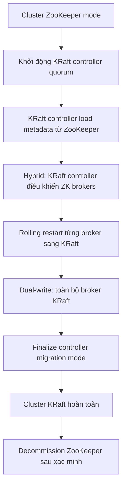

# Chuẩn bị nâng cấp ZooKeeper sang KRaft cho hệ thống cũ

Kafka dùng ZooKeeper ở các phiên bản cũ để lưu metadata cluster và bầu controller. KRaft thay cơ chế đó bằng một metadata log được sao chép qua controller quorum. Khi chuyển một cluster đang chạy từ ZooKeeper sang KRaft, dữ liệu record trong các partition vẫn nằm trên broker; phần cần chuyển là metadata và vai trò điều khiển cluster. Đây là một thay đổi kiến trúc, không đơn thuần là đổi một vài thuộc tính trong `server.properties`.

Với hệ thống cũ, cần tách hai công việc: **nâng phần mềm Kafka lên bridge release hỗ trợ migration**, sau đó **chuyển metadata mode từ ZooKeeper sang KRaft**. Apache Kafka 4.0 đã loại bỏ chế độ ZooKeeper; Kafka 3.9 là bridge release cuối cùng để thực hiện migration. Tài liệu Kafka 3.9 yêu cầu broker ở phiên bản 3.9.1 và `inter.broker.protocol.version=3.9` trước khi bắt đầu migration. Không thể lấy một cluster đang ở ZooKeeper mode rồi khởi động trực tiếp bằng Kafka 4.x.

## 1. Phân biệt nâng cấp phiên bản và migration metadata

Hai hoạt động có mục tiêu và rủi ro khác nhau:

| Hoạt động | Thay đổi | Ví dụ |
|---|---|---|
| Software upgrade | Thay binary Kafka và thư viện đi kèm, giữ metadata mode hiện tại | Nâng cluster ZooKeeper từ phiên bản cũ lên Kafka 3.9.1 |
| Metadata migration | Chuyển metadata authority từ ZooKeeper sang KRaft controller quorum | Bật migration mode, chuyển từng broker sang KRaft rồi finalize |
| KRaft software upgrade | Nâng phiên bản phần mềm của cluster đã chạy KRaft | Sau migration, nâng cluster KRaft 3.9 lên Kafka 4.x theo upgrade guide |

Không gộp cả ba vào một lần bảo trì. Trước tiên hoàn tất software upgrade lên bridge release và xác nhận cluster ZooKeeper hoạt động ổn định. Sau đó mới triển khai metadata migration. Khi migration đã finalize, thực hiện nâng Kafka 4.x theo quy trình upgrade của KRaft.

**Bridge release cuối: Kafka 3.9.**

Kafka 4.x không còn ZooKeeper mode. Nếu cluster đang ở phiên bản cũ hơn bridge release, phải đi theo đường nâng cấp tương thích được tài liệu của từng phiên bản hỗ trợ để đến Kafka 3.9.1; không bỏ qua các bước nâng cấp trung gian bắt buộc.

## 2. Các phase của ZooKeeper-to-KRaft migration

Migration có nhiều phase. Hiểu trạng thái của từng phase giúp vận hành biết metadata đang được đồng bộ ở đâu và lúc nào có thể dừng sử dụng ZooKeeper.

| Phase | Broker | Controller | Metadata behavior |
|---|---|---|---|
| Initial | Tất cả ở ZooKeeper mode | ZooKeeper-based controller | ZooKeeper đang điều khiển cluster |
| Initial metadata load | Vẫn ZooKeeper mode | KRaft controller được khởi động | KRaft controller tải metadata từ ZooKeeper |
| Hybrid | Có broker ZK mode | KRaft controller | KRaft controller điều khiển broker ZK mode qua controller RPC |
| Dual-write | Tất cả broker đã chuyển KRaft | KRaft controller vẫn ở migration mode | KRaft controller tiếp tục ghi metadata tương thích sang ZooKeeper |
| Finalized | Tất cả broker KRaft mode | KRaft quorum bình thường | Ngừng dual-write; ZooKeeper không còn cần cho Kafka metadata |



Trong hybrid phase, KRaft controller gửi các controller RPC như `UpdateMetadata` và `LeaderAndIsr` đến broker vẫn đang chạy ZooKeeper mode. Khi broker cuối cùng được chuyển sang KRaft, controller vẫn ở migration mode cho đến khi quản trị viên finalize.

## 3. Lộ trình phiên bản được hỗ trợ

Trước khi lập kế hoạch, xác định rõ phiên bản Kafka hiện tại, Java runtime, hệ điều hành, plugin và các tích hợp xung quanh cluster.

Theo hướng dẫn ZooKeeper-to-KRaft của Kafka 3.9:

- Broker phải được nâng lên Kafka 3.9.1 trước migration.
- `inter.broker.protocol.version` phải đặt thành `3.9` trong giai đoạn chuẩn bị/migration.
- Kafka 3.9 là bridge release cuối; Kafka 4.0 trở đi chỉ chạy KRaft.
- Không thay đổi metadata version/IBP trong khi migration đang diễn ra.
- Sau khi finalize, không thể quay lại ZooKeeper mode.

Nếu cluster cũ cần nhiều lần nâng cấp để tới 3.9.1, hãy hoàn tất từng lần theo upgrade guide tương ứng, kiểm tra cluster sau mỗi lần và giữ IBP ở mức được tài liệu yêu cầu. Không đồng thời thay đổi broker version, metadata version, storage layout và security architecture trong cùng một rollout.

## 4. Kiểm tra tương thích trước khi migration

Không phải mọi cấu hình hoặc tính năng của ZooKeeper mode đều tự động tương thích với KRaft. Lập inventory trước khi tạo controller quorum.

### Broker và storage

- Ghi lại `broker.id`, `log.dirs`, `listeners`, `advertised.listeners`, `inter.broker.listener.name`, `security.inter.broker.protocol` và các override theo listener.
- Đảm bảo mỗi broker có `broker.id` tường minh, là số nguyên không âm và không vượt `reserved.broker.max.id`.
- Kiểm tra tất cả log directory, filesystem, quyền truy cập và dung lượng. Trong migration, lỗi ở một log directory của broker dùng nhiều log directory có thể làm broker dừng; sửa lỗi storage trước khi tiếp tục.
- Ghi nhận replication factor, `min.insync.replicas`, ISR, under-replicated partitions và offline partitions.
- Kiểm tra cluster không đang có reassignment, recovery lớn hoặc broker restart loop.

### Metadata và security

- Kiểm tra topic, partition, topic configuration, quota, ACL, SCRAM credential và các cấu hình dynamic.
- Nếu đang dùng `kafka.security.authorizer.AclAuthorizer`, chuẩn bị chuyển sang `org.apache.kafka.metadata.authorizer.StandardAuthorizer` khi broker được chuyển sang KRaft.
- Kiểm tra `control.plane.listener.name`; nếu đang cấu hình, cần loại bỏ khi chuyển broker sang KRaft theo hướng dẫn migration.
- Rà soát `AlterConfigPolicy`. Kafka 3.9.2 có compatibility fix cho khác biệt tham số ở các operation `SUBTRACT`, `DELETE` và `APPEND` (KIP-1252); nếu hệ thống có policy tùy chỉnh, kiểm thử trên đúng patch release trước khi rollout.
- Kiểm tra feature nào đang dùng nhưng chưa được hỗ trợ trong KRaft ở phiên bản đích. Không giả định rằng việc cluster khởi động được đồng nghĩa mọi tính năng đang dùng đều tương thích.

### Hệ thống phụ thuộc ZooKeeper

Xác định ZooKeeper có đang được ứng dụng hoặc nền tảng khác dùng ngoài Kafka hay không. Chỉ được decommission ZooKeeper sau khi Kafka migration hoàn tất và đã xác minh không còn workload nào khác phụ thuộc ensemble đó.

## 5. Chuẩn bị dữ liệu và kế hoạch khôi phục

Trước migration, cần có bản ghi cấu hình và khả năng phục hồi đã được kiểm chứng:

1. Backup ZooKeeper theo quy trình vận hành của ensemble, bao gồm snapshot và transaction log phù hợp.
2. Lưu bản sao cấu hình broker/controller, topic config, ACL, quota, listener, TLS/SASL và danh sách broker ID.
3. Ghi lại cluster ID hiện tại, metadata version, broker version và trạng thái replication.
4. Xác nhận backup dữ liệu Kafka và log directory có thể phục hồi theo runbook hiện có.
5. Tạo môi trường staging hoặc bản sao topology đủ giống production để diễn tập migration và rollback.
6. Định nghĩa cửa sổ bảo trì, tiêu chí dừng, người phê duyệt từng phase và thời gian chờ phục hồi.

Không dùng một bản copy thư mục ZooKeeper đang chạy làm backup duy nhất. Dùng snapshot/backup nhất quán theo hướng dẫn ZooKeeper và thử khôi phục trước khi dựa vào nó.

## 6. Lấy cluster ID hiện tại

KRaft controller quorum phải dùng đúng cluster ID của cluster ZooKeeper hiện hữu. Không tạo cluster ID mới cho migration.

Có thể đọc cluster ID từ ZooKeeper:

```bash
bin/zookeeper-shell.sh zk-1.internal:2181 get /cluster/id
```

Hoặc kiểm tra `meta.properties` trong data directory của broker. Đối chiếu các bản ghi để chắc chắn tất cả broker thuộc cùng một cluster. Ghi cluster ID vào change record và dùng đúng giá trị đó khi format controller storage.

## 7. Thiết kế KRaft controller quorum

KRaft controller giữ metadata log và tham gia quorum. Với production, nên dùng ba hoặc năm controller riêng biệt, đặt trên failure domain phù hợp. Quorum cần majority để hoạt động:

\[
Majority = \lfloor N/2 \rfloor + 1
\]

| Controller voters | Majority cần có | Số voter có thể mất mà vẫn còn majority |
|---:|---:|---:|
| 3 | 2 | 1 |
| 5 | 3 | 2 |

Controller `node.id` phải khác tất cả `broker.id` đang tồn tại. Trong KRaft, broker và controller dùng chung namespace node ID. Nếu broker hiện có ID 0, 1, 2 thì không được dùng lại các ID đó cho controller mới.

Nên tách controller role khỏi broker role ở môi trường quan trọng. Combined node (`broker,controller`) đơn giản hơn nhưng không thể scale hoặc rolling restart controller độc lập với broker.

### Listener và kết nối

Controller cần listener riêng, ví dụ `CONTROLLER://controller-1.internal:9093`. Broker phải truy cập được controller listener; controller cũng cần inter-broker listener để gửi RPC đến broker trong giai đoạn migration. Firewall/security group phải cho phép đúng các đường này.

### Ví dụ cấu hình controller trong migration mode

Đây là ví dụ minh họa một controller trong topology quorum; thay hostname, listener protocol, TLS/SASL và các thông số storage theo môi trường.

```properties
process.roles=controller
node.id=3000

listeners=CONTROLLER://controller-1.internal:9093
controller.listener.names=CONTROLLER
controller.quorum.bootstrap.servers=controller-1.internal:9093,controller-2.internal:9093,controller-3.internal:9093

listener.security.protocol.map=CONTROLLER:SSL,INTERNAL:SASL_SSL
inter.broker.listener.name=INTERNAL

zookeeper.metadata.migration.enable=true
zookeeper.connect=zk-1.internal:2181,zk-2.internal:2181,zk-3.internal:2181
```

`controller.quorum.bootstrap.servers` là danh sách endpoint để node tìm quorum theo cấu hình dynamic quorum của bridge release. Nếu dùng static quorum, cấu hình phải theo đúng mô hình `controller.quorum.voters` mà phiên bản hỗ trợ; không trộn hai mô hình quorum. Controller cũng cần keystore/truststore và cấu hình xác thực tương ứng với listener thực tế.

### Format và khởi động controller

Dùng cluster ID đọc từ ZooKeeper. Ví dụ sau minh họa bootstrap voter đầu tiên cho dynamic quorum của Kafka 3.9:

```bash
ZK_CLUSTER_ID='paste-existing-cluster-id-here'

bin/kafka-storage.sh format \
  --standalone \
  --cluster-id "$ZK_CLUSTER_ID" \
  -c config/kraft/controller.properties

bin/kafka-server-start.sh config/kraft/controller.properties
```

Đây là lệnh bootstrap cho voter đầu tiên, không phải lệnh để format lặp lại cùng một controller hoặc tạo quorum ba node bằng cách sao chép một metadata directory. Với dynamic quorum, provision các controller tiếp theo bằng cùng cluster ID và `--no-initial-controllers`, khởi động từng node rồi thêm vào quorum bằng `kafka-metadata-quorum.sh add-controller` theo đúng thủ tục Kafka 3.9.1. Theo dõi `describe --replication` để xác nhận controller mới bắt kịp trước khi hoàn tất membership. Mỗi controller phải có storage directory và node identity riêng. Không format lại storage đã có metadata.

Ví dụ format node controller bổ sung:

```bash
ZK_CLUSTER_ID='paste-existing-cluster-id-here'

bin/kafka-storage.sh format \
  --cluster-id "$ZK_CLUSTER_ID" \
  -c config/kraft/controller-2.properties \
  --no-initial-controllers
```

Sau khi khởi động controller mới, thêm nó vào dynamic quorum bằng CLI với `--command-config` trỏ tới cấu hình controller đó và `--bootstrap-server` trỏ tới broker đang hoạt động. Không dùng quy trình này cho static quorum; làm theo đúng quorum mode đã chọn.

```bash
bin/kafka-metadata-quorum.sh \
  --command-config config/kraft/controller-2.properties \
  --bootstrap-server broker-1.internal:9092 \
  add-controller

bin/kafka-metadata-quorum.sh \
  --bootstrap-server broker-1.internal:9092 \
  describe --replication
```

## 8. Bật migration mode trên broker ZooKeeper

Sau khi KRaft controller quorum đã chạy, thêm cấu hình migration vào broker đang ở ZooKeeper mode. Mỗi broker cần giữ `broker.id`, `zookeeper.connect`, thêm controller bootstrap endpoint, controller listener name và migration flag.

Ví dụ:

```properties
broker.id=0
listeners=PLAINTEXT://:9092
advertised.listeners=PLAINTEXT://broker-1.internal:9092

listener.security.protocol.map=PLAINTEXT:PLAINTEXT,CONTROLLER:PLAINTEXT

inter.broker.protocol.version=3.9
zookeeper.connect=zk-1.internal:2181,zk-2.internal:2181,zk-3.internal:2181
zookeeper.metadata.migration.enable=true

controller.quorum.bootstrap.servers=controller-1.internal:9093,controller-2.internal:9093,controller-3.internal:9093
controller.listener.names=CONTROLLER
```

Với TLS/SASL, dùng protocol map và credential thật của cluster; ví dụ `PLAINTEXT` chỉ để minh họa. Đảm bảo `CONTROLLER` được khai báo trong `listener.security.protocol.map` và broker có thể kết nối tới tất cả controller endpoint cần thiết.

Restart broker lần lượt theo rolling procedure. Không restart đồng thời toàn bộ broker. Sau mỗi broker:

- Xác nhận broker đăng ký lại và phục vụ request bình thường.
- Kiểm tra partition leader, ISR và under-replicated partitions.
- Theo dõi log controller/broker để phát hiện lỗi kết nối ZooKeeper hoặc KRaft.
- Không chuyển broker tiếp theo nếu cluster chưa ổn định.

Khi broker ZooKeeper cuối cùng được restart với cấu hình migration, quá trình metadata migration tự động bắt đầu. Theo dõi controller log để xác nhận thông báo:

```text
Completed migration of metadata from Zookeeper to KRaft
```

Không dựa riêng vào process health hoặc việc controller port mở để kết luận metadata đã được load. Phải kiểm tra log migration và trạng thái cluster.

Trong thời gian migration, Apache Kafka khuyến nghị bật TRACE cho package migration trên KRaft controller và DEBUG cho controller/broker liên quan để dễ điều tra:

```properties
log4j.logger.org.apache.kafka.metadata.migration=TRACE
```

Chỉ giữ mức log chi tiết trong cửa sổ migration và giảm về mức vận hành bình thường sau khi xác minh hoàn tất để tránh log volume không cần thiết.

## 9. Chuyển từng broker sang KRaft mode

Sau khi KRaft controller hoàn tất metadata migration, broker vẫn đang chạy ZooKeeper mode. Controller KRaft tiếp tục gửi các controller RPC cần thiết cho các broker này trong hybrid phase.

Chuyển từng broker theo rolling restart:

1. Giữ nguyên broker ID hiện tại và dùng giá trị đó làm `node.id`.
2. Thêm `process.roles=broker`.
3. Bỏ `broker.id` và dùng `node.id`.
4. Bỏ `zookeeper.connect` và `zookeeper.metadata.migration.enable` khỏi broker config.
5. Giữ `controller.quorum.bootstrap.servers` và `controller.listener.names`.
6. Giữ listener/client/inter-broker config tương ứng; bỏ `control.plane.listener.name` nếu trước đó có cấu hình.
7. Nếu dùng `kafka.security.authorizer.AclAuthorizer`, chuyển sang `org.apache.kafka.metadata.authorizer.StandardAuthorizer` và xác minh ACL/principal.
8. Không đặt `inter.broker.protocol.version` cho broker KRaft theo cấu hình cuối; KRaft sử dụng `metadata.version` feature level.

Ví dụ cấu hình broker sau khi chuyển:

```properties
process.roles=broker
node.id=0

listeners=PLAINTEXT://:9092
advertised.listeners=PLAINTEXT://broker-1.internal:9092
listener.security.protocol.map=PLAINTEXT:PLAINTEXT,CONTROLLER:PLAINTEXT

controller.quorum.bootstrap.servers=controller-1.internal:9093,controller-2.internal:9093,controller-3.internal:9093
controller.listener.names=CONTROLLER

# Không còn broker.id, zookeeper.connect hoặc migration flag.
# Không cấu hình inter.broker.protocol.version cho broker KRaft.
```

Đây là cấu hình minh họa; phải giữ các thuộc tính production khác như `log.dirs`, replication, authorizer, TLS/SASL, quota và inter-broker listener. Không đổi node ID của broker vì broker phải giữ nguyên identity trong cluster.

Sau mỗi broker restart, xác nhận broker đăng ký trong KRaft, partition leader/ISR phục hồi và client traffic trở lại bình thường. Chỉ chuyển broker tiếp theo sau khi broker trước đã ổn định. Lặp đến khi toàn bộ broker chạy KRaft mode.

## 10. Finalize migration trên controller

Khi tất cả broker đã ở KRaft mode, cluster vẫn có thể đang ở dual-write phase. KRaft controller tiếp tục migration compatibility với ZooKeeper cho đến khi quản trị viên finalize.

Trước khi finalize:

- Xác nhận mọi broker đang chạy KRaft mode và không còn broker ZooKeeper mode.
- Xác nhận controller quorum có leader, majority và metadata replication ổn định.
- Kiểm tra topic/partition, ACL, quota, dynamic config và client traffic.
- Kiểm tra producer/consumer, Kafka Connect, Kafka Streams, MirrorMaker và các tích hợp phụ thuộc.
- Giữ ZooKeeper ensemble và backup trong giai đoạn soak/validation theo kế hoạch.

Để finalize, trên từng controller:

1. Xóa `zookeeper.metadata.migration.enable`.
2. Xóa `zookeeper.connect` và các ZooKeeper-only config không còn dùng.
3. Restart controller lần lượt, mỗi lần chỉ một voter và chờ quorum ổn định trước khi chuyển node kế tiếp.
4. Kiểm tra log xác nhận controller đã rời migration mode và quorum vẫn khỏe.

Sau khi finalize, ZooKeeper không còn cần cho Kafka metadata. Tuy nhiên chỉ decommission ensemble sau khi xác minh không còn ứng dụng khác sử dụng nó. **Sau finalization không thể rollback cluster về ZooKeeper mode.** Một số đội vận hành giữ ZooKeeper thêm một đến hai tuần trong dual-write phase để quan sát KRaft trước khi finalize; lựa chọn thời gian phải dựa trên kế hoạch rủi ro và vận hành của hệ thống.

## 11. Kiểm tra sau mỗi phase

### Trạng thái controller quorum

```bash
bin/kafka-metadata-quorum.sh \
  --bootstrap-server broker-1.internal:9092 \
  describe --status

bin/kafka-metadata-quorum.sh \
  --bootstrap-server broker-1.internal:9092 \
  describe --replication
```

Kiểm tra controller leader, voter membership, high watermark và follower lag. Trong migration, cần đảm bảo quorum có majority và metadata log bắt kịp.

### Trạng thái broker và partition

```bash
bin/kafka-topics.sh --bootstrap-server broker-1.internal:9092 \
  --describe --under-replicated-partitions

bin/kafka-topics.sh --bootstrap-server broker-1.internal:9092 \
  --describe --unavailable-partitions
```

### Trạng thái ứng dụng

- Producer error/retry và request latency không tăng bất thường.
- Consumer group lag ổn định; offset commit và rebalance hoạt động bình thường.
- Kafka Connect connector/task không ở `FAILED`.
- Kafka Streams application/task và state store đã sẵn sàng.
- ACL, SCRAM, TLS/SASL và quota vẫn áp dụng đúng.
- Các công cụ quản trị, monitoring, backup và automation dùng đúng endpoint KRaft/broker.

Chụp lại baseline trước migration để so sánh sau từng phase. Nếu có lỗi, dừng ở phase hiện tại và xử lý trước khi tiếp tục.

## 12. Những thay đổi không nên làm trong migration

| Thay đổi | Vì sao phải tránh |
|---|---|
| Thay đổi `inter.broker.protocol.version` hoặc metadata version giữa migration | Kafka không hỗ trợ thay đổi metadata version trong quá trình migration; có thể làm hỏng cluster |
| Nâng binary lên Kafka 4.x trước khi metadata migration hoàn tất | Kafka 4.x không còn ZooKeeper mode; 3.9 là bridge release cuối |
| Dùng cluster ID mới | Controller quorum sẽ không thuộc cluster metadata hiện hữu |
| Dùng trùng `node.id` với broker ID | Broker và controller dùng chung node ID namespace trong KRaft |
| Đổi broker ID khi chuyển sang KRaft | Làm mất identity mapping của broker cũ |
| Format lại log directory hoặc metadata directory đang có dữ liệu | Có thể phá hủy metadata/data identity và làm node không thể gia nhập cluster |
| Dừng ZooKeeper trước finalization | Controller migration vẫn cần ZooKeeper để dual-write |
| Restart nhiều broker/controller cùng lúc | Có thể mất ISR hoặc controller quorum majority |
| Xóa ZooKeeper ngay sau khi broker cuối chuyển KRaft | Controller vẫn có thể đang ở dual-write phase |

## 13. Rollback trước khi finalize

Rollback chỉ còn khả năng khi migration chưa được finalize. Cách quay lại phụ thuộc phase cuối cùng đã hoàn tất; không phải chỉ xóa `process.roles` rồi restart.

- Nếu mới chuẩn bị hoặc chỉ provision KRaft controller quorum, quy trình revert đơn giản hơn vì broker vẫn ở ZooKeeper mode.
- Nếu đã bật migration mode trên broker, phải dùng đúng quy trình revert của Kafka 3.9 cho phase đó. Quy trình có thể yêu cầu deprovision KRaft quorum, kiểm tra controller epoch trong ZooKeeper, xử lý `/controller` và `/migration`, rồi rolling restart broker.
- Nếu broker đã chuyển sang KRaft, quy trình revert phức tạp hơn và có thêm một hoặc nhiều lần rolling restart.
- Nếu đã finalize migration, không thể revert về ZooKeeper mode.

Đặc biệt, khi revert sau khi KRaft controller đã ghi metadata state, controller epoch trong ZooKeeper có thể thấp hơn KRaft controller epoch. Tài liệu Kafka 3.9 yêu cầu kiểm tra và xử lý epoch trước khi ZooKeeper controller được bầu lại. Không tự chạy lệnh xóa znode theo trí nhớ; chọn đúng bảng revert cho phase cuối đã hoàn tất trong tài liệu chính thức và thực hiện dưới change plan có backup.

## 14. Các lỗi thường gặp

| Triệu chứng | Nguyên nhân có thể | Hướng kiểm tra |
|---|---|---|
| KRaft controller không khởi động | Cluster ID sai, node ID trùng, storage format/quorum config không đúng | Đối chiếu `/cluster/id`, `meta.properties`, node IDs và controller logs |
| Controller không kết nối broker | Thiếu inter-broker listener hoặc listener security protocol map sai | Kiểm tra `inter.broker.listener.name`, `controller.listener.names`, DNS/firewall/TLS |
| Migration không bắt đầu sau rolling broker | Một broker chưa bật migration flag hoặc chưa restart với đúng config | Kiểm tra tất cả broker, `zookeeper.metadata.migration.enable` và controller log |
| Metadata migration bị stall | Kết nối ZooKeeper, migration state hoặc compatibility issue | Kiểm tra controller TRACE logs, ZK logs và release notes của patch release |
| Broker không vào KRaft | Còn ZooKeeper-only config, node ID không giữ nguyên hoặc controller quorum chưa khỏe | So sánh broker config trước/sau và controller connectivity |
| ACL không hoạt động sau migration | Authorizer chưa chuyển đúng hoặc principal/ACL chưa tương thích | Kiểm tra `StandardAuthorizer`, super users và ACL audit |
| Controller quorum mất majority | Nhiều voter dừng hoặc network partition | Khôi phục voter và quorum trước khi tiếp tục |
| Broker dừng do log directory lỗi | Một log directory trong nhiều log dirs bị hỏng | Sửa storage/permission trước migration tiếp theo |

## 15. Runbook triển khai theo từng cổng kiểm soát

| Gate | Việc cần hoàn tất | Điều kiện cho phép đi tiếp |
|---|---|---|
| G0 — Inventory | Version, broker ID, cluster ID, features, storage, security và dependencies | Không còn feature blocker chưa xử lý |
| G1 — Bridge release | Nâng ZooKeeper cluster lên 3.9.1, đặt IBP 3.9 | Cluster ổn định, không under-replicated/offline partitions ngoài baseline |
| G2 — KRaft controllers | Provision controller quorum cùng cluster ID, listener và migration config | Quorum có leader/majority, controller log khỏe |
| G3 — Broker migration mode | Rolling restart toàn bộ ZK brokers với migration flag và controller endpoints | Controller log báo metadata migration completed |
| G4 — KRaft brokers | Chuyển từng broker sang `process.roles=broker`, giữ nguyên node ID | Tất cả broker KRaft, partition/ISR và client traffic ổn định |
| G5 — Finalize | Xóa migration flag/ZK config trên controllers, rolling restart controller | Quorum KRaft hoạt động bình thường, không còn phụ thuộc ZooKeeper |
| G6 — Decommission | Xác minh dependency ngoài Kafka rồi decommission ZooKeeper | Không còn workload dùng ZooKeeper; backup và audit được lưu |

Mỗi gate cần người chịu trách nhiệm, log/metric evidence và quyết định go/no-go. Nếu một gate không đạt, giữ nguyên phase và xử lý sự cố thay vì tiếp tục để “hoàn thành lịch”.

## 16. Checklist chuẩn bị migration

- [ ] Xác định Kafka version hiện tại và đường upgrade đến bridge release 3.9.1.
- [ ] Hoàn tất software upgrade riêng, đặt `inter.broker.protocol.version=3.9`.
- [ ] Không thay đổi IBP/metadata version trong metadata migration.
- [ ] Kiểm tra cluster ID từ ZooKeeper và dùng lại cho KRaft controller quorum.
- [ ] Broker ID là số nguyên không âm, được khai báo tường minh.
- [ ] Controller node IDs không trùng bất kỳ broker ID nào.
- [ ] Kiểm tra log directory, disk, filesystem và replica health.
- [ ] Rà soát feature compatibility, ACL/authorizer, SCRAM, quota và dynamic configs.
- [ ] Chuẩn bị controller quorum, controller listener, inter-broker listener và firewall.
- [ ] Backup ZooKeeper/config/data và diễn tập rollback theo từng phase.
- [ ] Bật migration mode và rolling restart broker theo từng node.
- [ ] Xác nhận log `Completed migration of metadata from Zookeeper to KRaft`.
- [ ] Chuyển từng broker sang KRaft, giữ nguyên broker/node ID.
- [ ] Xác nhận toàn bộ broker KRaft trước khi finalize controller.
- [ ] Giữ ZooKeeper đến khi finalize và xác minh dependency ngoài Kafka.
- [ ] Chỉ decommission ZooKeeper sau khi có bằng chứng cluster hoạt động KRaft ổn định.

## Tài liệu tham khảo

- [Apache Kafka 4.4 KRaft Operations — Kafka 3.9 là bridge release cuối](https://kafka.apache.org/44/operations/kraft/)
- [Apache Kafka 3.9 ZooKeeper to KRaft Migration — quy trình migration và revert](https://kafka.apache.org/39/operations/kraft/)
- [Apache Kafka 3.9 Upgrade Guide](https://kafka.apache.org/39/documentation/#upgrade)
- [Apache Kafka 3.9 Broker Configs — `zookeeper.metadata.migration.enable`](https://kafka.apache.org/39/configuration/broker-configs/)

Chuẩn bị migration ZooKeeper sang KRaft cần một bridge release phù hợp, controller quorum dùng đúng cluster ID, broker ID/node ID nhất quán và các phase được xác nhận riêng. Nâng lên Kafka 3.9.1 với IBP 3.9 trước; load metadata vào KRaft controller; chuyển broker từng node; sau đó mới finalize controller và ngừng ZooKeeper. Ranh giới quan trọng nhất là finalization: trước đó còn quy trình revert theo phase, sau đó không thể quay lại ZooKeeper mode.
