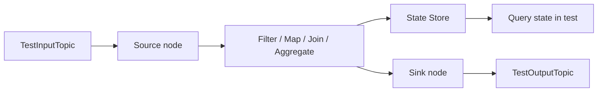

# TopologyTestDriver cho logic Kafka Streams

`TopologyTestDriver` là công cụ kiểm thử topology Kafka Streams trong bộ `kafka-streams-test-utils`. Nó cho phép đưa record vào source topic, chạy các processor trong topology và đọc record ở sink topic hoặc truy vấn state store ngay trong test. Quá trình xử lý diễn ra đồng bộ trong bộ nhớ, không cần khởi động Kafka broker, ZooKeeper hay KRaft controller.

Công cụ này phù hợp để kiểm tra logic xử lý: filter, map, branch, join, aggregation, window, timestamp, Serde, state store và custom Processor API. Nó giúp phát hiện lỗi topology nhanh trong unit test. Tuy nhiên, nó không mô phỏng đầy đủ network, broker, consumer group coordinator, rebalance, replication, transaction protocol hoặc connector bên ngoài. Vì vậy, một topology vượt qua TopologyTestDriver vẫn cần integration test với Kafka thật trước khi production.

## 1. TopologyTestDriver nằm ở đâu trong chiến lược kiểm thử?

Một Kafka Streams application thường có ba lớp cần kiểm thử:

| Lớp | Thành phần | Cách kiểm thử phù hợp |
|---|---|---|
| Logic topology | Processor, transformation, join, window, state store | `TopologyTestDriver` |
| Tích hợp Kafka | Broker, topic, partition, serialization trên wire, transaction, ACL, rebalance | Integration test với Kafka broker |
| Ứng dụng hoàn chỉnh | Spring context, external database/API, deployment, observability | Component test, integration test và end-to-end test |

Luồng xử lý topology:



`TopologyTestDriver` tạo một môi trường thực thi topology trong tiến trình test. Test có thể điều khiển record đầu vào, timestamp và thời gian wall-clock, sau đó kiểm tra output hoặc state mà không phải chờ một broker xử lý request mạng.

## 2. Thêm dependency

Cần có thư viện Kafka Streams ở main scope và `kafka-streams-test-utils` ở test scope. Hai artifact nên dùng cùng Kafka version để tránh lỗi API hoặc classpath.

### Maven

```xml
<dependencies>
    <dependency>
        <groupId>org.apache.kafka</groupId>
        <artifactId>kafka-streams</artifactId>
        <version>4.x.y</version>
    </dependency>

    <dependency>
        <groupId>org.apache.kafka</groupId>
        <artifactId>kafka-streams-test-utils</artifactId>
        <version>4.x.y</version>
        <scope>test</scope>
    </dependency>

    <dependency>
        <groupId>org.junit.jupiter</groupId>
        <artifactId>junit-jupiter</artifactId>
        <version>5.x.y</version>
        <scope>test</scope>
    </dependency>
</dependencies>
```

Thay các placeholder version bằng version được dự án quản lý. Nếu Spring Boot BOM hoặc dependency management đã quản lý Kafka version, nên để BOM quyết định version thay vì khai báo một version khác cho test utility.

### Gradle Kotlin DSL

```kotlin
dependencies {
    implementation("org.apache.kafka:kafka-streams:$kafkaVersion")
    testImplementation("org.apache.kafka:kafka-streams-test-utils:$kafkaVersion")
    testImplementation("org.junit.jupiter:junit-jupiter:$junitVersion")
}

tasks.test {
    useJUnitPlatform()
}
```

Không đưa `kafka-streams-test-utils` vào runtime production nếu ứng dụng chỉ cần dùng nó trong test.

## 3. Cấu trúc một test cơ bản

Một test với TopologyTestDriver thường có các bước:

1. Tạo topology bằng cùng factory/builder mà ứng dụng production sử dụng.
2. Tạo `Properties` cho test, tối thiểu có `application.id` và `bootstrap.servers`.
3. Khởi tạo `TopologyTestDriver`.
4. Tạo `TestInputTopic` cho source topic với serializer.
5. Tạo `TestOutputTopic` cho sink topic với deserializer.
6. Gửi record bằng `pipeInput`.
7. Đọc output hoặc truy vấn state store và assert kết quả.
8. Đóng driver để giải phóng state store và tài nguyên.

`bootstrap.servers` vẫn có mặt trong cấu hình Streams để topology được khởi tạo đúng, nhưng TopologyTestDriver không mở kết nối tới địa chỉ broker đó. Có thể dùng địa chỉ giả như `dummy:9092`.

Ví dụ khung test:

```java
Properties props = new Properties();
props.put(StreamsConfig.APPLICATION_ID_CONFIG, "orders-topology-test");
props.put(StreamsConfig.BOOTSTRAP_SERVERS_CONFIG, "dummy:9092");

try (TopologyTestDriver driver =
         new TopologyTestDriver(topology, props)) {
    // Tạo input/output topic, gửi record và kiểm tra kết quả.
}
```

Tạo một driver mới cho mỗi test giúp test độc lập, tránh state store, stream time hoặc output queue của test trước ảnh hưởng test sau.

## 4. Ví dụ topology cần kiểm thử

Giả sử ứng dụng nhận event từ topic `orders`, chỉ chuyển các đơn đã thanh toán sang `paid-orders`. Payload đầu vào có dạng:

- `PAID:1200`: đơn đã thanh toán, giá trị 1200.
- `PENDING:500`: đơn đang chờ thanh toán.
- `CANCELLED:300`: đơn đã hủy.

Topology chỉ giữ event có trạng thái `PAID` và bỏ phần prefix khỏi value.

### Production topology

```java
package com.example.orders;

import org.apache.kafka.common.serialization.Serdes;
import org.apache.kafka.streams.StreamsBuilder;
import org.apache.kafka.streams.Topology;
import org.apache.kafka.streams.kstream.Consumed;
import org.apache.kafka.streams.kstream.Produced;

public final class PaidOrdersTopology {

    private PaidOrdersTopology() {
    }

    public static Topology build() {
        StreamsBuilder builder = new StreamsBuilder();

        builder.stream(
                "orders",
                Consumed.with(Serdes.String(), Serdes.String()))
            .filter((orderId, payload) ->
                payload != null && payload.startsWith("PAID:"))
            .mapValues(payload -> payload.substring("PAID:".length()))
            .to(
                "paid-orders",
                Produced.with(Serdes.String(), Serdes.String()));

        return builder.build();
    }
}
```

Điểm quan trọng là production code trả về `Topology` từ một factory method. Test gọi chính factory này, do đó test và ứng dụng sử dụng cùng cấu trúc xử lý. Tránh viết một topology khác chỉ để test vì nó có thể không phát hiện lỗi trong topology production.

## 5. Viết test filter/map bằng JUnit 5

```java
package com.example.orders;

import static org.junit.jupiter.api.Assertions.assertEquals;
import static org.junit.jupiter.api.Assertions.assertTrue;

import java.util.List;
import java.util.Properties;

import org.apache.kafka.common.serialization.Serdes;
import org.apache.kafka.streams.StreamsConfig;
import org.apache.kafka.streams.TopologyTestDriver;
import org.apache.kafka.streams.test.TestInputTopic;
import org.apache.kafka.streams.test.TestOutputTopic;
import org.apache.kafka.streams.KeyValue;
import org.junit.jupiter.api.Test;

class PaidOrdersTopologyTest {

    @Test
    void forwardsOnlyPaidOrders() {
        Properties props = new Properties();
        props.put(StreamsConfig.APPLICATION_ID_CONFIG,
            "paid-orders-test");
        props.put(StreamsConfig.BOOTSTRAP_SERVERS_CONFIG,
            "dummy:9092");

        try (TopologyTestDriver driver =
                 new TopologyTestDriver(PaidOrdersTopology.build(), props)) {

            TestInputTopic<String, String> input =
                driver.createInputTopic(
                    "orders",
                    Serdes.String().serializer(),
                    Serdes.String().serializer());

            TestOutputTopic<String, String> output =
                driver.createOutputTopic(
                    "paid-orders",
                    Serdes.String().deserializer(),
                    Serdes.String().deserializer());

            input.pipeInput("order-1", "PAID:1200");
            input.pipeInput("order-2", "PENDING:500");
            input.pipeInput("order-3", "PAID:800");
            input.pipeInput("order-4", "CANCELLED:300");

            List<KeyValue<String, String>> actual =
                output.readKeyValuesToList();

            assertEquals(2, actual.size());
            assertEquals("order-1", actual.get(0).key);
            assertEquals("1200", actual.get(0).value);
            assertEquals("order-3", actual.get(1).key);
            assertEquals("800", actual.get(1).value);
            assertTrue(output.isEmpty());
        }
    }
}
```

Các điểm được kiểm tra:

- Hai event `PAID` được chuyển tiếp.
- Event `PENDING` và `CANCELLED` không xuất hiện ở output.
- Key order ID được giữ nguyên.
- Value được chuyển đổi đúng.
- Output queue đã được đọc hết.

`readKeyValuesToList()` đọc toàn bộ key/value đang chờ trong output topic. Nếu test cần kiểm tra timestamp hoặc headers, dùng `readRecord()` để lấy `TestRecord` thay vì chỉ lấy `KeyValue`.

## 6. Tạo input và output topic đúng Serde

`createInputTopic` và `createOutputTopic` cho phép chỉ định serializer/deserializer cụ thể:

```java
TestInputTopic<String, Long> input =
    driver.createInputTopic(
        "payments",
        Serdes.String().serializer(),
        Serdes.Long().serializer());

TestOutputTopic<String, Long> output =
    driver.createOutputTopic(
        "payment-results",
        Serdes.String().deserializer(),
        Serdes.Long().deserializer());
```

Có hai lớp Serde cần chú ý:

- Serde được cấu hình trên source/sink node của topology.
- Serializer/deserializer được test topic sử dụng để đưa dữ liệu vào và lấy dữ liệu ra.

Nếu hai phía không tương thích, test có thể lỗi khi serialize/deserialize hoặc đọc được dữ liệu sai. Hãy dùng đúng kiểu dữ liệu và Serde production đang dùng.

### Test custom Serde

Nếu ứng dụng dùng JSON, Avro, Protobuf hoặc custom Serde, có thể truyền serializer/deserializer thực tế vào test topic. Điều này giúp kiểm tra serialization boundary ở mức record. Tuy nhiên, nó chưa kiểm tra Schema Registry, compatibility rule, authentication hoặc network call tới registry nếu Serde production phụ thuộc dịch vụ ngoài.

Nên tách test:

1. Unit test cho serializer/deserializer.
2. TopologyTestDriver test cho luồng record với Serde thật.
3. Integration test với Schema Registry hoặc dịch vụ schema nếu ứng dụng dùng dịch vụ đó.

## 7. Kiểm tra output metadata: timestamp và headers

Output không chỉ có key/value. Với event processing, timestamp và headers có thể ảnh hưởng đến window, routing, tracing hoặc downstream processing.

Dùng `pipeInput` với `Instant` để đặt timestamp xác định:

```java
import java.time.Instant;

import org.apache.kafka.streams.test.TestRecord;

Instant eventTime = Instant.parse("2026-11-20T10:15:30Z");

input.pipeInput("order-1", "PAID:1200", eventTime);

TestRecord<String, String> outputRecord =
    output.readRecord();

assertEquals(
    eventTime.toEpochMilli(),
    outputRecord.timestamp());
```

`TestRecord` cũng cho phép kiểm tra headers khi topology giữ hoặc biến đổi chúng. Khi kiểm tra header, hãy xác định rõ topology có chủ ý giữ header, thêm header hay loại bỏ header. Đừng mặc định mọi transformation đều bảo toàn metadata theo cách ứng dụng mong muốn.

Nếu timestamp được thay bằng `TimestampExtractor`, `selectKey`, join hoặc custom Processor, hãy assert timestamp cuối cùng ở sink thay vì chỉ assert timestamp đầu vào.

## 8. Test state store trực tiếp

Topology có aggregation hoặc join thường duy trì state store. TopologyTestDriver cho phép truy cập store để kiểm tra kết quả mà không cần đọc output topic.

Ví dụ đếm số đơn theo customer:

```java
package com.example.orders;

import org.apache.kafka.common.serialization.Serdes;
import org.apache.kafka.streams.StreamsBuilder;
import org.apache.kafka.streams.Topology;
import org.apache.kafka.streams.kstream.Consumed;
import org.apache.kafka.streams.kstream.Grouped;
import org.apache.kafka.streams.kstream.Materialized;

public final class CustomerOrderCountTopology {

    private CustomerOrderCountTopology() {
    }

    public static Topology build() {
        StreamsBuilder builder = new StreamsBuilder();

        builder.stream(
                "orders",
                Consumed.with(Serdes.String(), Serdes.String()))
            .groupByKey(
                Grouped.with(Serdes.String(), Serdes.String()))
            .count(
                Materialized.as("customer-order-counts"));

        return builder.build();
    }
}
```

Test state store:

```java
@Test
void countsOrdersPerCustomer() {
    Properties props = new Properties();
    props.put(StreamsConfig.APPLICATION_ID_CONFIG,
        "customer-count-test");
    props.put(StreamsConfig.BOOTSTRAP_SERVERS_CONFIG,
        "dummy:9092");

    try (TopologyTestDriver driver =
             new TopologyTestDriver(
                 CustomerOrderCountTopology.build(), props)) {

        TestInputTopic<String, String> input =
            driver.createInputTopic(
                "orders",
                Serdes.String().serializer(),
                Serdes.String().serializer());

        input.pipeInput("customer-1", "order-1");
        input.pipeInput("customer-1", "order-2");
        input.pipeInput("customer-2", "order-3");

        KeyValueStore<String, Long> counts =
            driver.getKeyValueStore("customer-order-counts");

        assertEquals(Long.valueOf(2L), counts.get("customer-1"));
        assertEquals(Long.valueOf(1L), counts.get("customer-2"));
        assertNull(counts.get("customer-missing"));
    }
}
```

Tên store truyền vào `Materialized.as(...)` phải khớp tên dùng trong `getKeyValueStore(...)`. Nếu store không tồn tại, sai loại hoặc topology không tạo store như dự kiến, driver sẽ báo lỗi khi truy cập.

Cần import `org.apache.kafka.streams.state.KeyValueStore` và `assertNull` trong test class. State store được cập nhật đồng bộ khi driver xử lý input, do đó có thể truy vấn ngay sau `pipeInput`.

### Những loại state store có thể kiểm tra

| Store | Mục đích kiểm tra |
|---|---|
| Key-value store | Aggregation, deduplication, lookup theo key |
| Window store | Giá trị theo key và time window |
| Session store | Session boundaries và aggregation theo session |
| Timestamped store | Value cùng timestamp của state update |
| Versioned store | Truy vấn theo timestamp/version nếu topology và Kafka version hỗ trợ |

Dùng API truy vấn đúng loại store và đúng version Kafka Streams. Không cast một store thành loại khác chỉ để dùng chung helper test.

## 9. Test event-time và stream-time

Kafka Streams xử lý event-time dựa trên timestamp của record. Test nên đặt timestamp rõ ràng để không phụ thuộc đồng hồ máy chạy test.

```java
Instant firstEvent = Instant.parse("2026-11-20T10:00:00Z");
Instant secondEvent = Instant.parse("2026-11-20T10:00:30Z");

input.pipeInput("customer-1", "order-1", firstEvent);
input.pipeInput("customer-1", "order-2", secondEvent);
```

Với windowed aggregation, record có timestamp khác nhau có thể đi vào các window khác nhau. Hãy tạo test case cho:

- Record nằm ngay trước ranh giới window.
- Record đúng tại ranh giới.
- Record ngay sau ranh giới.
- Record đến muộn nhưng còn trong grace period.
- Record đến muộn vượt grace period.
- Record có timestamp nhỏ hơn record đã xử lý trước đó.
- Record không có timestamp hợp lệ hoặc timestamp được custom extractor thay đổi.

### Phân biệt stream-time và wall-clock time

- **Stream-time** tiến lên dựa trên timestamp của record được xử lý.
- **Wall-clock time** tiến theo thời gian thực/đồng hồ hệ thống.

Một topology dùng stream-time punctuation không nên được test bằng cách chỉ advance wall-clock. Ngược lại, wall-clock punctuation cần được kích hoạt bằng API advance wall-clock của driver.

## 10. Test window và late event

Với tumbling window 1 phút và grace period 10 giây, test cần xác định rõ timestamp và thứ tự đưa record vào.

Topology minh họa:

```java
builder.stream(
        "payments",
        Consumed.with(Serdes.String(), Serdes.Long()))
    .groupByKey(Grouped.with(Serdes.String(), Serdes.Long()))
    .windowedBy(
        TimeWindows.ofSizeAndGrace(
            Duration.ofMinutes(1),
            Duration.ofSeconds(10)))
    .sum(
        Materialized.as("payment-window-sum"));
```

Các mốc thời gian:

| Event time | Ý nghĩa cần test |
|---|---|
| 10:00:00 | Bắt đầu window 10:00–10:01 |
| 10:00:59 | Record cuối trong window theo boundary |
| 10:01:00 | Bắt đầu window tiếp theo |
| 10:01:05 | Record đến muộn của window trước, vẫn trong grace nếu stream-time chưa vượt close boundary |
| Sau close boundary + grace | Record quá muộn, thường bị drop khỏi window aggregation |

Để test late event, không chỉ nhìn timestamp của record đến muộn. Kết quả còn phụ thuộc stream-time hiện tại. Cần đưa một record có timestamp cao hơn vào topology để tiến stream-time vượt qua cửa sổ/grace, rồi mới đưa record cũ vào và kiểm tra kết quả.

Đối với windowed store, có thể truy vấn bằng `WindowStore` và `WindowStoreIterator` với khoảng thời gian phù hợp. Đóng iterator sau khi dùng để tránh rò rỉ tài nguyên.

## 11. Test wall-clock punctuation

Nếu processor đăng ký `PunctuationType.WALL_CLOCK_TIME`, TopologyTestDriver cung cấp `advanceWallClockTime(Duration)` để tiến đồng hồ test và kích hoạt callback đến hạn.

Ví dụ ý tưởng:

```java
driver.advanceWallClockTime(Duration.ofSeconds(5));
```

Test nên:

1. Tạo topology có wall-clock punctuator với interval đã biết.
2. Khởi tạo driver.
3. Kiểm tra chưa có output trước thời hạn.
4. Advance wall clock tới trước thời hạn và kiểm tra vẫn chưa có output.
5. Advance qua thời hạn và kiểm tra punctuator đã phát output.
6. Advance thêm lần nữa để kiểm tra lần chạy tiếp theo.

Không dùng `Thread.sleep()` trong TopologyTestDriver test để chờ punctuation. Driver có đồng hồ điều khiển được, vì vậy test có thể chạy nhanh và lặp lại ổn định.

Với stream-time punctuation, cần đưa record có timestamp tiến lên để làm stream-time tăng. Advance wall-clock không thay thế việc đưa record vào topology.

## 12. Test join và dữ liệu ở hai source topic

Join là nơi dễ phát sinh lỗi về key, timestamp, window và Serde. TopologyTestDriver cho phép tạo nhiều input topic trong cùng driver.

Ví dụ test inner join cần chuẩn bị:

- `orders`: key là `customerId`, value là order event.
- `customers`: key là `customerId`, value là customer profile.
- Join window hoặc table semantics được khai báo trong topology.

Test cần bao phủ:

- Hai record cùng key có thể join.
- Hai record khác key không join.
- Record ngoài join window không tạo kết quả.
- Duplicate key/update ở KTable làm thay đổi kết quả theo semantics.
- Timestamp và Serde của cả hai source đều đúng.
- Record đến lệch thứ tự được xử lý đúng theo topology contract.

Với KStream-KStream join, đưa record của hai source theo timestamp xác định để kiểm tra window. Với KStream-KTable join, test cập nhật table trước/sau stream record để xác minh giá trị được tra cứu tại thời điểm xử lý.

Không giả định thứ tự input của hai topic luôn giống thứ tự producer gửi ngoài production; test nên chủ động mô phỏng các thứ tự đến khác nhau.

## 13. Test branch, merge và routing

Topology có `branch`, `split`, `merge` hoặc nhiều sink cần kiểm tra cả routing lẫn record bị bỏ.

Ví dụ test routing:

| Input | Output topic mong đợi |
|---|---|
| `PAID` | `paid-orders` |
| `PENDING` | `pending-orders` |
| `CANCELLED` | `cancelled-orders` |
| Unknown status | Không có output hoặc đi vào `invalid-orders` theo policy |

Với mỗi test case, kiểm tra:

- Record chỉ xuất hiện ở đúng output topic.
- Không có duplicate giữa các output.
- Key/value và metadata đúng.
- Unknown/null/invalid input được xử lý theo contract.
- Branch order không khiến record bị bắt bởi điều kiện rộng trước điều kiện cụ thể.

Dùng `isEmpty()` sau khi đọc output để xác nhận không có record ngoài dự kiến.

## 14. Test custom Processor API và exception

TopologyTestDriver hỗ trợ topology dùng Processor API. Có thể kiểm tra custom processor thực hiện validate, enrich, state lookup hoặc forward record.

Nên viết test riêng cho:

- Record hợp lệ được forward.
- Record không hợp lệ được bỏ hoặc chuyển sang invalid stream.
- State store được đọc/ghi đúng.
- Punctuation được đăng ký đúng.
- Header/timestamp được giữ hoặc thay theo contract.
- Exception được phát sinh đúng khi input vi phạm invariant.

Nếu `pipeInput` làm processor ném exception, test có thể assert exception đồng bộ ngay tại lời gọi đó. Điều này hữu ích để kiểm tra validation và logic lỗi trong processor.

Tuy nhiên, exception đồng bộ ở driver không mô phỏng retry, task restart, uncaught exception handler hoặc stream thread failure behavior trong một Kafka Streams runtime thật. Những phần đó cần integration test với application chạy thực.

## 15. Kiểm tra topology description

`Topology.describe()` trả về mô tả các source, processor, state store và sink node. Có thể dùng để hỗ trợ chẩn đoán topology:

```java
Topology topology = PaidOrdersTopology.build();

String description = topology.describe().toString();

assertTrue(description.contains("orders"));
assertTrue(description.contains("paid-orders"));
```

Không nên viết test phụ thuộc quá chặt vào toàn bộ chuỗi description nếu formatting/naming có thể thay đổi giữa Kafka version. Dùng description cho diagnostic hoặc kiểm tra các node/topic quan trọng; test behavior qua input/output vẫn là bằng chứng chính.

## 16. Test Serde và schema boundary

TopologyTestDriver dùng serializer của input topic để tạo bytes và deserializer của source node để đọc record. Ở output, sink Serde serialize record và output topic deserializer đọc lại. Do đó, nếu cấu hình đúng, test có thể phát hiện nhiều lỗi mapping/Serde.

Nên có các case:

- Value hợp lệ.
- Key null nếu topic/topology cho phép.
- Tombstone/null value.
- Payload thiếu field bắt buộc.
- Enum/number/date sai format.
- Schema version cũ và mới.
- Header ảnh hưởng tới custom deserializer.
- Record lớn hoặc field biên.

Nhưng driver không tự cung cấp Schema Registry. Nếu serializer gọi Schema Registry qua network, test có thể phụ thuộc dịch vụ ngoài hoặc cần mock/config riêng. Không gọi dịch vụ schema thật trong unit test thuần nếu mục tiêu chỉ là logic topology; hãy mock Serde boundary hoặc chạy một integration test có Schema Registry.

## 17. Test tombstone và null value

Kafka Streams thường dùng `null` value để biểu diễn tombstone trong KTable/changelog semantics. Topology cần xác định rõ null có ý nghĩa xóa key, bỏ record hay lỗi.

Ví dụ đưa null value:

```java
input.pipeInput("customer-1", null);
```

Tạo test riêng để xác minh:

- KTable xóa key tương ứng khi nhận tombstone.
- Aggregation có xử lý null theo semantics mong muốn.
- `filter`/`mapValues` không vô tình dereference null.
- Sink topic phát tombstone khi topology cần xóa downstream state.
- State store không còn giữ value cũ sau tombstone.

Không gộp null value với key null. Key null và tombstone value có semantics khác nhau; một số operation yêu cầu key non-null.

## 18. Test với Spring Kafka Streams

Nếu ứng dụng dùng Spring Boot/Spring Kafka, nên tách topology factory khỏi lifecycle khởi chạy stream runtime.

Một cách tổ chức:

- `PaidOrdersTopology`: tạo `Topology` hoặc cấu hình `StreamsBuilder`.
- `KafkaStreamsConfiguration`: cấu hình runtime production.
- `StreamsBuilderFactoryBean`/Spring lifecycle: quản lý KafkaStreams instance.
- Test class: gọi topology factory và tạo `TopologyTestDriver`.

Tránh khởi tạo `StreamsBuilderFactoryBean` theo cách tự động start KafkaStreams trong unit test TopologyTestDriver. Mục tiêu của test này là chạy topology trong driver, không mở consumer/producer kết nối broker.

Nếu topology có bean phụ thuộc service ngoài, inject dependency hoặc tách phần pure transformation ra để test độc lập. Chỉ mock external collaborator khi topology thực sự gọi nó; không mock Kafka Streams DSL vì khi đó test không còn xác minh topology.

## 19. Quản lý test fixture và tính độc lập

Một test tốt cần dễ đọc, có input nhỏ và assert rõ ràng.

Khuyến nghị:

- Dùng topic name hằng số hoặc test fixture để tránh typo.
- Dùng timestamp cố định, không dùng `Instant.now()` cho window test.
- Mỗi test tạo driver mới.
- Đóng driver bằng try-with-resources.
- Không chia sẻ mutable state store giữa test.
- Dùng helper chỉ cho phần khởi tạo lặp lại; giữ input/expected gần assertion.
- Tên test diễn tả behavior, ví dụ `dropsPendingOrders()` hoặc `countsOrdersPerCustomer()`.
- Mỗi test tập trung một behavior chính.
- Assert cả output count lẫn content để phát hiện record thừa.
- Test negative case và boundary, không chỉ happy path.

Không nên tạo một test method dài với hàng trăm record và nhiều loại behavior. Chia test theo transformation hoặc contract giúp xác định lỗi nhanh hơn.

## 20. Test nhiều input bằng pipeInputList

Khi cần đưa nhiều record vào một source topic, `TestInputTopic` có các API tiện dụng như `pipeInputList` và `pipeKeyValueList` tùy Kafka version.

Ví dụ gửi danh sách key/value:

```java
List<KeyValue<String, String>> records = List.of(
    KeyValue.pair("order-1", "PAID:100"),
    KeyValue.pair("order-2", "PENDING:50"),
    KeyValue.pair("order-3", "PAID:200")
);

input.pipeKeyValueList(records);
```

Nếu test phụ thuộc timestamp riêng cho từng record, tạo record input có timestamp cụ thể hoặc gọi `pipeInput` lần lượt. Kiểm tra API của Kafka version đang dùng vì các overload list và record có thể khác giữa release.

Đừng dùng batch fixture quá lớn nếu không cần thiết; một test nhỏ giúp failure output dễ đọc hơn.

## 21. Kiểm tra output queue đúng cách

`TestOutputTopic` cung cấp các cách đọc khác nhau:

| API | Khi dùng |
|---|---|
| `readKeyValue()` | Đọc một key/value tiếp theo |
| `readKeyValuesToList()` | Đọc tất cả key/value còn lại |
| `readValue()` | Chỉ đọc value |
| `readValuesToList()` | Đọc toàn bộ value |
| `readRecord()` | Đọc record gồm key/value/timestamp/headers |
| `readRecordsToList()` | Đọc toàn bộ record |
| `isEmpty()` | Kiểm tra queue đã hết |
| `getQueueSize()` | Kiểm tra số record đang chờ |

Khi test output order, đọc danh sách và assert từng phần tử. Nếu topology có nhiều source/partition hoặc semantics không cam kết global ordering, chỉ assert ordering mà contract thực sự bảo đảm, thường là theo key/partition.

Đừng assert global order giữa các topic như thể Kafka có một thứ tự toàn cục.

## 22. Những điều TopologyTestDriver không kiểm thử

Đây là giới hạn quan trọng khi thiết kế test strategy:

| Không kiểm thử đầy đủ | Vì sao cần integration test |
|---|---|
| Broker/network | Driver chạy trong tiến trình, không gửi request tới Kafka broker |
| Partition assignment thực | Driver mô phỏng source topic trong test, không có broker partition metadata |
| Consumer group rebalance | Không có group coordinator và nhiều runtime member thực |
| Replication/ISR | Không có leader/follower replica hoặc controller quorum |
| ACL/TLS/SASL | Không thực hiện xác thực broker thực |
| Transaction protocol | Không kiểm tra transaction coordinator, fencing hoặc read_committed của broker |
| Retry/restart task | Không mô phỏng đầy đủ stream thread failure, task migration hoặc restart |
| Kafka Connect/Schema Registry | Không tự chạy connector hoặc registry service |
| Disk/state restoration | State store test không chứng minh changelog restore từ broker sau node failure |
| Production throughput | Không phản ánh network, disk, broker contention hoặc concurrency production |

TopologyTestDriver có thể kiểm tra logic của topology tạo ra output/error theo input, nhưng không thay thế kiểm thử cách Kafka runtime vận hành logic đó trong cluster.

## 23. Khi nào dùng TopologyTestDriver, khi nào dùng broker thật?

| Tình huống | TopologyTestDriver | Integration test |
|---|---:|---:|
| Kiểm tra filter/map/branch | Rất phù hợp | Có thể bổ sung |
| Kiểm tra join/window/aggregation | Rất phù hợp | Nên có test trọng yếu |
| Kiểm tra state store query | Rất phù hợp | Cần thêm test restore nếu yêu cầu |
| Kiểm tra custom Serde thuần | Phù hợp | Schema Registry thật cần integration |
| Kiểm tra consumer rebalance | Không phù hợp | Bắt buộc dùng runtime/broker |
| Kiểm tra transaction exactly-once | Không đủ | Cần broker và transaction coordinator |
| Kiểm tra ACL/TLS | Không phù hợp | Cần cluster có security |
| Kiểm tra throughput/latency | Không phù hợp | Cần benchmark môi trường tương đương |
| Kiểm tra broker restart/replication | Không phù hợp | Cần cluster test |

Một pipeline CI hiệu quả thường chạy TopologyTestDriver trong unit-test stage vì nhanh; integration test với Kafka chạy ở stage riêng hoặc nightly tùy chi phí.

## 24. Lỗi thường gặp khi viết test

| Lỗi | Nguyên nhân | Cách xử lý |
|---|---|---|
| Không tạo được driver | Thiếu `application.id`, cấu hình Serde hoặc topology sai | Kiểm tra Properties và source/sink config |
| `NoSuchElementException` khi đọc output | Không có record được forward hoặc test đọc quá nhiều | Kiểm tra filter/branch và output queue |
| Output value sai | Serializer/deserializer hoặc mapping sai | Kiểm tra Serde ở input, source, sink và output |
| Store không tồn tại | Sai tên store hoặc topology không materialize store | Đối chiếu `Materialized.as` với getter |
| Window test không phát kết quả | Stream-time chưa tiến, window chưa đóng hoặc cache | Dùng timestamp xác định và hiểu emission/cache semantics |
| Late event vẫn được chấp nhận | Stream-time chưa vượt grace boundary | Đưa event timestamp cao hơn để tiến stream-time trước |
| Punctuation không chạy | Advance nhầm clock type hoặc chưa đủ interval | Dùng record timestamp cho stream-time; advance wall-clock cho wall-clock |
| Test phụ thuộc đồng hồ thật | Dùng `Instant.now()` hoặc `Thread.sleep()` | Dùng timestamp cố định và driver clock |
| Test chạy khác nhau giữa lần chạy | Chia sẻ driver/store hoặc thời gian không xác định | Driver mới cho từng test, fixture deterministic |
| Test pass nhưng production fail | Chưa kiểm tra broker/protocol/rebalance/transaction | Bổ sung integration test với Kafka thật |

### Lưu ý về cache và emission

Một số KTable aggregation có thể buffer/collapse updates do state store cache và commit interval. Nếu test kỳ vọng từng intermediate update, cần hiểu semantics cache/flush của topology và cấu hình test phù hợp. Không tắt cache trong mọi test một cách mặc định vì có thể làm test khác behavior production; chỉ tắt khi mục tiêu test là quan sát từng update và ghi rõ lý do.

## 25. Quy trình xây dựng bộ test cho một topology

1. Liệt kê source topic, sink topic, Serde và state store.
2. Mô tả input/output contract cho từng transformation.
3. Tạo topology factory dùng chung production và test.
4. Viết test happy path cho từng branch.
5. Viết negative test cho invalid/null/tombstone input.
6. Viết boundary test cho key, timestamp, window và grace period.
7. Kiểm tra state store sau khi xử lý record.
8. Kiểm tra headers/timestamp nếu downstream phụ thuộc metadata.
9. Kiểm tra Serde thực tế và schema boundary.
10. Bổ sung integration test cho broker, rebalance, transaction và security.
11. Chạy test trong CI và giữ fixture deterministic.
12. Đánh giá lại coverage khi topology thay đổi.

Một test suite tốt nên bảo vệ business rule quan trọng. Không cần assert mọi node nội bộ của DSL; hãy tập trung vào observable behavior mà ứng dụng cam kết.

## 26. Ghi nhớ

`TopologyTestDriver` cho phép chạy Kafka Streams topology đồng bộ trong bộ nhớ, không cần broker. Dùng `TestInputTopic` để gửi record, `TestOutputTopic` để đọc output và `getKeyValueStore`/API store tương ứng để kiểm tra state. Timestamp có thể được kiểm soát trực tiếp; stream-time tiến theo record timestamp, còn wall-clock punctuation được điều khiển bằng `advanceWallClockTime`.

Hãy dùng chính topology factory của production trong test, tạo driver mới cho mỗi test, dùng Serde đúng và timestamp cố định. Kiểm tra happy path, invalid/null/tombstone, join/window, state store, timestamp/header và punctuation. TopologyTestDriver là lớp unit test cho logic xử lý; broker thật vẫn cần thiết để kiểm tra rebalance, replication, transaction, ACL, TLS, state restoration và performance.

## Tài liệu tham khảo

- [Apache Kafka Streams – Testing](https://kafka.apache.org/documentation/streams/developer-guide/testing/)
- [Apache Kafka Streams – Developer Guide](https://kafka.apache.org/documentation/streams/developer-guide/)
- [Apache Kafka Streams – API Javadocs](https://kafka.apache.org/40/javadoc/org/apache/kafka/streams/TopologyTestDriver.html)
- [Apache Kafka – kafka-streams-test-utils](https://mvnrepository.com/artifact/org.apache.kafka/kafka-streams-test-utils)
- [JUnit 5 User Guide](https://junit.org/junit5/docs/current/user-guide/)

