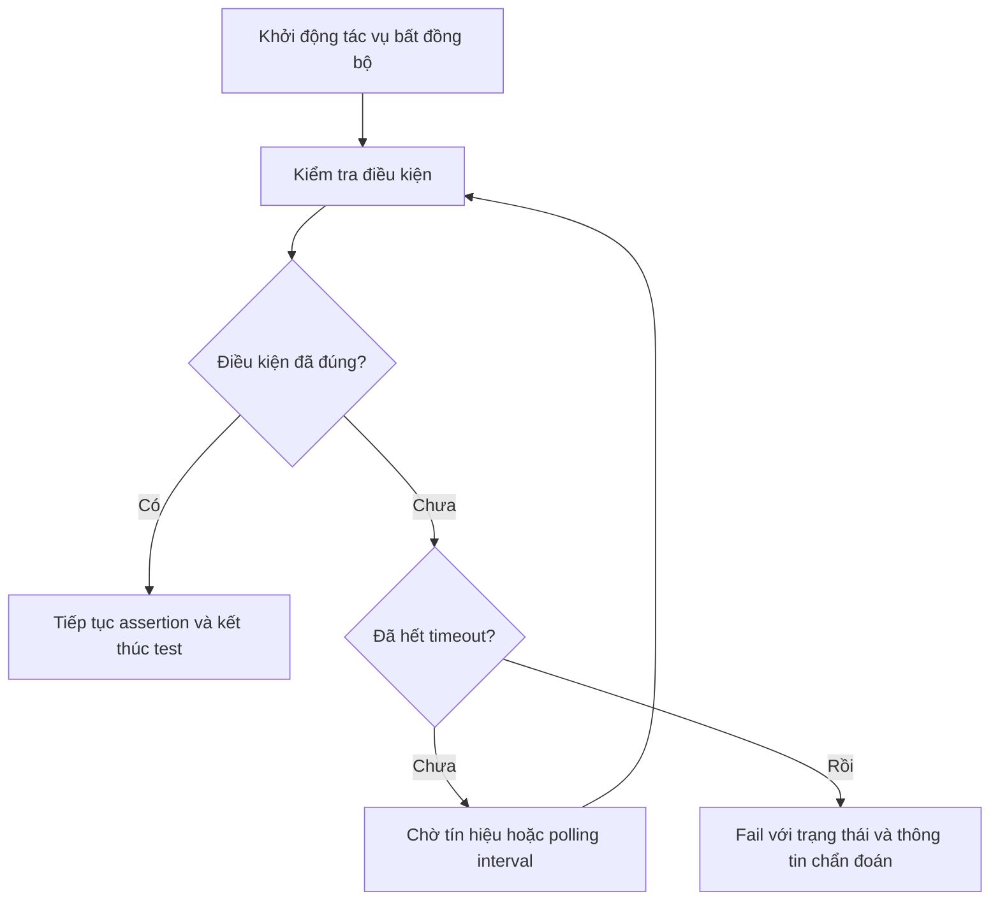

# Chờ kết quả bất đồng bộ theo điều kiện thay vì thời gian cố định

Trong hệ thống Kafka, gửi record, broker xác nhận, consumer nhận record và ứng dụng hoàn tất xử lý là những bước diễn ra bất đồng bộ. Một bài kiểm thử không thể giả định rằng mọi bước sẽ hoàn tất sau đúng một khoảng thời gian cố định. Nếu dùng `Thread.sleep(1000)` rồi kiểm tra kết quả, test có thể chạy qua trên máy nhanh nhưng thất bại trên CI hoặc khi broker chịu tải; tăng thời gian sleep chỉ làm test chậm hơn mà vẫn không bảo đảm kết quả đã sẵn sàng.

Cách kiểm thử ổn định hơn là chờ một điều kiện có thể quan sát được, với giới hạn thời gian rõ ràng. Ví dụ: chờ `Future` của producer hoàn tất, chờ consumer poll được record, chờ listener đưa sự kiện vào queue hoặc chờ trạng thái trong database đạt giá trị mong đợi. Khi điều kiện đúng, test tiếp tục ngay; nếu hết thời hạn mà điều kiện vẫn sai, test thất bại với thông tin đủ để điều tra.

## Mục tiêu bài học

Sau bài học, bạn có thể:

- Giải thích vì sao `Thread.sleep()` tạo ra test chậm và dễ chập chờn.
- Phân biệt chờ theo điều kiện với chờ một khoảng thời gian cố định.
- Đặt timeout hữu hạn và polling interval hợp lý.
- Chờ kết quả gửi Kafka qua `Future` hoặc `CompletableFuture`.
- Chờ consumer nhận record bằng `poll()` và chờ listener xử lý bằng queue, latch hoặc Awaitility.
- Kiểm thử trạng thái cuối cùng mà không giả định thời gian xử lý chính xác.
- Viết test có khả năng chẩn đoán tốt khi timeout, retry hoặc consumer lag xảy ra.

## 1. Vì sao không nên chờ bằng `Thread.sleep()`?

Một test thường có dạng:

```java
producer.send(record);
Thread.sleep(1_000);
assertThat(repository.findById(orderId)).isPresent();
```

Đoạn mã này giả định rằng một giây luôn đủ để producer gửi record, broker lưu record, consumer nhận sự kiện và cập nhật database. Kafka không đưa ra bảo đảm đó. Thời gian thực tế phụ thuộc vào scheduler của JVM, mạng, tải broker, consumer group rebalance, retry, database và môi trường CI.

Sleep gây ra hai tình huống xấu:

- **Thời gian chờ quá ngắn:** test kiểm tra trước khi công việc hoàn tất và thất bại ngẫu nhiên.
- **Thời gian chờ quá dài:** công việc hoàn tất sớm nhưng test vẫn đứng chờ hết thời gian đã đặt.

Tăng sleep từ một lên năm giây có thể giảm tần suất lỗi trong một môi trường, nhưng không xử lý nguyên nhân. Trong môi trường khác, năm giây vẫn có thể không đủ; còn các test chạy ổn định sẽ luôn tốn thêm thời gian.

Thay vào đó, hãy chờ điều kiện trực tiếp:

```java
await()
    .atMost(Duration.ofSeconds(5))
    .untilAsserted(() ->
        assertThat(repository.findById(orderId)).isPresent()
    );
```

Test kiểm tra trạng thái lặp lại cho đến khi assertion thành công hoặc hết năm giây. Nếu dữ liệu xuất hiện sau 200 ms, test có thể tiếp tục sau khoảng đó thay vì chờ đủ năm giây.

## 2. Mô hình chờ có điều kiện và timeout

Một phép chờ bất đồng bộ nên có ba thành phần:

1. **Điều kiện quan sát được:** trạng thái mà test cần xác nhận, chẳng hạn record đã được nhận hoặc database có trạng thái `PAID`.
2. **Timeout tối đa:** giới hạn tổng thời gian test được phép chờ. Timeout giúp test kết thúc và báo lỗi thay vì treo vô hạn.
3. **Cách chờ hoặc polling:** cơ chế nhận tín hiệu hoàn tất hoặc kiểm tra điều kiện định kỳ.



Timeout là giới hạn trên, không phải thời gian phải chờ đủ. Polling interval là khoảng nghỉ giữa các lần kiểm tra trong công cụ polling; nó không nên được dùng như một sleep cố định trước assertion.

### 2.1. Chọn timeout theo môi trường và mục tiêu test

Timeout cần đủ rộng để bao gồm độ trễ hợp lý của môi trường test, nhưng không nên quá lớn đến mức che giấu lỗi hoặc làm feedback chậm. Một số yếu tố cần tính đến:

- Test chạy local hay trong CI dùng tài nguyên chia sẻ.
- Kafka chạy embedded, bằng Testcontainers hay trên môi trường tích hợp.
- Test có chờ consumer group khởi động/rebalance hay không.
- Có retry hoặc thao tác ghi database nằm trong luồng cần kiểm tra không.
- SLA của hành vi đang kiểm thử là gì.

Không dùng cùng một timeout tùy tiện cho mọi test. Chờ producer future thường có thể ngắn hơn việc chờ một consumer group mới khởi động và xử lý xong. Ghi rõ timeout theo mục đích sẽ giúp test dễ hiểu và dễ điều chỉnh.

### 2.2. Chọn polling interval

Polling interval là khoảng cách giữa hai lần công cụ kiểm tra điều kiện. Interval quá ngắn có thể tạo nhiều truy vấn không cần thiết, đặc biệt khi điều kiện đọc database hoặc gọi dịch vụ ngoài. Interval quá dài làm test phản hồi chậm hơn khi điều kiện đã đạt.

Chọn interval dựa trên chi phí kiểm tra và độ trễ chấp nhận được. Với điều kiện trong bộ nhớ, interval vài chục mili giây thường đã đủ. Với truy vấn tích hợp đắt hơn, có thể dùng interval dài hơn hoặc exponential backoff nếu thư viện hỗ trợ. Điều quan trọng là tổng thời gian bị chặn vẫn có timeout hữu hạn.

## 3. Chờ producer gửi record thành công

Kafka producer gửi record bất đồng bộ. `KafkaProducer.send()` trả về `Future<RecordMetadata>`. Test có thể chờ future hoàn tất với timeout thay vì sleep rồi đoán rằng broker đã nhận record.

```java
import java.util.concurrent.TimeUnit;
import org.apache.kafka.clients.producer.ProducerRecord;
import org.apache.kafka.clients.producer.RecordMetadata;

ProducerRecord<String, String> record = new ProducerRecord<>(
    "orders",
    "ORD-900",
    "{\"eventType\":\"OrderCreated\",\"orderId\":\"ORD-900\"}"
);

RecordMetadata metadata = producer.send(record).get(5, TimeUnit.SECONDS);

assertThat(metadata.topic()).isEqualTo("orders");
assertThat(metadata.partition()).isGreaterThanOrEqualTo(0);
assertThat(metadata.offset()).isGreaterThanOrEqualTo(0);
```

`get(5, TimeUnit.SECONDS)` là chờ có giới hạn: nếu producer không nhận được kết quả trong năm giây, test thất bại với `TimeoutException`. Nếu future hoàn tất bằng exception, lỗi gửi cũng được truyền đến test. Điều này xác nhận kết quả gửi theo cấu hình producer; nó không chứng minh consumer đã xử lý record.

### 3.1. Với Spring Kafka và `CompletableFuture`

Trong Spring Kafka 3.x, `KafkaTemplate.send()` trả về `CompletableFuture<SendResult<K, V>>`. Test có thể chờ future và kiểm tra metadata:

```java
import java.util.concurrent.TimeUnit;
import org.springframework.kafka.support.SendResult;

SendResult<String, String> result = kafkaTemplate
    .send("orders", "ORD-900", payload)
    .get(5, TimeUnit.SECONDS);

assertThat(result.getRecordMetadata().topic()).isEqualTo("orders");
assertThat(result.getRecordMetadata().offset()).isGreaterThanOrEqualTo(0);
```

Nếu muốn kiểm tra callback, có thể dùng `CompletableFuture` để nối tiếp assertion. Không cần tạo thread phụ chỉ để chờ một kết quả đã được biểu diễn bằng future.

```java
CompletableFuture<SendResult<String, String>> sendFuture =
    kafkaTemplate.send("orders", "ORD-900", payload);

SendResult<String, String> result = sendFuture.get(5, TimeUnit.SECONDS);
assertThat(result.getProducerRecord().key()).isEqualTo("ORD-900");
```

Kiểu trả về và một số API của Spring Kafka phụ thuộc phiên bản. Với phiên bản trước Spring Kafka 3.x, `send()` có thể trả về `ListenableFuture`; hãy dùng API tương ứng của dependency đang chạy.

## 4. Chờ consumer nhận record bằng `poll()`

Kafka consumer có cơ chế chờ dữ liệu sẵn có ngay trong `poll(Duration)`. Thay vì gọi `poll()` một lần rồi sleep, test có thể tiếp tục poll cho đến khi nhận đủ số record cần kiểm tra hoặc hết deadline.

Ví dụ dưới đây minh họa đọc một record từ topic:

```java
import java.time.Duration;
import java.util.ArrayList;
import java.util.List;
import java.util.concurrent.TimeUnit;
import org.apache.kafka.clients.consumer.ConsumerRecord;
import org.apache.kafka.clients.consumer.ConsumerRecords;

List<ConsumerRecord<String, String>> received = new ArrayList<>();
long deadline = System.nanoTime() + TimeUnit.SECONDS.toNanos(5);

while (received.isEmpty() && System.nanoTime() < deadline) {
    ConsumerRecords<String, String> records =
        consumer.poll(Duration.ofMillis(100));

    for (ConsumerRecord<String, String> item : records) {
        received.add(item);
    }
}

assertThat(received)
    .as("consumer should receive an order event before the deadline")
    .hasSize(1);
assertThat(received.get(0).key()).isEqualTo("ORD-900");
```

`poll()` vừa tham gia vòng đời consumer group, vừa lấy record nếu có. Trong test tích hợp, cần subscribe topic trước và cho consumer tham gia group. Nếu test cần xác nhận assignment, có thể gọi `poll()` cho đến khi `consumer.assignment()` không rỗng, với deadline tương tự, rồi mới phát record. Việc chờ assignment là một điều kiện quan sát được; sleep một khoảng cố định sau `subscribe()` không bảo đảm partition đã được gán.

Ví dụ chờ assignment:

```java
long assignmentDeadline = System.nanoTime() + TimeUnit.SECONDS.toNanos(5);
while (consumer.assignment().isEmpty()
        && System.nanoTime() < assignmentDeadline) {
    consumer.poll(Duration.ofMillis(100));
}

assertThat(consumer.assignment())
    .as("consumer should receive a partition assignment")
    .isNotEmpty();
```

Trong consumer thực tế, tiếp tục gọi `poll()` theo vòng lặp bình thường để duy trì group membership. Ví dụ test trên chỉ minh họa cách đồng bộ hóa bước setup; cần đóng consumer trong `finally` hoặc `try-with-resources` sau khi kiểm tra.

## 5. Chờ listener xử lý trong Spring Kafka

Với `@KafkaListener`, phương thức listener được gọi trên luồng do listener container quản lý. Test thread không nên giả định listener chạy xong ngay sau `kafkaTemplate.send()`. Hãy tạo một tín hiệu có thể quan sát được như `BlockingQueue`, `CountDownLatch` hoặc trạng thái trong repository.

### 5.1. Dùng `BlockingQueue`

Một queue thread-safe phù hợp khi test muốn nhận payload từ listener:

```java
@Component
public class OrderListenerProbe {
    private final BlockingQueue<ConsumerRecord<String, String>> received =
        new LinkedBlockingQueue<>();

    @KafkaListener(topics = "orders", groupId = "orders-test")
    public void onMessage(ConsumerRecord<String, String> record) {
        received.offer(record);
    }

    public ConsumerRecord<String, String> awaitRecord(Duration timeout)
            throws InterruptedException {
        return received.poll(timeout.toMillis(), TimeUnit.MILLISECONDS);
    }
}
```

Trong test:

```java
kafkaTemplate.send("orders", "ORD-900", payload)
    .get(5, TimeUnit.SECONDS);

ConsumerRecord<String, String> record =
    orderListenerProbe.awaitRecord(Duration.ofSeconds(5));

assertThat(record).isNotNull();
assertThat(record.key()).isEqualTo("ORD-900");
```

`BlockingQueue.poll(timeout)` trả về ngay khi có phần tử hoặc khi timeout hết. Test không phải đợi hết khoảng thời gian nếu listener xử lý nhanh. Queue nên được làm sạch hoặc tạo mới cho từng test để tránh record từ test trước làm test sau pass nhầm.

### 5.2. Dùng `CountDownLatch`

Nếu test chỉ cần biết một hành động đã xảy ra, `CountDownLatch` biểu diễn tín hiệu hoàn tất rõ ràng:

```java
class OrderListenerProbe {
    private final CountDownLatch received = new CountDownLatch(1);
    private volatile ConsumerRecord<String, String> lastRecord;

    @KafkaListener(topics = "orders", groupId = "orders-test")
    public void onMessage(ConsumerRecord<String, String> record) {
        lastRecord = record;
        received.countDown();
    }

    boolean await(Duration timeout) throws InterruptedException {
        return received.await(timeout.toMillis(), TimeUnit.MILLISECONDS);
    }

    ConsumerRecord<String, String> lastRecord() {
        return lastRecord;
    }
}
```

Test gọi `await(Duration.ofSeconds(5))` và kiểm tra kết quả trả về. Latch phù hợp cho tín hiệu một lần; nếu cần nhận nhiều record hoặc nhiều sự kiện theo thứ tự, queue thường thuận tiện hơn. Tạo latch mới cho từng test hoặc từng scenario vì sau khi đếm về 0, latch không thể reset.

## 6. Dùng Awaitility để chờ điều kiện cuối cùng

Awaitility là thư viện Java giúp kiểm thử điều kiện bất đồng bộ bằng cú pháp dễ đọc. Nó phù hợp khi test cần chờ trạng thái xuất hiện trong database, cache, read model hoặc một cấu trúc dữ liệu dùng chung.

Dependency Maven:

```xml
<dependency>
    <groupId>org.awaitility</groupId>
    <artifactId>awaitility</artifactId>
    <version>4.2.2</version>
    <scope>test</scope>
</dependency>
```

Ví dụ chờ trạng thái đơn hàng:

```java
import static org.awaitility.Awaitility.await;
import static org.assertj.core.api.Assertions.assertThat;

await()
    .atMost(Duration.ofSeconds(5))
    .pollInterval(Duration.ofMillis(100))
    .untilAsserted(() -> {
        Order order = orderRepository.findById("ORD-900").orElse(null);
        assertThat(order).isNotNull();
        assertThat(order.getStatus()).isEqualTo(OrderStatus.PAID);
    });
```

`untilAsserted` chạy assertion lặp lại cho đến khi tất cả assertion thành công hoặc hết timeout. Nếu repository vẫn trả về trạng thái cũ, test tiếp tục chờ. Khi hết hạn, Awaitility báo timeout và giữ thông tin assertion để hỗ trợ chẩn đoán.

### 6.1. Chờ một điều kiện thay vì chờ một số lần tùy ý

Nếu listener cập nhật một counter hoặc queue, có thể chờ số lượng đạt yêu cầu:

```java
await()
    .atMost(Duration.ofSeconds(5))
    .untilAsserted(() ->
        assertThat(receivedEvents).hasSize(3)
    );
```

Nếu điều kiện cần lấy giá trị boolean:

```java
await()
    .atMost(Duration.ofSeconds(5))
    .until(() -> orderRepository.existsById("ORD-900"));
```

Các điều kiện được polling nên là thao tác đọc, có thể lặp lại và không tạo tác dụng phụ. Không đặt lệnh gửi Kafka, trừ tiền hoặc cập nhật trạng thái bên trong lambda được Awaitility chạy nhiều lần; thao tác đó có thể được thực hiện lặp lại ngoài ý muốn.

## 7. Phân biệt các mốc hoàn tất trong luồng Kafka

Một test cần chờ đúng mốc mà nó muốn xác minh. Các mốc sau không đồng nghĩa:

| Mốc | Bằng chứng phù hợp | Không chứng minh điều gì? |
|---|---|---|
| Producer đã nhận xác nhận gửi | `Future`/`CompletableFuture` hoàn tất và có `RecordMetadata` | Consumer chưa chắc đã nhận hoặc xử lý |
| Consumer đã fetch record | `poll()` trả về `ConsumerRecord` | Logic nghiệp vụ có thể chưa hoàn tất |
| Listener đã được gọi | Queue/latch nhận tín hiệu | Database hoặc dịch vụ ngoài chưa chắc đã cập nhật |
| Tác dụng phụ nghiệp vụ đã hoàn tất | Trạng thái database hoặc kết quả hệ thống đích đạt điều kiện | Consumer group có thể chưa commit offset |
| Consumer đã commit tiến độ | Offset commit được xác nhận hoặc kiểm tra qua API phù hợp | Không chứng minh tác dụng phụ bên ngoài được ghi nguyên tử cùng offset |

Ví dụ, nếu test muốn xác minh `OrderPaid` đã cập nhật bảng `orders`, chỉ chờ `kafkaTemplate.send()` thành công là chưa đủ. Hãy chờ trạng thái database thành `PAID`. Nếu test chỉ kiểm tra producer ghi đúng topic/partition/offset, chờ future là mốc phù hợp và không cần đợi listener.

## 8. Thiết kế test Kafka không bị race condition

Chờ theo điều kiện vẫn cần setup đúng. Một số lỗi thường gặp đến từ consumer chưa sẵn sàng hoặc dữ liệu cũ còn trong topic.

### 8.1. Khởi tạo consumer trước khi phát record

Trong test tích hợp, hãy tạo consumer, subscribe topic và xác nhận assignment khi cần trước khi producer gửi record. Nếu producer gửi trước khi consumer sẵn sàng, kết quả còn phụ thuộc `auto.offset.reset`, committed offset của group và retention.

Với group ID riêng cho mỗi test, việc kiểm soát offset và dữ liệu dễ hơn. Tuy nhiên, group ID ngẫu nhiên không thay thế việc kiểm tra assignment nếu test cần chắc chắn consumer đã tham gia group.

### 8.2. Dùng topic và group cô lập

Test chạy song song có thể đọc nhầm record của nhau nếu cùng dùng topic và group cố định. Hãy tạo topic riêng cho test hoặc dùng tên topic có suffix duy nhất, và chọn group ID riêng theo test. Dọn tài nguyên trong teardown theo cách phù hợp với test environment.

### 8.3. Xóa trạng thái chia sẻ giữa các test

Queue, latch, counter, mock invocation và database row có thể tồn tại qua nhiều test nếu dùng singleton Spring context. Làm sạch trạng thái trước mỗi test hoặc thiết kế fixture riêng. Nếu không, điều kiện có thể đúng ngay lập tức do kết quả của test trước, tạo false positive.

### 8.4. Không polling một thao tác gây tác dụng phụ

Một điều kiện được kiểm tra nhiều lần phải an toàn khi chạy lặp. Các thao tác đọc trạng thái như truy vấn repository hoặc kiểm tra queue phù hợp. Việc gửi record mới, tạo đơn hàng hoặc gọi API thanh toán phải thực hiện một lần ở ngoài vòng polling.

## 9. Xử lý timeout và chẩn đoán lỗi

Timeout là một kết quả kiểm thử hữu ích nếu test cung cấp đủ ngữ cảnh. Khi chờ thất bại, nên ghi lại:

- Topic, partition và key của record đang kiểm tra nếu đã biết.
- Consumer group và assignment hiện tại.
- Số record đã nhận, offset gần nhất và trạng thái committed offset nếu có liên quan.
- Trạng thái database hoặc queue ở thời điểm hết timeout.
- Producer send result, exception và retry nếu gửi thất bại.
- Thời gian đã chờ và timeout được cấu hình.

Ví dụ với Awaitility, có thể thêm mô tả để lỗi dễ đọc:

```java
await()
    .alias("Order ORD-900 should become PAID after OrderPaid event")
    .atMost(Duration.ofSeconds(5))
    .untilAsserted(() ->
        assertThat(orderRepository.findStatus("ORD-900"))
            .contains(OrderStatus.PAID)
    );
```

Không tăng timeout ngay khi test thất bại. Trước tiên, xác định test đang chờ mốc nào và vì sao mốc đó chưa xảy ra: consumer chưa được assign, record không vào topic mong đợi, deserializer lỗi, listener ném exception, retry chưa kết thúc hay database update bị từ chối. Timeout lớn hơn chỉ hợp lý khi đã xác nhận thời gian xử lý dài là đặc tính hợp lệ của môi trường.

## 10. Những sai lầm thường gặp

| Sai lầm | Hậu quả | Cách xử lý |
|---|---|---|
| `Thread.sleep()` trước assertion | Test chậm và vẫn có thể chạy trước khi tác vụ xong | Chờ future, queue, latch hoặc trạng thái cuối cùng |
| Không đặt timeout | Test có thể treo vô hạn khi consumer hoặc broker lỗi | Mọi phép chờ bất đồng bộ cần timeout hữu hạn |
| Timeout quá ngắn | Test chập chờn trên CI hoặc khi group rebalance | Chọn timeout theo môi trường và mốc cần chờ |
| Timeout quá dài | Lỗi thật được phát hiện muộn, feedback chậm | Chọn giới hạn đủ rộng nhưng có căn cứ |
| Chờ producer ack rồi kết luận listener đã xử lý | Test kiểm tra sai mốc hoàn tất | Chờ trạng thái ở consumer hoặc hệ thống đích |
| Polling điều kiện có tác dụng phụ | Gửi hoặc thực hiện nghiệp vụ nhiều lần | Thực hiện tác vụ một lần, polling chỉ đọc trạng thái |
| Dùng queue/counter không được đồng bộ giữa thread | Visibility/race condition trong test | Dùng `BlockingQueue`, `CountDownLatch`, `Atomic*` hoặc cấu trúc thread-safe |
| Tái sử dụng topic/group và dữ liệu cũ | Test có thể nhận record của scenario khác | Cô lập topic, group và fixture |
| Chỉ tăng timeout khi test fail | Che giấu lỗi cấu hình hoặc xử lý | Thu thập assignment, offset, exception và trạng thái cuối cùng |

## 11. Bài tập tự kiểm tra

Một test gửi `OrderPaid` bằng `KafkaTemplate`, sau đó đợi bảng `orders` chuyển trạng thái sang `PAID`. Trong CI, test đôi lúc thất bại khi chờ một giây nhưng pass khi chạy lại.

Hãy trả lời:

1. Vì sao `Thread.sleep(1000)` không chứng minh listener đã xử lý xong?
2. Nên chờ `CompletableFuture` của producer ở bước nào và điều đó chứng minh điều gì?
3. Nên dùng Awaitility để kiểm tra điều kiện nào nếu mục tiêu là xác nhận database đã cập nhật?
4. Vì sao lambda polling chỉ nên đọc trạng thái thay vì gửi lại `OrderPaid`?
5. Nếu timeout xảy ra, cần ghi lại những thông tin nào để biết consumer chưa nhận record hay listener đã lỗi?
6. Nếu test chạy song song, topic và consumer group dùng chung có thể gây ra lỗi gì?

Gợi ý: tách mốc producer ack, consumer receive và business completion; dùng timeout hữu hạn; kiểm tra trạng thái cuối cùng bằng thao tác đọc lặp lại an toàn; cô lập topic/group và thu thập dữ liệu chẩn đoán.

## Kết luận

Kiểm thử bất đồng bộ cần đồng bộ hóa theo sự kiện hoặc trạng thái có thể quan sát được. Dùng `Future.get(timeout)`, `poll()`, `BlockingQueue`, `CountDownLatch` hoặc Awaitility để tiếp tục ngay khi điều kiện đạt và thất bại rõ ràng khi hết thời hạn. Chọn đúng mốc cần xác minh: producer ack, consumer nhận record, listener hoàn tất hay tác dụng phụ nghiệp vụ đã được ghi. Khi kết hợp timeout hữu hạn, điều kiện polling an toàn và test fixture cô lập, các bài kiểm thử Kafka sẽ nhanh hơn và ít phụ thuộc vào tốc độ của môi trường chạy.
