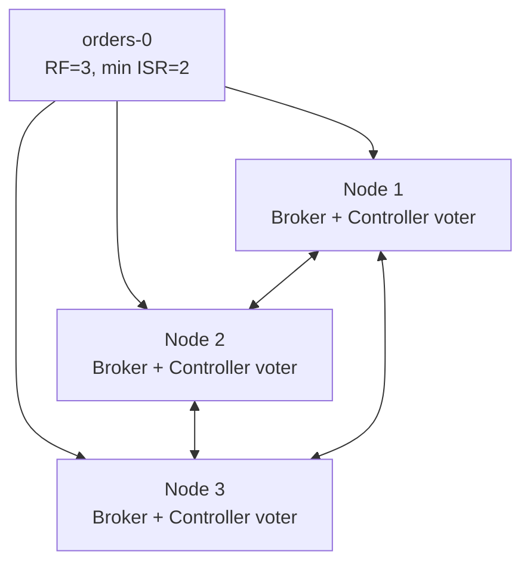

# Mô phỏng broker lỗi, mạng gián đoạn và consumer rebalance

## Kiểm thử khả năng chịu lỗi của Kafka bằng fault injection có kiểm soát

Kafka được thiết kế để tiếp tục phục vụ khi một số thành phần gặp lỗi, nhưng khả năng phục hồi thực tế phụ thuộc vào replication factor (RF), In-Sync Replicas (ISR), min.insync.replicas, producer acknowledgement, timeout, consumer group protocol và cách ứng dụng commit offset.

Một bài kiểm thử chịu lỗi cần tạo ra lỗi có thể tái lập, quan sát phản ứng của broker/client, rồi xác minh dữ liệu và trạng thái ứng dụng sau khi hệ thống ổn định. Chỉ nhìn thấy container restart hoặc consumer tự kết nối lại chưa đủ để chứng minh hệ thống an toàn.

Bài này tập trung vào ba nhóm tình huống:

- **Broker failure:** broker dừng có chủ đích, crash đột ngột hoặc mất vai trò leader/follower.
- **Network interruption:** client mất kết nối broker, broker mất kết nối broker khác hoặc kết nối bị trễ/giới hạn băng thông.
- **Consumer rebalance:** member rời group, member mới tham gia, consumer không poll đúng hạn hoặc mất kết nối với group coordinator.

Mọi thử nghiệm phá lỗi phải chạy trong môi trường test/staging cô lập, có dữ liệu kiểm thử và kế hoạch khôi phục. Không chạy lệnh dừng broker, ngắt mạng hoặc kill container trên production như một phép thử tùy tiện.

## 1. Mục tiêu và nguyên tắc kiểm thử

### 1.1 Điều cần chứng minh

Một bộ fault test tốt phải trả lời được:

1. Kafka có tiếp tục nhận ghi khi số replica còn lại vẫn đạt chính sách durability không?
2. Khi leader broker mất, partition có bầu leader hợp lệ từ ISR không?
3. Khi follower mất, producer/consumer còn hoạt động và follower có bắt kịp sau khi trở lại không?
4. Khi client bị mất mạng, producer retry và consumer reconnect có nằm trong timeout budget không?
5. Khi group rebalance, partition được thu hồi/giao lại đúng và offset không vượt quá công việc đã xử lý?
6. Nếu record đã xử lý nhưng offset chưa commit, ứng dụng có chịu được duplicate không?
7. Sau khi fault được gỡ bỏ, ISR, consumer lag, connector/task và downstream có trở lại baseline không?

### 1.2 Phân biệt lỗi hạ tầng và lỗi tiến độ ứng dụng

Kafka consumer có hai cơ chế liveness cần hiểu:

- **Session/heartbeat:** broker phát hiện member không còn gửi heartbeat trong thời hạn session.
- **Poll progress:** consumer phải tiếp tục gọi poll() trong giới hạn max.poll.interval.ms; nếu ứng dụng không poll đúng hạn, consumer có thể bị loại khỏi group dù heartbeat từng còn hoạt động.

Một consumer bị treo trong lúc xử lý batch không giống một consumer mất network. Hai tình huống có thể cùng gây rebalance nhưng cần fault injection và chẩn đoán khác nhau.

### 1.3 Phân loại mức độ lỗi

| Loại fault | Ví dụ | Điều được kiểm tra |
|---|---|---|
| Graceful shutdown | Dừng broker bằng SIGTERM/Docker stop | Shutdown, leader election, replica catch-up |
| Abrupt crash | SIGKILL/Docker kill | Phục hồi sau process crash, log recovery |
| Client-to-broker outage | Chặn đường TCP từ producer/consumer đến broker | Retry, reconnect, request timeout |
| Broker-to-broker partition | Chặn inter-broker traffic | ISR shrink, replication lag, leader availability |
| Latency/bandwidth fault | Tăng latency, giới hạn throughput | Timeout, backpressure, lag |
| Consumer member loss | Dừng một consumer | Session expiry, partition reassignment |
| Poll starvation | Cố ý xử lý lâu hơn max poll interval | Livelock detection và rebalance |
| Coordinator interruption | Mất kết nối broker đang làm group coordinator | Group recovery và commit retry |

## 2. Chọn môi trường test phù hợp

### 2.1 Embedded Kafka

Embedded Kafka hoặc broker giả lập phù hợp để kiểm tra:

- Serialization/deserialization.
- Listener method và Spring container wiring.
- Retry/error handler ở tầng ứng dụng.
- Commit mode, header, converter và business logic.

Nó không phải lựa chọn đủ tin cậy để chứng minh leader election, replica recovery, KRaft quorum hoặc inter-broker network partition giống production. Các kiểm thử này cần nhiều broker thực sự và topology phù hợp.

### 2.2 Testcontainers với một broker

Testcontainers Kafka module thuận tiện để khởi tạo broker tạm cho integration test. Một broker đủ để kiểm tra client reconnect, producer timeout, consumer restart và một số hành vi ứng dụng.

Một broker không thể chứng minh replication factor 3, ISR shrink/expand hoặc leader failover giữa các broker. Không viết test “broker failover” bằng cách dừng broker duy nhất rồi kết luận cluster đã chịu được lỗi replica.

### 2.3 Cluster nhiều broker chạy KRaft

Để kiểm tra broker failure và replication, cần tối thiểu nhiều broker có replica của cùng partition. Một môi trường test thực tế có thể dùng ba node kết hợp broker/controller hoặc tách controller và broker tùy mục tiêu.

Ví dụ topology ba node kết hợp:



Với ba controller voter, đa số là hai. Mất một node vẫn còn quorum; mất hai node làm mất majority và không còn khả năng điều phối metadata bình thường. Khi node đồng thời là broker/controller, dừng node ảnh hưởng cả data plane và metadata quorum; ghi rõ phạm vi này trong test report.

Nếu muốn tách riêng broker failure khỏi controller failure, dùng ba controller voter độc lập và ít nhất ba broker. Topology này tốn tài nguyên hơn nhưng giúp phân tích nguyên nhân rõ hơn.

### 2.4 Toxiproxy để mô phỏng lỗi mạng

Toxiproxy là TCP proxy có thể chèn vào giữa test client và broker hoặc giữa các container. Testcontainers có module Toxiproxy để tạo proxy và áp dụng các toxic như latency, bandwidth hoặc timeout.

Khi dùng Kafka, cần chú ý metadata và advertised listeners: client bootstrap vào một địa chỉ, sau đó nhận danh sách broker endpoint và kết nối trực tiếp đến các địa chỉ được quảng bá. Nếu chỉ proxy bootstrap endpoint mà không proxy các advertised broker endpoint, test có thể không thực sự đi qua Toxiproxy.

Đối với broker-to-broker fault, phải định tuyến inter-broker listener qua proxy hoặc dùng công cụ network fault injection ở network namespace/container. Chỉ chặn client listener không mô phỏng được mất kết nối replication giữa broker.

### 2.5 Ma trận chọn công cụ

| Công cụ | Phù hợp với | Giới hạn cần nhớ |
|---|---|---|
| Embedded Kafka | Test logic Spring/client nhanh | Không thay thế cluster nhiều broker |
| Testcontainers Kafka | Integration test với broker thật | Một container mặc định không tạo cluster RF nhiều broker |
| Docker Compose | Cluster KRaft nhiều node tái lập | Cần tự quản lý listener, storage và startup ordering |
| Toxiproxy | TCP latency, timeout, bandwidth, connection fault | Phải proxy đúng mọi endpoint cần thử |
| Linux tc netem | Delay, loss, reorder ở network interface | Cần quyền và phạm vi network namespace phù hợp |
| Docker stop/kill | Graceful stop và crash container | Dừng sai node hoặc volume có thể phá môi trường test |
| Kubernetes/Chaos tooling | Fault trong topology gần production | Cần namespace, RBAC và blast radius được giới hạn |

## 3. Chuẩn bị cluster và dữ liệu kiểm thử

### 3.1 Cấu hình topic và producer

Để kiểm tra durability khi mất một broker, tạo topic có RF=3, sau đó đặt min ISR=2 và chính sách clean election. RF là tham số tạo topic; min ISR và unclean election là cấu hình topic có thể được quản lý riêng:

```bash
kafka-topics.sh --bootstrap-server kafka-1:9092 \
  --create --topic orders --partitions 6 --replication-factor 3 \
  --config min.insync.replicas=2 \
  --config unclean.leader.election.enable=false
```

Producer kiểm thử nên dùng:

```properties
acks=all
enable.idempotence=true
retries=2147483647
delivery.timeout.ms=120000
request.timeout.ms=30000
```

Các giá trị timeout ở trên chỉ là cấu hình minh họa cho một test profile. Chọn timeout phù hợp với thời gian fault, SLA và phiên bản client. delivery.timeout.ms bao trùm thời gian chờ request, retry và delivery; không đặt nó nhỏ hơn fault window nếu mục tiêu là kiểm tra producer phục hồi sau một outage ngắn.

acks=all chờ ISR hiện tại và min.insync.replicas=2 yêu cầu ít nhất hai ISR khi xử lý produce. Khi ISR chỉ còn một replica, producer sẽ nhận lỗi insufficient replicas thay vì tiếp tục ghi dưới ngưỡng durability.

### 3.2 Tạo record có thể đối chiếu

Không dùng tổng record count làm bằng chứng duy nhất. Tạo record với ID duy nhất và sequence theo key:

```json
{
  "eventId": "fault-test-000001",
  "key": "customer-42",
  "sequence": 1,
  "createdAt": "2026-11-20T12:00:00Z",
  "payload": {
    "status": "ACTIVE"
  }
}
```

Producer test ghi manifest gồm:

- Tập event ID đã gửi.
- Event ID được broker ACK thành công.
- Key và sequence dự kiến.
- Payload hash.
- Topic/partition/offset nhận được từ callback.
- Thời điểm bắt đầu/kết thúc từng fault.

Consumer test ghi:

- Event ID đã nhận.
- Số lần nhận từng event ID.
- Partition/offset và timestamp.
- Thời điểm xử lý side effect.
- Offset đã commit.
- Partition assignment và các callback rebalance.

### 3.3 Lưu trạng thái ban đầu

Trước mỗi test case:

1. Xác nhận toàn bộ broker và controller khỏe.
2. Xác nhận topic có đúng RF, leader và ISR mong đợi.
3. Xác nhận không có under-replicated hoặc offline partition ngoài baseline.
4. Ghi consumer group member và assignment.
5. Ghi committed offset, log end offset và consumer lag.
6. Ghi producer/consumer error rate, request latency và throughput.
7. Lưu cluster ID, image version, cấu hình và test run ID.

Không chạy nhiều fault case đồng thời trên cùng cluster dùng chung; kết quả sẽ khó quy nguyên nhân và có thể làm test khác thất bại.

## 4. Mô phỏng broker graceful shutdown

### 4.1 Mục tiêu

Kiểm tra cluster khi một broker rời đi có trật tự:

- Controller phát hiện broker rời cluster.
- Partition leader trên broker đó được chuyển sang replica hợp lệ trong ISR.
- Producer retry và tiếp tục ghi nếu min ISR còn đáp ứng.
- Consumer tiếp tục fetch sau khi metadata/leader được cập nhật.
- Replica trên broker dừng trở lại và catch up.

### 4.2 Các bước thực hiện

Trong cluster test có ít nhất ba broker:

1. Chọn broker đang làm leader cho ít nhất một partition có RF=3.
2. Ghi nhận leader, replicas, ISR và offset của partition.
3. Bắt đầu producer liên tục và consumer đọc song song.
4. Dừng broker bằng cơ chế graceful shutdown, ví dụ docker compose stop --timeout 60 broker-1.
5. Chờ controller phát hiện broker rời cluster và bầu leader mới.
6. Theo dõi producer retry/error và consumer fetch/rebalance.
7. Khởi động lại broker bằng docker compose start broker-1.
8. Chờ follower fetch bù và trở lại ISR.
9. Đối chiếu event ID, duplicate, offset và business state.

Lệnh ví dụ chỉ phù hợp khi tên service thực tế là broker-1 trong một Docker Compose test project. Không chạy lệnh trên một compose project khác hoặc cluster dùng chung.

### 4.3 Kết quả mong đợi

- Partition có leader mới thuộc ISR.
- Nếu ISR còn hai replica và min ISR bằng hai, producer acks=all tiếp tục ghi sau thời gian chuyển leader/retry.
- Consumer thường gặp fetch retry hoặc refresh metadata rồi tiếp tục đọc. Leader change tự nó không bắt buộc tạo consumer group rebalance; rebalance chỉ xảy ra nếu membership, coordinator hoặc assignment bị ảnh hưởng.
- Broker trở lại không tự động trở thành leader cho mọi partition; nó phải bắt kịp để vào ISR.
- Under-replicated partition trở về 0 sau catch-up.
- Không thiếu event đã ACK trong phạm vi durability contract.
- Duplicate được đánh giá theo delivery semantics; consumer phải idempotent nếu side effect có thể chạy lại.

### 4.4 Tiêu chí pass/fail

| Kiểm tra | PASS | FAIL |
|---|---|---|
| Leader election | Leader mới thuộc ISR | Không có leader hoặc unclean election ngoài chính sách |
| Producer | Tiếp tục trong recovery budget | Mất record đã ACK ngoài RPO hoặc lỗi kéo dài vượt SLA |
| Consumer | Tiếp tục sau leader change | Group treo, lag tăng không hồi phục |
| Replica recovery | Broker trở lại ISR | Replica không catch up hoặc ISR tiếp tục giảm |
| Data integrity | Không thiếu/corrupt event đã ACK | Event ID mất hoặc payload sai |

## 5. Mô phỏng broker crash đột ngột

### 5.1 Khác graceful shutdown ở điểm nào?

Graceful shutdown cho broker thời gian đóng socket, flush trạng thái và rời cluster có trật tự. Crash đột ngột mô phỏng process bị kill hoặc máy chủ mất nguồn, do đó broker không hoàn tất shutdown protocol.

Trong Docker test environment, docker kill broker-1 thường gửi SIGKILL đến process chính. Lệnh này chỉ dùng trong môi trường cô lập; không xóa container volume.

### 5.2 Kịch bản

1. Ghi canary events liên tục và lưu producer ACK.
2. Xác nhận topic RF=3, min ISR=2, unclean leader election bị tắt.
3. Kill broker đang làm leader.
4. Theo dõi thời gian controller phát hiện broker mất và thời gian leader election.
5. Theo dõi producer retry, delivery timeout và consumer leader refresh.
6. Khởi động lại broker.
7. Chờ log recovery và follower catch-up.
8. Đối chiếu event ID đã ACK với consumer output.

### 5.3 Kỳ vọng và điều cần đo

- Producer có thể nhận retriable errors trong lúc leader thay đổi.
- Request đang bay có thể timeout; producer idempotence và retry policy quyết định cách xử lý.
- Consumer có thể thấy disconnect, fetch retry hoặc group rebalance nếu coordinator/broker bị ảnh hưởng.
- Broker khởi động lại phải phục hồi log và replica state trước khi bắt kịp leader.
- Không ép replica ngoài ISR thành leader khi chính sách yêu cầu clean election.

Đo ít nhất:

- Thời gian từ kill đến leader mới.
- Thời gian producer gửi thành công trở lại.
- Số request retry, timeout và lỗi không retry được.
- Thời gian consumer fetch trở lại.
- Thời gian ISR phục hồi.
- Số event bị xử lý lại và số side effect duplicate.

### 5.4 Phân biệt broker crash với mất controller quorum

Trong topology ba node kết hợp broker/controller, kill một node làm giảm cả broker count và controller voter count nhưng vẫn còn hai trong ba voter. Kill hai node có thể làm mất majority controller. Đây là test quorum loss riêng, không gộp vào kịch bản một broker crash.

Khi mất controller quorum, metadata operation và điều phối cluster bị ảnh hưởng. Không kết luận lỗi produce/fetch ở data plane chỉ từ trạng thái quorum; cần xem broker/partition leader và client error riêng.

## 6. Mô phỏng follower failure và ISR shrink/expand

### 6.1 Mục tiêu

Kiểm tra leader vẫn phục vụ khi một follower không còn fetch được:

1. Topic có ba replica và ISR ban đầu gồm cả ba.
2. Chặn kết nối từ follower đến leader hoặc dừng follower.
3. Chờ follower bị loại khỏi ISR theo cơ chế replica lag/failure detection.
4. Xác nhận producer vẫn ghi nếu ISR còn hai và min ISR là hai.
5. Gỡ fault, khởi động follower và chờ follower catch up.
6. Xác nhận ISR trở lại ba.

### 6.2 Không đồng nhất broker online với ISR healthy

Broker có thể đã đăng ký lại cluster nhưng một số replica vẫn đang fetch bù. Điều kiện phục hồi là replica được thêm lại vào ISR, không chỉ là process có trạng thái running.

Theo dõi:

- UnderReplicatedPartitions.
- UnderMinIsrPartitionCount.
- IsrShrinksPerSec và IsrExpandsPerSec.
- Replica fetcher lag/throughput.
- Leader/follower LEO và high watermark nếu công cụ cung cấp.

### 6.3 Thử mất hai replica

Với RF=3 và min ISR=2:

- Mất một replica: ISR có thể còn hai; producer acks=all vẫn ghi được.
- Mất thêm một replica: ISR chỉ còn một; producer bị từ chối theo min ISR.

Đây là kết quả mong đợi để chứng minh chính sách durability đang hoạt động. Không hạ min ISR xuống một chỉ để test producer tiếp tục ghi.

## 7. Mô phỏng client network interruption

### 7.1 Phân biệt lỗi kết nối với broker crash

Broker có thể vẫn khỏe trong khi client không kết nối được. Ví dụ:

- Mất route từ ứng dụng đến broker.
- TCP reset hoặc connection timeout.
- Packet loss/latency cao.
- Firewall tạm thời chặn port.
- DNS hoặc advertised listener không phân giải được.

Trong kịch bản này, controller và replication có thể vẫn bình thường. Chỉ client path bị lỗi.

### 7.2 Dùng Toxiproxy

Đặt proxy giữa test client và Kafka broker, sau đó thay đổi toxic trong lúc producer/consumer đang chạy. Các fault thường dùng:

- Latency: thêm độ trễ hai chiều.
- Bandwidth: giới hạn tốc độ byte.
- Timeout: làm kết nối bị ngắt/không phản hồi theo cấu hình toxic.
- Reset peer hoặc connection interruption: mô phỏng TCP connection bị reset.

Với Kafka, phải cấu hình listener sao cho mọi broker endpoint mà client nhận từ metadata đều có thể đi qua proxy. Nếu client kết nối trực tiếp tới advertised listener của broker, fault ở proxy bootstrap sẽ không tác động đến các request sau đó.

### 7.3 Test producer khi mất mạng

1. Bắt đầu gửi event ID tăng dần.
2. Chèn latency hoặc timeout qua proxy.
3. Ghi nhận retry, request timeout và delivery timeout.
4. Khôi phục kết nối.
5. Chờ producer callback hoàn tất hoặc trả lỗi cuối.
6. Đối chiếu tập event ID được ACK với tập event ID consumer đọc được.

Kỳ vọng:

- Producer retry retriable errors trong giới hạn delivery timeout.
- Nếu outage vượt delivery timeout, send future/callback kết thúc bằng lỗi; ứng dụng phải có chính sách xử lý record chưa xác nhận.
- Không giả định một request timeout đồng nghĩa broker chắc chắn chưa ghi record. Request có thể đã được append nhưng ACK bị mất trên mạng; retry/idempotence và business idempotency cần xử lý tình huống này.
- Sau khi mạng phục hồi, producer không được giữ buffer đầy vô hạn hoặc tạo backlog nội bộ không kiểm soát.

### 7.4 Test consumer khi mất mạng

1. Consumer đang poll và xử lý record.
2. Chặn client-to-broker path hoặc coordinator path.
3. Quan sát heartbeat, fetch/commit errors và group state.
4. Khôi phục mạng trước và sau session timeout trong hai lần test riêng.
5. Xác nhận consumer rejoin hoặc partition được giao cho member khác.
6. Đối chiếu committed offset với side effect đã hoàn tất.

Consumer có thể bị rebalance nếu không gửi heartbeat hoặc không poll đúng hạn. Nếu side effect đã hoàn tất nhưng offset chưa commit, record có thể được giao lại. Đây là lý do consumer cần idempotency key hoặc transaction phù hợp.

## 8. Mô phỏng network partition giữa các broker

### 8.1 Mục tiêu

Kiểm tra replication và controller behavior khi broker không trao đổi được với nhau, trong khi một số client vẫn có thể kết nối tới một phía.

Đây là fault nguy hiểm hơn client disconnect vì có thể tạo ra hai nhóm node có góc nhìn khác nhau về cluster. Trong KRaft, controller quorum majority vẫn là điều kiện để metadata log tiếp tục tiến triển.

### 8.2 Thiết kế test

Trong môi trường ba node:

1. Chọn một node hoặc một đường inter-broker link.
2. Chặn traffic inter-broker theo một hướng hoặc cả hai hướng bằng Toxiproxy/network namespace.
3. Không chặn nhầm toàn bộ controller quorum nếu mục tiêu chỉ là follower replication.
4. Quan sát ISR shrink, controller leader và broker registration.
5. Gỡ fault và kiểm tra replication catch-up.

Nếu topology dùng combined broker/controller, một network partition có thể đồng thời ảnh hưởng replication và controller quorum. Ghi rõ node nào còn nhìn thấy node nào; không chỉ ghi chung “Kafka mất mạng”.

### 8.3 Kỳ vọng

- Replica không theo kịp có thể rời ISR.
- Leader tiếp tục nhận ghi chỉ khi ISR còn đạt min ISR.
- Controller majority duy trì được metadata quorum trong kịch bản còn đủ voter.
- Không có hai leader hợp lệ cùng ghi vào một partition trong một cluster.
- Khi mạng phục hồi, follower fetch bù và ISR mở rộng trở lại.
- Nếu quorum mất majority, metadata progress bị dừng; không cố tạo cluster mới hoặc format storage để “sửa” test.

## 9. Kiểm thử consumer rebalance

### 9.1 Các nguyên nhân gây rebalance

Rebalance xảy ra khi membership hoặc subscription của group thay đổi, hoặc khi member bị xem là không còn hợp lệ:

- Consumer mới join group.
- Consumer shutdown/crash.
- Consumer mất heartbeat quá session timeout.
- Ứng dụng không gọi poll trong max.poll.interval.
- Subscription/topic metadata thay đổi.
- Partition count thay đổi.
- Group coordinator hoặc broker có sự cố.

Rebalance không nhất thiết là lỗi. Đây là cơ chế phân phối lại partition; vấn đề là thời gian dừng xử lý, duplicate, commit sai và rebalance lặp lại.

### 9.2 Eager và cooperative rebalance

Với Classic group protocol, eager assignment có thể thu hồi toàn bộ partition rồi gán lại. Cooperative assignment cho phép chuyển dần partition để giảm phạm vi dừng, tùy assignor. Với Consumer group protocol mới, việc gán partition do broker điều phối thông qua server-side assignor; không áp dụng máy móc cùng cấu hình client-side assignor của Classic protocol.

Test cần ghi rõ:

- Group protocol đang dùng.
- Với Classic protocol: partition.assignment.strategy và assignor được chọn.
- Với Consumer protocol: group.remote.assignor và broker group.consumer.assignors.
- Có static membership (group.instance.id) hay không.
- Có cooperative assignor như CooperativeStickyAssignor hay không.
- Số member và partition trước/sau fault.

Không so sánh thời gian rebalance giữa hai lần test nếu assignor hoặc protocol khác nhau mà không ghi nhận.

### 9.3 Thêm member vào group

Kịch bản:

1. Chạy một consumer với group ID cố định trên topic có sáu partition.
2. Xác nhận member sở hữu cả sáu partition.
3. Khởi động consumer thứ hai cùng group ID và subscription.
4. Chờ rebalance hoàn tất.
5. Xác nhận hai member nhận partition theo assignor.
6. Dừng member thứ hai và xác nhận partition được giao lại cho member còn lại.

Kỳ vọng:

- Không có partition được hai member cùng sở hữu trong cùng group tại cùng thời điểm ổn định.
- Tổng assignment bằng số partition đang được group subscribe và có thể xử lý.
- Consumer tiếp tục tiến offset sau rebalance.
- Có thể xuất hiện duplicate nếu record đã xử lý nhưng commit chưa hoàn tất.

### 9.4 Kill consumer member

Kịch bản:

1. Chạy hai consumer trong cùng group.
2. Ghi nhận assignment và heartbeat.
3. Kill một process consumer mà không gọi close.
4. Chờ session timeout hoặc cơ chế phát hiện failure phù hợp.
5. Xác nhận member còn lại nhận partition bị thu hồi.
6. Khởi động lại member đã kill.
7. Xác nhận group rebalance lại và cả hai member ổn định.

Test nên đo thời gian từ khi process chết đến khi partition được giao cho member còn lại. Thời gian này chịu ảnh hưởng session timeout, group protocol, coordinator và thời điểm rebalance.

### 9.5 Cố ý vượt max.poll.interval.ms

Để mô phỏng consumer không tiến triển:

1. Đặt max.poll.records nhỏ để dễ kiểm soát batch.
2. Đặt max.poll.interval.ms ngắn trong test profile.
3. Cố ý block xử lý batch lâu hơn poll interval.
4. Quan sát consumer rời group hoặc bị thay thế.
5. Kiểm tra commit offset có thất bại do member không còn quyền sở hữu partition không.
6. Xác nhận member khác đọc lại record chưa commit.

Ví dụ cấu hình test:

```properties
max.poll.records=5
max.poll.interval.ms=10000
enable.auto.commit=false
```

Đây là cấu hình để test liveness, không phải cấu hình production khuyến nghị. Không đặt sleep cứng trong business handler production chỉ để tạo rebalance.

### 9.6 Classic và Consumer group protocol

Với group.protocol=classic, client dùng heartbeat.interval.ms và session.timeout.ms theo giới hạn broker; heartbeat interval thường phải nhỏ hơn session timeout. partition.assignment.strategy chọn client-side assignor cho group protocol này.

Với group.protocol=consumer, heartbeat interval và session timeout do broker quản lý bằng các cấu hình như group.consumer.heartbeat.interval.ms và group.consumer.session.timeout.ms; client không cấu hình các giá trị Classic tương ứng. group.remote.assignor chọn server-side assignor, còn broker khai báo các assignor được hỗ trợ qua group.consumer.assignors. max.poll.interval.ms vẫn là giới hạn tiến độ gọi poll.

Nếu consumer dùng static membership qua group.instance.id và vượt max.poll.interval.ms, partition không nhất thiết được giao lại ngay: consumer ngừng heartbeat và việc reassignment chờ đến khi session timeout hết hạn. Hãy đưa static/dynamic membership vào test matrix.

Vì vậy, test phải ghi rõ group protocol và đọc cấu hình của đúng Kafka/client version. Không thay heartbeat.interval.ms trong test Consumer protocol rồi kết luận đã thay đổi heartbeat behavior.

## 10. Kiểm tra callback rebalance và commit offset

### 10.1 ConsumerRebalanceListener

Consumer API có các callback:

- onPartitionsRevoked: partition sắp bị thu hồi; ứng dụng có cơ hội hoàn tất/commit offset an toàn khi vẫn còn quyền sở hữu.
- onPartitionsAssigned: partition mới được giao; ứng dụng có thể khôi phục state hoặc seek theo policy.
- onPartitionsLost: partition đã mất quyền sở hữu; không được giả định còn an toàn để commit.

Với Spring Kafka, ContainerProperties cho phép cấu hình rebalance listener; ConsumerAwareRebalanceListener cung cấp callback trước/sau commit và callback lost để tích hợp logic offset/state của ứng dụng.

### 10.2 Ví dụ listener ở Kafka Consumer API

```java
ConsumerRebalanceListener rebalanceListener = new ConsumerRebalanceListener() {
    @Override
    public void onPartitionsRevoked(Collection<TopicPartition> partitions) {
        log.info("Partitions revoked: {}", partitions);
        // Commit only offsets for records whose processing has completed.
    }

    @Override
    public void onPartitionsAssigned(Collection<TopicPartition> partitions) {
        log.info("Partitions assigned: {}", partitions);
        // Restore partition-local state if the application requires it.
    }

    @Override
    public void onPartitionsLost(Collection<TopicPartition> partitions) {
        log.warn("Partitions lost: {}", partitions);
        // Ownership is already lost; do not blindly commit stale positions.
    }
};
```

Đoạn code minh họa callback; cách đăng ký listener phụ thuộc API subscribe overload và phiên bản client. Không thực hiện database/network I/O kéo dài trong callback vì nó có thể kéo dài rebalance.

### 10.3 Kiểm tra commit không vượt quá xử lý

Giả sử partition có record offset 100, 101, 102:

- 100 xử lý thành công.
- 101 đang xử lý.
- 102 chưa xử lý.

Nếu consumer commit offset 103, khi rebalance consumer mới bắt đầu từ offset 103 và bỏ qua 101/102. Commit an toàn phải biểu thị offset tiếp theo sau dãy record đã hoàn tất liên tục, tức offset 101 trong ví dụ này.

Nếu 100 và 102 đã hoàn tất nhưng 101 chưa xong, không được commit vượt qua gap. Với xử lý song song, cần completion tracker theo partition.

### 10.4 Duplicate là điều cần kiểm tra, không phải luôn là test failure

Với at-least-once:

- Side effect có thể đã thành công.
- Consumer chưa commit offset.
- Rebalance hoặc crash xảy ra.
- Record được giao lại.

Test nên xác nhận side effect cuối cùng không bị nhân đôi nhờ idempotency key, unique constraint, inbox table hoặc transaction boundary. Đừng đặt tiêu chí “không bao giờ nhận duplicate” nếu ứng dụng dùng at-least-once.

## 11. Ví dụ Spring Kafka ghi nhận rebalance

Spring Kafka listener container hỗ trợ rebalance listener. Ví dụ dưới đây ghi log partition được thu hồi/giao lại/mất; trong production, logic commit và state restore phải phù hợp với ack mode và transaction của ứng dụng.

```java
@Bean
ConcurrentKafkaListenerContainerFactory<String, OrderEvent> kafkaListenerContainerFactory(
        ConsumerFactory<String, OrderEvent> consumerFactory) {

    var factory =
            new ConcurrentKafkaListenerContainerFactory<String, OrderEvent>();
    factory.setConsumerFactory(consumerFactory);
    factory.setConcurrency(3);

    factory.getContainerProperties().setConsumerRebalanceListener(
            new ConsumerRebalanceListener() {
                @Override
                public void onPartitionsRevoked(
                        Collection<TopicPartition> partitions) {
                    log.info("Revoked partitions: {}", partitions);
                }

                @Override
                public void onPartitionsAssigned(
                        Collection<TopicPartition> partitions) {
                    log.info("Assigned partitions: {}", partitions);
                }

                @Override
                public void onPartitionsLost(
                        Collection<TopicPartition> partitions) {
                    log.warn("Lost partitions: {}", partitions);
                }
            });

    return factory;
}
```

Nếu cần truy cập Consumer để lưu position hoặc acknowledge pending records, Spring Kafka có ConsumerAwareRebalanceListener. Phân biệt callback revoke trước commit, revoke sau commit và lost; không gọi logic revoke mặc định hai lần từ callback lost.

## 12. Fault test matrix

| ID | Fault injection | Kỳ vọng chính | Bằng chứng |
|---|---|---|---|
| BKR-01 | Graceful stop broker đang giữ leader | Leader mới từ ISR, producer/consumer phục hồi | Leader/ISR, ACK, event ID |
| BKR-02 | Kill broker leader đột ngột | Retry và clean election đúng policy | Error timeline, leader election time |
| BKR-03 | Stop follower | ISR shrink, leader tiếp tục nếu đủ min ISR | ISR, under-replicated metrics |
| BKR-04 | Restart follower | Follower catch up và vào ISR | LEO/lag, ISR expand |
| BKR-05 | Mất hai replica | Produce bị từ chối khi ISR dưới min ISR | NotEnoughReplicas errors |
| NET-01 | Client-to-broker timeout | Producer retry, consumer reconnect | Request errors, recovery time |
| NET-02 | Client-to-broker latency | Latency tăng có kiểm soát, không treo vô hạn | p99, timeout, buffer |
| NET-03 | Broker-to-broker partition | ISR thay đổi, quorum/data plane được phân biệt | ISR, controller status |
| NET-04 | Bandwidth limit | Throughput giảm, lag tăng rồi drain | Byte rate, lag trend |
| CG-01 | Thêm consumer member | Rebalance và assignment hợp lệ | Member/assignment |
| CG-02 | Kill consumer member | Partition được giao lại | Session/rebalance timing |
| CG-03 | Vượt max.poll.interval | Member mất quyền sở hữu, commit fail an toàn | Poll interval, commit error |
| CG-04 | Coordinator connection loss | Group phục hồi sau reconnect | Group state, rebalance metrics |

Mỗi test case cần ghi rõ fault duration, fault scope, expected recovery time, data contract và cleanup procedure.

## 13. Quan sát và thu thập bằng chứng

### 13.1 Broker/KRaft metrics

Theo dõi tối thiểu:

- OfflinePartitionsCount.
- UnderReplicatedPartitions.
- UnderMinIsrPartitionCount.
- IsrShrinksPerSec và IsrExpandsPerSec.
- Produce/fetch request rate, latency và error rate.
- Replication bytes in/out và replica fetcher lag.
- Request queue time, CPU, disk I/O và network throughput.
- KRaft controller leader, quorum status và metadata log progress.

Tên metric/MBean có thể khác theo phiên bản và exporter. Xác minh tên metric trong Kafka version đang test.

### 13.2 Consumer metrics

Theo dõi:

- rebalance-rate-per-hour.
- rebalance-latency-avg và rebalance-latency-max.
- last-poll-seconds-ago.
- time-between-poll-avg và time-between-poll-max.
- assigned-partitions.
- records-consumed-rate và bytes-consumed-rate.
- records-lag-max hoặc lag theo partition từ công cụ giám sát.
- Commit latency và commit failure.

### 13.3 Producer metrics

Theo dõi:

- Record send rate và byte rate.
- Request latency p50/p95/p99.
- Retry rate và error rate.
- Request timeout và delivery timeout.
- Buffer available bytes và waiting threads.

### 13.4 Correlate bằng timeline

Ghi một timeline duy nhất với:

1. Timestamp bắt đầu fault.
2. Container/process/network action.
3. Broker/controller log event.
4. Leader/ISR/group state change.
5. Producer error/retry.
6. Consumer rebalance callback.
7. Timestamp gỡ fault.
8. Thời điểm throughput/lag trở về baseline.

Nếu không có timeline, khó xác định lỗi đầu tiên là nguyên nhân hay chỉ là hệ quả của một rebalance.

## 14. Tự động hóa với Testcontainers và Toxiproxy

### 14.1 Dependency test

Ví dụ dependency Gradle cho Testcontainers 2.x; pin version phù hợp với dự án:

```gradle
testImplementation("org.testcontainers:testcontainers-kafka:2.0.5")
testImplementation("org.testcontainers:testcontainers-toxiproxy:2.0.5")
```

Tên module và API có thể thay đổi theo major version. Đọc tài liệu đúng version trước khi copy code vào build thật.

### 14.2 Vòng đời test

Một integration test tự động thường có các bước:

1. Tạo Docker network riêng cho test.
2. Khởi động Kafka container và Toxiproxy trên network đó.
3. Đăng ký listener phù hợp để test client kết nối qua proxy.
4. Tạo topic và producer/consumer fixture.
5. Gửi canary event và xác nhận baseline.
6. Áp dụng toxic hoặc dừng broker.
7. Chờ điều kiện bằng Awaitility/polling có timeout hữu hạn.
8. Gỡ toxic hoặc khởi động broker lại.
9. Xác minh dữ liệu và metric.
10. Đóng consumer/producer và dọn container/network.

Không dùng Thread.sleep() dài để đoán thời điểm rebalance. Dùng điều kiện quan sát được như callback đã xảy ra, leader đã đổi, ISR đã phục hồi hoặc consumer đã nhận đủ event ID.

### 14.3 Ví dụ logic test ở mức khái niệm

```java
@Test
void producerRecoversAfterTemporaryNetworkOutage() {
    // Arrange: create topic, producer, consumer and expected event IDs.
    sendBaselineEvents();
    awaitBaselineConsumed();

    // Fault: route the client connection through Toxiproxy,
    // then enable a temporary timeout/latency toxic.
    enableNetworkFault();

    // Act: continue sending uniquely identified events.
    sendEventsDuringFault();

    // Recover: remove the toxic and allow reconnect.
    disableNetworkFault();

    // Assert: wait for final send results and compare event IDs,
    // payload hashes, duplicates and processing outcomes.
    awaitProducerSettled();
    awaitConsumerCaughtUp();
    assertNoMissingAcknowledgedEvents();
    assertBusinessEffectsAreIdempotent();
}
```

Đây là skeleton minh họa; các hàm fixture cần triển khai theo Testcontainers/Toxiproxy version và test harness của dự án. Test phải có timeout tổng thể để không treo CI khi broker không thể phục hồi.

### 14.4 Khi nào không dùng Testcontainers đơn broker?

Không dùng một Kafka container đơn lẻ để kết luận các điều sau:

- Leader election giữa các replica.
- ISR shrink/expand trên RF=3.
- min.insync.replicas khi mất hai replica.
- Controller quorum majority.
- Broker-to-broker network partition.

Những tình huống này cần cluster nhiều broker/controller. Dùng Testcontainers cho client behavior; dùng Docker Compose/Kubernetes test topology hoặc môi trường chaos riêng cho cluster-level failure.

## 15. Quy trình chạy test có kiểm soát

### Trước test

- Chọn cluster test riêng và xác nhận đúng project/network.
- Xác nhận không chứa dữ liệu production.
- Chụp cấu hình, cluster ID, broker list và topic assignment.
- Xác nhận RF, min ISR và unclean election policy.
- Ghi producer/consumer baseline và expected event manifest.
- Xác định fault duration, timeout và recovery deadline.
- Bảo đảm có cách gỡ fault và khởi động lại node.

### Trong test

- Chỉ kích hoạt một fault class tại một thời điểm.
- Ghi timestamp và target chính xác.
- Không xóa volume hoặc format storage.
- Theo dõi broker, controller, producer, consumer và downstream.
- Dừng thử nghiệm nếu controller quorum hoặc dữ liệu test vượt khỏi phạm vi dự kiến.

### Sau test

- Gỡ toàn bộ toxic/firewall rule.
- Khởi động lại node đã dừng.
- Chờ ISR, leader và consumer group ổn định.
- Xác nhận không còn under-replicated/offline partition ngoài baseline.
- Đối chiếu event ID, payload hash, duplicate và business effect.
- Thu log/metric và tính recovery time.
- Dọn test resource sau khi đã lưu evidence.

Không dùng docker compose down -v như bước cleanup mặc định nếu cần giữ volume để điều tra hoặc khôi phục test data. Lệnh đó có thể xóa persistent volumes.

## 16. Tiêu chí nghiệm thu cho fault test

| Nhóm | Điều kiện đạt |
|---|---|
| Durability | Event đã ACK theo producer contract không mất ngoài RPO |
| Leader election | Leader mới thuộc ISR khi clean election được yêu cầu |
| ISR recovery | Replica trở lại ISR sau khi fault được gỡ và catch-up hoàn tất |
| Producer | Retry/timeout nằm trong budget; lỗi cuối được ứng dụng xử lý rõ |
| Consumer | Rejoin, assignment và poll progress trở lại bình thường |
| Offset | Không commit vượt quá record đã hoàn tất liên tục |
| Duplicate | Duplicate được xử lý idempotent theo delivery semantics |
| Ordering | Ordering trong partition/key được giữ theo thiết kế |
| KRaft | Controller quorum còn majority trong fault scenario yêu cầu |
| Recovery | Lag, throughput, request latency và error rate trở lại baseline |
| Evidence | Có timeline, logs, metrics, manifest và test result có thể tái lập |

Không yêu cầu zero duplicate cho mọi hệ thống at-least-once. Tiêu chí phải phù hợp với semantics ứng dụng và cách side effect được bảo vệ.

## 17. Lỗi kiểm thử thường gặp

| Sai lầm | Vì sao sai | Cách sửa |
|---|---|---|
| Dừng broker duy nhất rồi gọi là test replication | Không có follower/ISR để bầu leader | Dùng cluster ít nhất ba broker có RF=3 |
| Chỉ proxy bootstrap listener | Client kết nối broker advertised endpoint trực tiếp | Proxy toàn bộ advertised broker endpoint |
| Kill broker và controller cùng lúc nhưng không ghi phạm vi | Không biết lỗi data plane hay quorum | Tách test broker-only và controller quorum |
| Dùng acks=1 để test durability RF=3 | ACK không chờ ISR đầy đủ | Dùng acks=all và min ISR theo policy |
| Hạ min ISR khi fault xảy ra | Che giấu chính sách durability | Giữ cấu hình và xác minh lỗi produce mong đợi |
| Dùng sleep để chờ rebalance | Test flaky theo tải/CI | Chờ callback/assignment/condition có timeout |
| Assert không có duplicate trong at-least-once | Duplicate có thể xảy ra khi commit chưa hoàn tất | Assert idempotent business outcome |
| Commit offset trong callback lost | Consumer đã mất quyền sở hữu partition | Không commit stale position sau lost |
| Chỉ kiểm tra container RUNNING | Broker có thể chưa vào ISR hoặc chưa có leader | Kiểm tra topic describe, quorum và metrics |
| Không gỡ network toxic | Test sau bị ảnh hưởng | Cleanup toxic trong finally/fixture teardown |
| Xóa volume khi cleanup | Mất log phục vụ điều tra | Chỉ xóa khi test đã được lưu evidence và xác nhận |
| Chạy chaos test trên production không có giới hạn | Blast radius không kiểm soát | Dùng staging hoặc game day được phê duyệt |

## 18. Checklist production và CI

- [ ] Unit test bao phủ serialization, business handler và idempotency.
- [ ] Integration test dùng Kafka broker thật cho producer/consumer behavior.
- [ ] Cluster-level test có nhiều broker và RF phù hợp.
- [ ] Có test graceful broker shutdown và abrupt crash.
- [ ] Có test follower loss, ISR shrink và catch-up.
- [ ] Có test mất client network, latency và bandwidth.
- [ ] Có test inter-broker partition nếu kiến trúc yêu cầu.
- [ ] Có test consumer join/leave, crash và poll starvation.
- [ ] Có kiểm tra classic/consumer group protocol đúng với cấu hình triển khai.
- [ ] Có assertion về event ID, payload hash, ordering và duplicate.
- [ ] Có kiểm tra offset commit không vượt quá processing completion.
- [ ] Có dashboard broker, KRaft, producer, consumer và rebalance.
- [ ] Mỗi test có timeout, cleanup và fault scope rõ.
- [ ] Fault test chạy trên môi trường cô lập, không dùng production data.
- [ ] Có recovery evidence sau khi gỡ fault.

## Kết luận

Mô phỏng broker failure, network interruption và consumer rebalance cần được thiết kế thành các kịch bản riêng. Broker shutdown/crash kiểm tra leader election và ISR; Toxiproxy hoặc network fault injection kiểm tra retry, reconnect và timeout; consumer membership/poll fault kiểm tra rebalance, offset commit và idempotency.

Test có giá trị khi fault tái lập được và kết quả có thể đo: leader/ISR, controller quorum, producer ACK/error, consumer assignment, committed offset, event ID, payload hash, lag và recovery time. Dùng một broker để kiểm tra integration của client, cluster nhiều broker để kiểm tra replication/quorum, và proxy đúng advertised listener để kiểm tra network path. Sau mỗi fault, xác nhận hệ thống trở về trạng thái ổn định trước khi kết luận PASS.

## Tài liệu tham khảo

- Apache Kafka 4.2 Consumer Configs: https://kafka.apache.org/42/configuration/consumer-configs/
- Apache Kafka 4.2 KafkaConsumer Java API: https://kafka.apache.org/42/javadoc/org/apache/kafka/clients/consumer/KafkaConsumer.html
- Apache Kafka 4.2 Monitoring: https://kafka.apache.org/42/operations/monitoring/
- Apache Kafka 4.2 KRaft Operations: https://kafka.apache.org/42/operations/kraft/
- Testcontainers for Java — Kafka Module: https://java.testcontainers.org/modules/kafka/
- Testcontainers for Java — Toxiproxy Module: https://java.testcontainers.org/modules/toxiproxy/
- Spring for Apache Kafka — Rebalancing Listeners: https://docs.spring.io/spring-kafka/reference/kafka/receiving-messages/rebalance-listeners.html
- Docker CLI — Stop Containers: https://docs.docker.com/reference/cli/docker/container/stop/
- Docker CLI — Kill Containers: https://docs.docker.com/reference/cli/docker/container/kill/
