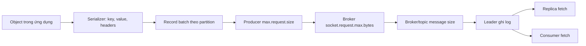

# RecordTooLargeException và giới hạn kích thước ở nhiều tầng

`RecordTooLargeException` thường xuất hiện khi producer gửi một record hoặc record batch vượt quá giới hạn mà Kafka client hay broker chấp nhận. Lỗi có thể bắt nguồn từ kích thước dữ liệu sau serialize, cấu hình producer, giới hạn của broker hoặc cấu hình riêng của topic. Với luồng có Kafka Connect, Kafka Streams hay nhiều consumer khác nhau, mỗi client còn có các giới hạn fetch và xử lý riêng.

Vì vậy, xử lý lỗi cần xác định chính xác tầng từ chối dữ liệu. Tăng một tham số bất kỳ có thể không giải quyết được nguyên nhân, hoặc khiến hệ thống phải cấp phát nhiều bộ nhớ hơn mức cần thiết. Bài học này đi theo đường đi của một record từ ứng dụng đến broker, qua replication và consumer, rồi đưa ra quy trình chẩn đoán và cách chọn giải pháp.

## 1. Mục tiêu và phạm vi

Sau bài học, người học có thể:

- Giải thích kích thước Kafka kiểm tra là kích thước dữ liệu đã serialize và record batch, không đơn thuần là kích thước object Java.
- Phân biệt `max.request.size`, `message.max.bytes`, `max.message.bytes`, `socket.request.max.bytes` và các giới hạn fetch.
- Nhận biết `RecordTooLargeException` ở producer và phân biệt với cảnh báo hoặc giới hạn fetch của consumer, replica.
- Kiểm tra cấu hình broker, topic, producer, consumer, Connect và Streams theo đúng vai trò.
- Chọn giữa giảm payload, nén, chia nhỏ dữ liệu hoặc điều chỉnh giới hạn có kiểm soát.

Phạm vi là Kafka với ứng dụng Java/Spring Kafka. Tên cấu hình và giá trị mặc định có thể khác theo phiên bản Kafka và cách triển khai. Khi vận hành, hãy kiểm tra tài liệu đúng phiên bản cùng cấu hình hiệu lực của cluster và client.

## 2. Kích thước nào được tính?

Producer không gửi trực tiếp object Java. Serializer chuyển key, value và dữ liệu liên quan thành byte; Kafka client đóng các record thành batch theo partition, có thể nén batch, rồi gửi trong Produce request.

Kích thước cần quan tâm vì thế có thể bao gồm:

- Byte của key sau serialize.
- Byte của value sau serialize.
- Header của record và metadata của record batch.
- Overhead của giao thức request khi nhiều batch được gom trong một request.
- Kết quả nén batch nếu producer bật compression.

Ví dụ, một object có trường văn bản dài 900 KB có thể lớn hơn 900 KB sau khi serialize thành JSON vì tên trường, dấu ngoặc, ký tự escape và header. Ngược lại, payload có cấu trúc lặp lại có thể nhỏ hơn trên đường truyền khi nén. Base64 làm dữ liệu nhị phân tăng khoảng một phần ba trước khi tính thêm phần bao JSON. Do đó, đo `object.toString().length()` hoặc số ký tự của chuỗi không đủ để kết luận record có vừa giới hạn Kafka hay không.

Với một luồng producer thông thường, đường đi có thể mô tả như sau:



Mỗi tầng bảo vệ một tài nguyên hoặc một loại dữ liệu khác nhau. Một record có thể vượt giới hạn producer trước khi gửi, bị broker từ chối sau khi gửi, hoặc được broker chấp nhận nhưng tạo áp lực bộ nhớ và mạng ở consumer hay replica.

## 3. Những giới hạn kích thước quan trọng

| Tầng | Cấu hình | Ý nghĩa |
| --- | --- | --- |
| Producer | `max.request.size` | Giới hạn kích thước Produce request mà producer tạo ra; đồng thời giới hạn hiệu dụng kích thước record batch mà producer có thể gửi. |
| Broker | `message.max.bytes` | Giới hạn batch broker chấp nhận theo cấu hình broker mặc định. |
| Topic | `max.message.bytes` | Giới hạn batch được chấp nhận cho topic; nếu không override thì dùng giá trị mặc định từ broker. |
| Broker network | `socket.request.max.bytes` | Giới hạn tổng kích thước một request mà broker nhận. Đây là giới hạn request, không phải giới hạn riêng cho một record. |
| Follower replica | `replica.fetch.max.bytes` | Lượng dữ liệu follower cố lấy cho mỗi partition trong một fetch. |
| Follower replica | `replica.fetch.response.max.bytes` | Giới hạn mục tiêu cho tổng dữ liệu trong replica fetch response. |
| Consumer | `max.partition.fetch.bytes` | Lượng dữ liệu tối đa consumer muốn lấy cho mỗi partition trong một fetch. |
| Consumer | `fetch.max.bytes` | Lượng dữ liệu tối đa consumer muốn nhận trong một fetch response tổng thể. |

Các cấu hình fetch của consumer và replica có một chi tiết quan trọng: Kafka cho phép trả về record batch đầu tiên của partition không rỗng ngay cả khi batch đó lớn hơn giới hạn fetch tương ứng. Cơ chế này giúp consumer và follower vẫn tiến lên khi gặp một batch lớn. Vì vậy, `max.partition.fetch.bytes` và `replica.fetch.max.bytes` không phải lúc nào cũng là hard cap chặn tuyệt đối một batch lớn. Tuy nhiên, đặt chúng quá thấp so với kích thước batch thực tế có thể làm fetch kém hiệu quả, tăng số lần fetch hoặc tạo cảnh báo khó hiểu.

`fetch.max.bytes` là giới hạn mục tiêu cho tổng response. Kafka cũng có ngoại lệ để trả về batch đầu tiên cần thiết cho tiến độ. Nếu consumer đọc nhiều partition, cần xem cả giới hạn mỗi partition và giới hạn tổng thể.

### 3.1. Những tham số thường bị nhầm là giới hạn record

- `batch.size` là kích thước mục tiêu để producer gom nhiều record cùng partition thành batch. Nó ảnh hưởng batching và bộ nhớ, nhưng không phải cách đặt giới hạn tối đa cho một record riêng lẻ.
- `buffer.memory` là tổng bộ nhớ producer dành cho buffer record đang chờ gửi. Thiếu buffer có thể khiến send chờ hoặc timeout, nhưng đây không phải giới hạn kích thước record ở broker.
- `linger.ms` điều chỉnh thời gian producer chờ gom batch, không làm record lớn trở nên hợp lệ.
- `max.poll.records` giới hạn số record trả về trong một lần `poll()`, không giới hạn số byte của một record hoặc fetch response.
- `max.poll.interval.ms` là giới hạn thời gian giữa các lần poll của consumer group, không phải giới hạn kích thước.
- `request.timeout.ms` và `delivery.timeout.ms` liên quan đến thời gian chờ, không sửa được một record luôn vượt giới hạn.

Không nên tăng các tham số này chỉ vì thấy lỗi có chữ `large` hoặc `timeout`. Trước hết phải xác định thông báo lỗi đến từ tầng nào.

## 4. Nhận diện nơi phát sinh lỗi

`RecordTooLargeException` thường được nhìn thấy ở phía producer khi client xác định record batch vượt `max.request.size`, hoặc khi broker trả lỗi vì batch vượt giới hạn của broker/topic. Với Spring Kafka, exception có thể được bọc trong `ExecutionException`, `CompletionException` hoặc exception của framework, tùy cách gửi và phiên bản thư viện.

Một số dấu hiệu giúp khoanh vùng:

| Triệu chứng | Tầng cần kiểm tra trước | Hướng xác minh |
| --- | --- | --- |
| `RecordTooLargeException` ngay khi gửi hoặc future thất bại | Producer | Kiểm tra byte sau serialize, `max.request.size` và cause gốc. |
| Broker trả lỗi batch quá lớn | Broker/topic | Kiểm tra `message.max.bytes` và `max.message.bytes` hiệu lực của topic. |
| Broker đóng kết nối hoặc từ chối request rất lớn | Broker network | Kiểm tra tổng Produce request và `socket.request.max.bytes`. |
| Producer gửi được nhưng consumer có cảnh báo fetch lớn hoặc đọc chậm | Consumer | Kiểm tra `max.partition.fetch.bytes`, `fetch.max.bytes`, bộ nhớ và số partition được gán. |
| Follower lag tăng khi có batch lớn | Replication | Kiểm tra replica fetch limits, băng thông, disk I/O và tình trạng follower. |
| Source connector lỗi khi publish | Kafka Connect producer | Kiểm tra converter, `producer.max.request.size` và giới hạn broker/topic. |
| Sink connector lỗi hoặc xử lý chậm khi nhận record lớn | Kafka Connect consumer và hệ thống đích | Kiểm tra `consumer.max.partition.fetch.bytes`, converter, giới hạn HTTP/database và bộ nhớ task. |

Không phải mọi lỗi consumer đều là `RecordTooLargeException`. Giới hạn fetch của consumer có cơ chế bảo đảm tiến độ như đã nêu; hãy đọc đầy đủ exception, log và metric thay vì suy ra nguyên nhân từ tên cấu hình.

## 5. Quy trình chẩn đoán theo từng bước

### Bước 1: Ghi lại thông tin của record lỗi

Thu thập topic, partition nếu đã biết, key hoặc correlation ID, serializer, loại dữ liệu, thời điểm gửi và kích thước payload đã serialize. Không ghi toàn bộ payload nhạy cảm vào log chỉ để điều tra kích thước.

Nếu ứng dụng có thể đo byte sau serialize mà không chạy serializer hai lần, hãy ghi nhận kích thước đó cùng kích thước key, value và số header. Tránh ước lượng bằng số ký tự Java vì số ký tự và số byte UTF-8 không giống nhau.

### Bước 2: Đọc cause gốc của producer future

Với Spring Kafka 3.x, `KafkaTemplate.send()` trả về `CompletableFuture`. Ví dụ sau minh họa cách lấy exception gốc khi chờ kết quả đồng bộ trong test hoặc công cụ chẩn đoán:

```java
try {
    SendResult<String, byte[]> result = kafkaTemplate
        .send(topic, key, payload)
        .get(10, TimeUnit.SECONDS);

    log.info("Sent topic={}, partition={}, offset={}",
        result.getRecordMetadata().topic(),
        result.getRecordMetadata().partition(),
        result.getRecordMetadata().offset());
} catch (ExecutionException ex) {
    Throwable cause = rootCause(ex);

    if (cause instanceof RecordTooLargeException) {
        log.error("Record vượt giới hạn Kafka; topic={}, keyId={}",
            topic, key);
    }

    throw ex;
}

private static Throwable rootCause(Throwable error) {
    Throwable current = error;
    while (current.getCause() != null && current.getCause() != current) {
        current = current.getCause();
    }
    return current;
}
```

Đây là ví dụ tập trung vào exception; ứng dụng thực tế nên tránh log key nếu key chứa dữ liệu nhạy cảm và nên có correlation ID riêng để tra cứu. `send()` cũng có thể phát sinh lỗi đồng bộ trước khi trả future, vì vậy phần xử lý lỗi của ứng dụng cần bao quát cả lỗi khi gọi hàm lẫn lỗi khi future hoàn tất. Nếu không cần chặn luồng, dùng `whenComplete` và ghi nhận lỗi trong callback.

Spring Kafka 2.x có API future khác với 3.x ở một số phiên bản. Hãy dùng kiểu future và cách xử lý callback tương ứng với phiên bản đang cài.

### Bước 3: Kiểm tra cấu hình producer

Đọc cấu hình thực tế mà ứng dụng truyền cho `KafkaProducer`, đặc biệt:

```properties
max.request.size=2097152
compression.type=zstd
```

Các giá trị trên chỉ minh họa một producer có giới hạn request 2 MiB và nén Zstandard. Chúng không phải cấu hình khuyến nghị dùng nguyên trạng cho mọi hệ thống. Nếu payload sau serialize đã lớn hơn giới hạn producer, broker chưa chắc đã nhận được request để có thể từ chối.

Với Spring Boot, có thể khai báo trực tiếp thuộc tính Kafka client:

```properties
spring.kafka.producer.properties.max.request.size=2097152
spring.kafka.producer.compression-type=zstd
```

Kiểm tra thêm serializer, header, key, compression và các cấu hình được ghi đè bởi profile, biến môi trường hoặc cấu hình triển khai. Đừng chỉ xem file `application.yml` rồi kết luận đó là cấu hình cuối cùng.

### Bước 4: Kiểm tra broker và topic

Broker có cấu hình mặc định `message.max.bytes`; topic có thể override bằng `max.message.bytes`. Ví dụ cấu hình minh họa:

```properties
# Broker config
message.max.bytes=2097152
socket.request.max.bytes=104857600
replica.fetch.max.bytes=4194304
```

```properties
# Topic config
max.message.bytes=2097152
```

Đọc cấu hình topic bằng CLI:

```bash
bin/kafka-configs.sh --bootstrap-server localhost:9092 \
  --entity-type topics --entity-name orders --describe --all
```

Đọc cấu hình broker theo broker ID:

```bash
bin/kafka-configs.sh --bootstrap-server localhost:9092 \
  --entity-type brokers --entity-name 1 --describe --all
```

CLI có thể hiển thị override động và thông tin cấu hình theo phiên bản; cần đối chiếu với cấu hình tĩnh của broker, cấu hình mặc định và cấu hình thực tế mà cluster đang chạy. Với cluster nhiều broker, kiểm tra tất cả broker có vai trò liên quan. Tránh chỉ kiểm tra broker bootstrap vì producer có thể được chuyển đến leader của partition trên broker khác.

`socket.request.max.bytes` giới hạn tổng request. Một request có thể chứa nhiều batch; vì vậy một record batch vừa `max.message.bytes` vẫn có thể nằm trong request quá lớn nếu producer gom nhiều dữ liệu vào cùng request. Hãy phân biệt hai trường hợp này khi đọc log.

### Bước 5: Kiểm tra consumer và replication

Nếu broker đã chấp nhận record, xác nhận các consumer có thể fetch và xử lý batch. Ví dụ Spring Boot:

```properties
spring.kafka.consumer.properties.max.partition.fetch.bytes=2097152
spring.kafka.consumer.properties.fetch.max.bytes=52428800
```

`max.partition.fetch.bytes` áp dụng cho từng partition; `fetch.max.bytes` áp dụng cho tổng response. Các giá trị cần dựa trên kích thước batch lớn nhất dự kiến, số partition được gán và ngân sách bộ nhớ của consumer.

Với replication, xem `replica.fetch.max.bytes` và `replica.fetch.response.max.bytes`, đồng thời quan sát replica lag, tốc độ mạng và disk I/O. Ngoại lệ trả batch đầu tiên giúp follower tiến lên khi gặp batch lớn, nhưng không thay thế việc thiết kế giới hạn và tài nguyên phù hợp.

### Bước 6: Kiểm tra các tầng ngoài Kafka

Record có thể đi qua API gateway, HTTP service, object mapper, converter, database hoặc hệ thống lưu trữ trước/sau Kafka. Một gateway có giới hạn request body nhỏ hơn Kafka sẽ từ chối dữ liệu trước khi producer gửi. Một sink connector có thể đọc được record nhưng không ghi được vào database do giới hạn cột, kích thước row hoặc API đích.

Kiểm tra kích thước ở từng điểm chuyển đổi. Đặc biệt lưu ý JSON, Base64, header do middleware bổ sung và converter của Kafka Connect. Schema Registry quản lý schema và compatibility; nó không tự nâng giới hạn kích thước của Kafka record.

### Bước 7: Tái hiện bằng payload đại diện

Tạo test với payload gần kích thước tối đa dự kiến, gồm cả key, header và serializer thật. Kiểm tra cả trường hợp ngay dưới và ngay trên ngưỡng. Chạy qua đường đi tương đương production: cùng serializer, compression, topic config và loại client. Một unit test chỉ kiểm tra object Java không đủ để xác nhận giới hạn trên wire.

## 6. Cấu hình đồng bộ khi cần tăng giới hạn

Nếu nghiệp vụ thật sự cần record lớn, hãy xác định kích thước batch lớn nhất và lập bảng cấu hình theo từng client trước khi thay đổi.

| Thành phần | Cần xem xét | Nguyên tắc |
| --- | --- | --- |
| Producer ứng dụng | `max.request.size` | Phải cho phép producer tạo request chứa batch hợp lệ; chừa chỗ cho overhead phù hợp. |
| Broker/topic | `message.max.bytes`, `max.message.bytes` | Đặt giới hạn chấp nhận theo topic và nhu cầu thực tế; topic override phải được kiểm tra rõ. |
| Broker network | `socket.request.max.bytes` | Đủ lớn cho tổng request, nhưng vẫn có giới hạn để bảo vệ broker. |
| Follower | `replica.fetch.max.bytes`, `replica.fetch.response.max.bytes` | Đủ để replication hiệu quả với batch dự kiến và số partition fetch. |
| Consumer | `max.partition.fetch.bytes`, `fetch.max.bytes` | Đủ để fetch hiệu quả, đồng thời tính ngân sách bộ nhớ khi nhiều partition được gán. |
| Connect/Streams | Producer và consumer client config | Kiểm tra config thực tế của task hoặc ứng dụng; không giả định chúng tự kế thừa config của service khác. |
| Hệ thống đích | HTTP, database, object storage | Bảo đảm giới hạn downstream phù hợp với định dạng dữ liệu sau chuyển đổi. |

Không nhất thiết mọi con số phải giống nhau. Producer giới hạn request, broker giới hạn batch và request, consumer giới hạn fetch response; chúng đo những đơn vị khác nhau. Hãy đặt các giới hạn sao cho một batch hợp lệ có thể đi qua toàn bộ đường xử lý, nhưng tổng request và mức sử dụng bộ nhớ vẫn được kiểm soát.

## 7. Kafka Connect và Kafka Streams

### 7.1. Kafka Connect

Source connector đọc dữ liệu từ hệ thống ngoài rồi ghi vào Kafka bằng producer của Connect worker. Khi source task gặp lỗi kích thước, kiểm tra converter và cấu hình producer của worker, thường được truyền qua các thuộc tính có tiền tố `producer.`.

Sink connector đọc record từ Kafka bằng consumer của worker rồi chuyển đổi và ghi sang hệ thống đích. Khi sink task lỗi, kiểm tra `consumer.max.partition.fetch.bytes`, `consumer.fetch.max.bytes`, converter và giới hạn của hệ thống đích. Một record có thể hợp lệ với Kafka nhưng vượt giới hạn HTTP hoặc database sau khi chuyển đổi.

Một số triển khai cho phép connector override cấu hình client bằng `producer.override.*` hoặc `consumer.override.*`. Việc này phụ thuộc `connector.client.config.override.policy` và chính sách quản trị của Connect cluster. Hãy xác minh override có được cho phép và cấu hình có thực sự được áp dụng cho task hay không.

### 7.2. Kafka Streams

Kafka Streams dùng Kafka consumer để đọc input topic và producer để ghi output topic. Vì vậy, giới hạn của cả hai client đều có thể ảnh hưởng đến topology. Khi một processor tạo output record lớn hơn input, việc đọc thành công không có nghĩa ghi output sẽ thành công.

Kiểm tra cấu hình consumer/producer hiệu lực của Streams application, serializer của output topic, header và cấu hình topic đích. Nếu record được mở rộng trong processor, hãy đo kích thước sau khi xử lý. Khi tăng giới hạn output topic, cần kiểm tra các ứng dụng consumer downstream và replica của topic đó.

## 8. Chọn cách khắc phục

### 8.1. Giảm payload

Đây thường là lựa chọn đầu tiên nếu record chứa dữ liệu thừa. Chỉ gửi trường cần thiết cho consumer; tránh nhúng object lồng nhau hoặc bản sao của dữ liệu đã có trong hệ thống khác. Dùng ID và metadata để consumer tra cứu phần dữ liệu còn lại khi phù hợp với yêu cầu độ trễ và tính sẵn sàng.

### 8.2. Nén dữ liệu

Producer hỗ trợ các kiểu nén như `gzip`, `snappy`, `lz4` và `zstd` tùy phiên bản client/broker. Compression có thể giảm byte truyền và lưu trữ, nhất là với JSON hoặc văn bản có nhiều phần lặp lại. Tuy nhiên:

- Hiệu quả phụ thuộc nội dung; dữ liệu đã nén hoặc mã hóa thường khó nén thêm.
- Nén và giải nén tiêu tốn CPU.
- Một record đơn lẻ rất lớn vẫn có thể vượt giới hạn nếu mức giảm không đủ.
- Consumer, broker và công cụ vận hành cần hỗ trợ codec được chọn.

Đo tỷ lệ nén và độ trễ với payload đại diện trước khi triển khai.

### 8.3. Đưa payload lớn ra object storage

Với file, ảnh, video hoặc tài liệu lớn, thường phù hợp hơn khi lưu nội dung trong object storage và gửi một sự kiện nhỏ chứa tham chiếu:

```json
{
  "eventId": "evt-8f31",
  "objectUri": "s3://orders/2026/11/order-781/document.pdf",
  "contentType": "application/pdf",
  "sizeBytes": 7340032,
  "sha256": "...",
  "schemaVersion": 1
}
```

Consumer tải object bằng quyền truy cập riêng và xác minh kích thước/checksum trước khi xử lý. Cần thiết kế thời hạn lưu object, quyền truy cập, mã hóa, xử lý object chưa được tham chiếu và tình huống upload thành công nhưng publish Kafka thất bại. URI không nên chứa credential hoặc token dài hạn.

### 8.4. Chia payload thành nhiều record

Nếu nghiệp vụ cần truyền dữ liệu qua Kafka, có thể chia thành các chunk có kích thước nhỏ hơn giới hạn. Mỗi chunk cần metadata để tái lắp ghép, chẳng hạn:

```json
{
  "messageId": "msg-42",
  "chunkIndex": 2,
  "chunkCount": 8,
  "checksum": "...",
  "data": "..."
}
```

Các chunk cần cùng key nếu yêu cầu chúng nằm trên cùng partition và giữ thứ tự trong partition đó. Consumer phải xử lý chunk trùng lặp theo hướng idempotent, phát hiện chunk thiếu, kiểm tra checksum, đặt timeout cho trạng thái chưa hoàn tất và dọn dữ liệu reassembly hết hạn. Nếu consumer group rebalance giữa lúc nhận chunk, trạng thái reassembly cần được lưu bền vững hoặc có thể khôi phục. Chia nhỏ dữ liệu làm tăng số record và độ phức tạp giao dịch; không nên chọn nếu object storage giải quyết được bài toán đơn giản hơn.

### 8.5. Tăng giới hạn có kiểm soát

Khi đã xác nhận record lớn là yêu cầu nghiệp vụ, thay đổi cấu hình theo một rollout có kế hoạch:

1. Đo phân phối kích thước record thực tế và xác định giới hạn tối đa cần hỗ trợ.
2. Kiểm tra tài nguyên broker, replica, consumer, Connect/Streams và downstream.
3. Cập nhật giới hạn broker/topic và network phù hợp với batch/request dự kiến.
4. Cập nhật producer và toàn bộ consumer cần đọc record đó; kiểm tra cả replica fetch.
5. Thử nghiệm trên môi trường staging bằng serializer và payload giống production.
6. Triển khai theo từng nhóm producer/topic, theo dõi lỗi gửi, request size, memory, GC, network, disk và consumer lag.
7. Giữ giới hạn ở mức thấp nhất vẫn đáp ứng yêu cầu; ghi lại chủ sở hữu và lý do của cấu hình.

Không tăng đồng loạt lên hàng chục hoặc hàng trăm MB chỉ để làm biến mất exception. Record lớn làm tăng áp lực bộ nhớ, thời gian GC, thời gian truyền, độ trễ replication và thời gian xử lý mỗi poll. Một số lượng nhỏ record lớn cũng có thể ảnh hưởng nhiều partition hoặc consumer cùng lúc.

## 9. Những cách xử lý không hiệu quả

| Cách làm | Vì sao không giải quyết đúng vấn đề |
| --- | --- |
| Tăng `retries` hoặc retry vô hạn | Payload có kích thước cố định vẫn vượt giới hạn ở lần gửi tiếp theo. |
| Tăng `request.timeout.ms` | Timeout dài hơn không làm request vượt giới hạn trở nên hợp lệ. |
| Chỉ tăng `max.poll.records` | Tham số đếm record, không tăng giới hạn byte của batch. |
| Chỉ tăng `batch.size` | Đây là mục tiêu gom batch, không thay thế `max.request.size` hay giới hạn broker/topic. |
| Chỉ tăng `fetch.max.bytes` ở một consumer | Producer, broker, topic, replica hoặc consumer khác vẫn có thể là tầng từ chối. |
| Chỉ tăng broker `message.max.bytes` | Topic override, producer request, broker socket hoặc downstream có thể vẫn thấp hơn. |
| Dùng compression mà không đo | Dữ liệu có thể không nén được đủ; CPU có thể trở thành nút thắt mới. |
| Ghi toàn bộ payload vào log | Tăng tải log và có thể làm lộ dữ liệu nhạy cảm mà không xác định được tầng lỗi. |

## 10. Bài tập thực hành

**Bài 1 — Tìm giới hạn đầu tiên:** Tạo topic thử nghiệm với giới hạn nhỏ, cấu hình producer và broker có giá trị khác nhau. Gửi payload ở dưới và trên từng ngưỡng, ghi lại tầng phát sinh lỗi và exception gốc.

**Bài 2 — Đo kích thước sau serialize:** Dùng serializer thật của ứng dụng để đo key, value và header cho một tập payload UTF-8, JSON và payload nhị phân Base64. So sánh kích thước trước và sau serialize.

**Bài 3 — So sánh compression:** Gửi cùng tập dữ liệu với `gzip`, `lz4` và `zstd` nếu môi trường hỗ trợ. So sánh kích thước batch, CPU và độ trễ; không chỉ so sánh kích thước object gốc.

**Bài 4 — Kiểm tra đường đọc:** Gửi record lớn hợp lệ vào topic thử nghiệm, cấu hình consumer fetch nhỏ hơn batch, rồi quan sát hành vi fetch và log. Xác nhận ngoại lệ batch đầu tiên giúp consumer tiến lên, sau đó điều chỉnh fetch limit để giảm fetch kém hiệu quả.

**Bài 5 — Thiết kế offload:** Thay một payload tài liệu lớn bằng object URI, checksum và metadata. Viết consumer xác minh checksum và xử lý trường hợp object không tồn tại hoặc publish sự kiện thất bại.

## 11. Checklist vận hành

- [ ] Đã xác định kích thước byte sau serialize, gồm key, value và header.
- [ ] Đã đọc cause gốc và xác định lỗi ở producer, broker/topic hay downstream.
- [ ] Đã kiểm tra `max.request.size`, `message.max.bytes` và `max.message.bytes` hiệu lực.
- [ ] Đã phân biệt giới hạn batch với giới hạn tổng request `socket.request.max.bytes`.
- [ ] Đã kiểm tra fetch limits của consumer và replica, cùng số partition và ngân sách bộ nhớ.
- [ ] Đã kiểm tra cấu hình client của Connect/Streams nếu chúng nằm trên đường đi.
- [ ] Đã thử payload đại diện với serializer và compression thực tế.
- [ ] Đã cân nhắc giảm payload, offload hoặc chunking trước khi tăng giới hạn.
- [ ] Đã rollout thay đổi theo từng nhóm và theo dõi memory, GC, network, replication lag, consumer lag.
- [ ] Đã ghi lại giới hạn tối đa, lý do thay đổi và chủ sở hữu cấu hình.

## 12. Tiêu chí hoàn thành

Người học hoàn thành bài khi có thể giải thích record size được tính sau serialize và đóng batch; phân biệt được giới hạn producer, broker/topic, socket, consumer và replica; lần theo exception đến tầng từ chối; và đề xuất được giải pháp phù hợp giữa tối ưu payload, compression, object storage, chunking hoặc tăng giới hạn có kiểm soát. Người học cũng cần giải thích được vì sao retry, `max.poll.records` hay chỉ tăng một tham số fetch không phải cách sửa tổng quát cho `RecordTooLargeException`.
