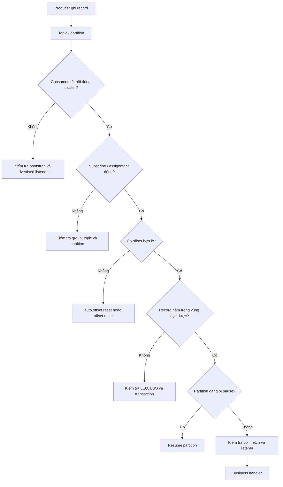

# Consumer không nhận dữ liệu do group, offset hoặc isolation level

Khi Kafka consumer không nhận được record, cần xác định dữ liệu đang thiếu ở đâu trong đường đi: topic có record hay không, partition đã được assign cho consumer chưa, group đang đọc từ offset nào và record có đủ điều kiện hiển thị theo isolation level hay chưa. Một lệnh `poll()` trả về tập rỗng chỉ cho biết lần fetch đó không trả về record; nó không tự chứng minh broker mất dữ liệu hoặc producer chưa gửi.

Bài này tập trung vào ba nhóm nguyên nhân thường gây hiểu nhầm: consumer group và partition assignment, committed offset cùng `auto.offset.reset`, và `isolation.level` với giao dịch Kafka. Quy trình chẩn đoán đi từ bằng chứng đơn giản đến cấu hình và code, có ví dụ Kafka CLI, Java Consumer và Spring Kafka.

## 1. Nhìn đúng đường đi của một record

Một record chỉ tới được business handler khi các điều kiện chính đều đúng:

1. Producer ghi record vào đúng cluster và topic.
2. Topic có partition chứa record và partition có leader hoạt động.
3. Consumer kết nối đúng cluster, subscribe đúng topic hoặc assign đúng partition.
4. Consumer group được assign partition cho member hiện tại.
5. Consumer có vị trí đọc hợp lệ và vị trí đó chưa vượt quá phần dữ liệu có thể đọc.
6. Record được phép hiển thị theo `isolation.level`.
7. Listener/application không pause partition, bỏ qua record hoặc bị lỗi trước khi gọi business handler.

Sơ đồ tổng quát:



Hãy thu thập bằng chứng trước khi reset offset. Reset sai có thể khiến consumer đọc lại dữ liệu cũ hoặc bỏ qua dữ liệu chưa xử lý.

## 2. Phân biệt các dấu hiệu ban đầu

| Dấu hiệu | Khả năng cần kiểm tra trước |
|---|---|
| `poll()` luôn trả về rỗng, assignment rỗng | Consumer chưa join group, subscribe sai, topic pattern chưa match hoặc rebalance chưa hoàn tất |
| Assignment có partition nhưng không có record | Offset ở cuối log, topic chưa có dữ liệu mới, partition bị pause hoặc `read_committed` bị giới hạn bởi LSO |
| Một vài consumer trong group nhận record, member khác không nhận | Số member lớn hơn số partition hoặc assignment phân phối không đều |
| Group mới không đọc được dữ liệu cũ | `auto.offset.reset=latest` khi chưa có committed offset hợp lệ |
| Đổi `group.id` thì consumer không nhận lịch sử | Group mới chưa có offset và bắt đầu từ `latest` |
| CLI cho thấy lag lớn nhưng `read_committed` không tiến | Có thể có transaction đang mở, hoặc consumer chưa xử lý/fetch được dữ liệu |
| `poll()` ném `TopicAuthorizationException` hoặc `GroupAuthorizationException` | ACL thiếu quyền; đây thường là lỗi rõ trong log/exception, không chỉ là empty poll |
| Consumer đọc được record nhưng listener không xử lý | Kiểm tra deserializer, error handler, filter, pause/resume và listener container |

Không dùng một dấu hiệu đơn lẻ để kết luận. Ví dụ, lag bằng 0 có thể nghĩa là consumer đã đọc hết dữ liệu hiện có; nó không phải lỗi nếu producer chưa ghi thêm record.

## 3. Kiểm tra producer và topic trước

Trước khi điều tra group, xác nhận producer ghi vào đúng cluster/topic. Hai môi trường dev và staging có thể dùng tên topic giống nhau nhưng bootstrap server khác nhau.

Liệt kê topic:

```bash
kafka-topics.sh --bootstrap-server kafka-1:9092 --list
```

Xem partition, leader và replica:

```bash
kafka-topics.sh --bootstrap-server kafka-1:9092 --describe --topic orders
```

Đọc kết quả:

- `PartitionCount` phải phù hợp với thiết kế consumer concurrency.
- Mỗi partition cần có leader hợp lệ.
- `Replicas` và `Isr` cho biết vị trí replica và tập replica đồng bộ.
- Nếu topic không tồn tại, kiểm tra tên topic, quyền truy cập và chính sách tạo topic.
- Nếu topic có partition nhưng chưa có record, kiểm tra producer, routing key, serializer và cluster đích.

Topic name phân biệt chữ hoa/chữ thường. Một consumer subscribe `Orders` sẽ không đọc topic `orders`.

Nếu cần xác minh có record, dùng consumer kiểm tra độc lập với group ID mới và offset policy có chủ đích. Không chạy console consumer chung group production: member debug có thể tham gia rebalance và, nếu commit offset, làm thay đổi checkpoint của ứng dụng. `--from-beginning` chỉ quyết định điểm bắt đầu khi group chưa có offset hợp lệ; nó không tự ghi đè committed offset hiện tại.

## 4. Kiểm tra consumer group và trạng thái member

Consumer dùng `subscribe()` sẽ tham gia consumer group thông qua `group.id`. Group coordinator phân phối partition cho các member. Trong consumer group truyền thống, tại một thời điểm một partition chỉ được assign cho tối đa một member trong group đó.

Liệt kê group:

```bash
kafka-consumer-groups.sh --bootstrap-server kafka-1:9092 --list
```

Xem offset và lag của một group:

```bash
kafka-consumer-groups.sh --bootstrap-server kafka-1:9092 --describe --group orders-service
```

Kết quả thường có các cột:

| Cột | Ý nghĩa |
|---|---|
| `GROUP` | Consumer group |
| `TOPIC` | Topic được group đọc |
| `PARTITION` | Partition |
| `CURRENT-OFFSET` | Offset đã commit của group |
| `LOG-END-OFFSET` | Offset cuối log mà công cụ báo cáo |
| `LAG` | Khoảng cách offset theo phép tính của công cụ |
| `CONSUMER-ID` | Member đang sở hữu partition |
| `HOST` | Host của member |
| `CLIENT-ID` | Client ID dùng để chẩn đoán |

Nếu `CURRENT-OFFSET` là `-`, group chưa có committed offset cho partition đó hoặc offset không có sẵn trong kết quả. Khi không có committed offset, client có thể phải áp dụng `auto.offset.reset`.

Kiểm tra member và assignment:

```bash
kafka-consumer-groups.sh --bootstrap-server kafka-1:9092 --describe --group orders-service --members --verbose
```

Kiểm tra trạng thái group:

```bash
kafka-consumer-groups.sh --bootstrap-server kafka-1:9092 --describe --group orders-service --state
```

Tên trạng thái cụ thể tùy phiên bản và thời điểm truy vấn. Các trạng thái như `Stable`, `PreparingRebalance` hoặc `CompletingRebalance` giúp xác định group đã ổn định hay đang thay đổi membership.

### Cách đọc assignment

- Nếu member không có partition, member đó sẽ không nhận record từ topic trong thời điểm hiện tại.
- Nếu một member sở hữu partition, hãy đối chiếu partition đó với offset và dữ liệu.
- Nếu group liên tục rebalance, kiểm tra member restart, heartbeat, xử lý record quá lâu, network và `max.poll.interval.ms`.
- Nếu group không xuất hiện trong danh sách, có thể ứng dụng chưa join group hoặc group chưa có offset được lưu; kiểm tra log và runtime consumer.

## 5. Consumer nhiều hơn partition

Giả sử topic `orders` có 3 partition và ứng dụng chạy 5 consumer trong cùng group:

| Consumer | Assignment minh họa |
|---|---|
| consumer-1 | `orders-0` |
| consumer-2 | `orders-1` |
| consumer-3 | `orders-2` |
| consumer-4 | Không có partition |
| consumer-5 | Không có partition |

Hai consumer cuối có thể đang hoạt động bình thường nhưng không nhận record vì không có partition để đọc. Tăng số consumer vượt quá số partition không làm tăng parallelism của một topic theo cách mong muốn.

Cách xử lý:

- Giảm concurrency/replica nếu số consumer quá lớn so với partition.
- Tăng partition nếu cần thêm parallelism và chấp nhận hệ quả về ordering, key distribution, storage và vận hành.
- Kiểm tra assignment thực tế bằng `--members --verbose`, không chỉ nhìn số pod hoặc số thread.
- Nếu cần mọi instance nhận toàn bộ sự kiện, mỗi logical application phải dùng group ID riêng. Các member trong cùng một group chia nhau partition.

Không nhầm `client.id` với `group.id`. `client.id` giúp nhận diện client trong log/metrics; `group.id` xác định nhóm consumer cùng chia sẻ assignment và committed offset.

## 6. Kiểm tra API subscribe, assign và topic pattern

Có hai cách chính để xác định partition consumer đọc:

- `subscribe(...)`: consumer tham gia group và để group coordinator phân phối partition.
- `assign(...)`: ứng dụng tự chỉ định partition; consumer không dùng group assignment để phân phối partition theo cách của `subscribe`.

Ví dụ subscribe topic:

```java
consumer.subscribe(List.of("orders"));
```

Ví dụ subscribe theo regex:

```java
consumer.subscribe(Pattern.compile("orders\\..*"));
```

Nếu dùng regex, tên topic phải match pattern. Kiểm tra dấu chấm, dấu gạch, chữ hoa/thường và escape trong regex.

Ví dụ assign thủ công:

```java
consumer.assign(List.of(
    new TopicPartition("orders", 0),
    new TopicPartition("orders", 1)
));
```

Không dùng `subscribe()` và `assign()` lẫn lộn trong cùng một luồng điều khiển consumer. Với manual assignment, ứng dụng chịu trách nhiệm phân phối partition, xử lý khi partition thay đổi và quản lý offset phù hợp.

Sau khi gọi `subscribe()`, assignment thường chưa có ngay lập tức. Consumer phải gọi `poll()` để tham gia group protocol và nhận assignment. Vì vậy, đừng kết luận subscribe thất bại chỉ vì `assignment()` rỗng trước lần poll đầu tiên.

## 7. Kiểm tra offset đã commit

Offset là vị trí tiếp theo consumer group sẽ đọc trong một partition, theo cách Kafka lưu committed offset. Nếu group đã commit offset 500, lần đọc tiếp theo thường bắt đầu từ offset 500; record có offset nhỏ hơn đã nằm trước checkpoint của group.

Có ba giá trị cần phân biệt:

- **Committed offset:** checkpoint được lưu cho group.
- **Consumer position:** vị trí tiếp theo mà consumer instance sẽ đọc trong partition hiện tại.
- **Log end offset (LEO):** ranh giới cuối của log partition tại thời điểm đo.

Nếu committed offset bằng log end offset, consumer đã bắt kịp dữ liệu hiện có. `poll()` trả về rỗng cho đến khi có record mới là hành vi bình thường.

Nếu committed offset thấp hơn log end offset nhưng consumer không tiến, kiểm tra assignment, pause, fetch, transaction visibility và lỗi xử lý.

### auto.offset.reset không reset offset đã commit

`auto.offset.reset` chỉ được áp dụng khi consumer không tìm thấy offset hợp lệ cho partition, ví dụ:

- Group chưa từng commit offset.
- Offset đã commit không còn hợp lệ vì dữ liệu cũ bị retention xóa.
- Offset nằm ngoài phạm vi log hiện có.

Nó không tự ghi đè một committed offset còn hợp lệ chỉ vì bạn đổi giá trị property.

Các giá trị thường dùng:

| Giá trị | Hành vi khi cần reset |
|---|---|
| `earliest` | Bắt đầu từ offset sớm nhất còn được giữ trong partition |
| `latest` | Bắt đầu từ cuối log hiện tại; chỉ đọc record mới được ghi sau đó |
| `none` | Ném lỗi nếu không có offset hợp lệ thay vì tự reset |

`latest` là lựa chọn dễ gây hiểu nhầm với group mới: topic có thể chứa hàng triệu record cũ, nhưng consumer bắt đầu ở cuối log và không đọc lịch sử. Điều này không phải Kafka xóa dữ liệu.

## 8. Kiểm tra group.id có bị đổi không

`group.id` xác định committed offset namespace. Nếu ứng dụng đổi từ `orders-service-v1` sang `orders-service-v2`, Kafka coi đó là một group khác.

Ví dụ cấu hình:

```properties
group.id=orders-service-v2
auto.offset.reset=latest
```

Nếu `orders-service-v2` chưa có committed offset, nó có thể bắt đầu từ cuối log. Người vận hành nhìn thấy topic còn dữ liệu nhưng consumer không đọc dữ liệu cũ.

Kiểm tra các nguyên nhân đổi group ngoài ý muốn:

- Tên group chứa profile/environment hoặc suffix được tạo động.
- Spring property `spring.kafka.consumer.group-id` bị override.
- Annotation `@KafkaListener(groupId = "...")` ghi đè group ID dự kiến.
- Nhiều service dùng nhầm cùng một group ID dù cần nhận độc lập.
- Deployment cũ và mới chạy đồng thời với group ID khác nhau.

Dùng group ID riêng cho từng logical consumer application nếu mỗi ứng dụng cần nhận toàn bộ event. Dùng chung group ID giữa các instance của cùng ứng dụng nếu muốn chúng chia nhau partition.

## 9. Kiểm tra offset bằng Kafka CLI

Xem trạng thái group:

```bash
kafka-consumer-groups.sh --bootstrap-server kafka-1:9092 --describe --group orders-service
```

Nếu cần đọc lại dữ liệu từ đầu, phải dừng tất cả consumer member của group trước khi reset. Chạy dry-run trước:

```bash
kafka-consumer-groups.sh --bootstrap-server kafka-1:9092 \
  --group orders-service \
  --topic orders \
  --reset-offsets \
  --to-earliest \
  --dry-run
```

Đọc kỹ offset dự kiến. Nếu đúng mục tiêu, mới thực thi:

```bash
kafka-consumer-groups.sh --bootstrap-server kafka-1:9092 \
  --group orders-service \
  --topic orders \
  --reset-offsets \
  --to-earliest \
  --execute
```

Một số lựa chọn reset thường dùng:

| Option | Ý nghĩa |
|---|---|
| `--to-earliest` | Offset sớm nhất còn được giữ |
| `--to-latest` | Offset cuối log |
| `--to-offset N` | Đặt offset cụ thể |
| `--shift-by N` | Dịch offset tương đối |
| `--to-datetime ...` | Tìm offset theo timestamp nếu phiên bản/tool hỗ trợ |

Lưu ý:

- Group phải không còn member hoạt động khi thực hiện reset offset bằng CLI.
- Dùng `--dry-run` để xem trước và lưu lại kết quả.
- Reset offset không xóa record trong topic; nó thay đổi checkpoint của group.
- Reset về earliest có thể làm business xử lý lại dữ liệu, vì vậy cần kiểm tra idempotency và tác động downstream.
- Reset về latest có thể bỏ qua toàn bộ record đang tồn tại.
- Nếu dữ liệu cũ đã bị retention xóa, `earliest` chỉ là offset sớm nhất còn tồn tại, không phải offset 0.

## 10. Kiểm tra seek, seekToBeginning và seekToEnd

Ứng dụng có thể thay đổi vị trí đọc trong code bằng:

- `seek(partition, offset)`: đặt position cụ thể.
- `seekToBeginning(partitions)`: chuyển về đầu dữ liệu còn giữ của partition.
- `seekToEnd(partitions)`: chuyển về cuối log của partition.

Ví dụ:

```java
TopicPartition partition = new TopicPartition("orders", 0);

consumer.poll(Duration.ofMillis(500));

if (consumer.assignment().contains(partition)) {
    consumer.seekToBeginning(List.of(partition));
}
```

Các thao tác seek ảnh hưởng đến position của consumer instance. Nếu ứng dụng commit position mới, lần chạy sau có thể tiếp tục từ checkpoint đó. Vì vậy, kiểm tra code có gọi seek khi khởi động, khi xử lý lỗi hoặc trong rebalance callback hay không.

`seekToEnd()` thường được dùng để bỏ qua dữ liệu cũ và chỉ đọc dữ liệu mới. Nếu vô tình gọi trong startup path, consumer có thể trông như không nhận record cho tới khi producer ghi thêm.

## 11. Kiểm tra isolation.level

Kafka consumer hỗ trợ hai isolation level quan trọng:

| Giá trị | Record consumer có thể đọc |
|---|---|
| `read_uncommitted` | Đọc record thường và record transactional trước khi transaction được commit; record đã abort cũng có thể được nhìn thấy |
| `read_committed` | Chỉ trả về record transactional đã commit và record không thuộc transaction; record thuộc transaction bị abort được lọc bỏ |

`read_uncommitted` là default của Kafka consumer nếu không cấu hình khác. `read_committed` thường được dùng khi consumer cần chỉ xử lý kết quả giao dịch đã commit, ví dụ đọc output từ Kafka Streams với exactly-once processing.

Cấu hình Java:

```java
props.put(
    ConsumerConfig.ISOLATION_LEVEL_CONFIG,
    "read_committed");
```

Spring Boot:

```properties
spring.kafka.consumer.properties.isolation.level=read_committed
```

### Tình huống dễ gặp

Một producer mở transaction, ghi record A, sau đó ghi record B. Trước khi transaction commit, consumer `read_committed` không trả về các record đó. Khi transaction commit, các record hợp lệ mới được hiển thị. Nếu transaction abort, record trong transaction bị lọc khỏi kết quả của `read_committed`.

Consumer `read_uncommitted` có thể nhìn thấy record transactional trước khi commit và cả record thuộc transaction bị abort. Vì vậy, hai consumer cùng đọc một topic có thể nhìn thấy tập record khác nhau do isolation level khác nhau.

Không nhầm `acks=all` với transaction commit. `acks=all` nói về xác nhận replica khi producer ghi; một record đã nhận acknowledgement trong transaction vẫn chưa được `read_committed` consumer nhìn thấy cho tới khi transaction commit.

## 12. Hiểu Last Stable Offset (LSO)

Với partition có transaction đang mở, Kafka duy trì Last Stable Offset (LSO) để xác định ranh giới mà `read_committed` consumer có thể đọc an toàn.

Các khái niệm:

- **LEO (Log End Offset):** ranh giới cuối log, vị trí tiếp theo để append record.
- **HW (High Watermark):** ranh giới record đã được replicate theo điều kiện Kafka dùng để xác nhận khả năng đọc thông thường.
- **LSO (Last Stable Offset):** ranh giới ổn định cho `read_committed`, không vượt quá HW và bị giới hạn bởi transaction chưa hoàn tất sớm nhất. Có thể hiểu LSO là giá trị nhỏ hơn giữa HW và offset bắt đầu của transaction chưa ổn định đầu tiên; nếu không có transaction đang mở thì LSO bằng HW.

Cả hai isolation level đều không đọc vượt quá HW. `read_committed` có thêm ranh giới LSO, vì vậy transaction đang mở có thể khiến consumer dừng trước HW.

Ví dụ minh họa:

```text
Offset:  100 101 102 103 104 105 106 107 108 109
         |   |   |   |   |   |   |   |   |   |
Record:  A   B   T1  C   D   E   T2  F   G   H
                         ^           ^
                    transaction T1 còn mở

Giả sử transaction T1 bắt đầu tại offset 102 và chưa kết thúc.
read_committed chỉ đọc các offset nằm trước LSO.
Các record từ ranh giới T1 trở đi chưa được coi là ổn định để trả về.
```

Trong thực tế, LSO là ranh giới offset do broker xác định; ví dụ trên chỉ minh họa rằng một transaction chưa kết thúc có thể chặn khả năng đọc các record nằm phía sau nó trong cùng partition. Không thể suy ra LSO chính xác chỉ từ một con số consumer lag thông thường.

Nếu `read_committed` consumer không tiến nhưng producer vẫn ghi thêm dữ liệu, hãy kiểm tra transaction đang mở hoặc transaction chưa được commit/abort. Khi transaction được hoàn tất, LSO có thể tiến lên và consumer tiếp tục đọc.

## 13. Chẩn đoán transaction đang mở hoặc bị treo

Kiểm tra producer có sử dụng:

- `transactional.id`.
- `initTransactions()`.
- `beginTransaction()`.
- `commitTransaction()` hoặc `abortTransaction()`.

Một producer bắt đầu transaction rồi không kết thúc có thể làm `read_committed` consumer bị chặn ở LSO. Tình huống này thường xuất hiện khi application crash giữa transaction, code quên commit/abort, transaction timeout hoặc producer cũ vẫn giữ trạng thái transaction.

Quy trình điều tra:

1. Xác định partition mà consumer không đọc tiếp.
2. So sánh committed offset, position và end offset có sẵn.
3. Xác định consumer đang dùng `read_committed` hay `read_uncommitted`.
4. Kiểm tra producer transactional đang ghi vào partition đó.
5. Đọc log producer, transaction coordinator và broker quanh thời điểm bắt đầu transaction.
6. Kiểm tra application có luôn commit/abort trong mọi nhánh code không.
7. Kiểm tra transaction timeout và producer fencing.
8. Chỉ restart hoặc thay đổi producer sau khi hiểu trạng thái transaction và khả năng hoàn tất/abort.

Không tự ý xóa transaction state hoặc can thiệp log segment để giải phóng LSO. Dùng Kafka transaction protocol và quy trình vận hành phù hợp; nếu transaction không thể hoàn tất, cần xử lý producer identity/transaction lifecycle theo runbook của cluster.

## 14. Ví dụ producer transaction và hai consumer isolation level

Producer transactional minh họa:

```java
producer.initTransactions();

producer.beginTransaction();
try {
    producer.send(new ProducerRecord<>("orders", "order-1", "created"));
    producer.send(new ProducerRecord<>("orders", "order-2", "paid"));

    // Các record chỉ được read_committed nhìn thấy sau commit.
    producer.commitTransaction();
} catch (RuntimeException ex) {
    producer.abortTransaction();
    throw ex;
}
```

Trong ứng dụng thật, cần xử lý cả lỗi phát sinh trong `commitTransaction()`, fencing và shutdown. Không tiếp tục sử dụng producer sau lỗi transaction khiến trạng thái của nó không còn hợp lệ.

Consumer đọc committed records:

```properties
group.id=orders-audit
enable.auto.commit=false
isolation.level=read_committed
auto.offset.reset=earliest
```

Consumer đọc cả uncommitted records:

```properties
group.id=orders-debug
enable.auto.commit=false
isolation.level=read_uncommitted
auto.offset.reset=earliest
```

Hai group ID riêng cho phép quan sát cùng topic theo hai isolation level mà không chia sẻ committed offset. Chỉ dùng `read_uncommitted` cho mục đích cần quan sát record chưa commit; không dùng nó cho business consumer cần loại bỏ dữ liệu đã abort.

## 15. Kiểm tra partition có bị pause không

Một consumer có assignment nhưng không fetch record có thể đã pause partition.

Java Consumer có các API:

- `pause(partitions)`: tạm dừng fetch từ các partition được chỉ định.
- `resume(partitions)`: tiếp tục fetch.
- `paused()`: xem các partition hiện đang pause.

Ví dụ log trạng thái:

```java
Set<TopicPartition> assigned = consumer.assignment();
Set<TopicPartition> paused = consumer.paused();

System.out.println("assigned=" + assigned);
System.out.println("paused=" + paused);
```

Nếu `assigned` có partition nhưng `paused` chứa tất cả partition, consumer sẽ không nhận record từ các partition đó cho tới khi resume.

Tìm nguyên nhân pause:

- Backpressure hoặc xử lý downstream chậm.
- Application tự pause khi queue nội bộ đầy.
- Error handler hoặc retry flow tạm dừng partition.
- Spring listener container được gọi `pause()` hoặc `pausePartition()`.
- Logic resume không chạy khi xử lý xong.

Đảm bảo mọi đường code pause đều có điều kiện resume rõ ràng, kể cả exception và shutdown.

## 16. Kiểm tra poll loop và thời gian xử lý

Consumer cần gọi `poll()` thường xuyên để nhận record, tham gia group protocol và duy trì membership. Nếu business processing chặn thread quá lâu, consumer có thể vượt `max.poll.interval.ms`, rời group và gây rebalance.

Ví dụ vòng lặp quan sát trạng thái:

```java
while (running) {
    ConsumerRecords<String, String> records =
        consumer.poll(Duration.ofMillis(500));

    if (records.isEmpty()) {
        System.out.println(
            "No records. assignment=" + consumer.assignment()
                + ", paused=" + consumer.paused());
        continue;
    }

    for (ConsumerRecord<String, String> record : records) {
        process(record);
    }
}
```

Trong code production, cần bổ sung shutdown handling, exception handling, commit strategy và logging phù hợp. Không gọi `poll()` từ nhiều thread trên cùng một KafkaConsumer; KafkaConsumer không thread-safe.

Nếu xử lý record lâu:

- Giảm `max.poll.records` để giới hạn số record mỗi batch.
- Tối ưu business processing.
- Dùng worker pool có thiết kế commit/ordering rõ ràng.
- Cân nhắc pause/resume để tạo backpressure.
- Điều chỉnh `max.poll.interval.ms` dựa trên thời gian xử lý đo được, không tăng tùy tiện.
- Đảm bảo thread poll vẫn hoạt động đúng và không commit offset trước khi xử lý hoàn tất nếu cần at-least-once.

## 17. Kiểm tra fetch configuration và traffic thấp

Một số cấu hình fetch ảnh hưởng thời gian consumer nhận record:

| Config | Tác động |
|---|---|
| `fetch.min.bytes` | Số byte tối thiểu broker cố gắng gom trước khi trả fetch response |
| `fetch.max.wait.ms` | Thời gian broker tối đa chờ đạt `fetch.min.bytes` trước khi trả response |
| `max.partition.fetch.bytes` | Giới hạn dữ liệu fetch cho mỗi partition trong một request |
| `fetch.max.bytes` | Giới hạn tổng dữ liệu fetch trong một request |

Nếu đặt `fetch.min.bytes` quá cao trong workload ít traffic, consumer có thể phải chờ lâu hơn dù đã có một vài record. `fetch.max.wait.ms` giới hạn thời gian chờ theo cấu hình broker/client protocol.

Đây thường là vấn đề latency, không phải cách giải thích mặc định cho việc consumer không bao giờ nhận dữ liệu. Trước khi thay config, đo fetch rate, fetch latency, traffic thực và kích thước record.

Không đặt giới hạn fetch nhỏ hơn kích thước batch lớn nhất mà ứng dụng cần đọc nếu chưa hiểu behavior và cảnh báo của Kafka. Broker/client có một số cơ chế để đảm bảo tiến triển khi batch đầu tiên vượt giới hạn fetch; đừng dùng giới hạn này như một bộ lọc record.

## 18. Kiểm tra ACL và kết nối

Consumer thường cần quyền đọc topic và quyền sử dụng consumer group tương ứng. Nếu thiếu quyền, Kafka thường trả exception authorization thay vì âm thầm bỏ qua record.

Các exception thường gặp:

- `TopicAuthorizationException`: không đủ quyền với topic.
- `GroupAuthorizationException`: không đủ quyền với group.
- `ClusterAuthorizationException`: không đủ quyền cho thao tác cluster-level.
- `AuthenticationException`: lỗi xác thực.
- `TimeoutException` hoặc lỗi network: không lấy được metadata/fetch response đúng hạn.

Admin có thể kiểm tra ACL theo topic/group bằng CLI:

```bash
kafka-acls.sh --bootstrap-server kafka-1:9092 --list --topic orders
kafka-acls.sh --bootstrap-server kafka-1:9092 --list --group orders-service
```

Cú pháp và cơ chế authorization phụ thuộc authorizer/security setup của cluster. Dùng tài khoản admin được cấp quyền để xem ACL; không cấp quyền rộng hơn cần thiết chỉ để làm mất exception.

Nếu kết nối không ổn định, kiểm tra:

- `bootstrap.servers` có trỏ đúng cluster không.
- DNS và port của listener.
- `advertised.listeners` mà broker trả về có thể truy cập từ network của consumer không.
- TLS truststore/keystore và SASL mechanism/credential.
- Network policy, firewall và routing giữa application với broker.

Lỗi kết nối thường có dấu vết trong log như metadata timeout, disconnect hoặc authentication failure. Không đổi offset để chữa lỗi network.

## 19. Kiểm tra lỗi deserialize và error handler

Consumer có thể fetch record nhưng ứng dụng không gọi business handler vì deserialization thất bại hoặc error handler chuyển record sang nhánh khác.

Kiểm tra:

- Key/value deserializer có đúng kiểu dữ liệu và schema không.
- Record tombstone/null có được hỗ trợ không.
- Header hoặc schema version có thay đổi không.
- `ErrorHandlingDeserializer` và `DefaultErrorHandler` có được cấu hình không.
- Record có bị gửi sang Dead Letter Topic (DLT) không.
- Listener có filter strategy loại record không.
- Log có `SerializationException`, `DeserializationException` hoặc lỗi schema registry không.

Một số lỗi deserialize có thể làm listener không nhận được object business dù consumer đã fetch record. Hãy kiểm tra log của container và DLT/record recovery path, không chỉ kiểm tra số lần gọi method listener.

## 20. Spring Kafka: kiểm tra listener container

Với annotation `@KafkaListener`, cần phân biệt consumer client đã poll record với listener method đã được gọi.

Ví dụ cấu hình:

```properties
spring.kafka.bootstrap-servers=kafka-1:9092
spring.kafka.consumer.group-id=orders-service
spring.kafka.consumer.auto-offset-reset=earliest
spring.kafka.consumer.enable-auto-commit=false
spring.kafka.consumer.properties.isolation.level=read_committed
```

Listener:

```java
@KafkaListener(
    topics = "orders",
    groupId = "orders-service",
    concurrency = "3"
)
public void consume(OrderEvent event) {
    orderService.handle(event);
}
```

Các điểm cần kiểm tra:

- `spring.kafka.consumer.group-id` và `groupId` trên annotation có khớp group dự kiến không.
- `topics` hoặc `topicPattern` có đúng tên/pattern không.
- `concurrency` có lớn hơn số partition không.
- Listener container có `autoStartup=false` hoặc chưa được start không.
- Container có đang pause hoặc bị dừng bởi lifecycle/error handler không.
- Deserializer và message converter có đọc đúng payload không.
- `DefaultErrorHandler`, retry topic hoặc DLT có chuyển record khỏi luồng xử lý chính không.
- Profile/environment có override bootstrap, group ID, isolation level hay topic không.

Dùng `KafkaListenerEndpointRegistry` để kiểm tra container theo listener ID khi cần. Log trạng thái container, assignment và pause state trong môi trường có kiểm soát; tránh in payload nhạy cảm vào log production.

## 21. Spring Kafka và group ID: annotation có thể ghi đè cấu hình

Ví dụ:

```properties
spring.kafka.consumer.group-id=orders-default
```

Nhưng listener:

```java
@KafkaListener(
    id = "orders-audit-listener",
    topics = "orders",
    groupId = "orders-audit"
)
public void audit(OrderEvent event) {
    // ...
}
```

Listener trên sử dụng group ID `orders-audit`. Khi kiểm tra bằng CLI, cần describe đúng group đang chạy. Nếu chỉ kiểm tra `orders-default`, có thể kết luận sai rằng listener không có member.

Giữ group ID rõ ràng cho từng logical consumer application. Đừng dùng một group ID chung cho hai listener độc lập nếu cả hai cần nhận toàn bộ event; khi cùng group, Kafka sẽ phân phối partition giữa chúng.

## 22. Kiểm tra consumer group rebalance

Rebalance xảy ra khi member tham gia/rời group, partition thay đổi hoặc coordinator cần phân phối lại assignment.

Nguyên nhân thường gặp:

- Pod/container restart liên tục.
- Consumer xử lý một batch vượt `max.poll.interval.ms`.
- Heartbeat không tới coordinator đúng hạn do GC pause, CPU starvation hoặc network.
- Deploy tăng/giảm replica.
- Topic tăng partition.
- Static member ID trùng hoặc member cũ chưa rời group.
- Subscription của member khác nhau.

Cần phân biệt:

- `session.timeout.ms`: thời gian coordinator chờ heartbeat trước khi coi member mất.
- `heartbeat.interval.ms`: nhịp gửi heartbeat trong consumer group protocol tương ứng.
- `max.poll.interval.ms`: giới hạn thời gian giữa các lần poll trước khi consumer bị coi là không tiến triển.

Nếu group liên tục rebalance, consumer có thể thường xuyên mất assignment và không xử lý ổn định. Đọc log consumer coordinator và group state, sau đó tìm member restart hoặc thời gian xử lý quá dài. Không chỉ tăng timeout để che một handler bị treo.

## 23. Static membership và group.instance.id

Static membership cho phép consumer có `group.instance.id` ổn định để hạn chế rebalance không cần thiết khi member restart trong điều kiện phù hợp.

Nếu nhiều instance dùng cùng `group.instance.id`, coordinator có thể fencing member cũ/mới và phát sinh `FencedInstanceIdException`. Mỗi static member trong cùng group cần identity duy nhất.

Kiểm tra:

- ID có được tạo từ pod name/ordinal ổn định không.
- Hai replica có vô tình nhận cùng ID do config cố định không.
- Khi scale hoặc thay pod, identity có được cập nhật đúng không.
- Có log fencing hoặc member replacement không.

Không bật static membership nếu chưa có cách bảo đảm uniqueness và lifecycle identity.

## 24. Phân tích lag mà không kết luận vội

Lag thường được hiểu là khoảng cách giữa offset group đã commit và offset cuối mà công cụ dùng để so sánh. Đây là chỉ báo hữu ích nhưng không cho biết toàn bộ nguyên nhân consumer không trả record.

| Quan sát | Diễn giải có thể |
|---|---|
| `LAG=0`, assignment có partition | Consumer đã bắt kịp ranh giới được báo cáo; chờ record mới là bình thường |
| `LAG` tăng liên tục | Producer ghi nhanh hơn consumer xử lý, consumer bị pause hoặc không poll |
| `LAG` cao nhưng `poll()` rỗng với `read_committed` | Kiểm tra LSO và transaction chưa kết thúc |
| `CURRENT-OFFSET` là `-` | Group chưa có committed offset; kiểm tra reset policy |
| Một partition lag cao, partition khác bằng 0 | Key skew, partition hotspot hoặc consumer xử lý không đều |
| Group không có member | Ứng dụng chưa chạy, không join được hoặc group đã rời |

Trong `read_committed`, dữ liệu transactional sau LSO chưa thể trả về cho consumer. Do đó, không nên coi `LOG-END-OFFSET - CURRENT-OFFSET` là số record chắc chắn có thể đọc ngay. Đối chiếu thêm transaction state và khả năng tiến của LSO.

## 25. Bảng quyết định xử lý nhanh

| Tình huống đã xác nhận | Hướng xử lý |
|---|---|
| Topic sai hoặc không tồn tại | Sửa topic name/cluster và kiểm tra producer |
| Không có leader hoặc ISR bất thường | Điều tra broker/replication trước khi sửa consumer |
| Assignment rỗng sau nhiều lần poll | Kiểm tra group, subscription, regex, ACL và rebalance |
| Member không có partition, consumer count lớn hơn partition count | Giảm concurrency hoặc thiết kế lại partition count |
| Group mới có offset `-`, reset policy là `latest` | Chọn rõ có cần replay lịch sử hay chỉ nhận record mới |
| Committed offset bằng cuối log | Chờ producer ghi record mới hoặc kiểm tra producer |
| Offset vượt ngoài dữ liệu còn giữ | Xác định replay policy và reset offset có kiểm soát |
| Consumer bị pause | Tìm nơi pause và đảm bảo resume |
| `read_committed` đứng ở LSO | Điều tra transaction producer chưa commit/abort |
| Authorization exception | Sửa ACL/authentication theo least privilege |
| Deserialization error | Sửa Serde/schema hoặc error recovery path |
| Rebalance liên tục | Điều tra restart, poll interval, heartbeat, GC và network |
| Listener không chạy dù consumer fetch | Kiểm tra Spring container, filter, converter và error handler |

## 26. Quy trình chẩn đoán theo thứ tự

Thực hiện tuần tự để tránh thay đổi trạng thái trước khi thu thập bằng chứng.

### Bước 1: xác nhận cluster và topic

- So sánh `bootstrap.servers` giữa producer và consumer.
- Kiểm tra topic tồn tại và đúng tên.
- Xem partition, leader và ISR.
- Xác nhận producer đã ghi record vào đúng topic/partition.

### Bước 2: xác nhận group và assignment

- Ghi lại `group.id` runtime thực tế.
- Dùng `--describe --group` để xem offset/lag.
- Dùng `--members --verbose` để xem partition assignment.
- Dùng `--state` để kiểm tra group đang stable hay rebalance.
- Kiểm tra số consumer so với số partition.

### Bước 3: xác nhận offset

- Xác định group có committed offset hay chưa.
- So sánh committed offset với position và end offset.
- Kiểm tra `auto.offset.reset`.
- Tìm code gọi `seek`, `seekToBeginning` hoặc `seekToEnd`.
- Chỉ reset sau khi dừng group, chạy dry-run và xác nhận tác động replay/skip.

### Bước 4: xác nhận isolation level

- Đọc effective value của `isolation.level`.
- Nếu là `read_committed`, kiểm tra producer transactional.
- Kiểm tra transaction có commit/abort và LSO có tiến không.
- Không đổi sang `read_uncommitted` cho business consumer chỉ để làm record xuất hiện nếu điều đó vi phạm yêu cầu dữ liệu.

### Bước 5: xác nhận poll và listener

- Log assignment, paused partitions và poll result.
- Kiểm tra exception, deserialize, error handler và DLT.
- Với Spring, kiểm tra listener container lifecycle, concurrency và filter.
- Đối chiếu thời gian xử lý với `max.poll.interval.ms`.

### Bước 6: chỉ thay đổi sau khi có nguyên nhân

- Sửa group ID hoặc topic subscription nếu cấu hình sai.
- Chọn reset policy theo yêu cầu đọc lịch sử.
- Resume partition nếu đã pause ngoài ý muốn.
- Hoàn tất/abort transaction qua producer lifecycle phù hợp.
- Sửa ACL hoặc network.
- Thực hiện reset offset có kiểm soát và ghi nhận checkpoint trước/sau.

## 27. Log và metrics cần quan sát

Trong môi trường test/staging, bật log đủ chi tiết để thấy:

- Bootstrap server và cluster ID (nếu ứng dụng có ghi nhận).
- Group ID và client ID.
- Subscription/topic pattern.
- Assigned partitions và rebalance callback.
- Committed offset và position khi cần chẩn đoán.
- Pause/resume event.
- Fetch exception, authorization exception và deserialization exception.
- Listener/container state và error handler path.
- Producer transaction begin/commit/abort.

Các consumer metric hữu ích gồm fetch rate/latency, records consumed rate/total, records lag và commit latency. Tên metric/JMX MBean cụ thể có thể khác theo Kafka client version và metrics binder. So sánh theo client ID, group, topic/partition và thời gian để tìm consumer hoặc partition bất thường.

Không log credential, access token, payload nhạy cảm hoặc thông tin cá nhân để chẩn đoán. Chỉ bật debug protocol trong thời gian ngắn và giới hạn phạm vi vì log có thể rất lớn.

## 28. Những thao tác không nên làm khi chưa có bằng chứng

- Không reset offset về earliest chỉ vì listener không log record.
- Không reset về latest để "làm sạch lag" nếu chưa xác nhận dữ liệu có thể bỏ qua.
- Không đổi group ID ngẫu nhiên trong production; điều đó tạo group mới và có thể đổi điểm bắt đầu.
- Không đổi `read_committed` thành `read_uncommitted` nếu business yêu cầu chỉ đọc transaction đã commit.
- Không tăng partition chỉ để làm consumer hiện tại nhận dữ liệu khi nguyên nhân là offset hoặc ACL.
- Không tăng `max.poll.interval.ms` để che business handler treo.
- Không xóa topic hoặc transaction state để giải phóng consumer.
- Không chạy nhiều consumer debug cùng group với ứng dụng production nếu không muốn thay đổi assignment.
- Không dùng `--execute` reset offset trước khi xem kết quả `--dry-run`.

## 29. Ví dụ runbook cho sự cố thực tế

**Tình huống:** `orders-service` không ghi log xử lý đơn mới. Producer báo send thành công, topic `orders` có 12 partition.

1. Chạy `kafka-topics.sh --describe` để xác nhận topic, leader và ISR.
2. Chạy `kafka-consumer-groups.sh --describe --group orders-service`.
3. Nếu `CURRENT-OFFSET` bằng `LOG-END-OFFSET`, kiểm tra producer có ghi thêm record sau thời điểm đo không.
4. Nếu member không có assignment, chạy `--members --verbose` và kiểm tra concurrency so với 12 partition.
5. Nếu group mới và offset chưa có, đọc `auto.offset.reset`. Nếu là `latest`, xác nhận business có cần replay lịch sử không trước khi đổi.
6. Nếu assignment có nhưng consumer dùng `read_committed`, điều tra transaction đang mở và LSO.
7. Nếu consumer có fetch nhưng listener không chạy, kiểm tra deserializer, Spring container và DLT.
8. Ghi lại nguyên nhân, offset trước/sau, thay đổi config và kết quả xác nhận.

Runbook phải kết thúc bằng một bằng chứng: record test mới được đọc, offset tiến, listener xử lý đúng và group trở lại trạng thái ổn định.

## 30. Checklist phòng ngừa

**Topic và cluster**

- [ ] Producer và consumer trỏ đúng cluster.
- [ ] Topic name/pattern chính xác.
- [ ] Partition có leader và replica state phù hợp.
- [ ] ACL cho topic và group đã được cấp đúng.

**Group và assignment**

- [ ] `group.id` ổn định, đúng logical application.
- [ ] Số consumer concurrency phù hợp với partition count.
- [ ] Assignment được quan sát sau khi poll.
- [ ] Không rebalance liên tục.
- [ ] Static member ID duy nhất nếu sử dụng.

**Offset**

- [ ] `auto.offset.reset` được chọn rõ ràng.
- [ ] Biết group đã có committed offset hay chưa.
- [ ] Không có seek ngoài ý muốn.
- [ ] Có quy trình dry-run trước khi reset.
- [ ] Có idempotency/replay plan khi đọc lại dữ liệu.

**Isolation và transaction**

- [ ] `isolation.level` phù hợp với contract dữ liệu.
- [ ] Producer transaction luôn commit hoặc abort.
- [ ] Có cách điều tra transaction mở và LSO.
- [ ] Không nhầm `acks=all` với transaction commit.

**Application**

- [ ] Poll loop chạy thường xuyên.
- [ ] Processing time nằm trong giới hạn phù hợp.
- [ ] Pause/resume có cặp logic rõ ràng.
- [ ] Deserializer/error handler/DLT có monitoring.
- [ ] Spring listener container được start và không bị pause ngoài ý muốn.

## 31. Ghi nhớ

Khi consumer không nhận record, hãy xác minh đúng cluster/topic trước, sau đó kiểm tra group membership và partition assignment. Tiếp theo đối chiếu committed offset, consumer position, end offset và `auto.offset.reset`. Nếu consumer dùng `read_committed`, kiểm tra transaction đang mở và Last Stable Offset vì record phía sau transaction chưa hoàn tất có thể chưa được trả về.

`auto.offset.reset` chỉ áp dụng khi không có offset hợp lệ; nó không ghi đè committed offset đang tồn tại. Consumer nhiều hơn partition có thể có member idle. Hai ứng dụng cần nhận toàn bộ event phải dùng group ID riêng. `read_committed` bảo vệ business khỏi record transaction bị abort, do đó không nên đổi isolation level chỉ để làm dữ liệu xuất hiện.

Chỉ reset offset, thay group ID hoặc thay isolation level sau khi xác nhận nguyên nhân và hiểu tác động tới replay, bỏ qua dữ liệu và tính đúng đắn nghiệp vụ.

## Tài liệu tham khảo

- [Apache Kafka – Consumer Configs](https://kafka.apache.org/documentation/#consumerconfigs)
- [Apache Kafka – Consumer Groups](https://kafka.apache.org/documentation/#intro_consumers)
- [Apache Kafka – Design: Message Delivery Semantics](https://kafka.apache.org/documentation/#semantics)
- [Apache Kafka – Transactional Messaging](https://kafka.apache.org/documentation/#transactions)
- [Apache Kafka – Consumer API](https://kafka.apache.org/40/javadoc/org/apache/kafka/clients/consumer/KafkaConsumer.html)
- [Spring for Apache Kafka – Reference](https://docs.spring.io/spring-kafka/reference/)

