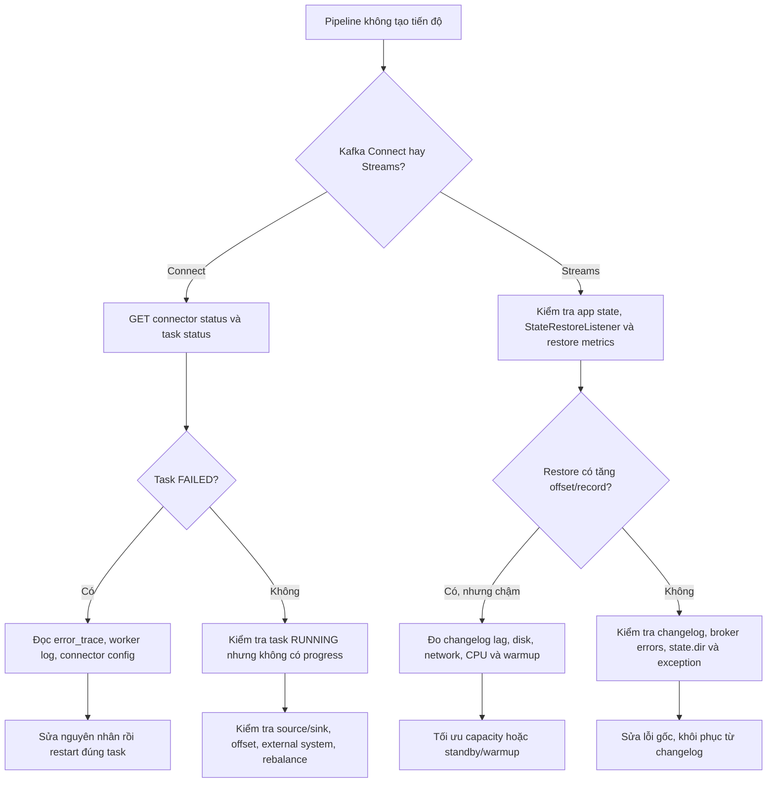

# Connect task lỗi hoặc Streams phục hồi trạng thái quá lâu

## Khoanh vùng lỗi connector và tình trạng state restoration

Kafka Connect và Kafka Streams đều có thể ngừng tạo tiến độ dù broker vẫn khỏe. Connect có thể hiển thị connector RUNNING nhưng một task đã FAILED; Streams có thể đã kết nối cluster và tham gia group nhưng chưa xử lý được vì state store đang phục hồi từ changelog.

Hai triệu chứng này cần được chẩn đoán theo hai đường khác nhau:

- **Connect task lỗi:** xác định connector hay task nào thất bại, worker đang chạy task, exception đầu tiên, giai đoạn xử lý record và offset cuối cùng đã hoàn tất.
- **Streams phục hồi lâu:** xác định task/store nào đang restore, còn bao nhiêu changelog lag, restore rate có tiến triển không, local state có còn hay phải dựng lại toàn bộ, và task có đang chờ warmup/probing rebalance hay không.

Không nên restart liên tục hoặc xóa internal topic ngay khi thấy trạng thái bất thường. Những thao tác đó có thể che mất nguyên nhân, tạo thêm rebalance, làm mất offset hoặc buộc Streams restore lại từ đầu.

## 1. Phân biệt triệu chứng trước khi xử lý

### 1.1 Kafka Connect: connector và task là hai trạng thái riêng

Connector là thành phần điều phối việc tạo task; task thực hiện công việc đọc nguồn hoặc ghi đích. Một connector có thể ở trạng thái RUNNING trong khi một hoặc nhiều task đã FAILED.

Các trạng thái thường gặp:

| Trạng thái | Ý nghĩa |
|---|---|
| RUNNING | Connector/task đang chạy |
| FAILED | Connector/task đã thất bại; REST status thường có thông tin lỗi |
| UNASSIGNED | Chưa được gán worker |
| RESTARTING | Đang hoặc sắp được restart |
| PAUSED | Đã tạm dừng theo yêu cầu quản trị |
| STOPPED | Connector đã dừng và task đã được shutdown; trạng thái này không áp dụng cho task đã bị loại khỏi status |

Trạng thái connector và task có thể khác nhau trong thời gian ngắn. Connect phân phối trạng thái qua status.storage.topic, nên REST API có thể phản ánh thay đổi trễ một khoảng ngắn. Đọc lại status sau khi rebalance hoặc restart hoàn tất trước khi kết luận worker bị kẹt.

Connect không tự động restart một task đã ở trạng thái FAILED. Sau khi xác định và sửa nguyên nhân, operator cần restart task hoặc các task lỗi bằng REST API.

### 1.2 Kafka Streams: phục hồi state không đồng nghĩa với xử lý record

Stateful task dùng local state store và changelog topic để khôi phục dữ liệu. Khi instance nhận task:

1. Streams kiểm tra local state store và checkpoint.
2. Nếu local state còn hợp lệ, chỉ replay changelog từ checkpoint gần nhất.
3. Nếu local state không tồn tại, Streams có thể phải replay changelog từ đầu đến vị trí hiện tại.
4. Khi state đạt điều kiện sẵn sàng, task mới có thể hoạt động bình thường.

Một instance có thể đã join group nhưng vẫn chưa xử lý input cho task đang restore. Cần đo tiến độ restore và lag thay vì chỉ nhìn process hoặc thread có sống hay không.

### 1.3 Cây quyết định nhanh



## 2. Chẩn đoán Kafka Connect task bị lỗi

### 2.1 Kiểm tra status qua REST API

Trong distributed mode, REST API là điểm bắt đầu nhanh nhất:

```bash
# Danh sách connector
curl -sS http://connect-1:8083/connectors

# Trạng thái connector và tất cả task
curl -sS http://connect-1:8083/connectors/orders-sink/status

# Cấu hình connector
curl -sS http://connect-1:8083/connectors/orders-sink/config

# Danh sách task và task config
curl -sS http://connect-1:8083/connectors/orders-sink/tasks

# Trạng thái chi tiết một task
curl -sS http://connect-1:8083/connectors/orders-sink/tasks/0/status

# Plugin đang được worker này nhận diện
curl -sS http://connect-1:8083/connector-plugins
```

Thay host, port, connector name theo môi trường. Nếu REST bật TLS hoặc authentication, dùng cấu hình xác thực được quản lý an toàn; không ghi password/token vào shell history hoặc evidence pack.

Trong response status, tập trung vào:

- connector.state và tasks[].state.
- worker_id: worker đang sở hữu connector/task.
- trace hoặc error_trace: exception và stack trace.
- Task ID nào lỗi, task nào vẫn chạy.
- Thời điểm status được cập nhật và trạng thái rebalance của worker cluster.

Không chỉ nhìn connector.state. Một connector RUNNING với task FAILED vẫn có thể làm pipeline thiếu dữ liệu.

### 2.2 Xác định task lỗi nằm trên worker nào

Khi đã có worker_id:

1. Mở log của đúng worker.
2. Tìm connector name, task ID và timestamp từ REST response.
3. Tìm exception đầu tiên, không chỉ exception cuối cùng sau nhiều lần retry.
4. Đối chiếu cùng thời điểm với Kafka broker log, external system log và Connect rebalance log.

Nếu task chuyển worker liên tục, kiểm tra worker restart, network, group rebalance và plugin/config consistency trên toàn bộ worker.

### 2.3 Phân biệt FAILED với RUNNING nhưng không có tiến độ

| Quan sát | Khả năng cần kiểm tra |
|---|---|
| Connector RUNNING, task FAILED | Task exception; đọc task error_trace |
| Connector và task RUNNING, source không có record | Source system, query/filter, source offset, polling interval |
| Connector và task RUNNING, sink không ghi | Consumer lag, converter/SMT, sink API/database, retry hoặc quota |
| Task UNASSIGNED lâu | Worker group, rebalance, internal topics, worker availability |
| Task RESTARTING kéo dài | Restart loop, plugin load, external dependency hoặc worker crash |
| REST status không đổi ngay sau thao tác | Status topic propagation delay; đọc lại sau một khoảng ngắn |
| REST restart trả HTTP 409 | Connect cluster đang rebalance; chờ rebalance kết thúc rồi kiểm tra lại |

Một task RUNNING chỉ chứng minh task chưa báo lỗi. Cần kiểm tra record rate, offset progress, external side effect và connector-specific metrics để chứng minh nó đang làm việc.

## 3. Phân loại nguyên nhân Connect task lỗi

### 3.1 Plugin không được cài trên tất cả worker

Triệu chứng:

- ClassNotFoundException, NoClassDefFoundError hoặc không tìm thấy connector.class.
- Connector tạo được trên một worker nhưng task fail khi chuyển sang worker khác.
- /connector-plugins trả danh sách khác nhau giữa các worker.
- Lỗi dependency/JAR hoặc xung đột classloader.

Kiểm tra:

1. plugin.path của tất cả worker có cùng thư mục plugin cần thiết không.
2. Mỗi worker có cùng connector version và dependency JAR không.
3. Có hai phiên bản thư viện trùng tên nhưng khác binary compatibility không.
4. Plugin có được cài trong plugin isolation layout đúng không.
5. Worker đã được restart sau khi thay plugin chưa.

plugin.path là cấu hình worker, không phải cấu hình connector. Distributed workers phải có plugin tương thích; chỉ cài plugin trên worker đang nhận REST request là chưa đủ.

Ví dụ cấu hình:

```properties
plugin.path=/opt/kafka/plugins,/opt/company/connectors
```

Sau khi triển khai plugin:

- Đồng bộ artifact và version tới mọi worker.
- Kiểm tra plugin list trên từng worker.
- Restart worker theo kế hoạch để plugin scanner nạp lại.
- Chạy lại connector validation và task test.

Không copy JAR tùy tiện vào classpath đang chạy hoặc thay dependency riêng trên một worker trong cluster.

### 3.2 Connector config sai hoặc thiếu

Các lỗi thường gặp:

- Sai tên bảng, schema, database, bucket hoặc endpoint.
- Sai kiểu dữ liệu hoặc giá trị config.
- Thiếu quyền truy cập tài nguyên.
- tasks.max cao hơn năng lực connector có thể tạo.
- Source query/filter không trả dữ liệu như mong đợi.
- Sink topic/table mapping không đúng.

tasks.max chỉ là giới hạn tối đa. Connector có thể tạo ít task hơn vì số partition, shard, table hoặc khả năng song song của chính connector.

Kiểm tra cấu hình qua REST, đối chiếu với tài liệu connector đúng version và xác minh từng giá trị đã được config provider resolve. Không in secret đã resolve vào log để debug.

### 3.3 Converter, schema và serialization

Triệu chứng:

- SerializationException, DataException, schema lookup failure.
- Task fail khi gặp một record cụ thể.
- Chỉ một topic/partition hoặc một loại event gây lỗi.
- Sink không deserialize được key/value hoặc schema version.

Kiểm tra:

- key.converter và value.converter hiệu lực.
- Schema Registry URL, TLS, authentication và compatibility policy.
- Schema ID/version của record lỗi.
- SMT có đổi kiểu hoặc xóa field mà sink cần không.
- Topic có trộn nhiều format hoặc schema ngoài dự kiến không.
- Record cụ thể có payload/header bất thường không.

Tìm topic, partition và offset trong error context để tái hiện record lỗi ở môi trường cô lập. Không bật log payload toàn phần trên production nếu record có dữ liệu nhạy cảm.

### 3.4 External system không khả dụng hoặc bị giới hạn

Đối với source connector, kiểm tra:

- Database/API/object storage có reachable không.
- Credential, certificate và quyền đọc còn hợp lệ không.
- Query timeout, cursor, snapshot hoặc transaction phía nguồn.
- Rate limit, quota và connection pool.
- Source offset có bị lỗi hoặc trỏ tới vị trí không còn tồn tại không.

Đối với sink connector, kiểm tra:

- Database/API đích có nhận write không.
- Authentication, authorization và TLS.
- Connection pool, transaction timeout, batch size và quota.
- Schema/table mapping, unique constraint và duplicate handling.
- Sink consumer lag và thời gian xử lý mỗi batch.

Phân biệt lỗi tạm thời (timeout, throttling, service restart) với lỗi dữ liệu/cấu hình (table không tồn tại, schema sai, permission bị từ chối). Retry vô hạn không sửa được lỗi cấu hình cố định.

### 3.5 Connect worker rebalance hoặc internal topic lỗi

Distributed Connect lưu trạng thái cluster trong Kafka:

- config.storage.topic: cấu hình connector.
- offset.storage.topic: source offsets.
- status.storage.topic: connector/task status.

Các topic này cần được tạo/cấu hình theo hướng dẫn Connect: config topic có một partition và compact; offset/status topics cũng cần compaction và replication factor phù hợp với độ bền của cluster.

Kiểm tra:

- Worker có cùng group.id, bootstrap/security config và internal topic names không.
- Internal topics có tồn tại, đủ replication và còn leader không.
- Topic config có bị thay đổi sang cleanup.policy=delete không.
- Broker có lỗi produce/fetch hoặc ACL với internal topics không.
- Worker có restart loop hoặc network flap gây rebalance liên tục không.

Không xóa hoặc tạo lại config.storage.topic, offset.storage.topic hay status.storage.topic để chữa một task lỗi. Đây là metadata/offset của Connect cluster; thao tác đó có thể làm mất cấu hình hoặc tiến độ source connector.

### 3.6 Task lỗi do record không hợp lệ

Nếu cùng một task luôn fail tại cùng topic/partition/offset, nghi ngờ poison record hoặc lỗi chuyển đổi dữ liệu.

Quy trình:

1. Ghi lại topic, partition, offset và exception.
2. Xác định lỗi xảy ra ở converter, SMT hay sink connector.
3. Tái hiện với record đã redacted trong môi trường test.
4. Sửa schema/SMT/sink mapping hoặc quyết định cách xử lý record lỗi.
5. Chỉ bật tolerance/DLQ nếu nghiệp vụ chấp nhận việc record lỗi được tách khỏi luồng chính.
6. Lưu lại offset và kiểm tra cách replay record sau khi sửa.

Không tăng tasks.max hoặc restart task lặp lại khi một record cố định luôn làm task fail.

## 4. Retry, error tolerance và Dead Letter Queue của Connect

### 4.1 Mặc định là fail-fast

Kafka Connect mặc định dừng task khi gặp lỗi trong conversion hoặc transformation. Các cấu hình mặc định quan trọng trong Kafka 4.2:

```properties
errors.retry.timeout=0
errors.retry.delay.max.ms=60000
errors.log.enable=false
errors.log.include.messages=false
errors.tolerance=none
```

errors.retry.timeout=0 nghĩa là framework không retry các operation thuộc error handling framework. Connector vẫn có thể có retry logic riêng cho external system; phải đọc tài liệu plugin để biết behavior thực tế.

### 4.2 Ví dụ cấu hình retry và DLQ

Ví dụ cho sink connector cần tách record lỗi khỏi luồng chính sau khi đã đánh giá tác động:

```properties
errors.retry.timeout=600000
errors.retry.delay.max.ms=30000
errors.log.enable=true
errors.log.include.messages=false
errors.deadletterqueue.topic.name=orders-sink-dlq
errors.deadletterqueue.context.headers.enable=true
errors.tolerance=all
```

Ý nghĩa:

- Retry tối đa trong 10 phút cho các operation được error framework hỗ trợ.
- Delay giữa các lần retry tăng dần đến mức tối đa đã cấu hình.
- Ghi error context vào Connect log.
- Gửi record lỗi cùng context vào DLQ.
- errors.tolerance=all cho phép bỏ qua record lỗi thay vì làm task fail.

### 4.3 DLQ không phải cách sửa mọi task failure

DLQ hữu ích cho lỗi record ở converter, SMT và sink processing trong phạm vi Connect error reporter hỗ trợ. Nó không tự giải quyết:

- Source database/API không truy cập được trước khi source record được tạo.
- Plugin không load được.
- Connector config sai.
- Worker mất kết nối Kafka hoặc internal topics.
- Task chết do OOM hoặc fatal exception ngoài phạm vi error reporter.

Source connector cần retry/offset/error handling theo khả năng riêng của plugin. Không giả định mọi exception phía source đều có thể ghi vào DLQ vì record có thể chưa tồn tại trong Kafka.

### 4.4 Rủi ro của errors.tolerance=all

errors.tolerance=all có thể khiến pipeline tiếp tục nhưng bỏ qua record lỗi. Nếu không theo dõi DLQ, ứng dụng có thể âm thầm mất một phần dữ liệu.

Trước khi bật:

- Có chủ sở hữu DLQ và quy trình xử lý/replay.
- Có alert theo DLQ rate và số record.
- Bảo đảm topic DLQ có retention, RF và ACL phù hợp.
- Xác định record nào được phép bỏ qua.
- Kiểm tra downstream có chấp nhận thứ tự xử lý khi record lỗi được tách ra không.

errors.log.include.messages=true có thể ghi key/value/header vào log. Chỉ bật trong môi trường cô lập hoặc khi đã đánh giá dữ liệu nhạy cảm và quyền truy cập log.

## 5. Restart Connect task an toàn

### 5.1 Sửa nguyên nhân trước

Trước khi restart:

1. Lưu status và error_trace.
2. Xác định worker và task ID.
3. Sửa plugin/config/credential/network/schema hoặc poison record.
4. Xác nhận dependency đã ổn định.
5. Kiểm tra Connect cluster không đang rebalance.

### 5.2 Restart đúng phạm vi

Restart một task:

```bash
curl -X POST \
  http://connect-1:8083/connectors/orders-sink/tasks/0/restart
```

Restart connector và chỉ các task đang FAILED:

```bash
curl -X POST \
  'http://connect-1:8083/connectors/orders-sink/restart?includeTasks=true&onlyFailed=true'
```

Tên endpoint và query parameters cần đối chiếu với version Connect đang chạy. Nếu REST trả HTTP 409 trong lúc rebalance, chờ rebalance kết thúc, đọc lại status rồi mới thử lại.

### 5.3 Xác minh sau restart

- Connector và task chuyển về RUNNING.
- Worker ID ổn định, không chuyển qua lại liên tục.
- Source offset hoặc sink consumer progress tiếp tục.
- Record rate tăng và external side effect được ghi nhận.
- DLQ/error rate không tăng bất thường.
- Không có duplicate hoặc missing record ngoài semantics của connector.

Không restart toàn bộ worker cluster chỉ để chữa một task lỗi nếu worker và internal topics vẫn khỏe.

## 6. Chẩn đoán Kafka Streams phục hồi state quá lâu

### 6.1 State store được khôi phục như thế nào?

Kafka Streams lưu state local trên mỗi instance và ghi changelog topic để state có thể được tái tạo. Khi task khởi động hoặc chuyển sang instance khác:

- Nếu local state store còn và checkpoint hợp lệ, Streams replay phần changelog kể từ checkpoint.
- Nếu local state không tồn tại, Streams replay từ đầu changelog đến vị trí mới nhất.
- Nếu có standby replica, instance có thể nhận task đã có local state được cập nhật gần với active task.
- Nếu task được chuyển sang instance mới, warmup replica có thể restore ở nền trước khi được promote thành active.

Vì vậy, mất local state directory, dùng filesystem tạm hoặc liên tục thay pod có thể khiến ứng dụng restore lại lượng dữ liệu rất lớn sau mỗi lần restart.

### 6.2 Phân biệt restore đang tiến triển với restore bị kẹt

Ghi lại cho từng state store/task:

- Topic-partition của changelog.
- Starting offset và ending offset khi restore bắt đầu.
- Batch end offset gần nhất.
- Tổng record đã restore.
- Restore rate và restore latency.
- Changelog lag còn lại.
- Disk I/O, network throughput, CPU và GC.

Nếu batch end offset tiếp tục tăng và lag giảm, restore đang tiến triển dù chậm. Nếu offset không đổi trong thời gian dài, cần tìm lỗi broker, fetch, disk, exception hoặc task migration lặp lại.

### 6.3 Ghi nhận tiến độ bằng StateRestoreListener

StateRestoreListener cung cấp callback khi restore bắt đầu, sau mỗi batch và khi hoàn tất. Ví dụ:

```java
streams.setGlobalStateRestoreListener(new StateRestoreListener() {
    @Override
    public void onRestoreStart(
            TopicPartition topicPartition,
            String storeName,
            long startingOffset,
            long endingOffset) {
        log.info(
            "Restore start store={} partition={} start={} end={}",
            storeName, topicPartition, startingOffset, endingOffset);
    }

    @Override
    public void onBatchRestored(
            TopicPartition topicPartition,
            String storeName,
            long batchEndOffset,
            long numRestored) {
        // Export counters/offset progress; avoid expensive work per batch.
    }

    @Override
    public void onRestoreEnd(
            TopicPartition topicPartition,
            String storeName,
            long totalRestored) {
        log.info(
            "Restore complete store={} partition={} total={}",
            storeName, topicPartition, totalRestored);
    }

    @Override
    public void onRestoreSuspended(
            TopicPartition topicPartition,
            String storeName,
            long totalRestored) {
        log.info("Restore suspended store={} partition={} total={}",
                 storeName, topicPartition, totalRestored);
    }
});
```

Đây là ví dụ rút gọn; bổ sung imports và metrics exporter theo ứng dụng. Không ghi log một dòng cho từng record hoặc thực hiện I/O đồng bộ trong callback vì chính instrumentation có thể làm restore chậm hơn.

Có thể đăng ký KafkaStreams.StateListener để theo dõi các chuyển trạng thái như REBALANCING, RUNNING và ERROR. Không giả định KafkaStreams có một state enum riêng tên RESTORING; dùng StateRestoreListener để quan sát tiến độ restore của state store.

StateRestoreListener chỉ theo dõi active task đang restore; nó không theo dõi standby/warmup task đang cập nhật state liên tục. Nếu cần đo tiến độ standby hoặc warmup, đăng ký StandbyUpdateListener và theo dõi các callback onUpdateStart, onBatchLoaded, onUpdateSuspended. Điều này giúp phân biệt task đã catch up nhưng đang chờ promote với task thực sự không có tiến độ.

Ví dụ theo dõi standby update:

```java
streams.setStandbyUpdateListener(new StandbyUpdateListener() {
    @Override
    public void onUpdateStart(
            TopicPartition topicPartition,
            String storeName,
            long startingOffset) {
        log.info("Standby update start store={} partition={} offset={}",
                 storeName, topicPartition, startingOffset);
    }

    @Override
    public void onBatchLoaded(
            TopicPartition topicPartition,
            String storeName,
            TaskId taskId,
            long batchEndOffset,
            long batchSize,
            long currentEndOffset) {
        // Record batch progress and remaining changelog lag.
    }

    @Override
    public void onUpdateSuspended(
            TopicPartition topicPartition,
            String storeName,
            long storeOffset,
            long currentEndOffset,
            StandbyUpdateListener.SuspendReason reason) {
        log.info("Standby update suspended store={} reason={}",
                 storeName, reason);
    }
});
```

Các listener được chia sẻ giữa các thread của Streams client; implementation cần thread-safe. Callback batch phải nhẹ, không gọi dịch vụ ngoài hoặc ghi log quá dày.

Đăng ký StateRestoreListener, StandbyUpdateListener và StateListener trước khi gọi streams.start(). KafkaStreams không cho thay listener sau khi instance đã start.

### 6.4 Streams metrics cần quan sát

Kafka Streams có metric ở nhiều cấp: client, thread, task, processor node và state store. Các metric restore hữu ích trong Kafka 4.2 gồm:

| Metric | Cấp | Ý nghĩa |
|---|---|---|
| record-rate / record-total | Task | Tốc độ/tổng record được restore |
| restore-rate | State store | Tốc độ thao tác restore của store |
| restore-latency-avg / restore-latency-max | State store | Thời gian thao tác restore |
| process-rate / process-total | Task | Tiến độ xử lý record sau khi task hoạt động |
| commit-latency-avg / commit-latency-max | Thread | Thời gian commit |
| poll-latency-avg / poll-latency-max | Thread | Thời gian consumer poll |
| record-e2e-latency-avg / max | Processor node | Độ trễ end-to-end của record |

State-store metrics chi tiết thường cần metrics.recording.level=DEBUG; mức mặc định INFO không xuất tất cả metric debug. Bật DEBUG có chọn lọc và theo dõi overhead.

Ví dụ:

```properties
metrics.recording.level=DEBUG
```

Đừng chỉ nhìn process-rate: task chưa hoàn tất restore có thể chưa xử lý input. Kết hợp restore rate, batch offset, changelog lag, task state và broker metrics.

## 7. Nguyên nhân phổ biến khiến Streams restore chậm

### 7.1 Local state store bị mất sau mỗi lần restart

Triệu chứng:

- Mỗi lần pod/VM restart đều có restore duration dài gần như nhau.
- Restore start offset thường quay về đầu changelog.
- Local directory không tồn tại sau khi container bị thay.
- state.dir trỏ vào thư mục tạm hoặc volume không được mount.

Kiểm tra:

- Giá trị state.dir hiệu lực.
- Disk mount và quyền owner/permission.
- Pod có dùng ephemeral filesystem hay không.
- Có nhiều instance dùng chung một state directory không.
- Deployment có xóa thư mục state trong startup/cleanup script không.

Kafka 4.2 mặc định tính state.dir từ java.io.tmpdir. Đường dẫn này không bảo đảm tồn tại qua container replacement. Mỗi Streams instance dùng chung filesystem phải có path riêng.

Ví dụ cấu hình:

```properties
state.dir=/var/lib/kafka-streams/instance-01
```

Trong môi trường nhiều replica, cấp một thư mục/volume riêng cho mỗi instance. Local state là cache có thể dựng lại từ changelog, nhưng giữ được state local hợp lệ giúp tránh replay toàn bộ changelog mỗi lần restart.

### 7.2 Changelog lớn hoặc lag quá cao

Nguyên nhân:

- State store chứa nhiều key hoặc window history lớn.
- Changelog có lượng record lớn do retention/compaction policy.
- Instance mới không có local checkpoint.
- Standby không theo kịp active task.
- Tốc độ restore thấp hơn tốc độ record mới tiếp tục được ghi vào changelog.

Đo:

- Changelog log end offset và restore batch end offset.
- Lag theo từng changelog partition.
- Restore records/second và byte/second.
- Tỷ lệ restore rate so với changelog arrival rate.
- Kích thước state store trên disk.

Nếu restore capacity không lớn hơn tốc độ changelog mới đến, task có thể không bắt kịp. Tính thời gian catch-up bằng lag và tốc độ drain ròng, không chỉ dựa vào tổng kích thước changelog.

### 7.3 Broker, network hoặc disk bị giới hạn

Kiểm tra:

- Changelog partition có leader/ISR khỏe không.
- Broker disk read latency và request queue.
- Network giữa Streams instance và broker.
- Fetch request latency, bytes consumed và throttling/quota.
- Local disk throughput, IOPS và filesystem space.
- CPU, GC pause, heap pressure và RocksDB compaction.

Restore chậm có thể là vấn đề broker hoặc storage chứ không phải Streams thread. Tăng num.stream.threads trong khi disk đã bão hòa thường không giúp.

### 7.4 Rebalance hoặc task migration lặp lại

Nếu instance liên tục restart, scale up/down hoặc mất heartbeat, task có thể bị chuyển đi trước khi restore xong. Instance mới lại bắt đầu warmup, tạo thêm network/disk load và kéo dài thời gian sẵn sàng.

Kiểm tra:

- KafkaStreams state transitions.
- Consumer group rebalance count và thời gian.
- Pod restart/OOMKilled và deployment rollout.
- Task assignment thay đổi liên tục.
- application.id, instance count và num.stream.threads.
- Network disconnect tới group coordinator.

Ổn định số instance và xử lý nguyên nhân restart/rebalance trước khi tuning restore.

### 7.5 Warmup replica đã restore nhưng chưa được promote

Trong cơ chế warmup, task có thể được restore trên instance đích trong nền trong khi active task vẫn chạy ở instance cũ. Khi warmup đủ gần trạng thái mới nhất, Streams cần probing rebalance để kiểm tra và promote task.

Do đó, có thể thấy:

- Restore rate đã đạt gần 0 vì warmup đã bắt kịp.
- Task vẫn chưa active trên instance đích.
- Chờ tới lần probing rebalance tiếp theo.

Kiểm tra acceptable.recovery.lag, max.warmup.replicas và probing.rebalance.interval.ms nếu ứng dụng dùng Classic Streams assignment protocol. Kafka 4.2 mặc định probing.rebalance.interval.ms là 10 phút; giá trị thực tế phụ thuộc cấu hình và protocol.

### 7.6 Changelog topic hoặc internal resource gặp lỗi

Triệu chứng:

- Restore consumer nhận lỗi authorization, unknown topic/partition hoặc fetch error.
- Changelog topic thiếu partition, không có leader hoặc ISR không đạt policy.
- Internal topic bị xóa, thay đổi cleanup policy hoặc thay đổi partition count ngoài kế hoạch.
- Schema/serdes của state store thay đổi không tương thích.

Kiểm tra:

1. Topic changelog của đúng application.id và store.
2. Partition count, leader, replicas và ISR.
3. cleanup.policy và cấu hình retention/compaction.
4. ACL cho Streams application principal.
5. Broker log và restore consumer error.
6. Thay đổi topology/state store giữa các phiên bản ứng dụng.

Không xóa changelog/repartition topic hoặc thay partition count để “reset” restore. Đây là dữ liệu cần để khôi phục state.

### 7.7 Dùng sai application.id hoặc thay topology không tương thích

application.id xác định consumer group và tên các internal topic của Streams. Đổi ID có thể tạo một ứng dụng logic mới, không tự động dùng lại state store/changelog của ID cũ.

Nếu thay đổi:

- Ghi rõ lý do đổi ID.
- Xác định input offset reset policy.
- Xác định internal topic cũ/mới và quy trình migration.
- Kiểm tra state có thể rebuild từ input topic còn retention hay không.
- Không dùng đổi ID như cách chữa restore chậm nếu chưa có kế hoạch replay.

Thay tên store, topology, serdes hoặc repartition có thể ảnh hưởng state/changelog compatibility. Đọc upgrade/migration guide của Kafka Streams version và kiểm thử trên bản sao dữ liệu.

## 8. Tối ưu khả năng phục hồi state của Kafka Streams

### 8.1 Giữ local state ổn định

- Đặt state.dir trên local disk hoặc volume phù hợp với deployment.
- Bảo đảm mỗi instance có path riêng trên cùng filesystem.
- Không xóa state directory khi ứng dụng restart bình thường.
- Theo dõi disk capacity, IOPS, latency và RocksDB compaction.
- Chỉ xóa local state của một instance đã dừng khi đã xác nhận changelog còn đủ để rebuild.

Local state không phải bản backup độc lập; changelog vẫn là nguồn khôi phục chính. Giữ local state giúp giảm thời gian phục hồi nhưng không thay thế replication/backup của Kafka.

### 8.2 Dùng standby replicas

num.standby.replicas tạo shadow copy của local state store trên các instance khác và cập nhật chúng từ changelog. Khi active task fail, Streams ưu tiên instance có standby state để giảm lượng phải restore.

Trong Kafka 4.2, mặc định là 0. Ví dụ:

```properties
num.standby.replicas=1
```

Với một standby cho mỗi task, cần đủ instance để phân bố active và standby; tài liệu Kafka khuyến nghị có ít nhất n+1 Streams instances khi cấu hình n standby. Standby tăng storage, network và broker traffic; đo chi phí trước khi bật rộng.

### 8.3 Warmup replicas và probing rebalance

Với Classic Streams rebalance protocol, các cấu hình liên quan:

| Config | Tác dụng |
|---|---|
| acceptable.recovery.lag | Lag tối đa để instance được xem là đủ bắt kịp cho active assignment |
| max.warmup.replicas | Số warmup task bổ sung tối đa có thể chạy đồng thời |
| probing.rebalance.interval.ms | Khoảng chờ tối đa trước khi rebalance kiểm tra warmup task đã bắt kịp |

Trong Kafka 4.2:

- acceptable.recovery.lag mặc định 10.000 offset.
- max.warmup.replicas mặc định 2.
- probing.rebalance.interval.ms mặc định 600.000 ms (10 phút), và giá trị phải ít nhất một phút.

Đây là giá trị mặc định, không phải target phù hợp cho mọi workload. Chọn acceptable.recovery.lag dựa trên thời gian xử lý thực tế của workload; lag nhỏ hơn không tự động có nghĩa task đã hoàn toàn restore, vì task vẫn có thể replay phần changelog còn lại sau khi được assign.

Tăng max.warmup.replicas có thể cho phép nhiều task warmup song song hơn nhưng tăng broker traffic, disk và network usage. Giảm probing interval có thể làm task được promote sớm hơn sau khi đã bắt kịp, nhưng cũng tăng tần suất rebalance.

### 8.4 Lưu ý khi dùng Streams Rebalance Protocol

Kafka 4.2 có Streams rebalance protocol tùy chọn với group.protocol=streams. Khi bật protocol này, num.standby.replicas được cấu hình ở group level bằng streams.num.standby.replicas; các cấu hình Classic như acceptable.recovery.lag, max.warmup.replicas và probing.rebalance.interval.ms bị bỏ qua. task.assignor.class cũng không còn điều khiển assignment; protocol mới dùng group.streams.assignors và streams.assignor.name.

Với Streams protocol, kiểm tra group-level config như streams.num.standby.replicas bằng kafka-configs.sh theo tài liệu đúng version:

```bash
kafka-configs.sh --bootstrap-server kafka-1:9092 \
  --alter --entity-type groups --entity-name order-streams \
  --add-config streams.num.standby.replicas=1
```

Không thay client property rồi chờ hiệu lực nếu protocol đang dùng yêu cầu cấu hình ở group level.

### 8.5 Tối ưu restore capacity theo bottleneck

Nếu restore rate thấp:

- Broker/network bottleneck: kiểm tra replica placement, broker read latency, network throughput và quota.
- Disk bottleneck: kiểm tra local disk, IOPS, filesystem, page cache và RocksDB compaction.
- CPU/GC bottleneck: profile deserialize, state update, compression và heap pressure.
- Too many warmups: điều chỉnh số warmup replica đồng thời theo capacity broker.
- Changelog lớn: rà soát state retention, window retention, key cardinality và topology.
- Rebalance loop: ổn định instance, deployment và coordinator connectivity.

Không tăng đồng thời mọi tham số. Thay một nhóm cấu hình, chạy lại cùng workload và so sánh restore rate, lag, task availability và resource.

## 9. Exception handler trong Kafka Streams

Không phải mọi task dừng đều là state restore chậm. Streams có các lớp exception khác nhau:

| Lớp lỗi | Nơi xảy ra | Cần kiểm tra |
|---|---|---|
| Deserialization | Đọc key/value từ source topic | Deserialization exception handler, schema/serde |
| Processing | Processor/DSL logic xử lý record | Processing exception handler và application log |
| Production | Ghi output/changelog/repartition | Production exception handler, broker/ACL/quota |
| State restore | Đọc changelog và cập nhật store | StateRestoreListener, restore consumer và changelog |
| Uncaught thread exception | Stream thread gặp lỗi không xử lý | Streams uncaught exception handler và thread state |

Không dùng CONTINUE để che lỗi dữ liệu nếu chưa biết record nào sẽ bị bỏ qua. Nếu chọn bỏ qua record lỗi, cần DLQ/audit hoặc corrective process tương ứng; nếu không, state store có thể lệch so với input history.

## 10. Bảng chẩn đoán nhanh

| Triệu chứng | Nguyên nhân có khả năng | Bằng chứng cần xem | Hướng xử lý |
|---|---|---|---|
| Connect connector RUNNING, một task FAILED | Task exception | REST task status, error_trace | Sửa lỗi gốc rồi restart task |
| Connect task fail khi chuyển worker | Plugin/JAR không đồng nhất | /connector-plugins, plugin.path, worker log | Đồng bộ plugin và restart worker theo kế hoạch |
| Connect fail ở cùng offset | Poison record/schema/SMT | Topic-partition-offset, converter/SMT log | Sửa mapping hoặc xử lý record theo DLQ policy |
| Connect task RUNNING nhưng không ghi sink | Sink/downstream chậm hoặc consumer không có data | Lag, sink metrics, DB/API latency | Khôi phục downstream hoặc sửa topic/offset/config |
| Connect REST restart trả 409 | Connect rebalance đang diễn ra | Worker log, group rebalance | Chờ ổn định rồi đọc status lại |
| Streams restore luôn chạy lại từ đầu | state.dir mất hoặc checkpoint không còn | Restore start offset, filesystem/pod volume | Giữ local state bền vững và ổn định instance |
| Streams restore rate thấp | Broker/network/disk/CPU bottleneck | restore-rate, disk I/O, fetch latency | Sửa bottleneck đo được |
| Streams restore có tiến độ nhưng task chưa active | Warmup/probing chờ promotion | warmup lag, probing interval, assignment | Kiểm tra recovery lag và probing schedule |
| Streams restore offset đứng yên | Changelog fetch/auth/topic lỗi | Restore consumer log, topic leader/ISR, ACL | Khôi phục changelog access và broker path |
| Streams liên tục restore lại | Rebalance/restart loop | State transitions, pod restart, task assignment | Ổn định deployment và group membership |
| Streams task ERROR ngay sau restore | Processing/production exception | Thread exception, handler log | Sửa lỗi xử lý/produce, không xóa state tùy tiện |
| Streams state bị rebuild sau đổi app ID | Internal topic/group identity mới | application.id, changelog topic names | Quay lại ID hoặc thực hiện migration có kế hoạch |

## 11. Runbook xử lý Connect task FAILED

### Bước 1 — Bảo toàn bằng chứng

- Lấy connector status, task status và config đã redacted.
- Ghi task ID, worker ID, error trace, timestamp.
- Ghi source offset hoặc sink topic/partition/offset cuối cùng.
- Thu worker log và external system log cùng thời điểm.

### Bước 2 — Khoanh vùng

- Plugin/classloader.
- Connector config/tasks.max.
- Converter/schema/SMT/poison record.
- Source hoặc sink external system.
- Connect internal topics, ACL và rebalance.
- Worker OOM/restart/network.

### Bước 3 — Sửa nguyên nhân

- Đồng bộ plugin/config trên toàn worker.
- Sửa credential, schema, endpoint hoặc permission.
- Khôi phục external system.
- Quyết định retry/DLQ cho record lỗi.
- Khôi phục internal topic/ACL nếu có sự cố.

### Bước 4 — Restart có chọn lọc

- Restart task lỗi hoặc các task FAILED của connector.
- Nếu REST trả 409, đợi rebalance kết thúc.
- Không restart tất cả worker nếu chưa có lý do.

### Bước 5 — Xác minh

- Task chuyển RUNNING và không restart loop.
- Offset/record rate tiếp tục tăng.
- Sink/source side effect đúng.
- DLQ/error rate trong ngưỡng.
- Không có dữ liệu bị bỏ qua ngoài quyết định đã phê duyệt.

## 12. Runbook xử lý Streams restore quá lâu

### Bước 1 — Xác định task/store đang restore

- Ghi application ID, instance ID, thread ID và task ID.
- Thu StateRestoreListener start/batch/end.
- Xác định changelog topic-partition và offset range.
- Đọc restore rate, restore latency và remaining lag.

### Bước 2 — Xác định restore có tiến triển không

- Batch end offset tăng: restore đang tiến triển.
- Restore rate > 0 nhưng lag không giảm: arrival rate có thể gần hoặc cao hơn restore capacity.
- Restore rate = 0 và offset đứng: kiểm tra fetch, ACL, leader, exception và task migration.
- Restore hoàn tất nhưng task chưa active: kiểm tra warmup promotion/probing rebalance.

### Bước 3 — Kiểm tra local state và resource

- state.dir có đúng path, persistent và unique không.
- Local state/checkpoint có bị xóa khi pod restart không.
- Disk còn dung lượng, IOPS và latency có đạt không.
- Broker/network có đang throttling hoặc quá tải không.
- CPU/GC/RocksDB có bottleneck không.

### Bước 4 — Kiểm tra assignment và standby

- Có rebalance liên tục không.
- Có standby task và instance đủ để giữ standby không.
- acceptable.recovery.lag, warmup replicas và probing interval có đúng protocol không.
- Nếu dùng Streams protocol, các group-level configs đã được đặt đúng chưa.

### Bước 5 — Khôi phục và xác minh

- Sửa broker/changelog/ACL/network hoặc storage bottleneck.
- Ổn định deployment và tránh restart liên tục.
- Chờ restore lag về ngưỡng và task chuyển RUNNING.
- Xác nhận output, state store và business invariant.
- Ghi thời gian restore thực tế và cập nhật capacity target.

Không xóa changelog topic hoặc reset toàn bộ application offsets chỉ để làm task chạy lại. Nếu local state buộc phải xóa, dừng instance, xác minh changelog đủ dữ liệu và làm theo runbook rebuild state đã được kiểm thử.

## 13. Những thao tác cần tránh

| Thao tác | Rủi ro |
|---|---|
| Restart task liên tục khi chưa đọc error_trace | Tạo restart loop và mất bằng chứng lỗi gốc |
| Bật errors.tolerance=all để mọi task tiếp tục | Có thể âm thầm bỏ record |
| Bật log payload toàn phần trên production | Lộ dữ liệu nhạy cảm |
| Xóa Connect internal topics | Mất connector config, source offsets hoặc status |
| Xóa Streams changelog topic | Không còn nguồn để dựng state |
| Đổi application.id để né lỗi restore | Tạo group/internal topics mới và có thể replay input |
| Xóa state.dir khi instance vẫn chạy | Corrupt state hoặc gây restore lặp |
| Dùng chung state.dir cho nhiều instance | Xung đột local state |
| Tăng num.stream.threads khi disk/network đã bão hòa | Tăng cạnh tranh tài nguyên mà không tăng restore throughput |
| Giảm acceptable.recovery.lag hoặc probing interval mà không đo | Tăng rebalance hoặc thay đổi task availability ngoài dự kiến |
| Tăng warmup/standby vô hạn | Tăng broker traffic, disk và cluster state |
| Reset offsets/internal topics bằng tay | Có thể replay sai phạm vi hoặc mất state |

## 14. Checklist production

**Kafka Connect**

- [ ] Có endpoint REST và log truy cập được cho từng worker.
- [ ] Theo dõi connector state và từng task state riêng.
- [ ] Log có connector name, task ID, worker ID và error trace.
- [ ] Plugin và dependency version đồng nhất trên tất cả worker.
- [ ] plugin.path đúng và được kiểm tra sau deploy.
- [ ] Connect config/offset/status topics có compaction, partition và RF phù hợp.
- [ ] Có retry/DLQ policy theo từng loại lỗi và chủ sở hữu DLQ.
- [ ] Không bật log payload nhạy cảm không cần thiết.
- [ ] Có alert cho FAILED task, task restart loop, offset stagnation và DLQ growth.

**Kafka Streams**

- [ ] application.id ổn định và được quản lý như một định danh stateful app.
- [ ] state.dir unique, có disk capacity và persistence phù hợp.
- [ ] Changelog/repartition topics có leader, ISR, ACL và cleanup policy đúng.
- [ ] Có StateRestoreListener hoặc metric để đo restore progress.
- [ ] Thu thập task/store restore rate và latency khi điều tra.
- [ ] Theo dõi rebalance, pod restart, OOM và task migration.
- [ ] Đánh giá standby replicas theo RTO và storage/network budget.
- [ ] Chọn warmup/probing/recovery lag theo protocol và version.
- [ ] Không xóa internal topic/state store nếu chưa có rebuild plan.
- [ ] Có test restore state và xác minh business invariant sau failover.

## Kết luận

Connect task failure cần bắt đầu từ REST status của connector và từng task, sau đó lần theo worker ID, error trace, plugin/config, converter/SMT và external system. Sửa nguyên nhân trước rồi restart đúng phạm vi. Retry và DLQ phải gắn với chính sách dữ liệu; errors.tolerance=all có thể bỏ record và không phải cách sửa lỗi plugin, worker hay source system.

Streams restoration chậm cần được đo theo từng state store và changelog partition. Phân biệt restore có tiến triển với restore bị kẹt, kiểm tra local state.dir, disk/network/broker, changelog health và task rebalance. Standby và warmup replicas có thể giảm thời gian failover, nhưng tăng chi phí tài nguyên và có các cấu hình khác nhau tùy Streams rebalance protocol.

Chỉ kết thúc xử lý khi Connect task tạo lại tiến độ, Streams task chuyển sang hoạt động, offset/lag giảm, output đúng và business state được xác minh. Không xóa internal topics hoặc reset offsets để che triệu chứng.

## Tài liệu tham khảo

- Apache Kafka 4.2 — Kafka Connect User Guide: https://kafka.apache.org/42/kafka-connect/user-guide/
- Apache Kafka 4.2 — Kafka Connect Administration: https://kafka.apache.org/42/kafka-connect/administration/
- Apache Kafka 4.2 — Kafka Connect Configs: https://kafka.apache.org/42/configuration/kafka-connect-configs/
- Apache Kafka 4.2 — Kafka Streams Running Applications: https://kafka.apache.org/42/streams/developer-guide/running-app/
- Apache Kafka 4.2 — Kafka Streams Configs: https://kafka.apache.org/42/configuration/kafka-streams-configs/
- Apache Kafka 4.2 — Streams Rebalance Protocol: https://kafka.apache.org/42/streams/developer-guide/streams-rebalance-protocol/
- Apache Kafka 4.2 — Monitoring: https://kafka.apache.org/42/operations/monitoring/
