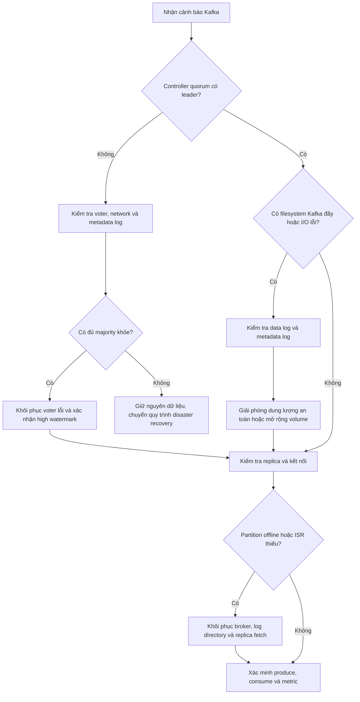

# Đĩa đầy, replica offline và mất controller quorum

Trong một cụm Apache Kafka, đĩa lưu log bị đầy, replica không theo kịp leader và controller quorum mất đa số có thể xuất hiện cùng lúc. Chúng ảnh hưởng đến những lớp khác nhau của hệ thống: dung lượng lưu trữ, khả năng sao chép dữ liệu và khả năng quản lý metadata của cụm. Muốn phục hồi an toàn, trước hết phải xác định lớp nào đang lỗi, node nào còn hoạt động và dữ liệu nào vẫn còn bản sao hợp lệ.

Bài này tập trung vào Kafka chạy KRaft, nơi controller duy trì metadata bằng một quorum Raft. Các lệnh minh họa dùng Kafka CLI trên Linux; tên script và một số tùy chọn có thể khác theo phiên bản, vì vậy hãy đối chiếu `--help` của đúng bản Kafka đang triển khai trước khi chạy trong production.

## 1. Phân biệt ba loại sự cố

| Sự cố | Thành phần bị ảnh hưởng | Dấu hiệu điển hình | Rủi ro chính |
|---|---|---|---|
| Đĩa đầy | Log directory của broker hoặc metadata log directory của controller | `No space left on device`, log directory offline, ghi record thất bại | Broker không ghi được record; replica hoặc partition có thể offline |
| Replica offline | Một replica không hoạt động hoặc không thể đồng bộ với leader | ISR co lại, `UnderReplicatedPartitions` tăng, replica fetch lỗi | Giảm redundancy; producer có thể bị từ chối ghi nếu ISR dưới ngưỡng |
| Mất controller quorum | Đa số controller voter không thể liên lạc hoặc không hoạt động | Không bầu được controller leader, metadata operation bị treo hoặc thất bại | Không thể quản lý metadata ổn định; failover và thay đổi trạng thái cụm bị hạn chế |

Ba hiện tượng có thể liên quan nhưng không đồng nghĩa. Ví dụ, một broker đầy đĩa có thể làm replica trên broker đó offline. Nếu broker này đồng thời là controller voter trong cấu hình KRaft kết hợp broker/controller, sự cố lưu trữ có thể làm quorum mất thêm một phiếu. Ngược lại, replica offline do lỗi mạng không chứng minh rằng đĩa đã đầy.

Kafka có thể vẫn phục vụ một phần lưu lượng đọc/ghi trong một số tình huống mất controller quorum nếu broker còn giữ metadata và leader hiện tại vẫn hoạt động. Tuy nhiên, khả năng bầu leader mới, đăng ký broker, cập nhật metadata và xử lý thay đổi partition có thể bị ảnh hưởng. Không được coi việc một vài request vẫn thành công là bằng chứng cụm đã phục hồi.

## 2. Nhận diện mức độ ảnh hưởng trước khi thao tác

Khi nhận cảnh báo, hãy xác định phạm vi trước:

1. Có bao nhiêu broker và controller đang sống? Phân biệt process đang chạy với node thực sự kết nối được qua listener đúng.
2. Sự cố chỉ nằm ở một broker, một log directory, một rack hay nhiều node cùng lúc?
3. Có partition nào không có leader hay chỉ có replica chưa bắt kịp leader?
4. ISR còn bao nhiêu replica và có partition nào xuống dưới `min.insync.replicas` không?
5. Controller quorum có leader không, high watermark có tiến triển không và các voter có theo kịp log không?
6. Ứng dụng producer đang nhận lỗi nào: timeout, `NOT_ENOUGH_REPLICAS`, `NOT_ENOUGH_REPLICAS_AFTER_APPEND`, lỗi metadata hay lỗi kết nối?

Không khởi động lại đồng loạt các broker hoặc controller khi chưa biết node nào đang giữ dữ liệu mới nhất. Restart đồng loạt có thể làm mất thêm quorum, khiến việc bầu leader khó hơn và làm dấu vết chẩn đoán biến mất.

## 3. Đọc các chỉ số và trạng thái quan trọng

Các metric hữu ích thường gồm:

| Metric hoặc trạng thái | Cách hiểu |
|---|---|
| `OfflinePartitionsCount` | Số partition hiện không có leader khả dụng; giá trị lớn hơn 0 là tình trạng cần ưu tiên xử lý |
| `UnderReplicatedPartitions` | Số partition có ít replica trong ISR hơn tổng replica được cấu hình |
| `UnderMinIsrPartitionCount` hoặc metric tương đương theo phiên bản | Số partition có ISR thấp hơn `min.insync.replicas`; tên metric cụ thể tùy phiên bản và hệ thống giám sát |
| `IsrShrinksPerSec` | Tốc độ ISR bị thu hẹp; tăng đột biến thường chỉ ra replica mất kết nối hoặc không theo kịp |
| `IsrExpandsPerSec` | Tốc độ ISR được mở rộng trở lại sau khi replica bắt kịp |
| Disk usage và inode usage | Dung lượng byte và số inode còn lại trên từng filesystem chứa log hoặc metadata |
| KRaft quorum leader và high watermark | Controller leader hiện tại và vị trí metadata log đã được quorum xác nhận |

Metric là tín hiệu khoanh vùng, không thay thế log broker/controller và trạng thái từng partition. Một broker có thể báo process sống nhưng một log directory đã bị đánh dấu offline. Tương tự, controller process có thể chạy nhưng không tham gia được quorum do network, cấu hình voter hoặc metadata log lỗi.

## 4. Xử lý khi đĩa đầy

### 4.1. Xác định đúng filesystem và directory

Kafka có thể lưu partition log trong một hoặc nhiều đường dẫn `log.dirs`. KRaft controller còn có metadata log directory; nếu không cấu hình riêng, metadata có thể dùng vị trí mặc định theo cấu hình và phiên bản. Cần xác định filesystem thực tế của từng đường dẫn, thay vì chỉ kiểm tra phân vùng gốc.

Trên Linux, kiểm tra dung lượng, inode và thư mục chiếm nhiều chỗ:

```bash
df -h
df -i
du -xhd1 /var/lib/kafka
```

Thay `/var/lib/kafka` bằng các đường dẫn `log.dirs` và metadata log thực tế. Nếu `df -h` cho thấy filesystem đầy nhưng `du` cộng các file nhìn thấy không giải thích được dung lượng, kiểm tra file đã bị xóa nhưng process vẫn mở:

```bash
lsof +L1
```

File log đã bị xóa khỏi directory nhưng vẫn mở có thể tiếp tục chiếm dung lượng cho đến khi process đóng file. Không restart broker chỉ để giải phóng dung lượng trước khi đánh giá ảnh hưởng đến replica và quorum.

Kiểm tra log của dịch vụ và kernel để xác nhận lỗi I/O hoặc hết dung lượng:

```bash
journalctl -u kafka -n 200 --no-pager
dmesg -T | tail -n 100
```

Tên systemd unit có thể khác. Tìm các dấu hiệu như `No space left on device`, `Disk quota exceeded`, lỗi mount, read-only filesystem, I/O error hoặc log directory bị đánh dấu offline.

### 4.2. Phân biệt data log với metadata log

- **Data log directory** chứa segment của các partition. Khi một đường dẫn trong `log.dirs` không ghi được, broker có thể đánh dấu log directory đó offline và các replica nằm trên đó bị ảnh hưởng. Nếu tất cả log directory của broker đều offline, broker có thể dừng hoạt động.
- **Metadata log directory** chứa log metadata KRaft trên controller. Nếu filesystem này đầy hoặc không ghi được, controller có thể không tiếp tục ghi metadata log hoặc không tham gia quorum bình thường. Với node có cả hai role, lỗi có thể đồng thời ảnh hưởng data plane và control plane.

Không giả định `log.dirs` và metadata log nằm trên cùng filesystem. Kiểm tra cấu hình đã triển khai, mount thực tế và log khởi động của node. Khi điều tra, chỉ chia sẻ các dòng cấu hình liên quan; không đưa mật khẩu hoặc thông tin xác thực vào ticket.

### 4.3. Giải phóng dung lượng an toàn

Ưu tiên các biện pháp có thể kiểm soát:

1. Mở rộng volume hoặc filesystem theo quy trình của nền tảng lưu trữ.
2. Dọn file tạm, core dump, log ứng dụng đã rotate hoặc artifact không thuộc Kafka trên cùng filesystem.
3. Điều chỉnh log rotation cho log ứng dụng và log hệ điều hành nếu chúng chiếm phần lớn dung lượng.
4. Nếu Kafka data log thực sự cần giảm, xem xét retention theo chính sách topic, kích thước segment và yêu cầu lưu trữ; thay đổi cấu hình có kiểm soát rồi theo dõi quá trình xóa segment do Kafka quản lý.
5. Kiểm tra cả inode, quota, quyền sở hữu thư mục và trạng thái mount sau khi giải phóng dung lượng.

**Không xóa thủ công các file segment, index, checkpoint hoặc file trong metadata log directory để lấy chỗ.** Xóa file trực tiếp có thể làm hỏng log, mất dữ liệu hoặc khiến node không thể khởi động. Không xóa `meta.properties`, không format lại storage của node đang có dữ liệu và không dùng `kafka-storage.sh format` như một thao tác sửa lỗi đĩa đầy.

Giảm retention cũng có thể xóa dữ liệu mà consumer chưa đọc. Trước khi đổi `retention.ms`, `retention.bytes` hoặc cấu hình tương ứng, hãy xác nhận yêu cầu replay, thời gian lưu, consumer lag, chính sách tuân thủ và bản sao lưu. Việc tăng dung lượng thường là cách khôi phục ít rủi ro hơn khi chưa hiểu rõ nhu cầu dữ liệu.

### 4.4. Xác nhận broker hoạt động trở lại

Sau khi filesystem có đủ dung lượng và quyền truy cập bình thường:

- Kiểm tra log broker để xác nhận log directory được khởi tạo hoặc đưa trở lại trạng thái hoạt động.
- Kiểm tra broker đăng ký được với cluster và metadata của partition được cập nhật.
- Kiểm tra replica fetcher bắt đầu sao chép lại; theo dõi ISR mở rộng dần.
- Kiểm tra `OfflinePartitionsCount`, `UnderReplicatedPartitions`, dung lượng đĩa và tốc độ tăng dữ liệu.

Một broker vừa phục hồi có thể cần thời gian dài để bắt kịp replica. Đừng thực hiện reassignment hàng loạt hoặc restart tiếp node khác trong lúc recovery đang tạo tải I/O lớn.

## 5. Chẩn đoán và phục hồi replica offline

### 5.1. Phân biệt offline partition và under-replicated partition

Một partition có thể có leader hoạt động nhưng thiếu một hoặc nhiều replica trong ISR. Trường hợp đó partition vẫn phục vụ request, nhưng mức dự phòng đã giảm. Một partition offline là partition hiện không có leader khả dụng; đây là mức độ nghiêm trọng hơn vì request tới partition đó có thể thất bại.

Với cấu hình producer `acks=all`, broker chỉ chấp nhận ghi khi điều kiện ISR và `min.insync.replicas` được đáp ứng. Khi ISR xuống dưới ngưỡng, producer có thể nhận `NOT_ENOUGH_REPLICAS` hoặc `NOT_ENOUGH_REPLICAS_AFTER_APPEND`. Đây là cơ chế bảo vệ durability; hạ `min.insync.replicas` hoặc đổi sang `acks=1` để làm mất cảnh báo có thể tăng nguy cơ mất dữ liệu khi leader gặp sự cố.

### 5.2. Liệt kê partition và replica bị ảnh hưởng

Kết nối tới một broker bootstrap còn hoạt động:

```bash
bin/kafka-topics.sh --bootstrap-server broker-1:9092 --describe --under-replicated-partitions
bin/kafka-topics.sh --bootstrap-server broker-1:9092 --describe --unavailable-partitions
```

Nếu bản Kafka đang dùng không hỗ trợ một tùy chọn trên, chạy `kafka-topics.sh --help` và dùng `--describe` để kiểm tra từng topic. Đọc các trường `Leader`, `Replicas` và `Isr`:

- `Leader: -1` cho biết partition chưa có leader.
- `Replicas` là tập broker được gán replica cho partition.
- `Isr` là tập replica hiện được xem là đồng bộ.
- Broker có trong `Replicas` nhưng vắng trong `Isr` cần được điều tra ở phía broker, network, disk và replica fetcher.

Kiểm tra dung lượng của log directory theo broker:

```bash
bin/kafka-log-dirs.sh \
  --bootstrap-server broker-1:9092 \
  --describe \
  --broker-list 1,2,3
```

Thay danh sách broker ID theo cụm. Kết quả cho biết trạng thái log directory và replica partition được lưu trên từng broker. Dùng kết quả này cùng log của broker để phân biệt đĩa đầy, directory offline, replica lag và lỗi kết nối.

### 5.3. Tìm nguyên nhân replica rời ISR

Kiểm tra theo từng replica bị ảnh hưởng:

1. Broker chứa replica có đang sống và kết nối được tới listener nội bộ không?
2. Filesystem chứa replica có đủ dung lượng và inode không? Log directory có bị offline hoặc read-only không?
3. Log broker có lỗi `ReplicaFetcherThread`, timeout, authentication, authorization, network hoặc I/O không?
4. Replica có bị giới hạn băng thông, CPU hoặc I/O đến mức không theo kịp leader không?
5. Có thay đổi cấu hình, rolling restart, reassignment hoặc thay đổi số partition gần thời điểm lỗi không?
6. Có chênh lệch phiên bản Kafka hoặc cấu hình listener/security sau nâng cấp không?

Replica có thể bị loại khỏi ISR khi không theo kịp leader trong khoảng thời gian được cấu hình, ví dụ liên quan đến `replica.lag.time.max.ms`. Không nên tăng timeout chỉ để che lỗi disk hoặc network; trước hết cần sửa nguyên nhân khiến replica không fetch được dữ liệu.

### 5.4. Đưa replica trở lại ISR

Sau khi broker và log directory ổn định, Kafka thường tự bắt đầu fetch phần log còn thiếu. Theo dõi log replica fetcher, lag, ISR và dung lượng đĩa. Khi replica bắt kịp leader và thỏa điều kiện đồng bộ, nó có thể được thêm trở lại ISR.

Nếu cần di chuyển replica sang broker khác do hỏng thiết bị hoặc phân bố tải không cân bằng, lập kế hoạch reassignment cho đúng partition và kiểm tra dung lượng đích, rack awareness, replication factor cùng tải mạng. Ví dụ quy trình CLI có hai giai đoạn: tạo file reassignment JSON theo schema của phiên bản Kafka, sau đó chạy lệnh execute và verify:

```bash
bin/kafka-reassign-partitions.sh \
  --bootstrap-server broker-1:9092 \
  --reassignment-json-file reassignment.json \
  --execute

bin/kafka-reassign-partitions.sh \
  --bootstrap-server broker-1:9092 \
  --reassignment-json-file reassignment.json \
  --verify
```

Không dùng JSON ví dụ chưa được kiểm tra cho cluster thật. Xác minh partition, replica đích, dung lượng và kế hoạch rollback trước khi execute. Reassignment tạo thêm network và disk I/O, vì vậy không nên bắt đầu khi cụm đang thiếu tài nguyên nghiêm trọng hoặc controller quorum chưa ổn định.

Tránh bật unclean leader election như một biện pháp chữa cháy mặc định. Nếu replica ngoài ISR được chọn làm leader, các record đã được xác nhận ở leader cũ nhưng chưa sao chép sang replica đó có thể bị mất. Chỉ cân nhắc trong quy trình disaster recovery có đánh giá và chấp thuận rõ ràng về khả năng mất dữ liệu.

## 6. Chẩn đoán controller quorum trong KRaft

### 6.1. Hiểu quorum và majority

KRaft dùng một nhóm controller voter để sao chép metadata log. Một quorum cần đa số voter hoạt động và liên lạc được với nhau. Với `N` voter, số phiếu tối thiểu là:

\[
\text{majority} = \left\lfloor \frac{N}{2} \right\rfloor + 1
\]

| Số voter | Số voter tối thiểu để có quorum | Có thể mất tối đa |
|---:|---:|---:|
| 1 | 1 | 0 |
| 3 | 2 | 1 |
| 5 | 3 | 2 |

Đây là số voter, không phải tổng số broker trong cluster. Broker-only node không đóng góp phiếu cho controller quorum. Trong cấu hình combined broker/controller, node đó có thể vừa lưu partition data vừa là một voter; một sự cố node có thể ảnh hưởng cả hai vai trò.

Ba hoặc năm controller voter phân bố trên các failure domain độc lập thường có khả năng chịu lỗi tốt hơn một nhóm chẵn cùng quy mô. Tuy nhiên, topology cụ thể phải tính đến rack, zone, network và năng lực vận hành. Thêm broker không tự động tăng số phiếu controller.

### 6.2. Kiểm tra trạng thái quorum

Nếu broker listener còn truy cập được, chạy:

```bash
bin/kafka-metadata-quorum.sh \
  --bootstrap-server broker-1:9092 \
  describe --status

bin/kafka-metadata-quorum.sh \
  --bootstrap-server broker-1:9092 \
  describe --replication
```

Một số phiên bản hoặc topology cho phép bootstrap trực tiếp qua controller listener bằng tùy chọn `--bootstrap-controller`. Hãy kiểm tra `kafka-metadata-quorum.sh --help` của đúng phiên bản để dùng endpoint và cú pháp tương ứng.

Các trường cần chú ý trong kết quả status gồm controller leader hiện tại, leader epoch, high watermark và danh sách voter/observer nếu phiên bản hiển thị. Trong kết quả replication, xem từng voter có log end offset tiến triển và có khoảng cách lớn so với leader hay không.

- Không có leader: quorum chưa bầu được leader hoặc không có đa số voter liên lạc được.
- Có leader nhưng follower lag: kiểm tra network, disk I/O, metadata log và log controller trên các follower.
- High watermark không tăng: metadata log có thể không commit được entry mới; đối chiếu tình trạng voter và lỗi ghi đĩa.
- Lệnh không kết nối được qua broker: thử endpoint controller theo hướng dẫn của phiên bản; lỗi kết nối CLI tự nó chưa chứng minh quorum đã mất.

### 6.3. Kiểm tra cấu hình và log của từng controller

Trên từng node controller, xác nhận các giá trị cấu hình liên quan:

```properties
process.roles=controller
node.id=1
controller.listener.names=CONTROLLER
listeners=CONTROLLER://controller-1:9093
```

Đây chỉ là ví dụ cấu hình rút gọn; node có thể dùng role kết hợp `broker,controller`. Với static quorum, kiểm tra `controller.quorum.voters` trên các node có cùng danh sách voter và đúng `node.id`, host, port. Với dynamic quorum ở các phiên bản hỗ trợ, kiểm tra cấu hình bootstrap controller và membership hiện tại theo đúng quy trình của phiên bản đó. Không áp dụng cấu hình static cho một cluster dynamic hoặc ngược lại.

Kiểm tra lần lượt:

- Controller process có chạy không và có bind đúng controller listener không?
- DNS, route, firewall và security protocol có cho phép các voter kết nối hai chiều không?
- Metadata log filesystem có đủ dung lượng, inode, quyền sở hữu và khả năng ghi không?
- Log có lỗi bầu cử, request timeout, authentication, I/O, corruption hoặc node ID/cluster ID không khớp không?
- Các node có dùng đúng cluster identity và metadata directory đã khởi tạo cho cluster này không?
- Có node nào bị khởi động từ snapshot hoặc volume cũ làm metadata log lùi xa không?

KRaft lưu thông tin nhận diện storage trong `meta.properties`. Khi điều tra, đối chiếu `cluster.id`, `node.id` và directory ID với hồ sơ triển khai. Không chỉnh sửa file này bằng tay và không sao chép metadata directory từ node khác để thay thế một controller hỏng.

### 6.4. Khôi phục quorum theo nguyên tắc tối thiểu

1. Xác định voter nào còn dữ liệu metadata hợp lệ và có log mới nhất dựa trên log, offset và trạng thái replication.
2. Khôi phục network, DNS, mount hoặc dung lượng cho voter bị lỗi. Nếu process dừng do nguyên nhân có thể khắc phục, sửa nguyên nhân trước rồi khởi động lại đúng node đó.
3. Khởi động từng voter cần phục hồi theo runbook của phiên bản, theo dõi bầu leader và replication sau mỗi bước.
4. Khi quorum có leader, xác nhận high watermark tiến triển và các voter bắt kịp trước khi thực hiện thay đổi metadata lớn.
5. Sau đó mới xử lý replica data, reassignment hoặc rolling restart broker nếu cần.

Không restart tất cả controller cùng lúc. Không tự ý xóa metadata log, xóa `meta.properties`, format storage, thay `cluster.id`, thêm voter bằng chỉnh file cấu hình hoặc ép một node cũ tham gia quorum. Những thao tác đó có thể tạo cluster identity khác, làm mất lịch sử metadata hoặc khiến các node không còn thống nhất về trạng thái.

Nếu không còn đủ voter có metadata hợp lệ để tạo quorum, đây là tình huống disaster recovery. Dừng các thao tác có thể ghi đè dữ liệu, giữ nguyên disk image và log, xác định bản sao lưu metadata có thể khôi phục, rồi áp dụng quy trình phục hồi phù hợp chính xác với phiên bản Kafka và topology. Không có một lệnh format chung an toàn cho mọi trường hợp mất quorum.

## 7. Quy trình xử lý khi ba sự cố xảy ra cùng lúc

Khi đĩa đầy làm replica offline và controller quorum cũng mất đa số, thứ tự xử lý cần bảo toàn metadata và bản sao dữ liệu hiện có:

1. **Đóng băng thay đổi không thiết yếu:** tạm dừng reassignment, rolling upgrade, thay đổi topic và các thao tác quản trị có thể chờ. Ghi nhận thời điểm, node, broker ID, controller voter và lỗi ứng dụng.
2. **Xác định quorum còn lại:** lập danh sách voter đang sống, voter liên lạc được và node có metadata log khỏe. Nếu vẫn có majority, giữ các voter đó ổn định.
3. **Tìm filesystem đầy:** kiểm tra data log và metadata log trên từng node; xác định byte, inode, quota, mount và lỗi I/O.
4. **Khôi phục dung lượng tối thiểu:** mở rộng volume hoặc dọn file ngoài Kafka có thể xóa an toàn. Không xóa segment hay metadata log thủ công.
5. **Khôi phục controller majority:** đưa các voter bị ảnh hưởng trở lại theo thứ tự có kiểm soát; chờ leader và high watermark ổn định.
6. **Khôi phục broker và replica:** kiểm tra broker registration, log directory, partition leader, replica lag và ISR. Chờ replication bắt kịp trước khi tái cân bằng.
7. **Xác minh ứng dụng:** thử produce/consume trên topic kiểm thử hoặc luồng được phê duyệt, xác nhận lỗi `NOT_ENOUGH_REPLICAS` đã hết và consumer tiếp tục tiến offset.
8. **Theo dõi sau phục hồi:** quan sát disk growth, ISR shrink/expand, offline partition, quorum replication, request latency và consumer lag trong một khoảng thời gian đủ dài.

Nếu không thể vừa duy trì quorum vừa giữ dữ liệu, ưu tiên bảo toàn dữ liệu và bằng chứng để thực hiện disaster recovery có kiểm soát. Không ép cluster hoạt động bằng cách hạ các bảo đảm durability khi chưa lượng hóa được dữ liệu có thể mất.

## 8. Sơ đồ quyết định khoanh vùng



Sơ đồ là thứ tự khoanh vùng tổng quát. Trong sự cố thực tế, controller và broker có thể cần được phục hồi xen kẽ tùy node nào kiêm cả hai role và quorum còn lại.

## 9. Ví dụ đọc trạng thái partition

Giả sử lệnh `kafka-topics.sh --describe` trả về:

```text
Topic: orders  Partition: 4  Leader: 2  Replicas: 1,2,3  Isr: 2,3
```

Partition vẫn có leader là broker 2. Replica trên broker 1 không có trong ISR, vì vậy partition đang under-replicated nhưng chưa offline. Hãy kiểm tra broker 1, filesystem chứa replica và log replica fetcher. Nếu broker 1 phục hồi và bắt kịp leader, ISR có thể trở lại `1,2,3`.

Nếu trạng thái là:

```text
Topic: orders  Partition: 4  Leader: -1  Replicas: 1,2,3  Isr: 2
```

Partition không có leader. Chỉ còn một replica trong ISR nhưng chưa có leader được bầu. Cần xác minh trạng thái các replica, broker và controller trước khi quyết định phục hồi. Không ép replica ngoài ISR làm leader nếu chưa đánh giá nguy cơ mất record đã được xác nhận.

Hai đoạn trên là dữ liệu minh họa để giải thích cách đọc output, không phải trạng thái của một cluster thật.

## 10. Checklist xác nhận phục hồi

### Lưu trữ

- [ ] Tất cả filesystem chứa `log.dirs` và metadata log còn dung lượng và inode dự phòng.
- [ ] Không còn lỗi read-only mount, quota hoặc I/O trên thiết bị.
- [ ] Các log directory cần thiết được broker nhận diện và hoạt động.
- [ ] Không có segment, index, checkpoint hoặc metadata file bị xóa thủ công.

### Controller và metadata

- [ ] Controller quorum có leader và đủ majority voter.
- [ ] High watermark tiến triển; follower replication không còn lag bất thường.
- [ ] `cluster.id`, `node.id` và metadata directory khớp với cluster.
- [ ] Không còn lỗi bầu cử hoặc kết nối controller lặp lại trong log.

### Broker và replica

- [ ] Các broker cần thiết đã đăng ký và phục vụ request.
- [ ] Không còn partition offline ngoài các ngoại lệ đã được ghi nhận.
- [ ] `UnderReplicatedPartitions` và số partition dưới min ISR trở về mức kỳ vọng.
- [ ] Replica lag giảm; ISR mở rộng ổn định.
- [ ] Không có reassignment ngoài kế hoạch đang chạy.

### Ứng dụng

- [ ] Producer ghi thành công với cấu hình durability dự kiến.
- [ ] Consumer đọc được record và tiếp tục tiến offset.
- [ ] Không có lỗi retry hoặc timeout tăng bất thường.
- [ ] Dashboard, alert và log đã phản ánh trạng thái khỏe sau phục hồi.

## 11. Phòng ngừa tái diễn

- Đặt cảnh báo dung lượng và inode theo từng mount, không chỉ theo tổng dung lượng máy. Thiết lập ngưỡng cảnh báo sớm đủ thời gian mở rộng volume hoặc xử lý retention.
- Dành headroom cho compaction, segment rolling, reassignment và recovery. Đừng vận hành filesystem sát 100% trong điều kiện bình thường.
- Phân tách hoặc lập kế hoạch dung lượng riêng cho data log, metadata log và log hệ điều hành theo yêu cầu của workload.
- Theo dõi `OfflinePartitionsCount`, `UnderReplicatedPartitions`, ISR shrink, replica lag và KRaft quorum health cùng dashboard disk.
- Phân bố controller voter trên các failure domain độc lập; xác nhận quorum sau mỗi thay đổi topology hoặc bảo trì.
- Kiểm thử runbook mất một voter, mất một broker và đầy filesystem trong môi trường staging có dữ liệu giả lập.
- Lập kế hoạch retention, replication factor, `min.insync.replicas`, producer `acks` và backup dựa trên RPO/RTO đã thống nhất.
- Ghi lại phiên bản Kafka, cấu hình quorum, danh sách node, đường dẫn metadata và quy trình phục hồi để người trực sự cố không phải suy đoán trong lúc incident.

Đĩa đầy là vấn đề tài nguyên lưu trữ; replica offline là vấn đề khả năng sao chép và độ dự phòng; controller quorum mất đa số là vấn đề điều phối metadata. Chẩn đoán đúng từng lớp, giữ nguyên dữ liệu Kafka và phục hồi theo thứ tự có kiểm soát sẽ giảm nguy cơ biến một sự cố vận hành thành mất dữ liệu hoặc mất khả năng khởi động cụm.
