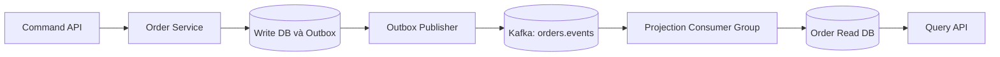

# Xây dựng read model và phép chiếu từ sự kiện

Trong một ứng dụng dùng Apache Kafka, dữ liệu được phát ra dưới dạng sự kiện thường phù hợp với cách các dịch vụ ghi nhận thay đổi, nhưng chưa chắc phù hợp với cách giao diện cần truy vấn. Một màn hình danh sách đơn hàng có thể cần tên khách hàng, trạng thái mới nhất, tổng tiền và thời điểm cập nhật trong cùng một hàng. Nếu mỗi lần đọc đều phải ghép nhiều sự kiện hoặc gọi nhiều dịch vụ, truy vấn sẽ phức tạp và khó đáp ứng tải lớn.

Read model giải quyết vấn đề này bằng cách lưu một cấu trúc dữ liệu được tối ưu cho truy vấn. Một consumer đọc các sự kiện từ Kafka, biến đổi chúng thành dữ liệu cần thiết và cập nhật read model. Quá trình biến đổi đó được gọi là *projection* (phép chiếu). Bài học này trình bày cách thiết kế luồng sự kiện, cấu trúc read model, xử lý trùng lặp và sai thứ tự, cũng như vận hành và xây dựng lại projection trong ứng dụng Java/Spring.

Sau bài học, người học có thể:

- Giải thích vai trò của read model và projection trong kiến trúc hướng sự kiện, đặc biệt khi áp dụng CQRS.
- Thiết kế event contract và khóa phân vùng để giữ thứ tự sự kiện trong phạm vi cần thiết.
- Xây dựng consumer Java/Spring Kafka cập nhật read model một cách an toàn khi sự kiện được gửi lại.
- Chọn chiến lược xử lý sự kiện đến trễ, lỗi, phát lại và xây dựng lại dữ liệu đọc.
- Theo dõi độ trễ projection và đánh giá ảnh hưởng của tính nhất quán cuối cùng đến API.

## 1. Read model và projection là gì?

**Read model** là mô hình dữ liệu được tổ chức theo nhu cầu đọc của một hoặc nhiều truy vấn. Nó có thể là một bảng quan hệ đã phi chuẩn hóa, một tài liệu trong document database, một chỉ mục tìm kiếm hoặc một state store. Read model thường chứa dữ liệu đã được tổng hợp hoặc kết hợp để API có thể trả lời nhanh mà không phải tái dựng trạng thái từ toàn bộ lịch sử sự kiện.

**Projection** là logic tiêu thụ một hay nhiều loại sự kiện rồi tạo ra hoặc cập nhật read model. Ví dụ, `OrderPlaced` tạo một dòng đơn hàng; `OrderPaid` đổi trạng thái thành `PAID`; `OrderShipped` ghi nhận trạng thái `SHIPPED` và mã vận đơn. Projection có thể chỉ cập nhật một bảng, hoặc kết hợp nhiều luồng sự kiện để tạo một màn hình tổng hợp.

Trong CQRS (*Command Query Responsibility Segregation*), đường ghi và đường đọc được thiết kế theo hai nhu cầu khác nhau:

- Đường ghi tiếp nhận command, kiểm tra quy tắc nghiệp vụ và thay đổi trạng thái miền.
- Đường đọc truy vấn read model đã được chuẩn bị cho các câu hỏi của người dùng.

Hai đường này không bắt buộc phải dùng hai hệ quản trị cơ sở dữ liệu khác nhau. Ở hệ thống nhỏ, chúng có thể dùng chung một database nhưng có bảng hoặc schema riêng. Khi tải đọc, yêu cầu tìm kiếm hoặc cách mở rộng khác biệt rõ rệt, read model có thể chuyển sang một kho dữ liệu phù hợp hơn.

Read model không nên trở thành nguồn sự thật thứ hai. Trạng thái nghiệp vụ chuẩn vẫn thuộc về dịch vụ sở hữu aggregate hoặc dữ liệu ghi. Read model là dữ liệu dẫn xuất; nếu bị mất hoặc sai, hệ thống phải có cách tạo lại từ nguồn sự kiện hoặc từ một nguồn dữ liệu chuẩn đã xác định.

## 2. Luồng kiến trúc tổng quát

Một luồng phổ biến trong ứng dụng đặt hàng như sau:



Khi người dùng tạo đơn hàng, Order Service xác thực command và ghi trạng thái đơn hàng. Sự kiện `OrderPlaced` được xuất bản lên topic `orders.events`. Consumer group dành riêng cho read model nhận sự kiện, chuyển đổi nó thành một bản ghi trong bảng `order_summary`. Query API đọc bảng này để trả về danh sách đơn hàng.

Tách publisher và projection consumer giúp đường ghi không phải chờ read model cập nhật. Đổi lại, dữ liệu đọc có thể chậm hơn dữ liệu ghi một khoảng thời gian. Đây là đặc tính **tính nhất quán cuối cùng** (*eventual consistency*) và phải được tính đến trong thiết kế API, giao diện và nghiệp vụ.

Nếu dịch vụ vừa ghi database vừa gửi Kafka trực tiếp, có thể xảy ra tình huống database commit thành công nhưng gửi Kafka thất bại, hoặc Kafka nhận sự kiện nhưng database rollback. Đây là lỗi ghi kép (*dual-write problem*). Mẫu Outbox ghi thay đổi nghiệp vụ và bản ghi outbox trong cùng transaction database; publisher đọc outbox rồi gửi sự kiện đến Kafka. Publisher có thể gửi lại khi không chắc lần gửi trước đã thành công, vì vậy consumer vẫn cần xử lý trùng lặp.

## 3. Thiết kế event contract và khóa phân vùng

Projection phụ thuộc vào ý nghĩa và cấu trúc của sự kiện. Một event contract nên cung cấp đủ thông tin để consumer hiểu sự kiện mà không phải gọi ngược dịch vụ phát sự kiện trong mọi lần xử lý.

Ví dụ payload cho `OrderPlaced`:

```json
{
  "eventId": "b2d40f6c-4c1b-4e6f-9f2c-8d1a42a80b21",
  "eventType": "OrderPlaced",
  "schemaVersion": 1,
  "aggregateId": "order-8472",
  "aggregateVersion": 1,
  "occurredAt": "2026-11-20T10:15:30Z",
  "payload": {
    "customerId": "customer-29",
    "currency": "VND",
    "totalAmount": 1250000
  }
}
```

Các trường có vai trò khác nhau:

| Trường | Mục đích |
|---|---|
| `eventId` | Định danh duy nhất một sự kiện, dùng để nhận biết lần xử lý lặp lại. |
| `eventType` | Cho biết sự kiện mô tả điều gì. |
| `schemaVersion` | Phiên bản cấu trúc payload, phục vụ tương thích schema. |
| `aggregateId` | Định danh đối tượng nghiệp vụ mà sự kiện tác động. |
| `aggregateVersion` | Số phiên bản tăng theo từng thay đổi của aggregate, hữu ích để phát hiện trùng hoặc sai thứ tự. |
| `occurredAt` | Thời điểm sự kiện xảy ra theo nguồn phát. |

Không nên dùng `schemaVersion` thay cho `aggregateVersion`: một phiên bản schema có thể chứa hàng nghìn thay đổi nghiệp vụ của cùng aggregate. Tương tự, `occurredAt` không phải cơ chế duy nhất để xác định thứ tự vì đồng hồ giữa các máy có thể lệch nhau.

Khi gửi sự kiện lên Kafka, thường dùng `aggregateId` làm message key. Các sự kiện của cùng một đơn hàng nhờ đó được đưa vào cùng partition và Kafka giữ thứ tự bản ghi trong partition đó. Thứ tự này chỉ có ý nghĩa trong một partition; Kafka không đảm bảo thứ tự toàn cục giữa nhiều partition hoặc nhiều topic.

Consumer group cho projection nên có `group.id` riêng, ví dụ `order-summary-projection-v1`. Những consumer thuộc cùng group chia nhau các partition. Một group khác có thể đọc cùng topic độc lập để tạo read model khác, chẳng hạn `customer-order-history`. Không dùng chung group ID cho hai projection cần nhận đầy đủ cùng một tập sự kiện, vì Kafka sẽ phân phối bản ghi giữa các thành viên của group thay vì gửi bản sao cho từng projection.

## 4. Thiết kế read model theo câu hỏi cần trả lời

Hãy bắt đầu từ truy vấn của người dùng thay vì sao chép nguyên cấu trúc của write model. Giả sử màn hình quản trị cần hiển thị danh sách đơn hàng với các cột:

- Mã đơn hàng và mã khách hàng.
- Trạng thái hiện tại.
- Tổng tiền và đơn vị tiền tệ.
- Thời điểm tạo và cập nhật gần nhất.

Một bảng đọc có thể được thiết kế như sau:

```sql
CREATE TABLE order_summary (
    order_id           VARCHAR(64) PRIMARY KEY,
    customer_id        VARCHAR(64) NOT NULL,
    status             VARCHAR(24) NOT NULL,
    total_amount       DECIMAL(19, 2) NOT NULL,
    currency           CHAR(3) NOT NULL,
    created_at         TIMESTAMP NOT NULL,
    updated_at         TIMESTAMP NOT NULL,
    aggregate_version  BIGINT NOT NULL
);

CREATE INDEX idx_order_summary_customer_created
    ON order_summary (customer_id, created_at DESC);
```

Khóa chính `order_id` giúp tìm và cập nhật một đơn hàng. Index hỗ trợ truy vấn lịch sử theo khách hàng và thời gian. Nếu màn hình thường lọc theo trạng thái, có thể cân nhắc index phù hợp sau khi đo truy vấn thực tế. Không nên tạo index cho mọi cột vì mỗi lần projection ghi dữ liệu cũng phải duy trì các index đó.

Một projection có thể nhận nhiều loại sự kiện và cập nhật cùng read model:

| Sự kiện | Thay đổi trong `order_summary` |
|---|---|
| `OrderPlaced` | Tạo dòng mới, trạng thái `CREATED`, ghi khách hàng và tổng tiền. |
| `OrderPaid` | Đổi trạng thái thành `PAID`, cập nhật phiên bản aggregate. |
| `OrderShipped` | Đổi trạng thái thành `SHIPPED`, cập nhật thời điểm và phiên bản. |
| `OrderCancelled` | Đổi trạng thái thành `CANCELLED`, cập nhật phiên bản. |

Projection phải hiểu quy tắc chuyển trạng thái của miền. Ví dụ, một sự kiện thanh toán không hợp lệ hoặc sự kiện hủy đến sau khi đơn đã giao không nên âm thầm ghi đè trạng thái hiện tại. Cần xác định rõ sự kiện nào hợp lệ, dữ liệu nào là đầy đủ trong event contract và khi nào phải đưa bản ghi vào luồng xử lý lỗi để điều tra.

## 5. Cập nhật read model an toàn trong Java/Spring Kafka

Với Kafka, consumer có thể nhận lại một bản ghi khi tiến trình dừng sau khi cập nhật database nhưng trước khi offset được commit. Vì vậy, xử lý projection cần chịu được ít nhất một lần giao (*at-least-once delivery*). Một cách phổ biến là dùng `eventId` làm khóa chống xử lý lặp và lưu dấu đã xử lý trong cùng transaction database với thay đổi read model.

Ví dụ DTO cho sự kiện:

```java
public record OrderPlaced(
    UUID eventId,
    String orderId,
    long aggregateVersion,
    Instant occurredAt,
    String customerId,
    BigDecimal totalAmount,
    String currency
) {}
```

Bảng theo dõi sự kiện đã xử lý:

```sql
CREATE TABLE processed_event (
    event_id       UUID PRIMARY KEY,
    processed_at   TIMESTAMP NOT NULL
);
```

Repository cần có thao tác thêm `event_id` theo kiểu chỉ thêm nếu chưa tồn tại. Với PostgreSQL, câu lệnh có thể dùng `INSERT ... ON CONFLICT DO NOTHING` và trả về số dòng được thêm. Nếu không thêm được dòng nào, sự kiện đã được xử lý trước đó.

Service cập nhật projection có thể được viết như sau (các repository là thành phần ứng dụng cung cấp):

```java
@Service
public class OrderSummaryProjector {
    private final ProcessedEventRepository processedEvents;
    private final OrderSummaryRepository summaries;

    public OrderSummaryProjector(
            ProcessedEventRepository processedEvents,
            OrderSummaryRepository summaries) {
        this.processedEvents = processedEvents;
        this.summaries = summaries;
    }

    @Transactional
    public void onOrderPlaced(OrderPlaced event) {
        boolean firstDelivery = processedEvents.insertIfAbsent(event.eventId());
        if (!firstDelivery) {
            return;
        }

        summaries.createIfVersionIsNewer(
            event.orderId(),
            event.customerId(),
            "CREATED",
            event.totalAmount(),
            event.currency(),
            event.occurredAt(),
            event.aggregateVersion()
        );
    }
}
```

Listener nhận sự kiện và ủy quyền cho projector:

```java
@Component
public class OrderEventsListener {
    private final OrderSummaryProjector projector;

    public OrderEventsListener(OrderSummaryProjector projector) {
        this.projector = projector;
    }

    @KafkaListener(
        topics = "orders.events",
        groupId = "order-summary-projection-v1"
    )
    public void onOrderPlaced(OrderPlaced event) {
        projector.onOrderPlaced(event);
    }
}
```

Ví dụ trên minh họa một loại sự kiện. Trong ứng dụng thực tế, cần cấu hình deserializer, type mapping hoặc event envelope để chuyển payload về đúng kiểu; đồng thời đăng ký listener cho các loại sự kiện mà projection hỗ trợ. Không nên giả định Kafka tự hiểu kiểu Java từ JSON.

Điểm quan trọng là thao tác ghi `processed_event` và cập nhật `order_summary` phải nằm trong cùng transaction database. Nếu cập nhật read model lỗi, transaction rollback cả dấu đã xử lý; Kafka có thể gửi lại và consumer thử lại. Nếu transaction database commit nhưng offset Kafka chưa commit, lần nhận lại sẽ gặp `eventId` đã tồn tại và không áp dụng thay đổi lần thứ hai.

`@Transactional` trong ví dụ quản lý transaction database. Nó không tự tạo một transaction nguyên tử bao trùm cả database và Kafka. Nếu dùng transaction manager Kafka hoặc chế độ exactly-once của Kafka, cần hiểu phạm vi đảm bảo của cấu hình đó. Khi đích ghi là database bên ngoài Kafka, thiết kế idempotent vẫn là nền tảng để chịu được retry và crash.

## 6. Kiểm soát thứ tự và sự kiện đến trễ

Kafka giữ thứ tự bản ghi trong từng partition. Để các thay đổi của một đơn hàng đi theo thứ tự, producer phải gửi chúng với cùng key `orderId`, và projection phải xử lý tuần tự trong phạm vi partition. Nếu listener đẩy công việc sang thread pool bất đồng bộ rồi ghi database song song, ứng dụng có thể tự làm mất thứ tự mà Kafka đã cung cấp.

Nên lưu `aggregateVersion` trên read model và chỉ áp dụng thay đổi nếu phiên bản sự kiện mới hơn phiên bản hiện tại. Ví dụ, câu lệnh cập nhật có điều kiện:

```sql
UPDATE order_summary
SET status = :status,
    updated_at = :occurredAt,
    aggregate_version = :incomingVersion
WHERE order_id = :orderId
  AND aggregate_version < :incomingVersion;
```

Điều kiện này ngăn sự kiện phiên bản cũ ghi đè trạng thái mới. Tuy nhiên, nó không tự giải quyết mọi trường hợp. Nếu read model đang ở phiên bản 4 mà nhận phiên bản 6, có thể phiên bản 5 đã bị bỏ qua. Với projection cần đầy đủ mọi chuyển đổi, hãy phát hiện khoảng trống phiên bản và retry, tạm giữ sự kiện hoặc đưa vào quy trình phục hồi. Nếu sự kiện mới chứa snapshot đầy đủ trạng thái cần đọc, có thể áp dụng phiên bản mới nhất mà không cần tái dựng từng bước; lựa chọn này phải phù hợp với ngữ nghĩa sự kiện.

Khi tăng số partition của topic, phép ánh xạ key sang partition có thể thay đổi. Trong một số cấu hình, sự kiện mới của cùng aggregate có thể đi vào partition khác với sự kiện cũ còn đang được xử lý. Vì vậy, việc mở rộng partition cần được xem xét cùng yêu cầu ordering, cách producer gửi sự kiện và cách consumer xử lý phiên bản aggregate.

## 7. Xây dựng lại projection và quản lý phiên bản

Read model có thể cần xây dựng lại khi schema thay đổi, logic projection được sửa, dữ liệu bị lỗi hoặc cần tạo một góc nhìn mới. Một quy trình rebuild có kiểm soát thường gồm:

1. Tạo read model mới hoặc bảng mới, ví dụ `order_summary_v2`.
2. Tạo consumer group mới, ví dụ `order-summary-projection-v2`, với offset bắt đầu phù hợp.
3. Phát lại sự kiện từ nguồn đã lưu giữ và cập nhật read model mới.
4. So sánh số lượng bản ghi, trạng thái tổng hợp và các chỉ số nghiệp vụ giữa phiên bản cũ và mới.
5. Chuyển Query API sang read model mới khi dữ liệu đã đạt yêu cầu, sau đó ngừng phiên bản cũ theo quy trình triển khai.

Khả năng rebuild phụ thuộc vào chính sách lưu giữ của topic. Topic dùng retention theo thời gian hoặc dung lượng có thể xóa các sự kiện cũ; topic compacted giữ bản ghi mới nhất theo key và có thể không còn toàn bộ lịch sử chuyển trạng thái. Nếu cần tái dựng một projection từ đầu, phải bảo đảm nguồn sự kiện lưu giữ đủ thông tin và đủ lâu, hoặc có chiến lược snapshot kết hợp với sự kiện sau snapshot.

Khi chỉ cần phát lại một phần dữ liệu, cần xác định rõ phạm vi offset, partition và aggregate. Xóa bảng read model trong khi consumer group vẫn giữ offset ở cuối topic sẽ khiến consumer không đọc lại các sự kiện cũ. Ngược lại, reset offset mà không chuẩn bị read model có thể tạo dữ liệu trùng hoặc trạng thái không nhất quán. Hãy lập kế hoạch cho cả dữ liệu đích lẫn offset trước khi rebuild.

## 8. Tổ chức nhiều projection và lựa chọn công nghệ

Một topic sự kiện có thể phục vụ nhiều read model độc lập. Ví dụ:

| Projection | Consumer group | Read model | Truy vấn phục vụ |
|---|---|---|---|
| Tóm tắt đơn hàng | `order-summary-v1` | `order_summary` | Danh sách đơn hàng cho quản trị. |
| Lịch sử khách hàng | `customer-history-v1` | `customer_order_history` | Các đơn hàng theo khách hàng. |
| Báo cáo doanh thu | `revenue-report-v1` | Bảng tổng hợp doanh thu | Tổng doanh thu theo ngày và khu vực. |

Các projection độc lập có thể có tốc độ, schema và vòng đời triển khai khác nhau. Một projection lỗi không nhất thiết ngăn các projection khác tiến triển, miễn là chúng dùng consumer group riêng và hạ tầng được cấp đủ tài nguyên.

Với consumer Java/Spring Kafka thông thường, nhóm phát triển chủ động viết logic nghiệp vụ và cập nhật database. Khi cần phép biến đổi liên tục, join stream, window hoặc stateful aggregation, Kafka Streams có thể phù hợp hơn. Kafka Streams cung cấp abstraction cho stream/table, state store và xử lý theo thời gian. Với nhu cầu chuyển dữ liệu giữa Kafka và hệ thống ngoài theo cấu hình connector, Kafka Connect có thể đảm nhận việc ingest hoặc sink dữ liệu. Connector không thay thế projection nghiệp vụ có quy tắc phức tạp; hãy chọn công cụ theo mức độ biến đổi và trách nhiệm nghiệp vụ.

## 9. Tính nhất quán cuối cùng trong API

Sau khi command tạo đơn hàng thành công, sự kiện có thể cần một khoảng thời gian mới đến projection và được ghi vào read model. Nếu API ngay lập tức truy vấn read model, kết quả có thể chưa hiển thị đơn hàng vừa tạo.

Có một số cách xử lý tùy yêu cầu sản phẩm:

- Trả trạng thái hoặc dữ liệu vừa ghi từ command response, rồi để màn hình cập nhật khi read model bắt kịp.
- Trả `eventId` hoặc phiên bản aggregate để client có thể kiểm tra tiến độ cập nhật nếu trải nghiệm cần xác nhận.
- Dùng cơ chế chờ có giới hạn khi nghiệp vụ thật sự cần đọc ngay sau ghi; cần đặt timeout và tránh tạo tải truy vấn lặp quá lớn.
- Với truy vấn quan trọng, định nghĩa rõ mức trễ chấp nhận được và cách xử lý khi projection chưa đạt phiên bản mong muốn.

Không nên giả định một lần commit vào write database đồng nghĩa mọi read model đã cập nhật. API cần mô tả rõ trạng thái đang xử lý, đã xác nhận hay đã sẵn sàng để truy vấn.

## 10. Retry, lỗi dữ liệu và khả năng quan sát

Projection chạy lâu dài nên cần có chính sách xử lý lỗi rõ ràng. Lỗi tạm thời như database mất kết nối có thể retry với backoff. Lỗi dữ liệu không thể giải mã hoặc vi phạm contract có thể cần đưa vào dead-letter topic (DLT) cùng thông tin topic, partition, offset và nguyên nhân để điều tra.

Retry không đúng cách có thể làm thay đổi thứ tự. Ví dụ, nếu sự kiện phiên bản 2 bị chuyển sang retry topic trong khi phiên bản 3 tiếp tục được xử lý, read model có thể thấy phiên bản 3 trước. Điều kiện `aggregateVersion` giúp ngăn ghi đè cũ, nhưng ứng dụng vẫn cần quyết định cách xử lý khoảng trống và cách phát lại bản ghi lỗi. Với nghiệp vụ yêu cầu thứ tự nghiêm ngặt, hãy chọn chiến lược retry và partitioning phù hợp thay vì chỉ tăng số lần thử.

Các chỉ số nên theo dõi gồm:

- Consumer lag theo partition và tốc độ lag tăng hoặc giảm.
- Số sự kiện xử lý mỗi giây, thời gian xử lý trung vị và các phân vị cao.
- Số lần retry, số bản ghi vào DLT và nhóm lỗi thường gặp.
- Thời gian từ `occurredAt` đến khi read model được cập nhật.
- Độ trễ và tỷ lệ lỗi của database, số connection đang dùng và thời gian transaction.
- Số sự kiện bị bỏ qua do trùng `eventId` hoặc do phiên bản đã cũ.

Lag thấp chưa chắc read model chính xác: consumer có thể đọc hết topic nhưng bỏ qua sự kiện vì lỗi mapping hoặc logic. Vì vậy, ngoài chỉ số Kafka, cần kiểm tra các bất biến nghiệp vụ và đối chiếu dữ liệu mẫu giữa nguồn ghi với read model.

## 11. Ví dụ luồng xử lý đơn hàng hoàn chỉnh

Giả sử người dùng đặt một đơn hàng có mã `order-8472`:

1. Order Service nhận command `PlaceOrder`, kiểm tra giỏ hàng và lưu đơn hàng ở trạng thái `CREATED`.
2. Cùng transaction, dịch vụ ghi một bản ghi `OrderPlaced` vào outbox.
3. Outbox Publisher gửi sự kiện lên topic `orders.events` với key `order-8472`.
4. Consumer group `order-summary-projection-v1` nhận sự kiện, kiểm tra `eventId`, rồi tạo dòng tương ứng trong `order_summary`.
5. Query API đọc `order_summary` và trả danh sách đơn hàng cho màn hình quản trị.
6. Khi thanh toán thành công, dịch vụ phát `OrderPaid` với cùng key và `aggregateVersion` tiếp theo. Projection cập nhật trạng thái thành `PAID`.
7. Nếu consumer dừng sau khi database commit nhưng trước khi Kafka commit offset, Kafka có thể gửi lại sự kiện. `processed_event` nhận ra `eventId` đã tồn tại nên read model không bị áp dụng lần hai.

Luồng này cho thấy read model được cập nhật bất đồng bộ, nhưng có thể phục hồi sau khi consumer khởi động lại. Việc dùng key nhất quán, event ID duy nhất, phiên bản aggregate và transaction database giúp projection có hành vi dự đoán được khi retry.

## 12. Những câu hỏi cần trả lời khi thiết kế

Trước khi triển khai một projection, nhóm phát triển nên thống nhất:

1. Read model phục vụ chính xác những truy vấn nào, tần suất đọc và độ trễ tối đa chấp nhận được là bao nhiêu?
2. Dịch vụ nào sở hữu sự kiện và nguồn dữ liệu chuẩn? Contract có đủ dữ liệu để projection hoạt động độc lập không?
3. Key Kafka là gì và phạm vi nào cần giữ thứ tự? Có kiểm tra `aggregateVersion` không?
4. Projection chống xử lý trùng bằng `eventId` như thế nào? Dấu đã xử lý và dữ liệu đọc có được commit cùng transaction không?
5. Khi sự kiện lỗi hoặc đến sai thứ tự, hệ thống retry, tạm giữ hay đưa vào DLT ra sao?
6. Có thể rebuild từ nguồn sự kiện hiện có không? Retention, compaction và snapshot có đáp ứng yêu cầu không?
7. Những chỉ số nào xác nhận projection đang cập nhật đúng và đủ nhanh?

Một thiết kế tốt làm rõ nguồn sự thật, hợp đồng sự kiện, quy tắc cập nhật và cách phục hồi. Khi các quyết định này được xác định trước, read model có thể phát triển độc lập theo nhu cầu truy vấn mà vẫn theo kịp luồng sự kiện của ứng dụng Kafka.
