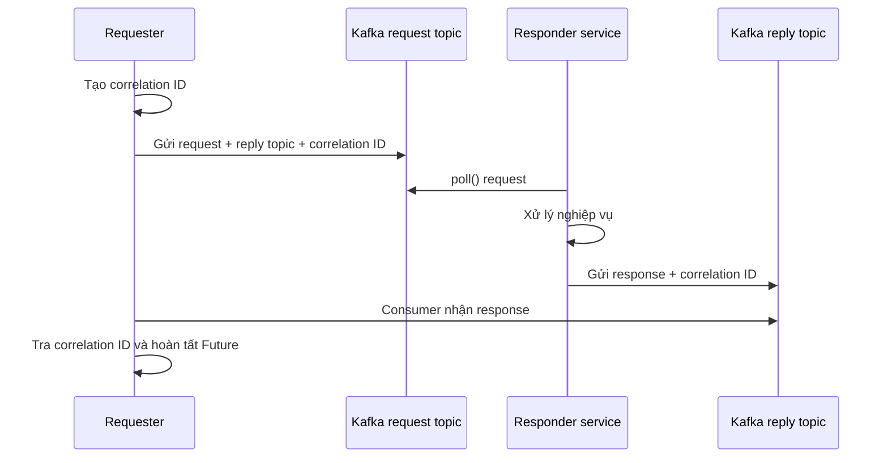
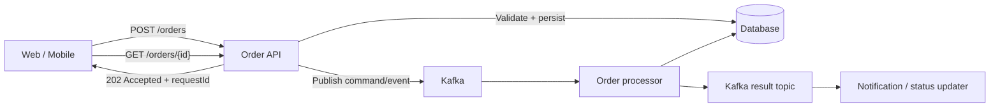

# Request-reply qua Kafka và khi nên chọn HTTP hoặc RPC

Kafka thường được dùng để truyền sự kiện bất đồng bộ, nhưng cũng có thể triển khai mẫu request-reply: một ứng dụng gửi yêu cầu vào topic, dịch vụ xử lý tiêu thụ yêu cầu rồi gửi kết quả vào topic phản hồi. Ứng dụng gửi yêu cầu dùng correlation ID để ghép phản hồi với lời gọi ban đầu.

Mẫu này hữu ích khi yêu cầu cần đi qua luồng xử lý Kafka, cần lưu bền vững, đệm tải hoặc tách rời thời điểm hoạt động giữa bên gọi và bên xử lý. Tuy nhiên, request-reply qua Kafka có thêm độ trễ và công việc quản lý timeout, correlation, reply routing, retry và phản hồi đến muộn. Với lời gọi tương tác cần kết quả ngay, HTTP hoặc RPC thường đơn giản và phù hợp hơn.

Bài này giải thích cách thiết kế request-reply, triển khai bằng Kafka Java client và Spring Kafka, xử lý các tình huống lỗi, rồi đưa ra tiêu chí chọn Kafka, HTTP hoặc RPC.

## 1. Request-reply qua Kafka hoạt động như thế nào?

Một luồng request-reply thường có ba thành phần:

- **Requester:** tạo yêu cầu, gửi record đến request topic và chờ kết quả.
- **Responder:** consumer thuộc một consumer group đọc yêu cầu, thực hiện nghiệp vụ và gửi kết quả.
- **Reply channel:** topic dùng để chuyển phản hồi trở lại requester.

Requester cần gắn một correlation ID duy nhất cho mỗi yêu cầu. ID này được gửi kèm request và được responder sao chép nguyên vẹn sang response. Khi response đến, requester tra correlation ID trong bảng các yêu cầu đang chờ và hoàn tất đúng lời gọi.



Kafka không tự động ghép request với response. Ứng dụng hoặc framework phải duy trì correlation ID và định tuyến phản hồi.

## 2. Các thành phần của một message request-reply

Một request nên có đủ thông tin để responder xử lý và trả lời:

| Thành phần | Mục đích |
|---|---|
| Request ID | Định danh yêu cầu nghiệp vụ ổn định, hỗ trợ idempotency |
| Correlation ID | Ghép response với lời gọi đang chờ |
| Reply topic | Cho responder biết nơi gửi phản hồi |
| Reply partition (nếu dùng) | Định tuyến phản hồi đến đúng requester instance |
| Key | Chọn partition request và hỗ trợ ordering theo khóa |
| Payload | Nội dung lệnh hoặc truy vấn |
| Deadline/expiry | Cho biết yêu cầu còn ý nghĩa đến thời điểm nào |
| Schema version | Giúp hai phía diễn giải payload tương thích |

Có thể đặt correlation ID và reply topic trong Kafka record headers; request ID và dữ liệu nghiệp vụ thường nằm trong payload. Header là byte array, vì vậy hai phía phải thống nhất encoding và tên header.

Ví dụ payload request:

```json
{
  "requestId": "cmd-8a12",
  "orderId": "order-1001",
  "operation": "CHECK_STATUS",
  "deadline": "2026-11-20T15:30:00Z"
}
```

Các header minh họa:

```text
correlation-id: 4c2e8f8b-...
reply-topic: orders.reply.instance-17
```

Không dùng correlation ID làm cơ chế xác thực. Nó chỉ là định danh để ghép thông điệp; quyền gửi request và đọc reply phải được kiểm soát bằng xác thực và ACL.

## 3. Chọn topology cho reply topic

Cách định tuyến reply là một quyết định quan trọng. Nếu nhiều requester instance cùng đọc một reply topic bằng một consumer group, mỗi record chỉ được giao cho một thành viên của group. Response có thể đến instance khác với instance đã gửi request, trong khi bảng Future đang chờ chỉ tồn tại trong bộ nhớ của requester ban đầu.

Có ba cách phổ biến để giải quyết vấn đề này.

### 3.1. Reply topic riêng cho từng requester instance

Mỗi requester instance có một reply topic riêng hoặc một kênh reply riêng được cấu hình trước. Request mang tên topic đó trong header; responder gửi response về đúng topic.

Ưu điểm:

- Định tuyến đơn giản, response chỉ đến đúng requester instance.
- Bảng correlation ID có thể nằm trong bộ nhớ của instance.
- Không cần mọi requester đọc và lọc response của nhau.

Nhược điểm:

- Nhiều instance có thể tạo nhiều topic.
- Cần quản lý vòng đời topic, ACL, retention và số lượng partition.
- Topic động theo từng request sẽ tạo metadata overhead lớn; thường nên dùng theo instance hoặc nhóm instance, không tạo topic cho mỗi request.

Đây là cách dễ hiểu cho ví dụ và hệ thống có số requester instance vừa phải.

### 3.2. Reply topic chung, mỗi requester sở hữu một partition

Một reply topic có nhiều partition. Mỗi requester instance được gán một partition ổn định; request gửi kèm reply partition, và responder ghi response vào đúng partition đó.

Cách này tiết kiệm số topic, nhưng cần thiết kế ownership rõ ràng:

- Không để hai requester instance cùng xử lý một reply partition đồng thời.
- Quản lý assignment và rebalance khi instance khởi động, dừng hoặc thay thế.
- Requester cần khôi phục các yêu cầu đang chờ sau restart nếu muốn tiếp tục chờ.
- Responder phải xác thực partition đích thuộc reply channel được phép.

Nếu dùng consumer group thông thường, rebalance có thể chuyển partition sang instance khác. Bảng Future trong bộ nhớ của instance cũ sẽ không tự chuyển theo. Vì vậy, cần cơ chế lưu pending request bền vững hoặc thiết kế ownership/khôi phục phù hợp.

### 3.3. Reply topic chung, mỗi requester group đọc toàn bộ response

Mỗi requester instance có consumer group riêng trên cùng reply topic. Mỗi group nhận toàn bộ response và lọc theo correlation ID trong bộ nhớ. Cách này bảo đảm requester ban đầu có thể nhìn thấy response, nhưng tất cả instance phải đọc mọi response.

Phương án này có thể dùng khi lưu lượng thấp hoặc số instance nhỏ. Khi lưu lượng tăng, chi phí đọc và lọc lặp lại tăng theo số instance. Không nên nhầm nó với một consumer group dùng chung, nơi mỗi response chỉ đến một thành viên.

## 4. Luồng xử lý và các điểm cần bảo đảm

Một quy trình request-reply nên diễn ra theo thứ tự:

1. Requester tạo correlation ID duy nhất.
2. Requester đăng ký Future vào bảng pending trước khi gửi request.
3. Requester gửi request kèm correlation ID và reply route.
4. Responder nhận request, kiểm tra schema và deadline, rồi thực hiện nghiệp vụ.
5. Responder gửi response kèm lại correlation ID.
6. Reply consumer nhận response, tra pending map và hoàn tất Future.
7. Requester xóa trạng thái pending sau khi hoàn tất, lỗi hoặc hết thời gian chờ.

Đăng ký pending trước khi gửi là quan trọng: nếu response đến rất nhanh trước khi Future được đăng ký, requester có thể không tìm thấy lời gọi đang chờ và bỏ mất response.

Một request có thể được xử lý nhiều lần do retry, consumer restart hoặc commit thất bại. Responder nên dùng request ID làm idempotency key để tránh thực hiện nghiệp vụ lặp lại. Correlation ID chủ yếu dùng ghép response; request ID dùng nhận diện cùng một thao tác nghiệp vụ qua nhiều lần gửi.

## 5. Ví dụ requester bằng Kafka Java client

Ví dụ dưới đây minh họa một requester instance có reply topic riêng và một reply consumer chạy liên tục ở luồng riêng. Các phần tạo Kafka client, xử lý lỗi và quản lý vòng đời cần được đặt trong service quản lý lâu dài, không tạo consumer mới cho từng request.

### 5.1. Lưu các yêu cầu đang chờ

```java
private final ConcurrentMap<String, CompletableFuture<String>> pending =
        new ConcurrentHashMap<>();

private final KafkaProducer<String, String> producer;
private final String requestTopic = "orders.commands";
private final String replyTopic = "orders.reply.instance-17";

public CompletableFuture<String> request(String payload) {
    String correlationId = UUID.randomUUID().toString();

    CompletableFuture<String> response = new CompletableFuture<>();
    pending.put(correlationId, response);

    ProducerRecord<String, String> record =
            new ProducerRecord<>(requestTopic, correlationId, payload);

    record.headers().add(
            "correlation-id",
            correlationId.getBytes(StandardCharsets.UTF_8)
    );
    record.headers().add(
            "reply-topic",
            replyTopic.getBytes(StandardCharsets.UTF_8)
    );

    producer.send(record, (metadata, exception) -> {
        if (exception != null) {
            CompletableFuture<String> waiting =
                    pending.remove(correlationId);
            if (waiting != null) {
                waiting.completeExceptionally(exception);
            }
        }
    });

    response.orTimeout(5, TimeUnit.SECONDS)
            .whenComplete((value, exception) ->
                    pending.remove(correlationId));

    return response;
}
```

Các điểm chính:

- Pending map được cập nhật trước khi gọi `send()`.
- Correlation ID nằm trong header và cũng được dùng làm key trong ví dụ.
- Nếu gửi request thất bại, Future được hoàn tất với exception.
- `orTimeout()` giới hạn thời gian chờ và callback xóa entry khỏi map.
- Reply consumer phải chạy độc lập, liên tục poll reply topic để hoàn tất Future.

Ví dụ dùng Java 9 trở lên vì `CompletableFuture.orTimeout()` được bổ sung từ Java 9. Nếu dùng Java 8, cần cơ chế timeout riêng và scheduler có quản lý vòng đời.

### 5.2. Nhận response và hoàn tất Future

Reply consumer của requester đọc topic riêng rồi xử lý correlation ID:

```java
private void handleReply(ConsumerRecord<String, String> record) {
    Header header = record.headers().lastHeader("correlation-id");

    if (header == null) {
        throw new IllegalArgumentException(
                "Reply is missing correlation-id"
        );
    }

    String correlationId =
            new String(header.value(), StandardCharsets.UTF_8);

    CompletableFuture<String> waiting = pending.remove(correlationId);

    if (waiting == null) {
        // Request đã timeout, đã hoàn tất hoặc không thuộc instance này.
        log.info("Late or unmatched reply: {}", correlationId);
        return;
    }

    waiting.complete(record.value());
}
```

Reply consumer cần được khởi động khi requester service sẵn sàng và đóng có kiểm soát khi service dừng. Nếu response đến sau timeout, pending entry đã bị xóa; ứng dụng nên ghi metric hoặc log cho late reply thay vì giữ nó vô thời hạn.

Nếu reply thiếu correlation ID, không nên âm thầm bỏ qua rồi để record được giao lại vô hạn. Trong production, hãy ghi record vào DLT hoặc áp dụng chính sách bỏ qua có audit, sau đó commit offset theo đúng chính sách xử lý lỗi.

Không chặn luồng poll reply bằng cách chờ Future ngay trong listener. Nếu luồng đó bị block, nó không thể nhận response tiếp theo để hoàn tất các Future khác.

## 6. Ví dụ responder xử lý request và gửi reply

Responder tham gia consumer group trên request topic. Nhiều instance có thể chia nhau xử lý các partition request. Mỗi request mang reply topic và correlation ID; responder sao chép correlation ID vào response.

```java
while (running) {
    ConsumerRecords<String, String> records =
            consumer.poll(Duration.ofMillis(500));

    for (ConsumerRecord<String, String> request : records) {
        Header correlationHeader =
                request.headers().lastHeader("correlation-id");
        Header replyHeader =
                request.headers().lastHeader("reply-topic");

        if (correlationHeader == null || replyHeader == null) {
            throw new IllegalArgumentException(
                    "Request is missing correlation-id or reply-topic"
            );
        }

        String correlationId = new String(
                correlationHeader.value(),
                StandardCharsets.UTF_8
        );
        String replyTopic = new String(
                replyHeader.value(),
                StandardCharsets.UTF_8
        );

        String result = orderService.handle(request.value());

        ProducerRecord<String, String> reply =
                new ProducerRecord<>(replyTopic, request.key(), result);

        reply.headers().add(
                "correlation-id",
                correlationId.getBytes(StandardCharsets.UTF_8)
        );

        producer.send(reply).get();

        TopicPartition partition = new TopicPartition(
                request.topic(),
                request.partition()
        );
        consumer.commitSync(Map.of(
                partition,
                new OffsetAndMetadata(request.offset() + 1)
        ));
    }
}
```

Đây là ví dụ tuần tự, minh họa thứ tự gửi reply thành công rồi mới commit offset request. Consumer cần tắt auto commit vì ví dụ tự gọi `commitSync()`. Nếu request thiếu header, ví dụ dừng xử lý để không âm thầm bỏ qua record; trong production, hãy bắt lỗi, ghi record lỗi vào DLT thành công rồi mới commit offset tương ứng, hoặc áp dụng chính sách retry có giới hạn. Nếu chỉ `continue` mà không commit, record lỗi có thể được giao lại liên tục. Cũng cần bổ sung kiểm tra reply topic bằng allowlist, xử lý exception, retry, giới hạn thời gian và quản lý shutdown.

Thứ tự gửi response trước khi commit request giúp tránh trường hợp đã commit request nhưng chưa gửi reply. Tuy nhiên, nếu response đã được ghi thành công rồi commit request thất bại, Kafka có thể giao lại request và responder gửi response trùng. Vì vậy:

- Request ID cần ổn định để responder nhận diện yêu cầu đã xử lý.
- Reply có thể được phát lại; requester cần xử lý correlation ID đã hoàn tất hoặc response trùng.
- Side effect nghiệp vụ phải idempotent.
- Không xem việc gửi reply thành công là bằng chứng requester đã nhận response.

Với producer response, nên cấu hình `acks=all` và bật idempotence để tăng độ tin cậy khi retry ở tầng producer. Idempotent producer không ngăn responder xử lý cùng request nhiều lần sau khi offset bị phát lại; request ID và idempotency nghiệp vụ vẫn cần thiết.

Với xử lý consume-process-produce trên cùng Kafka cluster, có thể dùng Kafka transaction để kết hợp gửi response và commit offset request trong một transaction. Cách này bảo đảm tính nguyên tử giữa output Kafka và offset input theo transaction semantics, nhưng không bao trùm side effect trong database hoặc hệ thống bên ngoài.

## 7. Correlation ID, request ID và idempotency

Ba khái niệm này có mục đích khác nhau:

| Giá trị | Phạm vi | Mục đích |
|---|---|---|
| Correlation ID | Một lần gọi request-reply | Ghép response với lời gọi đang chờ |
| Request ID / command ID | Một thao tác nghiệp vụ | Nhận diện cùng yêu cầu qua retry hoặc gửi lại |
| Idempotency key | Tác động nghiệp vụ ở hệ thống đích | Ngăn áp dụng side effect nhiều lần |

Ví dụ, requester gửi lệnh tạo đơn hàng với request ID `create-order-1001` và correlation ID `call-abc`. Khi timeout, requester có thể gửi lại cùng request ID nhưng tạo correlation ID mới `call-def`. Responder nhận ra cùng một lệnh nghiệp vụ, trả lại kết quả đã lưu và dùng correlation ID mới cho response tương ứng.

Nếu dùng correlation ID làm request ID và tạo ID mới mỗi lần retry, responder có thể không nhận ra các lần gửi là cùng một thao tác. Điều đó dễ gây tạo đơn hàng hoặc thanh toán nhiều lần.

## 8. Timeout, retry và response đến muộn

Timeout ở requester chỉ có nghĩa requester ngừng chờ kết quả trong thời hạn đã đặt. Nó không tự động hủy request trong Kafka và không dừng responder đang xử lý.

Ví dụ, requester chờ 3 giây nhưng responder cần 8 giây. Sau 3 giây, Future timeout; responder vẫn có thể hoàn thành và gửi reply ở giây thứ 8. Response này là late reply.

Cần định nghĩa chính sách cho từng trường hợp:

| Tình huống | Hành vi đề xuất |
|---|---|
| Request chưa gửi được | Trả lỗi gửi và cho phép retry theo chính sách |
| Request đã gửi nhưng chưa có response | Timeout phía gọi; trạng thái xử lý có thể chưa xác định |
| Response đến sau timeout | Ghi nhận late reply, lưu audit hoặc bỏ qua theo chính sách |
| Request được gửi lại | Dùng request ID ổn định để chống thực hiện trùng |
| Responder xử lý quá deadline | Có thể từ chối hoặc trả trạng thái hết hạn nếu nghiệp vụ cho phép |
| Reply gửi được nhưng offset request chưa commit | Có thể phát lại reply; cần idempotency và xử lý response trùng |

Retry phải có backoff và giới hạn số lần. Retry không kiểm soát có thể làm tăng tải đúng lúc responder đang chậm, khiến hàng đợi request dài hơn và làm sự cố nghiêm trọng hơn.

Nếu cần hủy tác vụ đang chạy, phải thiết kế một command hủy riêng hoặc trạng thái nghiệp vụ có thể kiểm tra. Hết thời gian chờ ở requester không phải cancellation protocol.

## 9. Ordering, partition và backpressure

Kafka chỉ bảo đảm thứ tự trong một partition. Nếu các request liên quan đến cùng một thực thể nghiệp vụ cần xử lý theo thứ tự, hãy dùng key ổn định như `orderId` để chúng được đưa vào cùng partition.

Tuy nhiên, response có thể được gửi theo thứ tự hoàn tất xử lý. Nếu responder xử lý song song, request sau có thể hoàn tất trước request trước. Correlation ID giúp ghép đúng response nhưng không tự bảo đảm thứ tự nghiệp vụ. Khi cần ordering, phải tuần tự hóa theo key hoặc quản lý sequence/version tại hệ thống đích.

Requester cũng cần giới hạn số request đang chờ. Nếu gửi nhanh hơn khả năng xử lý, pending map và reply topic có thể tăng không giới hạn. Nên có:

- Giới hạn số Future đang pending.
- Admission control hoặc semaphore để từ chối/chờ khi đạt ngưỡng.
- Timeout và cleanup cho mọi request.
- Metric về số pending, tuổi request lâu nhất và tỷ lệ timeout.
- Giới hạn kích thước payload và thời gian xử lý.
- Cơ chế xử lý lỗi và dead-letter cho request không hợp lệ.

## 10. Tích hợp Spring Kafka

Spring Kafka có hỗ trợ request-reply qua `ReplyingKafkaTemplate`. Template gửi request, quản lý correlation ID và trả về Future chứa kết quả. Phía listener có thể dùng `@KafkaListener` kết hợp `@SendTo` để tạo response.

Mẫu cấu hình khái niệm:

```java
@KafkaListener(topics = "orders.commands", groupId = "orders-service")
@SendTo
public OrderStatus handle(OrderCommand command) {
    return orderService.getStatus(command.orderId());
}
```

Ở phía requester, `ReplyingKafkaTemplate` được cấu hình với producer factory và reply listener container. Khi gửi request, ứng dụng đặt reply topic và chờ kết quả bằng correlation ID do template quản lý hoặc cấu hình tương ứng.

Một số điểm cần kiểm tra theo phiên bản Spring Kafka:

- Reply listener container phải subscribe/assign đúng reply topic và partition.
- Request phải chứa thông tin reply destination phù hợp.
- Correlation ID phải được chuyển nguyên vẹn trong response.
- Với nhiều requester instance, cần bảo đảm response được route về đúng instance.
- Cấu hình timeout của template phải phù hợp với SLA nghiệp vụ.
- Nếu dùng shared reply topic, cần hiểu rõ cơ chế partition assignment và ownership.

Không nên chỉ thêm `@SendTo` rồi mặc định hệ thống đã có request-reply hoàn chỉnh. Cần cấu hình reply container và cách route phản hồi theo tài liệu của phiên bản Spring Kafka đang dùng.

## 11. Bảo mật và quản trị reply channel

Header `reply-topic` đến từ request, vì vậy không nên tin tưởng tùy ý. Nếu responder cho phép request chỉ định bất kỳ topic nào, kẻ gửi có thể lợi dụng để yêu cầu responder ghi vào topic ngoài phạm vi.

Các biện pháp cần áp dụng:

- Dùng allowlist reply topic hoặc namespace được phép.
- Chỉ cho requester đọc reply topic của nó.
- Chỉ cấp quyền responder ghi vào các reply topic cần thiết.
- Xác thực requester và phân quyền ghi request topic.
- Kiểm tra payload, schema version và kích thước record.
- Không đưa secret, token hoặc dữ liệu nhạy cảm vào correlation ID hay header không được bảo vệ.
- Đặt retention và quota cho reply topic.
- Theo dõi request không hợp lệ, reply route bị từ chối và late reply.

Nếu reply topic được tạo theo instance, cần có chính sách dọn topic cũ sau khi instance bị loại bỏ. Không xóa topic khi vẫn còn request đang chờ hoặc cần điều tra.

## 12. Khi nào nên chọn Kafka, HTTP hay RPC?

Không nên chọn Kafka chỉ vì hệ thống đã dùng Kafka. Hãy bắt đầu từ yêu cầu giao tiếp và thời gian phản hồi mà bên gọi cần.

| Tiêu chí | Kafka request-reply | HTTP REST | RPC / gRPC |
|---|---|---|---|
| Kiểu giao tiếp | Bất đồng bộ qua topic, requester có thể chờ Future | Request/response trực tiếp | Lời gọi hàm từ xa trực tiếp |
| Độ trễ | Thường cao hơn do broker, poll và consumer scheduling | Thường thấp cho request ngắn | Thường thấp, phù hợp service-to-service |
| Đệm tải | Topic lưu request và hấp thụ burst | Cần queue hoặc cơ chế riêng | Thường cần queue/backpressure ở service |
| Tách rời thời gian hoạt động | Cao hơn; request có thể chờ khi responder tạm ngừng | Caller thường cần server khả dụng ngay | Caller thường cần server khả dụng ngay |
| Replay/audit | Có thể đọc lại request theo offset/retention | Không có sẵn như log Kafka | Không có sẵn như log Kafka |
| Fan-out | Có thể cho nhiều consumer group đọc cùng topic | Cần gọi nhiều endpoint hoặc event phía sau | Cần gọi nhiều service hoặc event phía sau |
| Timeout/cancellation | Phải tự thiết kế semantics | Có timeout và cơ chế hủy theo giao thức/client | Có deadline, cancellation và streaming hỗ trợ |
| Hợp đồng dữ liệu | Schema và versioning cho record | JSON/OpenAPI thường phổ biến | Protobuf/IDL thường được dùng |
| Vận hành | Cần quản lý topic, partition, offset, correlation và reply routing | Cần quản lý endpoint, auth, gateway và retry | Cần quản lý service discovery, deadline và compatibility |

### 12.1. Chọn HTTP REST khi

- Người dùng hoặc frontend cần kết quả ngay để hiển thị.
- Request là truy vấn ngắn, ví dụ lấy trạng thái đơn hàng hoặc thông tin hồ sơ.
- Caller cần mã HTTP, cache, gateway, browser integration hoặc API công khai.
- Không cần lưu request như một log có thể replay.
- Việc server không khả dụng có thể trả lỗi ngay cho caller.

Ví dụ: trang web hỏi trạng thái đơn hàng nên gọi HTTP API. Backend có thể đọc database hoặc gọi dịch vụ nội bộ, rồi trả kết quả ngay.

### 12.2. Chọn RPC/gRPC khi

- Service-to-service cần lời gọi đồng bộ với độ trễ thấp.
- Hai bên có hợp đồng kiểu dữ liệu rõ ràng và cần sinh client/server stub.
- Cần deadline, cancellation, streaming hoặc truyền dữ liệu có cấu trúc hiệu quả.
- Caller cần kết quả ngay để tiếp tục một chuỗi xử lý.

Ví dụ: service tính giá cần gọi pricing service để lấy kết quả trong cùng request checkout. gRPC có thể phù hợp nếu hệ thống kiểm soát cả hai phía và đã có hạ tầng RPC.

### 12.3. Chọn Kafka request-reply khi

- Yêu cầu có thể chờ lâu hơn và không cần phản hồi ngay trong cùng tương tác người dùng.
- Request cần được lưu bền vững, đệm khi responder quá tải hoặc tạm ngừng.
- Công việc đã nằm trong event-driven workflow và kết quả cần quay lại qua Kafka.
- Cần tách rời thời gian hoạt động giữa requester và responder.
- Có thể quản lý correlation ID, timeout, retry, idempotency và late reply.

Ví dụ: hệ thống gửi yêu cầu đối soát giao dịch đến dịch vụ xử lý theo batch. Requester nhận correlation ID và kiểm tra kết quả sau đó, thay vì giữ một HTTP connection mở trong thời gian dài.

## 13. Kết hợp HTTP và Kafka trong cùng một hệ thống

Một thiết kế thực tế thường dùng HTTP ở biên hệ thống và Kafka cho công việc bất đồng bộ phía sau:



Ví dụ, API nhận lệnh tạo đơn hàng, lưu trạng thái ban đầu, publish sự kiện vào Kafka rồi trả `202 Accepted` kèm request ID. Client dùng HTTP để kiểm tra trạng thái sau đó. Kafka chịu trách nhiệm chuyển công việc đến consumer và hấp thụ tải.

Cách này tránh giữ kết nối HTTP mở trong khi consumer xử lý lâu. Nếu cần bảo đảm database update và publish event không bị lệch nhau, hãy xem xét transactional outbox thay vì thực hiện hai thao tác độc lập mà không có cơ chế đồng bộ.

## 14. Những lỗi thiết kế thường gặp

| Lỗi | Hệ quả | Cách khắc phục |
|---|---|---|
| Không có correlation ID | Không biết response thuộc request nào | Tạo ID duy nhất và sao chép qua response |
| Dùng chung reply topic và chung consumer group cho mọi requester | Response có thể đến instance không có Future đang chờ | Dùng reply topic riêng, partition ownership rõ ràng hoặc broadcast group có đánh đổi |
| Đăng ký pending sau khi gửi request | Response nhanh có thể đến trước khi Future tồn tại | Đăng ký pending trước khi send |
| Không timeout hoặc cleanup pending map | Rò rỉ bộ nhớ khi response không đến | Timeout, cleanup và giới hạn inflight |
| Retry tạo request ID mới | Responder có thể thực hiện nghiệp vụ trùng | Giữ request ID ổn định qua retry |
| Commit request trước khi gửi response | Có thể mất reply khi publish thất bại | Gửi reply trước commit hoặc dùng Kafka transaction |
| Nghĩ timeout sẽ hủy request | Responder vẫn có thể tiếp tục và tạo side effect | Thiết kế deadline/cancel command riêng |
| Cho phép reply topic tùy ý | Có nguy cơ ghi dữ liệu sang topic trái phép | Allowlist và ACL |
| Xử lý song song mà giả định response theo thứ tự | Kết quả có thể hoàn tất khác thứ tự request | Correlation ID và ordering theo key/version |
| Dùng Kafka cho truy vấn ngắn cần trả lời tức thì | Tăng độ phức tạp và latency | Ưu tiên HTTP hoặc RPC |

## 15. Checklist thiết kế request-reply

Trước khi đưa vào production, cần trả lời được:

- [ ] Request topic và reply topic có tên, retention, partition và ACL rõ ràng.
- [ ] Mỗi request có correlation ID duy nhất.
- [ ] Request ID ổn định qua retry để hỗ trợ idempotency.
- [ ] Reply route được kiểm tra bằng allowlist.
- [ ] Nhiều requester instance có cách nhận đúng response.
- [ ] Pending request có timeout và cleanup.
- [ ] Late reply và unmatched reply có metric/log.
- [ ] Responder có retry, DLT và chính sách xử lý lỗi.
- [ ] Offset request chỉ commit sau khi reply được ghi thành công, hoặc có transaction phù hợp.
- [ ] Side effect bên ngoài có idempotency hoặc outbox/inbox.
- [ ] Có giới hạn inflight request và backpressure.
- [ ] Có cách quan sát latency end-to-end, timeout rate và pending count.
- [ ] Có quyết định rõ ràng về HTTP/RPC nếu cần kết quả tương tác ngay.

## 16. Những điểm cần nhớ

- Request-reply qua Kafka là một mẫu bất đồng bộ: requester gửi request, responder xử lý và gửi response kèm correlation ID.
- Kafka không tự ghép request với response; ứng dụng hoặc Spring Kafka phải quản lý correlation và reply routing.
- Reply topic dùng chung cần chiến lược partition/consumer ownership; một consumer group dùng chung có thể giao response cho sai requester instance.
- Timeout chỉ dừng việc chờ ở requester; nó không hủy request hoặc side effect của responder.
- Retry cần request ID ổn định và idempotency để tránh thực hiện nghiệp vụ nhiều lần.
- Kafka phù hợp với workflow có thể chờ, cần đệm tải, lưu request hoặc tách rời thời gian hoạt động.
- HTTP REST phù hợp API tương tác và truy vấn ngắn; RPC/gRPC phù hợp lời gọi service-to-service cần deadline và latency thấp.
- Có thể kết hợp HTTP ở biên và Kafka bên trong để vừa giữ trải nghiệm phản hồi nhanh, vừa xử lý công việc bất đồng bộ.

Hãy chọn giao thức dựa trên thời gian phản hồi, mức độ tách rời, yêu cầu lưu trữ và khả năng xử lý lỗi. Request-reply qua Kafka có giá trị khi chính luồng bất đồng bộ là một phần của yêu cầu hệ thống; với lời gọi đồng bộ đơn giản, HTTP hoặc RPC thường dễ vận hành hơn.

