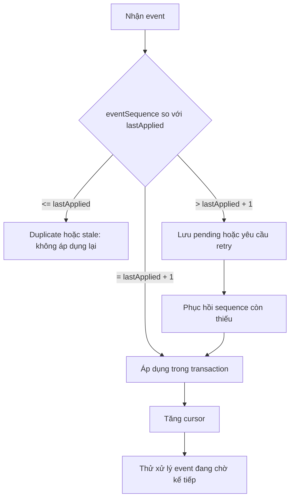

# Version theo thực thể và phát hiện khoảng trống thứ tự

Trong hệ thống event streaming, nhiều sự kiện cùng tác động đến một thực thể nghiệp vụ như đơn hàng, tài khoản hoặc hồ sơ khách hàng. Một đơn hàng có thể lần lượt được tạo, thanh toán, đóng gói, giao đi rồi hoàn tất. Read model hoặc consumer cần biết sự kiện nào đã được áp dụng để tránh trạng thái cũ ghi đè trạng thái mới, đồng thời phát hiện khi một thay đổi ở giữa bị thiếu.

Kafka cung cấp thứ tự bản ghi trong từng partition. Tuy nhiên, thứ tự đó không tự chứng minh rằng consumer đã nhận đủ mọi thay đổi của một thực thể. Sự kiện có thể được phát ra không đúng thứ tự do nhiều publisher, retry hoặc luồng outbox song song; consumer cũng có thể lọc bỏ một số loại sự kiện. Vì vậy, ứng dụng thường cần một số thứ tự riêng theo thực thể và một quy tắc kiểm tra khoảng trống (*sequence gap*).

Bài học này tập trung vào cách định nghĩa version/sequence, phân biệt nó với Kafka offset và schema version, phát hiện sự kiện trùng, cũ hoặc đến vượt trước, rồi xử lý an toàn trong Java/Spring Kafka.

Sau bài học, người học có thể:

- Thiết kế số thứ tự tăng đơn điệu cho các sự kiện của một thực thể.
- Phân biệt event sequence, aggregate version, event ID, schema version và Kafka offset.
- Xây dựng thuật toán nhận diện sự kiện kế tiếp, sự kiện trùng và khoảng trống thứ tự.
- Lưu trạng thái projection và sự kiện chờ một cách an toàn khi consumer retry hoặc khởi động lại.
- Chọn giữa retry tại partition, lưu vùng đệm theo thực thể, replay hoặc nạp snapshot để khôi phục khoảng trống.
- Theo dõi và kiểm thử các tình huống sai thứ tự, mất sự kiện và xử lý đồng thời.

## 1. Vì sao cần version theo thực thể?

Giả sử đơn hàng `order-8472` phát ra ba sự kiện:

| Sequence | Sự kiện | Trạng thái mong đợi |
|---:|---|---|
| 1 | `OrderPlaced` | `CREATED` |
| 2 | `OrderPaid` | `PAID` |
| 3 | `OrderShipped` | `SHIPPED` |

Nếu projection nhận sequence 1, 2, 3 thì có thể cập nhật trạng thái lần lượt. Nhưng nếu nhận 1, 3, 2 và chỉ ghi trạng thái theo sự kiện đến sau cùng, `OrderPaid` có thể làm trạng thái quay từ `SHIPPED` về `PAID`. Nếu sequence 2 bị mất hoàn toàn, projection có thể không biết vì sao nó chuyển từ `CREATED` sang `SHIPPED` hoặc vì sao một thay đổi quan trọng chưa được phản ánh.

Mỗi sự kiện vì vậy nên mang thông tin nhận diện và thứ tự trong phạm vi thực thể:

- `eventId`: định danh duy nhất của lần phát hành sự kiện.
- `aggregateId` hoặc `entityId`: định danh thực thể bị tác động.
- `eventSequence`: số thứ tự tăng dần của sự kiện trong luồng sự kiện của thực thể.
- `aggregateVersion`: phiên bản trạng thái aggregate tại thời điểm phát sự kiện, nếu miền nghiệp vụ có khái niệm này.
- `schemaVersion`: phiên bản cấu trúc payload.
- `occurredAt`: thời điểm nghiệp vụ xảy ra, hữu ích cho truy vết nhưng không thay thế sequence.

Một event envelope có thể có dạng:

```json
{
  "eventId": "e6cba0dd-7a34-4f8f-9f25-9c73a40c1d62",
  "eventType": "OrderPaid",
  "schemaVersion": 2,
  "aggregateId": "order-8472",
  "aggregateVersion": 7,
  "eventSequence": 12,
  "occurredAt": "2026-11-20T10:22:00Z",
  "payload": {
    "paymentId": "payment-991",
    "amount": 1250000,
    "currency": "VND"
  }
}
```

`eventSequence` là số thứ tự của sự kiện trong luồng đã định nghĩa; `aggregateVersion` là revision của trạng thái aggregate; `schemaVersion` mô tả định dạng dữ liệu. Ba giá trị này có thể trùng nhau trong một thiết kế đơn giản, nhưng chúng giải quyết ba vấn đề khác nhau và không nên mặc định thay thế cho nhau.

Đặc biệt, nếu một lần cập nhật aggregate phát ra hai sự kiện, cả hai có thể cùng `aggregateVersion` nhưng phải có `eventSequence` riêng nếu consumer cần xử lý từng sự kiện theo thứ tự. Ngược lại, nếu aggregate tăng version cho các thay đổi nội bộ không phát sự kiện, lấy aggregate version làm sequence sẽ tạo ra những khoảng trống hợp lệ mà consumer không thể phân biệt với sự kiện bị mất.

## 2. Định nghĩa sequence sao cho phát hiện gap có ý nghĩa

Một sequence chỉ giúp phát hiện mất sự kiện khi quy tắc tăng số được xác định rõ. Với cách đơn giản nhất, mỗi sự kiện được công bố trong một luồng đều nhận một số tiếp theo: 1, 2, 3, 4... cho từng `aggregateId`.

Ví dụ, nguồn phát duy trì `next_event_sequence` trong cùng transaction ghi thay đổi nghiệp vụ và outbox. Khi tạo sự kiện, dịch vụ cấp số tiếp theo, lưu envelope vào outbox, rồi commit. Publisher chỉ gửi các outbox record đã commit. Điều này giúp sequence phản ánh thứ tự đã được nguồn dữ liệu chuẩn xác nhận.

Nếu một aggregate có nhiều loại sự kiện, hãy xác định sequence áp dụng cho tập nào. Có hai lựa chọn thường gặp:

1. **Sequence cho toàn bộ event stream của aggregate.** Consumer cần nhận tất cả sự kiện để giữ cursor liên tục. Nếu một sự kiện không ảnh hưởng đến read model, consumer vẫn phải nhận nó và tăng cursor như một sự kiện no-op.
2. **Sequence riêng cho một projection hoặc một luồng đã lọc.** Chỉ dùng khi producer hoặc tầng phát sự kiện cấp sequence riêng cho chính tập sự kiện đó.

Không nên lọc bỏ một loại sự kiện ở consumer rồi yêu cầu sequence của toàn bộ aggregate phải liên tục. Ví dụ projection chỉ đăng ký `OrderPaid` và `OrderShipped` nhưng bỏ `OrderAddressChanged`; khi nhận sequence 9 rồi 11, nó có thể báo thiếu 10 dù sequence 10 đã được phát và bị filter có chủ đích. Đây là gap giả do hợp đồng sequence và phạm vi subscription không khớp.

### Cấp sequence ở nguồn phát

Sequence phải được cấp theo cách chống cạnh tranh. Nếu hai request đồng thời cùng sửa một đơn hàng, cả hai không được đọc cùng giá trị hiện tại rồi cùng phát sequence tiếp theo. Có thể dùng optimistic locking, row lock hoặc một cơ chế tuần tự hóa theo aggregate.

Ví dụ với database quan hệ, bảng aggregate có thể lưu `event_sequence`:

```sql
BEGIN;

SELECT event_sequence
FROM orders
WHERE order_id = :orderId
FOR UPDATE;

UPDATE orders
SET status = :newStatus,
    event_sequence = event_sequence + 1
WHERE order_id = :orderId;

INSERT INTO outbox_event (
    event_id,
    aggregate_id,
    event_sequence,
    event_type,
    payload,
    created_at
) VALUES (
    :eventId,
    :orderId,
    :nextSequence,
    :eventType,
    :payload,
    CURRENT_TIMESTAMP
);

COMMIT;
```

Đây là minh họa cho transaction cấp sequence và ghi outbox; câu lệnh thực tế cần đọc hoặc trả về giá trị sequence mới theo cú pháp của hệ quản trị đang dùng. Điều quan trọng là cập nhật trạng thái, cấp sequence và ghi outbox phải cùng một transaction. Nếu transaction rollback, sequence và sự kiện tương ứng cũng rollback.

Outbox Publisher cũng cần giữ thứ tự theo aggregate. Nếu nhiều worker lấy các bản ghi outbox song song, worker xử lý sequence 12 có thể gửi trước worker xử lý sequence 11. Có thể phân công theo aggregate key, chỉ lấy bản ghi kế tiếp của mỗi aggregate hoặc để consumer phát hiện và xử lý khoảng trống. Việc dùng outbox giải quyết ghi kép giữa database và Kafka; tự nó không bảo đảm mọi publisher song song đều phát đúng thứ tự.

## 3. Phân biệt thứ tự thực thể với thứ tự Kafka

Kafka gán offset tăng dần trong từng partition. Với cùng một topic và partition, offset cho biết thứ tự bản ghi được ghi vào log. Kafka không cấp một offset toàn cục cho tất cả partition và offset không phải version của thực thể.

| Khái niệm | Phạm vi | Dùng để làm gì |
|---|---|---|
| `eventId` | Một sự kiện | Nhận diện cùng một sự kiện khi giao lại hoặc retry. |
| `eventSequence` | Một thực thể trong một event stream | Phát hiện sự kiện kế tiếp, trùng, cũ hoặc bị thiếu. |
| `aggregateVersion` | Trạng thái aggregate | Xác định revision nghiệp vụ của aggregate. |
| `schemaVersion` | Hợp đồng payload | Chọn cách giải mã và tương thích cấu trúc dữ liệu. |
| Kafka `offset` | Một partition của một topic | Theo dõi vị trí đọc, commit và replay trong partition. |
| `occurredAt` | Mốc thời gian | Truy vết thời gian; không đủ tin cậy để xác lập thứ tự tuyệt đối. |

Đặt `aggregateId` làm Kafka message key thường đưa các sự kiện cùng thực thể vào cùng partition. Consumer trong một group đọc partition theo thứ tự log, nhờ vậy có một lớp bảo vệ ordering hữu ích. Tuy nhiên, key không tự sửa được sự kiện đã bị producer gửi sai thứ tự. Nếu outbox publisher gửi sequence 12 trước 11, Kafka vẫn lưu đúng thứ tự nhận được: 12 rồi 11.

Ordering cũng có thể bị ảnh hưởng khi:

- Nhiều producer hoặc nhiều outbox worker cùng phát sự kiện cho một aggregate.
- Retry một lần gửi không xác định kết quả trong khi sự kiện sau đã được gửi.
- Consumer chuyển xử lý sang thread pool và cập nhật database song song.
- Tăng số partition khiến phép ánh xạ key sang partition thay đổi trong khi dữ liệu cũ vẫn đang được xử lý.
- Một quy trình replay hoặc backfill phát dữ liệu theo thứ tự khác luồng trực tiếp.

Producer idempotence và cấu hình retry phù hợp giúp giảm một số rủi ro ghi trùng hoặc đảo thứ tự từ cùng producer, nhưng không thay thế sequence do miền nghiệp vụ quản lý. Khi cần giữ thứ tự theo thực thể xuyên suốt nhiều producer, phải tuần tự hóa việc cấp sequence và phát sự kiện ở nguồn hoặc dùng một cơ chế phân phối có thứ tự.

## 4. Thuật toán phát hiện sự kiện trùng, cũ và gap

Mỗi projection lưu `lastAppliedSequence` cho từng thực thể. Khi nhận sự kiện có sequence `incomingSequence`, so sánh nó với sequence kế tiếp mong đợi:

| Điều kiện | Diễn giải | Hành động thường dùng |
|---|---|---|
| `incomingSequence <= lastAppliedSequence` | Sự kiện đã được áp dụng hoặc đã cũ so với cursor. | Bỏ qua an toàn sau khi kiểm tra tính nhất quán của event ID/sequence. |
| `incomingSequence == lastAppliedSequence + 1` | Đúng sự kiện kế tiếp. | Áp dụng projection và tăng cursor. |
| `incomingSequence > lastAppliedSequence + 1` | Có khoảng trống; một hoặc nhiều sequence trước chưa được áp dụng. | Giữ sự kiện chờ, retry hoặc phục hồi phần còn thiếu. |

Ví dụ cursor hiện tại của `order-8472` là 20:

- Nhận 20: sự kiện cũ hoặc giao lại; không áp dụng lần nữa.
- Nhận 21: sự kiện kế tiếp; áp dụng rồi chuyển cursor thành 21.
- Nhận 24: thiếu 22 và 23; không được cập nhật read model như thể 24 đã liên tục.



Không dùng riêng timestamp để thay thế quy tắc này. Hai sự kiện có thể có cùng timestamp, đồng hồ của các máy có thể lệch nhau, và thời điểm publish có thể khác thời điểm nghiệp vụ xảy ra.

## 5. Lưu cursor và chống xử lý trùng trong read model

Một projection có thể lưu sequence cuối đã áp dụng ngay trên bảng read model:

```sql
CREATE TABLE order_summary (
    order_id             VARCHAR(64) PRIMARY KEY,
    status               VARCHAR(24) NOT NULL,
    total_amount         DECIMAL(19, 2) NOT NULL,
    last_event_sequence  BIGINT NOT NULL
);
```

Để audit và chống giao lặp, có thể lưu inbox của các sự kiện đã áp dụng:

```sql
CREATE TABLE projection_inbox (
    event_id        UUID PRIMARY KEY,
    aggregate_id    VARCHAR(64) NOT NULL,
    event_sequence  BIGINT NOT NULL,
    processed_at    TIMESTAMP NOT NULL,
    UNIQUE (aggregate_id, event_sequence)
);
```

Ràng buộc `event_id` ngăn cùng một sự kiện được áp dụng hai lần. Ràng buộc `(aggregate_id, event_sequence)` giúp phát hiện hai event khác nhau cùng chiếm một vị trí sequence, thường là lỗi nghiêm trọng ở nguồn phát hoặc contract. Nếu hệ thống cho phép nhiều loại bản ghi dùng chung một sequence theo thiết kế, cần điều chỉnh khóa duy nhất theo đúng quy tắc stream đã chọn.

Khi cần lưu sự kiện vượt trước để chờ, dùng bảng pending riêng:

```sql
CREATE TABLE pending_projection_event (
    event_id        UUID PRIMARY KEY,
    aggregate_id    VARCHAR(64) NOT NULL,
    event_sequence  BIGINT NOT NULL,
    event_type      VARCHAR(128) NOT NULL,
    payload         TEXT NOT NULL,
    received_at     TIMESTAMP NOT NULL,
    UNIQUE (aggregate_id, event_sequence)
);
```

Pending phải lưu đủ envelope và payload để xử lý lại sau khi ứng dụng khởi động. Không đánh dấu một sự kiện là đã áp dụng trong inbox khi nó mới chỉ được đưa vào pending. Nếu dùng một bảng inbox chung, hãy phân biệt rõ trạng thái `PENDING` và `APPLIED`; trạng thái chỉ được chuyển sang `APPLIED` cùng transaction cập nhật read model.

Một transaction áp dụng sự kiện cần thực hiện các việc sau:

1. Khóa hoặc cập nhật có điều kiện trạng thái projection của aggregate.
2. Kiểm tra event ID và sequence đã tồn tại.
3. Chỉ áp dụng sự kiện kế tiếp đúng sequence.
4. Ghi inbox và cập nhật read model cùng transaction.
5. Nếu có pending ở sequence kế tiếp, lấy ra và tiếp tục xử lý theo thứ tự.

Với cập nhật SQL, có thể dùng compare-and-set để chỉ tiến cursor từ đúng phiên bản trước đó:

```sql
UPDATE order_summary
SET status = :newStatus,
    total_amount = :newTotal,
    last_event_sequence = :incomingSequence
WHERE order_id = :orderId
  AND last_event_sequence = :incomingSequence - 1;
```

Nếu số dòng được cập nhật là 0, không được mặc định đó là lỗi tạm thời. Hãy đọc cursor hiện tại để phân loại: sự kiện đã cũ, có gap, aggregate chưa được khởi tạo, hoặc một consumer khác vừa cập nhật. Với aggregate mới, cần tạo trạng thái ban đầu có cursor 0 một cách an toàn trước khi áp dụng sequence đầu tiên, hoặc nạp snapshot với cursor đã xác nhận.

## 6. Ví dụ xử lý bằng Java/Spring Kafka

DTO có thể định nghĩa như sau:

```java
public record OrderEvent(
    UUID eventId,
    String aggregateId,
    long eventSequence,
    String eventType,
    Instant occurredAt,
    JsonNode payload
) {}
```

Phần dưới minh họa logic của projector. Các repository như `ProjectionStateRepository`, `PendingEventRepository` và `ProjectionInboxRepository` là abstraction của ứng dụng; thao tác khóa, lưu pending và ghi inbox phải được triển khai bằng câu lệnh database có ràng buộc phù hợp.

```java
public enum ApplyResult {
    APPLIED,
    DUPLICATE_OR_STALE,
    GAP_BUFFERED
}

@Service
public class OrderProjectionService {
    private final ProjectionStateRepository states;
    private final ProjectionInboxRepository inbox;
    private final PendingEventRepository pending;
    private final OrderSummaryRepository summaries;

    public OrderProjectionService(
            ProjectionStateRepository states,
            ProjectionInboxRepository inbox,
            PendingEventRepository pending,
            OrderSummaryRepository summaries) {
        this.states = states;
        this.inbox = inbox;
        this.pending = pending;
        this.summaries = summaries;
    }

    @Transactional
    public ApplyResult accept(OrderEvent event) {
        if (inbox.existsByEventId(event.eventId())) {
            return ApplyResult.DUPLICATE_OR_STALE;
        }

        // lockOrCreate khóa trạng thái của aggregate trong transaction.
        ProjectionState state = states.lockOrCreate(event.aggregateId());
        long last = state.lastEventSequence();

        if (event.eventSequence() <= last) {
            return ApplyResult.DUPLICATE_OR_STALE;
        }

        if (event.eventSequence() > last + 1) {
            pending.insertIfAbsent(event);
            return ApplyResult.GAP_BUFFERED;
        }

        applyNext(event, state);
        drainContiguousPending(state);
        return ApplyResult.APPLIED;
    }

    private void applyNext(OrderEvent event, ProjectionState state) {
        summaries.apply(event);
        inbox.insertApplied(event.eventId(), event.aggregateId(),
                            event.eventSequence());
        states.advance(state, event.eventSequence());
        pending.deleteIfPresent(event.aggregateId(), event.eventSequence());
    }

    private void drainContiguousPending(ProjectionState state) {
        while (true) {
            long next = state.lastEventSequence() + 1;
            OrderEvent waiting = pending.find(state.aggregateId(), next)
                .orElse(null);
            if (waiting == null) {
                return;
            }
            applyNext(waiting, state);
        }
    }
}
```

Ví dụ này giả định `lockOrCreate` khóa được một dòng trạng thái cho mỗi aggregate, kể cả trường hợp aggregate chưa có dòng; có thể cần insert-if-absent rồi `SELECT ... FOR UPDATE` hoặc cơ chế khóa tương đương. `applyNext` phải ghi read model, inbox, cursor và xóa pending trong cùng transaction. Nếu một bước lỗi, toàn bộ transaction rollback để không tạo trạng thái nửa chừng.

Listener có thể chuyển sự kiện cho service:

```java
@Component
public class OrderEventListener {
    private final OrderProjectionService projection;

    public OrderEventListener(OrderProjectionService projection) {
        this.projection = projection;
    }

    @KafkaListener(
        topics = "orders.events",
        groupId = "order-summary-projection-v2"
    )
    public void onMessage(OrderEvent event) {
        ApplyResult result = projection.accept(event);
        // GAP_BUFFERED chỉ được xác nhận sau khi pending đã commit bền vững.
        // Nếu không thể lưu pending, hãy để exception truyền ra để retry.
    }
}
```

Nếu service commit database thành công nhưng consumer dừng trước khi Kafka commit offset, Kafka có thể giao lại bản ghi. Inbox và cursor giúp lần giao lại không áp dụng thay đổi lần hai. Nếu gap được lưu vào pending và transaction commit thành công, listener có thể xác nhận bản ghi Kafka vì ứng dụng đã lưu bền vững công việc còn chờ. Một tiến trình hoặc lần xử lý sau sẽ tiếp tục drain pending khi sequence thiếu xuất hiện.

`@Transactional` trong ví dụ quản lý transaction database. Nó không tự tạo transaction nguyên tử giữa database và Kafka. Khi cập nhật read model ở database bên ngoài Kafka, hãy dựa vào inbox, sequence và thao tác idempotent để xử lý tình huống giao lại.

## 7. Chọn chiến lược xử lý gap

Không có một chiến lược duy nhất phù hợp cho mọi hệ thống. Quyết định phụ thuộc vào yêu cầu ordering, khả năng replay, độ trễ chấp nhận được và tác động khi một aggregate bị kẹt.

### Retry tại partition

Consumer không xác nhận offset của bản ghi có gap và thử lại sau một khoảng backoff. Cách này giữ bản ghi sau không vượt qua bản ghi đang lỗi trong cùng partition nếu consumer xử lý tuần tự. Đổi lại, một aggregate bị thiếu sự kiện có thể chặn các aggregate khác nằm trong cùng partition (*head-of-line blocking*). Cần giới hạn retry, pause/resume partition đúng cách và cảnh báo khi thời gian chờ vượt ngưỡng.

### Lưu pending theo aggregate

Consumer lưu sự kiện vượt trước vào database với trạng thái chờ, rồi xác nhận offset Kafka sau khi transaction lưu pending commit. Khi sự kiện còn thiếu đến, projector áp dụng nó và lần lượt drain các sequence đã chờ. Cách này giúp các aggregate khác trong partition tiếp tục tiến triển, nhưng cần giới hạn kích thước pending, quản lý thời gian chờ, xử lý xung đột cùng sequence và có tiến trình phục hồi.

### Replay sự kiện còn thiếu

Nếu có event store hoặc nguồn lưu lịch sử đầy đủ, hệ thống có thể yêu cầu phát lại các sequence còn thiếu của aggregate. Cần biết nguồn replay có thể truy vấn theo `aggregateId` và sequence hay không. Kafka offset chỉ định vị trí trong partition, không trực tiếp trả lời “sequence 22 của order-8472 nằm ở đâu” nếu ứng dụng không duy trì ánh xạ hoặc chỉ mục phù hợp.

### Nạp snapshot rồi tiếp tục

Nếu lịch sử quá dài hoặc không còn trong retention, có thể lấy snapshot đáng tin cậy của aggregate/read model tại sequence N, cập nhật cursor thành N, rồi chỉ áp dụng sự kiện N+1 trở đi. Snapshot phải bao gồm đầy đủ trạng thái mà projection cần và watermark sequence phải được chụp nhất quán với dữ liệu. Nếu cập nhật snapshot và cursor tách rời, consumer có thể bỏ sót hoặc áp dụng lặp sự kiện ở ranh giới.

### Đưa vào quy trình sửa lỗi

Nếu sequence bị thiếu do producer không phát sự kiện, dữ liệu sai contract hoặc retention đã xóa nguồn cần thiết, retry vô hạn không thể tự giải quyết. Cần cảnh báo, lưu bằng chứng, xác định nguồn dữ liệu chuẩn và thực hiện repair có kiểm soát. Dead-letter topic có thể lưu bản ghi không thể xử lý, nhưng không nên xem việc chuyển một sự kiện gap sang DLT rồi tiếp tục như thể sequence đã liền mạch là khôi phục thành công.

## 8. Ví dụ phục hồi một khoảng trống

Giả sử projection của `order-8472` đang ở sequence 40. Consumer nhận sequence 43 trước:

1. So sánh 43 với 41 là sequence kế tiếp mong đợi; phát hiện thiếu 41 và 42.
2. Lưu toàn bộ event 43 vào `pending_projection_event` với khóa duy nhất `(aggregate_id, event_sequence)`.
3. Commit transaction pending rồi xác nhận offset Kafka của event 43.
4. Khi event 41 đến, projector áp dụng 41 và tăng cursor lên 41.
5. Projector kiểm tra pending, thấy 42, áp dụng 42 rồi tăng cursor lên 42.
6. Projector tiếp tục thấy pending 43, áp dụng 43 rồi tăng cursor lên 43.
7. Xóa các pending đã áp dụng và ghi inbox tương ứng trong cùng transaction với mỗi lần cập nhật.

Nếu event 41 không đến trong thời gian quy định, hệ thống ghi nhận gap đang mở, số sequence thiếu, thời điểm phát hiện và vị trí Kafka liên quan. Bộ phục hồi có thể truy vấn nguồn sự kiện để lấy 41 và 42. Nếu nguồn xác nhận 41 hoặc 42 chưa từng được phát, nhóm vận hành cần quyết định sửa từ nguồn chuẩn hoặc nạp snapshot; không tự ý tăng cursor để bỏ qua.

## 9. Đồng bộ xử lý khi có nhiều consumer hoặc nhiều thread

Kafka consumer group thường chia partition cho các consumer, nhưng điều đó không đủ để bảo vệ database nếu ứng dụng tự chạy song song nhiều tác vụ cho cùng aggregate. Hai handler có thể cùng đọc cursor 40; một handler xử lý 41 và handler còn lại xử lý 42 trước khi 41 commit.

Có thể bảo vệ bằng một trong các cơ chế:

- Xử lý tuần tự trong partition và không chuyển các bản ghi cùng partition sang worker chạy song song không có kiểm soát.
- Khóa dòng projection theo `aggregateId` bằng `SELECT ... FOR UPDATE` trong transaction.
- Dùng optimistic locking hoặc câu lệnh compare-and-set với điều kiện cursor hiện tại bằng sequence trước đó.
- Đặt unique constraint trên `(aggregate_id, event_sequence)` để hai sự kiện không thể cùng chiếm một vị trí.

Khi consumer rebalance, partition có thể được chuyển sang consumer khác trong lúc request cũ vẫn đang hoàn tất. Database constraint và transaction vẫn cần bảo vệ dữ liệu vì không nên phụ thuộc hoàn toàn vào vòng đời consumer để đảm bảo tính đúng đắn.

Không giữ transaction database mở trong thời gian chờ một sự kiện còn thiếu đến Kafka. Hãy commit trạng thái pending, giải phóng tài nguyên rồi tiếp tục khi có dữ liệu hoặc tiến trình phục hồi. Transaction dài làm giữ lock, connection và gây ảnh hưởng đến các aggregate khác.

## 10. Rebuild, snapshot và thay đổi contract

Khi tạo projection mới hoặc thay đổi logic, cần xác định cursor bắt đầu của nó. Nếu replay từ đầu, cursor khởi tạo theo sequence đầu tiên của stream. Nếu nạp snapshot, snapshot phải công bố sequence watermark. Consumer chỉ áp dụng sự kiện sau watermark và phải xử lý đúng sự kiện tại ranh giới.

Schema version không làm thay đổi ý nghĩa của event sequence. Một payload phiên bản schema 3 vẫn có thể là sequence 18 của aggregate. Khi thay đổi schema, cần giữ khả năng giải mã các sự kiện còn trong retention hoặc chuyển đổi chúng trong quá trình replay. Không tăng `eventSequence` chỉ vì thay đổi schema; cũng không tái sử dụng sequence cũ cho một sự kiện mới.

Nếu projection chỉ tiêu thụ một tập con của event stream, hãy quyết định rõ cách giữ cursor:

- Tiêu thụ mọi loại sự kiện và cập nhật cursor cả với loại không tác động read model.
- Dùng một sequence riêng cho tập sự kiện projection nhận.
- Dùng snapshot hoặc checkpoint được tạo từ một tiến trình đã quan sát đầy đủ stream.

Không đặt cursor theo offset cuối topic một cách máy móc nếu còn sự kiện chưa được áp dụng hoặc pending chưa được xử lý. Offset Kafka và sequence thực thể là hai tọa độ khác nhau; checkpoint của projection cần lưu đủ thông tin để liên hệ chúng khi vận hành replay.

## 11. Theo dõi sequence gap trong vận hành

Consumer lag đo khoảng cách giữa offset của consumer và log end offset trong partition. Lag thấp không có nghĩa mọi aggregate đã liên tục: consumer có thể đã xác nhận offset của một sự kiện được lưu pending trong khi pending chờ nhiều giờ.

Nên theo dõi các chỉ số sau:

- Tổng số gap đang mở và số aggregate có gap.
- Tuổi của gap lâu nhất và thời gian từ lúc phát hiện đến lúc phục hồi.
- Số sự kiện pending, tốc độ thêm/xóa pending và kích thước lưu trữ.
- Số sự kiện duplicate, stale, xung đột cùng sequence và lỗi schema.
- Sequence cuối đã áp dụng của các projection quan trọng và độ trễ cập nhật.
- Consumer lag, throughput, thời gian xử lý, retry, rebalance và DLT.

Log có cấu trúc nên chứa `aggregateId`, `eventId`, `eventSequence`, `lastAppliedSequence`, topic, partition, offset và kết quả xử lý. Tránh dùng `aggregateId` làm nhãn metric có cardinality cao; dùng log, trace hoặc truy vấn điều tra cho từng thực thể.

Một cảnh báo hữu ích nên phân biệt gap mới xuất hiện, gap tồn tại quá lâu, pending tăng liên tục và xung đột sequence. Gap thoáng qua có thể do publisher hoặc retry; gap kéo dài có thể chỉ ra mất sự kiện, sai filter hoặc lỗi dữ liệu nguồn.

## 12. Các tình huống cần kiểm thử

Trước khi triển khai, hãy kiểm tra tối thiểu các trường hợp:

| Tình huống | Kết quả mong đợi |
|---|---|
| Nhận sequence liên tiếp 1, 2, 3 | Áp dụng đủ và cursor bằng 3. |
| Nhận lại cùng `eventId` | Không áp dụng thay đổi lần hai. |
| Nhận sequence nhỏ hơn cursor | Không làm read model lùi trạng thái. |
| Nhận sequence 5 khi cursor là 2 | Phát hiện thiếu 3, 4; lưu pending hoặc retry theo chính sách. |
| Nhận 3, sau đó 4 khi 5 đang pending | Áp dụng 3, 4 rồi drain 5 đúng thứ tự. |
| Hai event khác ID cùng sequence | Phát hiện xung đột, không âm thầm chọn một event. |
| Hai thread cùng cập nhật một aggregate | Chỉ một cập nhật kế tiếp được commit; thread còn lại phân loại lại. |
| Database commit nhưng Kafka offset chưa commit | Event giao lại không gây cập nhật trùng. |
| Consumer dừng sau khi lưu pending | Pending còn tồn tại và được xử lý sau khi khởi động lại. |
| Projection lọc một event type | Không tạo gap giả; cursor vẫn theo đúng phạm vi sequence. |
| Nạp snapshot tại sequence N | Chỉ áp dụng N+1 trở đi, không bỏ sót ranh giới. |
| Tăng partition hoặc replay song song | Sequence vẫn phát hiện và ngăn cập nhật sai thứ tự. |

## 13. Quy tắc thiết kế cần thống nhất

Trước khi triển khai version theo thực thể, nhóm phát triển cần trả lời:

1. Đơn vị thứ tự là aggregate, entity hay một luồng con? Khóa định danh có ổn định suốt vòng đời không?
2. `eventSequence` tăng cho mọi sự kiện được công bố hay chỉ một loại sự kiện? Consumer có nhận đủ tập sự kiện đó không?
3. Sequence được cấp nguyên tử cùng transaction nghiệp vụ và outbox như thế nào?
4. Nguồn phát và publisher có thể gửi sai thứ tự trong trường hợp retry hoặc chạy song song không?
5. Khi gặp gap, consumer block partition, lưu pending, replay hay nạp snapshot? Ai chịu trách nhiệm xử lý gap quá hạn?
6. Cursor, inbox, pending và read model được commit nhất quán ra sao?
7. Có thể truy vấn nguồn lịch sử theo aggregate và sequence không? Retention có đủ dài để phục hồi không?
8. Những metric và cảnh báo nào chứng minh projection đã bắt kịp và không còn gap?

Version theo thực thể tạo ra một hợp đồng thứ tự rõ ràng cho ứng dụng Kafka. Khi sequence được cấp đúng ở nguồn, consumer so sánh với cursor đã áp dụng và có quy trình phục hồi gap, hệ thống có thể nhận biết sự kiện trùng, sự kiện cũ và thay đổi bị thiếu thay vì âm thầm tạo ra read model sai.
