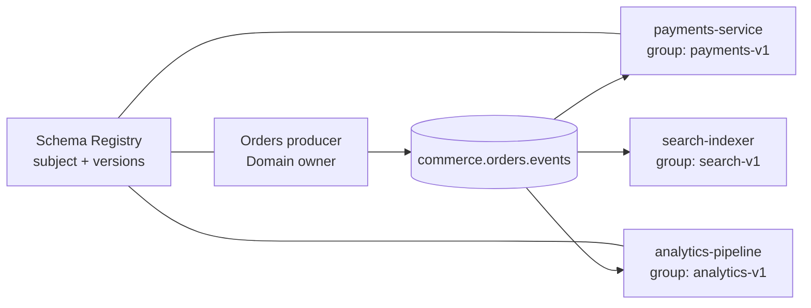

# Quản lý quyền sở hữu topic, schema và consumer group

Trong hệ thống Kafka có nhiều domain và nhiều nhóm phát triển, topic, schema và consumer group cần có chủ sở hữu rõ ràng. Thiếu ownership thường dẫn đến topic trùng tên, schema thay đổi làm hỏng consumer cũ, nhiều ứng dụng dùng chung một consumer group ngoài ý muốn, hoặc không ai chịu trách nhiệm khi dữ liệu bị giữ quá lâu và lag tăng.

Ownership là trách nhiệm vận hành và quản trị một tài nguyên, không phải quyền độc quyền đọc dữ liệu. Nhóm domain phát sự kiện chịu trách nhiệm về ý nghĩa, chất lượng và hợp đồng dữ liệu. Nhóm nền tảng Kafka chịu trách nhiệm về cluster, khả năng sẵn sàng, bảo mật và chính sách chung. Mỗi ứng dụng consumer chịu trách nhiệm về consumer group, tiến độ xử lý và side effect của chính nó. Một topic có thể được nhiều consumer group đọc độc lập.

## 1. Xác định ranh giới ownership

### 1.1. Ba lớp trách nhiệm

| Tài nguyên | Chủ sở hữu chính | Trách nhiệm |
|---|---|---|
| Topic và event contract | Domain/team phát sự kiện | Định nghĩa tên, key, ý nghĩa event, schema, retention theo nhu cầu nghiệp vụ, tương thích khi thay đổi |
| Kafka cluster và policy | Platform/data infrastructure | Broker, KRaft, replication, ACL framework, quota, capacity, monitoring, backup/restore và nâng cấp |
| Consumer group | Team sở hữu ứng dụng tiêu thụ | `group.id`, xử lý record, offset, retry/DLQ, lag, scaling, idempotency và quyền truy cập |
| Schema Registry subject | Producer domain cùng các consumer phụ thuộc; platform vận hành Registry | Quy trình đăng ký, kiểm tra compatibility, quản lý version và quyền thay đổi schema |

Một team có thể đảm nhận nhiều vai trò ở hệ thống nhỏ, nhưng trách nhiệm vẫn nên được ghi riêng. Ví dụ, team Orders sở hữu topic `commerce.orders.events`; team Payments có thể đọc topic bằng group riêng nhưng không tự ý đổi schema hoặc retention của topic Orders.

### 1.2. Topic ownership không đồng nghĩa consumer ownership

Producer/domain định nghĩa event contract và chịu trách nhiệm giữ ý nghĩa sự kiện ổn định. Consumer chọn subscription riêng và tự quản lý offset. Không nên tạo một consumer group chung cho nhiều dịch vụ độc lập chỉ vì chúng cùng đọc một topic: các member trong cùng group chia nhau partition, nên mỗi record thường chỉ được một member trong group xử lý. Nếu Payments và Analytics đều cần nhận mọi sự kiện, chúng cần hai group khác nhau.



Trong sơ đồ, topic có một domain owner nhưng có nhiều consumer group. Mỗi group duy trì offset riêng; việc Payments xử lý xong không làm Analytics mất record của nó.

## 2. Thiết kế và đăng ký topic

### 2.1. Quy ước tên có thể truy ra domain và event

Tên topic nên thể hiện domain, entity hoặc luồng dữ liệu và mục đích. Một quy ước thường dùng:

```text
<domain>.<entity>.<event-or-purpose>

commerce.orders.events
commerce.payments.events
identity.users.changes
logistics.shipments.commands
```

Chọn một quy ước nhất quán trong toàn tổ chức. Tránh đưa tên cá nhân, tên pod, môi trường tạm thời hoặc thông tin nhạy cảm vào tên topic. Nếu cluster dùng chung nhiều môi trường, có thể phân tách bằng cluster/namespace riêng; nếu cần tiền tố môi trường trong tên, phải thống nhất một mẫu duy nhất.

Phân biệt event với command. Event mô tả việc đã xảy ra (`orders.created`), còn command yêu cầu một hành động (`orders.create`). Không dùng một topic với ý nghĩa lúc là event, lúc là command vì consumer khó xác định semantics và retry policy.

Không tạo topic mới cho mọi thay đổi nhỏ của schema. Thay đổi tương thích thường có thể tiếp tục trên cùng topic và tăng schema version. Tạo topic version mới khi có thay đổi semantics, key/partitioning, retention, security boundary hoặc migration không thể tương thích an toàn; khi đó cần kế hoạch dual-publish/bridge và thời điểm ngừng topic cũ.

### 2.2. Hồ sơ ownership cho mỗi topic

Topic cần có một hồ sơ được quản lý cùng hạ tầng hoặc catalog dữ liệu. Tối thiểu ghi nhận:

| Trường | Ví dụ | Mục đích |
|---|---|---|
| Topic | `commerce.orders.events` | Định danh tài nguyên |
| Owner team | `commerce-orders` | Nhóm chịu trách nhiệm contract và vận hành producer |
| Contact/on-call | Nhóm trực hoặc kênh hỗ trợ | Liên hệ khi lỗi dữ liệu hoặc incident |
| Purpose | Sự kiện vòng đời đơn hàng | Ngăn dùng sai mục đích |
| Key | `orderId` | Xác định partitioning và ordering |
| Schema subjects | `commerce.orders.events-value` | Liên kết contract với Registry |
| Data classification | Internal / Confidential / PII | Chọn ACL, masking và retention |
| Retention/cleanup | 7 ngày, `delete` | Thời gian lưu và chính sách xóa/compact |
| Replication/availability | RF, min ISR, SLA | Yêu cầu độ bền và khả dụng |
| Consumers | Tên service và group ID | Biết ai phụ thuộc topic |
| Lifecycle | Active, deprecated, sunset date | Quản lý thay đổi và ngừng sử dụng |

Catalog không thay thế ACL hoặc cấu hình broker. Nó giúp người vận hành biết ai có quyền phê duyệt thay đổi và những consumer nào cần được thông báo.

### 2.3. Provision topic qua quy trình có kiểm soát

Trong production, topic nên được tạo qua IaC, pipeline hoặc quy trình provisioning của platform. Không phụ thuộc vào `auto.create.topics.enable` để ứng dụng tự tạo topic lần đầu, vì topic có thể được tạo với partition count, replication factor hoặc retention mặc định không phù hợp.

Ví dụ tạo topic bằng CLI:

```bash
kafka-topics.sh \
  --bootstrap-server kafka-1:9092 \
  --create \
  --topic commerce.orders.events \
  --partitions 12 \
  --replication-factor 3 \
  --config cleanup.policy=delete \
  --config retention.ms=604800000 \
  --config min.insync.replicas=2
```

Các con số trên chỉ minh họa: 12 partition, replication factor 3 và retention 7 ngày. Chọn partition count theo throughput, số consumer song song, ordering key và khả năng mở rộng. Replication factor phải phù hợp số broker; `min.insync.replicas` phải nhỏ hơn hoặc bằng replication factor và được chọn cùng `acks=all` nếu muốn producer chỉ nhận xác nhận khi số replica trong ISR đáp ứng yêu cầu.

Lệnh kiểm tra:

```bash
kafka-topics.sh \
  --bootstrap-server kafka-1:9092 \
  --describe \
  --topic commerce.orders.events
```

Kiểm tra partition leader, replica, ISR và topic config sau provisioning. `--partitions` khi tạo topic là số partition ban đầu; tăng partition sau này có thể đổi mapping key sang partition và ảnh hưởng ordering theo key, vì vậy không xem tăng partition là thay đổi vô hại.

### 2.4. Chọn partition key và retention theo hợp đồng

Nếu cần thứ tự sự kiện cho cùng một đơn hàng, dùng `orderId` làm key để các record có cùng key thường được đưa vào cùng partition. Kafka chỉ bảo đảm thứ tự trong một partition, không bảo đảm thứ tự toàn topic. Key phân bố lệch có thể tạo hot partition; cần đo phân bố key và throughput thực tế.

Chính sách cleanup phụ thuộc loại dữ liệu:

- `cleanup.policy=delete`: giữ log theo thời gian/kích thước rồi xóa segment cũ; phù hợp event history có thời hạn.
- `cleanup.policy=compact`: giữ giá trị mới nhất theo key sau các đợt compaction; phù hợp changelog/state snapshot, không thay thế một event history đầy đủ.
- `cleanup.policy=compact,delete`: kết hợp compaction và giới hạn thời gian lưu theo chính sách phù hợp.

Retention phải xét yêu cầu replay, khôi phục consumer, điều tra sự cố, quy định lưu trữ và dữ liệu cá nhân. Nếu consumer có thể ngừng nhiều ngày, retention ngắn hơn thời gian ngừng có thể khiến consumer không còn dữ liệu để bắt kịp. Topic compacted cần thiết kế key, tombstone và thời gian giữ tombstone cẩn thận.

## 3. Quản lý schema như một hợp đồng dữ liệu

### 3.1. Schema định nghĩa cấu trúc và semantics

Schema mô tả tên field, kiểu dữ liệu, required/optional, default và các quy tắc serialization. Kafka lưu byte; producer và consumer cần thống nhất serializer/deserializer. Schema Registry hỗ trợ quản lý version cho Avro, Protobuf hoặc JSON Schema và kiểm tra compatibility trước khi chấp nhận schema mới.

Ví dụ event Avro đơn giản:

```json
{
  "type": "record",
  "name": "OrderCreated",
  "namespace": "com.example.commerce.events",
  "fields": [
    {"name": "eventId", "type": "string"},
    {"name": "orderId", "type": "string"},
    {"name": "createdAt", "type": "string"},
    {"name": "currency", "type": ["null", "string"], "default": null}
  ]
}
```

Schema không thể hiện toàn bộ ý nghĩa nghiệp vụ. Contract cần mô tả thêm timezone/format của timestamp, đơn vị tiền, ý nghĩa null, quy tắc event ID, semantics của key và điều kiện phát sự kiện. Hai schema có cấu trúc tương thích vẫn có thể phá consumer nếu producer đổi ý nghĩa field mà không đổi tên hoặc type.

### 3.2. Subject và chiến lược đặt tên

Schema Registry lưu schema theo subject. Với `TopicNameStrategy` mặc định phổ biến, subject cho value thường là `<topic>-value`, key là `<topic>-key`. Ví dụ topic `commerce.orders.events` có subject `commerce.orders.events-value` và `commerce.orders.events-key`.

Các naming strategy khác có thể gom schema theo record name hoặc topic/record name. Lựa chọn này ảnh hưởng phạm vi compatibility: subject theo topic thường gắn contract với một topic; subject theo record name cho phép chia sẻ cùng schema giữa nhiều topic nhưng cần kiểm soát version và consumer phụ thuộc chặt hơn. Chọn strategy trước khi đưa dữ liệu vào production; đổi strategy sau này có thể làm xuất hiện subject mới và bỏ qua lịch sử compatibility của subject cũ.

### 3.3. Compatibility và quy tắc thay đổi

Các chế độ phổ biến:

| Chế độ | Ý nghĩa khái quát | Dùng khi |
|---|---|---|
| `BACKWARD` | Schema mới có thể đọc dữ liệu được ghi theo schema trước đó | Consumer được nâng cấp trước producer |
| `BACKWARD_TRANSITIVE` | Schema mới tương thích ngược với mọi version trước | Cần replay dữ liệu cũ qua consumer mới |
| `FORWARD` | Consumer/schema cũ có thể đọc dữ liệu được ghi theo schema mới theo quy tắc format | Producer được nâng cấp trước consumer |
| `FULL` | Tương thích cả backward và forward với version trước | Producer và consumer triển khai lệch phiên bản |
| `FULL_TRANSITIVE` | Tương thích cả hai chiều với mọi version trước | Cần bảo đảm với toàn bộ lịch sử schema |
| `NONE` | Không kiểm tra compatibility | Chỉ dùng khi có kế hoạch migration được kiểm soát rõ |

Compatibility cụ thể phụ thuộc format và cách serializer/deserializer áp dụng schema. Với Avro, thêm field có default thường hỗ trợ backward compatibility; xóa field hoặc đổi type cần xem kỹ reader/writer resolution. Không coi việc thêm field optional là luôn an toàn với mọi JSON Schema hoặc Protobuf rule.

Ví dụ thay đổi thường an toàn hơn:

- Thêm field có default/optional phù hợp với format.
- Giữ nguyên tên và ý nghĩa field cũ.
- Consumer bỏ qua field chưa biết khi format/implementation hỗ trợ.

Thay đổi có nguy cơ phá contract:

- Xóa hoặc đổi tên field đang được consumer sử dụng.
- Đổi kiểu dữ liệu hoặc thay đổi nullability không tương thích.
- Đổi ý nghĩa đơn vị, currency, timestamp hoặc trạng thái mà vẫn giữ tên field.
- Thay key hoặc partitioning strategy mà không có migration plan.

Trong pipeline CI, đăng ký thử schema mới với Registry compatibility check trước khi deploy producer. Chạy contract tests với fixture của version cũ và mới, rồi deploy consumer có khả năng đọc schema mới trước khi producer phát field mới nếu rollout cần backward compatibility.

### 3.4. Đăng ký schema trước khi phát dữ liệu

Ở môi trường production, có thể quản lý schema bằng migration pipeline: kiểm tra lint/compatibility, đăng ký schema, xác nhận subject/version, rồi mới cho phép deploy producer. Khi đã pre-register, cấu hình serializer không tự đăng ký schema ngoài quy trình:

```yaml
spring:
  kafka:
    properties:
      schema.registry.url: https://schema-registry.example.internal
    producer:
      properties:
        auto.register.schemas: false
```

Thuộc tính thực tế cần đặt ở cấu hình serializer/producer tương ứng với thư viện đang dùng; ví dụ trên minh họa cách cấu hình qua Spring Boot. Đảm bảo schema cần dùng đã được đăng ký đúng subject trước khi producer khởi động. Nếu để `auto.register.schemas=true`, lần gửi đầu tiên có thể tự tạo version mới và làm thay đổi contract mà không qua review.

Quyền đăng ký/đổi schema nên giới hạn cho pipeline hoặc service owner được phê duyệt. Consumer runtime thường chỉ cần quyền đọc schema. Bật compatibility ở mức subject hoặc global theo policy; ghi rõ ai được phép thay đổi policy và cách xử lý ngoại lệ.

## 4. Quản lý consumer group theo ứng dụng

### 4.1. group.id đại diện một logical subscription

`group.id` xác định consumer group và không gian offset của group. Nhiều instance của cùng một ứng dụng dùng cùng `group.id` để chia partition và tăng throughput. Hai ứng dụng độc lập cần hai group ID khác nhau để mỗi ứng dụng nhận toàn bộ record theo tốc độ riêng.

```yaml
spring:
  kafka:
    consumer:
      group-id: payments-service-v1
      enable-auto-commit: false
      auto-offset-reset: earliest
```

Ví dụ `payments-service-v1` là group của logical subscription Payments. Nếu chạy bốn replica của cùng service, cả bốn replica dùng group này; Kafka phân phối partition giữa chúng. Analytics phải dùng `analytics-pipeline-v1`, không dùng chung `payments-service-v1`.

Không dùng `group.id` chứa pod name cho một consumer group cần chia tải, vì mỗi pod sẽ tạo group độc lập và cùng đọc toàn bộ topic. Ngược lại, không dùng một group ID chung cho các ứng dụng khác nhau nếu mỗi ứng dụng phải nhận mọi record.

### 4.2. Đặt tên group và quản lý vòng đời

Group ID nên thể hiện ứng dụng hoặc subscription ổn định, không gắn với tên người vận hành hay hostname tạm thời. Có thể thêm version khi tạo một logical subscription mới cần replay độc lập, nhưng phải hiểu rằng group mới có offset riêng và có thể đọc lại toàn bộ dữ liệu còn retention.

Trước khi đổi `group.id`, xác định mục tiêu:

- Muốn scale cùng một consumer application: giữ group ID, tăng/giảm replica.
- Muốn một ứng dụng mới nhận độc lập toàn bộ sự kiện: tạo group ID mới và đặt offset reset policy rõ ràng.
- Muốn thay thế consumer nhưng giữ tiến độ: dùng lại group ID sau khi dừng consumer cũ và kiểm tra assignment/offset.
- Muốn replay: dùng group mới hoặc reset offset theo quy trình có kiểm soát, xác định side effect và idempotency trước.

`auto.offset.reset` chỉ áp dụng khi group chưa có committed offset hợp lệ hoặc offset không còn trong log. `earliest` không tự tua một group đã có offset về đầu. Để replay group hiện có, cần dùng quy trình reset offset phù hợp và dừng consumer group trong thời gian thao tác.

Không xóa group chỉ để làm mất lag trên dashboard. Trước khi xóa hoặc reset, xác nhận service đã dừng, offset hiện tại đã được lưu/đối soát và owner nghiệp vụ chấp thuận việc bỏ hoặc phát lại dữ liệu.

### 4.3. Partition, concurrency và ordering

Trong một consumer group, mỗi partition tại một thời điểm được gán cho tối đa một consumer member. Số consumer active hữu ích thường không vượt số partition đang subscribe. Tăng concurrency vượt partition count không tăng số partition xử lý song song và tạo member idle.

Spring Kafka cho phép cấu hình concurrency của listener container. Ví dụ:

```yaml
spring:
  kafka:
    listener:
      concurrency: 4
```

Giá trị này là số consumer thread/container concurrency cho listener, không phải cam kết có bốn consumer hoạt động nếu topic chỉ có hai partition. Cần cân bằng concurrency với partition count, CPU, database pool và giới hạn downstream. Nếu nhiều listener cùng group trong một ứng dụng, kiểm tra cấu hình group và topic subscription để tránh tạo assignment ngoài dự kiến.

Ordering chỉ được bảo đảm trong một partition. Nếu consumer xử lý bất đồng bộ, cần duy trì thứ tự hoàn tất/commit theo partition; không commit offset cao hơn khi record trước đó còn đang xử lý. Thay đổi partition count có thể làm key chuyển sang partition khác đối với record mới, nên không mặc định rằng thứ tự toàn vòng đời của một key sẽ được giữ xuyên suốt thay đổi partition.

## 5. Bảo mật ownership bằng ACL và quota

### 5.1. Tách principal theo service

Mỗi producer/consumer service nên có principal riêng, ví dụ `User:orders-producer`, `User:payments-consumer`. Cấp quyền tối thiểu theo chức năng:

- Producer cần `Write` và thường cần `Describe` trên topic; quyền tạo/alter topic nên thuộc provisioning identity.
- Consumer cần `Read` và `Describe` trên topic, cùng quyền `Read` trên consumer group của nó để quản lý offset/group membership.
- Pipeline đăng ký schema cần quyền ghi subject/schema theo policy của Schema Registry.
- Runtime consumer thường chỉ cần quyền đọc schema.

Ví dụ ACL minh họa cho producer và consumer:

```bash
# Producer được ghi vào topic Orders
kafka-acls.sh --bootstrap-server kafka-1:9092 \
  --add --allow-principal User:orders-producer \
  --operation Write --operation Describe \
  --topic commerce.orders.events

# Consumer được đọc topic Orders
kafka-acls.sh --bootstrap-server kafka-1:9092 \
  --add --allow-principal User:payments-consumer \
  --operation Read --operation Describe \
  --topic commerce.orders.events

# Consumer chỉ được tham gia group Payments
kafka-acls.sh --bootstrap-server kafka-1:9092 \
  --add --allow-principal User:payments-consumer \
  --operation Read \
  --group payments-service-v1
```

Cú pháp và quyền hiệu lực phụ thuộc authorizer, Kafka version và cấu hình cluster. Một số thao tác quản trị cần thêm quyền cluster hoặc quyền resource khác; kiểm tra ACL thực tế sau khi áp dụng. Không cấp `--cluster`/`All` cho service runtime chỉ để xử lý lỗi authorization tạm thời.

### 5.2. Dùng prefix ACL có kiểm soát

Nếu một domain có nhiều topic cùng tiền tố, có thể cấp ACL theo resource pattern prefix. Prefix phải đủ hẹp để không vô tình cho service truy cập topic của domain khác. Định kỳ liệt kê ACL và đối chiếu với catalog owner/consumer registry.

Schema Registry thường có authentication/authorization riêng, không mặc định dùng ACL của Kafka topic. Cần bảo vệ endpoint Registry, giới hạn quyền subject và bảo đảm producer/consumer dùng đúng credential/TLS. Không lưu credential trực tiếp trong source code hoặc file cấu hình được commit vào repository.

### 5.3. Quota và giới hạn tài nguyên

Topic owner và consumer owner cần phối hợp với platform để thiết lập quota phù hợp cho producer/consumer principal hoặc client ID. Quota giúp một service lỗi hoặc phát dữ liệu đột biến không chiếm hết broker capacity. Theo dõi byte rate, request rate, throttling time và consumer fetch throughput; tăng quota phải dựa trên capacity của cluster.

## 6. Quy trình thay đổi contract và ownership

Một thay đổi schema/topic/group nên đi qua quy trình có thể kiểm tra:

1. **Đề xuất:** owner mô tả mục đích, topic/subject/group liên quan, lý do thay đổi và ngày áp dụng.
2. **Phân tích phụ thuộc:** tra catalog để biết consumer nào đang đọc topic và group nào chịu ảnh hưởng.
3. **Kiểm tra compatibility:** chạy Registry compatibility check và contract tests với schema cũ.
4. **Thiết kế rollout:** xác định thứ tự deploy consumer/producer, dual-read/dual-publish nếu cần, thời gian hỗ trợ version cũ.
5. **Provisioning:** cập nhật topic config, ACL, schema hoặc group policy qua pipeline được phê duyệt.
6. **Triển khai:** deploy theo canary/rolling strategy và theo dõi lỗi serialization, authorization, lag, throughput.
7. **Xác nhận:** kiểm tra consumer group ổn định, schema subject đúng version, dữ liệu mới được xử lý và không phát sinh lỗi contract.
8. **Ngừng phiên bản cũ:** chỉ xóa topic/subject/ACL hoặc group cũ sau khi xác nhận không còn producer/consumer phụ thuộc và retention/replay obligation đã hoàn tất.

### 6.1. Ví dụ migration schema tương thích

Giả sử event `OrderCreated` ban đầu có `eventId`, `orderId`, `createdAt`. Cần bổ sung `salesChannel`:

1. Thêm `salesChannel` theo cách tương thích với format, có default/optional phù hợp.
2. Đăng ký schema mới và kiểm tra compatibility trong CI.
3. Deploy consumer có thể đọc cả record cũ không có field này và record mới có field.
4. Deploy producer bắt đầu ghi `salesChannel`.
5. Theo dõi lỗi deserialization và consumer lag.
6. Chỉ loại bỏ fallback cũ khi dữ liệu trong retention và mọi consumer đã đáp ứng contract mới.

Không xóa field cũ ngay trong cùng lần deploy nếu consumer cũ còn chạy. Schema Registry có thể xác nhận cấu trúc tương thích nhưng không xác nhận logic nghiệp vụ của mọi consumer; contract test vẫn cần thiết.

### 6.2. Ví dụ thay đổi consumer group

Giả sử thay `payments-service-v1` bằng một phiên bản xử lý mới:

- Nếu muốn giữ tiến độ liên tục, triển khai phiên bản mới trong cùng group theo rolling strategy có kiểm soát; kiểm tra tương thích logic và assignment khi hai phiên bản chạy đồng thời.
- Nếu muốn chạy song song để so sánh, tạo `payments-service-shadow-v1` với quyền read riêng. Group shadow có offset độc lập; side effect phải bị vô hiệu hóa hoặc ghi sang vùng kiểm thử.
- Nếu muốn replay từ đầu, tạo group mới với `auto.offset.reset=earliest` hoặc thực hiện reset offset có kiểm soát. Đảm bảo idempotency và capacity để xử lý lượng dữ liệu phát lại.

Không để hai phiên bản cùng group xử lý event theo hai hợp đồng nghiệp vụ không tương thích mà không có kế hoạch rollout. Cùng group đồng nghĩa chia partition, không phải broadcast record cho từng phiên bản.

## 7. Theo dõi ownership và sức khỏe hệ thống

| Phạm vi | Chỉ số/sự kiện | Owner xử lý |
|---|---|---|
| Topic | Partition count, bytes in/out, retention, under-replicated partitions, disk usage | Domain phối hợp platform |
| Producer | Send error, retry, request latency, serialization error, unauthorized | Producer/domain owner |
| Schema | Compatibility failure, schema registration, version drift, deserialization error | Domain owner và Registry operator |
| Consumer group | Lag theo partition, rebalance rate, commit failure, processing latency | Consumer application owner |
| Security | ACL changes, authorization failure, credential expiry, quota throttling | Platform/security cùng service owner |
| Lifecycle | Topic/group không còn owner, consumer không hoạt động, schema subject không dùng | Catalog owner và platform |

Đặt cảnh báo có owner và runbook rõ ràng. Ví dụ, lag tăng cần xác định producer rate có tăng, consumer throughput có giảm, partition có skew hay downstream bị chậm. Không gán mọi lỗi lag cho platform nếu nguyên nhân là truy vấn database của consumer.

## 8. Checklist ownership trước khi đưa vào production

- [ ] Topic có tên theo convention và một domain owner được ghi trong catalog.
- [ ] Có purpose, key, schema subject, data classification, retention và lifecycle.
- [ ] Partition count, replication factor, min ISR và cleanup policy được review.
- [ ] Schema có compatibility policy; thay đổi được kiểm tra trong CI.
- [ ] Producer chỉ có quyền ghi topic được giao; quyền tạo/alter do provisioning identity quản lý.
- [ ] Mỗi logical consumer có group ID riêng; replica của cùng ứng dụng dùng chung group ID.
- [ ] Consumer group có owner, lag alert, retry/DLQ policy và quy trình replay.
- [ ] ACL topic, group và Schema Registry theo nguyên tắc least privilege.
- [ ] Quota và capacity phù hợp tải dự kiến.
- [ ] Có danh sách consumer phụ thuộc và quy trình thông báo khi contract thay đổi.
- [ ] Có kế hoạch deprecate và sunset cho topic, schema subject hoặc group cũ.

Quản lý ownership tốt giúp Kafka trở thành nền tảng tích hợp có hợp đồng rõ ràng: domain chịu trách nhiệm về sự kiện, platform bảo vệ và vận hành cluster, còn từng consumer group chịu trách nhiệm về tiến độ xử lý riêng. Khi topic, schema và group có owner cùng quy trình thay đổi minh bạch, các team có thể phát triển độc lập mà vẫn duy trì khả năng tương thích và vận hành an toàn.
